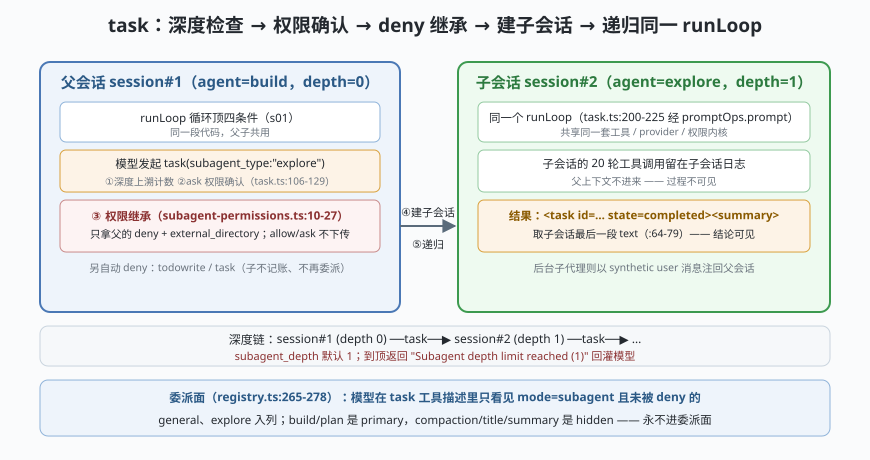

# s06: 子代理 —— task 就是同进程递归调自己的 runLoop

[s05_model_shape](../s05_model_shape/) → **s06** → [s07_plugin_hooks](../s07_plugin_hooks/) → ...

> OpenCode 的招牌设计：**子代理不是另一种引擎，而是同一个 `runLoop` 的递归调用**。`task` 工具建一个带 `parentID` 的子会话，然后通过 `ctx.extra.promptOps.prompt(...)` 回到 `session/prompt.ts` 的主循环（上游 `tool/task.ts:200-225`）——子代理与父代理共享同一套工具、provider、权限内核。权限继承规则精确到冷酷：**只继承父会话的 deny 规则 + external_directory 规则，父的 allow 一律不下传**（`agent/subagent-permissions.ts:10-27`）。
>
> **Harness 层**：子代理 —— 委派、深度限制、权限收敛、结果回注。

---

## 问题

1. **委派会不会放大权限？** 父代理千辛万苦把权限收得很紧，子代理一句话就把宽权限要回来了——委派就成了提权通道。
2. **子代理自己再委派怎么办？** explore 里再开 explore 再开 explore……不设界就是递归爆炸。
3. **子会话的过程要不要让父会话看见？** 中间 20 轮工具调用全灌回父上下文，窗口立刻爆掉。
4. **模型怎么知道能委派给谁？** 内建 7 个 agent（build/plan/general/explore/compaction/title/summary）里只有 `mode:"subagent"` 的能被委派。

---

## 解决方案



| 机制 | mini 实现 | 真实实现（packages/opencode/src/） |
|------|-----------|-----------------------------------|
| **递归同一 runLoop** | `runLoop(childSession)` 复用父循环同一段代码 | `tool/task.ts` :200-225（`ctx.extra.promptOps.prompt(...)` → `runLoop`） |
| **深度限制** | 沿 `parentID` 链上溯计数，`>= subagent_depth` 报错 | 同上 ：106-128（默认 1，schema 在 `packages/core/src/v1/config/config.ts:84`） |
| **权限只继承 deny** | `deriveChildRuleset()`：父 deny + external_directory，其余按子自己 | `agent/subagent-permissions.ts:10-27`（`deriveSubagentSessionPermission`）；额外 deny `todowrite`/`task`（task.ts :143-155 一带） |
| **过程不可见、结论可见** | 只把子会话最后一段 text 包进 `<task>` 标签回注 | 同上 ：64-79（`renderOutput`：`<task id=… state=…><summary>…`）；后台子代理完成后以 synthetic user 消息注回 |
| **委派面动态列出** | task 描述只列"可见且未被 deny"的 subagent | `tool/registry.ts` :265-278（按权限过滤后拼进工具描述） |

---

## 工作原理

`code.mjs` 四个场景：

**场景 1（递归委派）**：父 runLoop 第 2 步模型发起 `task(subagent_type:"explore")` → 权限确认 → 建子会话（打印 `parentID`）→ **同一个 `runLoop` 函数**跑子会话 2 步 → 子会话结论被 `<task id=… state=completed><summary>…` 包裹，作为工具结果回到父会话。对比 deepseek 课程 s07：dsh 的子代理可以是别家引擎（提供方 seam），OpenCode 的 task 是**同进程递归**——两种架构取向。

**场景 2（权限收敛）**：父会话带着四条规则（bash allow、`git push *` deny、`webfetch` ask、external_directory）→ 子会话的规则集只有：父的 deny + external_directory + 自动的 `todowrite`/`task` deny。现场验证：父能 `bash *`，子问 `bash git push` → **deny 依旧生效**；父的 allow 与 ask **都没有跟过来**。

**场景 3（深度限制，失败路径）**：`subagent_depth=1` 时，子会话再发起 `task` → 沿 parentID 上溯已到深度 1 → `Subagent depth limit reached (1)`，工具返回错误文本回灌模型。

**场景 4（委派面）**：内建 7 个 agent 按 `mode` 过滤——模型在 task 工具描述里只看到 `general`/`explore`；`build`/`plan` 是 primary、`compaction`/`title`/`summary` 是 hidden（内部使用）。

**跑一跑**（零依赖，离线）：

```bash
node code.mjs
```

---

## 对照真实源码

| mini 实现 | 真实代码位置 | 学习点 |
|-----------|-------------|--------|
| `runLoop` 递归 | `packages/opencode/src/tool/task.ts` :200-225（经 `promptOps.prompt` 进 `session/prompt.ts` 的 runLoop） | 子代理与父代理共用一套循环/工具/provider，没有第二引擎 |
| 深度上溯 | 同上 ：106-128（`while (current.parentID)` 沿链计数） | 防的是子代理互相委派成环 |
| `deriveChildRuleset()` | `packages/opencode/src/agent/subagent-permissions.ts:10-27`（逐行可读的 27 行文件） | 只继承 `action === "deny"` 与 `external_directory`；allow 不下传 = 委派不放大权限 |
| `todowrite`/`task` 自动 deny | `packages/opencode/src/tool/task.ts` :139-155 一带 | 子代理默认不再记账、不再委派（除非它自己的 ruleset 显式允许） |
| `renderOutput()` | 同上 ：64-79 | `<task>` 包裹 + 取子会话最后一段 text；过程留在子会话日志里 |
| 内建 agent 表 | `packages/opencode/src/agent/agent.ts` :140-265（build/plan：primary；general/explore：subagent；compaction/title/summary：primary+hidden） | 压缩/标题/摘要 agent 也走同一套定义，只是 hidden |

> 行号以当前检出为准，上游会漂移。后台子代理（`OPENCODE_EXPERIMENTAL_BACKGROUND_SUBAGENTS`）走 `BackgroundJob`，完成后把结果作为 **synthetic user 消息**注回父会话且提示语禁止轮询（task.ts :227-254）——前台/后台是同一委派的两种结算方式。

---

## 自测

1. 如果权限继承改成"父的 allow 也下传"，构造一个具体事故：父会话哪条 allow 会在子会话里变成危险能力？
2. 深度限制为什么用"沿 parentID 链上溯计数"而不是全局计数器？两种方案在"两个并行的子代理各自委派"时行为有什么差别？
3. 子会话的完整过程都留在子会话日志里——结合 s02 的投影机制，说明"审计一次委派"该怎么做？

下一课 [s07_plugin_hooks](../s07_plugin_hooks/)：21 个钩子位如何贴着推理链路排列。
