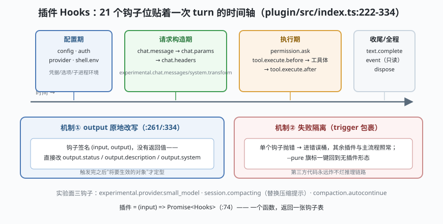

# s07: 插件钩子 —— 21 个 Hooks 贴着推理链路排列

[s06_subagent](../s06_subagent/) → **s07** → [s08_prompt_family](../s08_prompt_family/) → ...

> OpenCode 的招牌设计：**插件面贴到推理链路本身**。`packages/plugin/src/index.ts:222-334` 的 `Hooks` 接口列出 **21 个钩子位**——从 `config`、`chat.params`（改 temperature）、`tool.execute.before/after`，一路贴到 `experimental.chat.system.transform`（整体替换系统提示词）和 `experimental.session.compacting`（替换压缩提示）。插件就是一个函数：`(input) => Promise<Hooks>`（:74）。
>
> **Harness 层**：插件钩子 —— 时序、可变输出（output 参数）、失败隔离。

---

## 问题

1. **钩子挂在哪里？** 挂错了位置（比如挂在日志层）就只能"看见"不能"改变"；OpenCode 的钩子多数能通过 **output 参数原地改写**即将发出的请求。
2. **多个插件都改同一个东西，听谁的？** 两个插件都往 `chat.headers` 加头、都改工具描述——顺序与覆盖规则必须确定。
3. **插件抛异常怎么办？** 一个第三方插件的 bug 不能炸掉整轮推理。
4. **怎么让插件"只看不改"？** 审计类插件需要只读事件流。

---

## 解决方案



| 机制 | mini 实现 | 真实实现（packages/opencode/src/） |
|------|-----------|-----------------------------------|
| **钩子时序** | 一次 turn 按 `config → chat.message → chat.params → chat.headers → tool.execute.before → 工具体 → tool.execute.after → text.complete` 顺序触发 | `session/tools.ts` :123/:138（`tool.execute.before/after` 触发点）；`session/prompt.ts`（chat.* 系列在请求构造期触发） |
| **output 原地改写** | 钩子签名 `(input, output)`——直接改 output 的字段 | `plugin/src/index.ts:222-334`（如 `permission.ask?: (input, output: { status: "ask"|"deny"|"allow" }) => Promise<void>`，:261） |
| **失败隔离** | 钩子抛错被捕获，工具照常有结果（错误文本回灌） | `session/tools.ts` 的 Plugin.trigger 包裹；`--pure` 旗标整体禁用外部插件（`index.ts:62-65`） |
| **事件流只读面** | `event` 钩子只收不回 | 同上 `event` 钩子（:226 附近）——审计插件用它 |

---

## 工作原理

`code.mjs` 四个场景：

**场景 1（钩子时序）**：一次完整的 turn，打印每个钩子触发点的顺序——注意 `chat.params`/`chat.headers` 发生在**请求发出前**（可改参数），`tool.execute.before/after` 包住**工具体**，`text.complete` 收尾。这就是"21 个钩子位"的空间分布。

**场景 2（output 原地改写）**：两个插件——A 通过 `tool.definition` 把 `read` 工具的描述改成"先看目录再读文件"；B 通过 `experimental.chat.system.transform` 把系统提示词整体替换成自己的版本。打印改写前后，看清 **output 参数是引用传递**：钩子不返回值，改的是"将要生效的对象"。

**场景 3（permission.ask 钩子 + 失败隔离）**：插件 C 把 `deploy` 的审批直接改成 `deny`（连弹窗都不出）——工具被拦、错误文本回灌模型；然后演示插件 D 的 `tool.execute.after` 抛异常——被 `trigger()` 捕获打印 `[hook-error]`，**其余插件与主流程照常**。

**场景 4（清单）**：把 21 个钩子按"配置期 / 请求构造期 / 执行期 / 实验面"分组打印——这张表就是扩展面的索引页。

**跑一跑**（零依赖，离线）：

```bash
node code.mjs
```

---

## 对照真实源码

| mini 实现 | 真实代码位置 | 学习点 |
|-----------|-------------|--------|
| `trigger(hook, input, output)` | `packages/opencode/src/session/tools.ts` :123/:138（before/after 触发点）、plugin 包 `Plugin.trigger` | 钩子在 Effect 管线里被逐个 await，顺序 = 插件加载顺序 |
| `Hooks` 全清单 | `packages/plugin/src/index.ts` :222-334 | 21 个钩子位；`Plugin = (input) => Promise<Hooks>`（:74） |
| output 引用改写 | 同上 :261（`permission.ask` 的 output.status）、:334（`tool.definition` 的 output.description） | 钩子无返回值，改的是 output——请求/描述在触发后才定型 |
| 系统提示词替换 | 同上 `experimental.chat.system.transform`（`session/system.ts` 拼装时调用） | 插件可以整体接管系统提示词——比"加一段"更激进 |
| 失败隔离与 --pure | `plugin/loader.ts`、`packages/opencode/src/index.ts` :62-65 | 第三方插件 bug 不炸主流程；`--pure` 一键回到无插件形态 |
| V2 钩子面 | `packages/plugin/src/v2/{effect,promise}/` | V2 把钩子面按 Effect/Promise 双风格重排，语义不变 |

> 行号以当前检出为准，上游会漂移。`auth`/`provider`/`shell.env` 三个钩子位属"环境期"：凭据注入、provider 选项改写、子进程环境变量——它们影响的是请求之外的世界。

---

## 自测

1. `tool.execute.before` 与 `permission.ask` 都能拦工具——两者职责差在哪？如果一个钩子想"改参数后再执行"，该挂哪个？
2. output 参数原地改写 vs 返回新对象——前者对多个插件的叠加顺序有什么影响？谁先加载谁吃亏还是占便宜？
3. `experimental.session.compacting` 能整体替换压缩提示——结合 s02 的收件箱与投影，说明"插件改压缩"为什么不会破坏"日志只增不减"。

下一课 [s08_prompt_family](../s08_prompt_family/)：系统提示词的完整拼装线——家族模板只是第一段。
