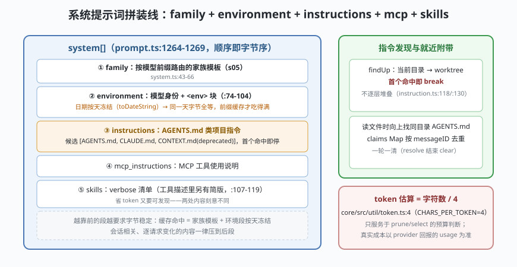

# s08: 提示词拼装线 —— 家族模板只是第一段

[s07_plugin_hooks](../s07_plugin_hooks/) → **s08** → [s09_http_boundary](../s09_http_boundary/) → ...

> s05 看了"按模型选家族"，本课看**完整拼装线**：`session/prompt.ts:1264-1269` 的拼装顺序是 `environment + instructions + mcp_instructions + skills`——家族模板（`session/system.ts` 的 `system()`）之后，环境段、项目指令、MCP 说明、技能清单依次入列。项目指令的发现规则很克制：**首个命中即 break，不逐层堆叠**（`session/instruction.ts`），另有"读文件时就近附带"机制——同一轮里按 messageID 去重。
>
> **Harness 层**：提示词组装 —— 拼装顺序、指令发现、就近附带、去重。

---

## 问题

1. **系统提示词里有几段？** 模型身份、环境信息、项目规则、MCP 工具说明、技能清单——顺序错了，前缀缓存（cache）命中率就会崩。
2. **项目规则从哪读？** `AGENTS.md` / `CLAUDE.md` / `CONTEXT.md` 候选一堆、目录可能嵌套十层——是把每层的都堆进上下文吗？
3. **模型读到 `src/db/pool.ts`，该不该带上 `src/db/AGENTS.md`？** 不带，模型不知道这个目录的规矩；带了，怎么避免同一轮里重复附带八次？
4. **`skills` 清单放哪？** 全文太贵，不列模型又不知道有技能可用。

---

## 解决方案



| 机制 | mini 实现 | 真实实现（packages/opencode/src/） |
|------|-----------|-----------------------------------|
| **四段拼装** | `assemble()` 按序拼接四段并统计 token | `session/prompt.ts` :1264-1269（environment + instructions + mcp_instructions + skills） |
| **环境段** | 模型身份 + `<env>` 块（cwd/worktree/git/平台/日期） | `session/system.ts` :74-104；日期刻意用 `toDateString()`（粒度=天）保前缀缓存 |
| **指令发现** | 向上 findUp，候选 `[AGENTS.md, CLAUDE.md, CONTEXT.md]`，**首个命中即停** | `session/instruction.ts` :76-82（全局含 `~/.claude/CLAUDE.md` 兼容；:80-82 项目候选，CONTEXT.md 标注 deprecated） |
| **就近附带 + 去重** | 读文件时向上找同名目录的 AGENTS.md；`claims` Map 按 messageID 去重 | 同上 `resolve()`（:179-221；key 是 **assistant messageID**，一轮结束 `instruction.clear(messageID)`） |
| **skills 双版本** | 系统提示里 verbose、工具描述里简版 | `session/system.ts` :107-119（注释解释：省 token 又要可发现） |

---

## 工作原理

`code.mjs` 四个场景：

**场景 1（拼装线）**：为一个 `claude-*` 模型拼完整系统提示词，打印四段的顺序与 token 估算（用 s02 介绍过的 `字符/4` 估算式）——**family → environment → instructions → mcp → skills**，任何逐请求变化的字节都被刻意压到后段（日期按天冻结），前缀缓存才吃得满。

**场景 2（首个命中即停）**：文件树 `repo/{AGENTS.md, src/{AGENTS.md, db/pool.ts}}`——从 `pool.ts` 向上走，命中 `src/AGENTS.md` 就停，仓库根的**不堆叠**。对照错误做法（全部堆叠）打印浪费的 token——这是 mini 演示的一条"想当然"失败路径。

**场景 3（就近附带 + claims 去重）**：同一轮里模型连读 `src/db/pool.ts`、`src/db/index.ts`、`src/api/server.ts`——前两次命中同一个 `src/db/AGENTS.md`（第二次被 claims 去重），第三次命中 `src/api/AGENTS.md`。**换一条新消息（新 messageID）后**，同目录允许重新附带——"很久之前读过的文件"语境已经变了。

**场景 4（空指令兜底）**：没有 AGENTS.md、没有 MCP、没有技能——系统提示词只剩 family + environment，照样能跑（边界路径）。

**跑一跑**（零依赖，离线）：

```bash
node code.mjs
```

---

## 对照真实源码

| mini 实现 | 真实代码位置 | 学习点 |
|-----------|-------------|--------|
| `assemble()` | `packages/opencode/src/session/prompt.ts` :1264-1269（+ :1271 json_schema 模式追加结构化输出提示） | 拼装顺序写死在 runLoop 附近，不是配置 |
| `environment()` | `packages/opencode/src/session/system.ts` :74-104（模型身份、`<env>`、`<available_references>`） | 日期按天冻结 = 前缀缓存的字节级纪律 |
| `findProjectInstruction()` | `packages/opencode/src/session/instruction.ts` :76-82（候选）、:118/:130（首个命中即 break） | 不堆叠：语义归属清晰，token 可控 |
| `resolve()` + claims | 同上 ：179-221（:89 注释解释为什么 key 是 messageID 而非 sessionID） | 一轮多次读同目录只附带一次；每轮结束显式 clear 防 Map 无界增长 |
| `config.instructions[]` | 同上 ：135-150、:158-167（glob（通配模式）/ `~/` / http(s) URL，远程并发 4） | 远程指令也进同一条拼装线 |
| skills 双版本 | `session/system.ts` :107-119 | 系统提示 verbose + 工具描述简版，两处清单内容不同 |

> 行号以当前检出为准，上游会漂移。指令面**没有独立 "rules" 概念**——最接近的组合是 instructions（本课）+ permission（s04）+ `config/managed.ts`。

---

## 自测

1. 如果把 skills 清单从"verbose 进系统提示、简版进工具描述"改成两边都 verbose，每轮多花多少？改成两边都简版，丢掉的是什么能力？
2. claims 的 key 为什么是 **assistant messageID** 而不是 sessionID？如果用 sessionID，"第 10 轮再读 src/db/ 下的文件"会发生什么？
3. 场景 2 的"首个命中即停"与"逐层堆叠"各自对应什么产品取向？找出一个"堆叠派"的好处，再说明 OpenCode 为什么仍然选择前者。

下一课 [s09_http_boundary](../s09_http_boundary/)：把整套内核装进 HTTP——同一份 app，网络传输与进程内直调互换。
