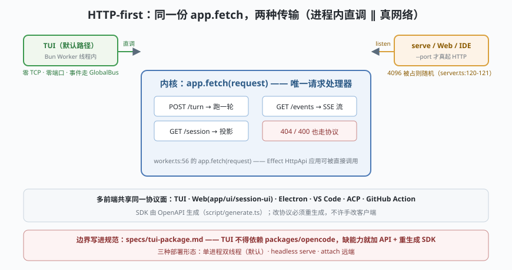

# s09: HTTP-first 边界 —— 同一份 app.fetch，两种传输

[s08_prompt_family](../s08_prompt_family/) → **s09** → [s10_finale](../s10_finale/) → ...

> OpenCode 最容易被误解、也最有辨识度的设计：**HTTP-first 不等于默认有网络**。默认命令下，整个服务端跑在 Bun Worker 线程里（`cli/cmd/tui.ts:210` `new Worker()`），TUI 的 `fetch` 被桥成 `await Server.Default().app.fetch(request)` 的**进程内直调**（`cli/tui/worker.ts:56`，上游 ：42）——一次 TCP 都没有；只有传 `--port/--hostname/--mdns` 才真开监听（worker.ts 的 `rpc.server` 分支）。而边界被写成规范：`specs/tui-package.md` 明文规定 TUI **不得**依赖 `packages/opencode`，只能经 SDK 走协议。
>
> **Harness 层**：服务化边界 —— 协议契约、传输可换、SSE（Server-Sent Events，服务器单向推送事件）事件流。

---

## 问题

1. **一套内核要喂多少前端？** TUI、Web、Electron、VS Code、ACP、GitHub Action——每个都 fork 一份内核逻辑，改一处要改六处。
2. **协议边界会不会拖慢单机场景？** 真走 localhost TCP，序列化 + 端口管理全是开销，还可能端口冲突。
3. **事件怎么推？** 工具执行、流式输出都是"服务端发生、客户端要看见"的事——轮询不可接受。
4. **"只认协议"如何强制执行？** 靠自觉的边界半年就破。

---

## 解决方案



| 机制 | mini 实现 | 真实实现（packages/opencode/src/） |
|------|-----------|-----------------------------------|
| **同一 app 两种传输** | `kernel.app.fetch(Request)` 直调 ∥ `http.createServer` 包同一函数 | `cli/tui/worker.ts:56`（进程内直调）∥ `rpc.server` 分支真 `Server.listen`（:54 附近）；`server/server.ts:120-121` 端口先试 4096 被占则随机 |
| **/turn 端点** | `POST /turn`：进 mock runLoop，同步返回事件列表 | HttpApi 24 个 group（`server/routes/instance/httpapi/api.ts`），`session.prompt` 端点 |
| **SSE 事件流** | `GET /events`：text/event-stream，带心跳语义 | `handlers/event.ts:70-84`（10s heartbeat）、:33-38（按 directory 过滤）；`middleware/compression.ts:11` 对事件端点禁压缩 |
| **契约强制** | 两个客户端（CLI 打印器 / SSE 监听器）都只走 HTTP 语义 | `specs/tui-package.md`（"must not depend on packages/opencode…"）+ SDK 从 OpenAPI 生成（`script/generate.ts`） |

---

## 工作原理

`code.mjs` 用 Node 内置 `http` + 全局 `fetch`/`Request`（零依赖）把同一份 mini 内核跑两种模式：

**场景 1（进程内直调）**：`kernel.app.fetch(new Request(...))`——没有 `listen`、没有端口，请求直接进处理器。对应真实代码"Worker 线程 + in-process fetch"的默认路径：**协议是契约，不是网络**。

**场景 2（真 HTTP）**：`http.createServer` 包**同一个** `kernel.app.fetch`，绑定端口 0（OS 随机分配——真实代码是"先试 4096 被占则随机"，:120-121）→ 客户端用全局 `fetch` 打 `POST /turn`，得到与场景 1 **事件序列等价**的响应。

**场景 3（SSE 事件流）**：`GET /events` 返回 `text/event-stream`，服务端把 mock turn 的三个事件（tool-call / tool-result / step-finish）按 SSE 帧推出后收流；第二个客户端（"审计器"）同时收同一股事件——**多前端共享同一条事件流**。

**场景 4（失败路径）**：未知路由 404、非法 JSON 400——错误也走协议，客户端拿到的永远是结构化响应而不是挂死。

**跑一跑**（零依赖；会临时绑定本机随机端口，演示完即关）：

```bash
node code.mjs
```

---

## 对照真实源码

| mini 实现 | 真实代码位置 | 学习点 |
|-----------|-------------|--------|
| `kernel.app.fetch()` | `packages/opencode/src/cli/tui/worker.ts:56`（本检出；上游 ：42，注释"那行是真正的进程内直调"） | Effect HttpApi 应用本身可被直接调用——传输与协议解耦 |
| `rpc.server` 分支 | 同上 ：54 附近（唯一 `Server.listen` 分支） | `--port/--hostname/--mdns` 才真起网络；事件经 `GlobalBus → Rpc.emit("global.event")` 回传（:37-39） |
| 端口回退 | `packages/opencode/src/server/server.ts:120-121` | `startListener(4096).catch(() => startListener(0))`——先按惯例再让 OS 挑 |
| 24 个 group | `packages/opencode/src/server/routes/instance/httpapi/api.ts:47-84` | config/control/event/file/… 全走同一 OpenAPI，SDK 由此生成 |
| SSE 端点 | `packages/opencode/src/server/routes/instance/httpapi/handlers/event.ts:24-92` | 10s heartbeat + 目录过滤；事件端点禁用压缩 |
| 边界规范 | `specs/tui-package.md`（"must not depend on packages/opencode"） | 边界用规范 + SDK 生成强制，不靠自觉 |

> 行号以当前检出为准，上游会漂移。默认部署是**单进程双线程**（主线程 TUI + Worker 线程 server）；`opencode serve` 才是真正的 headless 网络服务，`opencode attach <url>` 让本地 TUI 连远端 server——同一套协议的三种部署形态。

---

## 自测

1. 场景 1 与场景 2 的响应逐字节相同——这说明"协议"的定义落在哪一层？如果 mini 内核直接暴露 JS 函数而不是 `app.fetch(Request)`，会丢掉哪种客户端？
2. 为什么事件端点要**禁用压缩**且带 10s 心跳？（提示：SSE 的代理/缓冲行为。）
3. `specs/tui-package.md` 禁止 TUI 依赖内核包——对照 s03 的"模型可见工具集"，说说协议边界与权限边界分别在约束谁？

收官课 [s10_finale](../s10_finale/)：独立 git-dir 的 undo 与多前端装配对照。
