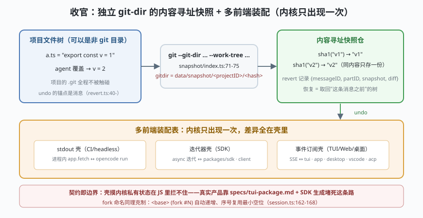

# s10: 收官 —— 独立 git-dir 的 undo，与多前端装配对照

[s09_http_boundary](../s09_http_boundary/) → **s10（收官）**

> 学完 s01–s09，手上有了一台完整的 harness：主循环、存储、工具、权限、模型特化、子代理、钩子、提示词、HTTP 边界。收官课回答两个最有辨识度的问题：**非 git 目录凭什么也能 undo？**（`snapshot/index.ts:71-75`：把 git 当纯内容寻址存储用——独立 `--git-dir` + `--work-tree`，与项目自身的 git 仓库完全解耦）；以及**多前端怎么装配**（TUI/Web/Electron/VS Code/ACP/GitHub Action 都只是同一协议面的客户端）。
>
> **Harness 层**：快照与恢复、会话分叉、产品矩阵装配。

---

## 问题

1. **agent 要改文件，改坏了怎么办？** 没有 git 的目录（或用户不希望 agent 动自己的 git 历史）如何提供 undo？
2. **undo 的"点"挂在哪？** 挂在时间上没用——用户要的是"回到第 N 条消息之前的样子"。
3. **fork 出来的会话叫什么？** 复制会话后标题混乱是产品细节，也是数据模型细节。
4. **六种前端，内核要不要知道它们存在？**

---

## 解决方案



| 机制 | mini 实现 | 真实实现（packages/opencode/src/） |
|------|-----------|-----------------------------------|
| **内容寻址快照** | `snapshot()` 以内容 hash 为键存文件树；同内容同 hash | `snapshot/index.ts` :71（`gitdir = data/snapshot/<projectID>/<hash(worktree)>`）、:75（`["--git-dir", …, "--work-tree", …]` 前缀一切 git 命令） |
| **revert 元数据** | 记 `{messageID, snapshot, diff}`，恢复 = 取回快照 | `session/revert.ts:40-`（`revert{messageID,partID,snapshot,diff}`；每次新 prompt 先 `revert.cleanup`，`prompt.ts:1056`）；`config.snapshot:false` 可整体关闭（index.ts:169 一带） |
| **fork 命名** | `(fork #N)` 自动递增复用 | `session/session.ts` :162-168（正则 `/^(.+) \(fork #(\d+)\)$/`）、:691（`fork`） |
| **多前端装配** | 装配表：前端 = 内核 + 传输 + UI 壳；内核零感知 | 真实包矩阵：`packages/tui`（SolidJS + @opentui/core）· `packages/app`+`ui/session-ui`（Web）· `packages/desktop`（Electron）· `sdks/vscode` · ACP（`cli/cmd/acp.ts`）· `github/`（Action） |

---

## 工作原理

`code.mjs` 四个场景：

**场景 1（非 git 目录的 undo）**：内存文件树上——写 `a.ts` v1 → 快照（打印内容 hash）→ "agent"覆盖成 v2 → 用户说 undo → 按 revert 元数据取回 v1。**全程没有碰项目自己的 .git**：hash 相同的内容只存一份，这就是"把 git 当内容寻址存储用"的含义。

**场景 2（revert 元数据与 diff）**：undo 记录挂在**消息**上（`{messageID, snapshot, diff}`）而非时间点——打印一条 revert 记录的形状，说明"回到第 N 条消息之前"为什么是唯一正确的锚点。

**场景 3（fork 命名，边界路径）**：对 "demo" 会话连续 fork 三次——`(fork #1)`、`(fork #2)`、`(fork #3)` 自动递增；再 fork 一个 `(fork #1)`——序号**复用最小空位**而不是一直累加（:162-168 的正则行为）。

**场景 4（多前端装配对照）**：同一份 mini 内核装三个壳——stdout 壳（CI/headless 形态）、async 迭代器壳（SDK 形态）、事件订阅壳（TUI/Web 形态的事件面）。装配表打印对照真实包矩阵；演示一个"壳试图绕过协议直接摸内核私有状态"的越界动作被拒绝——契约即边界（s09 的规范在代码里的影子）。

**跑一跑**（零依赖，离线）：

```bash
node code.mjs
```

---

## 对照真实源码

| mini 实现 | 真实代码位置 | 学习点 |
|-----------|-------------|--------|
| `snapshot()` | `packages/opencode/src/snapshot/index.ts` :71-75（gitdir 路径 + 双旗标命令前缀） | 独立 `--git-dir` = 与项目 git 完全解耦的内容寻址存储 |
| revert 记录 | `packages/opencode/src/session/revert.ts:40-`（`revert{messageID,partID,snapshot,diff}`） | undo 的锚点是消息，不是时间；`snap.restore` + `snap.revert(patches)` 回滚磁盘 |
| `forkTitle()` | `packages/opencode/src/session/session.ts` :162-168、:691 | fork 复用前缀 + 最小空位序号；HTTP 端点 `groups/session.ts:248` |
| 装配表 | `packages/tui`（SolidJS + @opentui/core，31.9k 行）· `packages/app`/`ui`/`session-ui` · `packages/desktop`（Electron）· `sdks/vscode` · `src/acp/` · `github/` | 前端差异全部住在壳里；内核包不知道任何前端存在 |
| 成本结算 | `packages/opencode/src/session/session.ts:338-410`（`getUsage`：cache 语义归一、`Decimal` 精算、context tier 定价） | token 估算粗（字符/4），成本结算反而极精细——两套口径各司其职 |

> 行号以当前检出为准，上游会漂移。

---

## 自测

1. 快照用内容寻址（hash）而不用时间戳——两个 agent 先后写了**相同内容**，存储里是几份？"回滚到 v1"与"回滚到 v2 再回 v1"在存储上有什么差别？
2. revert 记录里为什么要存 `diff` 而不只是快照指针？（提示：unrevert 与"看见 agent 改了什么"的 UI 需求。）
3. 六种前端的装配表里，哪一格（传输/UI/会话）是**不能**共享的？哪一格是**必须**共享的？

---

## 学完之后去哪

1. **真源码重走一遍**：按 [架构拆解](../../架构拆解.md) 第 14 节的 31 条精读索引，把每课的 mini 实现换成真包——★ 标记的 7 条（`runLoop`、`processor`、`registry`、`permission`、`task`、`compaction`、`sql.ts`）优先。本仓检出在 `study-cn-comments` 分支，核心文件头部有中文导读块。
2. **权威口径补完**：读根目录 `CONTEXT.md`（V2 术语表）与 `specs/v2/session.md`、`specs/v2/tools.md`——读完回 V1 主路径核对哪些已实跑（见 [阅读指南](../../阅读指南.md) 第 2 节的权威度排序）。
3. **横向对照**：同一张图比较三家——[Claude Code（01 号仓教材）](../../../01-claude-code/架构拆解.md) 的单体内核、[dsh 的教材](../../../03-deepseek-harness/analysis_deepseek_harness/README.md) 的插件树、OpenCode 的 HTTP-first 双内核。压缩/记忆的通用方法论见 [context-handbook](../../../context-handbook/Context与记忆系统手册.md)。
4. **跑真的 OpenCode**：`bun install && bun dev`（Bun 1.3+）；记住三个坑——测试不能从仓库根跑、断点要用 `bun dev spawn`、改协议要 `bun run generate`（[阅读指南](../../阅读指南.md) 第 6 节）。
