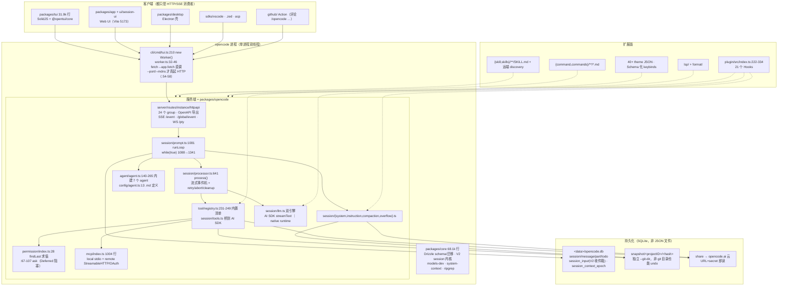

# OpenCode 架构拆解

> 生成日期：2026-09-22 ｜ 仓库 `opencode/` @ `fe3f3a4`（v1.18.32，MIT，纯 TypeScript，bun workspace）
>
> 证据口径：以**实际源码**为主（每条结论带 `路径:行号`），`CONTEXT.md` / `specs/` 作为 V2 语义的官方口径补充。凡"文档声称但未在 V1 主路径验证"的地方都单独标注。
>
> **路径缩写**：行文中的短写（如 `session/prompt.ts:1081`、`tool/registry.ts`、`permission/index.ts`）默认相对 `packages/opencode/src/`；`core/src/…` 相对 `packages/core/`；`schema/src/…` 相对 `packages/schema/`。第 14 节的索引表一律用完整路径。
>
> ⚠️ **行号坐标约定**：本文行号指**上游 `dev` 分支的原始树**（`git show dev:<路径>` 可核对，例如 `runLoop` 确在 `session/prompt.ts:1081`）。本地学习注释分支 `study-cn-comments` 在 17 个文件顶部各插了约 14 行文件头块，**这些文件内的行号在该分支上会整体下移**；跳转请认符号名（`runLoop`、`process`、`evaluate`、`usable`、`isOverflow`）。

## 1. 一句话总览

OpenCode 是一个**Effect 写成的 HTTP-first agent server**：会话/工具/权限/provider 全在服务端进程内（默认跑在 Bun Worker 线程，`fetch` 被桥成进程内直调，不占端口），TUI、Web、Electron、VS Code、ACP、GitHub Action 都只是同一套 HttpApi 的客户端；主循环是 `session/prompt.ts` 里一个 260 行的 `while(true)`，靠"上一条 assistant 的 finish 原因 + 是否还有本地未结算 tool call"决定继续还是退出。

## 2. 总体架构图



## 3. 进程模型与 API 面：为什么"默认没有网络"

这是读 OpenCode 最容易误解的一层。

- **CLI 入口链**：`bin/opencode`（Node CJS 启动器，按 `opencode-<platform>-<arch>` 找原生二进制，含 **AVX2 运行时探测** `bin/opencode:72-125`，`OPENCODE_BIN_PATH` 可覆盖）→ 真实 TS 入口 `packages/opencode/src/index.ts:45`（yargs，`:81-103` 注册 **23 个子命令**）。
- **默认命令是 `TuiThreadCommand`**（`cli/cmd/tui.ts:186`）：主线程渲染 TUI，`:210` `new Worker(file, {env})` 把**整个服务端**跑在 Bun Worker 线程。
- **同进程内 RPC 桥**：TUI 侧的 `fetch` 被替换成 `Rpc` 调用，Worker 里执行 `await Server.Default().app.fetch(request)`（`cli/tui/worker.ts:32-46`）——**Effect HttpApi 对象被直接调用，一次 TCP 都没有**；反向事件用 `GlobalBus` → `Rpc.emit("global.event")` 推回主线程（`worker.ts:18-20`）。
- **真起 HTTP 的条件**：只有传 `--port` / `--hostname` / `--mdns` 时才 `Server.listen` 并改用网络传输（`tui.ts:236-246`、`worker.ts:54-58`）。
- **headless 模式**：`opencode serve`（`cli/cmd/serve.ts:8-22`）默认端口 4096；端口填 0 时"先试 4096，被占则随机"（`server/server.ts:122-126`）；`--mdns` 开局域网发现（`server/mdns.ts`）。
- **事件流**：SSE `GET /event`（`groups/event.ts:8,16`；`handlers/event.ts:70-84` 带 10s heartbeat，`:33-38` 按 instance directory/workspace 过滤）+ `/global/event`（跨目录）；PTY 走 **WebSocket**（`groups/pty.ts:153`）；`middleware/compression.ts:11` 显式对两个事件端点禁用压缩。
- **鉴权**：`OPENCODE_SERVER_PASSWORD` → basic auth（`serve.ts:14-16` 未设置时直接警告 unsecured）。`opencode attach <url>`（`cli/cmd/attach.ts:8`）让本地 TUI 连远端 server。

> 一句话：**"客户端/服务端分离"是契约层面的（`specs/tui-package.md:22-30` 禁止 TUI 依赖内核包），而不是部署层面的**。这是它与 Codex（app-server 真守护进程）最实在的差别。

## 4. 主循环：`runLoop` + `process()` 两级

### 4.1 循环骨架（`session/prompt.ts:1081-1341`）

```text
runLoop(sessionID)                                  :1081  Effect.fn("SessionPrompt.run")
  while (true)                                      :1088
    status.set(busy)
    msgs = MessageV2.filterCompactedEffect(sessionID) :1092  ← 已压缩的历史不再回放原文
    {lastUser, lastAssistant, lastFinished, tasks} = MessageV2.latest(msgs)  :1096
    ── 退出判定 ──                                   :1106-1130
        lastAssistant.finish 存在
        且 finish ∉ ["tool-calls","unknown"]
        且 本地没有未结算 tool call（hasToolCalls 兜底）
        且 lastAssistant.parentID === lastUser.id
        → break
    step == 1 → fork 会话标题                        :1133-1139
    分派 task 队列：subtask → handleSubtask          :1142-1159
                    compaction → compaction.process（返回 "stop" 即 break）
    上一轮 isOverflow → compaction.create({auto:true}) 后 continue  :1161-1168  ← 下一轮才真压缩
    解析 agent；maxSteps = agent.steps ?? Infinity   :1170-1179
    末轮在消息尾部追加 MAX_STEPS_PROMPT               :1281
    SessionReminders.apply（plan 模式等注入）          :1180
    创建 processor                                   :1213-1219
    SessionTools.resolve（工具集 → AI SDK tools）      :1226-1241
    json_schema 模式注入 StructuredOutput 工具         :1243-1250
    拼 system：environment+instructions+mcp+skills    :1257-1271
    handle.process(...)                               :1272-1286
    result=="stop" → break；"compact" → create；否则 continue  :1319-1329
  fork compaction.prune（循环结束后）                 :1338
```

要点：

1. **"是否继续"分散在两处**：processor 只回答三态 `"compact" | "stop" | "continue"`（`processor.ts:30`、`:693-695`），真正的 break 条件在 `runLoop:1106-1130`。
2. **finish reason 不可全信**：注释 `:1103-1105` 明说有些 provider 带着 tool call 也返回 `"stop"`，所以额外用 `hasToolCalls` 把循环钉住——这是各家 agent 都会踩的坑，OpenCode 用显式兜底处理。
3. **overflow 不当场压缩**：`:1161-1168` 只是打个标记 continue，下一轮才真正走 compaction。
4. **没有"tool call 次数硬上限"**：`maxSteps` 默认 `Infinity`（`:1170-1179`），只有 agent 显式配 `steps` 才限制。这一点与 ZCode 的"长程任务优先，不用 tool call 次数做硬停止"（`apps/zcode-cli/AGENTS.md`）是同一取向，而 Claude Code/anon-kode 时代是靠递归深度自然收敛。

### 4.2 流式与工具生命周期（`session/processor.ts`）

- `:641` `process()`：`:654` `llm.stream(input)` → `:656-660` `Stream.tap(handleEvent)` + `takeUntil(() => ctx.needsCompaction)`——**一旦判定溢出立刻截断当前流**；`:662-669` `onInterrupt` 置 `aborted` 并 `halt(AbortError)`；`:674-688` `Effect.retry(SessionRetry.policy(...))` 并把"第几次重试/原因"推进 UI 状态；`:690` `ensuring(cleanup())`。
- `handleEvent`（`:278-551`）逐事件落库：reasoning/text delta 走 `session.updatePartDelta` 增量写（`:299-305`、`:517-523`）；`tool-call` 内做 **doom-loop 检测**（`:353-380`，最近 3 个 part 同工具+同参数 → `permission.ask({permission:"doom_loop"})`）；`tool-result`（`:391-412`）对 image attachment 走 `Image.normalize`，压不下去就在文本里追加 `[N images omitted]`；`step-finish`（`:435-497`）算 usage/cost、写 `step-finish` part、生成 `patch` part、fork `summary.summarize`、并置 `needsCompaction`。
- `cleanup()`（`:553-611`）：给未 settle 的 tool call 250ms 宽限，然后统一标成 `"Tool execution aborted"` + `interrupted:true`。
- **重试策略**（`session/retry.ts`）：`:47` `delay` 优先读 `retry-after-ms` / `retry-after` / HTTP-date，否则 2s 指数退避 × jitter（无 header 时上限 30s，`:26-31`），最多 5 次；`:85-155` `retryable` 用 8 条正则识别瞬时错误；**context overflow 明确不重试**（`:87`）。
- **错误工具调用会被回灌**：`llm.ts:296-312` 的 `experimental_repairToolCall` + `tool/invalid.ts:10`，把非法调用改写成 `invalid` 工具的结果送回模型，而不是直接崩。

## 5. 工具系统

### 5.1 内置工具清单（`tool/registry.ts:231-249`，顺序即注册顺序）

| id | 文件 | 备注 |
|---|---|---|
| `invalid` | `tool/invalid.ts:10` | 承接模型幻觉/参数错误的调用 |
| `question` | `tool/question.ts:15` | 仅 `client ∈ {app, cli, desktop}` 时启用（`registry.ts:207`） |
| `bash` | `tool/shell.ts:338` + `tool/shell/id.ts:16` | **id 故意保留 "bash"** 兼容旧插件，实现支持 bash/pwsh/powershell/cmd |
| `read` | `tool/read.ts:69` | 文本 + 图片(jpeg/png/gif/webp) + PDF（`:19`、`:303-321` base64 data URL） |
| `glob` / `grep` | `tool/glob.ts:18` / `tool/grep.ts:21` | grep 走 `@opencode-ai/core/ripgrep` |
| `edit` / `write` | `tool/edit.ts:59` / `tool/write.ts:28` | gpt 系模型下会被 `apply_patch` 取代（见 5.3） |
| `task` | `tool/task.ts:81` | 子代理委派（第 8 节） |
| `webfetch` | `tool/webfetch.ts:25` | |
| `todowrite` | `tool/todo.ts:15` | |
| `websearch` | `tool/websearch.ts:100` | Exa / Parallel，走 MCP-over-HTTP（`tool/mcp-websearch.ts:4-5`），按 sessionID checksum 分流（`:30-37`） |
| `skill` | `tool/skill.ts:13` | |
| `apply_patch` | `tool/apply_patch.ts:23` | |
| `execute`（code-mode） | `tool/code-mode.ts:188` | 需 `experimentalCodeMode` flag |
| `lsp` | `tool/lsp.ts:38` | 需 `OPENCODE_EXPERIMENTAL_LSP_TOOL` |
| `plan_exit` | `tool/plan.ts:15` | 需 flag 且 `client === "cli"` |

另有 `plan_enter` 这个**权限键**（`agent.ts:127`、`run.ts:439`），但**未找到对应的 tool 文件**。每个工具有同名 `.txt`（`tool/read.txt` 等）作为模型侧描述。

### 5.2 schema 与注册来源

- schema 用 **Effect `Schema.Struct`**：`tool/tool.ts:151` `define()`、`:111` 预编译 decoder；`tool/json-schema.ts` 转 JSON Schema；`ProviderTransform.schema` 按模型改写（`session/tools.ts:96`）。
- **插件工具仍然收 Zod**，在 registry 边界转 JSON Schema（`registry.ts:130-137`）。
- 三层来源：内置 + 磁盘 `{tool,tools}/*.{js,ts}`（`:184-197`）+ 插件 `p.tool`（`:199-204`）。
- `tool.definition` hook 可改描述（`:318`）。

### 5.3 按模型动态裁剪（很有信息量的一处）

- `websearch` 仅 opencode 自家 provider 提供（`:58-65`、`:293-295`）。
- **`gpt-*`（非 oss、非 gpt-4）用 `apply_patch` 取代 `edit` + `write`**（`:297-300`）。
- 全 deny 的工具直接从**模型可见集**里删除（`permission/index.ts:204-219`）——权限规则不只是拦截，还改变模型看到的工具面。

### 5.4 输出截断与 artifact 化

`tool/truncate.ts:14-15` 默认 **2000 行 / 50 KB**；超限则把全文写到 truncation 目录、只返回预览 + 提示；`:129-133` 的提示词是："如果这个 agent 有 task 工具，交给 explore agent 处理，别自己读"——**用截断机制反向引导模型做上下文外包**。`tool/tool.ts:131-144` 自动给每个工具套上截断；`:53-66` 每小时清 7 天前的文件。MCP 的 image/resource blob 上限 10 MB 并有 mime 白名单（`session/tools.ts:29-39`、`:426-455`）。

### 5.5 MCP

`mcp/index.ts`（1004 行）：`type:"local"` 走 `StdioClientTransport`（`:342-347`），`type:"remote"` **优先 StreamableHTTP、回退 SSE**（`:271-279`），带完整 OAuth（`mcp/oauth-provider.ts`、`mcp/auth.ts`、`mcp/oauth-callback.ts`、`mcp/browser.ts`）。工具在 `session/tools.ts:390-404` 转成 AI SDK tool，**每次调用前** `ctx.ask({permission:key, patterns:["*"], always:["*"]})`；resources 额外生成 `list_mcp_resources` / `list_mcp_resource_templates` / `read_mcp_resource`（`:28-32`、`:136+`）。

## 6. 权限与沙箱：五层 ruleset，一条求值式

### 6.1 数据结构与求值

```ts
// packages/schema/src/v1/permission.ts:20-26
Rule    = { permission: string, pattern: string, action: "allow" | "deny" | "ask" }
Ruleset = Rule[]
Reply   = "once" | "always" | "reject"        // :38
```

求值只有一行语义（`packages/opencode/src/permission/index.ts:28-38`，已实测核对）：把所有 ruleset `flat()` 后 **`findLast`** 取最后一条双通配匹配（`Wildcard.match(permission) && Wildcard.match(pattern)`）的规则，无匹配则默认 `{action:"ask"}`——**后写覆盖先写**。

失败形态分三类（`packages/core/src/v1/permission.ts:7-31`）：`RejectedError`（用户拒绝）、`CorrectedError`（带用户反馈回灌模型）、`DeniedError`（把相关规则文本回灌模型）。V2 另有 `{action, resource, effect}` 形状（`packages/schema/src/permission.ts:60-66`），**尚未接管主路径**。

### 6.2 默认值与五层叠加

默认 ruleset（`agent/agent.ts:119-136`）：`"*": "allow"`、`doom_loop: "ask"`、`external_directory: {"*":"ask" + 白名单 allow}`、`question`/`plan_enter`/`plan_exit`: `"deny"`、`read: {"*":"allow", "*.env":"ask", "*.env.*":"ask", "*.env.example":"allow"}`（注释说明这是镜像 gitignore 语义）。白名单含 truncate 目录、tmp、skill 目录、reference 目录（`:108-117`）。

叠加层次：`defaults → agent 特例 → 用户 config`（`:145-152`）→ `agent.<name>.permission` merge（`:293`）→ **session 级**（由 prompt/`--tools` 参数转成 ruleset，`prompt.ts:1060-1067`）→ CLI flag `--auto` / `--yolo` / `--dangerously-skip-permissions`（`cli/cmd/tui.ts:106-120`）。

### 6.3 审批运行时

`permission/index.ts:67-107` `ask()`：逐 pattern evaluate，`deny` 立即 fail，`allow` 跳过，出现 `ask` 则发 `permission.asked` 事件并 **`Deferred.await` 阻塞**；`:109-167` `reply()`：reject 时**级联拒绝同 session 全部 pending**，always 时把 `always[]` 写进进程内 `approved` 并自动放行已满足的其他 pending。审批 UI 在 `packages/tui/src/routes/session/permission.tsx`（`PermissionStage = "permission"|"always"|"reject"` `:22`；edit 类请求内嵌 `<diff>`，按终端宽度选 split/unified `:41-44`）；HTTP 侧 `permission.respond`（`groups/session.ts:403`）。

**bash 的 pattern 是解析出来的，不是猜的**：`tool/shell.ts:283-285` 用 tree-sitter（`web-tree-sitter` + `tree-sitter-bash`/`powershell`）解析命令行，再用 `permission/arity.ts:24-161` 的 arity 字典把 `npm run dev xxx` 归一成 `npm run dev`。越界路径检查在 `tool/external-directory.ts:15-44`。

### 6.4 沙箱：**没有**

全仓未找到 landlock / seccomp / bubblewrap / 容器隔离实现。grep `sandbox` 的命中项是 git worktree 语义下的"项目副本"（`project/project.ts:90`、`:309`、`:402-438`）。`packages/codemode`（11,218 行）名字像沙箱，实为"只能调用 schema 描述过的 MCP 工具"的受限解释器。对比：Codex 有内核级 Seatbelt/Landlock/Windows 双轴，DeepSeek Harness 有 sandbox-policy + Landlock + Windows ACL，ZCode 有子进程统一执行入口承载 sandbox/审批。**OpenCode 的安全模型 = 权限规则 + 弹窗 + 提示词**，这是六家里最薄的一层。

## 7. 上下文、提示词与压缩

### 7.1 系统提示词：按模型选家族

`session/system.ts:28-51` 按 model id 前缀选模板：`muse→meta.txt`、`gpt-4/o1/o3→beast.txt`、`gpt-6→gpt-astra.txt`、`codex→codex.txt`、`gpt→gpt.txt`、`gemini-→gemini.txt`、`claude→anthropic.txt`、`trinity→trinity.txt`、`kimi→kimi.txt`，兜底 `default.txt`（共 15 个 `.txt` 在 `session/prompt/`）。最终拼装顺序在 `prompt.ts:1264-1269`：`environment + instructions + mcp_instructions + skills`；json_schema 模式再加结构化输出提示（`:1271`）。`environment` 内容见 `system.ts:74-104`（模型 ID、cwd、worktree、是否 git、平台、日期、`<available_references>`）。**skills 清单在系统提示里给 verbose 版、在工具描述里给简版**，`:115-117` 注释解释了原因（省 token 又要可发现）。

### 7.2 项目指令

`session/instruction.ts:60-68`：全局优先 `~/.config/opencode/AGENTS.md`，兼容 `~/.claude/CLAUDE.md`；项目侧候选 `["AGENTS.md","CLAUDE.md","CONTEXT.md"]`（后者代码里标注 deprecated），`findUp` 到 worktree，**首个命中即 break，不逐层堆叠**（`:122-133`）。`config.instructions[]` 支持 glob / `~/` / 绝对路径 / **http(s) URL**（`:135-150`、`:158-167`，远程并发 4）。另有"读文件时就近附带"机制：`resolve()`（`:179-221`）从被读文件向上走到 root，按 messageID 去重（`claims` Map）避免重复注入。**没有独立 "rules" 概念**（最接近的是 instructions + permission + `config/managed.ts`）。

### 7.3 compaction（`session/compaction.ts`，608 行）

三种触发：① 上一轮 `isOverflow` → 下一轮压缩（`prompt.ts:1161-1168`）；② processor 返回 `"compact"`（`:1319-1329`）；③ task 队列里的 `compaction` 任务（`:1142-1159`）。

执行方式：用内建 **`compaction` agent**（`agent.ts:219-233`，全工具 deny，提示词 `agent/prompt/compaction.txt`）对 head 发一次 summary 请求，产出一条 `summary:true` 的 assistant 消息（`compaction.ts:393-419`）。

- **tail 逐字保留**：`select()`（`:223-269`）在 `preserve_recent_tokens` 预算内倒序装填（默认 `clamp(usable×0.25, 2k, 15k)`，`:32-33`、`:115-119`），`splitTurn`（`:140-163`）**允许把一个 turn 从中间切开**，`tail_turns` 可限条数。
- **序列化格式**（`:54-85`）：被摘要的对话先转成 `[User]: … / [Assistant]: … / [Assistant reasoning]: … / [Assistant tool call]: name(args) / [Tool result]: …`，工具结果截 2000 字（`:30`）。
- **摘要续写**：已完成的旧摘要会被隐藏，其文本作为 `previousSummary` 参与本轮摘要（`:97-113`、`:364-366`）。
- **prune 是独立开关且默认关**（`:273-317`）：从后往前保护最近 40k tokens 的工具输出，更旧的打上 `time.compacted`，模型侧只见 `[Old tool result content cleared]`（`:28-31`）。
- `compaction.auto:false` 时 overflow 直接抛错给 UI（`processor.ts:621-628`）。
- overflow 场景走 replay：重放原用户消息，媒体降级成 `[Attached mime: name]`（`:340-356`、`:469-495`）。

### 7.4 token 与成本

真实用量在 `session/session.ts:338-410` `getUsage()`：归一化 AI SDK v6 的 cache 语义（`:361-364` 注释解释 inputTokens 已含 cached）、anthropic/vertex/bedrock/venice 的 cacheWrite 变体键（`:349-357`）、用 `Decimal` 精算、支持 context tier 定价（`:380-386`）与 GitHub Copilot 的 `totalNanoAiu` 计费（`:387-391`）。

**而用于压缩预算的 token 估算是 `字符数 / 4`**（`packages/core/src/util/token.ts:4`，已实测核对），只服务于 prune/select 的预算判断。provider 没回报 usage 时成本按 `?? 0` 处理（`:341-345`）→ **低估**。

## 8. 子代理与 agents

### 8.1 Agent 定义

`Agent.Info` schema（`agent/agent.ts:35-56`）：`mode: "subagent"|"primary"|"all"`、`permission: Ruleset`、`model`、`variant`、`prompt`、`temperature/topP`、`steps`、`options`、`native/hidden/color/description`。内建 7 个（`:140-265`）：`build` / `plan`（primary）、`general` / `explore`（subagent）、`compaction` / `title` / `summary`（primary + hidden，内部使用）。

**`.md` 定义格式**（`config/agent.ts:13`）：扫 `{agent,agents}/**/*.md`，**frontmatter = 配置，正文 = system prompt**（`:26-31`），文件名即 agent 名；`{mode,modes}/*.md` 是旧写法（强制 primary，`:28`）。查找目录 = 全局 `~/.config/opencode/agent/` + 项目 `.opencode/agent/`（`config/config.ts:439-443`、`:532`）。仓库自身 dogfood：`.opencode/agent/triage.md`、`duplicate-pr.md`，另有 `.opencode/{command,plugins,skills,themes,tool}`。`agent.generate()`（`:368-436`）能用模型自动生成新 agent 配置。

### 8.2 task 工具（`tool/task.ts:81`）

参数 `prompt / description / subagent_type / task_id / background`（`:43-62`）。流程：

1. `subagent_depth` 检查（默认 1，`:107-117`，配 `config.ts:88-91`）；
2. `ctx.ask({permission:"task", patterns:[subagent_type], always:["*"]})`（`:119-129`；用户消息里已含 `agent` part 时 `bypassAgentCheck` 跳过，`prompt.ts:1222-1223`）；
3. 权限继承：**只继承父 session 的 deny 规则 + external_directory 规则**，其余按子 agent 自己的 ruleset（`agent/subagent-permissions.ts:10-27`），并额外 deny `todowrite` / `task` / `primary_tools`（`task.ts:139-155`）；
4. `sessions.create({parentID, agent, permission})`（`:156-172`）；
5. 通过 `ctx.extra.promptOps.prompt(...)` **递归调用同一个 runLoop**（`:200-225`）；
6. 输出用 `<task id=… state=…><summary>…` 包裹（`:64-79`），取子会话最后一段 text 作为结果。

task 的工具描述会自动列出当前可见的 subagent（`registry.ts:265-278`，已按权限过滤）。**后台子代理**需 `OPENCODE_EXPERIMENTAL_BACKGROUND_SUBAGENTS=true`（`:98-102`），走 `BackgroundJob.start/extend/wait/waitForPromotion`，完成后把结果作为 **synthetic user 消息注回父会话**（`:227-254`），且提示语明确禁止轮询（`:31-41`）；前台调用用 `Effect.raceFirst(wait, waitForPromotion)` 支持"中途转后台"（`:334-338`），中断时 `Effect.acquireUseRelease` 取消子会话（`:347-357`）。

> 与 DeepSeek Harness 的关键区别：dsh 的 subagent 是"提供方 seam"，甚至能把轮次委派给 Claude Code/Codex；OpenCode 的 task 就是**同进程递归调用自己的 runLoop**，子会话共享同一套工具与 provider。

## 9. 模型与 provider：目录外置

**清单来源是 models.dev 的独立部署**：`packages/core/src/models-dev.ts:160` `Flag.OPENCODE_MODELS_URL || "https://models.opencode.ai"`，拉 `${source}/api.json`（`:176`）。缓存 `<data>/models.json`，TTL 5 分钟（`:165`、`:168-173`）+ 每 60 分钟后台刷新（`:255-258`），跨进程用 `Flock` 防竞态（`:223-231`）；支持 `OPENCODE_MODELS_PATH`、`OPENCODE_DISABLE_MODELS_FETCH`、构建期内嵌快照 `OPENCODE_MODELS_DEV`（`:136`、`:184`、`:198-200`、`:222`）。Schema 含 `cost/limit/modalities/reasoning_options/experimental.modes/status(alpha|beta|deprecated)`（`:67-120`）。Nix 把 `models-dev` 当独立 buildInputs（`nix/opencode.nix:24`），CI `models-snapshot.yml` 定期产快照。

**加新 provider 的官方路径是给 `github.com/anomalyco/models.dev` 提 PR，而不是改本仓代码**（`CONTRIBUTING.md:29-31`）。

实现侧：`packages/opencode/src/provider/provider.ts`（**2072 行**，`:174` 逐 provider loader 表，处理 AWS/Azure/Vertex/Snowflake 的 env 与凭据）、`provider/transform.ts`（**1909 行**，按模型改 JSON Schema/参数/maxOutputTokens/providerOptions）、`provider/auth.ts`、`provider/error.ts`；厂商专属钩子在 `plugin/{xai,azure,cerebras,cloudflare,digitalocean,snowflake-cortex,github-copilot/,openai/}.ts`；`packages/llm`（20,526 行）是自研 provider 协议层（`protocols/`、`providers/`、`route/`）。

**双引擎**：默认 Vercel AI SDK `streamText`（`session/llm.ts:280-353`，含 `experimental_repairToolCall`、`activeTools`、`wrapLanguageModel` 里的 `ProviderTransform.message`）；`OPENCODE_EXPERIMENTAL_NATIVE_LLM` 时改走 `LLMNativeRuntime.stream`（`:226-269`）；两者统一成 `LLMEvent` 流（`:357-381`）。GitLab "workflow" 模型另有 `toolExecutor`/`approvalHandler` 旁路（`:119-206`）。

**认证**：`auth/index.ts:11` 凭据写 `<data>/auth.json`（mode `0o600`，`:78`），三类 `Oauth{refresh,access,expires,accountId,enterpriseUrl}` / `Api{key,metadata}` / `WellKnown{key,token}`（`:16-35`）；`OAUTH_DUMMY_KEY`（`:9`）给 Anthropic OAuth 占位；`OPENCODE_AUTH_CONTENT` 可从 env 直接注入（`:58-63`）。命令：`opencode auth login [url]`（`cli/cmd/providers.ts:300`，`--method` 跳过选择，支持外部凭据 command `:330-340`）、`auth logout`（`:492`）、`opencode sso`（AWS SSO，根 `package.json:19`）。

## 10. 持久化、fork、revert、share

- **SQLite + Drizzle**（不是 JSON 文件）：库路径 `packages/core/src/database/database.ts:45-54` = `<data>/opencode.db`，非 `latest/beta/prod` channel 时改名 `opencode-<channel>.db`，`OPENCODE_DB` 可直接给绝对路径或 `:memory:`，`OPENCODE_DISABLE_CHANNEL_DB=1` 可强制回主库。封装在 `packages/effect-drizzle-sqlite`；迁移在 `packages/core/src/database/migration`。
  - ⚠️ **一个仓库自身的悬空引用**（实测）：`packages/opencode/package.json:25-29` 仍声明 `imports["#db"]` → `./src/storage/db.bun.ts` / `./src/storage/db.node.ts`，但**这两个文件在检出树里不存在**（`packages/opencode/src/storage/` 只有 `schema.ts` 与 `storage.ts`），且全仓没有任何源码 import `#db`。这条映射是迁移遗留，别按它去找驱动层。
- **表**（`packages/core/src/session/sql.ts`）：`session`(:22，含 `parent_id`、`slug`、`directory`、`share_url`、`summary_*`、`cost`、`tokens_*`、`revert`、`permission`、`agent`、`model`、`time_compacting`、`time_archived`)、`message`(:68)、`part`(:82)、`todo`(:100)、`session_message`(:119，**V2 投影**，`seq` 唯一索引)、`session_input`(:140，**V2 durable admission 收件箱**)、`session_context_epoch`(:168)；另有 `project`/`project_directory`/`account`/`account_state`/`credential`/`event_sequence`/`event`/`permission`/`workspace`/`session_share`/`data_migration`。
- **消息模型 = 关系骨架 + JSON 载荷**：message/part 各把整条 `data` 存成 JSON 列（`:78`、`:94`）。Part 类型：`text`/`reasoning`/`tool`/`file`/`patch`/`step-start`/`step-finish`/`compaction`。
- **fork**：`session/session.ts:691` `fork({sessionID, messageID?})`，标题 `<base> (fork #N)` 自动递增复用（`:162-168`），HTTP 端点 `groups/session.ts:248`。
- **revert / unrevert**：`session/revert.ts:40-` 沿消息/part 定位切点，记 `revert{messageID,partID,snapshot,diff}`，`snap.restore` + `snap.revert(patches)` 回滚磁盘；每次新 prompt 先 `revert.cleanup`（`prompt.ts:1056`）。依赖 `src/snapshot/index.ts:71-75`——**用独立 `--git-dir`（`<data>/snapshot/<projectID>/<hash(worktree)>` + `--work-tree`**，所以非 git 目录也能 undo；`config.snapshot:false` 可关（`core/src/v1/config/config.ts:49-52`）。
- **share**：`session/share/share-next.ts`。`:24` `OPENCODE_DISABLE_SHARE` 整体禁用；`:36-41` 返回 `{id,url,secret}`；`:85-92` 新走远端 `/api/shares`、legacy `/api/share`；`:171-206` 监听 session/message/part/diff/deleted 事件，`:120-141` 1 秒批量 flush。`config.share: "manual"|"auto"|"disabled"`（`:55-59`，`autoshare` 已废弃）。**风险**：URL + secret 即读，任何拿到链接的人能看到完整会话（含工具输出与文件内容），走 opencode.ai 云、非端到端加密。turbo.json 把 `OPENCODE_DISABLE_SHARE` 列为全局 env（CI 默认禁）。

## 11. 扩展面

| 能力 | 位置 | 关键事实 |
|---|---|---|
| **插件** | `packages/plugin/src/index.ts:74` | `Plugin = (input, options?) => Promise<Hooks>`；**Hooks 清单 `:222-334`**：`dispose`、`event`、`config`、`tool`、`auth`、`provider`、`chat.message`、`chat.params`、`chat.headers`、`permission.ask`、`command.execute.before`、`tool.execute.before`、`tool.execute.after`、`tool.definition`、`shell.env`、`experimental.chat.messages.transform`、`experimental.chat.system.transform`、`experimental.provider.small_model`、`experimental.session.compacting`、`experimental.compaction.autocontinue`、`experimental.text.complete` |
| 插件加载 | `plugin/loader.ts`、`plugin/install.ts`（npm 包）、`config/plugin.ts` | `--pure` 禁外部插件（`index.ts:62-65`）；V2 面在 `packages/plugin/src/v2/{effect,promise}/` |
| 自定义命令 | `config/command.ts:15` | 扫 `{command,commands}/**/*.md`，frontmatter + `$1/$2/$ARGUMENTS` 模板（`prompt.ts:1372-1390`）；内建 `/init`、`/review`（`command/template/*.txt`）；**MCP prompts 也映射成命令**（`command/index.ts:97-98`）；本仓 dogfood 8 个 `.opencode/command/*.md` |
| 技能 | `skill/index.ts:23-25` | 扫 `{skill,skills}/**/SKILL.md` 与外部 `skills/**/SKILL.md`；`skill/discovery.ts` 从远端 `index.json` 增量下载到 `<cache>/skills`；系统提示列清单（`system.ts:107-119`），`skill` 权限可 deny |
| 主题/键位 | `packages/tui/src/theme/assets/*.json`（40+）、`packages/tui/src/config/keybind.ts` | keybind 是 Schema 化的：`ctrl/shift/meta/super/hyper`、`press/release`、`fallthrough`、`false\|"none"` 解绑；`dev:storybook` 预览 |
| LSP / 格式化 | `src/lsp/{server,client,lsp,diagnostic,language,launch}.ts`、`src/format/*` | 内置 server 表 + 按扩展名分派 + 诊断回灌；`format/index.ts:120-145` 含 ruff/uv 同源联动 disable |
| 前端形态 | `sdks/vscode`、`.zed/`、`opencode acp`（`cli/cmd/acp.ts:3,11,58` + `src/acp/` 12 文件）、`src/ide/` | ACP = Agent Client Protocol stdio 服务端 |
| SDK | `packages/sdk/js`（OpenAPI 生成）、`packages/client`（Effect 生成，**禁止依赖 core/server**）、`packages/sdk-next` | **Python SDK：未找到可用源码**——`.github/publish-python-sdk.yml` 整个文件被注释掉，且自称 "This file intentionally in the wrong dir"（`:1-4`） |
| 其他 | `opencode generate`（OpenAPI 代码生成）、`github/`（Action）、`packages/slack` | 评论 `/opencode …` 触发 issue/PR 处理 |

## 12. 端到端时序：从 `bun dev` 到一条回复

1. `bun dev` → `packages/opencode/src/index.ts:45` yargs → 默认 `TuiThreadCommand`（`cli/cmd/tui.ts:186`）：主线程起 SolidJS TUI，`:210` `new Worker()` 把服务端装进 Bun Worker 线程。
2. Worker 内 `Server.Default()` 构建 Effect HttpApi 应用（24 个 group）；TUI 的每次请求走 `Rpc.fetch` → `app.fetch(new Request(...))`（`worker.ts:32-46`），**无网络**；`opencode auth login` 已写入 `<data>/auth.json` 的凭据在此加载（`auth/index.ts:11`）。
3. 用户在 TUI 输入 → HTTP `session.prompt` → 服务端把输入落库（V1 直接写 message part；V2 语义下先落 `session_input` 再 promote）→ `runLoop(sessionID)`（`prompt.ts:1081`）。
4. 每轮开始：`filterCompactedEffect` 取"压缩后视图"（`:1092`）→ `MessageV2.latest` 找 lastUser/lastAssistant（`:1096`）→ **先判退出**（`:1106-1130`）。
5. 若 agent 是 `plan`，`SessionReminders.apply` 注入提醒（`:1180`）；`SessionTools.resolve` 生成工具集（`:1226-1241`）——此处已完成"deny 全削工具""gpt 系换 apply_patch"等裁剪。
6. 系统提示按模型家族选模板并拼 `environment+instructions+mcp+skills`（`:1257-1271`，`system.ts:28-51`）→ `handle.process()`（`:1272`）。
7. `processor.ts:654` `llm.stream()`：默认走 AI SDK（`llm.ts:280-353`）；reasoning/text delta 实时 `updatePartDelta` 落库并 SSE 推给 TUI；`step-finish` 时 `getUsage()` 精算成本（`session.ts:338-410`）。
8. 模型发起 tool call → `session/tools.ts` → 工具 `ctx.ask()` → `permission/index.ts:67-107` 求值：`allow` 直接跑，`ask` 发 `permission.asked` 事件、TUI 弹出审批（含 `<diff>`）、**`Deferred.await` 挂住**；用户 `once/always/reject` → `reply()`（`:109-167`）。
9. bash 工具先 tree-sitter 解析命令 + arity 归一（`shell.ts:283-285`）再匹配 pattern；结果超 2000 行/50 KB 则全文落 truncation 目录、只回预览（`truncate.ts:14-15`、`:129-133`）；`tool.execute.before/after` 插件钩子在此触发（`tools.ts:105-129`）。
10. `task` 工具 → 权限确认 → 建子 session（只继承父 deny + external_directory）→ **递归 runLoop**（`task.ts:200-225`），结果包成 `<task …><summary>` 回到父会话。
11. 工具结果写回 → `continue` → 回到第 4 步；期间若 `needsCompaction`（`:656-660` 截断流；或 `isOverflow`）则下一轮走内建 `compaction` agent 摘要（`compaction.ts:393-419`），tail 逐字保留。
12. 无欠账 → `runLoop` break → `fork compaction.prune`（`:1338`）→ TUI 停止 busy。
13. 全程 side effect：SQLite 落库；开启 share 时事件 1 秒批量 flush 到 opencode.ai（`share-next.ts:120-141`）；文件写入前有 snapshot（`snapshot/index.ts:71-75`）。

## 13. 设计亮点与局限

**亮点**

1. **HTTP-first，但默认零网络开销**（`tui.ts:236-246` + `worker.ts:32-46`）：同一套 API 同时喂 TUI/Web/Electron/VS Code/ACP/GitHub Action，加 `--port` 就变成真服务。六家里只有它把自家 CLI 也降级成普通 HTTP client，并用 `specs/tui-package.md:22-30` 把这个边界写成规范。
2. **权限模型极简且正交**：`{permission, pattern, action}` + 一条 `findLast` 双通配求值（`permission/index.ts:28-38`）贯穿 defaults→agent→config→session→CLI 五层；且 **deny 会改变模型可见工具集**（`:204-219`），bash pattern 用 tree-sitter 实解析 + arity 字典而不是字符串前缀猜。
3. **上下文工程密度最高**：9+ per-model 提示词家族、按模型替换工具、截断落盘后反向引导"委派 explore agent"、可切 turn 的 compaction tail 预算、可选 prune、doom-loop 自动拦截——每一处都有明确行号可查。
4. **模型目录外置**（`models-dev.ts:160` + `CONTRIBUTING.md:29-31`）：加 provider 基本零代码，且缓存策略（TTL/后台刷新/Flock/构建期快照）完整。
5. **把 git 当纯内容寻址存储用**：独立 `--git-dir` 让非 git 目录也能 revert/undo（`snapshot/index.ts:71-75`）。
6. **插件面贴到推理链路**：`tool.definition`、`chat.params/headers`、`experimental.chat.{messages,system}.transform`、`experimental.session.compacting`（可整体替换压缩提示）——扩展能力比另五家的 hook 面更靠近模型请求本身。

**局限 / 代价**

1. **完全没有 OS 级沙箱**（第 6.4 节实证）：`--yolo` 一键全放，防线只有权限规则 + 弹窗。与 Codex 的双轴沙箱相比是明确缺口。
2. **上帝文件**：`provider.ts` 2072 行、`transform.ts` 1909、`prompt.ts` 1631、`session.ts` 1016、`mcp/index.ts` 1004；`runLoop` 单函数 260 行——与 `AGENTS.md` "Keep things in one function unless composable" 的风格自洽，但客观上抬高阅读成本。
3. **V1/V2 双内核并存、迁移未完**：`CONTEXT.md` + `specs/v2/*` 描述的是 V2，生产主路径仍是 V1；`specs/storage/remove-opencode-db.md` 自陈还有 22 个文件在用 legacy wrapper。**读文档必须区分"V2 承诺"与"V1 实跑"**。
4. **token 估算是 `字符/4`**（`core/src/util/token.ts:4`）：压缩预算建立在粗估上；真实成本依赖 provider 回报，缺回报即低估（`session.ts:341-345`）。
5. **share 默认云端 + 链接即读**（`share-next.ts:36-41`）：防线只有 `OPENCODE_DISABLE_SHARE` / `config.share:"disabled"`，而 README/SECURITY 中并未显著提示。
6. **依赖树脆弱**：`effect@4.0.0-beta.83` 且被本地 patch，9 个 `@ai-sdk/*` 被 patch，`bunfig.toml` 还要为 opentui/ai-sdk 开延迟发布白名单——升级面很大，也深度绑定 Bun 运行时。
7. **组织归属只能按仓库事实陈述**：`package.json:124-127` 的 repository 与 README 徽章/brew tap/nix 引用已指向 `anomalyco`，但 VS Code 扩展 publisher 仍是 `sst-dev`（`sdks/vscode/package.json:7`）、`CONTRIBUTING.md:74` 的 opentui 链接仍指向 `sst/opentui`、npm 包名仍是 `opencode-ai`（`README.md:13`）。本仓库是 depth=1 浅克隆，README/SECURITY/CONTRIBUTING 中**未找到**任何对改名或社区争议的说明，此项不作推断。

## 14. 关键文件索引（精读清单）

| # | 路径:行 | 一句话 |
|---|---|---|
| 1 | `packages/opencode/src/index.ts:33-142` | CLI 全景与 23 个子命令 |
| 2 | `packages/opencode/src/cli/cmd/tui.ts:186-260` | ★ 进程模型：Worker + in-process fetch |
| 3 | `packages/opencode/src/cli/tui/worker.ts:1-80` | 服务端在 Worker 线程的实体 |
| 4 | `packages/opencode/src/server/server.ts:60-140` | 监听、端口回退、mDNS |
| 5 | `packages/opencode/src/server/routes/instance/httpapi/api.ts:47-84` | HTTP API 两层组合 |
| 6 | `packages/opencode/src/server/routes/instance/httpapi/handlers/event.ts:24-92` | SSE 编码、目录过滤、heartbeat |
| 7 | ★ `packages/opencode/src/session/prompt.ts:1081-1341` | **agent 主循环本体** |
| 8 | ★ `packages/opencode/src/session/processor.ts:278-697` | 流式事件机 + tool call 生命周期 |
| 9 | `packages/opencode/src/session/llm.ts:85-381` | 双引擎与统一 LLMEvent |
| 10 | `packages/opencode/src/session/overflow.ts:8-34` | 上下文阈值算式 |
| 11 | `packages/opencode/src/session/retry.ts:26-207` | 退避与不可重试判定 |
| 12 | ★ `packages/opencode/src/session/compaction.ts:28-317` | prune / tail 预算 / 序列化格式 |
| 13 | `packages/opencode/src/session/compaction.ts:319-557` | 摘要请求构造 + overflow replay |
| 14 | ★ `packages/opencode/src/tool/registry.ts:183-340` | 工具三层注册 + 模型裁剪 |
| 15 | `packages/opencode/src/tool/tool.ts:99-181` | `Tool.define`：解码、自动截断 |
| 16 | `packages/opencode/src/tool/truncate.ts:12-141` | 2000 行/50 KB + 落盘 + 委派提示 |
| 17 | `packages/opencode/src/session/tools.ts:43-135` | 工具→AI SDK 桥 + `ctx.ask` + 插件钩子 |
| 18 | `packages/opencode/src/session/tools.ts:386-470` | MCP 工具/资源/图片接入 |
| 19 | ★ `packages/opencode/src/permission/index.ts:28-219` | 权限求值 + ask/reply 状态机 |
| 20 | `packages/schema/src/v1/permission.ts:15-63` | Rule/Ruleset/Request/Reply 权威定义 |
| 21 | `packages/opencode/src/permission/arity.ts:1-161` | bash 命令归一化字典 |
| 22 | ★ `packages/opencode/src/agent/agent.ts:108-294` | 7 个内建 agent + 默认权限全貌 |
| 23 | `packages/opencode/src/tool/task.ts:92-359` | 子代理委派 / 深度 / 后台 / 结果注入 |
| 24 | `packages/opencode/src/session/system.ts:28-137` | per-model 提示词选择与拼装 |
| 25 | `packages/opencode/src/session/instruction.ts:60-221` | AGENTS.md 加载与就近附带 |
| 26 | `packages/core/src/models-dev.ts:160-258` | 模型目录获取、缓存、刷新 |
| 27 | `packages/core/src/session/sql.ts:22-175` | 持久化 schema（含 V2 `session_input`） |
| 28 | `packages/opencode/src/session/session.ts:338-410` | `getUsage`：cache 语义归一与成本精算 |
| 29 | `packages/plugin/src/index.ts:222-334` | 插件 Hooks 全清单 |
| 30 | `packages/opencode/src/snapshot/index.ts:71-75` | 独立 git-dir 的 undo 能力 |
| 31 | `CONTEXT.md` + `specs/v2/session.md` | V2 内核词汇表与 durable admission 语义 |
