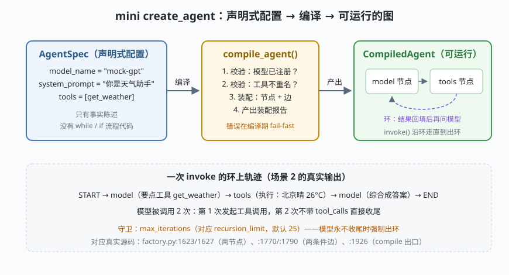

# s01: create_agent —— 一个 agent 如何被"编译"出来

`s01` → [s02_runnable_lcel](../s02_runnable_lcel/) → [s03](../s03_tool_system/) → [s04](../s04_state_graph/) → [s05](../s05_middleware/) → [s06](../s06_memory_checkpointer/) → [s07](../s07_structured_output/) → [s08](../s08_rag_retriever/) → [s09](../s09_streaming/) → [s10](../s10_classic_vs_v1/)

> LangChain 的招牌设计：**"做一个 agent"不是写一个 while 循环，而是"声明一份配置，编译成一张图"**。`create_agent(model, tools)`（`libs/langchain_v1/langchain/agents/factory.py:882`）把 model/tools 组装成 LangGraph 的 `StateGraph`——两个节点、两条条件边成环——最后 `compile()` 产出一个 Runnable。
>
> **框架层**：agent 工厂 —— 声明式配置如何变成可运行对象。

---

## 问题

你要造一个 agent 框架，第一天就遇到三个工程问题：

1. **agent 的"形状"写在哪？** 如果每个 agent 都是一段手写的 while 循环，那么"改系统提示、换一个工具、加一层拦截"都要动流程代码——改流程比改配置危险一个数量级。
2. **配置错误什么时候暴露？** 工具重名、模型名拼错、系统提示为空——如果这些错误留到第一次运行才炸，用户看到的将是一个莫名其妙的运行时异常。
3. **循环失控怎么办？** 模型有可能永远只要工具不给最终答案（甚至两个工具互相调用）。没有上限守卫的 agent 环就是一个烧钱死循环。

LangChain 对这三问的答案是同一个动作：**编译**。配置（数据）进，图（可运行对象）出。

---

## 解决方案



| 机制 | mini 版 | LangChain 真实实现 |
|------|---------|--------------------|
| **声明式配置** | `AgentSpec` dataclass（只有事实陈述） | `create_agent(model, tools, *, system_prompt, ...)` 签名 `factory.py:882` |
| **编译产物是图** | `CompiledAgent` 内建 model↔tools 环 | `graph: StateGraph[...]` `factory.py:1249` |
| **两个节点** | 装配报告里的 `nodes` | `add_node("model")` `:1623`、`add_node("tools")` `:1627` |
| **两条条件边** | `model→tools?  tools→model` | tools→model `:1770`、model→tools `:1790` |
| **编译出口** | `compile_agent()` 返回可 invoke 对象 | `return graph.compile(...)` `:1926`（产出的 CompiledStateGraph 本身是 Runnable） |
| **迭代上限** | `max_iterations` 守卫 | `recursion_limit` 默认 25（`runnables/config.py:183`；agent 图在 `factory.py` 里放宽到 9999） |

一条总纲：**spec 是数据，图是编译产物，环的轨迹是运行期的事**。三者分离，才可能"换配置不换代码"。

---

## 工作原理

`code.py` 约 200 行，走读四个关键机制：

**第 1 步**：`AgentSpec` 只陈述事实——用哪个模型、挂哪些工具、系统提示是什么。没有任何 while/if。真实框架的对应物就是 `create_agent` 的参数表（`factory.py:882-901`）。

**第 2 步**：`compile_agent()` 做三件事——校验（模型已注册、工具不重名）、装配（决定装不装 tools 节点：工具为空时图中没有环）、产出装配报告。对应真实框架里 `_resolve_schemas`（`:482`）、`add_node`（`:1623/:1627`）、`add_edge(START, entry_node)`（`:1755`）。**错误在编译期 fail-fast**：场景 3 的重名工具在 `compile()` 就被拒绝，而不是等用户问到一半才炸。

**第 3 步**：`CompiledAgent.invoke()` 沿环走：模型回复带 `tool_calls` 就执行工具、把结果回填为 `tool` 消息、再问模型；不带就出环返回。场景 2 的输出里可以数出来：模型被调用 2 次——第 1 次要工具，第 2 次收尾。

**第 4 步**：迭代上限守卫。场景 4 里模型永远只要工具，`max_iterations=3` 到点强制出环。真实框架同样有这道闸：LCEL 默认 `recursion_limit=25`（`config.py:183`），而 agent 图每轮工具往返都算一层递归，所以 `factory.py` 把它显式放宽——**"agent 型图必须显式放宽递归上限"是从链迁移到 agent 的隐含成本**。

**跑一跑**（零依赖，离线）：

```bash
python code.py
```

预期输出五个场景：装配报告（nodes/edges/conditional 清单）→ 一圈环的完整轨迹 → 重名工具编译报错 → 迭代上限强制出环 → 未注册模型编译报错。

---

## 对照真实源码

| mini 实现 | LangChain 真实代码（快照 80b7409） | 学习点 |
|-----------|-----------------------------------|--------|
| `AgentSpec` | `libs/langchain_v1/langchain/agents/factory.py:882` `def create_agent(...)` | 声明式入口：model/tools/system_prompt 全是参数 |
| `compile_agent()` 装配 | 同文件 `:1249` `graph: StateGraph[...]` | 图是工厂内部组装的，用户看不到图的存在 |
| 两节点 | `:1623` add_node("model")、`:1627` add_node("tools") | ReAct 环的全部硬件就这两个节点 |
| 两条件边 | `:1770` tools→model、`:1790` model→tools（辅助函数 `:2089`/`:2008`） | while 循环被显式建模成图 |
| `compile()` | `:1926` `return graph.compile(checkpointer=..., ...)`、`:1942` `.with_config(config)` | 产物是 CompiledStateGraph，即 Runnable |
| `BuildReport` | 教具化对应：编译出的图可 `get_graph().draw_mermaid()` 自检结构 | 装配报告 = 编译产物的白盒视图 |
| `max_iterations` | `libs/core/langchain_core/runnables/config.py:183` `DEFAULT_RECURSION_LIMIT = 25` | 动态能力必须有静态上限 |
| `MockModel` | `libs/core/langchain_core/language_models/chat_models.py:284` `BaseChatModel` | 真实模型实现同一调用面，本课程用 Mock 顶替 |

> 行号以快照 80b7409 为准，代码演进后以源码为准。核对方法：`sed -n 'Np' 文件`。

---

## 自测

1. `AgentSpec` 里为什么不允许出现任何流程代码？如果允许在 spec 里写"先调 A 再调 B"，编译器还能保证什么、失去什么？
2. 工具列表为空时，mini 编译器会装配出一张什么样的图？对应 `factory.py` 里哪段分支逻辑（提示：`if tool_node is not None`）？
3. LCEL 默认 `recursion_limit=25` 为什么对 agent 图不够用？这个数值由谁、在哪里放宽？

下一课 [s02_runnable_lcel](../s02_runnable_lcel/)：把图放一放，先看支撑整座框架的统一协议——Runnable 与 `a | b` 背后的 LCEL。
