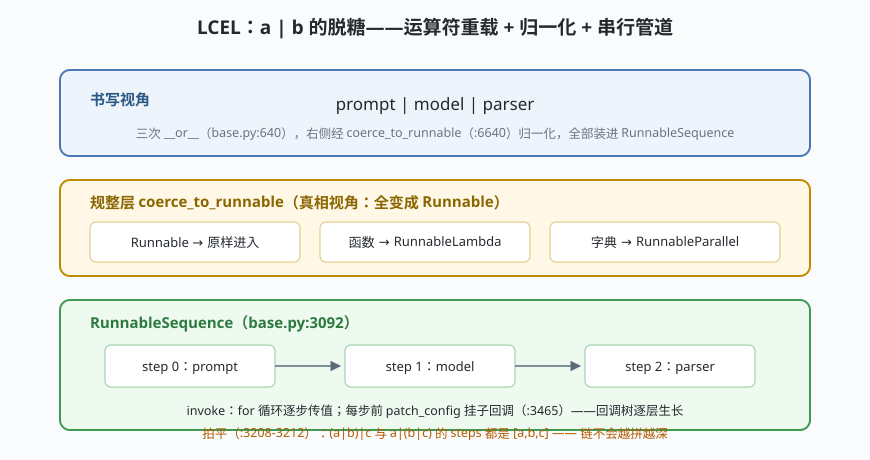

# s02: Runnable 与 LCEL —— `a | b` 到底发生了什么

[s01](../s01_agent_compile/) → **s02** → [s03_tool_system](../s03_tool_system/) → [s04](../s04_state_graph/) → ...

> LangChain 的第二块招牌：**一切组件都是 Runnable（可运行单元）**。模型、提示词、解析器、工具甚至普通函数，全都能 invoke、全都能用 `|` 串——LCEL（LangChain Expression Language，LangChain 表达式语言）不是 DSL（Domain-Specific Language，领域专用语言），就是 Python 运算符重载（`runnables/base.py:640`）加一层归一化。
>
> **框架层**：统一协议 —— 组件层的每个类如何获得同一张调用面。

---

## 问题

1. **组件协议爆炸**：提示词要能跑、模型要能跑、解析器也要能跑。如果每类组件各定一套调用方法，组合它们就要为每一对组合写胶水——N 种组件就是 N² 份胶水。
2. **"串起来"凭什么这么便宜？** `prompt | model | parser` 三个完全不同类型的对象，凭什么一个 `|` 就接上了？右侧是普通函数、甚至是字典时呢？
3. **链拼多了会怎样？** `(a|b)|c` 再 `|d`……如果每次拼接都嵌套一层，100 个组件的链就是 100 层深的递归调用。
4. **追踪从哪来？** 排查线上链路时，"哪一步慢、哪一步错了"的信息从哪一层冒出来？

---

## 解决方案



| 机制 | mini 版 | LangChain 真实实现 |
|------|---------|--------------------|
| **统一协议** | `Runnable` ABC：invoke/batch/stream 三件套 | `runnables/base.py:145` `class Runnable(ABC, Generic[...])` |
| **管道符** | `Runnable.__or__` → `RunnableSequence(self, coerce(other))` | `base.py:640` 定义、`:688` 实现；对称的 `__ror__` 在 `:691` |
| **归一化** | Runnable 原样 / 函数→Lambda / 字典→Parallel / 其余 TypeError | `coerce_to_runnable` `base.py:6640` |
| **拍平** | `__init__` 把嵌套 Sequence 展开成一级 steps | `RunnableSequence.__init__` `base.py:3186`（展开分支 `:3208-3212`） |
| **子回调** | 每步前挂 `seq:step:i` 前缀回调 | `base.py:3465-3469` `patch_config(callbacks=run_manager.get_child(...))` |
| **批量并发** | `ThreadPoolExecutor.map`，`max_concurrency` 控流 | `Runnable.batch` `base.py:946`（`:994` executor.map；并发执行器 `config.py:675`） |
| **生成器彩蛋** | lambda 返回生成器 → 逐段吐 | `RunnableLambda._invoke` `base.py:5180` `isgeneratorfunction` |

一条总纲：**组合子层不知道组件层的存在**。`RunnableSequence.invoke` 只会依次调 `step.invoke`——每步是提示词、模型还是解析器，它一概不关心。

---

## 工作原理

`code.py` 约 250 行，六个场景：

**场景 1（脱糖）**：`prompt | model | parser` 打印出来就是 `RunnableSequence([MockPrompt, MockModel, MockParser])`；`(p|m)|parser` 与 `p|(m|parser)` 的 steps 相同——拍平保证链是一层列表，不是一棵深树（对照 `:3208-3212`）。

**场景 2（回调树）**：invoke 时事件日志显示 `seq:step:1/2/3` 的 start/end 成对出现。真实实现里每步 invoke 前用 `patch_config` 把回调换成"当前 run 的 child"（`:3465-3469`）——LangSmith 追踪的树形就是这样一层层长出来的，组件自己毫无感知。

**场景 3（batch）**：3 个输入、`max_concurrency=2`，线程池 map 出 3 个输出。真实代码（`:994-995`）多做一件事：跨线程提交前 `copy_context()`（`config.py:639`）——子线程里回调还能收到事件，靠的就是这行。

**场景 4（字典 fan-out）**：`prompt | {"raw": ..., "length": ...}` 中字典被归一化成 RunnableParallel，同一输入并发喂给两个分支（`base.py:3881`）。

**场景 5（生成器彩蛋）**：lambda 里 yield 的函数参与流式——`base.py:5180` 检测 `isgeneratorfunction` 后逐段累积；管道末段是生成器时，chunk 逐段到达调用方。

**场景 6（边界）**：`prompt | 42` → `coerce_to_runnable` 直接 TypeError。真实的 `__or__` 甚至刻意不返回 `NotImplemented`，避免把 LCEL 组合语义意外委托给无关类型——语法糖越甜，规整层越要严。

**跑一跑**（零依赖，离线）：

```bash
python code.py
```

---

## 对照真实源码

| mini 实现 | LangChain 真实代码（快照 80b7409） | 学习点 |
|-----------|-----------------------------------|--------|
| `Runnable` ABC | `libs/core/langchain_core/runnables/base.py:145` | 一个协议统一全部组件 |
| `__or__` | 同文件 `:640`（overloads）→ `:688` `return RunnableSequence(self, coerce_to_runnable(other))` | LCEL 的全部魔法就这一行 |
| `coerce_to_runnable` | `base.py:6640` | 函数/字典/Runnable 三路归一 |
| 拍平 | `base.py:3186-3212`（`RunnableSequence.__init__`） | 拼接不加深，恒为一级 steps |
| 子回调 | `base.py:3465-3469`、`patch_config` `runnables/config.py:369` | 回调树 = 追踪树 |
| batch 并发 | `base.py:946`（`:994` executor.map）+ `config.py:619`（`:639` copy_context） | 并发没有黑魔法，线程池而已 |
| `RunnableParallel` | `base.py:3881`（invoke `:4156`，子 run 命名 `map:key:{key}`） | fan-out 与 batch 同一底座 |
| 生成器累积 | `base.py:4720`（`RunnableLambda`）、`:5180` | yield 即流式 |
| `recursion_limit` | `runnables/config.py:183`（默认 25）、`:267` `ensure_config` | 动态组合的静态闸门 |

> 行号以快照 80b7409 为准，代码演进后以源码为准。核对方法：`sed -n 'Np' 文件`。

---

## 自测

1. `a | b` 中 b 是普通函数，中间一共发生了几次"规整"？各自把 b 变成了什么类的实例？
2. 为什么 `(a|b)|c` 与 `a|(b|c)` 最终都是一级 steps 列表？在哪个方法的哪几行实现的？如果不拍平，100 步链的调用栈会发生什么？
3. 子线程里的回调为什么还能收到事件？`config.py` 里哪 5 行代码保证的？（往 s09 想一层：流式的双通道也站在同一底座上）

下一课 [s03_tool_system](../s03_tool_system/)：回到 agent 主线——@tool 装饰器如何把一个普通函数变成模型可点名的工具，工具调用循环如何闭合。
