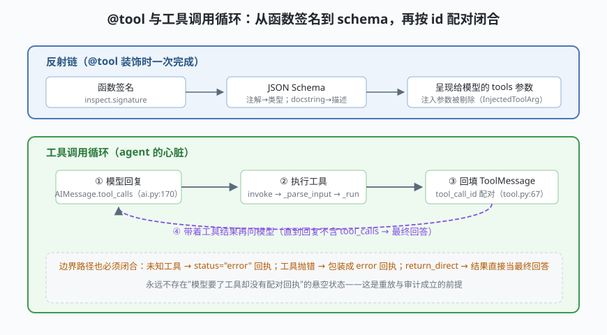

# s03: 工具系统 —— @tool 装饰器与工具调用循环

[s02](../s02_runnable_lcel/) → **s03** → [s04_state_graph](../s04_state_graph/) → [s05](../s05_middleware/) → ...

> 工具（Tool）是 agent 的手和脚：**带参数 schema（模式）的可调用函数，模型可点名调用**。LangChain 的招牌手法：普通函数带类型注解和 docstring，`@tool` 一挂，schema 自动反射生成（`tools/convert.py:89` → `tools/base.py:263`）——而且 BaseTool 本身是 RunnableSerializable（`tools/base.py:433`），**"工具"和"链"没有本质区别**。
>
> **框架层**：工具面 —— 函数如何变成模型可调用的协议，循环如何闭合。

---

## 问题

1. **schema 从哪来？** 给模型注册工具要提供参数模式。手写 JSON Schema 又慢又容易和函数实现脱节——函数改了 schema 忘改，模型照旧按旧 schema 传参，运行时才炸。
2. **哪些参数模型不该看见？** 回调管理器（run_manager）、当前登录用户这类参数是运行时上下文，绝不能出现在模型看到的 schema 里，否则既浪费 token 又是注入面。
3. **工具失败怎么收场？** 模型点了一个不存在的工具、或工具执行抛异常——如果异常直接穿透到调用栈顶，整个 agent 会话就崩了；如果不回填任何东西，消息历史里就留下悬空的 tool_calls。
4. **循环什么时候停？** 模型给出不带工具调用的回复才算完——但如果它永远要工具呢？

---

## 解决方案



| 机制 | mini 版 | LangChain 真实实现 |
|------|---------|--------------------|
| **装饰器反射** | `inspect.signature` → JSON Schema，docstring 当描述 | `tool()` `convert.py:89`（重载 `:29/:43/:59/:74`），汇入 `_tool_factory` `:294` |
| **schema 钥匙** | 注解 → JSON 类型映射；默认值 → 非必填 | `create_schema_from_function` `base.py:263` |
| **参数过滤** | 剔除 `run_manager/callbacks` + `Injected` 标注 | `FILTERED_ARGS` `base.py:74`；`InjectedToolArg` `base.py:1726` |
| **消息配对** | `ToolMessage(tool_call_id, status)` | `messages/tool.py:26`（`:67` tool_call_id、`:81` status）；`ToolCall` `:206` |
| **一等字段** | `AIMessage.tool_calls` | `messages/ai.py:160/170`（1.x 从 additional_kwargs 升为一等字段，展示视图 `content_blocks` `:243`） |
| **三段式执行** | `invoke(args)` 一步到位 | `invoke :757` → `_parse_input :778` → `_run :909` |
| **短路** | `return_direct=True` | `ToolMessage` 直连出环（`factory.py:1770` 的 destinations 分支） |

一条纪律：**永远不存在悬空的 tool_calls**——每个请求都必须有按 `tool_call_id` 配对的回执，哪怕是 `status="error"` 的合成回执。

---

## 工作原理

`code.py` 约 250 行，五个场景：

**场景 1（反射）**：`get_weather(city: str, days: int = 1)` 被反射成 `{"city": {"type": "string"}, "days": {"type": "integer"}}`，`required=["city"]`（有默认值即非必填）；`read_file` 的 `user: Injected` 参数彻底没进 schema——**模型看得见的只有 schema**，注入参数由运行时补齐。

**场景 2（循环闭合）**：模型要点 `get_weather(city=上海, days=3)` → 执行 → 回填 `tool_call_id=call_a` 的 ToolMessage → 模型综合出最终回答。数一数：模型 2 次调用，工具 1 次执行——与 s01 的环完全一致，只是这次消息级细节全打开了。

**场景 3/4（失败路径）**：未知工具与除零异常都变成 `status="error"` 的 ToolMessage 回执，循环不崩、模型能看到错误并自行收尾。这就是"配对纪律"的价值：**错误也是一种观察结果**。

**场景 5（短路）**：`return_direct=True` 的工具结果直接当最终回答，省一轮模型调用——对应真实图里 tools→END 的直达边（`factory.py:1770` 的 destinations 里带 `exit_node`）。

**跑一跑**（零依赖，离线）：

```bash
python code.py
```

---

## 对照真实源码

| mini 实现 | LangChain 真实代码（快照 80b7409） | 学习点 |
|-----------|-----------------------------------|--------|
| `tool()` 装饰器 | `libs/core/langchain_core/tools/convert.py:89`（重载 `:29-77`）、`_tool_factory :294` | 裸装饰/带参/包 Runnable 三种用法同一条路 |
| schema 反射 | `libs/core/langchain_core/tools/base.py:263` `create_schema_from_function` | `inspect.signature` → Pydantic 模型 → schema |
| `FILTERED_ARGS` | 同文件 `:74`（`run_manager`、`callbacks`） | 框架参数永不进模型上下文 |
| `Injected` 标注 | 同文件 `:1726` `InjectedToolArg`（剔除逻辑 `:331-341`） | 运行时注入 vs 模型可见的边界 |
| `MiniTool` | `libs/core/langchain_core/tools/structured.py:93` `StructuredTool`；`BaseTool :433` | 工具是 Runnable：能 invoke、能进链 |
| `Message` 三态 | `messages/ai.py:160/170`、`messages/tool.py:26/67/81`、`ToolCall :206` | tool_calls 与 ToolMessage 按 id 配对 |
| `content_blocks` 视图 | `messages/ai.py:243` | 1.x：存储用 tool_calls，展示用 content_blocks，双向对齐（`:215-228`） |
| 三段式执行 | `tools/base.py:757/778/909` | 输入校验独立成拍，错误不脏手 _run |

> 行号以快照 80b7409 为准，代码演进后以源码为准。核对方法：`sed -n 'Np' 文件`。

---

## 自测

1. 为什么 `user: Injected` 参数不能进 schema？如果模型看见了它并主动传值，会发生什么连锁问题？
2. 未知工具回执 `status="error"` 和工具内部抛错回执，在消息历史上有什么相同点？为什么两者都必须存在？
3. `return_direct=True` 改变的是图的哪条边？省掉一轮模型调用的代价是什么？（提示：模型失去对工具结果做"总结"的机会）

下一课 [s04_state_graph](../s04_state_graph/)：把 s01 见过、s03 闭合的"环"正式化——mini StateGraph 图引擎，节点、边与条件边。
