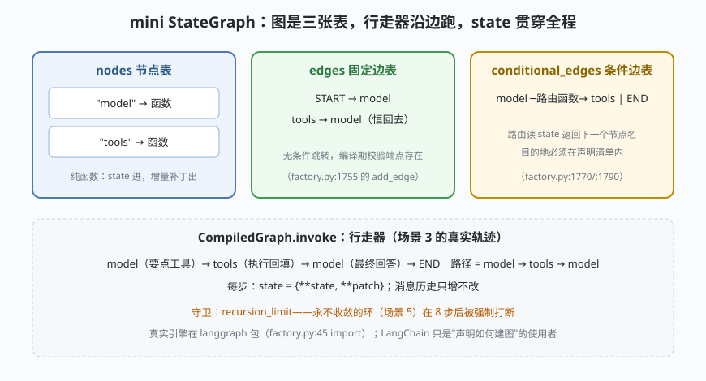

# s04: StateGraph 底座 —— 节点、边与条件边

[s03](../s03_tool_system/) → **s04** → [s05_middleware](../s05_middleware/) → [s06](../s06_memory_checkpointer/) → ...

> s01 见过 agent 图的最终形态，本课把支撑它的引擎做出来：**StateGraph 把控制流从代码搬进数据结构**——节点表 + 固定边表 + 条件边表，三张表就是图的全部；`while/if` 从此变成声明（`factory.py:1770/:1790` 的两条 `add_conditional_edges` 就是 agent 的环）。
>
> **框架层**：图引擎 —— 声明式编排的硬件层。

---

## 问题

1. **流程代码改不动**：s01/s03 的循环是硬编码的——"工具执行前插一道审批、模型调用后加一步校验"都要改循环本体。循环结构能不能变成**数据**，让别的代码安全地改它？
2. **分支逻辑藏在哪**：模型要不要调工具、工具结果够不够直接收尾——这些决策散落在循环的 if 里，没有一处能"看全局"。图怎么把决策显式化？
3. **死环谁兜底**：A→B→A 的环声明出来就合法。没有递归上限的图引擎等于给用户一把上膛的枪。
4. **错边什么时候暴露**：边指向一个不存在的节点——留到运行时走到那一步才炸，还是编译时就拒收？

---

## 解决方案



| 机制 | mini 版 | LangChain 真实实现 |
|------|---------|--------------------|
| **三张表建图** | `nodes` / `edges` / `cond_edges` 字典 | `StateGraph`（langgraph 包；使用现场 `factory.py:1249`，import `:45`） |
| **节点是纯函数** | state 进、增量补丁出 | `factory.py:1623/:1627` 两个 `add_node` |
| **固定边** | `add_edge("tools", "model")` | `factory.py:1755` `add_edge(START, entry_node)` |
| **条件边** | 路由函数读 state 返回节点名 | `factory.py:1770`（tools→model）、`:1790`（model→tools；辅助 `_make_model_to_tools_edge :2008`） |
| **编译期校验** | 边端点不存在 → `GraphCompileError` | langgraph 编译时做图校验（`graph.compile() :1926`） |
| **递归守卫** | `recursion_limit=8` 打断死环 | `config.py:183` 默认 25；agent 图放宽到 9999（`factory.py:1912-1916` 注释段与赋值） |
| **state 归约** | 浅覆盖 `{**state, **patch}` | `AgentState.messages` 挂 `add_messages` reducer（`middleware/types.py:349`） |

一条总纲：**节点不改历史，只提交补丁**。消息历史"只增不改"的不变量（s06 的检查点靠它）就是图引擎合并策略的直接后果。

---

## 工作原理

`code.py` 约 260 行，五个场景：

**场景 1（线性图）**：`clean → upper` 两节点串联，节点各自只返回 `{"text": ...}` 补丁，行走器负责合并。真实 StateGraph 的默认合并就是覆盖；消息字段特殊——走 `add_messages` reducer（按 id 追加/覆盖，见 s06）。

**场景 2（条件边）**：同一张图，长文走 `deep_read`、短文走 `quick_read`——分支决策被声明成"路由函数 + 目的地清单"，而不是埋在循环里的 if。运行时若路由返回了声明之外的目的地，行走器直接报错（真实性 langgraph 同样校验）。

**场景 3（ReAct 环）**：`build_react_graph` 用 mini 引擎重建 s01 的 agent 图：`add_node("model")` / `add_node("tools")`、`add_edge("tools", "model")`、`add_conditional_edges("model", route_after_model, ["tools", END])`。对照 `factory.py` 的 `:1623/:1627/:1770/:1790`，四条声明一一对应。轨迹输出里能数出环走了两轮 `model → tools → model`。

**场景 4/5（边界）**：边指向不存在的节点在 `compile()` 即报错；死环 `a→b→a` 在第 8 步被 `RecursionLimitError` 打断——真实引擎抛 `GraphRecursionError`，agent 图把上限放宽到 9999（`factory.py` 编译段注释），因为每轮工具往返都消耗一层递归预算。

**跑一跑**（零依赖，离线）：

```bash
python code.py
```

---

## 对照真实源码

| mini 实现 | LangChain 真实代码（快照 80b7409） | 学习点 |
|-----------|-----------------------------------|--------|
| `StateGraph` 三张表 | langgraph 包（`factory.py:45` import；建图 `factory.py:1249`） | 图引擎与框架解耦，LangGraph 可单独使用 |
| `add_node` | `factory.py:1623`（model）、`:1627`（tools）、`:1648-1726`（中间件节点织入，见 s05） | 节点注册是编译期行为 |
| `add_conditional_edges` | `factory.py:1770/:1790/:1803`；路由工厂 `_make_tools_to_model_edge :2089`、`_make_model_to_tools_edge :2008` | agent 的 while 循环 = 两条条件边 |
| `compile()` 校验 | `factory.py:1926` `graph.compile(checkpointer=..., ...)` | 编译期把声明问题一次性查完 |
| 行走器 + 守卫 | `DEFAULT_RECURSION_LIMIT` `config.py:183` | 动态能力必须有静态上限 |
| state 补丁合并 | `middleware/types.py:349` `AgentState`（messages 挂 `add_messages`） | "只增不改"是 reducer 的职责 |
| `ScriptedModel` | `chat_models.py:284` `BaseChatModel` | 真实模型与节点函数解耦：节点只管编排 |

> 行号以快照 80b7409 为准，代码演进后以源码为准。核对方法：`sed -n 'Np' 文件`。

---

## 自测

1. "节点不改历史，只提交补丁"——这条纪律对 s06 的检查点（checkpointer，检查点器）为什么是前提条件？如果节点可以原地改 state，检查点会记录到什么？
2. agent 图为什么恰好是"两条条件边"而不是"一条"？分别对应什么事件？（提示：模型发起工具调用 / 工具执行完毕）
3. mini 版路由返回声明之外的目的地会报错。真实框架里这个校验发生在什么时候？为什么要在这个时机？

下一课 [s05_middleware](../s05_middleware/)：图结构既定之后，行为定制走另一扇门——中间件（middleware）拦截链与洋葱模型。
