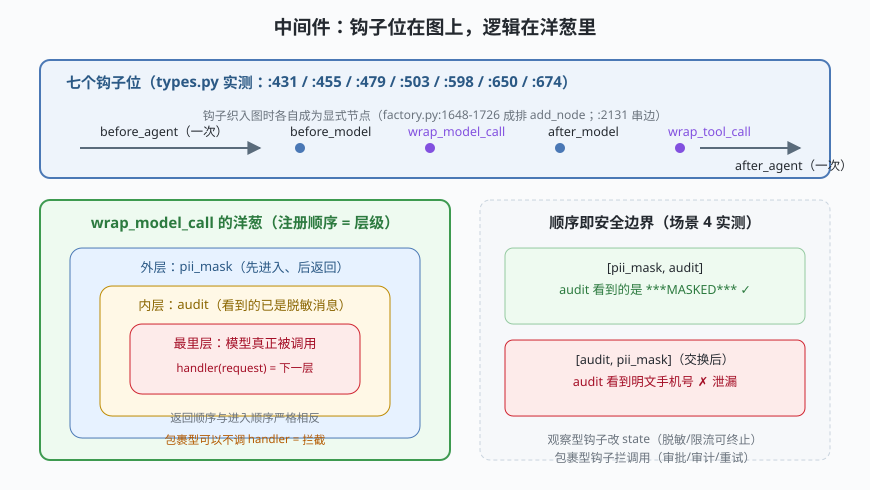

# s05: 中间件 —— 拦截链与洋葱模型

[s04](../s04_state_graph/) → **s05** → [s06_memory_checkpointer](../s06_memory_checkpointer/) → [s07](../s07_structured_output/) → ...

> 图（s04）解决"流程怎么走"，中间件（middleware，拦截链）解决"每一步前后还能插什么"。LangChain 1.x 把 agent 的关键位全开成钩子——`before_model` / `wrap_model_call` / `after_model` / `wrap_tool_call` 等（`middleware/types.py:455/503/479/674`）——编译期把它们**织入图结构**（`factory.py:1648-1726` 成排 `add_node`）：钩子在图里是显式节点，不是隐藏补丁。
>
> **框架层**：行为定制 —— 不改图、不改循环，横向插入能力。

---

## 问题

1. **横切关注写进主流程**：脱敏、审计、限流、审批——这些逻辑和"模型调用/工具执行"正交。硬编码进循环后，每个功能都让主流程更胖一分，而且拆不下来。
2. **拦截必须能"真拦"**：审批场景需要"不调用模型/工具，直接返回结果"的能力。简单的"前后回调"（只通知、不给否决权）做不到。
3. **顺序有没有语义**：三个中间件都挂在同一批钩子上，谁先谁后有区别吗？如果没区别，安全问题（审计日志里出现明文 PII）就会在不知情时发生。
4. **钩子失败怎么收场**：中间件自己出错了怎么办——拖垮 agent，还是能被优雅终止？

---

## 解决方案



| 机制 | mini 版 | LangChain 真实实现 |
|------|---------|--------------------|
| **钩子位** | 七个钩子：before/after_agent、before/after_model、wrap_model_call、wrap_tool_call | `types.py:431` / `:455` / `:479` / `:503`（async `:598`）/ `:674` / `:650` |
| **织入图** | mini 运行器按固定位置调用钩子链 | `factory.py:1648-1726` 钩子成排 `add_node`；`_add_middleware_edge :2131` 串边；entry/exit 节点由中间件决定（`:1743-1752`） |
| **观察型钩子** | 读 state、返回增量补丁；可触发终止 | `before_model :455` 返回 dict；真实版可用 `jump_to` 跳转 |
| **包裹型钩子** | `(request, handler)` 洋葱一层，可不调 handler | `wrap_model_call :503` 链成 `async_handlers`（`factory.py:1230-1237`） |
| **官方示范** | PiiMask / Audit / ToolGuard / ModelCallLimit | `SummarizationMiddleware`（`summarization.py:232`，`before_model :398` 先摘要再放行）、pii.py、model_call_limit.py 等 |
| **状态模式** | `state = {"messages", ...}` | `AgentState`（`types.py:349`，messages 挂 add_messages reducer） |

一条总纲：**观察型改 state，包裹型拦调用**。两者合起来，横切关注就可以完全外置——s04 的图一行不用改。

---

## 工作原理

`code.py` 约 270 行，四个场景：

**场景 1（洋葱顺序）**：两层 wrap 钩子的进入顺序 A→B→core、返回顺序 core→B→A 严格相反——注册顺序即洋葱层级，`onion()` 的组装对应真实代码把多个 `wrap_model_call` 链成 handler 列表（`factory.py:1230-1237`）。

**场景 2（同环共舞）**：脱敏 + 审计 + 工具拦截三个中间件挂上同一个 agent：pii_mask 在外层把手机号变成 `***MASKED***`，内层审计看到的是脱敏后的请求；`TOOL:deploy` 被 tool_guard 拦下并合成错误回执（没有 handler 调用，工具从未执行）。

**场景 3（边界）**：模型永远要工具时，call_limit 中间件在 `after_model` 计数到上限后要求终止——真实实现是 `after_model` 返回 `jump_to` 跳出循环，mini 版用异常表达同一意图。agent 被安全终止而不是烧穿预算。

**场景 4（安全教训）**：把审计和脱敏**交换注册顺序**，审计看到的是明文手机号——中间件顺序不是风格问题，是安全边界。真实框架无法替你决定顺序，只能靠你自己想清楚"谁该先看到数据"。

**跑一跑**（零依赖，离线）：

```bash
python code.py
```

---

## 对照真实源码

| mini 实现 | LangChain 真实代码（快照 80b7409） | 学习点 |
|-----------|-----------------------------------|--------|
| `AgentMiddleware` 七钩子 | `libs/langchain_v1/langchain/agents/middleware/types.py:431/455/479/503/598/650/674` | 状态模式 + 两类钩子形态 |
| `onion()` 组装 | `factory.py:1230-1237`（wrap handler 链）、`:503`（types 签名） | 先进后出，顺序有语义 |
| 钩子织入图 | `factory.py:1648-1726` 成排 `add_node`、`:2131` `_add_middleware_edge` | 钩子是显式节点：可跳转、可观测 |
| 终止语义 | `after_model` 返回 `jump_to`（types.py 的 `JumpTo`，`AgentState.jump_to` 字段 `:350`） | 观察型钩子也有控制权 |
| `PiiMaskMiddleware` | `middleware/pii.py`（官方 PII 中间件） | 敏感数据处理是典型横切关注 |
| `ModelCallLimitMiddleware` | `middleware/model_call_limit.py` | 预算守卫也是中间件，不是循环里的 if |
| `SummarizationMiddleware` | `summarization.py:232`（`before_model :398`：超预算先摘要再放行） | s06 记忆管理的官方答案就是中间件 |
| `AgentState` | `types.py:349` | 中间件和图共享同一状态模式 |

> 行号以快照 80b7409 为准，代码演进后以源码为准。核对方法：`sed -n 'Np' 文件`。

---

## 自测

1. 观察型钩子和包裹型钩子的本质区别是什么？为什么"审批"必须用包裹型实现？
2. 场景 4 的 PII 泄漏在真实框架里同样可能发生。要系统性避免这类问题，你能想到哪两种做法？（提示：让脱敏不依赖注册顺序 / 审计时二次过滤）
3. `after_model` 能返回 `jump_to` 跳出循环——这给了观察型钩子什么控制权？它和 s04 的条件边路由是什么关系？

下一课 [s06_memory_checkpointer](../s06_memory_checkpointer/)：环有了、拦截有了，还差"记住"——短期记忆与 checkpointer（检查点器）如何让 agent 跨轮次有状态。
