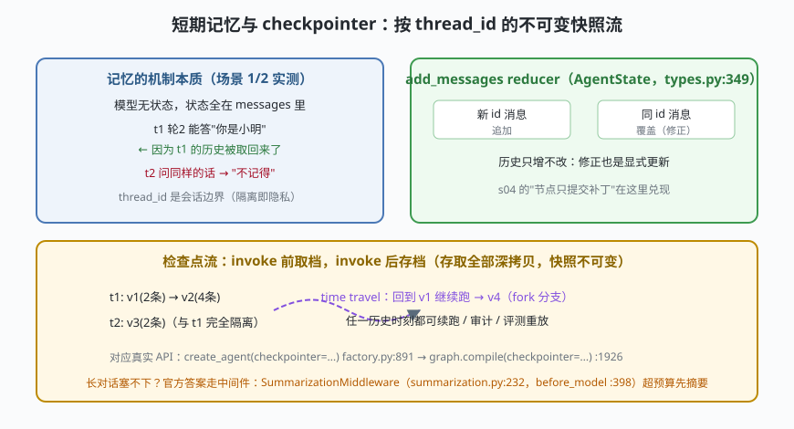

# s06: 短期记忆与 checkpointer —— 跨轮次的状态与快照

[s05](../s05_middleware/) → **s06** → [s07_structured_output](../s07_structured_output/) → [s08](../s08_rag_retriever/) → ...

> agent 的"记忆"并不神秘：**短期记忆就是消息列表跨调用存活**——模型每次只看到 messages，上一轮说了什么，只要还在列表里，模型就"记得"。LangGraph 把这件事落成两个机制：add_messages reducer（归约器，历史只增不改）和 checkpointer（检查点器，按 thread_id 存 state 快照）——`create_agent(checkpointer=...)`（`factory.py:891`）一行接上。
>
> **框架层**：状态与持久化 —— 会话如何跨轮次、跨进程、跨时间旅行。

---

## 问题

1. **模型明明无状态，"记住"从哪来？** 上一轮对话再问一次，模型却答得上来——如果不理解机制，就会误以为要给模型"训练"进记忆，或者引入全家桶式的记忆服务。
2. **会话之间必须隔离**：用户 A 的对话历史绝不能流进用户 B 的请求。没有 thread 边界的"全局记忆"是隐私事故。
3. **修正是覆盖还是追加？** 用户说"不对，我叫小明明"——如果历史只能追加，矛盾消息会越积越多；如果允许原地改，历史就被篡改了。两者要兼得。
4. **错了想反悔怎么办？** 工具跑岔了、结论错了——能不能回到任意历史时刻重新来？（time travel，时间旅行）

---

## 解决方案



| 机制 | mini 版 | LangChain 真实实现 |
|------|---------|--------------------|
| **记忆载体** | `state = {"messages": [...]}` | `AgentState.messages`（`middleware/types.py:349`，挂 `add_messages` reducer） |
| **合并策略** | 新 id 追加、同 id 覆盖 | `langgraph.graph.message.add_messages`（`factory.py:44` import） |
| **检查点器** | `MemoryCheckpointer`：put/get/list，深拷贝存取 | `create_agent(checkpointer=...)` `factory.py:891` → `graph.compile(checkpointer=...)` `:1926` |
| **会话隔离** | thread_id 是取档唯一钥匙 | config 里传 `thread_id`（LangGraph checkpointer 语义） |
| **时间旅行** | `get(thread_id, version)` 回到 v1 续跑 | 检查点版本流 + `interrupt_before/after`（`factory.py:893-894` 参数）配合可做 human-in-the-loop |
| **长对话治理** | 结尾点名（不在本课展开） | `SummarizationMiddleware`（`summarization.py:232`，`before_model :398` 超预算先摘要） |

一条总纲：**模型无状态，状态在消息里；消息不改写，改写在快照流里**。

---

## 工作原理

`code.py` 约 240 行，五个场景：

**场景 1（记忆成立）**：t1 轮 1 说"我叫小明"，轮 2 问"我叫什么？"——答"你是小明"。模型是被确定性函数 Mock 的，它"记得"的唯一原因是 t1 的消息历史被取回来了。**短期记忆没有魔法**。

**场景 2（隔离）**：t2 问同样的话，只能得到"不记得"——thread_id 是会话边界的唯一钥匙。

**场景 3（时间旅行）**：版本列表显示 t1 的 v1/v2；`get(t1, version=1)` 回到 v1 从那里继续，答出同样正确的"你是小明"——任一历史时刻都可续跑，这就是评测重放、断点续跑、人工介入的底层能力。

**场景 4（同 id 修正）**：`add_messages` 对同 id 消息覆盖（修正）、新 id 追加——历史"只增不改"与"可修正"同时成立：修正本身也是一条显式状态变更。

**场景 5（边界：快照不可变）**：把 get 回来的引用恶意清空，再取一次存档毫发无损——真实检查点器从序列化字节重建对象，天然是副本；mini 版用 deepcopy 表达同一不变量。

**跑一跑**（零依赖，离线）：

```bash
python code.py
```

---

## 对照真实源码

| mini 实现 | LangChain 真实代码（快照 80b7409） | 学习点 |
|-----------|-----------------------------------|--------|
| 消息状态 | `libs/langchain_v1/langchain/agents/middleware/types.py:349` `AgentState`（messages 字段） | agent 状态模式就一个 messages + 结构化响应 |
| `add_messages` | `factory.py:44` import（langgraph.graph.message） | reducer 挂在类型注解上：`Annotated[list, add_messages]` |
| checkpointer 参数 | `factory.py:891`（`checkpointer: Checkpointer \| None = None`） | 一行参数接通持久化 |
| 编译传入 | `factory.py:1926` `graph.compile(checkpointer=checkpointer, ...)` | 检查点是图引擎能力，工厂只是转发 |
| 可变快照 vs 深拷贝 | langgraph.checkpoint 序列化协议（msgpack） | 快照必须不可变，取档即重建 |
| 时间旅行/中断 | `factory.py:893-894` `interrupt_before/interrupt_after` | 检查点 + 中断 = human-in-the-loop |
| 长对话压缩 | `middleware/summarization.py:232`（`before_model :398`） | 记忆治理走中间件（s05 的钩子） |

> 行号以快照 80b7409 为准，代码演进后以源码为准。核对方法：`sed -n 'Np' 文件`。

---

## 自测

1. 为什么说"短期记忆没有魔法"？如果检查点器故障（取档失败），agent 会表现出什么症状？
2. add_messages 同时实现"历史只增不改"和"可修正"，它靠什么区分两者？（提示：消息的哪个字段）
3. 快照为什么必须不可变？如果 get 返回存档本体，s03 的工具调用循环会以什么方式污染历史？

下一课 [s07_structured_output](../s07_structured_output/)：模型自由文本怎么变成程序能用的数据——结构化输出与 schema 校验重试。
