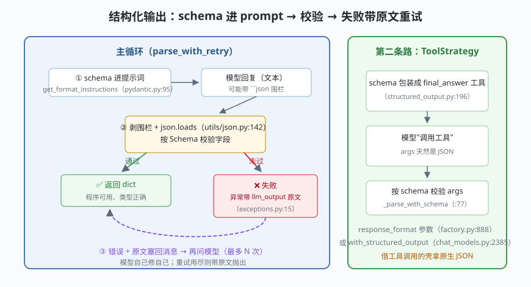

# s07: 结构化输出 —— schema 校验重试

[s06](../s06_memory_checkpointer/) → **s07** → [s08_rag_retriever](../s08_rag_retriever/) → [s09](../s09_streaming/) → ...

> 模型天然只会吐文本，程序需要的是数据。LangChain 的答案是闭环三步：**schema 进提示词**（`PydanticOutputParser.get_format_instructions`，`output_parsers/pydantic.py:95`）→ **输出再校验**（剥围栏 + 解析 + 校验，`utils/json.py:142`）→ **失败带原文重试**（`OutputParserException` 带着 `llm_output` 原文，`exceptions.py:15`，重试链把原文塞回去）。1.x agent 还有第二条路：ToolStrategy——把 schema 包装成 `final_answer` 工具，args 天然是 JSON（`agents/structured_output.py:196`）。
>
> **框架层**：文本与数据的边界 —— 程序拿到手的永远是校验过的数据。

---

## 问题

1. **自由文本没法接**：模型回答"网络故障，比较急，3 天了"——下游代码要的是 `{"category": ..., "priority": ..., "days_open": ...}`。靠字符串切割？改一个措辞就崩。
2. **模型会"违章"**：明明要求只输出 JSON，它偏要加一句"好的！这是结果："或包上 markdown 围栏；JSON 里还会出现尾逗号。
3. **合法 JSON 未必合规**：`days_open` 要求整数却给了字符串——`json.loads` 通过了，业务校验没过。谁负责发现？
4. **失败要能重试**：解析失败如果只抛异常，用户看到的是 500；理想行为是把错误反馈给模型让它自己修。

---

## 解决方案



| 机制 | mini 版 | LangChain 真实实现 |
|------|---------|--------------------|
| **schema 进提示词** | `Schema.get_format_instructions()` 渲染字段形状 | `pydantic.py:19` 类、`:95` 方法（把 `model_json_schema()` 拼进 prompt） |
| **剥围栏解析** | 正则剥 ` ```json ` 围栏 + `json.loads` | `parse_json_markdown` `utils/json.py:142`；`JsonOutputParser.parse` `output_parsers/json.py:93` |
| **异常带原文** | `OutputParserException(msg, llm_output=text)` | `exceptions.py:15`（带 `llm_output` 属性） |
| **校验器** | `Schema.validate()` 返回错误列表 | `PydanticOutputParser`（`:76-82` 按模型校验）；1.x agent `_parse_with_schema` `structured_output.py:77` |
| **重试链** | 错误 + 原文塞回消息，再问模型（max_retries） | retry parser / fixed schema retry 同思路 |
| **工具即 schema** | `final_answer` 工具 + args 校验 | `ToolStrategy` `structured_output.py:196`；入口 `response_format` 参数 `factory.py:888` |
| **模型级 API** | — | `with_structured_output` `chat_models.py:2385`（让模型直接返回 Pydantic 对象） |

一条总纲：**schema 只活在文本里**（prompt 或工具定义），校验永远是独立的最后一道闸。

---

## 工作原理

`code.py` 约 250 行，五个场景：

**场景 1（格式指令）**：`get_format_instructions()` 渲染出"请只输出 JSON + 字段要求 + 必填清单"——真实实现就是把 Pydantic 模型的 JSON Schema 拼进提示词，这是整条链里**唯一能影响模型行为的部分**。

**场景 2（坏 JSON 重试）**：模型第一句带着围栏和尾逗号——剥围栏救得了围栏、救不了尾逗号，`json.loads` 失败；错误 + 原文塞回消息，第二次模型修正，校验通过。

**场景 3（类型错误重试）**：JSON 合法但 `days_open` 是字符串——`Schema.validate` 抓出来，同样走一轮"反馈 → 修正"。

**场景 4（ToolStrategy）**：schema 包装成 `final_answer` 工具，模型"调用工具"的那一刻 args 已经是 JSON，只需校验——**结构化输出借了工具调用的壳**，这正是 1.x agent 的 `response_format` 在图里的实现方式（`factory.py:888` 参数 → structured_output.py 的解析）。

**场景 5（边界：重试用尽）**：顽固模型 3 次拒绝输出 JSON——`OutputParserException` 抛出，且 `llm_output` 保留原文。**失败也要带着证据走**：日志、告警、人工介入全靠这段原文。

**跑一跑**（零依赖，离线）：

```bash
python code.py
```

---

## 对照真实源码

| mini 实现 | LangChain 真实代码（快照 80b7409） | 学习点 |
|-----------|-----------------------------------|--------|
| `Schema.get_format_instructions` | `libs/core/langchain_core/output_parsers/pydantic.py:19`（类）、`:95`（方法） | schema 进 prompt 的最短实现 |
| `parse_json_markdown` | `libs/core/langchain_core/utils/json.py:142`；`JsonOutputParser` `json.py:31`（parse `:93`） | 解析器分层：先剥围栏再解析 |
| `OutputParserException` | `libs/core/langchain_core/exceptions.py:15` | 失败携带 `llm_output` 原文供重试 |
| `Schema.validate` | `pydantic.py:76-82`（模型校验）；agent 侧 `_parse_with_schema` `structured_output.py:77` | 解析与校验是两道独立闸门 |
| 重试链 | retry parser（`OutputFixingParser` 思路） | 反馈要包含错误 + 原文 |
| `final_answer` 工具 | `ToolStrategy` `structured_output.py:196`；`response_format` `factory.py:888` | 工具即 schema：1.x agent 的正路 |
| 模型级结构化 | `with_structured_output` `chat_models.py:2385` | 厂商原生 JSON 模式时更省 token |
| `StrOutputParser` 恒等 | `output_parsers/string.py:8` | 不需要结构时链尾的默认选择 |

> 行号以快照 80b7409 为准，代码演进后以源码为准。核对方法：`sed -n 'Np' 文件`。

---

## 自测

1. 格式指令（schema 进 prompt）和输出校验为什么必须同时存在？只做前者或只做后者分别会出什么事？
2. `OutputParserException` 为什么要携带 `llm_output` 原文？如果只有错误消息，重试链和线上排障分别损失什么？
3. ToolStrategy 和"prompt 里要 JSON"两条路各适合什么场景？当厂商支持原生 JSON 模式（`with_structured_output`）时，哪条路最省 token？

下一课 [s08_rag_retriever](../s08_rag_retriever/)：给 agent 外挂知识——mini 内存检索器与检索工具化（RAG，检索增强生成）。
