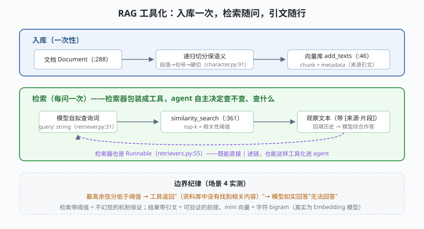

# s08: RAG 检索工具组合 —— mini 内存检索器与工具化

[s07](../s07_structured_output/) → **s08** → [s09_streaming](../s09_streaming/) → [s10](../s10_classic_vs_v1/) → ...

> RAG（Retrieval-Augmented Generation，检索增强生成）= 先检索外部知识，再让模型带着检索结果作答。在 agent 语境下，它的正确形态是**把检索器包装成一个带 schema 的工具**——模型自主决定"查不查、查什么"，检索结果带来源引文回填。LangChain 的四个标准件 Document / TextSplitter / VectorStore / Retriever 全部是 Runnable 协议的成员。
>
> **框架层**：知识外挂 —— 模型不知道的事，让工具知道。

---

## 问题

1. **模型不知道你的私域知识**：内部规范、私有文档、昨天的工单——模型训练语料里没有。直接问，它要么不知道，要么编（幻觉）。
2. **整篇文档塞不进上下文**：几百页文档远超窗口，而且塞进去也不省钱——必须"只取最相关的几段"。
3. **切分切在哪**：按固定长度硬切会把一句话拦腰斩断，检索到的碎片没法读。语义单元怎么保住？
4. **检索结果不可信怎么办**：相似度最高分 0.02 的"命中"其实是噪声——把噪声喂给模型，它就会一本正经地引用噪声作答。

---

## 解决方案



| 机制 | mini 版 | LangChain 真实实现 |
|------|---------|--------------------|
| **文档单元** | `Document(page_content, metadata)` | `documents/base.py:288` `class Document(BaseMedia)`（metadata 是引文的来源） |
| **切分器** | 递归降级：段落 → 句号 → 硬切 | `RecursiveCharacterTextSplitter`（`text-splitters/character.py:91`，`libs/text-splitters` 独立包） |
| **向量库** | 字符 bigram + 余弦相似度（零依赖） | `vectorstores/base.py:43` `VectorStore(ABC)`（`add_texts :46` / `similarity_search :361`） |
| **检索器** | `MiniRetriever.invoke(query)` → list[Document]，带相关性阈值 | `retrievers.py:55` `BaseRetriever(RunnableSerializable, ABC)` |
| **工具化** | `create_retriever_tool(retriever)` → schema 固定 `{query: string}` | `tools/retriever.py:31` `create_retriever_tool` |
| **接进 agent** | 工具 `run` 渲染 `[来源·片段]` 观察文本回填 | BaseTool（`tools/base.py:433`）作为 `create_agent(tools=[...])` 的成员 |

一条总纲：**切分保语义、检索带阈值、结果带引文**。模型负责综合，标准件负责纪律。

---

## 工作原理

`code.py` 约 250 行，四个场景：

**场景 1（切分入库）**：168 字符、4 个段落的文档被递归切成 4 个 chunk（60 字上限），每个都带 `source` 元数据。递归降级策略"段落切不动再切句子"保住了语义边界——对照真实 `RecursiveCharacterTextSplitter` 的 separators 链。

**场景 2（检索器直调）**："agent 的状态快照怎么保存？"命中 checkpointer 相关 chunk——mini 向量是字符 bigram + 余弦相似度，纯标准库即可演示检索的全部形状（真实实现换成 Embedding 模型 + 余弦/内积，接口不变）。

**场景 3（工具化进 agent）**：`create_retriever_tool` 把检索器变成 `search_docs` 工具（schema 固定 `{query: string}`）；模型自拟查询词"checkpointer 状态快照 保存"，工具返回带 `[langchain-内部笔记.md·片段N]` 引文的观察文本，模型据此作答。**引文随行，答案可验证**。

**场景 4（边界：不幻觉）**：问"公司年会去哪儿开"——库里只有 langchain 笔记，最高分低于阈值 0.5，工具返回"没有找到相关内容"，模型如实回答无法回答。**检索带阈值是不幻觉的机制保证**，比在提示词里求模型"不要编"可靠得多。

**跑一跑**（零依赖，离线）：

```bash
python code.py
```

---

## 对照真实源码

| mini 实现 | LangChain 真实代码（快照 80b7409） | 学习点 |
|-----------|-----------------------------------|--------|
| `Document` | `libs/core/langchain_core/documents/base.py:288` | page_content + metadata 双字段 |
| `recursive_split` | `libs/text-splitters/langchain_text_splitters/character.py:91` | separators 链递归降级保语义 |
| `InMemoryVectorStore` | `libs/core/langchain_core/vectorstores/base.py:43`（`:46` add_texts、`:361` similarity_search） | 接口固定，实现可换（pgvector/qdrant…） |
| `MiniRetriever` | `libs/core/langchain_core/retrievers.py:55` `BaseRetriever(RunnableSerializable, ABC)` | 检索器也是 Runnable，能进链 |
| `create_retriever_tool` | `libs/core/langchain_core/tools/retriever.py:31` | 检索器 → 工具的官方包装 |
| 工具 schema | `tools/base.py:433` `BaseTool`（s03 的反射机制） | 模型看见的仍是 schema |
| chunk 元数据 | `documents/base.py:288` 的 `metadata` 字段 | 引文/过滤/权限都挂在 metadata 上 |

> 行号以快照 80b7409 为准，代码演进后以源码为准。核对方法：`sed -n 'Np' 文件`。
> RAG 的全流程方法论（语料准备、评估、重排）见 [../../../rag-handbook/RAG搭建文档.md](../../../rag-handbook/RAG搭建文档.md)。

---

## 自测

1. 为什么"把检索器做成工具"优于"每轮强制检索"？两种做法分别损失什么能力？
2. 递归切分器的 separators 链为什么把"\n\n"排在最前、空串排最后？如果反过来会发生什么？
3. 检索阈值调得太高或太低分别出什么问题？你会怎么用 s07 的结构化输出把"命中分数"也交给模型判断？

下一课 [s09_streaming](../s09_streaming/)：token 流与事件流的双通道——streaming（流式）如何让等待变成体验。
