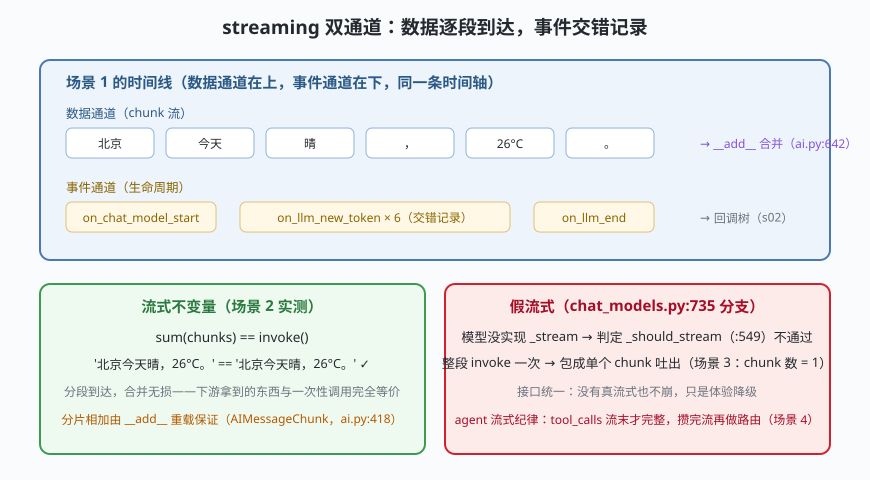

# s09: streaming —— 流式与多轮的双通道

[s08](../s08_rag_retriever/) → **s09** → [s10_classic_vs_v1](../s10_classic_vs_v1/) → （收官）

> 流式的本质：**把"等完整答案"变成"看答案长出来"**。LangChain 把它拆成两条并行通道——数据通道（AIMessageChunk 分片逐段到达，`__add__` 合并无损，`messages/ai.py:418/:642`）与事件通道（on_chat_model_start → on_llm_new_token×N → on_llm_end，回调体系与 s02 的回调树同源）。模型没实现 `_stream` 也有保底：假流式把整段 invoke 包成单 chunk（`chat_models.py:735`）。
>
> **框架层**：交付体验 —— 接口统一之下，真流式与假流式的差别只在体验。

---

## 问题

1. **首字延迟**：一次回答 20 秒，用户盯着空白屏幕会以为挂了。能不能边生成边显示？
2. **两套接口的诱惑**：如果 `stream()` 是另一套 API，那每个组件都要写两遍；下游消费流式结果的代码与消费完整结果的代码也无法复用。
3. **不支持流式的模型怎么办**：厂商 API 没有 SSE（Server-Sent Events，服务器推送事件）？直接报错等于把体验问题升级成功能问题。
4. **agent 流式的陷阱**：`tool_calls` 在流的**末尾**才拼装完整——中途看到"像是文本"的片段就做路由判断，会把工具调用轮误判成最终回答。

---

## 解决方案



| 机制 | mini 版 | LangChain 真实实现 |
|------|---------|--------------------|
| **统一入口** | `BaseStreamModel.stream()` 一个入口两种模式 | `chat_models.py:727` `def stream`（Runnable 协议成员） |
| **真流式** | 子类 `_stream()` 逐段 yield | `chat_models.py:2255` `_stream`（第 3 层，集成包唯一可选实现） |
| **判定闸** | `_should_stream()` 检查子类是否覆写 | `_should_stream` `chat_models.py:549`（判定顺序：覆写与否 → 显式开关 → 流式回调） |
| **假流式** | 整段 invoke 包成单 chunk | `chat_models.py:735-745`（`yield AIMessageChunk(self.invoke(...))`） |
| **分片合并** | `Chunk.__add__`：content 相加、tool_call 取先到 | `AIMessageChunk` `ai.py:418`、`__add__ :642` |
| **事件通道** | `EventLog` 记 start/new_token/end | 回调体系（`on_chat_model_start` / `on_llm_new_token` / `on_llm_end`） |
| **agent 纪律** | 攒完整个流再判 `tool_calls` | 图引擎按步提交，节点流式增量（`runnables/base.py:3844` `RunnableSequence.stream`） |

一条不变量：**sum(chunks) == invoke()**——分段到达、合并无损，流式与一次性调用下游等价。

---

## 工作原理

`code.py` 约 250 行，四个场景：

**场景 1（双通道）**：6 个 token 分片沿数据通道到达，事件通道同步记下 start / 6 次 new_token / end——两条通道时间线一致、职责分离：数据给 UI 渲染，事件给监控计费。

**场景 2（合并无损）**：`merge(chunks)` 与 `invoke()` 输出逐字符相等。这不是巧合而是契约——正因为有它，下游代码才能"流式渲染、最终按完整消息处理"两头通吃（对照 `AIMessageChunk.__add__`，`ai.py:642`）。

**场景 3（假流式）**：`NoStreamMock` 没实现 `_stream`，`_should_stream` 判定不通过 → 基类走 `:735` 分支：整段 invoke 一次、包成**单个** chunk 吐出（输出里 chunk 数 = 1、事件标记 `mode=fake`）。接口统一，体验降级但不崩。

**场景 4（agent 流式多轮）**：第 1 轮流里先冒出文本"我查一下天气。"、流末才拼出 `tool_call`——循环**攒完整个流**才路由（执行工具、回填 ToolMessage）；第 2 轮纯文本流逐 token 到达成为最终回答。若在流中途就判断，第 1 轮会被当成最终回答而漏掉工具执行。

**跑一跑**（零依赖，离线）：

```bash
python code.py
```

---

## 对照真实源码

| mini 实现 | LangChain 真实代码（快照 80b7409） | 学习点 |
|-----------|-----------------------------------|--------|
| `BaseStreamModel.stream` | `libs/core/langchain_core/language_models/chat_models.py:727` | 统一入口：三层结构的第 1 层 |
| `_stream` 抽象 | 同文件 `:2255`（默认抛 NotImplementedError） | 子类唯一可选实现 |
| `_should_stream` | 同文件 `:549` | 真流式/假流式的判定闸 |
| 假流式分支 | 同文件 `:735-745` | 整段 invoke 包单 chunk |
| 反向桥接 | 同文件 `:1892` `_generate_with_cache`（`:1969-2020` 流式 chunk 累积回 ChatResult） | 两个方向的伪流式桥接都在基类 |
| `Chunk.__add__` | `libs/core/langchain_core/messages/ai.py:418`（类）、`:642`（合并） | 分段到达，合并无损 |
| 分片 tool_calls | `AIMessageChunk` 的 `tool_call_chunks` 渐进拼装（content_blocks 视图 `:446`） | 流末才完整，中途不可路由 |
| 链级流式 | `runnables/base.py:3844` `RunnableSequence.stream` | 前段累积、末段逐段吐（s02 场景 5） |

> 行号以快照 80b7409 为准，代码演进后以源码为准。核对方法：`sed -n 'Np' 文件`。

---

## 自测

1. "sum(chunks) == invoke()" 这个不变量如果被破坏（比如某分片丢了标点），下游哪些功能会坏？
2. 假流式里 `on_llm_new_token` 只记 1 次——监控上如何区分真假流式？为什么要区分？
3. agent 流式循环为什么必须攒完整个流才能判断 `tool_calls`？如果厂商 API 支持"工具调用结束"事件，这个纪律可以怎么放松？

收官课 [s10_classic_vs_v1](../s10_classic_vs_v1/)：把两个时代的 agent 并排跑一遍——langchain-classic（兼容层）是怎么把 0.x 包住的，v1 又凭什么取代它。
