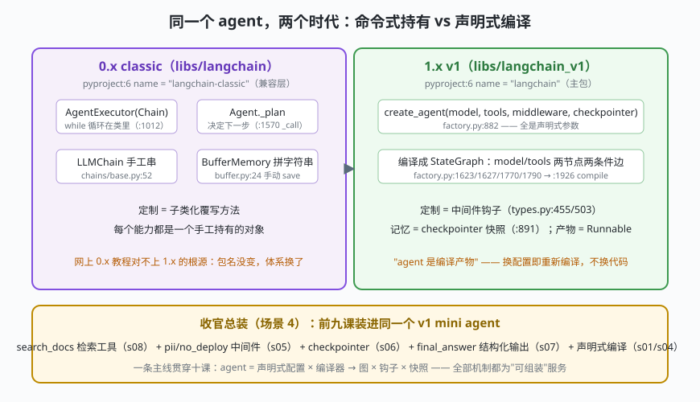

# s10: classic vs v1 —— 兼容层是怎么包的 + 收官装配

[s09](../s09_streaming/) → **s10**（收官）

> 仓库地图里最重要的认知：`pip install langchain` 装的是 `libs/langchain_v1`（pyproject `name = "langchain"`，`libs/langchain_v1/pyproject.toml:6`）；0.x 那套 `AgentExecutor` / `LLMChain` / `ConversationBufferMemory` 整体搬进了 `libs/langchain`（pyproject `name = "langchain-classic"`，`libs/langchain/pyproject.toml:6`）——**包名没变、体系已换代**。本课把两个时代的 agent 并排跑同一个任务，再收官总装。
>
> **框架层**：迁移方法论 —— 新体系如何包住旧体系，旧体系凭什么被取代。

---

## 问题

1. **两个时代的资料混在搜索引擎里**：`from langchain import AgentExecutor` 的教程满天飞，而 1.x 的正确入口是 `from langchain.agents import create_agent`（`v1 agents/__init__.py:3`）。不弄清包结构，写出来的永远是旧时代代码。
2. **旧代码怎么办**：0.x 用户千万级，不能一夜作废。兼容层怎么包才能"旧代码照跑、新代码不受污染"？
3. **迁移到底迁什么**：`AgentExecutor` → `create_agent`、`Memory` → `checkpointer`、子类化定制 → 中间件——映射关系不搞清楚，迁移就是重写。
4. **十课的零件怎么合成一台整机**：前面每课只点亮一个机制，收官要能装回去。

---

## 解决方案



| 能力 | 0.x classic（命令式） | 1.x v1（声明式编译） |
|------|----------------------|---------------------|
| **编排** | `AgentExecutor(Chain)` 自己写 while（`classic agents/agent.py:1012`，`_call :1570`） | `create_agent` 编译成 StateGraph（`factory.py:1249`、`:1926`） |
| **串接** | `LLMChain` 一个个手工连（`chains/base.py:52`） | LCEL：`prompt \| model \| parser`（`base.py:688`） |
| **记忆** | `ConversationBufferMemory` 拼字符串（`memory/buffer.py:24`），手动 `save_context` | checkpointer 按 thread_id 快照（`factory.py:891`） |
| **定制** | 子类化 Agent / Executor 覆写方法 | middleware 钩子织入图（`types.py:455/503`） |
| **工具** | `create_tool_calling_agent`（`classic agents/__init__.py:56`） | `tools` 参数直接挂 BaseTool（`factory.py:883`） |
| **入口** | `from langchain import ...`（0.x 写法） | `from langchain.agents import create_agent`（`v1 agents/__init__.py:3`） |

一条总纲：**0.x 把"循环"给你，让你填方法；1.x 把"图"给你，让你插钩子**。前者是框架类继承，后者是编译与装配。

---

## 工作原理

`code.py` 约 250 行，四个场景：

**场景 1（classic 跑通）**：`AgentExecutor` 手持 while 循环、`classic_plan` 扮演 Agent 决策、`ConversationBufferMemory` 在每轮结束后手动 `save_context`——能跑，但循环、记忆、决策全是**手工持有的对象**。

**场景 2（v1 跑同一任务）**：`create_agent_mini(script, tools, checkpointer=...)` 声明式编译；工具执行打印的是"节点 tools"、回答打印的是"节点 model"——环在编译产物里，记忆自动落进 checkpointer。两段输出并排看，迁移差异一目了然。

**场景 3（迁移清单）**：六行对照表打印在输出里——编排、串接、记忆、定制、工具、入口。背下这张表，看任何 0.x 教程都能心算出 1.x 的等价写法。

**场景 4（收官总装）**：一个 v1 mini agent 同时装上 `search_docs` 检索工具（s08）、`pii_mask`/`no_deploy` 中间件（s05）、checkpointer（s06）、`final_answer` 结构化输出（s07）——问"差旅报销标准"，先检索、再脱敏、后结构化落结论。十课机制全部到场。

**跑一跑**（零依赖，离线）：

```bash
python code.py
```

---

## 对照真实源码

| mini 实现 | LangChain 真实代码（快照 80b7409） | 学习点 |
|-----------|-----------------------------------|--------|
| 包名对照 | `libs/langchain/pyproject.toml:6` = "langchain-classic"；`libs/langchain_v1/pyproject.toml:6` = "langchain" | 同一个 import 名，包已换代 |
| `AgentExecutor` | `libs/langchain/langchain_classic/agents/agent.py:1012`（`class AgentExecutor(Chain)`）、`_call :1570` | 循环写在类里：命令式内核 |
| `Chain` 基类 | `libs/langchain/langchain_classic/chains/base.py:52` | 0.x 的"链"是类继承体系 |
| `ConversationBufferMemory` | `libs/langchain/langchain_classic/memory/buffer.py:24` | 记忆是显式对象，手动存取 |
| classic 导出 | `libs/langchain/langchain_classic/agents/__init__.py:46/:56`（create_react_agent / create_tool_calling_agent） | 0.x 入口的真实位置 |
| v1 入口 | `libs/langchain_v1/langchain/agents/__init__.py:3`（`from langchain.agents.factory import create_agent`） | 1.x 官方 agent 就这一个入口 |
| `create_agent` | `libs/langchain_v1/langchain/agents/factory.py:882`（编译 `:1926`） | s01 的锚点，收官再回望 |

> 行号以快照 80b7409 为准，代码演进后以源码为准。核对方法：`sed -n 'Np' 文件`。

---

## 自测

1. `pip install langchain` 装到的到底是哪个包？`import langchain` 拿到的呢？0.x 教程为什么会"看起来还能跑"？
2. `memory.save_context` 与 checkpointer 快照的本质差别是什么？（提示：谁负责存、存在哪、能不能回到历史版本）
3. 把场景 1 的 `AgentExecutor` 迁到 v1，循环、记忆、定制分别对应 v1 的哪个机制？

---

## 学完之后去哪

- **回到源头**：按 [本仓 LangChain 源码解析与学习路线](../../源码解析与学习路线.md) 的阶段 4 精读 `factory.py` 全文——本课程所有行号锚点在该快照上直接可用；附录 B 的 12 问自测正好检验十课成果。
- **往下一层**：图到底怎么执行的？LangGraph 是独立引擎，工作区 08 号目录（`08-langgraph/`）有对应的源码解析文档，讲清图的执行引擎、reducer 与中断恢复。
- **横向对照**：[03-deepseek-harness 的同体例教材](../../../03-deepseek-harness/analysis_deepseek_harness/)走的是"插件树"路线（TS 源码 + Node mini 实现）——两家把"可组装"做成了不同形状：dsh 换插件清单，LangChain 换编译配置。
- **动手延伸**：给 s04 的 mini 图引擎加 `interrupt_before`（人工介入）；给 s06 的检查点器换 SQLite 后端；把 s08 的 bigram 向量换成真 Embedding——每个都对应真实框架的一个模块。
