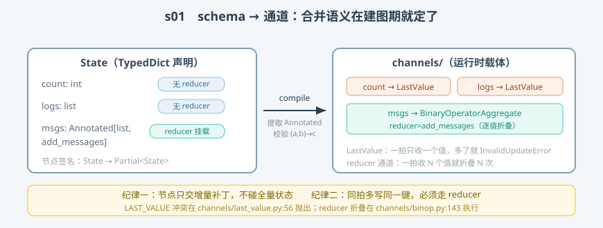

# s01: StateGraph 与 reducer —— 状态怎么声明、冲突怎么合并

`s01` → [s02_superstep](../s02_superstep/) → [s03](../s03_apply_writes/) → ... → [s10](../s10_capstone/)

> LangGraph 自述是"低层编排框架与运行时"。它的一切执行语义都建立在一个约定上：**节点之间从不互相调用，也不共享内存——各自读一份状态、各交一份增量补丁，合并交给声明好的 reducer（归并函数）**。本课拆这个约定的两个载体：schema（`graph/state.py`）与通道（`channels/`）。
>
> **引擎层**：状态面 —— schema 声明、通道协议、合并语义。

---

## 问题

1. **两个节点同时改一个键，听谁的？** 一拍（superstep，超步）里多个节点并发执行，都往 `messages` 里写——覆盖、报错还是合并？谁在什么时机裁决？
2. **"节点返回增量"靠什么兑现？** 如果节点拿到的是全量 state 字典，手一滑就整份覆盖了历史。
3. **合并规则写在哪？** 写在执行引擎的 if/else 里（每加一种键就要改引擎），还是写在键自己的声明上？
4. **错的键声明什么时候暴露？** reducer 签名写错了——留到运行到那一步才炸，还是建图时就拒收？

---

## 解决方案



| 机制 | mini 版 | LangGraph 真实实现 |
|------|---------|--------------------|
| **节点签名约定** | 注释即规范 | `StateGraph` docstring："State -> Partial<State>"（`graph/state.py:146`） |
| **reducer 挂载** | `Annotated[list, add_messages]` 提取元数据 | `Annotated` 元数据取 reducer（`state.py:1906`），签名校验 `state.py:1934` |
| **通道协议** | `LastValue` / `ReducerChannel` 各有 `update` | `BaseChannel` 七方法协议（`channels/base.py:19`，`update` :90） |
| **默认通道** | 一拍收 >1 个值即抛 `InvalidUpdateError` | `LastValue`（`channels/last_value.py:20`，报错 :61-64） |
| **reducer 通道** | 收 N 个值折叠 N 次 | `BinaryOperatorAggregate`（`channels/binop.py:65`，折叠 :143） |
| **add_messages** | 按 id 替换/追加 | 真实实现 `_messages.py` 一带（语义同：同 id 替换、新 id 追加） |

一条总纲：**声明（Annotated 元数据）决定运行时合并语义；引擎对通道种类无感知。**

---

## 工作原理

`code.py` 五个场景，对应"编译 → 写入 → 冲突 → 合并 → 校验"的完整闭环：

**场景 1（schema → 通道）**：`build_channels(AgentState)` 逐键读 `Annotated` 元数据——没挂 reducer 的键给 `LastValue`，挂了的给 `ReducerChannel`。这就是 `compile()` 做的第一件事（真实逻辑在 `graph/state.py` 的 `_get_channels` 一带）。

**场景 2（LastValue 铁律）**：`logs.update(["A 节点写的", "B 节点写的"])` 抛出 `InvalidUpdateError`，报错文本与真实源码 `last_value.py:61` 逐字一致——这就是新手最常撞见的 `INVALID_CONCURRENT_GRAPH_UPDATE`。**报错不是缺陷而是设计**：引擎不敢替你猜合并规则。

**场景 3（reducer 折叠）**：同一拍 3 份补丁写 `msgs`，`ReducerChannel.update` 逐值折叠（对应 `binop.py:143`）——3 个节点并发写同一个键，键自己知道怎么合。

**场景 4（add_messages 语义）**：同 id 的消息**原位替换**、新 id **追加**。"消息历史只增不改"的表象，其实是 reducer 在键级别裁决的结果。

**场景 5（错误左移）**：三参 reducer 在 `build_channels`（建图期）就被 `ValueError` 拒收——对应真实源码 `state.py:1934` 在构造期拦截，而不是跑到一半才炸。

**跑一跑**（零依赖，离线）：

```bash
python code.py
```

预期输出五个场景；场景 2 与场景 5 是**刻意的预期报错**——把报错信息读一遍，比读十行注释记得牢。

---

## 对照真实源码

| mini 实现 | 真实代码 | 学习点 |
|-----------|---------|--------|
| `LastValue` | `libs/langgraph/langgraph/channels/last_value.py:20`（`update` :56，报错 :61-64） | 默认通道"一拍一值"，错误码 `INVALID_CONCURRENT_GRAPH_UPDATE` |
| `ReducerChannel` | `libs/langgraph/langgraph/channels/binop.py:65`（`update` :123，折叠 :143） | reducer 的最终执行处；一拍最多一个 Overwrite 覆写指令（:131-139） |
| 通道协议 | `libs/langgraph/langgraph/channels/base.py:19`（`checkpoint` :49 / `update` :90 / `consume` :101 / `finish` :112） | 合并、消费、快照语义全封装在通道内部 |
| `build_channels` | `libs/langgraph/langgraph/graph/state.py:143`（`StateGraph`），reducer 校验 :1934 | 错误左移到建图期 |
| `add_messages` | `libs/langgraph/langgraph/pregel/_messages.py`（消息 id 去重追加） | "只增不改"是 reducer 的裁决结果 |

> 行号以快照 7daa3ab 为准、用 `sed -n 'Np'` 逐条实测；本检出带中文导读注释，`graph/state.py`、`pregel/` 下多份文件的行号因此比上游普遍下移约 12 行——以本课程实测值为准。

---

## 自测

1. 不带 reducer 的键被同拍两个节点写入，LangGraph 为什么选择抛错而不是"后写覆盖"？这个错误把决策还给谁了？
2. `Annotated[list, operator.add]` 的键编译成哪种通道？一拍收到 3 个值时最终值怎么算出来？
3. 增量补丁"合并"解决之后，还剩下一个问题：**这一拍该跑哪些节点、下一拍又该跑谁**？LangGraph 的答案是按"版本号差分"规划任务——这个引擎循环长什么样？

下一课 [s02_superstep](../s02_superstep/)：走进 Pregel 引擎的主循环——tick（规划）、执行、after_tick（写回）三拍。
