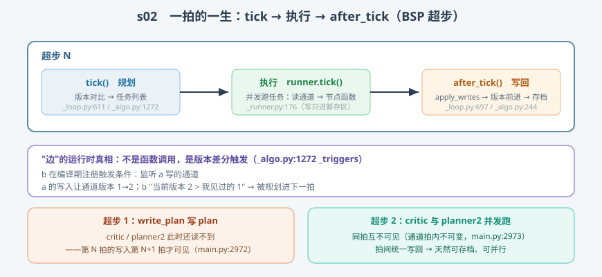

# s02: Pregel/BSP 超步 —— tick、执行、after_tick 三拍主循环

[s01](../s01_state_reducer/) → **s02** → [s03_apply_writes](../s03_apply_writes/) → ... → [s10](../s10_capstone/)

> LangGraph 引擎的执行模型借自 Google Pregel 论文：**BSP（Bulk Synchronous Parallel，整体同步并行）**——计算分成一拍一拍的**超步（superstep）**，拍内所有活跃节点并发执行、互不通信，拍间同步一次、统一写入。这四句话就写在主循环上方（`pregel/main.py:2970-2974`），官方注释是最好的教材。
>
> **引擎层**：执行循环 —— 规划、执行、写回。

---

## 问题

1. **"边"到底怎么执行？** 你写的是 `add_edge("a", "b")`，但节点之间从不函数调用——b 靠什么知道"a 已经跑完了"？
2. **并发节点为什么互不踩脚？** 一拍里 5 个节点同时读 state、同时交补丁，谁先谁后？补丁什么时候生效？
3. **循环图怎么终止？** A→B→A 声明出来是合法的，引擎靠什么分辨"还有活干"和"死环"？
4. **为什么任意一拍都能停下来存档？** claude-code 那种 while 主循环里，"随时可暂停"很难做到——图引擎为什么天然可以？

---

## 解决方案



| 机制 | mini 版 | LangGraph 真实实现 |
|------|---------|--------------------|
| **主循环三拍** | `while loop.tick(): 执行; after_tick()` | `main.py:2975` `while` / `:2979` `runner.tick` / `:2993` `after_tick` |
| **tick 规划** | `should_trigger`：版本差分 | `PregelLoop.tick`（`_loop.py:611`）+ `_triggers`（`_algo.py:1272`，比较式 :1285-1288） |
| **任务执行** | 顺序跑任务、产出 writes 暂存 | `Runner.tick`（`_runner.py:176`）：线程池并发，`commit` :574 收结果 |
| **after_tick 写回** | 分组 → 通道 update → 版本前进 | `after_tick`（`_loop.py:697`）调 `apply_writes`（`_algo.py:244`） |
| **三种结局** | done / out_of_steps / 继续拍 | done（`_loop.py:661-663`）、out_of_steps（:617-619，默认 recursion_limit=25） |
| **拍内不可变** | 任务读到的是旧值，写入只暂存 | 官方注释 `main.py:2973`："channels are guaranteed to be immutable for the duration of the step" |

一条总纲：**"边"是规划规则的语法糖，不是函数调用——版本差分触发，而非图遍历。**

---

## 工作原理

`code.py` 实现了一个约 120 行的 mini 超步执行器，然后走三个场景：

**场景 1（完整三拍）**：图 `START → write_plan → {critic, planner2}`（后两者都监听 `plan` 通道）。输出里逐拍可见：

- 超步 1：只有 `write_plan` 上榜（tick 打印任务表）——它写 `plan`，但 `critic` 此刻**读不到**；
- 超步 2：`critic` 与 `planner2` 都被"版本差"唤醒，并发执行。两者都能读到超步 1 写入的 `plan`（**第 N 拍写入第 N+1 拍才可见**），但 `planner2` 读不到 `critic` 同拍写的 `verdict`（**拍内不可变**）；
- 超步 3：tick 规划出空任务表 → `status=done`（通道不再触发任何节点，`_loop.py:661`）。

**场景 2（递归上限）**：`stop=1` 复现 `out_of_steps`——对应 `_loop.py:617` 的 `step > stop` 守卫，真实引擎默认 `recursion_limit=25`，死环图靠它兜底。

**场景 3（读后即证）**：并发节点的读写隔离在场景 1 的输出里已经完整呈现，不必另写代码。

一个实现细节值得停一停：mini 版的 `after_tick` **先记录 `versions_seen`、再应用写入**——顺序反了就大错。任务是被"旧版本差"唤醒的，它见过的是旧版本；如果把新版本记成"见过"，本轮被更新的通道将永远不再触发任何人。真实源码 `_algo.py:275`（versions_seen 更新）确实排在 `:331`（通道 update）之前。

**跑一跑**（零依赖，离线）：

```bash
python code.py
```

预期输出：场景 1 三拍后 `done`、场景 2 `out_of_steps`、场景 3 结论复述。

---

## 对照真实源码

| mini 实现 | 真实代码 | 学习点 |
|-----------|---------|--------|
| `while loop.tick()` 循环 | `libs/langgraph/langgraph/pregel/main.py:2975`（BSP 注释 :2970-2974） | 整个引擎就是这一层 while |
| `MiniLoop.tick` | `libs/langgraph/langgraph/pregel/_loop.py:611-691`（out_of_steps :617，done :661，interrupt 钩子 :675-679） | tick 只规划不执行 |
| `should_trigger` | `libs/langgraph/langgraph/pregel/_algo.py:1272-1289`（`_triggers`） | `versions.get(chan) > seen.get(chan)` 即"边" |
| 执行段 | `libs/langgraph/langgraph/pregel/_runner.py:176-230`（单任务快路径 :203，线程池 :260 一带） | 并发执行 + commit 收结果 |
| `MiniLoop.after_tick` | `libs/langgraph/langgraph/pregel/_loop.py:697-742`（apply_writes 调用 :708，存档 :734） | 每拍收尾动作固定 |
| versions_seen 顺序 | `libs/langgraph/langgraph/pregel/_algo.py:275`（先）vs `:331`（后） | 先记旧版本，再写新值 |

> 行号以快照 7daa3ab 为准、`sed -n 'Np'` 逐条实测；本检出带中文导读注释，`pregel/` 与 `graph/state.py` 的行号比上游普遍下移约 12 行。

---

## 自测

1. `add_edge("a", "b")` 在运行时等价于什么？"b 因为什么条件被规划进超步 N+1"？涉及哪两个数据结构？
2. 为什么同一拍的两个节点读不到彼此的写入？这条性质换来了哪两种工程能力（提示：并行正确性 + 可存档）？
3. mini 版把 `versions_seen` 的记录顺序写反会发生什么？这个顺序在真实源码里靠什么保证？

下一课 [s03_apply_writes](../s03_apply_writes/)：拆开 after_tick 的核心——同一拍多节点写同一通道的合并规则。
