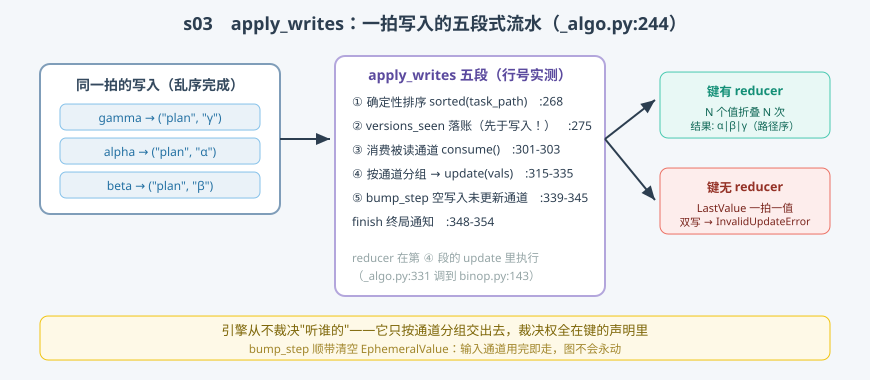

# s03: apply_writes 与写冲突 —— 同一拍的 N 份补丁怎么合

[s02](../s02_superstep/) → **s03** → [s04_checkpoint](../s04_checkpoint/) → ... → [s10](../s10_capstone/)

> after_tick 的核心是 `apply_writes`（`pregel/_algo.py:244`，实测行号）：一拍里所有任务的写入在这里**统一**变成通道的新值与检查点的新版本。它是整个引擎里唯一摸通道的地方——所以"并发写同一键"的全部答案都在这一个函数和通道自身的 `update` 里。
>
> **引擎层**：合并面 —— 写入分组、reducer 折叠、版本落账。

---

## 问题

1. **同拍 5 个节点写同一键，谁赢？** 完成顺序是不确定的，"后写覆盖前写"会让结果每次跑都不一样。
2. **非交换合并为什么在乎顺序？** `operator.add` 谁先谁后无所谓；但字符串拼接、消息追加这类合并，顺序错了结果就不同——确定性从哪来？
3. **输入通道为什么不会"永动"？** `__start__` 写入一次、触发一拍之后，是什么机制保证它不再触发任何人？
4. **错误在谁手里爆？** 无 reducer 的键被双写——引擎猜一个规则，还是让键自己报警？

---

## 解决方案



| 动作 | mini 版 | 真实实现 |
|------|---------|----------|
| **① 确定性排序** | `sorted(tasks, key=path)` | `_algo.py:268`（按 task_path_str，注释原话 "to ensure deterministic order"） |
| **② versions_seen 落账** | 先于写入记录旧版本 | `_algo.py:275-279`（顺序错 = 触发链断裂，s02 踩过） |
| **③ 消费被读通道** | 交给 ⑤ 的空写入等价呈现 | `_algo.py:301-303`（trigger 通道 `consume()`） |
| **④ 分组 + update** | `by_channel[chan].append(val)` → `channel.update(vals)` | `_algo.py:315-335`（reducer 执行点 :331 → `binop.py:143`） |
| **⑤ bump_step / finish** | 未更新通道空写入；Ephemeral 借此清空 | `_algo.py:339-345`（bump_step :271 判定）、`:348-354`（finish） |
| **冲突报错** | `LastValue.update` 抛 `InvalidUpdateError` | `channels/last_value.py:59-64`（错误码 `INVALID_CONCURRENT_GRAPH_UPDATE`） |

一条总纲：**引擎从不裁决"听谁的"——它只把写入按通道分组交出去，裁决权全在键的声明里。**

---

## 工作原理

`code.py` 实现了带五段流水的 mini `apply_writes`（含 `EphemeralValue` 通道），四个场景：

**场景 1（冲突）**：两个任务同拍写无 reducer 的 `logs` 键——`apply_writes` 在 `channels[chan].update(vals)` 内部抛 `InvalidUpdateError`，报错文本与真实源码逐字一致。

**场景 2（确定性折叠）**：三个任务（gamma/alpha/beta，故意乱序放入）用**非交换** reducer（字符串拼接）写同一 `plan` 键。结果是 `α|β|γ`——不是完成序，是**任务路径排序后的序**（对应 `:268`）。同样的输入永远得到同样的合并结果，这就是 BSP 换来的"可重放确定性"。

**场景 3（bump_step 与 Ephemeral）**：`__start__` 是 `EphemeralValue`（一次性通道，对应 `channels/ephemeral_value.py`）。一拍结束，它没被更新、但 `bump_step` 对它空写入一次 → 值被清空、版本推进。第二拍起它不再可用，`planner` 永远不会被它重复唤醒。**这就是输入通道不会永动的原因。**

**场景 4（finish，口头走读）**：疑似终局（本拍无触发者）时对全体通道调 `finish()`——`LastValueAfterFinish`（`last_value.py:81`）这类通道在 finish 之前不可读，中间态不外泄。

**跑一跑**（零依赖，离线）：

```bash
python code.py
```

预期输出：场景 1 预期报错（读报错文本）、场景 2 `α|β|γ` 与两张版本账本、场景 3 `__start__` 拍后不可用。

---

## 对照真实源码

| mini 实现 | 真实代码 | 学习点 |
|-----------|---------|--------|
| `apply_writes` 五段 | `libs/langgraph/langgraph/pregel/_algo.py:244-357` | 一拍写入的唯一入口 |
| 排序段 | 同上 `:268` | 合并确定性来自排序，不来自执行顺序 |
| 落账段 | 同上 `:275-279` | versions_seen 记"旧版本"——先于写入 |
| 分组段 | 同上 `:315-323` | 控制信号（PUSH/INTERRUPT/RESUME…）不进普通通道 |
| update 段 | 同上 `:331-335` | reducer 最终执行处（`channels/binop.py:143`） |
| bump_step 段 | 同上 `:271, :339-345` | 未更新通道也推版本；Ephemeral 通道清空 |
| finish 段 | 同上 `:348-354`；`channels/last_value.py:81` | 终局通知，中间态不外泄 |

> 行号以快照 7daa3ab 为准、`sed -n 'Np'` 逐条实测；`_algo.py` 因中文导读注释行号比上游下移约 12 行（上游 apply_writes 起于 :232）。

---

## 自测

1. 同拍双写无 reducer 键的报错，是在 `apply_writes` 的哪一段、由哪个对象抛出的？为什么说"裁决权在键的声明里"？
2. 换成非交换 reducer 后，合并顺序由什么决定？如果引擎按"任务完成序"合并，破坏的是什么性质？
3. `bump_step` 对"本拍没被写的通道"做了一次空写入——`EphemeralValue` 和普通 `LastValue` 分别因此发生什么？

下一课 [s04_checkpoint](../s04_checkpoint/)：每拍必存的检查点——时间旅行与断点续跑的全部家底。
