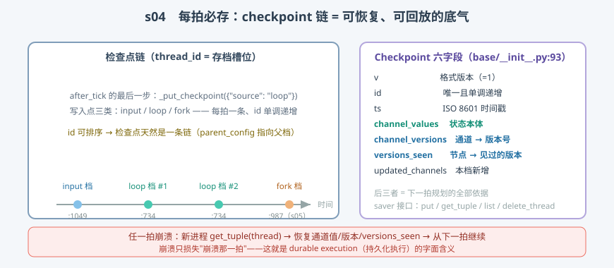

# s04: Checkpoint 每拍必存 —— 任意一拍可恢复的全部家底

[s03](../s03_apply_writes/) → **s04** → [s05_time_travel](../s05_time_travel/) → ... → [s10](../s10_capstone/)

> LangGraph 敢说 **durable execution（持久化执行）**，靠的是一个朴素的纪律：**每一拍结束都写一份检查点（checkpoint，状态快照）**。写入点就在 after_tick 里——`_put_checkpoint({"source": "loop"})`（`pregel/_loop.py:734`，实测行号）。本课拆检查点的结构与写入时机，以及四方法存取接口。
>
> **引擎层**：持久化面 —— 快照结构、写入时机、存取接口。

---

## 问题

1. **长跑 agent 崩在第 37 步怎么办？** 从头重跑 = 37 步的 API 调用与 token 全部白烧。能不能"从崩溃那一拍继续"？
2. **"短期记忆"是怎么实现的？** 同一个会话第二次 invoke 时，上一轮的消息还在——没有魔法，靠的是什么落在磁盘上？
3. **快照要存什么才够？** 只存"状态值"够恢复执行吗？下一拍该跑谁，这个信息也存在快照里吗？
4. **存档频率怎么定？** 每 N 拍存一次省 I/O，但崩溃要回退 N 拍——LangGraph 为什么选了"每拍必存"这个最奢侈的档位？

---

## 解决方案



| 机制 | mini 版 | LangGraph 真实实现 |
|------|---------|--------------------|
| **Checkpoint 六字段** | `Checkpoint` dataclass | `libs/checkpoint/langgraph/checkpoint/base/__init__.py:93-124` |
| **每拍必存** | `after_tick` 末尾 `saver.put(...)` | `_loop.py:734`；`durability="sync"` 时主循环等落盘（`main.py:2995-2996`） |
| **三类写入点** | input / loop（/fork 见 s05） | input `_loop.py:1049`、loop `:734`、fork `:987` |
| **Saver 接口** | `MiniSaver.put/get_tuple/list` | `BaseCheckpointSaver`（`base/__init__.py:177`）：`put` :278 / `get_tuple` :240 / `list` :254 / `delete_thread` :321 |
| **thread_id 槽位** | `storage[thread_id]` 一条链 | compile docstring（`state.py:1214` 一带）：同一 thread 反复 invoke 状态自动续接 |
| **父档指针** | `parent_config` | `CheckpointTuple.parent_config`（`base/__init__.py:140-147`）——检查点天然是链 |

一条总纲：**id 单调递增 + 每拍一条 = 检查点链；链既是恢复点，也是时间旅行（s05）的铁轨。**

---

## 工作原理

`code.py` 在 s02 的引擎上把存档织进 `after_tick`，三个场景：

**场景 1（数检查点链）**：三节点图 `planner → reviewer → archiver` 跑完后，`saver.list("t1")` 给出 4 条档（input + 3 拍），id 单调递增。顺带一个反例注释：如果 archiver 也写 `plan`，reviewer 会被重新唤醒、循环到 `recursion_limit`——死环在图结构里，不在引擎里。

**场景 2（崩溃恢复）**：`reviewer` 在第 2 拍抛异常（模拟数据库断连）。关键观察：**崩溃那一拍的存档照样落盘**（失败任务的写入为空，但拍本身收尾了）——然后"新进程"用全新的引擎对象 `get_tuple` 取最新档，恢复通道值、版本号、`versions_seen` 三样东西，`tick` 的规划逻辑一行未改、无缝续跑到 `done`。崩溃只损失崩溃那一拍。

**场景 3（六字段核对）**：打印一份真实档的 `v / id / ts / channel_values / channel_versions / versions_seen / updated_channels`，逐一对照 `base/__init__.py:93-124` 的字段注释。

**跑一跑**（零依赖，离线）：

```bash
python code.py
```

预期输出：场景 1 四条档、场景 2 崩溃与续跑 `done`、场景 3 六字段清单。

> 一个诚实的简化：mini 的续跑靠"失败任务不落 versions_seen 账"重新触发；真实引擎走的是另一条路——把上次成功任务的写入从 pending 落回（`_reapply_writes_to_succeeded_nodes`，`_loop.py:752`，跳过 ERROR/INTERRUPT 等控制信号），失败任务保持空写入、由 runner 重跑。两种做法同一目的，s06 恢复 interrupt 时还会再遇到它。

---

## 对照真实源码

| mini 实现 | 真实代码 | 学习点 |
|-----------|---------|--------|
| `Checkpoint` | `libs/checkpoint/langgraph/checkpoint/base/__init__.py:93-124` | 六字段 + updated_channels；id 可排序（:98-102） |
| 每拍写入点 | `libs/langgraph/langgraph/pregel/_loop.py:734`（函数体 `:1097` 起） | after_tick 的最后一步就是存档 |
| input/fork 档 | 同上 `:1049` / `:987` | source 三分：input / loop / fork |
| sync 落盘等待 | `libs/langgraph/langgraph/pregel/main.py:2995-2996` | `durability="sync"` 时 `await _put_checkpoint_fut` |
| `MiniSaver` | `libs/checkpoint/langgraph/checkpoint/base/__init__.py:177`（`put` :278，`get_tuple` :240，`list` :254） | 接口只有四方法，Sqlite/Postgres 各自实现 |
| 崩溃后续跑 | `libs/langgraph/langgraph/pregel/_loop.py:752-765` | `_reapply_writes_to_succeeded_nodes` 跳过控制信号 |

> 行号以快照 7daa3ab 为准、`sed -n 'Np'` 逐条实测；`_loop.py` 因中文导读注释行号比上游下移约 12 行（上游 `_put_checkpoint` 调用在 :718）。

---

## 自测

1. Checkpoint 的 `channel_versions` 与 `versions_seen` 为什么必须和 `channel_values` 存在一起？只存值的话，恢复后丢的是什么能力？
2. "每拍必存"比"每 N 拍存一次"多花了什么、买到了什么？什么业务场景会选后者的变体（提示：`durability` 参数）？
3. 崩溃那一拍的存档为什么照样存在？失败任务的写入此刻在引擎的哪里？

下一课 [s05_time_travel](../s05_time_travel/)：沿着检查点链回到任意一拍——回放与分叉。
