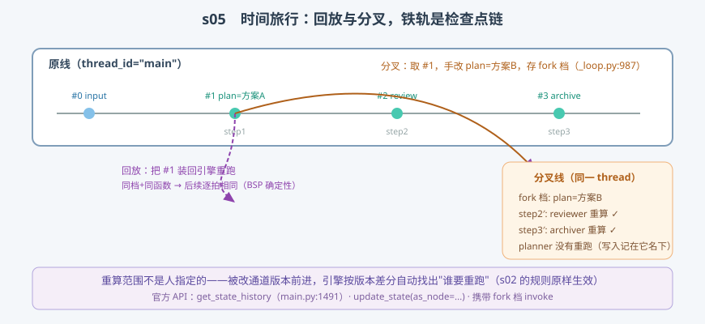

# s05: Time Travel —— 从检查点回放与分叉

[s04](../s04_checkpoint/) → **s05** → [s06_interrupt](../s06_interrupt/) → ... → [s10](../s10_capstone/)

> s04 说"每拍必存"是纪律；本课说它**是产品能力**。链上任意一拍都能装回引擎：原样重跑叫**回放（replay）**，手改一处再跑叫**分叉（fork）**——分叉档以 `source="fork"` 落盘（`_loop.py:987`，实测），原链一条不减。这和 s08（deepseek 课程）"日志不动、投影动"是同一条设计哲学：**历史不可变，分叉只是新历史**。
>
> **引擎层**：时间面 —— 回放、分叉、重算范围的自动判定。

---

## 问题

1. **agent 第 3 步跑歪了，想改第 2 步的输入重试**——从头跑一遍太贵（重烧 token），能不能只重算下游？
2. **调试时想"精确复现上一次的怪行为"**——LLM 输出带随机性，怎么保证从第 k 拍重跑得到和当时一模一样的后续？
3. **分叉会不会污染原历史？** 改了第 2 拍的状态，第 3 拍的原始记录还在吗？
4. **重算范围谁来定？** 人指定"重跑 reviewer"太脆弱（漏掉依赖它的 archiver）——有没有机制自动算？

---

## 解决方案



| 机制 | mini 版 | LangGraph 真实实现 |
|------|---------|--------------------|
| **取历史链** | `saver.list(thread_id)` | `get_state_history`（`pregel/main.py:1491`），逐条给 `CheckpointTuple` |
| **回放** | 恢复快照 → 从该 step 继续跑 | 携带历史中的 config 重新 invoke（BSP 确定性保证逐拍一致） |
| **分叉存档** | `fork()`：手改 + `source="fork"` | `_loop.py:987` `_put_checkpoint({"source": "fork"})`；上游 fork 判定 `:976-982` |
| **手改归属** | `as_node`：写入记在它名下 | `update_state(config, values, as_node=...)`（`main.py` 对应入口） |
| **重算范围** | 版本差分自动判定 | 与 s02 同一套规则：`_triggers`（`_algo.py:1272`）比较 versions_seen |
| **历史不可变** | fork 档追加，原链不动 | checkpoint 链只追加（id 单调递增，`base/__init__.py:98-102`） |

一条总纲：**历史不可变；分叉 = 在历史旁边开一条新链，重算范围引擎自己算。**

---

## 工作原理

`code.py` 在 s04 引擎上加了 `restore`（装回快照）与 `fork`（分叉），三个场景：

**场景 1（原线）**：三节点链跑完，得到 4 条档（input + 3 拍）。

**场景 2（回放）**：把 step1 的档装回引擎重跑，逐拍比对 `channel_values`——与原线**完全一致**。这就是 s02 埋的伏笔兑现：BSP 拍间统一写入带来确定性重放，同档 + 同函数 = 同样的每一拍。

**场景 3（分叉）**：取 step1 档，把 `plan` 手改成"方案B"，写入**记在 `as_node="planner"` 名下**——planner 自己的 versions_seen 同步推进（所以它不重跑），但 `plan` 的版本前进了，reviewer/archiver（见过旧版本）被自动唤醒。输出里能看到两条链并排：原线 4 条一条不减，分叉线从 fork 档向下生长。**重算范围没有一行是手工指定的。**

一个值得停一停的细节：`fork()` 里"把写入记到 as_node 名下"是 `update_state(as_node=...)` 语义的精髓——如果不记，planner 会因为自己"写的"新版本被再次唤醒（自己重跑自己）；记了，唤醒的只有下游。

**跑一跑**（零依赖，离线）：

```bash
python code.py
```

预期输出：场景 2 逐拍 `相同=True`、场景 3 原线 4 条 + 分叉 3 条并列。

---

## 对照真实源码

| mini 实现 | 真实代码 | 学习点 |
|-----------|---------|--------|
| `saver.list` | `libs/langgraph/langgraph/pregel/main.py:1491`（`get_state_history`） | 沿链回溯，逐条产出 CheckpointTuple |
| `fork()` 存档 | `libs/langgraph/langgraph/pregel/_loop.py:987` | `source="fork"`；`:976-982` 清理过期 INTERRUPT 残留写入 |
| `as_node` 归属 | `main.py` 的 `update_state`；`_loop.py:1049` 一带的 input 写入路径 | 归属节点的 versions_seen 随写入推进 |
| 回放确定性 | `pregel/main.py:2970-2974` 官方 BSP 注释 | "第 N 拍写入第 N+1 拍可见"的同义反复：同状态必同下一拍 |
| `restore()` | `base/__init__.py:93-124` 六字段 | 值 + 版本 + versions_seen 三样齐备即可复活 |

> 行号以快照 7daa3ab 为准、`sed -n 'Np'` 逐条实测；`_loop.py`、`main.py` 因中文导读注释行号比上游下移约 11-12 行。

---

## 自测

1. 回放为什么能逐拍一致？如果某个节点函数内部用了"当前时间"或随机数，哪条性质就破了？该怎么补救？
2. `as_node` 如果不填（默认归属根），planner 会在分叉后重跑吗？推演一遍 versions_seen 的变化。
3. 分叉的 fork 档 `parent_config` 指向谁？这条链对"评测 agent 的 A/B 实验"有什么用？

下一课 [s06_interrupt](../s06_interrupt/)：interrupt / human-in-the-loop——存档挂起，人类输入后从节点头重跑。
