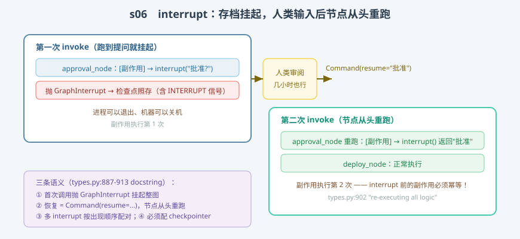

# s06: Interrupt / Human-in-the-Loop —— 存档挂起，重跑恢复

[...](../s05_time_travel/) → **s06** → [s07_subgraph](../s07_subgraph/) → ... → [s10](../s10_capstone/)

> LangGraph 的人在环原语是 `interrupt`（`types.py:887`，实测行号），它的三条语义全在 docstring 里：**抛异常挂起；恢复时整个节点从头重跑（"re-executing all logic"，:902）；多 interrupt 按出现顺序配对（:905-907）；必须配 checkpointer（:912）**。机制上是 s04/s05 的组合拳：挂起 = 那一拍照常存档；恢复 = 从存档把节点重新规划出来。
>
> **引擎层**：人在环 —— 挂起信号、恢复账本、重跑语义。

---

## 问题

1. **审批要等几小时，进程等不起**。claude-code 的权限确认是同步弹窗（进程阻塞在回调上）；要等一个"下周一才回复"的审批，怎么让进程敢退出？
2. **恢复时代码从哪里继续？** 精确恢复到 `interrupt()` 那一行的下一行，在 Python 里做不到——那 LangGraph 的"恢复"到底恢复到哪？
3. **节点里问了两个问题**，恢复值怎么知道哪个配哪个？
4. **为什么没有 checkpointer 直接报错**？interrupt 不是抛个异常就行了吗？

---

## 解决方案



| 机制 | mini 版 | LangGraph 真实实现 |
|------|---------|--------------------|
| **挂起** | `MiniInterrupt.interrupt()` 抛 `GraphInterrupt` | `interrupt()`（`types.py:887`），异常类型 `GraphInterrupt` |
| **中断入账** | pending_writes 里 `(节点, INTERRUPT, 问题)` | `Runner.commit`（`_runner.py:584-590`）：GraphInterrupt → `put_writes` 存 INTERRUPT |
| **拍照存档** | 挂起那一拍照样 `saver.put` | `_loop.py:734` 每拍必存——中断拍不例外（④的由来） |
| **恢复值配对** | resume_values 列表按序消费 | resume map（`_algo.py:1292` `_scratchpad` 的 resume_map；顺序配对 :905-907） |
| **重跑调度** | 挂起节点靠 pending 重新上榜；完成后账目清除 | `_loop.py:752` `_reapply_writes_to_succeeded_nodes` 跳过 ERROR/INTERRUPT/RESUME → 任务保持空写入 → runner 重跑 |
| **恢复调用** | `command_resume(value)` | `Command(resume=...)`（`types.py:851`，resume 字段） |

一条总纲：**中断是一次普通拍（有存档）；恢复是一次普通重跑（从节点头）——没有特例路径。**

---

## 工作原理

`code.py` 的 `MiniInterrupt` 类是 interrupt 的实现核心：首次调用抛 `GraphInterrupt`；恢复后按序吐值。三个场景：

**场景 1（审批流）**：`approval_node` 先调风控接口（副作用），再 `interrupt()` 问人。第一次 invoke 输出可见：副作用执行 1 次 → 挂起 → 存档里带 `pending_writes`（INTERRUPT 信号）——**进程此刻可以退出**。第二次 invoke（`Command(resume="批准")`）：节点**从头重跑**，副作用再执行 1 次（共 2 次），`interrupt()` 这次返回"批准"，`deploy_node` 接力完成。**副作用执行了两次就是"re-executing all logic"的实感**——interrupt 之前的 API 调用必须幂等，或挪到 interrupt 之后。

**场景 2（两个 interrupt）**：一个节点问 Q1/Q2，挂起两次、恢复两次。输出显示 Q1 配第一个 resume 值、Q2 配第二个——**按节点内出现顺序配对**（:905-907），这也是为什么每次重跑要把"已消费序号"清零重配。

**场景 3（无 checkpointer 报错）**：`"To use interrupt, you must enable a checkpointer."`——中断依赖存档，没有存档就没有"挂起点"（:912）。

**跑一跑**（零依赖，离线）：

```bash
python code.py
```

预期输出：场景 1 副作用两次 + 终态 `deployed='ok'`、场景 2 两次挂起后 `form='气象站 / 100'`、场景 3 预期报错。

---

## 对照真实源码

| mini 实现 | 真实代码 | 学习点 |
|-----------|---------|--------|
| `MiniInterrupt.interrupt` | `libs/langgraph/langgraph/types.py:887-913`（docstring 即规范） | 三条语义 + 官方示例 |
| 中断入账 | `libs/langgraph/langgraph/pregel/_runner.py:584-590`（`commit`） | GraphInterrupt → `put_writes` 存 INTERRUPT 写入 |
| 挂起拍照存档 | `libs/langgraph/langgraph/pregel/_loop.py:734` | 与普通拍同一存档点 |
| 恢复调度 | `libs/langgraph/langgraph/pregel/_loop.py:752-765` | `_reapply_writes_to_succeeded_nodes` 跳过控制信号（ERROR/INTERRUPT/RESUME），中断任务保持空写入 → 重跑 |
| resume map | `libs/langgraph/langgraph/pregel/_algo.py:1292-1302`（`_scratchpad`） | 恢复值按任务隔离、按序配对 |
| `Command(resume=...)` | `libs/langgraph/langgraph/types.py:827-852`（`resume` 字段 :851） | 恢复调用的官方入口 |

> 行号以快照 7daa3ab 为准、`sed -n 'Np'` 逐条实测；`_loop.py`、`_runner.py`、`_algo.py` 因中文导读注释行号比上游下移约 11-12 行。

---

## 自测

1. interrupt 恢复为什么不能"精确恢复到中断行"，而要整节点重跑？这个设计把什么责任转嫁给了节点作者？（提示：副作用幂等）
2. 节点里第一次 interrupt 拿到值、走到第二个 interrupt 又挂起——第二次恢复时第一个 interrupt 为什么还能拿到值？账本是怎么重放的？
3. 对照 01-claude-code 的 `canUseTool` 同步回调：两者各适合什么审批时长？分界线由哪个技术事实决定（进程生命周期）？

下一课 [s07_subgraph](../s07_subgraph/)：把整张图当作另一个图的节点——状态隔离与 checkpoint 命名空间嵌套。
