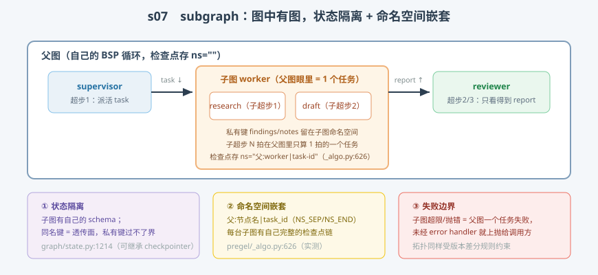

# s07: Subgraphs 嵌套图 —— 图中有图，状态隔离与命名空间

[s06](../s06_interrupt/) → **s07** → [s08_send_mapreduce](../s08_send_mapreduce/) → ... → [s10](../s10_capstone/)

> 多 agent 系统的基本形状是"图里有图"：监督者把一个子任务整个交给一台子 agent，拿回结果继续。LangGraph 的做法朴素到惊人——**子图就是一个编译好的 CompiledStateGraph，`add_node` 时它和普通函数是同一种东西**（节点是 Runnable，函数只是最短的那种 Runnable）。子图自带的 BSP 循环在父图眼里只是"一个任务多跑了会儿"。
>
> **引擎层**：组合面 —— 状态隔离、命名空间嵌套、失败边界。

---

## 问题

1. **子 agent 的草稿、中间笔记要不要进父图状态？** 全部上浮会让父状态变成垃圾场，全部隐藏又没法交接——边界画在哪？
2. **子图的执行历史存在哪？** 父图每拍有检查点，子图自己也是一台 BSP 引擎——它的逐拍历史要是混进父图的链里，回放就乱了。
3. **子 agent 崩了算谁的？** 监督者要不要为子 agent 的死循环负责？
4. **两个节点 A、B 想拆成子图复用**，但它们和外界通信用的键名各不相同——强行共用一个 schema 合理吗？

---

## 解决方案



| 机制 | mini 版 | LangGraph 真实实现 |
|------|---------|--------------------|
| **子图即节点** | `Node("worker", SubgraphSpec(...), ["task"])` | 编译图作为 node 传入 `add_node`（`graph/state.py:388-679` 的节点归一化路径） |
| **状态隔离** | `input_keys` / `output_keys` 是唯一透传面 | 子图有自己的 schema；同名键自然透传，私有键不外泄 |
| **checkpointer 继承** | 子循环直接用父 saver | `state.py:1214` docstring："may inherit the parent graph's checkpointer when used as a subgraph" |
| **命名空间嵌套** | 存档 ns=`父:worker\|task-id` | `_algo.py:626`：`checkpoint_ns = f"{parent_ns}{NS_SEP}{name}"`，task ns 追加 `NS_END + task_id` |
| **子图逐拍存档** | 子循环每拍 `saver.put(ns=task_ns)` | 同上——Studio 里能看到子图逐拍历史就是这个 ns 树 |
| **失败边界** | 子图 out_of_steps → 父图任务异常上抛 | 节点异常未经 error handler 时 invoke 直接抛给调用方（`_runner.py:222-232` 一带的路由逻辑） |

一条总纲：**子图的 N 拍在父图里只算 1 拍的一个任务——嵌套即递归，无需任何特殊机制。**

---

## 工作原理

`code.py` 的 `SubgraphSpec` 描述一张子图（自己的节点表 + 自己的键集 + 透传面），父循环执行到它时现场起一台新的 `MiniLoop`。三个场景：

**场景 1（透传与隔离）**：父图 `supervisor → worker(子图) → reviewer`。输出里可见：子图内部跑了 2 个子超步（research → draft），`task` 进、`report` 出；父图终态 keys 里**没有** `findings`/`notes`——子图私有键从未过界。顺带一个反例注释：若把 `task` 也放进 `output_keys`（worker 触发又回写同一键），worker 会自我唤醒无限循环——**子图拓扑同样受 s02 版本差分规则约束**。

**场景 2（命名空间嵌套）**：存档桶打印两行——父图 `ns=""` 4 条档，子图 `ns=":worker|task-…"` 3 条档（input + 2 拍）。这就是 `_algo.py:626` 那两行字符串拼接的产物：每台子图拥有自己完整的检查点链，s05 的时间旅行对子图逐拍历史原样可用。

**场景 3（失败边界）**：子图内造一个自环节点、步数上限设为 2——子图 `out_of_steps` 以 `RuntimeError` 上抛，父图 `invoke` 直接收到异常（真实引擎：节点异常未经 error handler 时同样向调用方抛出）。边界清晰：子图的死循环是子图的锅，但监督者要决定要不要兜。

**跑一跑**（零依赖，离线）：

```bash
python code.py
```

预期输出：场景 1 父图终态 keys 不含私有键、场景 2 两个命名空间各自一条链、场景 3 预期异常。

---

## 对照真实源码

| mini 实现 | 真实代码 | 学习点 |
|-----------|---------|--------|
| 子图作为节点 | `libs/langgraph/langgraph/graph/state.py` `add_node`（:388 起多个重载） | Runnable 归一化：函数与编译图同一挂法 |
| 命名空间嵌套 | `libs/langgraph/langgraph/pregel/_algo.py:626-635` | `parent_ns + NS_SEP + name`，task ns 追加 task_id |
| checkpointer 继承 | `libs/langgraph/langgraph/graph/state.py:1214`（compile docstring） | 子图不传 checkpointer 时继承父图 |
| 子图逐拍检查点 | `libs/langgraph/langgraph/pregel/_loop.py:734`（子图实例同一入口） | ns 不同、机制相同 |
| 失败传播 | `libs/langgraph/langgraph/pregel/_runner.py:222-232` | 异常路由给 error handler 节点，未配置则上抛 |
| 多子图并行 | `libs/langgraph/langgraph/pregel/_algo.py:563-606`（PUSH 任务路径，s08 展开） | 同拍多个子图任务天然并发 |

> 行号以快照 7daa3ab 为准、`sed -n 'Np'` 逐条实测；`_algo.py`、`state.py` 因中文导读注释行号比上游下移约 12 行。

---

## 自测

1. "同名键透传"如果改成"子图必须声明映射（父键→子键）"，会多买到什么、多付出什么？（LangGraph 为什么选了前者？）
2. 子图的逐拍历史在哪个命名空间下？想给第 2 个子图任务的第 1 子拍做时间旅行，操作路径是什么？
3. supervisor 派活时把 `task` 写了两遍（写完子图又回来写）会发生什么？用版本差分推演。

下一课 [s08_send_mapreduce](../s08_send_mapreduce/)：Send / Map-Reduce——运行时才知道扇出几个，怎么办。
