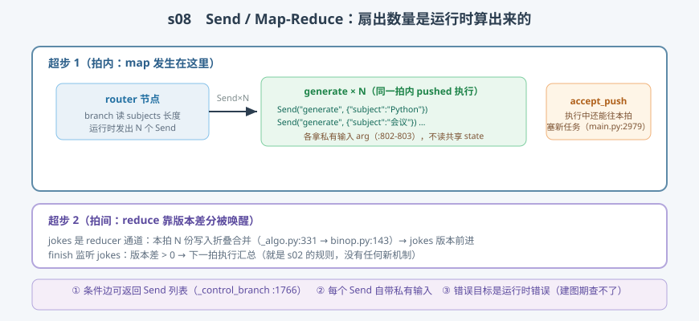

# s08: Send / Map-Reduce —— 运行时决定扇出

[...](../s07_subgraph/) → **s08** → [s09_command](../s09_command/) → ... → [s10](../s10_capstone/)

> 静态图的拓扑建图期就定了，但 agent 常见的需求是**运行时才知道要并行多少路**：主题列表 3 个就开 3 路研究、7 个开 7 路。LangGraph 的答案是 `Send`（`types.py:732`，实测）——条件边返回一叠 Send，每个自带**私有输入**，目标节点在**同一拍内**被追加执行（`main.py:2979` 的 `schedule_task=loop.accept_push`，实测）。
>
> **引擎层**：动态面 —— push 任务、私有输入、map-reduce 折叠。

---

## 问题

1. **扇出数量建图期不知道**：条件边只能"选路"，不能"造路"——怎么让一张图动态长出 N 个并行任务？
2. **并行任务的输入各不相同**：3 个研究任务读同一份共享 state 就互相踩了——每个任务的私有输入放哪？
3. **结果怎么汇？** N 个任务各交一份结果，汇总通道被同拍写 N 次——这不就是 s03 的写冲突吗？
4. **错误谁管**：Send 指向的节点不存在，建图期能查出来吗？

---

## 解决方案



| 机制 | mini 版 | LangGraph 真实实现 |
|------|---------|--------------------|
| **Send 原语** | `Send(node, arg)` 两个属性 | `types.py:732`（`node`/`arg` :802-803；docstring 即 map-reduce 教材） |
| **条件边发 Send** | `branch` 返回 `[Send(...), ...]` | `graph/state.py:1595-1602`（packets `str \| Send`）；`_control_branch` :1766 把 Send 转 `(TASKS, value)` 写入 |
| **同拍追加执行** | pushed 任务当拍跑完 | `main.py:2979-2982`：`schedule_task=loop.accept_push`——runner 执行中接受新任务 |
| **私有输入** | `push_input=True`：目标节点拿 arg | pushed 任务以 Send.arg 为输入，不走共享 state（`_algo.py` PUSH 任务路径 :563-606） |
| **reduce 汇总** | `jokes` 用 ReducerChannel 折叠 | `_algo.py:331` 调通道 update（s03 的规则，原样适用） |
| **下一拍收尾** | finish 监听 jokes 版本 | 版本差分触发（s02 `_triggers` :1272）——reduce 阶段零新机制 |

一条总纲：**map 在拍内（accept_push），reduce 在拍间（版本差分）——动态并发没有引入任何新引擎机制。**

---

## 工作原理

`code.py` 给引擎加了 `branch`（出口条件边）与 pushed 任务执行，三个场景：

**场景 1（Map-Reduce 全程）**：router 的 branch 读 `subjects`（3 个主题），发出 3 个 `Send("generate", {...})`；输出可见 3 个 pushed 任务**在同一超步内**各拿私有输入执行，写入 `jokes` reducer 通道；下一拍 `finish` 被 jokes 的版本差唤醒做汇总。push 账本显示 3 次扇出都记在超步 1。

**场景 2（换输入换拓扑）**：同一张图定义，输入 2 个主题执行 2 路、5 个主题执行 5 路——**图定义零改动**。这就是"Send 把拓扑从建图期搬到运行期"的字面演示。

**场景 3（失败路径）**：`Send("ghost_node")` 指向不存在的节点——运行时 `RuntimeError`。建图器没法检查"运行时才知道"的目标，这是动态扇出用静态安全换的代价（真实引擎同样在 push 时刻才报错）。

**跑一跑**（零依赖，离线）：

```bash
python code.py
```

预期输出：场景 1 三路并行后汇总、场景 2 两组扇出数字、场景 3 预期报错。

---

## 对照真实源码

| mini 实现 | 真实代码 | 学习点 |
|-----------|---------|--------|
| `Send` 类 | `libs/langgraph/langgraph/types.py:732`（属性 :802-803） | node + arg，可哈希可比较 |
| branch 发 Send | `libs/langgraph/langgraph/graph/state.py:1766-1789`（`_control_branch`） | Send → `(TASKS, value)`；Command.goto 也走这（s09 伏笔） |
| 条件边签名 | `libs/langgraph/langgraph/graph/state.py:1595-1602` | packets 类型 `Sequence[str \| Send]` |
| accept_push | `libs/langgraph/langgraph/pregel/main.py:2979-2982` | 执行中的任务可向本拍追加任务 |
| PUSH 任务规划 | `libs/langgraph/langgraph/pregel/_algo.py:563-606` | pushed 任务不走版本触发，走 PUSH 路径 |
| reduce 折叠 | `libs/langgraph/langgraph/pregel/_algo.py:331` → `channels/binop.py:143` | 同拍 N 写 reducer 键 = N 次折叠（s03 规则） |

> 行号以快照 7daa3ab 为准、`sed -n 'Np'` 逐条实测；`_algo.py` 因中文导读注释行号比上游下移约 12 行。

---

## 自测

1. Send 任务的输入为什么必须是"私有 arg"而不是共享 state？如果不做隔离，map-reduce 会撞上 s03 的哪条规则？
2. "扇出发生在拍内、汇总发生在拍间"——为什么 reduce 阶段不需要任何新机制？是谁在什么时机唤醒了 finish？
3. accept_push 允许"执行中的任务追加本拍任务"——如果每个 pushed 任务又发 10 个 Send，会不会失控？什么参数兜底？

下一课 [s09_command](../s09_command/)：Command 与多 agent 交接——goto 和 update 的组合语义。
