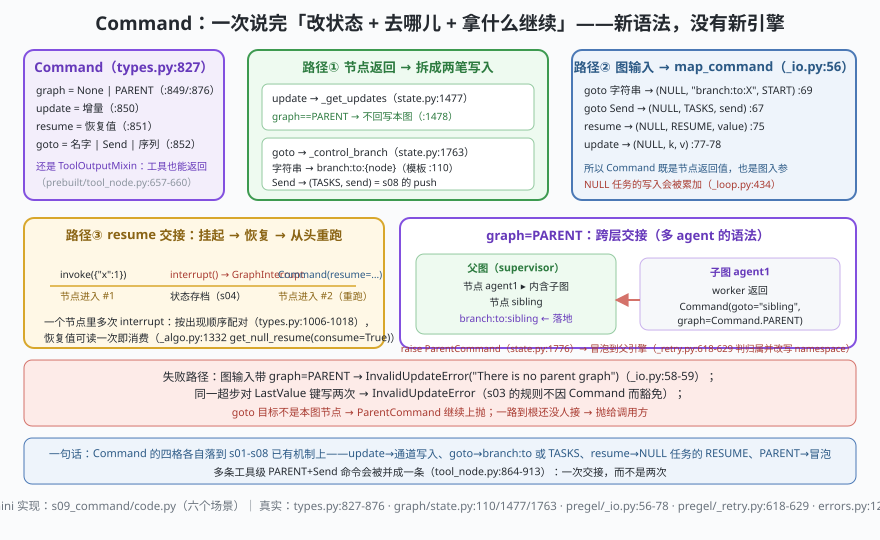

# s09: Command —— 状态更新、走向与恢复值的组合语义

[s08](../s08_send_mapreduce/) → **s09** → [s10_capstone](../s10_capstone/)（收官）

> s08 的 `Send` 让**边**能长出新任务；`Command` 让**节点返回值**同时表达三件事：改状态（`update`）、去哪儿（`goto`）、拿什么继续跑（`resume`）。它是 LangGraph 里多 agent 交接的语法。`types.py:827`（实测）：
>
> ```python
> class Command(Generic[N], ToolOutputMixin):   # :827 —— 注意它同时是合法的工具输出
>     graph: str | None = None                  # :849  None=当前图；Command.PARENT=最近的父图
>     update: Any | None = None                 # :850  写进状态的增量
>     resume: dict[str, Any] | Any | None = None#: :851  恢复 interrupt 的值（可用 id→值 的 mapping）
>     goto: Send | Sequence[Send | N] | N = ()  # :852  节点名 / Send / 它们的序列
>     PARENT: ClassVar = "__parent__"           # :876
> ```
>
> **引擎层**：控制面 —— 节点返回值与图入参共用一个类型，跨层命令靠冒泡。

---

## 问题

1. **节点想"改状态并决定下一站"**，怎么办？只返回 dict 就只能等边/条件边裁决；用 `add_conditional_edges` 又要为"顺手改一个键"额外绕一层。
2. **条件边只能选路，不能改状态**——那"改状态 + 跳转"是不是必须两次表达、两个时机？
3. **interrupt 之后靠什么继续？** s06 里恢复值从 `Command(resume=…)` 来，可这个值到底写进哪儿、第二次 interrupt 拿第几个？
4. **子图里的节点想把下一棒交给"兄弟 agent"**（supervisor 拓扑最常见的动作）——它凭什么能指挥父图的边？

---

## 解决方案



`Command` 没有引入新引擎，它把四条已有通路包进一个类型：

| 落地路径 | mini 版（`code.py`） | LangGraph 真实实现 |
|----------|---------------------|--------------------|
| **节点返回的 update** | `get_updates()`：`graph==PARENT` 就**不回写本图** | `graph/state.py:1477-1484`（`_get_updates`）；元组来自 `Command._update_as_tuples()`（`types.py:861`） |
| **节点返回的 goto** | `control_branch()`：字符串 → 写 `branch:to:{node}`；`Send` → `(TASKS, send)`；`END` → 不写 | `state.py:1763-1789`（`_control_branch`，模板 `_CHANNEL_BRANCH_TO = "branch:to:{}"` 在 :110） |
| **branch 通道是什么** | `Ephemeral`（拍后即焚）+ 它是节点的**触发器** | `state.py:1538-1546`：`EphemeralValue(Any, guard=False)`（`defer` 节点用 `LastValueAfterFinish`），`triggers=[branch_channel]` |
| **图输入是 Command** | `map_command()`：四格分别变成 `(NULL_TASK_ID, …)` 写入 | `pregel/_io.py:56-78`：goto→:67/:69，resume→`yield (NULL_TASK_ID, RESUME, cmd.resume)` :75，update→:77-78 |
| **NULL 任务的写入** | `_write` 累加，不清同任务旧值 | `pregel/_loop.py:434-446`：`task_id == NULL_TASK_ID` 时**累加**（特殊通道除外） |
| **resume 值的配对** | `read_resume(idx)`：按出现顺序取，取不到就 `GraphInterrupt` | `types.py:1006-1018`（顺序配对 + 写回 `(RESUME, scratchpad.resume[:idx+1])`）、`_algo.py:1332` `get_null_resume(consume)` |
| **跨层交接** | 子图抛 `ParentCommand` → 父引擎判 `goto` 是否命中本图节点 → 命中就落地，否则继续冒 | `state.py:1775-1776`（`raise ParentCommand(command)`）、`_retry.py:618-629`（给自己的图就地 `w.invoke(cmd, config)`；给父图的 `replace(cmd, graph=父 namespace)` 后 `raise`） |
| **工具也能返回** | 场景 6：两条 `PARENT + [Send…]` 合并成一条 | `prebuilt/tool_node.py:657-660`（"Command 可以改状态、触发跳转、发消息"）、`:864-913`（合并多条 parent command） |

一条总纲：**`Command` 是"把两笔已有写入 + 一条已有冒泡"打包成一个返回值**。理解了 update→通道、goto→branch 通道、resume→NULL 任务写入、PARENT→`GraphBubbleUp` 家族，就没有 Command 特有的规则要背。

---

## 工作原理

`code.py` 在 s08 的引擎上补出 Command 的四条通路（引擎本体仍是"通道 + 版本差分 + 同拍写入合并"）：

**场景 1（update + goto 同拍）**：`a` 返回 `Command(update={"n": 1}, goto="b")`。日志顺序就是语义：`超步 1：任务 ['a']` → `写入通道：['n', 'branch:to:b']` → `超步 2：任务 ['b']`。**状态与路由在同一拍的写入里一起生效**，b 读到的是已经更新过的 `n`。

**场景 2（goto 的四种取值）**：`goto=["c1","c2"]` 一次唤醒两个节点（两个 branch 通道都被写）；`goto=Send("c1", {...})` 走 s08 的 push 通道带私有输入；`goto=END` 什么都不写。这正是 `types.py:852` 那四行文档的类型学。

**场景 3（Command 当图输入）**：`invoke(Command(goto="worker", update={"seed": …}))`——不经 `__start__` 边直接落地，节点照样被 `branch:to:worker` 触发。同场景给失败路径：输入里带 `graph=PARENT` → `[预期报错] InvalidUpdateError: There is no parent graph`（真实文案在 `_io.py:58-59`：图输入没有父图可指）。

**场景 4（resume 的交接，本课关键手感）**：节点 `human_gate` 里两次 `read_resume(0/1)`。首轮 `invoke({"x": 1})` → 节点进入 #1 → 第 1 次取不到值 → `⏸ gate 挂起`，状态里没有 `ok`。然后 `invoke(Command(resume=["批准", "再给 5 分"]))` → 输出 `节点从头重跑，第 2 次进入`，最终 `{ok='批准 / 再给 5 分', x=1}`。**"从头重跑，不是接着跑"** 这句 s06 的话，在这里被 `reruns` 计数器打成可见的事实：节点里 interrupt 之前的副作用会再执行一次。

**场景 5（跨层交接）**：先演示"没人接"：子图独立跑时 `Command(graph=PARENT, goto="sibling")` 直接 `raise ParentCommand`（本图没有叫 sibling 的节点）。再把子图挂成父图的节点 `agent1`：子图抛出的 `ParentCommand` 冒到父引擎，父引擎看 `goto` 命中自己的 `sibling` → `↟ … 在本图落地：写入通道 ['branch:to:sibling'] + ['log']` → 超步 2 执行 sibling → 父图 `log=['worker 交棒', 'sibling 接手']`。真实侧这一跳还会把 `graph` 字段改写成父图的 checkpoint namespace（`_retry.py:626-628`），因为"父图"是相对的。

**场景 6（工具级交接）**：两个工具各返回 `Command(graph=PARENT, goto=[Send("agent_a", …)]) / ([Send("agent_b", …)])`，按 `tool_node.py:895-913` 的规则**合并成一条** parent command。意义：同一批工具调用只交接一次，不会让父图连吃两个跳转。

**跑一跑**（零依赖，离线）：

```bash
python code.py
```

预期输出：六个场景 + 末尾结论两行。重点看场景 4 的"第 2 次进入"与场景 5 的 `↟ … 在本图落地`。

---

## 对照真实源码

| mini 实现 | 真实代码（快照 7daa3ab，`sed -n 'Np'` 逐条实测） | 学习点 |
|-----------|------------------------------------------------|--------|
| `Command` 四字段 + `PARENT` | `libs/langgraph/langgraph/types.py:827`（字段 :849-:852，`PARENT` :876，`_update_as_tuples` :861） | 一个类型同时是节点返回值、图入参、工具输出（`ToolOutputMixin`） |
| `control_branch()` | `libs/langgraph/langgraph/graph/state.py:1763-:1789` | goto 的"跳"就是往 `branch:to:X` 写一下；`END` 不是节点所以不写 |
| `get_updates()` | `state.py:1477-1484`（`graph==PARENT` 直接 `return None`） | 交给父图的命令不该同时污染本图状态 |
| `Ephemeral` 通道 | `state.py:1538-1546`（`EphemeralValue(Any, guard=False)`；`defer` 用 `LastValueAfterFinish`） | 路由信号是**一次性**的：存档里没有"下次还要去 b" |
| `map_command()` | `libs/langgraph/langgraph/pregel/_io.py:56-:78` | 四格 → 四形写入；`graph=PARENT` 作为输入是错误而非特性 |
| `_write` 累加 NULL 任务 | `libs/langgraph/langgraph/pregel/_loop.py:434-446` | 恢复值/输入补丁与任务写入分池，互不覆盖 |
| `read_resume(idx)` | `types.py:1006-1018` + `pregel/_algo.py:1332`（`get_null_resume(consume=True)`） | 顺序即协议：第 n 次 interrupt 拿第 n 个恢复值，消费一次 |
| `ParentCommand` 冒泡与落地 | `state.py:1775-1776`、`pregel/_retry.py:618-629`、`errors.py:129`（`class ParentCommand(GraphBubbleUp)`） | 和 `GraphInterrupt` 同族：都是"停止本任务、把控制权交给上一层" |
| 工具返回 Command 的合并 | `libs/prebuilt/langgraph/prebuilt/tool_node.py:657-660`、:864-913 | agent 交接（handoff）在框架层就是 Command + Send，不是新协议 |

> 行号以快照 **7daa3ab** 为准，本仓带 `[中文导读]` 注释，`_algo.py`、`state.py` 等文件行号比上游下移约 12 行；升级版本后请以符号名为锚。

---

## 自测

1. `Command(update=..., goto="b")` 与"返回 update + 一条静态边 a→b"在**超步语义**上有什么不同？如果两个节点同拍都 goto 同一个 b，b 跑几次？（用 s03 的通道规则推。）
2. 场景 4 里节点重跑了两次。如果 interrupt 之前有一行"扣款"，正确做法是什么？（三条：挪到 interrupt 之后 / 幂等键 / 挪出节点。）
3. 为什么 `Command(graph=PARENT)` 作为**图输入**要报错，而作为**节点返回值**却合法？（提示：谁有父图，谁没有。）
4. ToolNode 把多条 PARENT+Send 合并成一条（`tool_node.py:895-913`）。如果不合并，supervisor 图会出现什么现象？

下一课 [s10_capstone](../s10_capstone/)：收官——把通道、超步、写入、存档、中断、Send、Command 装回一台整机，并与八家 harness 横向对照。
