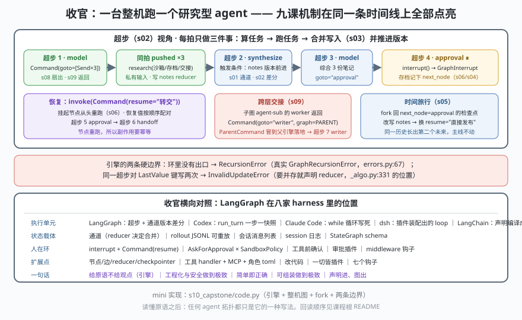

# s10: 收官 —— 一台整机与五家 harness 的横向对照

[s09](../s09_command/) → **s10**（收官）

> 前九课每课只点亮一个机制，这一课全部点亮在**同一条时间线**上：跑一个"研究型 agent"的图——`model` 扇出三个 `Send("research", …)`（s08），`research` 各写一份笔记进 reducer 通道（s01/s03），`synthesize` 靠 `notes` 的版本差被唤醒（s02），回到 `model` 综合，再跳进 `approval` 用 `interrupt()` 挂起（s06），`Command(resume="转交")` 恢复后进入 `handoff`——子图里的 worker 返回 `Command(graph=PARENT, goto="writer")`，`ParentCommand` 冒到父引擎落地（s07+s09），最后 `fork` 回挂起处的检查点换一个答复，让同一条历史长出第二个未来（s04/s05）。
>
> **引擎层**：整机 —— 所有机制在同一次运行里互相咬合的样子。

---

## 问题

1. **九块零件装回去会不会互相打架？** 扇出的写入、恢复值、跨层命令都往同一套通道上写，谁先谁后？
2. **挂起的会话能不能"回到过去"？** 想验证"如果当时人是另一个答复"，必须能取旧存档、改状态、换个起点重跑，且**不污染主线历史**。
3. **引擎的边界条件是什么？** 图里有环没出口、同拍对同一个键写两次——引擎替你兜底还是拒绝？
4. **学了 LangGraph，跟本工作区其他七家 harness 的关系是什么？** 收官要能横向说话，不然只会一种方言。

---

## 解决方案



整机 = 四条规则，没有第五条：

| 规则 | 一句话 | 覆盖的课 | 真实落点 |
|------|--------|----------|----------|
| **状态在通道里，不在节点里** | 节点只交增量，合并由通道声明的 reducer 决定 | s01 / s03 / s08 | `channels/*`，写入调 `pregel/_algo.py:331` |
| **拍是唯一的时钟** | 触发=版本差分；写入在拍尾合并；推版本在合并之后 | s02 / s06 / s09 | `pregel/main.py` 的 tick 循环、`branch:to:X`（`graph/state.py:110`） |
| **存档是拍的快照** | `channel_versions` + `versions_seen` + pending writes 决定"从哪儿继续" | s04 / s05 / s06 | `checkpoint/base/__init__.py`（`get_tuple` / `list` / `get_next_version`） |
| **冒泡是一种控制流** | `GraphInterrupt` 与 `ParentCommand` 同族：停止本任务，把控制权交给上一层 | s06 / s07 / s09 | `errors.py:50/102/129`、`_retry.py:618-629` |

一条总纲：**LangGraph 是编排引擎，不是 agent 产品。** 它把上面四条做成通用原语，agent 只是这些原语的一种用法——`create_agent` 编译出来的那张图（见 [07-langchain 的 s01/s04](../../../07-langchain/analysis_langchain/s01_agent_compile/)）跑的就是这台引擎。

---

## 工作原理

`code.py` 里 `Pregel` 是本册九课的合体（通道 / 超步 / 写入合并 / 检查点 / 中断 / pushed 任务 / Command 拆解 / fork），`build_graph()` 是跑在它上面的整机图。

**场景 1（机制总装）**：`invoke({"topic": None})` 后逐拍打日志——超步 1 `model` 扇出三个 pushed `research`（同拍执行、私有输入）、超步 2 `synthesize`（被 `notes` 版本唤醒）、超步 3 回到 `model` 综合、超步 4 `approval` **⏸ 挂起**。首轮状态里只有规划与三份笔记，**没有任何"已发布"的痕迹**——这就是检查点式人在环的手感。

**场景 2（恢复 → 交接）**：`invoke(Command(resume="转交"))` → 超步 5 `approval` **从头重跑**（这次 `interrupt()` 拿到值）→ 超步 6 `handoff` 里子图 `agent-sub` 的 worker 返回 `Command(goto="writer", graph=PARENT)` → 本图日志出现 `↟ handoff 交来的 Command 在本图落地` → 超步 7 `writer` 收尾。一次恢复里连跑了 s06 与 s09 两个机制。

**场景 3（时间旅行）**：从历史里挑出 `next_node=approval` 的那份存档（`ckpt-…`，step=4），`fork(cp_id, update={"notes": [... + "临时补一条：审计要求"]})`，再 `invoke(Command(resume="直接发布"))`——分叉里 approval 选了另一条出边直达 END。额外看点：`超步 5：任务 ['synthesize', 'approval']`——**你改写了 `notes`，监听它的 `synthesize` 就被唤醒了**，版本差分不讲情面（真实同款）。主线历史份数不变、分叉另开一条 thread（`…#fork`）：**同一条历史可以长出两个未来**（s05 的定义）。

**场景 4（两条边界）**：`ping ⇄ pong` 无出口 → `[预期报错] RecursionError`（真实 `GraphRecursionError`，`errors.py:67`）；同拍两个节点都写 `hit` 而 `hit` 是 `LastValue` → `[预期报错] InvalidUpdateError`。引擎**不替你猜**：要并存请声明 reducer（s01）。

**场景 5（横向对照）**：五个维度（执行单元 / 状态载体 / 人在环 / 扩展点 / 多智能体 / 一句话）并排打印 LangGraph、Codex、Claude Code、DeepSeek Harness、LangChain 五家。看得见的差别：LangGraph 的"人在环"是**存档 + 重跑**，Codex 的是**审批 × 沙箱双轴**；LangGraph 的扩展点是通道与节点，Codex 的是工具 handler 与角色文件，dsh 的是"一切皆插件"。

**跑一跑**（零依赖，离线）：

```bash
python code.py
```

预期输出：五个场景 + 末尾结论两行。重点看场景 1 的 `⏸ approval 挂起`、场景 2 的 `↟ … 在本图落地`、场景 3 的"两个未来"。

---

## 对照真实源码

| mini 实现 | 真实代码（快照 7daa3ab，行号实测） | 学习点 |
|-----------|-----------------------------------|--------|
| `Pregel._run` 主循环 | `libs/langgraph/langgraph/pregel/main.py`（tick 循环、`schedule_task=loop.accept_push` :2979） | 一台引擎同时服务静态边、动态扇出与命令路由 |
| `apply_writes` | `libs/langgraph/langgraph/pregel/_algo.py:331` | 写入合并只有一处；所有课都在这条线上 |
| `Checkpoint.channel_versions / versions_seen` | `libs/checkpoint/langgraph/checkpoint/base/__init__.py`（可排序 id、`get_next_version`、`get_tuple/list`） | 触发靠版本、恢复靠版本——存档格式就是执行语义 |
| `interrupt` / `resume_values` | `libs/langgraph/langgraph/types.py:887`（`interrupt`）、:1006-1018（顺序配对）、`_algo.py:1332` | 重跑不是 bug 是设计：状态在存档里，不在内存里 |
| `fork` | `libs/langgraph/langgraph/pregel/main.py`（时间旅行：`get_state_history` / `update_state` / 从旧 checkpoint 重放） | 历史是树不是线；fork 出新 thread 而非改写旧档 |
| `ParentCommand` 落地判定 | `libs/langgraph/langgraph/pregel/_retry.py:618-629`、`graph/state.py:1775-1776` | 跨层只有一种机制：抛出去，由能接的那一层落地 |
| `notes_reducer` / `LastValue` 报错 | `channels/binop.py:65/:143`、`channels/last_value.py:20/:61-64` | 冲突策略在键的声明上，不在执行引擎里 |
| 递归上限 | `libs/langgraph/langgraph/errors.py:67 GraphRecursionError` | 环必须有出口；引擎只兜底，不设计你的拓扑 |

> 行号以快照 **7daa3ab** 为准；本仓带 `[中文导读]` 注释，`_algo.py`、`state.py` 等文件行号比上游下移约 12 行。

---

## 自测

1. 场景 3 里 `fork` 把 `notes` 改了版本，于是 `synthesize` 也重跑了。如果**只想**让 `approval` 重跑，`update` 应该写哪个键？（这题考的是"触发靠版本差分"的字面理解。）
2. 整机里 `research` 是 pushed 任务（私有输入），`synthesize` 是普通节点。为什么扇出任务不需要、也不能有 `triggers`？
3. 把这台的 `approval` 换成 Codex 的做法（审批 × 沙箱双轴 + 反向 JSON-RPC 请求），需要动哪几块？（提示：LangGraph 的人在环在**节点内部**，Codex 的人在环在**执行闸口**。）
4. 若把这张图交给 `create_agent` 编译生成（07-langchain s01），哪些格子是声明出来的，哪些必须自己写？

---

## 之后的路线（本课程的回读顺序）

1. **本册十课重跑一遍**：`run.bat` / `run.sh`，然后挑两课改代码做实验——推荐 s03（把 reducer 换成覆盖，观察报错）与 s09（把 `goto` 指向不存在的节点）。
2. **回真源码**：[08-langgraph/源码解析与学习路线.md](../../源码解析与学习路线.md)（monorepo 地图 + 六阶段路线 + 附录 12 问），检出在 [../../langgraph/](../../langgraph/)（`git log -1` 应为 `7daa3ab`）；`libs/langgraph/langgraph/pregel/` 是引擎本体，`channels/` 与 `graph/state.py` 是状态面。
3. **上一层**：[07-langchain 的同款教材](../../../07-langchain/analysis_langchain/README.md)——`create_agent` 如何把声明编译成这张图（s01/s04/s05）。
4. **换立场对照**：[02-codex 的教材](../../../02-codex/analysis_codex/README.md)（服务化 + 双轴安全，收官 s10 有同题对照）、[03-deepseek-harness](../../../03-deepseek-harness/analysis_deepseek_harness/README.md)（一切皆插件）、[01-claude-code](../../../01-claude-code/analysis_claude_code/)（循环写死）、终端产品三家 [04-zcode](../../../04-zcode/analysis_zcode/README.md) / [05-openclaw](../../../05-openclaw/analysis_openclaw/README.md) / [06-opencode](../../../06-opencode/analysis_opencode/README.md)。
5. **方法论**：编排模式见 [Agent工作流编排手册](../../../workflow-handbook/Agent工作流编排手册.md)，状态与记忆见 [Context与记忆系统手册](../../../context-handbook/Context与记忆系统手册.md)，多 agent 见 [Multi-Agent协同手册](../../../multiagent-handbook/Multi-Agent协同手册.md)，评测与调优见 [Agent评测与质量工程手册](../../../eval-handbook/Agent评测与质量工程手册.md)。
