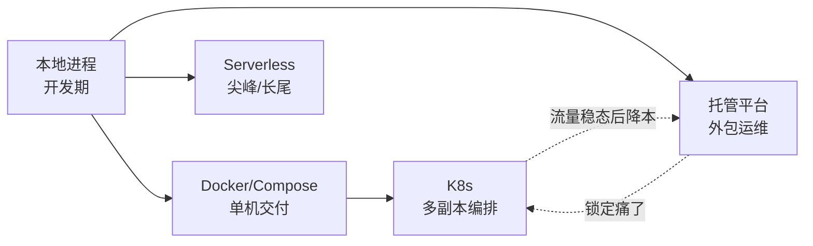
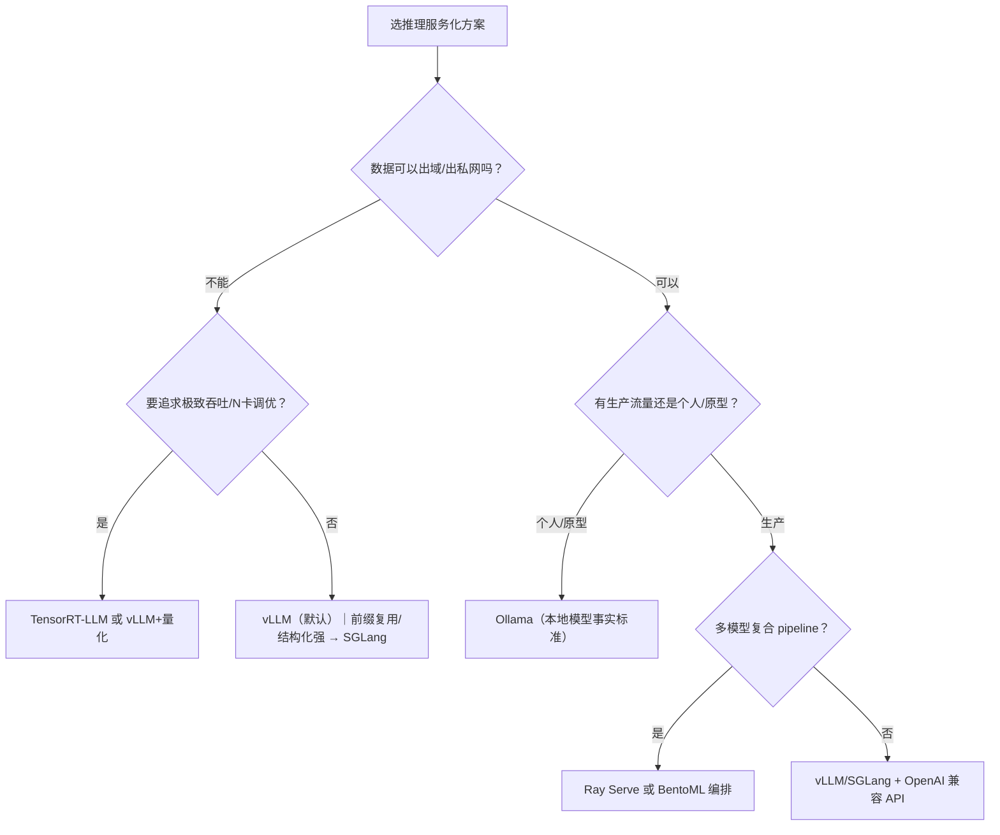
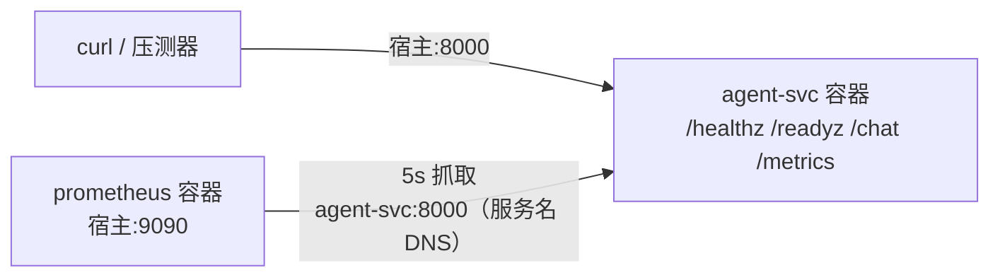

# AI 应用部署与运维手册：部署形态 · 容器化 · 推理服务化 · 网关治理 · 可观测 · 成本容量 · 发布回滚 · 企业范例 · 最小部署演练

> 信息基准日：2026-09-28。本文定位是 **AI 应用（LLM / Agent）从开发到生产的部署与运维工程**——不是通用 DevOps 教材，聚焦"模型与 agent 上生产"特有的问题：模型侧（权重放哪、谁来算、吞吐怎么来）与应用侧（agent 进程跑哪、会话怎么粘、流量怎么治）两层叠加出来的部署形态，以及推理吞吐、token 计费、灰度回滚、成本容量这些 LLM 特有的运维面。
>
> 各平台/项目的 star、版本、维护状态均为**当日经 GitHub API、官网与本文 §9 本机实操的实际抓取**，随时间漂移，以仓库与官方页面为准。本工作区惯例是结论带 `文件:行号`；本文一部分是网络调研（等价做法：**结论带来源链接**，各节末尾标 URL），一部分是本机实操（§9，**已本机验证**）。

---

## 0. TL;DR

- **部署是两层问题，别混着决策**：模型侧（参数在哪、谁来算——托管 API vs 自托管推理）与应用侧（agent 进程跑哪——本地进程 / Docker / K8s / Serverless / 托管平台）是两条正交的轴。多数选型困难源于把"用不用 K8s"和"用不用自托管模型"当成一个问题（§1.1）。
- **五档形态谱系**各有明确生态位：本地进程管开发、Docker 管单机交付、K8s 管多副本与编排、Serverless 管尖峰与长尾、托管平台管"把运维外包"（§1.2）。选型先过合规与团队规模两道硬约束，再谈成本与延迟（§1.3 判据表）。
- **托管平台已把"部署"产品化成一条流水线**：腾讯 ADP 的七步流程（开通 → 建应用 → 配知识工具 → 搭逻辑 → 调试评测 → 发布接入 → 监控运营，§1.4）就是官方给出的部署生命周期，与自建路线的"构建 → 发布 → 可观测"一一对应；其 Agent Harness（断点续跑/闲置暂停/密钥隔离托管）是把 durable execution 做成平台能力（对照 [workflow-handbook §4 Temporal](../workflow-handbook/Agent工作流编排手册.md)）。
- **容器化的四条铁律**：多阶段构建 + 依赖层先于代码层（层缓存全靠这个顺序）；**模型权重永不进镜像**（镜像可重建、权重可重下、版本用 digest 锁定）；GPU 镜像选 runtime 不选 devel；secret 永不 COPY 进镜像（§2）。
- **推理引擎格局已收敛（当日实抓）**：vLLM 92,787★/v0.30.0 是默认解，SGLang 36,481★/v0.5.20 是高性能对照，TensorRT-LLM 14,723★ 管 NVIDIA 极致性能，llama.cpp 129,687★ + Ollama 181,808★/v0.34.4 管本地与端侧。⚠️ **huggingface/text-generation-inference 已整库归档**（10,885★，最后 release v3.3.7 停在 2025-12-19）——选型必须做归档扫描，这也是多 agent 框架选型同款纪律（§3.2）。
- **吞吐三件套是理解一切推理指标的地基**：prefill 决定 TTFT、decode 决定输出速率、KV cache 决定显存；continuous batching 与 PagedAttention 把它们拼成高吞吐（§3.1）。**量化生态也在收敛**：AutoAWQ（2025-05）与 AutoGPTQ（2025-04）均已归档，vLLM 量化入口统一到 llm-compressor（vllm-project 名下，v0.14.0）；量化后的精度必须过评测集才算数（§3.3）。
- **LLM 网关与传统 API 网关的差别在计费与请求形态**：token 计费、分钟级长请求、流式响应、上游多供应商——所以限流要用 RPM/TPM 两把尺、超时要按预算分解、failover 要跨供应商（§4）。模型路由的"怎么分"在 [tuning-handbook §6.5](../tuning-handbook/Agent调优手册.md)，本文讲"怎么落"（网关侧实现，§4.4）。
- **可观测四件套**：OTel GenAI 约定（[eval-handbook §7.1](../eval-handbook/Agent评测与质量工程手册.md) 已拆协议字段，本文讲部署落地）+ LLM 专属指标（TTFT/token 速率/成本 per request/质量回归）+ 采样策略（错误全采、尾部采样）+ PII 脱敏挂在 exporter 侧（§5）。
- **成本侧四杠杆按顺序拧**：缓存命中率第一、批处理/错峰第二（API 一律 -50%）、模型路由第三、GPU 利用率第四；spot 实例官方口径 up to 90% off 但只给可中断负载（§6）。**容量算账从 KV cache 显存开始**——权重只是显存的小头，并发才是大头（§6.5）。
- **发布单元是三层组合的快照**：模型 revision × 提示词版本 × 工作流版本，单层回滚在组合里可能翻车；灰度按"质量门禁 + 成本门禁"双闸推进，回滚判据要预先写好并演练（§7，与 [workflow-handbook §6"发布≠生效"](../workflow-handbook/Agent工作流编排手册.md) 互引）。
- **§9 给了一个可复现的最小部署演练**：docker-compose 起 agent 服务 + Prometheus（健康检查、指标暴露、预算熔断、优雅停机），Docker 29.6.2 / Compose v5.3.1 本机全程验证；写它时真实踩出"空依赖表让多阶段构建翻车"等坑，全部进 FAQ（§9.5）。

**阅读路线**：选型 → §1；打包镜像 → §2；选推理引擎 → §3；治流量 → §4；看得见 → §5；算得清 → §6；发得稳 → §7；抄企业作业 → §8；30 分钟跑通演练 → §9。与既有内容的接口见 §1.4 的分工表。

---

## 1. 部署形态谱系与选型

### 1.1 两层部署问题：模型侧与应用侧分开决策

LLM 应用部署 = 传统服务部署 + 模型侧部署两层，正交组合出四个象限：

| | **托管模型 API**（OpenAI/Anthropic/百炼托管模型） | **自托管推理**（vLLM/Ollama/自建 GPU） |
|---|---|---|
| **托管应用运行时**（ADP/Bedrock AgentCore/Serverless） | 象限 A：**零运维起步**——平台管一切，代价是平台锁定与配额 | 象限 C：**平台管编排、模型自持**——私有化模型的托管形态 |
| **自托管应用**（Docker/K8s 自己跑 agent 服务） | 象限 B：**最常见的企业形态**——应用可控，模型借力 | 象限 D：**全自持**——合规/成本/延迟全掌握，运维全自担 |

两条选型规则：

1. **先定模型侧，再定应用侧**。模型侧由"合规与数据主权 + 模型自有度（微调/开源权重）+ GPU 预算"决定；应用侧由"团队规模 + 流量形态 + 现有基础设施"决定。反向决策（"我们用 K8s 所以模型也自托管"）是常见的沉没成本陷阱。
2. **象限之间可逐象限迁移，不必跳变**。象限 B（自托管应用 + 托管模型）是绝大多数团队的起点与长期形态；只有当 API 成本、数据出境或延迟成为硬约束时才向 D 迁移——而迁移的抓手正是 §2-§4：应用层本来就该容器化，模型接口本来就该走 OpenAI 兼容协议（§8.5 模式⑥），届时只换 base URL。

### 1.2 五档形态谱系

| 档位 | 是什么 | 何时选 | 代价 | 代表 |
|---|---|---|---|---|
| **本地进程** | `python agent.py` 直接跑，进程守护交给 systemd/pm2 | 开发调试、个人工具、一次性脚本 | 无隔离、无编排、环境漂移 | OpenClaw 的 gateway 本质是一台常开机器上的常驻进程（[05-openclaw §3](../05-openclaw/架构拆解.md)） |
| **Docker / Compose** | 容器化交付 + 单机编排 | 单机交付、POC、内部工具、中小流量 | 单点、扩容靠手 | §9 演练；mcp-handbook [部署三形态](../mcp-handbook/MCP搭建文档.md)的进程/容器形态 |
| **Kubernetes** | 多副本 + 编排 + 自愈 + 水平扩展 | 多副本生产流量、GPU 池、需要滚动发布与自动扩缩 | 平台工程成本高（集群本身的运维） | production-stack（§8.2）、KServe |
| **Serverless** | 函数/容器实例按请求伸缩，冷启动换免运维 | 尖峰流量、长尾低频、事件驱动任务 | 冷启动（模型加载分钟级对 serverless 是致命伤，除非权重外挂加速）、执行时长上限 | 云函数跑批处理/异步任务、ADP Agent Harness 的"闲置自动暂停" |
| **托管平台** | 平台包办运行时+观测+计费 | 团队无运维、快速上线、合规背书 | 平台锁定、配额与计费黑盒 | 腾讯 ADP、AWS Bedrock AgentCore、百炼 |

一张谱系图看迁移方向：



### 1.3 选型判据表

| 判据 | 硬约束级（一票决定） | 倾向托管平台 | 倾向自托管（Docker/K8s） |
|---|---|---|---|
| **合规/数据主权** | 数据不能出境/不能进第三方平台 → 模型必须自持或选私有化版本 | 平台企业版私有化（如 ADP 企业版含私有化部署，§1.4） | 象限 D：全自持 |
| **团队规模** | 没有专职平台工程师 → 别上 K8s | ≤10 人团队首选 | 10-50 人有 SRE 再考虑 |
| **成本结构** | GPU 闲不起 → 托管 API 按量付费更划算 | 流量波动大 | 流量平稳且大（自托管 GPU 摊薄） |
| **延迟** | P95 有硬指标 → 物理距离与专享算力说了算 | 依赖平台区域 | 自建就近部署 |
| **模型自有度** | 要微调/改推理逻辑 → 自托管推理 | 平台微调服务（Bedrock fine-tuning 等） | vLLM 全控制 |

把 §1.1 的两层判据合起来读：**合规与模型自有度定模型侧，团队规模与流量形态定应用侧**；四档里"合规硬约束"能一票否决三个象限，所以它永远是第一问。

### 1.4 托管平台横评（当日实抓）与 ADP 七步流程的通用化

| 平台 | 定位（官网口径，2026-09-28 实抓） | 与部署相关的关键能力 | 来源 |
|---|---|---|---|
| **腾讯 ADP** | 企业原生智能体底座，以 AgentOps 为核心 | 四种应用模式；**Agent Harness** 云托管运行时（断点自动续跑、闲置自动暂停、全链路 Trace、密钥隔离托管）；企业级 OpenAPI 10 大模块 100+ 接口；企微/钉钉/飞书/微信渠道接入；企业版（4,880 元/月）含自定义模型接入、可视化调试、私有化部署 | https://cloud.tencent.com/product/adp |
| **AWS Bedrock** | "building generative AI applications and agents at production scale"，10 万+ 组织在用 | **AgentCore**（any framework/model，自动鉴权/访问控制/追踪/评估，免基础设施）；Managed Agents powered by OpenAI；Intelligent Prompt Routing 成本至多 -30%；Model Distillation（up to 500% faster、至多 -75% 成本）；Guardrails | https://aws.amazon.com/bedrock/ |
| **阿里云百炼** | 全链路大模型服务与应用开发平台（MaaS） | 百余款托管模型（Qwen3.8-Max 等）；**专属部署**：模型独占吞吐，DTU 与 TPM/PTU 两种吞吐模式，动态限流；Token Plan 计费；可视化 Agent 工作流与企业 RAG | https://www.aliyun.com/product/bailian |
| **Google Vertex AI** | Google 云的 ML/Agent 平台 | Model Garden、Gemini 系列、Agent Builder、Provisioned Throughput、batch prediction（⚠️ 官网当日直连超时，本行能力清单未逐项当日复核，采用前请以官方文档为准） | https://cloud.google.com/vertex-ai |

**ADP 七步流程的通用性**（一手底稿：[fde-handbook ADP 2.3](../fde-handbook/tencent-adp-fde-course/lessons/2.3_从开发到上线：ADP_应用的完整使用流程.md)）：开通工作空间 → 创建应用并选择模式 → 配置知识库/连接器/工具 → 搭建智能体逻辑 → 对话调试与效果评测 → 发布应用与渠道接入 → 监控运营与持续优化。把平台名词翻译掉，这就是任何 AI 应用的部署生命周期：

| ADP 步骤 | 自建路线对应 | 本文落点 |
|---|---|---|
| 开通工作空间（组织/权限边界） | 账号体系、租户隔离、凭据管理 | security-handbook [§4.3](../security-handbook/AI应用安全手册.md) |
| 选择应用模式 | 部署形态与运行时选型 | §1.2 |
| 配置知识库/工具 | RAG 管线 + MCP 工具的接入与部署 | rag-handbook [§5.2 部署形态](../rag-handbook/RAG搭建文档.md)；mcp-handbook [§5.2](../mcp-handbook/MCP搭建文档.md) |
| 搭建智能体逻辑 | 应用构建（不属于本文） | workflow/multiagent/prompt 手册 |
| 对话调试与评测 | 评测集 + 灰度回放 | eval-handbook §2 |
| **发布与渠道接入** | 构建 → 灰度 → 发布 → 回滚 | §2、§4.5、§7 |
| **监控运营** | 可观测 + 成本容量 | §5、§6 |

ADP 2.3 的两条纪律值得抄进任何自建体系：**"调用凭证由后端安全保管，不能写入公开前端、URL、提示词或日志明文"**（= security-handbook §4.3 的 SecretRef 原则）；**"上线不是终点，运营反馈驱动下一轮配置、逻辑、评测和发布"**（= §7 的发布-回滚闭环是常态而非事故流程）。

### 1.5 与本工作区既有手册的分工

| 手册/资料 | 部署相关内容 | 本文分工 |
|---|---|---|
| [mcp-handbook §5.2](../mcp-handbook/MCP搭建文档.md) | MCP server 的部署三形态 | 那边讲"一个 stdio/HTTP 进程怎么部署"，本文讲整个 AI 应用栈的部署；MCP server 是应用栈里的一个组件 |
| [rag-handbook §5.2](../rag-handbook/RAG搭建文档.md) | RAG 系统的部署形态 | 那边讲检索服务怎么部署，本文把检索服务当作应用栈的一个 sidecar（§8.3 LibreChat 的 rag_api 模式） |
| [python-handbook §6/§7](../python-handbook/Python大模型应用开发手册.md) | 本地推理（vLLM/Ollama 用法）与服务界面（FastAPI+SSE） | 那边讲"怎么用"，本文讲"怎么部署与运维"；§3 只做引擎横评不重复用法 |
| [tuning-handbook §6.5/§7](../tuning-handbook/Agent调优手册.md) | 模型路由与级联降级、成本延迟工程 | 路由的"怎么分"（判据与价差）在那边，网关侧"怎么落"在本文 §4.4；价格口径两边同源 |
| [eval-handbook §7/§8](../eval-handbook/Agent评测与质量工程手册.md) | OTel GenAI 约定、可观测平台横评、成本核算 | 协议字段与平台选型在那边已拆，本文 §5 只讲部署落地（collector 架构/采样/脱敏）与 LLM 专属指标 |
| [security-handbook §4/§3.5](../security-handbook/AI应用安全手册.md) | secrets 管理、PII、合规、供应链 | 本文 §2.4/§5.4 只做部署视角的引用，不重复展开 |
| [workflow-handbook §5/§6](../workflow-handbook/Agent工作流编排手册.md) | 重试三要素、版本管理与"发布≠生效" | 本文 §4.3/§7 直接引用其军规，不重复 |
| [fde-handbook ADP 2.3](../fde-handbook/tencent-adp-fde-course/lessons/2.3_从开发到上线：ADP_应用的完整使用流程.md) | 平台化"从开发到上线"全流程 | 本文 §1.4 把它通用化；ADP 七步 = 本文 §1-§7 的平台版 |
| 六家《架构拆解》 | 各家进程模型与部署面 | §1.5 反面参照 |

> 来源：https://cloud.tencent.com/product/adp ｜ https://aws.amazon.com/bedrock/ ｜ https://www.aliyun.com/product/bailian ｜ https://cloud.google.com/vertex-ai（直连超时）

---

## 2. 容器化与镜像工程

### 2.1 多阶段构建与层缓存：顺序就是纪律

Docker 镜像是**指令序 → 层序**的投影，每条指令一层；构建缓存的失效规则是**某层输入变了，该层及其后所有层全部重建**。由此得出多阶段构建（multi-stage build）与层缓存（layer cache）的全部实践：

1. **依赖层先于代码层**：先 `COPY requirements.txt` 装依赖，再 `COPY 代码`——改代码不重装依赖。§9 演练的 Dockerfile 就按这个顺序写。
2. **多阶段构建把"构建工具"留在第一阶段**：builder 阶段装依赖/编译，runtime 阶段只 `COPY --from=builder` 运行产物。价值在依赖越重的项目越大（编译型语言省掉整个工具链），对纯 Python 服务收益小但结构相同——GPU 服务里它是标准姿势（§2.3）。
3. **基础镜像钉版本不钉 latest**：`python:3.13-alpine` 优于 `python:alpine`；生产再进一步钉 digest（`@sha256:...`），让"重建镜像"是确定性操作。
4. **`.dockerignore` 与 COPY 范围同步收窄**：`COPY . .` 会把 `.git`、本地 `.env`、模型缓存全拷进去——前两者泄密（§2.4），后者让镜像无谓膨胀。

当日现状（实抓）：Docker Engine 29.x（moby/moby 72,140★，`docker-v29.8.1`，2026-09-15；本机 29.6.2 + Compose v5.3.1 完成了 §9 全部演练）；Kubernetes 128,049★，稳定版 v1.37.1（2026-09-23）。

### 2.2 模型权重与镜像分离：三条不变量

权重是容器化里最容易被做错的决策。**错误做法**：`COPY models/ /app/models`——镜像 20GB、改一行提示词也要全量重推、多副本各自拉满磁盘、权重更新即全量重建。

三条不变量：

| # | 不变量 | 落地 |
|---|---|---|
| ① | **镜像可重建，权重可重下**——镜像里只有代码与依赖声明，权重由运行时从模型仓库拉取 | vLLM/Ollama 均以 HF/模型仓库名为输入，首次启动下载后缓存到本地目录 |
| ② | **权重路径用 volume 挂载，缓存跨容器复用** | `-v hfcache:/root/.cache/huggingface`：多副本共享一次下载；权重升级不动镜像 |
| ③ | **权重版本必须锁定**——仓库名会漂，commit/revision/digest 不会 | 下载命令带 revision 参数；把"权重指纹"记进日志与指标（§7.1 发布单元的一部分） |

工程细节两条：

- **启动时下载 vs 预下载**：serverless/自动扩缩场景冷启动会被首次下载放大（数十 GB 权重 + 分钟级加载），做法是"节点镜像预下载 + PVC/共享盘挂载"，或用平台层的专属吞吐实例（百炼 DTU 模式，§1.4）把这个问题外包出去。
- **国内拉取加速**：HF 直连不稳时用 ModelScope 等镜像源下载同名权重（注意校验配置文件一致性）；这条与"依赖源换镜像"同构，是容器供应链的地域性问题（§2.4）。

### 2.3 GPU 镜像体积治理

GPU 服务镜像以 GB 计（CUDA 栈 + PyTorch + 引擎），治理抓手按收益排序：

1. **CUDA 基础镜像分层选型**：`12.x-base`（无 CUDA 工具链）< `runtime`（运行所需）< `devel`（含编译器与头文件，最大）。服务化镜像选 base/runtime，**绝不用 devel**——除非必须现场编译自定义算子，那是 builder 阶段的事（§2.1 多阶段）。
2. **把"编译产物"从 builder 搬进 runtime**：自定义 kernel 在 devel 阶段编译，runtime 阶段只拷 `.so`——镜像差出几个 GB。
3. **量化间接减负**：镜像管"引擎与运行时"，权重管"体积大头"——权重分离（§2.2）+ 量化（§3.3）才是体积治理的真正大头，镜像侧只是不雪上加霜。
4. **分发层**：私有 registry + 按层增量推送是及格线；同节点多副本靠共享基础层天然去重。

> 来源：Docker 多阶段构建官方文档 https://docs.docker.com/build/building/multi-stage/ ｜ 层缓存 https://docs.docker.com/build/cache/

### 2.4 依赖锁定与供应链安全

部署面把供应链问题放大：**镜像 = 基础镜像 × 依赖闭包 × 你的代码**，三段都得锁。

- **依赖锁定**：`uv lock` / `pip --require-hashes` 产出可复现的依赖闭包；`requirements.txt` 只写顶层包等于把传递依赖裸奔。与 python-handbook §2 的工程基座（uv/ruff）同源。
- **镜像扫描进 CI**：Trivy（aquasecurity/trivy，38,094★，Apache-2.0，v0.74.0，2026-08-14，当日 GitHub API 实抓）对镜像做 CVE 扫描，阻断"基础镜像带洞上线"；与 security-handbook [§3.5](../security-handbook/AI应用安全手册.md) 的三类供应链载体（MCP server/技能包/规则文件）合起来构成 AI 应用的完整供应链面——**本文管容器层，那边管模型资产层**。
- **secret 永不进镜像**：`COPY .env` 是最常见泄密路径；凭据走运行时注入（环境变量/secret manager），与 security-handbook §4.3 的"SecretRef 引用而非内联"同一条军规。
- **基础镜像的最小化权衡**：alpine（约 70MB，musl libc 可能与部分 C 扩展不兼容）vs slim（glibc，兼容性稳）vs distroless（无 shell，最硬的攻击面削减）。§9 演练用 alpine 实测 69.9MB 成品。

> 来源：https://github.com/aquasecurity/trivy ｜ https://docs.docker.com/build/building/best-practices/

---

## 3. 推理服务化（当日实抓横评）

### 3.1 一次推理请求的生命周期：为什么连续批处理决定吞吐

理解一切推理指标的地基是三个词：**prefill、decode、KV cache**。

```text
请求进入
  │
  ├─ prefill（预填充）：一次性并行处理全部输入 token，产出 KV cache
  │     · 计算密集 → 决定 TTFT（首 token 延迟）
  │
  ├─ decode（解码）：逐 token 自回归生成，每步都要读上一步写下的 KV cache
  │     · 访存密集（带宽瓶颈）→ 决定输出速率（token/s）
  │
  └─ KV cache：每层把 Key/Value 存下来避免重算
        · 占显存 = 2 × 层数 × KV 头数 × 头维度 × 精度字节 × 序列长度 × 并发数
        · 并发越多、上下文越长，KV cache 越吃显存（§6.5 容量算账的主角）
```

两个决定吞吐的机制：

- **连续批处理（continuous batching）**：传统 static batching 要等一批全部生成完才接新请求；continuous batching 在**每个 decode 步之间**把生成完的请求踢出、把排队请求插进来——GPU 永远满负荷，这是 vLLM/SGLang 高吞吐的第一来源。静态批处理下"一个 2000 token 的长回复拖着 9 个 50 token 的短回复陪跑"的问题被直接消掉。
- **PagedAttention（分页注意力）**：把 KV cache 像操作系统内存分页一样切成小块按需分配，消除"按最大长度预分配"的显存浪费——同等显存塞下更多并发，是 vLLM 的成名机制。

推论两条：**TTFT 与吞吐是一对张力**（批塞得越满吞吐越高，但排队让单请求 TTFT 变差——§6.1 的"利用率高≠健康"）；**长上下文请求对显存的伤害是乘法级的**（序列长度 × 并发都在 KV cache 公式的乘号上）。

### 3.2 引擎横评总表（2026-09-28 GitHub API 实抓）

| 引擎 | star | 最新版本 | 维护状态 | 心智模型 | 适用场景 |
|---|---|---|---|---|---|
| **vLLM**（vllm-project/vllm） | 92,787 | v0.30.0（2026-09-22） | 活跃（当日有 push） | "把 continuous batching + PagedAttention 做成默认"的高吞吐引擎，OpenAI 兼容 API | **生产自托管推理的默认解** |
| **SGLang**（sgl-project/sglang） | 36,481 | v0.5.20（2026-09-18） | 活跃 | vLLM 同代高吞吐引擎，前缀缓存/RadixAttention 取向，结构化生成强 | 高并发对话、复杂前缀复用、结构化输出 |
| **TensorRT-LLM**（NVIDIA） | 14,723 | （按分支持续发版，无 latest release） | 活跃（当日有 push） | NVIDIA 官方深度优化，kernel 级调优 | NVIDIA 卡上追求极致吞吐/延迟 |
| **Triton Inference Server**（triton-inference-server/server） | 11,017 | v2.72.0（2026-08-31，按 年.月 版本号） | 活跃 | 多后端（TensorFlow/PyTorch/ONNX/TensorRT）通用推理服务器 | 非 LLM 模型（视觉/多模态编码器）的统一服务层 |
| **llama.cpp**（ggml-org/llama.cpp） | 129,687 | v0.5.0（2026-09-23） | 活跃 | CPU/端侧优先，GGUF 量化格式的大本营 | 端侧、CPU、边缘设备 |
| **Ollama**（ollama/ollama） | 181,808 | v0.34.4（2026-09-23） | 活跃 | 基于 llama.cpp 内核的"本地模型 Docker"，`ollama run` 即用 | 个人/开发机本地模型，原型验证 |
| ~~**TGI**（huggingface/text-generation-inference）~~ | 10,885 | v3.3.7（2025-12-19） | ⚠️ **已整库归档**（archived=true，最后 push 2026-03-21） | 曾是 HF 官方推理方案 | **不要再选**；存量迁移到 vLLM/SGLang 系 |
| **Ray Serve**（ray-project/ray） | 43,936 | Ray 2.58.0（2026-08-23） | 活跃 | Python 原生可编排的服务框架（多模型组合/自动扩缩） | 复合 pipeline（多模型/业务逻辑混排） |
| **BentoML**（bentoml/BentoML） | 8,867 | v1.4.39（2026-05-07；仓库当日仍活跃） | 活跃 | "模型服务打包机"：bento 制品化 + 云部署 | 把模型交付做成制品工程 |
| **KServe**（kserve/kserve） | 6,004 | v0.21.0（2026-09-25） | 活跃 | K8s CRD 化的模型服务标准（Serverless 扩缩、金丝雀） | 已有 K8s 平台的团队 |

三个选型要点：

1. **TGI 归档是本表最重要的一格**：它曾长期是"HF 官方推理引擎"的默认答案。2025-12 后无 release、2026-03 后整库归档——推理引擎选型必须做归档/维护扫描，与 workflow-handbook 对引擎的"归档扫描"纪律、multiagent-handbook 对 AutoGen 维护模式的核查**是同一条纪律**。
2. **Ollama 与 llama.cpp 的关系**：Ollama 是 llama.cpp 内核之上的产品化包装（模型管理/API/CLI）。生产自托管高并发别选 Ollama（它的价值在"本地易用"不在吞吐）；但它是开发机统一本地模型的事实标准，也常作为"自托管推理的入门款"。
3. **"OpenAI 兼容 API"是事实协议**：vLLM/SGLang/Ollama 全部提供 OpenAI 兼容端点——这意味着应用层换引擎只换 base URL（§8.5 模式⑥），也意味着网关层（§4.4）可以统一管理多引擎多供应商。

> 来源：各仓库 GitHub API 当日实抓（star/版本/归档状态）；版本取自各仓 latest release，维护状态取自 pushed_at 与 archived 字段。

### 3.3 量化：方法、对吞吐与精度的影响、生态收敛

**WxAy 记法**：W=权重精度，A=激活精度。对吞吐与显存的影响：

| 方案 | 显存/带宽收益 | 吞吐影响 | 精度风险 | 说明 |
|---|---|---|---|---|
| **FP16/BF16（不量化）** | 基准 | 基准 | 无 | 7B 模型权重约 14GB |
| **FP8 W8A8** | 权重与 KV cache 减半 | 明显提升（带宽省一半） | 低（Hopper 级卡原生支持） | 服务端在线量化的主流选择 |
| **INT8 W8A8** | 同上 | 明显提升 | 低-中 | 兼容无 FP8 硬件的卡 |
| **INT4 W4A16（AWQ/GPTQ 类）** | 权重约 1/4 | 提升（访存瓶颈场景） | 中（需校准数据） | 显存吃紧时先救显存 |
| **GGUF（llama.cpp 系，Q4/Q5/Q8）** | 同上 | 端侧/CPU 场景 | 中 | 端侧生态的事实格式 |
| **KV cache 量化** | KV 减半到 1/4 | 直接提高可容纳并发 | 中（长上下文质量回归明显） | §6.5 显存算账的第二杠杆 |

**生态收敛（当日核实的关键事实）**：vLLM 文档的量化支持清单为——AutoAWQ、BitsAndBytes、GPTQModel、Intel Neural Compressor、**LLM Compressor**（子格式：FP8 W8A8 / INT4 W4A16 / INT8 W4A8 / INT8 W8A8）、NVIDIA Model Optimizer、Online Quantization、AMD Quark、Quantized KV Cache、TorchAO、FP8 ViT Encoder Attention。其中 **AutoAWQ（2,347★）已归档（2025-05-11）、AutoGPTQ（5,067★，最后 release 2024-03）已归档（2025-04-11）**——量化工具链收敛到 **llm-compressor（vllm-project 名下，3,824★，v0.14.0，2026-09-22，活跃）**。读旧教程时：AWQ/GPTQ 是"格式名"仍被引擎支持，但"工具"已换代，别再往归档仓库提交问题。

**唯一要紧的纪律：量化是精度换资源，精度必须过评测集才算数**。量化前后跑同一 golden set（[eval-handbook §4](../eval-handbook/Agent评测与质量工程手册.md)），重点看长上下文与边界样本的退化；"量化后感觉没变差"不是证据，"分场景指标不回退"才是（[tuning-handbook §1.4 门禁三道闸](../tuning-handbook/Agent调优手册.md)同款）。

> 来源：https://docs.vllm.ai/en/stable/features/quantization/index.html ｜ https://github.com/casper-hansen/AutoAWQ ｜ https://github.com/AutoGPTQ/AutoGPTQ ｜ https://github.com/vllm-project/llm-compressor

### 3.4 应用层与编排层服务化

推理引擎管"一次前向"，应用层管"一次会话"——两者的分界是**引擎不懂对话历史、重试、工具调用与业务鉴权**。典型分层：

```text
客户端 → [LLM 网关（§4）] → [应用层：agent 服务（FastAPI/框架）] → [推理引擎（vLLM/SGLang）或托管 API]
                                        │
                                        └─ sidecar：RAG 检索服务（rag-handbook §5.2）/ MCP server（mcp-handbook §5.2）
```

- **FastAPI + SSE**：自研 agent 服务的最小底座，流式回复用 SSE（[python-handbook §7](../python-handbook/Python大模型应用开发手册.md)）；§9 演练用纯标准库展示了同一套部署机制（健康检查/指标/优雅停机与框架无关）。
- **Ray Serve**：多模型组合与自动扩缩的 Python 原生方案——当"一次请求 = 检索模型 + 小模型路由 + 主模型"的多级管线时，它管编排与伸缩。
- **BentoML**：把"模型 + 代码 + 环境"打成可部署制品（bento），适合把模型交付做成制品工程的团队。
- **KServe**：K8s 原生 CRD，Serverless 扩缩（缩到零）与金丝雀发布是平台内建能力——**K8s 团队的"少造轮子"选项**。

### 3.5 决策树



---

## 4. 网关与流量治理

### 4.1 LLM 网关的职责清单

LLM 网关与传统 API 网关的差异来自 LLM 请求的三个特性：**计费维度是 token 不是请求数**、**请求时长分钟级且流式**、**上游天然多供应商**。职责清单（按部署顺序）：

| 职责 | 做什么 | 对应节 |
|---|---|---|
| 鉴权与配额 | API key → 租户映射、per-tenant 预算 | §4.2 |
| 限流 | RPM/TPM 双维限流、排队与溢出策略 | §4.2 |
| 协议转换 | 上游 OpenAI/Anthropic/… → 对内统一协议 | §4.4 |
| 模型路由 | 大小模型分流、场景路由 | §4.4 |
| Failover | 供应商级降级链、健康探测 | §4.4 |
| 缓存 | 提示缓存对齐、语义缓存 | §6.3 |
| 审计与观测 | 全量调用日志、token 计量、成本归因 | §5 |

当日实抓的网关/路由项目：**LiteLLM**（BerriAI/litellm，59,719★，v1.102.1，2026-09-23，活跃；MIT + 企业版双许可）是"SDK + proxy 双形态"的代表；**Higress**（alibaba/higress，9,463★，v2.2.4）与 **Kong**（44,202★）是"基础设施级网关 + AI 插件"的代表（§8.4 精读 Higress）。

### 4.2 限流与配额：两把尺、两个方向

- **两把尺**：RPM（请求/分钟）与 TPM（token/分钟）。LLM 流量的"请求很小但 token 很大"（长上下文单请求可达数十万 token），只限 RPM 会被单请求打爆上游 TPM 配额——**两把尺都要挂**。
- **两个方向**：**自家对下游的限流**（保护自己的 GPU 与预算）与**对上游的限流**（供应商配额有限，网关要按配额 shaping 出站流量）。两者常被混成一件事，失控方式不同。
- **算法与响应**：令牌桶（token bucket）允许受控突发，配 `429 + Retry-After` 返回；溢出策略分级——排队（适合批任务）→ 降级到小模型（§4.4）→ 拒绝并计费告警。
- **配额进指标**：per-tenant 用量要进时序库（§5.2 的 cost/token 指标），否则"谁把预算烧完的"无法归因（[eval-handbook §8.1](../eval-handbook/Agent评测与质量工程手册.md)：账单要能归因到 trace）。

### 4.3 重试、超时预算与熔断

三条军规承接 [workflow-handbook §5](../workflow-handbook/Agent工作流编排手册.md) 与 [tuning-handbook §4.5](../tuning-handbook/Agent调优手册.md)，这里补部署侧细节：

1. **重试必须配幂等与"可重试错误分类"**：429/5xx/超时可重试，400/401 不可重试（重试只会烧钱）；指数退避 + 抖动（jitter）避免惊群——上游限流恢复的瞬间被全员重试打回 429 是经典事故。
2. **超时按预算分解而非全局一刀切**：总预算 = TTFT 预算 + 生成时间预算 + 工具往返预算（[tuning-handbook §7.5](../tuning-handbook/Agent调优手册.md)）；流式响应的"超时"要定义成**首字节超时**与**相邻 chunk 间隔超时**两个探测点，只设总超时会漏掉"已出首字但流挂死"的假活。
3. **熔断器（circuit breaker）三态**：闭合（正常）→ 打开（错误率超阈值，直接快速失败并触发 failover）→ 半开（探测恢复）。LLM 场景的阈值信号用**错误率 + TTFT 退化**双指标——供应商"没挂但变慢"比直接 500 更常见，只用错误率会漏报。

### 4.4 模型路由与多供应商 failover：网关侧的落地

路由的**判据**（什么请求给什么模型、价差几何）在 [tuning-handbook §6.5](../tuning-handbook/Agent调优手册.md)，本文讲网关侧怎么把它**落成配置**：

| 机制 | 网关侧做法 | 依据 |
|---|---|---|
| **路由表** | model 别名 → 候选后端列表（`gpt-5` → [azure-primary, openai-fallback]），权重/优先级可配 | LiteLLM router 的 model group；Higress 的 AI 代理配置 |
| **Failover 链** | 主→备→兜底逐级降级，跨供应商（OpenAI→Anthropic→自托管 vLLM）；每次降级记一条 metric | "级联降级"（tuning §6.5）的网关实现 |
| **健康探测** | 熔断三态（§4.3）+ 探测请求；production-stack 路由器直接用 K8s API 做服务发现与容错（§8.2） | 引擎级与供应商级两层探测 |
| **会话粘性** | 按 session ID 路由到同一后端，最大化 KV cache/前缀缓存复用 | production-stack 的 session-ID routing（§8.2） |
| **预算一致性** | 降级到便宜模型同时意味着**质量预算**变化——降级事件要打标进 trace，评测才能解释质量波动 | [eval-handbook §6.3](../eval-handbook/Agent评测与质量工程手册.md) 归因 |

选型直觉：**SDK 级（LiteLLM router）适合应用层自己掌控**——集成进 Python 代码、跟发布走；**基础设施级（Higress/Kong AI 插件）适合平台团队收口**——应用无感、跟基础设施走。两者也可以叠（SDK 管精细路由，基础设施管粗粒度 failover）。

### 4.5 提示词/模型版本灰度：三层灰度是并行的

灰度在 AI 应用里是**三维**的：模型版本、提示词版本、工作流版本各自独立变更又相互影响（§7.1）。网关侧的三个抓手：

1. **按 header/元数据路由**：请求带 `x-model-variant: canary` 或按租户/流量比例切分到不同"模型+提示词"组合——网关是唯一能无改代码切流量的位置。
2. **shadow（影子流量）**：新版本复制真实流量但响应不回给用户，只进评测管道——用真实分布验证质量与成本，是 eval-handbook [§2.2 灰度回放](../eval-handbook/Agent评测与质量工程手册.md)的在线形态。
3. **版本标签进指标**：灰度分组的每条 trace 带 `model_version`/`prompt_version`/`workflow_version` 标签（§5.2），否则"金丝雀质量跌了"无法归因到哪一层。

> 来源：https://github.com/BerriAI/litellm ｜ https://github.com/alibaba/higress ｜ https://github.com/kong/kong ｜ https://raw.githubusercontent.com/vllm-project/production-stack/main/README.md

---

## 5. 可观测性

### 5.1 OTel GenAI 落地：部署视角

协议字段与平台选型见 [eval-handbook §7.1/§7.2](../eval-handbook/Agent评测与质量工程手册.md)（`gen_ai.*` 属性、Langfuse/Phoenix/LangSmith 横评）。部署视角补三件事：

1. **collector 架构**：应用内 SDK → 本地 OTel collector（agent sidecar 或节点 daemonset）→ 后端。collector 是**缓冲与脱敏的落点**：后端抖动时队列兜底、PII 过滤（§5.4）与采样（§5.3）集中在一处改配置，不用重发应用。
2. **约定还是 Development 状态**：`gen_ai.*` 属性名可能变（eval-handbook 当日核实：GenAI 约定已独立成仓、状态 Development）。部署侧的对策是**自建一层薄的遥测门面**（封装 span 创建与属性命名），约定升级只改一处——"模式持久、封装易朽"的又一次应验。
3. **成本字段从第一天就埋**：`gen_ai.usage.*`（input/output tokens）与缓存细分字段直接决定 §6 的成本归因能力；后补埋点的成本远高于第一天带上。

### 5.2 LLM 专属指标：RED 之上的第四类

传统 RED（Rate/Error/Duration）之外，LLM 服务加第四类：

| 指标 | 含义 | 为什么重要 |
|---|---|---|
| **TTFT**（time to first token） | 首 token 延迟（直方图，看 P90/P99） | 用户感知"快不快"的第一信号；prefill 与排队都作用在它上（§3.1） |
| **TPOT / 输出速率** | 每 token 时间或 token/s | decode 带宽瓶颈的直接读数；退化 → 查批处理过载或 KV cache 压力 |
| **token 速率（进/出）** | 每秒 token 消耗，按方向/模型/租户分 | 容量规划（§6.5）与成本归因的原始量 |
| **成本 per request** | Σ(档位 token × 单价) | eval-handbook §8.1 的四档单价口径；按租户聚合出预算告警 |
| **缓存命中率** | 提示缓存/前缀缓存命中比例 | 成本第一杠杆的实时读数（§6.3） |
| **质量回归信号** | 在线抽样的评测分（judge/规则） | 部署监控里唯一能抓到"服务正常但变笨"的信号（§7.3 回滚判据） |

§9 演练的 `/metrics` 实现了其中五个（TTFT 直方图、token counter、成本 counter、请求 RED、就绪 gauge），Prometheus 实测抓通。

### 5.3 trace 采样：错误全采、按价值采

全量 trace 的存储成本随流量线性涨，采样策略按价值分级：

1. **头部采样（head sampling）**：入口按比例随机采（如 10%）——控制成本的基础盘。
2. **错误与慢请求全采**：错误 trace、超阈值延迟 trace 强制 100% 保留（尾部采样 tail sampling 的经典规则）——坏例回流（[eval-handbook §7.3](../eval-handbook/Agent评测与质量工程手册.md)）的进料口。
3. **按价值追加**：新版本灰度流量、高价值租户提高采样率；预算熔断触发后的请求全采（事故现场优先）。

工程提醒：**采样率是配置不是代码**——放 collector/网关层可调，别把 10% 写死在应用里。

### 5.4 日志 PII 脱敏：挂在 exporter 侧

纪律承接 security-handbook [§4.1/§4.2](../security-handbook/AI应用安全手册.md)（presidio 进出口双侧脱敏、prompt/completion 字段可关），部署侧三个落点：

1. **脱敏挂 exporter/collector 侧**：日志与 trace 出应用后过一道 anonymizer 再落库——一处配置覆盖全部服务，且**不依赖每个开发者自觉**（§9 演练把 `mask_pii` 放在日志唯一出口，是单服务版的最小实现）。
2. **内容字段默认 opt-in 不等于永远关闭**：OTel GenAI 约定默认不上报消息内容，但 Langfuse 类平台默认全录 prompt/completion——**平台默认值要当作一个显式决策评审**，不是装完就用。
3. **访问 trace 的权限 = 看见全部对话的权限**：观测平台的 RBAC 与审计（谁能查 trace）是合规检查项（security-handbook §4.2 第四条基线）。

> 来源：https://opentelemetry.io/docs/specs/semconv/gen-ai/ ｜ https://github.com/open-telemetry/semantic-conventions-genai ｜ https://github.com/microsoft/presidio ｜ https://github.com/prometheus/prometheus ｜ https://github.com/grafana/grafana ｜ https://github.com/openlit/openlit（OpenLIT，2,800★，OTel 系 LLM 遥测）

---

## 6. 成本与容量工程

### 6.1 GPU 利用率与 autoscaling：利用率高 ≠ 健康

**第一反直觉：GPU 利用率高不是好事本身**。批处理塞满时利用率高，但排队让 TTFT 变差——正确读数是"利用率 × SLO 达标率"两个一起看。第二个反直觉：**LLM 服务的负载指标不是 QPS 而是 token 速率与 KV cache 占用**（一个长上下文请求的负载抵得上百个短请求）。

autoscaling 的三层：

| 层 | 机制 | LLM 场景的坑 |
|---|---|---|
| HPA（K8s 自带） | 按 CPU/内存/自定义指标扩缩副本 | CPU/内存对 GPU 服务几乎无信息量；要挂自定义指标（排队请求数） |
| KEDA（kedacore/keda，10,548★，v2.21.0，2026-09-23 实抓） | 事件驱动扩缩（队列深度等 60+ 数据源） | 缩到零对模型服务=重新加载权重的冷启动，慎用 |
| 引擎/平台级 | 基于 vLLM 专属指标（KV 占用、pending 请求）扩缩 | production-stack 把它列在 roadmap（§8.2）；百炼"专属吞吐"是托管版答案（§1.4） |

**冷启动是 LLM 扩缩的核心约束**：权重加载分钟级 → 扩容来不及接流量。对策：min replicas ≥ 1 保底 + 预热副本（readiness gate，§9 不变量①）+ 权重本地缓存（§2.2）。当日实抓：kubernetes/autoscaler 8,982★（HPA/cluster-autoscaler 的家）。

### 6.2 spot/抢占实例：官方口径与适用边界

AWS 官方口径（当日实抓）：Spot 实例最高 **up to 90% off** On-Demand 价格，适用于"stateless、fault-tolerant、flexible"负载（https://aws.amazon.com/ec2/spot/）。对 AI 应用的适用边界：

- **适配**：批量离线推理（batch API 本身就是"可中断换折扣"的托管版，§6.4）、评测跑集（eval-handbook §8.3 的并行评测作业）、训练/微调（检查点续跑）。
- **不适配**：常驻在线服务的中断容忍度差——被回收即流量跌零；生产在线推理用 spot 必须配多可用区/混合池 + 快速补位，收益常小于复杂度。
- **K8s 混布**：无状态应用层上 spot、模型/GPU 层用按需或预留——把中断面收窄到可重试的作业层。

### 6.3 缓存层命中率：第一杠杆的三个层次

价格口径承接 [tuning-handbook §7.2](../tuning-handbook/Agent调优手册.md)（Anthropic 缓存读 0.1×、OpenAI 缓存输入 10% 价且延迟最高 -80%、DeepSeek 缓存命中低至 2%）。部署侧把缓存拆三层：

1. **提示缓存（provider 侧）**：稳定前缀（系统提示词+工具定义+few-shot）命中供应商 KV 缓存——**应用侧唯一要做的是把稳定内容放前面、动态内容放后面**（prompt-handbook 的缓存前缀工程）。
2. **前缀/KV 复用（自托管引擎侧）**：vLLM/SGLang 的前缀缓存 + production-stack 的 session-ID 路由（§8.2）+ LMCache 的 KV offloading——自托管体系的"提示缓存"由路由与引擎配合实现。
3. **语义缓存（网关侧）**：语义相近问题直接回缓存答案——省得最多、**风险也最大**（"语义相近但答案不同"的正确性风险与失效策略，[eval-handbook §8.1](../eval-handbook/Agent评测与质量工程手册.md) 与 [rag-handbook §6.6](../rag-handbook/RAG搭建文档.md) 已收录数字与纪律）。缓存命中必须作为一类指标监控（§5.2）。

### 6.4 批处理窗口与错峰：把闲时填满

口径承接 [tuning-handbook §7.3](../tuning-handbook/Agent调优手册.md)（批处理 API 一律 -50%、DeepSeek 错峰半价）。部署侧两个工程化做法：

1. **批处理窗口**：把"实时流量之外的闲时"留给批任务——夜间与低峰跑文档摘要/回填/评测集（eval 跑集本身就是典型批作业，eval-handbook §8.3 的并行度×超时×预算三要素在这里同样适用）。
2. **错峰调度**：批任务排队到折扣时段执行；K8s 侧用 CronJob + 队列消费实现"错峰填谷"，配预算熔断防止深夜无人值守时账单失控（eval-handbook §8.3 的熔断模式）。

### 6.5 容量算账：从 KV cache 显存开始

自托管推理的容量规划第一步不是"买多大卡"，而是算显存账：

```text
显存需求 ≈ 权重显存 + KV cache 显存 + 激活与开销
  权重 ≈ 参数量 × 每参数字节（7B × 2B(FP16) ≈ 14GB；INT4 后 ≈ 4GB）
  KV cache ≈ 2 × 层数 × KV头数 × 头维度 × 字节 × 序列长度 × 并发数
  并发上限 ≈ (显存总预算 − 权重) / 单请求 KV cache
```

例：7B 模型 FP16 在 24GB 卡上，权重占 14GB，剩 ~8GB 给 KV cache 与开销；长上下文（32k）单请求 KV 可能吃掉数 GB——**并发上限被长请求倍乘地吃掉**（§3.1 的乘法伤害）。三条对策按序：量化 KV cache（§3.3）→ 限流单请求最大上下文（网关层配额，§4.2）→ 扩显存或专属吞吐（§1.4）。

**成本公式的部署版**（价格口径同 tuning §7.1/§7.2，本文不重抄价目）：自托管单 token 成本 = GPU 租金 ÷ (利用率 × 有效吞吐)——所以 §6.1 的利用率与 §6.3 的缓存命中率最终都汇到这一条式子上；托管 API 成本 = Σ(档位 token × 单价)（eval-handbook §8.1）。

---

## 7. 发布与回滚

### 7.1 三层版本化：发布单元是组合快照

AI 应用有三个独立的"内容版本"在同时演进：**模型**（权重 revision/引擎版本）、**提示词**（模板与 few-shot，[prompt-handbook](../prompt-handbook/提示词搭建文档.md) 的版本指纹纪律）、**工作流**（结构与节点配置，[workflow-handbook §6](../workflow-handbook/Agent工作流编排手册.md) 的"发布≠生效"）。风险恰恰在组合处：**只回滚模型不回滚配套提示词，可能比不回滚更糟**（新提示词是按新模型调的）。

工程化答案：**发布单元 = 三层组合的快照 ID**。每次发布登记一个快照（模型 revision + 提示词版本 + 工作流版本 + 评测基线指纹），回滚回到"快照"而不是回到某一层。快照 ID 进每条 trace 的标签（§5.2）——线上一条坏例能直接反查"它在哪个组合上发生"。

模型层的具体抓手：权重用 revision/digest 锁定（§2.2 不变量③）；引擎升级（vLLM 0.29 → 0.30）是独立的发布事件，单独灰度——**引擎版本与权重版本是两个正交变量**。

### 7.2 灰度与 A/B：双闸推进

灰度承接 [eval-handbook §2.2 三时机](../eval-handbook/Agent评测与质量工程手册.md)（离线→在线→灰度回放）的在线段，推进机制用**双闸门**：

```mermaid
flowchart LR
    A["离线评测过门禁<br/>(golden set 不回退)"] --> B["灰度 1%<br/>质量+成本双闸"]
    B -->|两闸全过| C["10% → 50% → 100%"]
    B -->|任一闸退步| R["回滚到上一快照"]
    C -.影子流量 shadow（§4.5）先行.-> B
```

- **质量闸**：灰度分组的在线评测分（judge/规则判据）不劣于基线（判据优先级与 judge 校准复用 eval-handbook §2.3/§5）。
- **成本闸**：灰度分组的成本 per request 超基线阈值即暂停——模型/提示词变更经常"质量持平成本翻倍"，不设成本闸的质量灰度是残缺的。
- **A/B 分流按租户/流量比例在网关层实现**（§4.5），应用无感；分流键要稳定（同一会话始终同一组），否则会话内模型漂移。

### 7.3 回滚判据与演练

**回滚是预案不是临场发挥**。判据表（触发回滚的信号与阈值在发布前写定）：

| 信号 | 判据（示例） | 动作 |
|---|---|---|
| 质量回归 | 在线评测分跌破基线 −X%；坏例率上升 | 回滚快照；坏例入回归集 |
| 错误率 | 5xx/超时率超阈值（熔断已先动作） | failover 已兜底；定位后回滚 |
| 成本超限 | cost/request 超基线 Y%（预算熔断触发） | 切回上一组合；查 token 用量漂移 |
| 延迟 | TTFT P95 超预算 | 查批次/路由变更；必要时回滚 |

演练纪律：**回滚本身是一次发布，要按发布流程预演**（在预发环境真的执行一次"发布→回滚"，验证快照可重建）；回滚演练与故障演练同源，OpenClaw 六条限流那样的"把失败当常态设计"（[05-openclaw §7](../05-openclaw/架构拆解.md)）在部署层的对应物就是回滚预案。

### 7.4 会话数据与 schema 迁移

agent 服务是有状态的（会话、记忆、事件日志），升级时要动会话存储的 schema。两条与 workflow/mcp 手册同源的原则：

1. **只加不改**：新版本只加列/加表，旧字段保留只读——回滚后旧版本还能读自己写过的数据。六家 agent 的状态持久化里，DeepSeek harness"仅追加会话事件日志 + 版本化迁移"（[03-deepseek-harness §5](../03-deepseek-harness/架构拆解.md)）与 ZCode"SQLite 31 表 + 事件溯源"（[04-zcode §9](../04-zcode/架构拆解.md)）是两种参考实现：事件日志天然满足"只加不改"。
2. **消费者驱动兼容**：会话数据被新版本写入后，旧版本回滚读取不能崩——与 mcp-handbook [§6.2 工具签名变更"别名保底"](../mcp-handbook/MCP搭建文档.md)同一思想：**变更方保底兼容期，而不是要求所有读者同步升级**。

---

## 8. 企业范例（当日实抓横评 + 精读）

### 8.1 横向对比总表（2026-09-28 GitHub API 实抓）

| 项目 | star | 版本 | 许可 | 定位（部署视角） | 维护状态 |
|---|---|---|---|---|---|
| [vllm-project/production-stack](https://github.com/vllm-project/production-stack) | 2,640 | vllm-stack-0.1.12（2026-07-24） | Apache-2.0 | vLLM 的 K8s 生产化参考栈（Helm + 路由器 + 观测） | 活跃 |
| [langgenius/dify](https://github.com/langgenius/dify) | 157,331 | 1.17.1（2026-09-10） | 附加条件（NOASSERTION） | LLMOps 可视化平台，docker-compose 起全家桶 | 活跃 |
| [danny-avila/LibreChat](https://github.com/danny-avila/LibreChat) | 44,992 | 持续发版（当日有 push） | MIT | 多供应商 agent 应用平台，Compose 一键栈 | 活跃 |
| [Mintplex-Labs/anything-llm](https://github.com/Mintplex-Labs/anything-llm) | 66,530 | v1.16.2（2026-09-22） | MIT | 桌面/容器双形态全栈 RAG 应用 | 活跃 |
| [open-webui/open-webui](https://github.com/open-webui/open-webui) | 153,353 | v0.11.4（2026-09-21） | 附加品牌条款（NOASSERTION） | 自托管模型 WebUI 事实标准 | 活跃 |
| [run-llama/llama_deploy](https://github.com/run-llama/llama_deploy) | 2,068 | v0.9.2（2026-04-06） | MIT | LlamaIndex 生态的 agent 部署框架 | ⚠️ 低维护（半年未 push） |
| [alibaba/higress](https://github.com/alibaba/higress) | 9,463 | v2.2.4（2026-08-13） | Apache-2.0 | Envoy 基座 AI 网关（插件化） | 活跃 |
| [kserve/kserve](https://github.com/kserve/kserve) | 6,004 | v0.21.0（2026-09-25） | Apache-2.0 | K8s CRD 模型服务标准 | 活跃 |
| [bentoml/BentoML](https://github.com/bentoml/BentoML) | 8,867 | v1.4.39（2026-05-07） | Apache-2.0 | 模型交付制品工程 | 活跃 |
| [ray-project/ray](https://github.com/ray-project/ray) | 43,936 | 2.58.0（2026-08-23） | Apache-2.0 | 分布式计算 + Ray Serve 服务编排 | 活跃 |

### 8.2 精读一：vllm-project/production-stack——"从单实例到分布式不改应用代码"

官方自述：vLLM 之上的推理栈参考实现，*"Scale from a single vLLM instance to a distributed vLLM deployment without changing any application code"*。三个组件（README 当日版）：

- **Serving engine**：多个 vLLM 实例跑不同模型；
- **Request router**：按路由键/session ID 分发以**最大化 KV cache 复用**；路由算法有 round-robin、session-ID based、prefix-aware（WIP）；支持模型别名、按模型端点路由；导出 QPS/TTFT/pending·running·finished 请求数/uptime 指标；**"Automatic service discovery and fault tolerance via the Kubernetes API"**——服务发现交给编排器 API，路由器不自建注册中心；
- **Observability stack**：Prometheus + Grafana 面板（实例数、延迟分布、TTFT 分布、GPU KV 使用率与命中率）。

部署形态：Helm chart（`vllm/vllm-stack`）+ K8s GPU 节点，暴露 vLLM 同款 OpenAI 兼容 API；LMCache 教程提供 KV cache offloading。roadmap：基于 vLLM 专属指标的 autoscaling、disaggregated prefill（prefill/decode 分离）、更快非 Python 路由器。

**值得抄的三条设计**：① **会话粘性 = KV 复用**——把"同一个会话路由到同一后端"从性能技巧升级为路由器一级功能（§4.4 表）；② **服务发现交给 K8s API**——不重造注册中心；③ **观测三件套默认内置**——部署完成即有 TTFT/KV 面板，不是后补。

### 8.3 精读二：LibreChat——多供应商 agent 应用的交付样板

README 当日版的架构事实：一等公民多供应商（Anthropic/Bedrock/OpenAI/Azure/Google/Vertex + 任意 OpenAI 兼容端点 + Ollama 等本地）；**Docker Compose 栈一键起**（Admin Panel 随栈附带）；**Redis 支撑横向扩展**与 Resumable Streams（断线重连、多端同步）；RAG API 作为独立 sidecar 服务（`LibreChat-AI/rag_api`）；Code Interpreter API 自托管沙箱（多语言执行）；MCP 一等工具支持（**per-request headers、跨副本 OAuth refresh 协调、供应商故障时凭据持久**——这是把 security-handbook §4.3 的凭据纪律做进产品的例子）；可观测支持 OpenTelemetry 导出与 Langfuse 集成；Admin Panel 可不重启热改配置。

**值得抄的三条设计**：① **sidecar 分层**——RAG/代码执行都是独立服务，主应用无状态可横扩；② **横扩三件套写进默认架构**（Redis 会话共享、断线续传、多副本 OAuth 协调）——大多数自研 agent 服务是出事故后才补这三件；③ **配置热更新与发布解耦**——Admin Panel 改模型/提示词配置不重启，但注意：**热改的配置必须仍属"可灰度可回滚"的对象**（配置变更也是发布，§7.1），否则绕过了版本化。

### 8.4 精读三：Higress——基础设施级 AI 网关

Envoy 基座 + Wasm 插件体系的云原生网关（Apache-2.0，v2.2.4，9,463★）。AI 场景能力面：AI 代理（多 provider 协议转换）、token 限流、消费者鉴权、AI 专属插件（内容安全、缓存、fallback）等。与 LiteLLM 的定位差：**SDK 级路由（应用内）vs 基础设施级网关（平台层）**——§4.4 表的选型直觉在真实产品里的两个对应物。值得抄的一条设计：**插件热更新**——限流/鉴权/AI 插件改配置不换网关镜像，把"策略迭代"从发布流程里解耦出来（同样要受 §7.1 版本化约束）。

### 8.5 提炼：跨企业的 6 条设计模式

1. **OpenAI 兼容 API 是事实协议**——vLLM/SGLang/Ollama/LibreChat/production-stack 全线对齐，应用层换引擎/供应商只换 base URL。
2. **服务发现交给编排器**——production-stack 用 K8s API、Dify/LibreChat 用 compose 服务名；不重造注册中心。
3. **会话粘性当作一级功能**——KV/前缀缓存复用靠它，LibreChat 的多端同步与 Resumable Streams 同根。
4. **sidecar 分层**——RAG/代码执行/网关都是旁路服务，主服务无状态才能横扩。
5. **观测三件套（指标/trace/面板）默认内置**——production-stack 与 LibreChat 都是部署完成即有面板；可观测是部署的一部分（§5）。
6. **配置热更新受版本化约束**——热改 ≠ 免灰度；变更仍走快照/门禁/回滚（§7）。

> 来源：https://raw.githubusercontent.com/vllm-project/production-stack/main/README.md ｜ https://raw.githubusercontent.com/danny-avila/LibreChat/main/README.md ｜ https://github.com/alibaba/higress ｜ 各仓库 GitHub API 当日实抓

---

## 9. 最小部署演练（docker-compose，已本机验证）

### 9.1 目标与拓扑

用 docker-compose 起一个**带健康检查与指标暴露的推理/agent 服务**：服务纯 Python 标准库实现（模拟模型延迟与 token 计费，机制与真引擎一致），Prometheus 抓取指标。四个文件在 [deploy-handbook/code/](code/)：`agent.py`（服务）、`Dockerfile`（多阶段构建）、`compose.yml`（编排）、`prometheus.yml`（抓取配置）。



验证环境：Windows + Docker Desktop，Docker Engine 29.6.2 / Compose v5.3.1 / 镜像 `python:3.13-alpine`（70.4MB）/ `prom/prometheus:latest`（381MB，实抓版本 **Prometheus 3.15.0**，Go 1.27.1）。

### 9.2 机制讲解：每个文件负责什么

**agent.py 的六件事**（完整代码约 260 行，[code/agent.py](code/agent.py)）：

1. **两层健康检查**：`/healthz`（liveness）进程活着就 200；`/readyz`（readiness）预热完成才 200、否则 503——编排器据 readiness 摘流量、据 liveness 重启，两者不可混用。
2. **指标即数据结构**：Counter/Gauge/Histogram 三类采集器渲染成 Prometheus 文本协议（`# HELP/# TYPE` 头 + 样本行）；Histogram 额外输出 `_bucket/_sum/_count` 三组样本供 PromQL 算分位数。
3. **预算熔断**：`max_tokens` 超过服务上限直接 400——在读请求体之后、调"模型"之前挡掉必赔请求（F6 成本失控的第一道闸，与 [eval-handbook §8.3](../eval-handbook/Agent评测与质量工程手册.md) 的预算熔断同源）。
4. **PII 脱敏在日志唯一出口**：`mask_pii` 对手机号/长数字串/邮箱打码后才会进日志与回复引用（§5.4 的单服务最小实现）。
5. **计量进指标不进日志**：token 数、成本、TTFT 全部进 counter/histogram——指标可告警，日志只可翻阅。
6. **优雅停机**：`SIGTERM`（docker stop 的默认信号）→ 停止接新请求 → 在途请求收尾 → 退出；compose 的 `stop_grace_period: 10s` 给宽限，超时才 SIGKILL。

**Dockerfile**：多阶段构建（builder 装依赖 → runtime 只拷产物）+ 依赖层先于代码层（层缓存）+ 非 root 用户 + `HEALTHCHECK` 指令 + `STOPSIGNAL SIGTERM` + `python -u`（容器内日志必须无缓冲）。

**compose.yml**：两个服务；`restart: unless-stopped`（进程守护）；agent 的指标被 Prometheus 用**服务名** `agent-svc:8000` 抓取——容器互通走 compose 内部 DNS，`ports` 只是把端口开到宿主机，不是互通前提。

### 9.3 运行与验证记录（真实输出，2026-09-28）

```bash
cd deploy-handbook/code
docker compose up -d --build        # 构建并启动
```

启动后 `docker compose ps`：两个容器 Up，agent-svc 直接显示 **(healthy)**（Dockerfile HEALTHCHECK 生效）。逐项验证：

```bash
$ curl -s http://localhost:8000/healthz          # ① liveness
ok

$ curl -s -w " (HTTP %{http_code})" http://localhost:8000/readyz   # ② readiness（预热 3s 后）
ready (HTTP 200)

$ curl -s -X POST http://localhost:8000/chat \
    -d '{"message":"帮我查手机号13800138000的订单","max_tokens":64}'   # ③ 正常请求 + PII 脱敏
{"reply": "[示例回复] 已收到：帮我查手机号****的订单……（模拟 13 个输出 token）",
 "usage": {"prompt_tokens": 10, "completion_tokens": 13},
 "cost_usd": 6.2e-05, "ttft_seconds": 0.022}
# 注意手机号在回复引用里已被 mask_pii 打码为 ****

$ curl -s -w " (HTTP %{http_code})" -X POST http://localhost:8000/chat \
    -d '{"message":"hi","max_tokens":99999}'                        # ④ 预算熔断
{"error": "max_tokens 超过服务上限 512"} (HTTP 400)

$ curl -s http://localhost:8000/metrics | grep -E "^(http_requests_total|agent_tokens|agent_cost|agent_model_ready)"
http_requests_total{route="/chat",code="200",} 1.0
http_requests_total{route="/chat",code="400",} 1.0
agent_ttft_seconds_count 1
agent_tokens_total{direction="input",} 10.0
agent_tokens_total{direction="output",} 13.0
agent_cost_usd_total{} 6.199999999999999e-05
agent_model_ready 1                                                  # ⑤ 指标暴露

$ curl -s http://localhost:9090/api/v1/status/buildinfo              # ⑥ Prometheus 抓通
{"version":"3.15.0", ...}
$ curl -s 'http://localhost:9090/api/v1/query' --data-urlencode 'query=up{job="agent-svc"}'
agent-svc:8000 -> 1

$ docker compose stop agent-svc && docker compose logs agent-svc | tail -1
{"event": "shutdown", ...}                                           # ⑦ 优雅停机（SIGTERM 被处理）
```

⑦ 之后 `docker compose up -d agent-svc` 可再次拉起（restart 策略与镜像健康检查全程无人工干预）；最后 `docker compose down` 清场。成品镜像 69.9MB（≈ 基础镜像 70.4MB，多阶段构建没有引入额外负担）。

### 9.4 机制与不变量五条

1. **liveness 与 readiness 是两个协议位**：liveness 挂=重启，readiness 没好=摘流量。把依赖检查塞进 liveness，依赖抖动就会引发重启风暴；把预热塞进 liveness，容器会在"未就绪"时被流量打死。
2. **指标是文本协议且同名指标只能有一组 HELP/TYPE**：同名 counter 用 label 区分维度（本文 TOKENS 用 `direction`），重复注册会被 Prometheus 整次抓取拒收（开发时真实踩到，§9.5 #2）。
3. **便宜的检查挡在贵的调用前面**：预算熔断在读到请求体之后、模型调用之前执行——这句话同时是网关限流（§4.2）、路由降级（§4.4）与评测预算（eval §8.3）的顺序原则。
4. **SIGTERM 是协议不是信号量**：容器世界里 `docker stop` 发 SIGTERM 并给 `stop_grace_period` 宽限，宽限后 SIGKILL——在途请求处理时间必须小于宽限期（容量规划的一部分，§6.5）。
5. **容器互通靠 DNS 名不靠 IP**：compose 里写 `agent-svc:8000`，K8s 里写 Service 名——IP 会漂，名字不会；把 IP 写进配置是容器化的第一反模式。

### 9.5 常见坑 FAQ

1. **空 requirements + `pip --prefix` → 构建失败**：本机踩过——依赖表只有注释时 pip 不会创建 `--prefix` 目录，下一阶段 `COPY --from=builder /install` 报 `"/install": not found`。修法：builder 里 `mkdir -p /install &&` 先行。
2. **同名指标重复 HELP/TYPE → Prometheus 拒收整次抓取**：输入/输出 token 曾写成两个同名 Counter；改为一个 Counter + `direction` label。症状是 `up{job=...}` 变 0，`promtool check metrics` 或抓取端 target 页面能看到报错。
3. **镜像拉不动**：本机 Docker 配置的三个 registry mirror（USTC/163/腾讯云）当日全部 DNS 失败、docker.io 直连不通。解法：用可达镜像源的**完整地址**拉取再 `docker tag` 重命名（显式地址拉取不走 daemon 的 mirror 配置）。这也是供应链预案的一部分：镜像源要有备选清单。
4. **readiness 探针打错端口/路径**：healthcheck 在容器内执行，要用 `127.0.0.1` + 容器内端口；写成宿主映射端口永远 503。
5. **TTFT 分位数"看起来是 10 秒"**：样本只有 1 个时 `histogram_quantile` 退化为 +Inf 桶边界值——分位数需要足够样本密度，`rate()` 窗口要 ≥ 抓取间隔 × 若干样本（本机实测 P90 返回 10 即此原因）。
6. **日志不见输出**：Python 在管道下 stdout 带缓冲，容器里日志延迟甚至丢失——`python -u` 或 `PYTHONUNBUFFERED=1` 是容器 Python 的默认项。
7. **权重 COPY 进镜像**：镜像从几百 MB 膨胀到几十 GB、权重更新即全量重建——§2.2 三条不变量是解法；本演练没有真权重，但 `AGENT_WARMUP_SECONDS` 模拟的预热期就是给真权重加载留的位。
8. **把 liveness 探针间隔配得比请求还短**：探针超时 < 长请求处理时间 → 处理中被判死重启。探针超时与宽限期都要 ≥ 最长在途操作。
9. **`ports` 理解成容器互通**：删掉 `ports` 后 Prometheus 照样抓得到 agent-svc（服务名互通）；`ports` 只是调试/宿主访问用。K8s 里同理：Service/集群内 DNS，不靠 NodePort 互通。
10. **优雅停机没生效**：应用没注册 SIGTERM 处理（或 shell 形式的 CMD 吞了信号，如 `CMD python agent.py` 的 shell 包装）——用 exec 形式 `CMD ["python", "agent.py"]` 让 PID 1 收到信号。
11. **restart 策略掩盖崩溃**：`restart: unless-stopped` 会无限拉起崩溃容器——必须有 liveness + 告警（§5.2 错误率）配套，否则容器在"重启循环"里悄无声息。
12. **Prometheus 抓不到容器**：抓取目标写 `localhost:8000`（在 Prometheus 容器里 localhost 是它自己）——目标要用服务名；本机演练用 `agent-svc:8000` 抓通。

### 9.6 上手清单

- [ ] `docker --version` / `docker compose version` 确认环境（本机 Docker 29.6.2 / Compose v5.3.1）
- [ ] `cd deploy-handbook/code && docker compose up -d --build`
- [ ] `docker compose ps` 看到 agent-svc `(healthy)`（镜像级健康检查）
- [ ] 依次 curl `/healthz` → `/readyz` → `/chat`（带个手机号看脱敏）→ 超限 `max_tokens` 看 400 → `/metrics` 看指标
- [ ] 打开 http://localhost:9090 查 `up{job="agent-svc"}` 与 `agent_cost_usd_total`
- [ ] `docker compose stop agent-svc` 看日志确认 `"event": "shutdown"`，再 `up -d` 验证自愈
- [ ] `docker compose down` 清场
- [ ] 把 12 条 FAQ 扫一遍，重点 #1/#2/#5（本机真实踩过）

---

## 参考资料

**官方文档与产品页**：Docker 多阶段构建 https://docs.docker.com/build/building/multi-stage/ ｜ 层缓存 https://docs.docker.com/build/cache/ ｜ vLLM 量化 https://docs.vllm.ai/en/stable/features/quantization/index.html ｜ AWS Bedrock https://aws.amazon.com/bedrock/ ｜ AWS Spot https://aws.amazon.com/ec2/spot/ ｜ 阿里云百炼 https://www.aliyun.com/product/bailian ｜ 腾讯 ADP https://cloud.tencent.com/product/adp ｜ Vertex AI https://cloud.google.com/vertex-ai（直连超时）

**仓库（star/版本/维护状态 2026-09-28 GitHub API 实抓）**：vLLM https://github.com/vllm-project/vllm ｜ production-stack https://github.com/vllm-project/production-stack ｜ SGLang https://github.com/sgl-project/sglang ｜ TensorRT-LLM https://github.com/NVIDIA/TensorRT-LLM ｜ Triton https://github.com/triton-inference-server/server ｜ llama.cpp https://github.com/ggml-org/llama.cpp ｜ Ollama https://github.com/ollama/ollama ｜ TGI（已归档）https://github.com/huggingface/text-generation-inference ｜ Ray https://github.com/ray-project/ray ｜ BentoML https://github.com/bentoml/BentoML ｜ KServe https://github.com/kserve/kserve ｜ LiteLLM https://github.com/BerriAI/litellm ｜ Higress https://github.com/alibaba/higress ｜ Kong https://github.com/kong/kong ｜ Dify https://github.com/langgenius/dify ｜ LibreChat https://github.com/danny-avila/LibreChat ｜ AnythingLLM https://github.com/Mintplex-Labs/anything-llm ｜ Open WebUI https://github.com/open-webui/open-webui ｜ llama_deploy https://github.com/run-llama/llama_deploy ｜ Langfuse https://github.com/langfuse/langfuse ｜ Prometheus https://github.com/prometheus/prometheus ｜ Grafana https://github.com/grafana/grafana ｜ OpenLIT https://github.com/openlit/openlit ｜ Kubernetes https://github.com/kubernetes/kubernetes ｜ Moby https://github.com/moby/moby ｜ autoscaler https://github.com/kubernetes/autoscaler ｜ KEDA https://github.com/kedacore/keda ｜ Trivy https://github.com/aquasecurity/trivy ｜ AutoAWQ（已归档）https://github.com/casper-hansen/AutoAWQ ｜ AutoGPTQ（已归档）https://github.com/AutoGPTQ/AutoGPTQ ｜ llm-compressor https://github.com/vllm-project/llm-compressor

**本工作区互引**：[tuning-handbook §4.5/§6.5/§7](../tuning-handbook/Agent调优手册.md) ｜ [eval-handbook §2.2/§4/§7/§8](../eval-handbook/Agent评测与质量工程手册.md) ｜ [security-handbook §3.5/§4](../security-handbook/AI应用安全手册.md) ｜ [workflow-handbook §5/§6](../workflow-handbook/Agent工作流编排手册.md) ｜ [mcp-handbook §5.2/§6.2](../mcp-handbook/MCP搭建文档.md) ｜ [rag-handbook §5.2/§6.6](../rag-handbook/RAG搭建文档.md) ｜ [prompt-handbook](../prompt-handbook/提示词搭建文档.md) ｜ [python-handbook §6/§7](../python-handbook/Python大模型应用开发手册.md) ｜ [fde-handbook ADP 2.3](../fde-handbook/tencent-adp-fde-course/lessons/2.3_从开发到上线：ADP_应用的完整使用流程.md) ｜ 六家《架构拆解》（01-06）｜ [cloud-handbook](../cloud-handbook/云厂商AI平台对比手册.md)（本册 §1 托管平台速览的"选型深全版"：八家云平台 × 八维度，部署视角之外补选型视角）

**本机实操**：`deploy-handbook/code/`（agent.py / Dockerfile / compose.yml / prometheus.yml / requirements.txt），Docker 29.6.2 + Compose v5.3.1 + Python 3.13.5 全链路验证记录见 §9.3。
