# 腾讯云 ADP 前沿部署工程师（FDE）认证课程 · 全文整理

> 来源：[认证详情页](https://cloud.tencent.com/edu/training/cert/detail?type=CFD)（考试费 ¥1200，配套在线课程限时免费）
> 提取日期 2026-09-26，仅供个人学习备考。分节版见 lessons/ 目录。
---

# 第一章 · AI 和 Agent 基础

先建立一张完整的概念地图，再沿着“大语言模型如何变得会做事”的路径走到 Agent，最后理解企业为什么需要 ADP 这样的开发与运营平台。

## 1.1AI 基础

认识 **AI**，第一步不是记住那些名词、学习相关操作，而是先理清**AI**相关名词的关系：人工智能、机器学习、深度学习、生成式
 **AI** 到底是什么、有什么关系，**AI** 又是沿着怎样的时间线，一步步走到如今能够进行“创造”的。

学完这一节，你将能够说清人工智能、机器学习、深度学习、生成式 AI 之间的关系，不再被这些名词困扰；能够说出 AI 会“认”、会“判断”、会“创造”的三个发展阶段。

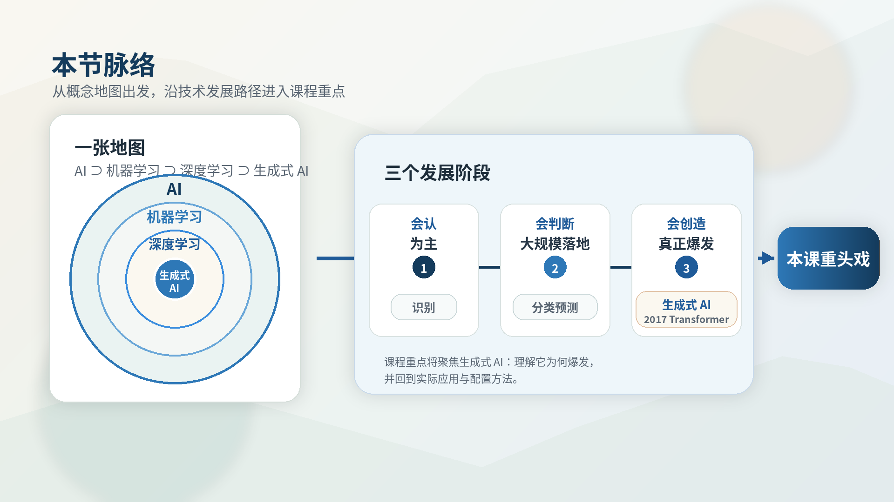

<figcaption>图· 本节脉络</figcaption>

在讲任何技术细节之前，我们要先在脑子里画一张“地图”。因为绝大多数人对 AI 的困惑，不是某个技术太难，而是名词太多、关系太乱——今天听到“机器学习”，明天听到“深度学习”，后天又冒出来一个“生成式
 AI”“大模型”，它们到底谁是什么、有什么关系，完全搞不清楚。

所以本节只做两件事：**第一，用一张****图****讲清这些名词的关系；第二，用****“****三个发展阶段****”****这条时间线，告诉我们
 AI
 是怎么从****“****会认字****”****一路进化到****“****会创作****”****的。**

## 1.1.1 AI 是什么

## 一张图解释人工智能、机器学习、深度学习、生成式 AI 的关系

想象四个从大到小、层层嵌套的圈：

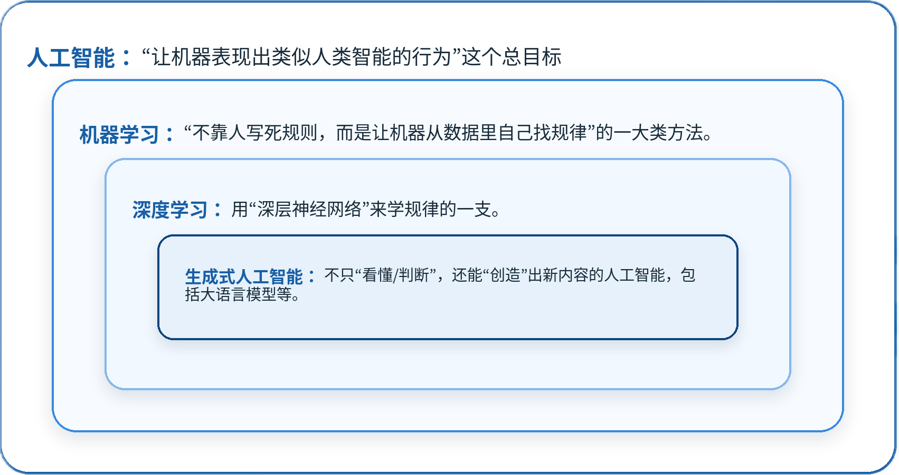

<figcaption>图· AI与机器学习层级关系</figcaption>

读懂这张图：

## 人工智能（AI） ——一个愿望

**人工智能****是最大的圈，它****更像****是一个****“****愿望****”，或者说一个“目标”：**让机器能像人一样思考、判断、做事。我们可以认为，凡是朝这个目标努力的技术，都算
 AI。这个概念并不新，早在 1956 年，一群科学家就在一次会议上正式提出了“人工智能”这个词，到今天已经七十年了。也就是说，人类“想让机器变聪明”的这个梦想，很早就开始做了，几十年来，人们一直在探索更多方法来实现这个梦想。

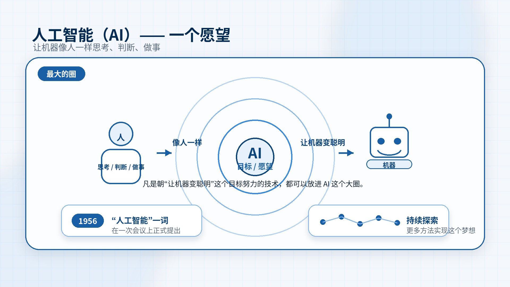

<figcaption>图· 人工智能概念</figcaption>

## 机器学习 ——实现这个愿望最主流的一条路

要让机器变聪明，历史上有过两种截然不同的思路。早期的思路是“人把规则写死”，即工程师把一条条规则提前编好告诉机器，比如“体温超过 38.5
 度就建议就医”，机器只会照着这些规则执行，遇到没写到的情况就束手无策，这类技术叫“符号
 AI”。而机器学习走的是另一条路，**不再靠人一条条写规则，而是喂给机器大量的数据，让它自己从数据里去总结规律。**打个比方，教小孩认猫，不是给他背一本"猫的定义手册"，而是给他看成百上千张猫的照片，看多了他自己就会认了。机器学习就是这个思路，也正是今天
 AI 最主流的实现方式。这里要提醒一句：即使是很早期的、靠人写符号规则的“符号 AI”，也属于人工智能这个大圈，只是不属于机器学习这一支。

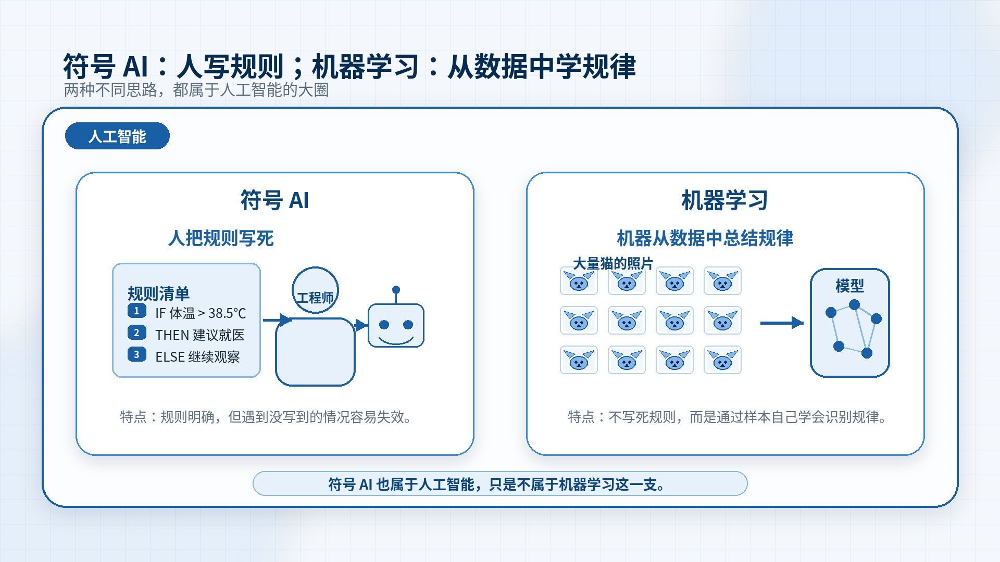

<figcaption>图· 符号AI与机器学习</figcaption>

## 深度学习 ——机器学习里“最能打”的一支

今天我们听到的几乎所有厉害的
 AI，底层都是深度学习。机器学习本身也有很多种方法，其中最能打、这十几年最出风头的一支，就是深度学习。它的名字听起来玄乎，其实拆开看很好懂：“学习”，说明它仍然是机器学习那一套——喂数据、自己总结规律；“深度”，指的是它用了一种叫"神经网络"的结构，而且这个结构层数堆得很多、很"深"，层数越深，它能理解的东西就越复杂、越抽象。所以叫深度学习。也正因为这个能力，今天我们听到的几乎所有厉害的
 AI——人脸识别、语音输入、机器翻译、自动驾驶的视觉——底层用的基本都是深度学习。

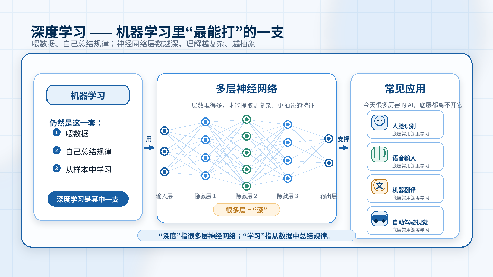

<figcaption>图· 深度学习神经网络</figcaption>

## 生成式 AI ——深度学习里最新、最耀眼的一小块

生成式 AI，顾名思义，就是"能生成新内容"的 AI。其实，“会创造”并不是生成式 AI 才有的能力。 在它之前，AI 就已经有一些“创造”的尝试了——比如早期能生成文字的模型、能生成逼真人脸图像的技术，都属于生成式 AI
 的早期探索。只是那时候的创造能力比较有限，写几句还行，写长文就语无伦次；生成的东西质量也不够稳定，更谈不上人人可用。

真正让生成式 AI 脱胎换骨的，是 2017 年之后的一系列突破（我们下一节讲的 Transformer 就是关键）。从那以后，生成式 AI 做到了又通用、又强大、又人人可用。我们不需要懂技术，打开
 ChatGPT、元宝、DeepSeek，随便说句话它就能帮你写、帮你画。所以我们说，生成式 AI 是深度学习里最新、也最耀眼的一小块。

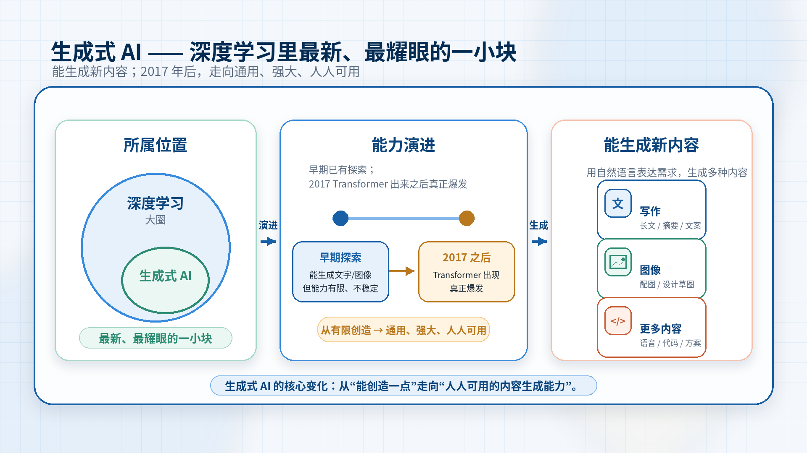

<figcaption>图· 生成式AI</figcaption>

## 1.1.2 AI的发展阶段

理解了空间上的包含关系，我们再来看时间上的发展阶段。**AI** 从诞生到今天，大致可以分成三个阶段，以“会认”为主的 **AI** → “会判断”的
 **AI** 大规模落地 → “会创造”的 **AI** 真正爆发。

AI
 最早期能做的事情，说起来很朴素：**识别，也就是让机器****“****看懂****”****一个东西是什么。**

时间回到 1956 年，一群科学家在美国达特茅斯学院开了一次会，正式提出了“人工智能”这个词，这一年被公认为 AI 的元年。不过在最初的几十年里，AI
 走得并不顺。早期人们主要靠“人来写规则”的思路，把知识一条条编成规则灌给机器，也就是所谓的“专家系统”。这类系统在特定领域（比如医疗诊断、化学分析）能派上用场，但毛病很明显：规则全靠人一条条手写，一旦遇到没写到的情况就束手无策，做起来又费力又不灵活。AI
 甚至经历过两次“寒冬”，人们对AI的热情退去、投入锐减。

真正让“会认”这件事落地的，是后来“让机器自己从数据里学”的思路。一个标志性的成果，是上世纪八九十年代的手写数字识别。以 Yann LeCun 等人的工作为代表，AI
 第一次能比较可靠地认出人手写的数字，并被真正用到了实处——比如银行自动识别支票上的手写金额、邮局自动分拣信封上的邮政编码。这在当时是了不起的进步，因为它证明了，机器不必靠人写死规则，也能从大量例子里自己总结出规律。


<figcaption>图· Yann LeCun 官网 LeNet demo 页面，手写数字识别示例</figcaption>

这个阶段的
 AI，可以用一句话概括它的本事：“给它一个东西，它告诉我们这是什么。”是猫还是狗、是数字几——它擅长“认”，但也仅此而已，它不会思考，更不会创造。尽管本事朴素，这一阶段却是后面一切的根基，机器证明了它能从数据里学到规律。

会“认”之后，AI 的下一步是学会“判断和预测”——不只是识别眼前这个东西是什么，还能基于数据做出决策、给出预测。

这一阶段之所以能起来，背后有两个现实推手：一是**互联网普及**，企业手里第一次攒下了海量数据；二是**计算机算力不断变强，**数据多了、算力够了，“让机器从数据里学规律”这条路才真正跑得通。于是，机器学习的各种经典算法开始大放异彩——比如决策树、支持向量机、随机森林等等。它们不像早期专家系统那样靠人写死规则，而是自己从大量历史数据里总结出判断的依据。

也正是在这个阶段，AI 第一次大规模从实验室走进了真实产业，而且都是能直接产生商业价值的场景。例如：

- **垃圾邮件过滤：**给它一封邮件，它判断这是不是垃圾邮件。

- **商品推荐：**根据我们过去买过、看过什么，预测我们可能还想买什么。亚马逊、淘宝等电商的推荐系统，正是从这个时期发展起来的。

- 除此之外，还有**银行的信用评分与风控反欺诈、广告的点击率预测、搜索引擎的结果排序**等，背后都是这一套判断与预测的能力。

它的本事，可以概括成一句话：**给它一堆情况，它帮我们做判断、下预测。**这一阶段的 AI 已经相当实用，甚至可以说，我们今天生活里习以为常的很多智能功能，都是在这时打下的底子。

但我们也会发现，这时候的AI自己主动创造新东西的能力不太行。要突破这个天花板，就要进入真正改变格局的第三阶段。

大约在 2017 年，一篇名为《Attention is All You Need》的文章提出了深度学习的一个全新架构——**Transformer。**在它之前，处理文字（序列）主要用
 RNN/LSTM，有个大毛病：得一个字一个字顺着读，读长句子时前面容易忘，而且没法并行、训练慢。Transformer
 **关键的贡献，是引入了一种叫“注意力机制”的设计，让模型既能一眼看全整句话、抓住词与词之间的关联，又能大规模并行计算。**这样，模型可以判断哪个词和哪个词最相关，长距离依赖不再健忘；也可以喂进海量数据、把模型堆得特别大。正是这两点，为“把模型做得又大又强”扫清了障碍。

紧接着在 2018～2019 年前后，基于 Transformer 的一批模型横空出世：谷歌推出了 BERT，OpenAI 推出了 GPT
 系列。研究者发现了一个规律——只要把模型堆得更大、喂进更多数据，它的能力就会持续变强。于是模型越做越大，从 GPT-2 到 GPT-3，参数量呈指数级增长，生成式 AI 开始起飞。到了 2022 年底，OpenAI 发布
 ChatGPT，第一次让普通人也能上手，短短两个月用户破亿，AI 就此彻底出圈，走进了大众视野。

“会创造”并非这时才出现，但正是从这一阶段起，它才第一次做到又通用、又强大、又人人可用：

我们说一句话，它能写出一整篇文章（ChatGPT、豆包、元宝、DeepSeek……）；

我们描述一个画面，它能画出一张图（Midjourney……）；

我们给一段文字，它能生成一段视频（Sora……）、一首歌（Suno……）。

这些，都属于生成式AI。短短几年间，AI
 从一个只会“认”和“判断”的工具，变成了**人人都能用的能写、能画、能作曲、能编程的“创造者”**，几乎渗透进内容、编程、设计等各行各业。其中，大语言模型是生成式 AI
 的一种，而且是最主流、最核心的一种。

## 1.1.3 小结

本小节中，AI 相关的名词虽多，核心是一张地图加一条时间线。人工智能、机器学习、深度学习、生成式 AI 层层包含；AI
 从“会认”为主，到“会判断”大规模落地，到“会创造”的真正爆发，再到后面即将讲到的Agent，AI正变得越来越强大。

下一节 1.2「大语言模型的进化之路：从“会接龙”到“会做事”」会把“会创造”大规模爆发的这个阶段展开，看大语言模型如何通过Prompt、记忆、RAG、工具、MCP 补齐短板，长成能做事的AI。

---

## 1.2大语言模型的进化之路：从“会接龙”到“会做事”

**大语言模型是生成式 AI 的一种，而且是最主流、最核心的一种。大语言模型本质上只会做文字接龙，但依靠 Prompt、记忆、RAG、工具、MCP
 逐步补齐短板，它逐渐从只会做文字接龙的AI成长为能做事的AI。**

学完这一节，你将能够用一句话讲清大语言模型的本质，并解释它为什么会“幻觉”；能够说清大语言模型如何依靠Prompt、记忆、RAG、Tool Use、MCP 完成从“会说”到“会做”的能力跃迁。

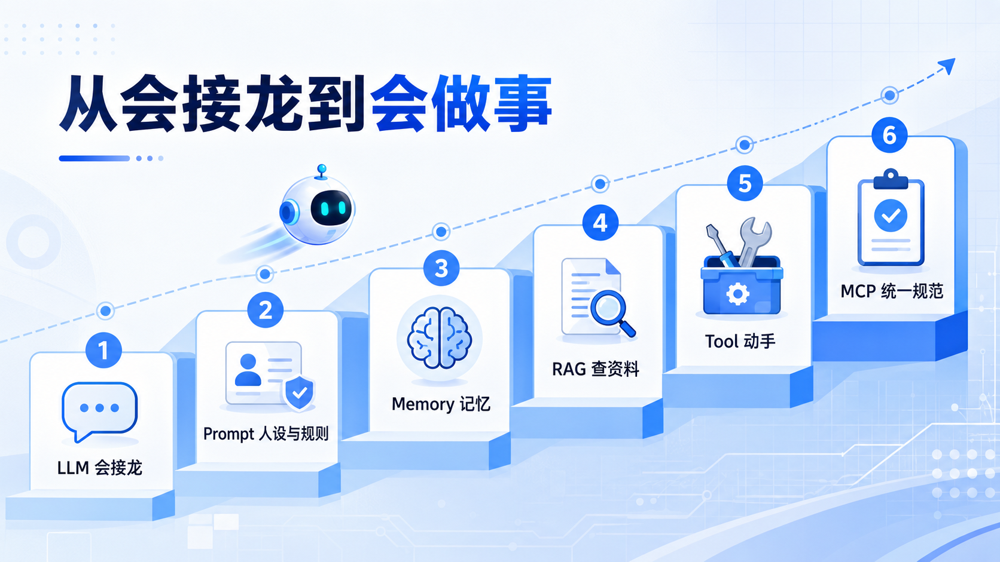

<figcaption>图· 大语言模型从会接龙到会做事的能力演进</figcaption>

## 1.2.1 Transformer：大语言模型的起点

说到大语言模型，首先就得提一提Transformer。上一节我们提到，Transformer是一个深度学习的架构，不是一个具体的产品。Transformer引入了一种叫“注意力机制”的设计，让模型既能一眼看全整句话、抓住词与词之间的关联，又能大规模并行计算，**为“把模型做得又大又强”扫清了障碍。**我们可以把“架构”理解成**一张建筑图纸**。图纸本身不能住人，但按照这张图纸，我们可以盖出千千万万栋不同的楼。Transformer
 就是这样一张革命性的“图纸”，2017 年被提出后，此后几乎所有厉害的生成式 AI 模型，都是照着这张图纸盖出来的。GPT、BERT、混元、DeepSeek……这些名字听起来五花八门，但它们本质上都是基于
 Transformer 这张“图纸”盖出来的不同的“楼”。**照着** **Transformer
 这张图纸，盖出来的第一批、也是最重要的一类"楼"****，就是****大语言模型。**

## 1.2.2 大语言模型如何从“会接龙”走向“会做事”

### 1.2.2 大语言模型（**LLM**）：本质就是“文字接龙”

大语言模型（LLM）的本质，其实并不神秘：它就是一个能力极强的“文字接龙机器”。给它一段文字，它便预测下一个字（**更准确地说是下一个“token”，可以****简单****理解为一个字或词**）最可能是什么，然后接上去；接完之后，再把新的这段文字重新读一遍，继续预测下一个，如此循环往复，直到生成一整段话。

例如：当模型看到“地球绕着什么转？”时，它先接出一个“太”字；再看着“地球绕着什么转？太”，接出“阳”字；如此一个字一个字地续下去，最终输出完整的回答。可以说，模型每走一步，做的都是同一件事——在无数可能的字里，挑出最合理的下一个，本质上是在不停地做“选择题”。我们平时用的
 ChatGPT、Claude、DeepSeek、元宝，底层做的都是这件事。

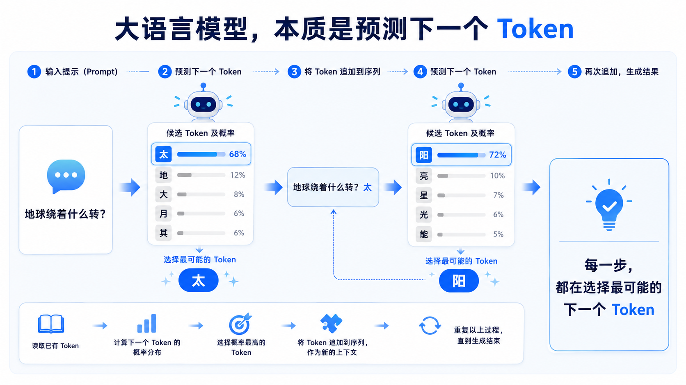

<figcaption>图· 大语言模型预测下一个 Token 的过程</figcaption>

作为一个“文字接龙机器”，它天生有两个毛病。

首先，它可能会一本正经地胡说八道，也就是所谓的AI
 幻觉。由于它只负责接出“读起来最通顺、最合理”的内容，并不真正核实事实对错，因此当它遇到不确定的问题时，往往不会承认“我不知道”，而是会顺着语感编出一个看似有理有据、实则并不存在的答案。有时候即便给模型接上了外部工具或资料，它也未必有足够的判断力，比如工具返回“上海气温一万度”这种明显离谱的数字，模型有时会照单全收地讲出来，有时才会察觉不对。这说明，它的“通顺”并不等于“正确”。

其次，它对“当下”一无所知。它不清楚自己是谁、现在几点、外面天气如何，因为这些信息根本不在它接龙时所看到的那段文字里，也不在它训练时学到的旧知识中。此外，它每次能“读进眼里”的文字还有长度上限（即“上下文窗口”），文字一旦太长，即便没有超限，也常常会接得不准。

于是，如何驯化这个既强大又毛躁的工具、让它变得可控可用，就成了关键。而驯化的方法之一，就是提示词（Prompt）。

这里解释一个贯穿全课程的关键概念——**token（中文译作“词元”）**。前面说模型是在“预测下一个字”，这只是一种通俗的说法；严格来讲，模型每一步预测和生成的基本单位并不是“一个字”，而是“一个
 token”。

**所谓
 token，就是模型处理文字时所切分出的最小单位****。**它可能是一个汉字，可能是一个英文单词，也可能只是单词的一部分或一个标点。换句话说，模型眼中的文字，并不是一个个字符，而是一串被切好的
 token；它所谓的“接龙”，本质上就是在已有的一串 token 后面，不断预测并接上最合理的下一个 token。

token 的意义不止于文字。随着技术发展，token 可以是文字，也可以是图像、表格，甚至是声音、视频的基本单位。正因为把各种复杂的内容都拆解成了有限的基本单位（token），生成式 AI
 才能用“从有限的选择里，不断决定下一个”的统一方式，去生成几乎无穷无尽的内容，这也正是它能同时写文章、画图、作曲的底层原理。

此外，token 还是一个非常实际的计量单位：我们平时听到的“模型能处理多长的内容”“调用一次花了多少钱”，通常都不是按字数、而是按 token 数来计算的。理解了
 token，后面许多概念（比如上下文长度、调用成本）也就更容易理解了。

### 1.2.3 提示词（**Prompt**）：给模型赋予设定

既然模型只会根据我们给的文字往下接，那么一个很自然的想法便产生了：我们能不能**在它正式接龙之前，先塞给它一段文字，把它应当知道的设定、背景、规则都预先告诉它？**我们完全可以在这段输入里“做文章”，用文字提前为它立好规矩。这正是提示词（Prompt）的核心思想。

- **系统提示词（System Prompt）**

它是系统预先为模型设定好的“人设与规则”，用户通常看不到。比如：“你的名字叫元宝，不叫小助手；请始终以礼貌、专业的语气回答，不讨论与业务无关的话题。”把这样一段文字，在用户提问之前就一并喂给模型，它接龙时便“知道”自己是谁、该用什么口吻、什么该说什么不该说。在真实的产品里，系统提示词往往远不止一句人设，还会包含与身份相关的信息、可以使用哪些工具及其用法、行为规范、能调用哪些技能、以及此前的记忆去哪里查找等等。也因此，用户可能明明只问了一个简单问题，模型那一端实际收到的系统提示词却可能超过四千个
 token——这些幕后的文字，用户完全看不见，却在默默地塑造着模型的每一次回答。

- **用户提示词（User Prompt）**

很好理解，它就是我们每次在对话框里输入的那句话，比如“帮我写一首诗”“把这段话翻译成英文”。它表达的是我们当下的具体需求。

归根结底，提示词是我们能够主动控制、并喂给模型的那段文字。系统提示词负责稳定的“人设与规则”，用户提示词负责当下的“具体任务”，二者叠加在一起送入模型。有了它们，一个原本只会漫无目的瞎接龙的模型，便有了稳定的身份与边界，开始真正像一个可用的助手。

### 1.2.4 记忆与上下文工程：让 **AI** 记住我们

如果只有提示词，大模型仍然记不住事。原因回到它的本质：它每一次接龙，能“看到”的只有当前这一次输入的文字，**一旦某些信息不在这段文字里，它就无从知晓。**

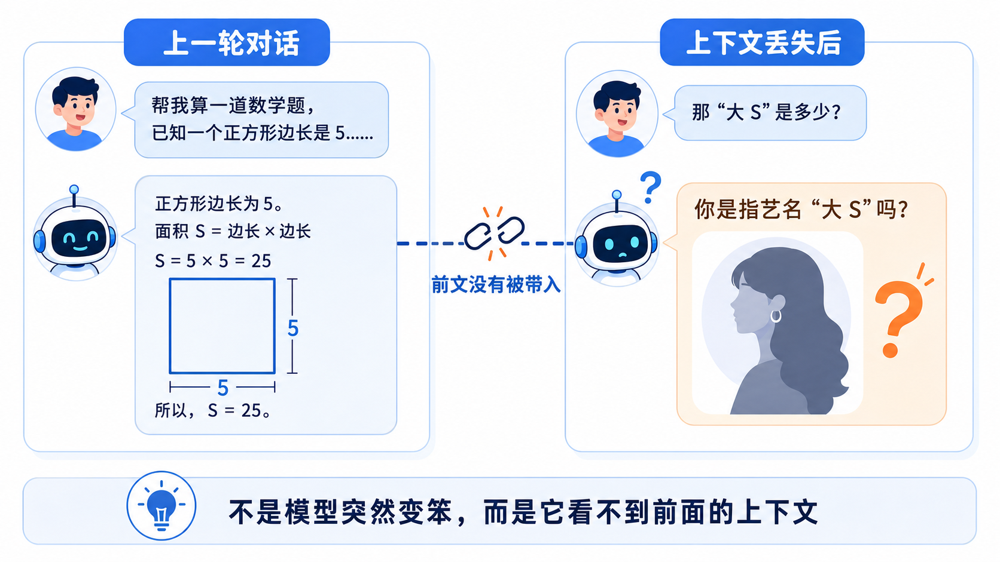

<figcaption>图· 上下文丢失示例</figcaption>

在这个例子中，用户先对 AI 说“帮我算一道数学题，……”，AI 算了一通；接着我们追问“那‘大 S’是多少？”这里的“大 S”，显然指的是公式里的面积 S。可 AI
 没有“记住”前面在聊数学，它直接蹦出一个“徐熙媛（艺名大 S）”来。这就是没有记忆、丢失上下文时的尴尬。它并不是变笨了，而是它“眼前”那段文字里，根本没有前面聊过数学的痕迹。

之所以会这样，还牵涉到一个现实限制。语言模型每次能够读入（以及输出）的文字长度是有限的，这个上限叫作“上下文窗口”（Context Window）。不同模型的上限各不相同，今天较好的模型往往能一次处理上百万个
 token；但即便如此，输入越长，哪怕还没触及上限，模型也常常会接得不那么准。这意味着，我们不能天真地把所有历史对话一股脑塞给它，而必须有策略地组织到底让它看到哪些内容。

正因如此，人们提出各种解决这个问题的办法，统称**上下文工程（Context
 Engineering）**：想办法把应当让模型看到的所有背景信息，都恰当地组织好、再喂给它。前面讲的提示词（Prompt），其实就是上下文工程的一部分；而其中另一个关键部分，就是记忆（Memory）。

- **短期记忆：**

指的是**本次会话里说过的话**，模型能够记住。但它的“短”就体现在，一旦我们换到一个新的对话框，之前的内容便不复存在，模型又会“失忆”般地从头开始。

- **长期记忆：**

指的是**跨越所有会话、绑定在我们这个账号上的信息**，而不只是当前对话框里的内容。比如它记住了“我们从事财务工作、偏好简洁的回答、所在公司叫某某”，那么无论哪天、开哪个新对话，它都能延续这些信息。模型正是借由这种方式，才显得“记得”我们是谁、之前聊过什么。可以看出，所谓长期记忆，本质上仍是把该记住的内容，在恰当的时候重新组织成文字、再喂回给模型。

有了上下文工程，AI
 便同时具备了会接龙、有人设、能记事这几项能力。但如果只有这些，就仍然存在一些问题。例如，它所掌握的知识，都是训练时学到的旧知识，而且还可能记错（幻觉）。如果我们想让它准确回答“我们公司最新的报销制度”这类它压根没学过的内容，又该怎么办？这时候，就需要
 RAG 登场了。

### 1.2.5 **Embedding** 与 **RAG**：让 **AI**
 先查资料再回答

我们想让 **AI** 在回答之前，先去我们指定的资料里查一查，找到相关内容，再基于查到的内容来回答，这样它就不那么容易瞎编。这个“先查资料、再回答”的机制，就是大名鼎鼎的
 **RAG**（Retrieval-Augmented Generation，检索增强生成）。

但在讲 RAG 的流程之前，必须先理解一个更重要的底层概念——**Embedding（向量化）**，否则我们会不明白AI 到底是怎么“查”资料的。

计算机不认识文字，只认识数字。**Embedding 做的事，就是把一段文字（一个词、一句话、一段话）转换成一串数字（我们叫它“向量”）**。
 而且这个转换很神奇：**意思相近的文字，转换出来的数字串也会很接近。**例如在一个二维坐标轴中，横轴表示“是否可食用”，纵轴表示“是否属于动物”。那么“苹果”就在右下角（可食用、不是动物），“梨”离苹果很近（也是水果），而“老虎”在左上角（不可食用、属于动物），
 “汽车”则可能在左下角（既不是动物，也不是食物）。每个词在这个平面上的位置，就是它的 Embedding。意思相近的词距离更近，意思不同的词距离更远。

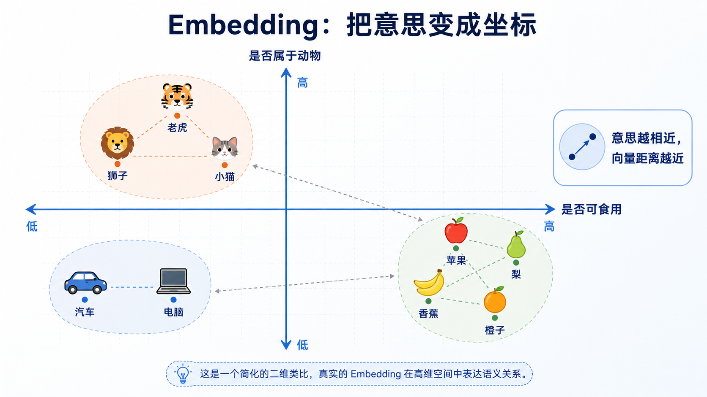

<figcaption>图· Embedding 把语义转换为向量坐标</figcaption>

但实际的Embedding不是二维，而是几百维甚至一千多维。我们的大脑无法想象这么高的维度，但数学模型可以。有意思的是，这些高维向量之间有代数关系：教师 − 学校 + 医院 ≈
 医生、巴黎-法国+中国≈北京。向量竟然学到了类比的逻辑！

**Embedding应用举例：**

①语义搜索：可以用语义关系而不是关键词去搜索，比如搜"悲伤的爱情故事"会找到所有情感相似的作品。

②推荐系统：推荐与用户兴趣向量"最接近"的商品。

③分类：相同类别的文档向量会聚集在一起。

④聚类：自动发现文本之间的相似性。

**理解了 Embedding，RAG 的流程就一目了然了****。**简单来讲，它其实就三步：

step1：把资料变成坐标点（导入与向量化）：提前把所有文档切分成小段（chunk），用Embedding把每一段都变成一个坐标点，存进一个知识库里。

step2：拿问题去就近找（检索召回）：当我们提问“差旅费怎么报？”，系统先把我们这句问题也 Embedding成一个坐标点，然后去知识库里找离它最近的那几个坐标点——这几段文字，就是和我们问题最相关的资料。

step3：把资料塞给模型再作答（增强生成）：把找到的这几段资料，连同我们的问题，一起塞进提示词喂给大模型，让它看着这些资料来回答。

这样一来，AI 的回答就有了**准确、实时、可溯源**的依据，“幻觉"问题被大大缓解。**这就是为什么企业做 AI，第一步几乎都是搭知识库**——本质就是在为 RAG
 准备“坐标点”。

### 1.2.6 工具调用（**Tool Use**）：让 **AI** 能“动手做事”

有了Prompt、Memory和RAG，AI
 已经会说、会记、会查了。但它依然**只会****“****说****”****，不会****“****做****”****。**
 要突破这一点，就要让 AI 学会用工具。

举一个例子：模型本身并没有查询实时天气的能力（天气是随时变化的，训练时根本学不到今天的数据），但我们又希望它能帮我们查天气，怎么办？

答案是，让模型去调用一个现成的、已经封装好的天气查询工具。**工具本质上可以看作一个函数（Function）**，使用工具就是去调用这些函数，这个动作也被称为“Function
 Call”。更重要的是，模型使用工具时，只需要知道“怎么用”，而不需要知道它“内部是怎么实现的”，就像我们用计算器，只管按键取结果，不必了解它内部的电路。

在上述例子中，我们可以把天气查询功能想象成一个数学函数T(X, Y) 。

T(X, Y) —— 其中 X 是地点，Y 是日期。当我们告诉模型“想查询上海今天的天气”，模型并不会自己瞎猜，而是先输出一段调用工具的指令，系统在后台执行这个工具（形如 T（上海，今天））、取回结果（例如“摄氏 32
 度”），这段结果通常并不直接展示给用户，而是重新交还给模型，模型再据此接龙出一句自然、通顺的回答。可以看到，模型自己并不“懂”天气，它扮演的角色，是判断“该在什么时候、调用哪个工具、填什么参数”，再把工具返回的结果组织成自然语言回复我们。

工具远不止查天气这一种。大语言模型常用的工具包括执行代码的 Python、搜索引擎，乃至调用另一个更强的
 AI——不同工具能力不同，也各有成本。除此之外，发送邮件、查询数据库、下单、在系统里生成一张工单，都可以被封装成工具供模型调用。只要把某项能力做成一个标准的“函数”交给它，它就能在合适的时机自行取用。

### 1.2.7 **MCP**：让工具调用有一门“普通话”

前面提到，工具本质上就是一个个可供模型调用的函数。当工具越来越多，一个新的麻烦便浮现出来：这些工具**各说各的“方言”**。例如，有的要求我们用英语来问，有的要求中文，有的又规定了另一套完全不同的参数格式；又或者这个工具把地点字段叫作
 city，那个工具叫 location，还有的干脆叫“地点”。如果没有统一的规矩，就会陷入一种极其低效的局面，**每一个工具，都要为全球成千上万家 AI
 公司分别对接、各自维护一套不同的接口**；反过来，**每一家 AI 公司，也要为成千上万个工具逐一适配**。这是一种“多对多”的重复劳动，无论对工具方还是模型方，都是一场灾难。

解决办法其实很朴素，和人类社会解决语言不通的思路如出一辙：大家坐下来，约定一套统一的、通用的协议。我们可以把它理解成一份公认的“说明书”或“标准接口规范”——**所有 AI
 公司都按照这一套标准格式去调用工具，所有工具方也只需按照这同一套标准来对外提供服务。这个用于工具调用的通用标准协议，就叫作 MCP（Model Context Protocol，模型上下文协议）**，由
 Anthropic 公司在 2024 年前后提出，如今已被越来越多的厂商采纳，逐渐成为业界通行的做法。

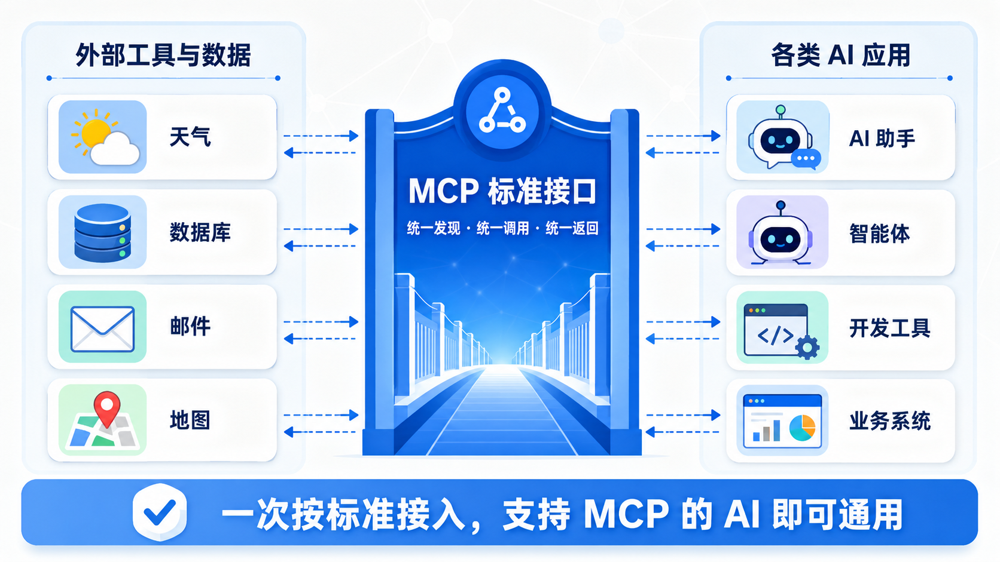

<figcaption>图· MCP 标准接口连接外部工具与 AI 应用</figcaption>

它带来的改变是显著的。以前，一个工具方要想让自己的能力被各家 AI 使用，往往得反复对接、重复开发；有了 MCP，它只需要按照这套标准，把自己的能力“挂”出来一次，任何支持 MCP 的 AI
 就都能直接调用，无需再单独适配。就好比商家只要把菜单印成统一的标准格式，天下的顾客都能照着点单，不必每进一家店就重新学一套规则。

正是有了 MCP 这样的统一协议，AI 才能更方便、更规范地连接起各种各样的外部工具和数据，工具生态也随之迅速繁荣起来。

## 1.2.8 小结

本小节我们把让大语言模型变得更好用的重要基础能力大致了解了一遍：

- 会接龙的模型（**LLM**）

- 给它人设（**Prompt**）

- 让它记事（**Memory**）

- 让它查资料（**Embedding** + **RAG**）

- 让它动手（**Tool Use**）

- 统一动手的规矩（**MCP**）

事实上，大约在 2022 年之前，市面上的 **AI** 工具虽然已经很能干，但是复杂、需要分步执行的长任务它仍然做不了。要突破这个瓶颈，**AI**
 须得从一问一答的工具，进化成能自己规划、分步骤把复杂任务做完的智能体。

下一节 1.3「智能体（**Agent**）基础」将继续解释这些能力如何被组织成 Goal–Action–Observation 循环，使 **AI**
 能自主规划并完成多步骤任务。

---

## 1.3智能体（Agent）基础

**2022 年前后****，****一方面，ChatGPT 通过 RLHF
 和指令微调，让模型第一次能稳定地****“****听人话****”****、照指令干活；另一方面，思维链（CoT）的发现教会了模型****“****分步骤思考****”****，大幅提升复杂推理能力****。****两块拼图凑齐——****“****会听指令
 + 会分步想****”****，2023 年初立刻涌现出 AutoGPT、BabyAGI 等一批 AI Agent 项目，智能体时代的大门就此打开。**

学完这一节，你将理解智能体与普通大语言模型工具的区别；能说清 Goal–Action–Observation 循环如何让 Agent 运转；能区分单 Agent、多 Agent、Workflow、Claw
 等典型编排方式；能理解企业为什么需要 ADP 这样的智能体开发平台。

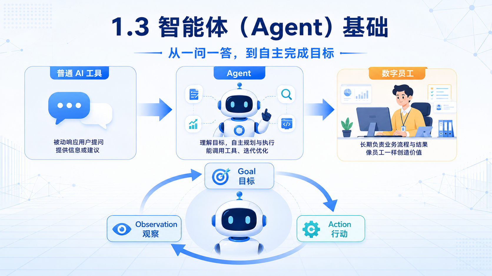

<figcaption>图· 智能体从一问一答走向自主完成目标</figcaption>

## **1.3.1 什么是智能体**

智能体（Agent）是一种 AI 系统：人只需要给它一个目标，它就能自己拆解任务、规划步骤、调用工具去执行，并根据每一步结果不断调整，直到把目标完成。

过去我们熟悉的大语言模型，是一种一问一答的工具：我们问一句，它答一句；要它完成一件复杂的事，就得由我们把每一步都想清楚，再一条条指令喂给它。真正动脑筋去规划的，其实是我们，而不是 AI。

而智能体，把“规划”这件事也交给了 AI。我们不再需要告诉它“第一步做什么、第二步做什么”，只需要告诉它“我最终想要什么”，剩下的“该分几步、每一步做什么、做完之后怎么办”，都由它自己决定。普通的 AI
 工具像一个“听指令的执行者”，你说一步它做一步；而智能体更像一个“能扛事的员工”，你交给它一个任务，它自己想办法把它办成。这也正是 AI 从“工具”进化为“数字员工”的原因所在。

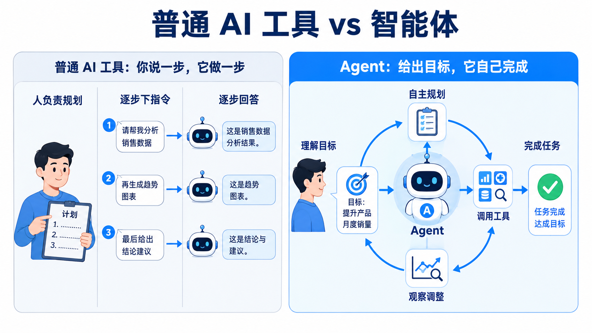

<figcaption>图· 普通 AI 工具与智能体的关键差异</figcaption>

## **智能体如何运转：Goal–Action–Observation 循环**

智能体最核心的运行方式，可以用三个词概括，它们构成一个不断循环的圈：

三步不断循环——观察结果、决定下一步、再观察新的结果——直到目标最终达成。它和过去那种“一问一答”的工具有着本质区别：过去我们得手把手地把每一步指令都下清楚，少说一步它就卡在那里；而智能体只需要接住一个目标，剩下的拆解、尝试、遇阻后的调整，都由它自己完成。

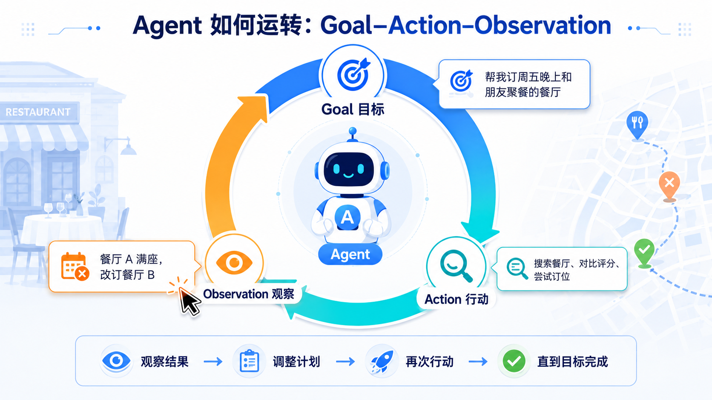

<figcaption>图· Agent 的 Goal Action Observation 循环</figcaption>

## **从大语言模型角度看：Agent 仍然是在“接龙”**

从大语言模型的角度看，智能体要解决的问题，无非就是“目标（Goal）、观察（Observation）、行动（Action）”这几样东西交替出现，而语言模型在整个过程中，其实一直都在做接龙。AI
 智能体依靠的，正是语言模型现有的能力，而非某种全新的、被重新训练出来的智慧。

换句话说，智能体的“聪明”，并不是凭空多出来的。我们所做的，只是把“目标是什么”“上一步做了什么”“观察到了什么结果”这些信息，统统作为文字，一次次喂给那个我们已经熟悉的大语言模型，让它据此接龙出“下一步应该做什么”。模型接出的这一步，被拿去真正执行，执行的结果又被重新整理成文字，再喂回给它，开始下一轮接龙。如此循环往复，一个看似会“自己规划、自己办事”的智能体，就运转起来了。

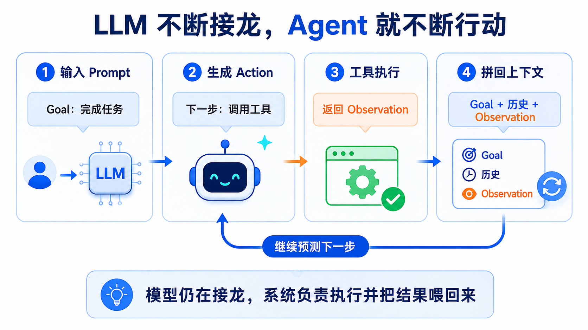

<figcaption>图· LLM 通过行动和观察持续完成任务</figcaption>

支撑这个循环顺畅运转的，是上一节讲过的关键机制：靠提示词（Prompt）为它设定目标与规则，靠记忆（Memory）让它记住之前发生了什么，靠工具调用（Tool Use）让它能真正“动手”执行并取回真实世界的观察结果，再靠
 MCP 这样的统一协议让它方便地接入各种工具。

可以说，智能体并不是某种神秘的新物种，而是大语言模型现有的能力，加上 Prompt / Memory / Tool / MCP
 这套机制，被组织起来、循环运转的结果。理解了这一点，前面铺垫的每一块拼图，也就在这里全部派上了用场。

## **1.3.2 Agent 编排方式**

前面提到，智能体靠 Goal–Action–Observation 循环运转。但同样是这套循环，落地时可以有不同的编排方式：可以是一个 Agent 独自完成，也可以是多个 Agent 分工协作；可以让 AI
 自主规划，也可以把流程提前固定成工作流；还可以让 AI 具备操作电脑、处理文件和调用命令的能力。

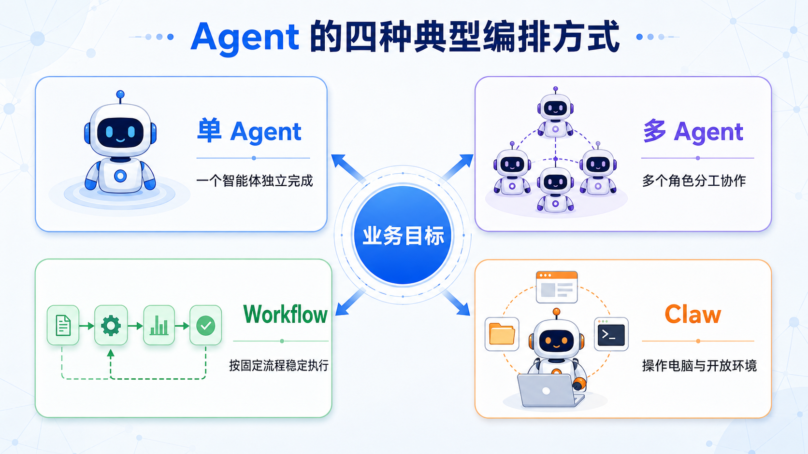

<figcaption>图· Agent 的四种典型编排方式</figcaption>

## **（1）单 Agent 与多 Agent：一个人干 vs 一个团队协作**

单 Agent，就是一个 AI 智能体，独自面对目标：自己规划、自己调用工具、自己观察结果、自己完成整件事。从头到尾，都是它一个人在跑“目标—行动—观察”的循环。

它的优点是简单、直接，适合相对单一、不太复杂的任务。比如“帮我查一下明天上海到北京的高铁票，并整理成一张表”，这类目标清晰、步骤不多的任务，交给一个能力不错的单 Agent 就足够了。

但它的局限也很明显。当任务变得庞大而复杂，既要查资料、又要算数据、还要审核和撰写报告，让同一个 Agent 从头包到尾，就会像让一个人同时兼任所有工种一样，既容易顾此失彼，也难以保证每个环节的质量。

为了应对复杂任务，可以采用多智能体（Multi-Agent）的形式：把一个大任务交给一个“AI 团队”来协作完成。它会先把任务拆解成多个步骤，再把每一步分派给专门的子
 Agent：一个负责查资料，一个负责算数据，一个负责风险把关，一个负责撰写结论。

多 Agent 的好处，是把“分工”和“专精”带进 AI
 的世界：复杂任务被拆细后，每一环都能做得更专业；引入审核、复核角色，也让最终结果更少出错。当然，代价是调度更复杂，消耗的算力和成本也更高，所以并非任何任务都值得动用一整个团队。

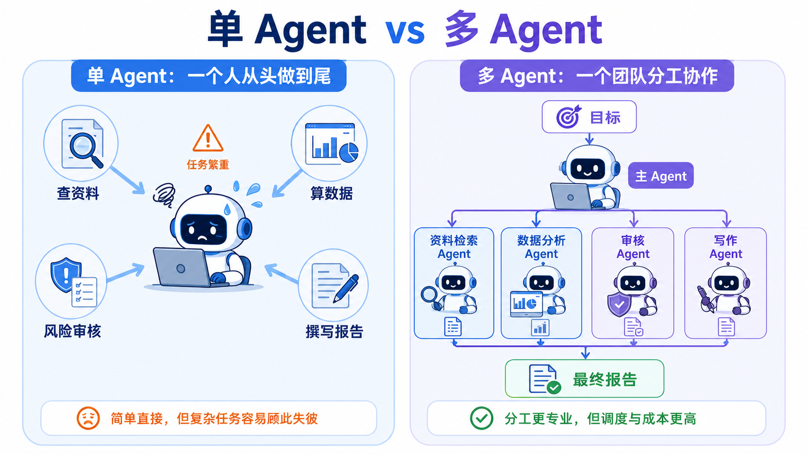

<figcaption>图· 单 Agent 与多 Agent 的差异</figcaption>

## **（2）工作流（Workflow）：把流程固化成流水线**

在实际业务里，还有另一种截然不同、甚至思路正好相反的编排方式，叫作工作流（Workflow）。并不是所有任务都需要 AI
 “随机应变”。现实中有大量业务，其实每一次都按照几乎一模一样的步骤在走——先做什么、再做什么、遇到某种情况该走哪个分支，都是固定的、可以事先写清楚的。

对于这类业务，与其让 AI
 每次都重新“动脑筋规划”（既慢，又可能跑偏），不如干脆把流程提前固定下来。工作流的做法，就像画一张流程图：把每一个环节做成一个个节点，再用连线把它们按顺序、按条件串接起来，编排成一条固定的流水线，然后让 AI
 严格沿着这条线一步一步执行。

在这里，AI 不再是那个自由发挥的“规划者”，而更像流水线上一个训练有素、只做规定动作的“操作员”。遇到分支时，智能体会根据实际情况选择走工作流的哪条分支。

> [图片未下载] 节点探索点击节点查看输入、处理和输出 — 

选择一个节点，查看它在流程中的输入、处理逻辑和输出。

### 判断问题类型

用户的自然语言问题和当前会话上下文。

识别咨询意图，判断问题属于数据查询、知识问答还是需要人工处理。

标准化的问题类型与后续执行分支。

### 调用接口查询数据

已识别的问题类型、查询条件和用户权限。

调用经过授权的业务接口，并记录调用参数、状态和返回结果。

结构化业务数据；失败时转入异常兜底。

### 根据查询结果生成建议

接口返回数据、回答规则与必要的业务知识。

由模型基于真实结果组织解释与建议，不补造缺失信息。

可供用户理解的自然语言草稿。

### 回复用户

生成的回答草稿、格式规范与安全检查结果。

应用输出格式并完成最后校验。

最终回复和必要的引用或提示。

### 异常兜底 / 转人工

接口失败、数据缺失、权限不足或低置信度结果。

停止继续自动执行，保存上下文并向用户说明原因。

明确的失败提示，或携带完整上下文转交人工。

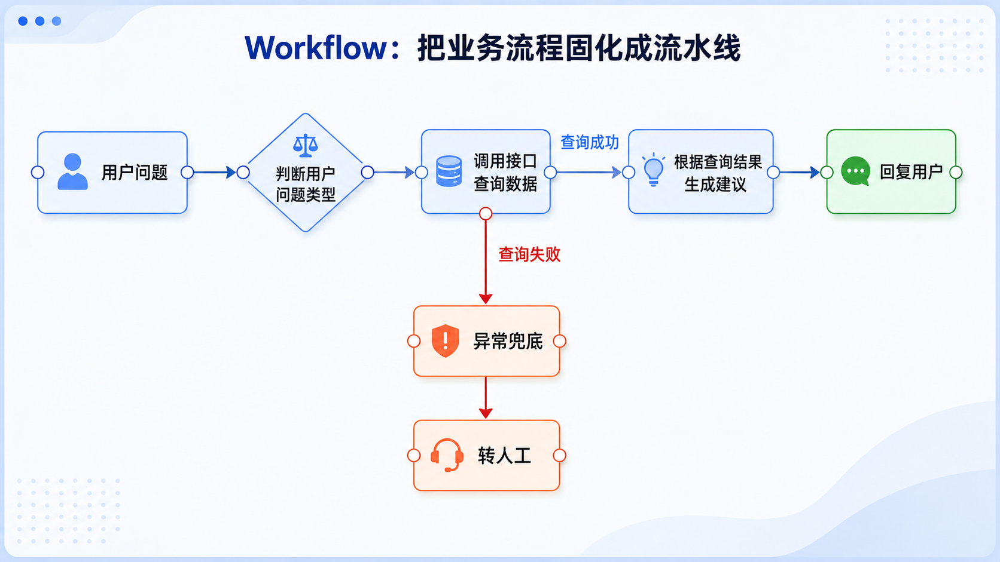

<figcaption>图· Workflow 将业务流程固化成流水线</figcaption>

## **（3）Claw 模式：能操作电脑的 AI**

2025 年初，一个新范式火了起来，业内常把这一类产品称为 Claw。很多人第一次听到，觉得它玄乎又神秘，但其实它的原理和前面讲的东西并没有本质区别——它只是在原有基础上，多做了一件事：**让 AI
 能够发出操作电脑的指令。**

以前的 AI，无论多么强大，输出的本质上都只是文字——它能把一件事说得头头是道，却终究只是“说”，真正动手去做的还得是人。而 Claw 这类
 AI，输出的可以是对电脑的操作指令：移动鼠标、点击、按下键盘、打开文档、填写表单、执行命令等。于是，AI 不再只是隔着屏幕跟人说话，而是能真正“动手”操作电脑，替人把事情从头做到尾。

看似神奇，但底层逻辑在工具调用中已经可以理解。电脑操作本质上也是一组工具：键盘输入、鼠标移动与点击、打开或关闭程序、执行命令。只要把这些操作封装成工具交给 AI 调用，就实现了“AI 操作电脑”。所以它本质上和 Tool
 Use、MCP 是一回事：按照约定好的方式，让 AI 发出标准化的指令。

> [图片未下载] 演示视频Claw 模式同步执行演示：点击“发送给 Claw”后，任务拆解、执行步骤与工作区产物同步变化；可暂停、重播或拖动进度条查看任一阶段。 — 

Claw 范式还有一个很吸引人的创新：它可以和聊天工具连在一起。于是我们会获得一种“远程操控”的体验——就像用手机给电脑发了一条消息，电脑那头的 AI
 就自己动起来，把活干完。从技术上看，这些指令本身并不复杂，但这种“我随手发个消息，电脑就自动帮我办事”的体验，一下子击中了大众。

## **tip1：****Claw 还很新：安全、权限与复杂长任务问题必须心里有数**

- **安全问题：**它能真正操作电脑，一旦被滥用或理解错误，后果可能很严重。例如误执行删除文件、泄露数据或受网页中的恶意指令影响。

- **权限问题：**既然它能接触文件和系统，“该让它碰哪些、不该碰哪些”的边界非常重要。

- **复杂长任务仍然吃力：**Claw 的手脚虽然灵活，但“大脑”仍取决于背后的语言模型，面对特别长、步骤特别多的任务仍可能失控或跑偏。

下面用四个任务检验一下判断力：为每项任务选择最合适的执行策略。判断时要关注**权限、可逆性和外部影响**。

- A可自动执行

- B需要人工确认

- C不应执行

- A可自动执行

- B需要人工确认

- C不应执行

- A可自动执行

- B需要人工确认

- C不应执行

- A可自动执行

- B需要人工确认

- C不应执行

## **tip2：****本地 Claw vs 云端 Claw**

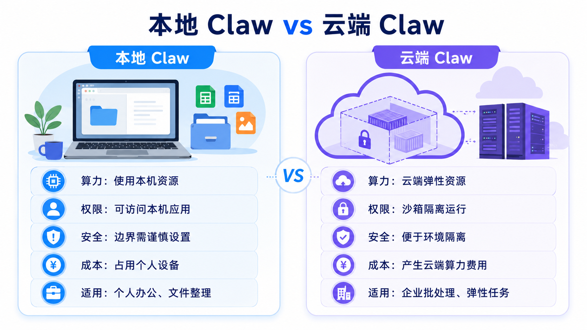

<figcaption>图· 本地 Claw 与云端 Claw 对比</figcaption>

## **1.3.3 为什么企业造智能体，需要一个平台**

学到这里，你可能会产生一种“我已经很懂 AI 了”的兴奋感。但事实上，个人日常使用 AI，和一家企业要把智能体真用起来、用得好、用得放心，是截然不同的。

一个人玩 AI，缺了什么问题不大。但一家企业要把智能体落地到真实业务里，例如智能客服、知识助手、经营分析、流程自动化，马上会撞上一堆现实的墙。


<figcaption>图· 企业落地 Agent 面临的五类现实障碍</figcaption>

## **（1）****企业级 Agent 必须具备的六大特性**

企业级 Agent 不是演示用的玩具，而是要进入真实业务系统。因此，它必须具备可控性、可测性、可审计性、可运维性、可复用性和可集成性。

> [图片未下载] 互动学习企业级 Agent 六大特性 — 

点击卡片翻面，查看定义、业务示例及 ADP 中的对应能力。

系统始终受人类掌控，可暂停、停止并设置权限边界。

**业务示例：**删除客户信息前必须等待人工审批。

**ADP：**权限边界、人工干预、发布审批、工具范围控制。

能够验证 Agent 是否按预期工作，并重现问题。

**业务示例：**上线前使用测试集验证准确率和流程完成率。

**ADP：**调试工具、评测数据集、对话日志、节点运行记录。

任何决策和行动都有完整、可回溯的记录。

**业务示例：**回溯某次拒答参考了哪个规则、何时执行。

**ADP：**知识引用来源、操作留痕、接口调用和决策回溯。

系统容易监控、调试、升级与回滚。

**业务示例：**成功率下降时告警并定位失败任务类型。

**ADP：**用量监控、效果分析、版本管理、异常定位与回滚。

知识、工具、规则和模板可被多个 Agent 复用。

**业务示例：**一个政策知识库授权给多个业务助手。

**ADP：**知识库共享、工具复用、Prompt 与 Workflow 沉淀。

能够通过标准接口连接企业现有系统。

**业务示例：**接入 CRM、ERP、工单系统或数据库。

**ADP：**API、数据库、MCP 和企业系统连接能力。

## **（2）****ADP：企业造智能体的一站式平台**

换句话说，企业要“可控、可运营、能规模化”地落地智能体，就必须有一个把这些能力和特性全部整合好、开箱即用的一站式平台。这样的平台，不是一个通用聊天机器人，也不是某个单独的 Claw
 工具，而是专门为“企业造智能体”而生的开发与运营底座。

腾讯云 ADP（智能体开发平台，Agent Development Platform）正是这样一个平台。它把本章讲到的大模型、知识库（RAG）、提示词、变量与记忆、连接器与工具（含 MCP）、工作流、多 Agent，乃至
 Claw 模式，全部做成了可视化、可配置、可运营的产品能力，让不懂代码的业务人员，也能亲手把一个智能体造出来。

正是这些特性，让企业能够真正“安心”地把智能体用在生产环境里——不是做一个演示用的玩具，而是搭建一套可控、可运营、能长期迭代的业务系统。它的优势在哪、能提供哪些具体能力？这正是下一章“ADP 产品能力”要展开的内容。

## **1.3 小结**

- 智能体不是神秘的新物种，而是大语言模型加上 Prompt、Memory、Tool Use、MCP 等机制后形成的能自己规划、自己行动，从而完成多步骤的复杂任务目标的人工智能系统。

- Agent 的核心运行逻辑是 Goal–Action–Observation 循环：给目标、做行动、看结果、再调整。

- Agent 可以有多种编排方式：单 Agent 适合简单任务，多 Agent 适合复杂协作，Workflow 适合固定流程，Claw 适合开放探索和电脑操作任务。

- 企业落地 Agent 不能只靠一个聊天工具，还需要知识、工具、流程、权限、安全、评测和运营的一站式平台支撑。ADP 正是把这些能力产品化、可视化、可运营化的智能体开发平台。

下一节进入第 2 章“ADP 产品能力”。在理解 Agent 的基本概念后，接下来会看到 ADP 如何把应用、知识库、Workflow、工具、模型、发布和运营能力组织成一套企业级智能体开发平台。

---


# 第二章 · ADP 产品能力

从平台定位出发，系统认识应用、模型、知识、连接、编排与运营能力，并串联从开发到上线的完整使用路径。

## 2.1ADP 是什么：企业级智能体开发平台

**腾讯云智能体开发平台****（Tencent Cloud Agent Development Platform，下文简称 Tencent Cloud
 ADP）****是面向企业的智能体开发平台****，可以****帮助企业构建、上线和持续运营智能体应用。它把大模型、知识、工具、流程和企业治理连接起来，让智能体真正进入业务场景。**

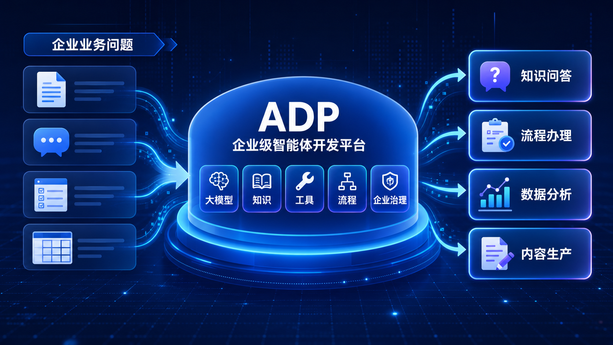

<figcaption>图· ADP企业级智能体开发平台概览</figcaption>

学完这一节，你应能说明 ADP 的产品定位；理解企业为什么不能只靠一个大模型；读懂 ADP 产品能力地图中“构建模式 × 核心能力组件 × AI Model”的关系；了解ADP的四大优势；初步判断哪些任务适合用
 ADP 构建智能体。

## **2.1.1 ADP 的产品定位**

ADP 是面向企业的智能体开发平台。它围绕大模型能力，整合应用构建、知识库、工具连接、Workflow、多 Agent、权限发布、调试评测和运营分析，帮助企业把 AI
 能力变成可使用、可管理、可上线、可持续优化的智能体应用。

ADP 不是普通 Chatbot，也不是单一大模型接口，而是企业构建智能体应用的生产与运营平台。

ADP 面向的不是单一角色，而是企业内围绕 AI 应用建设协同工作的多类人群。例如，业务团队关心能不能解决问题，IT 团队关心能不能安全接入和管理，售前与交付团队关心能不能快速搭建可复用方案。

## **为了避免把 ADP 理解窄，需要先区分它和几类常见产品的关系。**

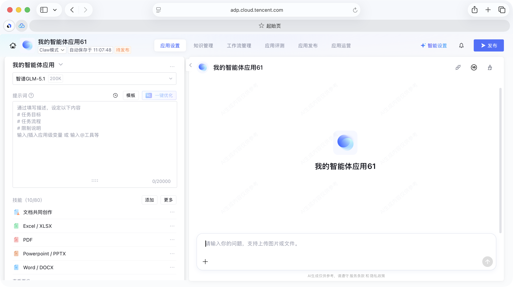

<figcaption>图· ADP智能体搭建页面。可以进行应用设置、知识管理、工作流管理、发布运营、工具设置等</figcaption>

- A只是一个聊天机器人

- B企业级 Agent 开发平台

- C可以连接知识、工具和流程

- D可以支持应用上线和运营

## **2.1.2****ADP的智能体范式**

理解 ADP
 的定位之后，再看企业为什么需要这样的平台。大模型让机器具备了理解、生成和推理能力，这是智能体能够工作的基础。但在企业场景里，“能回答”只是第一步。真正进入业务时，还需要继续追问：回答依据来自哪里？能不能查企业内部资料？能不能调用业务系统？能不能按固定流程执行？谁可以使用？上线之后怎么评测、监控和优化？

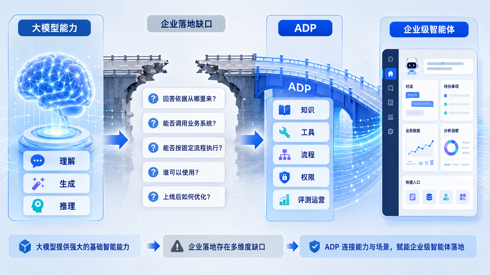

<figcaption>图· 大模型到ADP能力补足</figcaption>

大模型是智能体的能力基础，但企业级智能体不是“模型接口 + 聊天框”。企业真正需要的是一套能把模型、知识、工具、流程和治理能力组合起来的平台。ADP
 可以把大模型能力包装成不同智能体范式：有的负责稳定问答，有的负责按流程办事，有的负责多角色协同，有的负责处理更开放的复杂任务，也有的帮助用户用自然语言快速创建和辅助搭建应用。这与我们上一章介绍的当前已有的智能体范式是一致的。

这里的几种范式用于帮助你理解 ADP
 如何把大模型能力变成不同类型的智能体应用。本节不会展开具体的操作教程，**第三章****会再详细讲每种模式的适用边界、搭建方式和实战案例。**

> [图片未下载] 翻卡对比从大模型到企业级智能体，还缺什么？ — 

### 只靠大模型，还缺什么？

点击卡片翻面，查看 ADP 为企业落地补足的能力。

请用鼠标点击卡片翻面。

## **2.1.3 ADP 的产品能力****地图**

理解 ADP 的产品能力，不需要先陷入复杂的后台菜单。我们可以把ADP 看成“构建模式、核心能力组件和 AI
 Model”的灵活组合：不同业务场景，可以选择不同构建模式，接入不同能力组件，再结合合适的大模型能力，最终形成面向业务的 AI 应用。

能力地图中的构建模式、核心能力组件、模型能力和底部场景都是代表性示例，并不是 ADP 的完整能力清单。这里的目标不是穷举所有功能，而是帮助你理解 ADP 如何通过“模式 + 能力组件 + 模型”的组合构建不同业务场景。

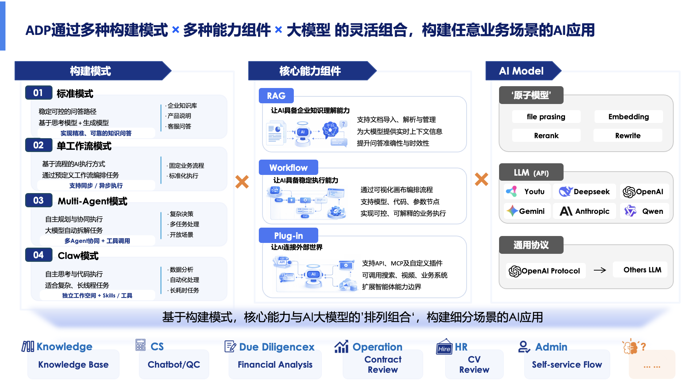

<figcaption>图· ADP 能力地图：构建模式 × 核心能力组件 × AI Model 的灵活组合</figcaption>

ADP能力地图

ADP 通过多种构建模式 × 多种能力组件 × 大模型的灵活组合，构建不同业务场景的 AI 应用。

## **（1）****如何阅读这张能力地图**

构建模式决定应用怎么运行。图中示例包括标准模式、单工作流模式、Multi-Agent 模式，分别对应稳定问答、固定流程和多 Agent 协作。

核心能力组件决定应用能做什么。图中示例包括 RAG、Workflow、Plug-in，分别补齐知识理解、流程执行和外部连接能力。

AI Model 提供底层智能能力。图中示例包括原子模型、LLM API 和通用协议，用于支撑文档解析、检索、生成、推理和模型接入。

构建模式负责承载应用形态，核心能力组件负责补齐知识、流程和工具，AI Model 负责提供底层智能。三者组合起来，就可以面向不同业务场景构建不同类型的 AI 应用。例如：

## **（2）ADP的实际应用**

ADP的能力可以应用在各类业务场景中。只要业务中存在大量知识问答、重复咨询、文档处理、流程办理、系统查询、数据分析或内容生产，或者其他复杂的、多步骤的任务，就可以进一步判断是否适合用 ADP 构建智能体。例如：

## **（3）ADP的****部署形态：公有云和私有化**

**公有云部署**：腾讯云 ADP 提供的标准服务，用户通过云端账户直接使用，无需自建基础设施，按使用量计费，快速上手。

**私有化部署**：适合对数据隐私、合规性、网络隔离有严格要求的客户，支持在客户专有的云环境或本地部署，保证数据完全由企业自主管理。

## **2.1.****4****ADP的四大产品优势**

为什么企业选 ADP，而不是自己拿开源框架从头拼？因为 ADP 在四个方面提供了“企业级”的保障。

## **（1）****优势一：更精准的对话效果。**

在真实业务里，"对话效果好不好"不只取决于大模型本身，更取决于系统能不能**准确看懂企业文档、高效检索、给出可靠答案**。ADP 在这方面积累深厚：

- **企业级文档理解**：依托腾讯优图实验室多年的 OCR 与文档解析技术积累，支持 10+ 文档文件类型、200MB
 单文档处理，对复杂图文混排、表格、公式等版面进行智能识别与结构化处理。在说明书、规章制度等场景中，能够准确提取文档中的文本和图片内容，为后续问答提供高质量的知识底座，同时支持对图片内容的直接理解与回答。

- **自研向量（Embedding）模型**：还记得第一章介绍的 Embedding 吗？ADP基于多阶段训练管线和精细化数据工程，自研的 2B 级 Embedding 模型在 C-MTEB
 基准测试中达到 SOTA 水平。结合基于 LLM 的 Reranker 模型(支持 8k+ 长文本、分层知识蒸馏)，实现高召回、高精准的检索效果。

- **智能 RAG（Agentic RAG）与结构化数据问答**：不仅能“匹配一段文本”，还可以通过多轮检索、跨文档推理和多工具协同，回答跨知识源的复杂问题。结合 Text-to-SQL
 能力，支持对上万行表格或数据库执行条件筛选并聚合问答，让"问文档、问表格、问数据库"可以在同一应用中统一完成。

## **（2）****优势二：完整的一站式开发与运营框架。**

- **多种智能体架构**：支持 LLM+RAG、Multi-Agent、Workflow 等主流范式，兼顾简单问答和复杂任务代理。

- **贯穿应用全生命周期**：从配置、开发、调试、评测、发布到运营，全链路都有配套能力，一套平台承载从试点到规模化。

- **企业级评测体系**：内置裁判模型、规则、代码等多种评估方式，支持一键批量对比不同模型、提示词和工作流版本，生成量化效果报告。

- **运营与用量管理**：提供用量、数据分析、对话记录日志等管理后台，便于精细化运营和查看使用成本。

- **零代码 / 低代码优先**：绝大部分功能通过可视化配置完成，复杂场景再补少量代码，兼顾业务和技术团队。

- **丰富模板与最佳实践**：预置教育、传媒、医疗、金融等多行业模板，以及多场景 Demo 与"应用开发要点"，降低试错成本。

- **可解释与持续优化**：每条回答附带命中文档片段、相似度评分和检索路径。配合应用日志分析和评测能力，帮助业务与运营人员了解大模型"为什么这么答"，基于实际效果持续调整知识组织与检索策略。

## **（3）****优势三：灵活的模型与开放生态。**

- **多模型统一接入**：支持主流大模型与自建模型一键导入 Tencent Cloud ADP。

- **企业级连接器与工具生态**：内置 200+ 高质量连接器和工具，覆盖知识问答、检索、图片/音视频处理、数据分析等场景，全面支持 MCP 协议和自定义扩展。

- **多种集成方式**：智能体 API 提供 RESTful API、SDK 等集成方式，支持发布至企业微信以及小程序等常用渠道，适配不同技术栈与接入场景。

## **（4）****优势四：企业级安全、性能与可观测性。**

- **高性能架构**：流式响应，首字时间 < 1 秒，支持高并发和扩缩容。

- **安全可靠**：多租户数据强隔离，内容安全审核，细粒度权限体系与操作审计。

- **精细化权限体系**：平台 / 空间 / 应用 / 知识库等多层级权限，数据权限与功能权限解耦，适配集团型企业复杂组织结构。

- **完善的监控与告警**：实时监控请求量、成功率、延迟、Token 消耗等核心指标。

- **智能体数据洞察能力**：智能体对话记录分析、热点问题挖掘、问答效果标注，效果趋势分析。

## **2.1****.5****小结**

ADP 是企业级 Agent 开发平台。它不是单独的大模型，也不是普通 Chatbot，而是通过构建模式、核心能力组件和大模型能力的灵活组合，支持公有云和私有化两种部署形态，让智能体能够进入企业业务并持续运行。

- ADP 的定位是企业级 Agent 开发平台，帮助企业把模型能力转化为可上线的智能体应用。

- 企业不能只靠一个大模型，因为真实业务还需要知识、工具、流程、权限、评测和运营。

- ADP 的产品能力可以理解为：构建模式 × 核心能力组件 × AI Model。

- ADP的四大优势。

本节内容已经回答了“ADP 是什么”。接下来，我们会进一步拆开看：一个智能体在 ADP 中究竟由哪些核心模块搭建起来。你将看到应用、模型、Prompt、变量、记忆、知识库、工具、Workflow等之间如何协同工作。

---

## 2.2 上基础能力：应用、模型、角色指令、变量与长期记忆

**本节主要了解****一个智能体在 ADP
 中是如何被“定义出来”的：它叫什么、面向谁、使用哪些模型、遵循什么角色指令、如何使用变量传递信息，以及是否通过长期记忆形成个性化体验。**


<figcaption>图· ADP应用设置基础能力概览</figcaption>

学完这一部分，能够知道如何给 Agent 一个“大脑”和任务边界；了解应用基础信息可以编辑什么；理解 ADP
 模型设置中各类模型的作用；知道角色指令如何限定模型回复的角色、语种、语气和版本；理解应用级变量、工作流级变量的类型与隔离范围；理解长期记忆如何为应用提供个性化对话体验。

一个智能体如何被搭建出来？首先，需要给 Agent 一个“大脑”和任务边界。这个智能体是谁？要完成什么任务？怎么说话？用哪个模型？记住什么？接下来我们将回答这些问题。

## **2.2.1****创建应用**

通过智能体开发平台新建智能体应用，可利用大模型技术，实现可自主编排与决策，或按固定工作流高效执行流程完成任务。创建应用时，可以配置应用的基础信息、应用模式等。

应用名称、图标、描述等，用于定义用户看到的智能体身份。

**应用模式**

可根据场景选择标准模式、单工作流模式、Multi-Agent 模式、Claw 模式或智能工作台。


<figcaption>图· 应用开发新建应用入口</figcaption>


<figcaption>图· “新建应用”界面</figcaption>

应用设置解决的是“智能体以什么身份存在”。它不会自动保证回答准确，也不会自动完成业务动作；回答准确依赖模型、Prompt 和知识库，业务动作依赖工具、Workflow 和权限配置。

创建应用后，进入应用设置页面，**可对应用模型、知识库、输出配置等进行设置**。以标准模式应用为例，应用设置页承载了大量应用配置能力。创建应用后，单击左上角应用图标，支持在“编辑应用”弹窗中修改应用图标、应用名称、应用简介等信息。


<figcaption>图· “应用设置”界面</figcaption>

**应用本身是一个可管理的智能体单位。**应用图标、名称和简介决定用户如何识别这个智能体，也影响后续运营、交付和复用。对于标准模式、单工作流模式、Multi-Agent
 模式三种应用，编辑应用弹窗中的“模式”区域会展示模式卡片，并支持切换至其他非 Claw 模式；Claw 模式应用不支持模式切换，编辑应用弹窗中的“模式”区域仅展示当前 Claw 模式卡片。


<figcaption>图· “应用设置”界面：Claw模式。Claw模式应用不支持模式切换</figcaption>

编辑应用可以修改应用身份信息，也能在部分模式间切换；但具体业务能力仍然取决于后续模型、角色指令、知识库、工具、变量、记忆、工作流和发布配置。

## **2.2.2 模型设置**

**在模型设置中，ADP
 支持对应用运行中的模型进行模型配置。**不同模型在应用运行链路中的作用不同，不是所有模型都只负责“回答问题”。有的用于意图识别，有的用于生成回复，有的用于图片理解，有的用于知识库片段解析，有的用于
 Prompt 改写和 AI 一键优化。

**标准模式、单工作流模式可通过模型设置进行统一设置。**模型设置相关功能包括模型服务、上下文轮数和参数设置。模型服务方面，平台新用户可获得一定量免费额度，可通过选择不同种类的模型进行免费应用调试；根据测试结果，再进一步购买和使用。


<figcaption>图· 模型设置功能入口</figcaption>


<figcaption>图· 模型选择与切换</figcaption>


<figcaption>图· 模型设置参数详情</figcaption>

**温度为什么会影响稳定性：**模型每一步都在多个候选 Token
 中采样。较低温度会压低低概率候选被选中的机会，因此同一问题多次生成通常更集中、更稳定；较高温度会保留更多候选，适合创意任务，但不适合要求口径一致的制度问答或结构化输出。

**上下文不只是聊天记录：**回答“我的报销为何被驳回”时，只有制度条文仍然不够，还要把该员工的具体单据状态、审批记录和必要身份信息作为实时业务上下文，通过有权限的工具或 API
 获取。模型参数不能替代真实业务数据。

**长任务要维护任务状态：**对“查资料—生成报告—发送通知”这类多步任务，应持续记录任务目标、输出格式、可用工具及调用约束、已完成步骤、关键中间结果和异常原因。步骤较多时要定期生成状态摘要，避免上下文越来越长后重复早期错误计划；失败时应能从最近的可靠状态继续，而不是从头盲目重跑。

多模态问答模型、多模态阅读理解模型、Prompt 改写模型、AI 一键优化模型在新建应用时，ADP
 展示的默认模型是平台官方推荐的最佳实践模型，是经过大量场景验证的优选模型，不建议用户随意修改。自行修改后，可能造成端到端问答效果下降，应谨慎更换。

## **2.2.3 角色指令**

用户提问后，应用会以“角色指令”中定义的任务角色给出回答。角色指令可以参照模板填写，用于限定模型回复的语种、语气等。目前平台已支持中英文问答输出。对客户来说，角色指令是让智能体从“通用模型”变成“某个业务角色”的关键配置。


<figcaption>图· 角色指令</figcaption>

角色指令可以强化角色、语气、回答格式和规则，但不能替代知识库和工具。需要基于企业资料回答的问题，应配合知识库；需要查询或执行的问题，应配合工具、工作流或连接器。

## **2.2.4 欢迎语**

填写欢迎语后，将在客户端侧首页显示，支持插入应用级变量显示。欢迎语不是可有可无的装饰，它影响用户第一次打开应用时是否知道应该怎么问、能获得什么帮助。平台支持使用 AI 一键优化生成欢迎语。


<figcaption>图· 欢迎语</figcaption>

## **2.2.5 变量**

智能体开发平台提供了丰富的变量类型，以满足不同业务场景需求。**从变量的使用范围角度，变量分为“应用级变量”和“工作流级变量”两类**。变量让应用可以读取系统信息、接收 API
 参数、保存环境密钥、在应用内传递内容，也可以在工作流内部传递节点输入输出。

应用级变量表示应用全局范围内可见、可使用的变量，具体包括系统变量、环境变量、API 参数和应用变量。


<figcaption>图· 应用级变量</figcaption>

工作流级变量表示工作流内部可见、可使用的变量，具体包括工作流变量、节点输入变量和节点输出变量。

由于使用场景不同，每种变量的适用范围也存在差异。

- 系统变量（除 SYS.Memory 外）通常用户隔离、Session 隔离；

- SYS.Memory 用户隔离但不 Session 隔离；

- 环境变量用户和 Session 都不隔离；

- API 参数和应用变量用户隔离但不 Session 隔离；

- 工作流变量、工作流节点输入变量和工作流节点输出变量均用户隔离、Session 隔离。

具体参考如下表格：

- “用户隔离”指同一个变量对于不同终端用户的变量值不同；“Session 隔离”指同一个变量在不同 session 下变量值不同。

- 从**隔离范围**上看，**用户隔离 > Session 隔离**。灵活使用变量可以满足复杂业务场景需求。

## **2.2.6 长期记忆**

长期记忆功能是实现个性化对话体验的核心，它如同为应用赋予了 “大脑记忆”
 的能力。通过持续识别并精准留存与终端用户相关的各类关键信息，包括**用户的基础画像**（年龄、性别等）以及**重要的记忆点**（如特定时间在特定地点做过的事情等），让应用在后续与用户的每一次互动中，都能快速调用这些信息，从而提供更贴合用户个性化需求的回应，极大地提升用户的使用体验。

**长期记忆的唯一性由两大核心要素共同决定，即终端用户**和**应用**。意味着每一个终端用户在不同的应用中，都会形成独立且唯一的长期记忆。这种独立性能够确保用户在不同应用场景下的信息不会相互混淆，保证了记忆的针对性和准确性。

- **说明：**

终端用户 A 在应用 1 中的长期记忆为 A1；终端用户 A 在应用 2 中的长期记忆为 A2；终端用户 B 在应用 1 中的长期记忆为 B1，其中 A1、A2、B1 彼此独立，互不相同，这些记忆不会相互干扰。

## **长期记忆的模块构成**

长期记忆主要分为两个步骤：**长期记忆总结**和**长期记忆召回**。

①**长期记忆总结**：在用户与智能体进行多轮对话的过程中，系统会调用 “长期记忆总结” 模块。每一轮对话都会运行总结模块并尝试提取长期记忆，更新 **SYS.Memory** 内容。

②**长期记忆召回**：当用户后续再次发起对话时，系统会进行长期记忆召回，帮助大模型了解用户画像及重要记忆点，与用户个性化对话。因为长期记忆不按 Session 隔离，所以只要是同一个应用id以及同一个终端用户id，即使开启了新的会话，之前总结的长期记忆也可以继续被使用。

因此整个过程（下文流程图中的循环）可以简单理解为：【用户发起对话 → 尝试总结并更新长期记忆 → 存入 **SYS.Memory** → 后续该用户再次发起会话 → 召回已有长期记忆 】。

例如，某一次会话后，长期记忆内容记录了“用户是一名素食主义者”，之后即使该用户重新开启了一个新的 Session，只要还是同一个应用、同一个 userID，系统仍然可以召回这个信息。当用户再问“帮我推荐附近的餐厅”时，就可以优先考虑素食餐厅。

长期记忆运行流程图如下：


<figcaption>图· 长期记忆运行流程图</figcaption>

## **2.2 上小结**

本部分内容聚焦应用设置中的核心配置能力：应用编辑定义应用身份，模型设置决定运行链路中的模型能力，角色指令限定回复角色和规则，欢迎语影响用户入口体验，变量支撑应用和工作流的数据传递，长期记忆支撑个性化对话体验。

下一节，我们将继续了解 ADP 如何让智能体获得企业知识、连接外部系统，并从“会回答”进一步走向“能办事”。

---

## 2.2 下任务执行与编排能力：Workflow、Multi-Agent 与 Claw

**上一部分已经讲清楚 ADP 如何通过知识库、工具、连接器与 Skills
 为智能体补充“知识”和“能力”。当任务进一步变复杂，智能体就不只是回答问题，还需要按照流程办事、在多个工具之间选择、拆解复杂目标，甚至在独立工作空间中持续处理文件、运行代码和生成结果。本节聚焦 ADP
 的三类任务执行与编排能力：Workflow、Multi-Agent 与 Claw。**

理解 Workflow、Multi-Agent 与 Claw 分别适合解决什么问题；知道 Workflow 如何通过节点和变量保证流程稳定可控；知道 Multi-Agent 如何让模型自主规划、调用工具和多
 Agent 协同；知道 Claw 如何通过独立工作空间、Skills、工具和连接器处理复杂自主任务。


<figcaption>图· 任务执行与编排能力进阶</figcaption>

## **2.2 下.1 Workflow：把业务流程编排成稳定可控的执行链路**

Workflow为用户提供了直观的可视化画布，支持通过大模型、代码、参数提取等多种节点来编排复杂的业务流程。工作流旨在实现稳定且可控的业务效果，确保每个流程节点的准确性和可解释性。

Workflow 的核心价值是把开放式对话转化为可验证、可复用的流程。当一个任务有明确步骤、明确输入输出、明确判断条件时，就适合用 Workflow
 承载。例如开票、售后处理、工单流转、审批办理、信息收集、报告生成等场景，都可以拆解成节点、变量、条件分支和工具调用。

## **（1）****可视化画布：用拖拽和连线搭建流程**

工作流画布支持通过拖拽和连接节点构建业务流程，画布支持鼠标和触控板操作，并提供多种快捷键，提高工作流配置效率。节点列表、画布、节点详情分类展现，使页面内容更简洁清晰。

在画布中，连线用于连接两个工作流节点，描述工作流执行流向，并在约束条件下连接节点。一个完整工作流通常从开始节点进入，经过信息收集、信息处理、变量处理和逻辑判断，最后通过回复节点或结束节点输出结果。


<figcaption>图· 工作流画布</figcaption>

## **（2）****节点设计：每个节点负责一类明确动作**

节点是工作流中的基本构建单元，每个节点代表一个特定操作或功能。节点通过互相连接形成完整业务流程。ADP 工作流节点可以分为信息收集类节点、信息处理类节点、变量处理类节点和基础节点。

## **（3）****变量与连线：让每一步结果能继续被后续节点使用**

变量用于承载工作流运行中可流转的数据。**工作流支持使用应用级变量和工作流级变量，也可以通过节点的输入变量引用前序节点变量、应用级变量或工作流级变量**。变量让流程中的信息不只停留在自然语言层面，而是可以被后续节点读取、判断、转换和传递。（对变量的介绍见2.2上）

工作流的连线也有明确约束。工作流中至少要有一个结束回复节点，整个工作流才可以正常执行；当前节点的输入一定要连接前一个节点的输出，节点的输入之间、输出之间不能连接；信息收集类节点、信息处理类节点之间没有固定前后顺序关系；开始节点、信息收集类节点、信息处理类节点的输出都可以连接多个后续节点，从而支持并行处理。

## **（4）****灵活对话：既能多轮澄清，也能稳定执行**

工作流的运行机制支持与用户进行多轮对话交互。在信息收集过程中，系统自主分析必填信息是否完整，如果不完整则自动生成反问澄清话术，引导用户提供必填信息。

工作流还**内置 Agent 全局监控节点跳转**，无需区分“对话流”和“工作流”，既能灵活对话又能确保精准执行流程。内置 Agent
 负责接管对话、控制节点跳转、识别全局意图，例如识别“不继续执行工作流”等退出意图，以及“好的”“没问题”等寒暄意图，并智能回复。

## **2.2 下.2 Multi-Agent：让模型自主规划、调用工具和协同执行**

“Multi-Agent
 模式”是智能体开发平台支持创建的应用类别之一。该模式的应用由大模型自主规划执行路径、灵活调用工具，其核心特点在于将对话的主动权更多地交由模型，充分发挥模型的主动性。此模式适用于需要灵活响应、多工具调用以及多 Agent
 协同的场景。

在 Multi-Agent 模式中，支持创建单 Agent 应用，同时允许添加多个 Agent，并支持切换不同的多 Agent 协同方式来满足多场景的需要。如果一个 Agent 足以完成任务，可以直接使用系统默认创建的
 Agent；如果需要多个专家角色协作，则可以添加多个 Agent 并配置转交关系。


<figcaption>图· Multi-Agent 应用编设置页，可以添加Agent、配置转交关系和协同方式、添加工具和连接器等</figcaption>

## **（1）核心工作流程：思考规划、工具调用、纠错反思**

Multi-Agent 模式包含思考规划、主动选择调用工具和主动纠错反思三类核心任务：

- **思考规划**：制定整体任务达成的规划思路，并把整体的复杂任务拆解为细分的子任务。

- **主动选择和调用工具**：根据拆解后的子任务和工具的描述说明，选择一个或多个合适的工具来解决问题。

- **主动纠错反思**：模型自主改进优化过去的行为决策，并对行为进行纠正。

以上三类工作可能多次循环执行，最终输出回复的答案。


<figcaption>图· Multi-Agent核心工作流程</figcaption>

## **（2）Agent 配置：让模型知道“谁负责什么”**

Agent 高级设置用于对 Agent 的思考逻辑和输出方式进行精细化调整，用户可以根据不同的业务场景选择合适的策略，从而优化 Agent 表现，提高结果的准确性或响应速度。

## **（3）协同方式：自由转交、工作流编排、Plan & Execute**

当应用中存在多个 Agent 时，需要选择协同方式。系统支持自由转交、工作流编排和 Plan & Execute 三种方式。创建 Multi-Agent 应用时，默认 Agent
 协同方式为自由转交；切换为工作流编排时，转交顺序固定，任务执行可控；切换为 Plan & Execute 协同时，任务将被 Planner Agent 拆解，由 Executor Agent
 执行，耗时较长，适用于对耗时要求不高的复杂任务。

目前 Plan-and-Execute 模式仅支持**单轮对话**，即每次输入（query）都会独立处理，暂不支持基于历史上下文的多轮对话。

## **2.2 下.3 Claw：面向复杂自主任务的独立工作空间**

Claw 模式应用通过自然语言驱动智能体自主思考并解决复杂问题；应用拥有独立工作空间，可自主编写和运行代码、调用 Skills / 工具 /
 连接器等多种能力。它适用于数据分析、内容生成、自动化处理等复杂任务场景，就像一位随时在线的数字同事。

## **Claw 的核心差异**

- **开箱即用**：Claw 模式创建后即可使用平台内置模型（支持自主切换），无需额外配置模型服务与思考-生成双模型体系。

- **Skills 能力扩展**：支持添加最多 **80 个 Skills**（来自 Skills 广场），让 Agent
 获得即装即用的专业能力（办公文档、医疗健康、图像处理、音视频等）。

- **独立工作空间**：Claw 模式应用拥有独立的工作空间，适合长耗时、涉及文件读写的自主任务。

- **不支持模式切换**：一旦创建为 Claw 模式，不支持切换到其他三种模式；反之，其他三种模式之间仍可互相切换。

## **2.2 下小结**

本节把 ADP 的复杂任务能力拆成三类执行载体：Workflow 用节点和变量把业务流程变得稳定可控；Multi-Agent 让模型能够自主规划、调用工具、进行多 Agent 协同；Claw
 通过独立工作空间、Skills、工具和连接器处理更复杂的自主任务。

理解这三类能力后，就能把 ADP 的能力地图进一步落到实际应用上。下一节将从开发到上线的完整生命周期出发，把应用创建、能力配置、执行逻辑搭建、对话调试、发布接入和运营优化串成一条完整路径。

---

## 2.2 中知识与连接能力：知识库、工具、连接器与 Skills

**了解了应用的基础配置后，我们继续看 ADP
 如何让智能体获得企业知识、连接外部系统，并从“会回答”进一步走向“能办事”。先理解什么是知识库、什么是知识管理，再进入文档、问答、数据库、知识库设置和 Agentic RAG。**

学习完本节后，你将能够：
 理解知识库与 **RAG** 的关系：知道 **ADP** 知识库如何让智能体基于企业知识回答问题。
 了解知识库的主要能力：掌握文档、问答、数据库、知识库设置和 Agentic **RAG** 分别解决什么问题。
 理解知识处理流程：知道文档从上传到检索，会经历解析、切分、干预和优化等环节。
 区分知识库与工具：知道知识库负责“查资料”，工具、连接器和 Skills 负责“办事情”。

## **2.2 中.1 知识库：ADP 中的 RAG 能力如何落地**

第一章已经讲过 RAG：大模型回答问题前，先从外部知识中检索相关内容，再把检索结果作为上下文交给模型生成答案。ADP 的知识库，就是把这套思路产品化、可配置化、可维护化的能力，是一条完整链路：知识导入、文档解析、Chunk
 切分、向量化与索引、检索召回、重排序、引用展示，以及后续的调试和维护。

RAG 是技术思路，知识库是 ADP 中承载这套思路的产品能力。RAG 解决“大模型不知道企业私有知识”的问题；ADP
 知识库进一步解决“企业知识如何进入平台、如何被处理、如何被检索、如何被引用、如何被持续维护”的问题。

> [图片未下载] 排序练习排出正确的 RAG 处理链路 — 

### 排出正确的 RAG 链路

使用上下按钮调整顺序，再提交答案。

## **2.2 中.1.1 什么是知识库？**

在 ADP
 中，知识库是用于导入、处理、维护和检索企业知识的核心模块。企业可以把产品说明、制度文件、操作手册、FAQ、培训材料、网页内容等资料放入知识库，让智能体在回答问题时优先从这些资料中查找依据。从实际使用角度看，知识库的价值不只是“让大模型知道更多”，而是让回答更贴近企业真实业务、更可追溯、更容易运营。

在腾讯云智能体开发平台，**知识库**存储的数据称为**知识**，分为以下三种类型：

ADP
 中主要有两个层级的知识库：一是**平台级****知识库**，可以在相同主账号下被多个应用关联使用；二是**应用内的默认知识库****（应用级知识库）**，服务于当前应用。**平台级****知识库适合企业级公共资料**，例如产品手册、政策制度、售后规则、行业方案等；**默认知识库适合当前应用的专属资料**，例如某个客服机器人自己的服务口径。

当应用评测进行时，无法对知识库内容进行更改，包括新增导入、删除和修改知识设置。


<figcaption>图· 知识库层级</figcaption>

## **平台级知识库的创建与引用**

### **（1）****新建知识库**

单击左侧菜单栏中的**知识库**> **新建知识库**，填写知识库名称和知识库描述。


<figcaption>图· 新建平台级知识库</figcaption>

### **（2）修改知识库名称**

**修改知识库名称**：单击知识库左上角即可修改知识库名称。


<figcaption>图· 修改知识库名称</figcaption>

### **（3）删除知识库**

如需删除知识库，请确保当前知识库未被任何应用所引用；被应用引用的知识库需要先解除引用关系后删除。


<figcaption>图· 删除知识库</figcaption>

### **（4）在应用内添加知识库**

单击应用，前往**应用 > 知识管理 > 添加知识库**。添加后即成功引用所添加的平台级知识库；若取消勾选，则为取消引用该平台级知识库。调整知识库的引用关系后需要重新发布应用。


<figcaption>图· 在应用内添加知识库</figcaption>

## **2.2 中.1.2 什么是知识管理？**

知识管理是围绕知识导入、知识处理、知识维护和知识效果调试的一组能力。ADP中，**如果需要复用其他知识内容，可以在知识管理内额外添加****刚刚提到的****平台级知识库。****同时，****每个智能体****应用内设默认知识库****（应用级知识库）****，仅限当前应用使用**，不支持跨应用共享。企业把资料放进平台只是第一步，真正影响效果的是后续管理：资料是否最新、是否重复、是否结构清晰、是否被正确切分、检索结果是否命中、答案是否引用了正确片段。因此，**知识管理可以理解为“让企业知识变成可被智能体稳定使用的资产”的过程。**

知识库效果不是“上传越多越好”，而是“资料质量、解析质量、切分方式、检索策略、更新维护”共同决定。ADP 把这些环节做成可配置能力，可以持续优化，而不是一次性上传后完全交给模型猜。

## **2.2 中.1.3 文档**

文档是知识库最常见的知识来源，也是最容易上手的部分。ADP 的文档能力覆盖从上传、解析、切分、干预到对比的多个环节，目的是把企业原始资料处理成适合检索的知识片段。下面按照控制台中的顺序展开。

## **2.2 中.1.3.1 文档****导入**

在准备知识文档时，应尽量保证标题层级清楚、段落边界明确、表格字段完整、版本信息可识别。这样平台在解析和切分时更容易保留业务语义，后续检索也更容易命中正确内容。

进入知识库文档页后，选择**知识管理 >
 文档**，进入文档管理界面。支持导入文档、下载文档、删除文档及文档分类。可以通过本地文档、网页文件、腾讯文档和腾讯云对象存储（COS）四种方式导入文档。


<figcaption>图· 导入文档</figcaption>

**1.****导入本地文档条件：**

- 支持 pdf、doc、docx、ppt、mhtml、pptx、wps、ppsx 格式，大小限制：200 MB。

- 支持 keynote、pages 格式，大小限制：50 MB。

- 支持 xlsx、xls、csv、md、txt、html、xmind、json、xml、log、numbers（限制行数3万行、列数180列）格式，大小限制：20 MB。

- 支持导入带文字的图片，包括 jpg、png、jpeg、tiff、bmp、gif 格式，大小限制：50MB，长宽比不超过1:7。

- 表格文件（ xlsx、xls、csv 格式）最大支持1万行、100列数据，建议一个 sheet 只存放一张表格，表格中出现全空行数据将影响问答效果。

- 支持批量导入文档。

**2.网站链接限制：**

- 确保所爬取的网页**无登录授权验证**，即无需验证当前用户身份和授予用户系统访问权限就可访问网页。

- 暂不支持异步加载类型的网站内容爬取。

- 请您确保在法律法规允许的范围内使用本网页解析工具，遵守目标平台管理规范、保障权利人合法权益，您应对此独立承担责任。腾讯云智能体开发平台作为工具提供方不对您的解析或下载行为承担任何责任。

## **2.2 中.1.3.2 文档切分设置**

文档切分指的是系统按照一定规则，将文档内容划分为多个独立的切片。这些切片会被索引并存储在知识库中，是实现 RAG（Retrieval-Augmented
 Generation，检索增强生成）能力的核心环节。在问答过程中，当用户提出问题时，系统会先从知识库中检索与问题最相关的内容切片，然后将这些切片作为外部知识注入大模型的上下文中，辅助其生成答案。合理的切分大小将直接影响检索和生成的效果：

- **切片过大**：可能包含过多无关信息，导致检索精度下降，并增加计算与资源消耗。

- **切片过小**：内容不完整，缺乏上下文连贯性，容易造成召回知识片段碎片化，使生成答案不够全面。

因此，平台在产品层面提供了灵活的文档切分规则，支持用户根据业务需求自定义调整规则，以在检索效率与生成质量之间取得最佳平衡，充分发挥 RAG 技术在知识问答与信息检索中的优势。

文档切分的规则支持**默认切分规则**和**自定义切分规则：**

- **默认切分规则**：产品使用模型能力进行切分，默认切片规则不支持用户干预。

- **自定义切分规则**：提供3种切分规则支持用户选择，包括通用标识符切分、父子标识符切分、及按行切分。

## **2.2 中.1.3.****3****智能结构化解析**

**智能结构化解析是指通过使用结构化表改写模型，自动判断用户导入的表格文件是否为结构化形式。**如当前您上传的表格源文件并非结构化表，也将通过模型自动判断，可能改写成结构化表，以提升表格问答准确率。

**（1）****结构化表格**

- 核心特征：具有严格的二维关系模型，可直接对应关系型数据库结构。

- 数据特征：

- 行列严格对齐，每个单元格对应唯一行列坐标。

- 单级表头（单行且无合并单元格），列名具有唯一性和明确的语义。

- 无数据嵌套，每个单元格存储原子数据。

- 支持数据库导入导出，支持 SQL 查询。

**（2）****非结构化表格**

- 核心特征：以人类阅读优先的视觉呈现方式破坏了机器可读性

- 结构干扰特征：

- 合并单元格（跨行/跨列/多级合并）

- 动态列结构（如：列数随行位置变化）

- 分页重复表头（每页重复列名）

## **2.2 中.1.3.****4****文档对比任务**

文档对比任务适合处理版本变更和内容差异。企业知识库不是静态的，政策会更新，产品手册会迭代，服务口径会调整。文档对比可以帮助识别不同版本之间的变化，判断哪些内容需要替换、哪些知识片段需要重新处理、哪些答案口径可能受到影响。

触发文档对比任务的方式包括**自动触发对比**和**手动触发对比**

（1）自动触发对比：当满足以下条件时，由系统自动生成的文档对比任务。

- **文档名称相同**：当客户本地上传的文档与文档列表中的文档名称及文档类型相同、文档内容不相同时，新导入文档（即新文档）的导入状态为待发布状态时，会自动触发文档对比。

- **网址来源相同**：当客户导入相同网址的文档，新文档导入状态为待发布状态时，会自动触发文档对比。

（2）手动对比：支持客户通过单击**文档对比任务** > 单击**添加对比任务**> 选择需要进行对比的文档 >
 单击**开始对比**手动**添加文档对比任务**。从文档列表中选择2个文档（仅支持选择待发布和已发布状态的文档），保存后将生成1条文档对比任务。

## **2.2 中.1.4 问答**

问答类知识是以**“问题—答案”形式成对存在**的知识。在将相关文档导入腾讯云智能体开发平台后，系统会自动生成对应的问答对。与传统的单纯文档内容分析相比，问答对具有更高的针对性和结构化程度：它能够直接将用户可能提出的问题与准确答案建立对应关系，减少了模型在理解和生成过程中的歧义。

例如，在客服场景下，问答对的优势尤为明显。一方面，它可以覆盖常见问题并快速定位标准答案，从而显著缩短响应时间；另一方面，问答对的结构化特性便于后续维护和扩展，能够随着业务的发展不断完善知识库。

当知识被导入系统后，设定的应用将形成基于问答对的业务知识库，应用可以直接利用该知识库内容对用户问题进行解答，从而实现更高效、更准确的自动化知识服务。

知识库问答应用支持**新建问答、****批量/手动导入****问答、校验问答、问答分类****等操作**。录入问答之后，当客户输入问题时，会将客户问题和问答库中的问题进行检索匹配，相似度达到一定阈值后，会输出对应回答。


<figcaption>图· 新建问答</figcaption>

## **2.2 中.1.5 数据库**

**数据库是用于存储和管理结构化数据格式文件的系统。**将数据库连接至腾讯云智能体开发平台后，可以赋予智能体基于结构化数据进行问答的能力，支持单表查询、多表查询等。

与传统 BI 工具需要依赖专业人员建模、编写 SQL 或配置报表不同，智能体结合数据库的方式能够让业务人员直接通过自然语言进行数据查询与分析。在 **Data+AI**
 场景下，这种方式不仅具备更高的交互灵活性，还能够结合上下文进行多维度探索与分析，从而让数据分析从“专业驱动”转向“业务驱动”，有效提升企业的数据利用效率与决策敏捷度。

## **2.2 中.1.****6****Agentic RAG**

Agentic RAG（智能体检索增强生成）是腾讯云智能体开发平台提供的下一代知识库问答能力。相比传统 RAG 的单次检索-生成流程，Agentic RAG 基于 Agent Loop
 框架，实现智能体自主反思、智能切换检索策略、多轮迭代检索，在知识场景中提供更广的回答范围和更高的回答准确度。

### **（1）****传统 RAG 与 Agentic RAG 的区别**

### **（2）****适用场景**

Agentic RAG 适用于以下类型的知识问答场景：

- **多文档整合问答**：需要综合多个文档信息才能回答的问题，例如“对比 A 产品和 B 产品的功能差异”。

- **复杂条件筛选**：需要按时间、地区、类别等条件筛选后生成答案，例如“2025 年华东区销售政策有哪些变化”。

- **交叉验证型问答**：答案需要从多个知识源交叉验证，例如“公司的差旅报销标准是否有最新更新”。

- **深度推理型问答**：需要理解问题意图并多步推理，例如“根据公司制度，跨部门协作的审批流程是什么”。

注意：

- **Agentic RAG 相比传统 RAG 会消耗更多 Token**，建议根据实际场景合理设置反思轮数。

- 对于简单的知识库问答场景，建议使用传统 RAG，响应更快、成本更低。

### **（3）****使用前提**

使用 Agentic RAG 前，需要满足以下条件：

- 已创建 **Claw 模式**或 **Multi-Agent 模式**应用（需要添加 AgenticRAGSearch 工具）。

- 已完成知识库创建并导入文档。

也就是说，Agentic RAG 不是独立于应用和知识库之外的能力，而是在已有知识库基础上，通过工具方式加入到应用中，让智能体具备更强的检索、反思和多轮查找能力。

## **2.2 中.2 连接器、工具与 Skills：让智能体从回答走向行动**

知识库解决“智能体能查什么”，连接器、工具和 Skills 解决“智能体能做什么”。当需要智能体查询订单、读取数据库、创建工单、发送通知、调用企业系统或执行某类文件处理能力时，就需要连接器、工具或 Skills。

### **（1）****连接器**

连接器用于接入第三方 SaaS、企业系统或腾讯生态产品中的数据与操作能力。通过连接器，智能体可以在获得授权或完成必要配置后，访问外部系统中的业务数据，并根据用户指令完成查询、创建、更新、通知等操作。例如，您可以使用
 TAPD 连接器查询项目需求、缺陷和任务信息；使用腾讯乐享连接器查询知识库内容；使用 GitHub 连接器查询 Issue、PR 或代码仓库信息。连接器更适合以下场景：

- 需要访问外部系统或企业内部系统中的数据；

- 需要对接账号、权限、授权或密钥配置；

- 需要让智能体在业务系统中执行查询、写入、通知等操作；

- 希望通过标准化方式将企业已有系统接入智能体应用。

### **（2）****自定义连接器**

当平台预置连接器无法满足企业接入需求时，您可以创建自定义连接器，将企业自有系统、内部服务或第三方 SaaS 接入平台。

**支持的接入方式：**

MCP：MCP（Model Context Protocol，模型上下文协议） 是专为大语言模型（LLM）应用设计的开放协议，旨在实现 LLM 与外部数据源、工具的无缝集成。它通过统一的接口规范，将原本分散API
 工具集成简化为"即插即用"模式，解决传统 API 工具集成中存在的多协议适配、高开发成本等问题。

### **（3）****工具**

工具用于为智能体提供独立的通用处理能力。工具通常不强调与某个业务系统的长期连接，而是面向某类具体任务提供原子能力。例如，文档抽取工具可以帮助智能体从文件中提取结构化信息；图片理解工具可以帮助智能体识别图片内容；内容安全工具可以帮助智能体对输入或输出内容进行安全检测。工具更适合以下场景：

- 需要完成某个独立任务或通用处理能力；

- 希望在智能工作台、工作流、Multi-Agent 中复用标准能力；

- 希望将复杂任务拆解为可被智能体调用的原子能力。

### **（4）Skills**

Skills（又称"技能"）可以为智能体应用扩展专业能力，例如通过文档翻译、图像识别、语音合成等 Skills 增强智能体的能力边界，让智能体具备更多实用场景下的专业处理能力。在 Skills
 广场内，您可以浏览和安装平台预置的内置 Skills，也可以导入自定义的 Skills 包来满足个性化需求；同时，您还可以将自己上架的优秀自定义 Skill 提交企业共享，审批通过后沉淀为企业共享
 Skills，供本企业下所有空间的成员复用，让团队的优秀经验在企业内高效流转。

### 接入前检查：Skills、连接器与工具的安全五层

**部门知识隔离同样属于权限治理：**应用端先校验用户身份，再按部门或角色限定知识范围；检索时传入权限变量，避免不同租户或部门的文档被越权召回；定期审查权限配置和访问日志。仅在提示词中写“不要查看其他部门资料”不能替代真实的权限控制。

**2.2 中** **小结**

知识库承载企业知识，文档/问答/数据库提供不同形态的知识来源，解析和切分决定知识能否被正确处理，检索设置决定知识能否被准确召回，连接器和工具则让智能体从“回答问题”进一步走向“执行任务”。下一部分将了解workflow、multi-agent和claw。

---

## 2.3从开发到上线：ADP 应用的完整使用流程

**前面****我们****已经了解了 ADP
 的产品定位、核心能力和任务执行方式。接下来****我们来整体梳理一下在ADP创建并应用智能体的全流程，****把这些能力放回真实使用路径中：从开通平台、创建应用，到配置知识和工具、搭建智能体逻辑，再到调试评测、发布接入和持续运营。**

1. 理解 ADP 应用从开通工作空间到运营优化的完整路径。

2. 能判断创建、配置、调试、评测、发布、接入、运营各阶段分别要解决什么问题。

3. 形成“上线不是终点，而是进入持续运营与迭代”的认知。

**完整流程**

ADP 应用的完整使用流程可以概括为七步：开通产品并创建工作空间 → 创建应用并选择模式 → 配置知识库、连接器和工具 → 搭建智能体逻辑 → 对话调试与效果评测 → 发布应用与渠道接入 → 监控运营与持续优化。

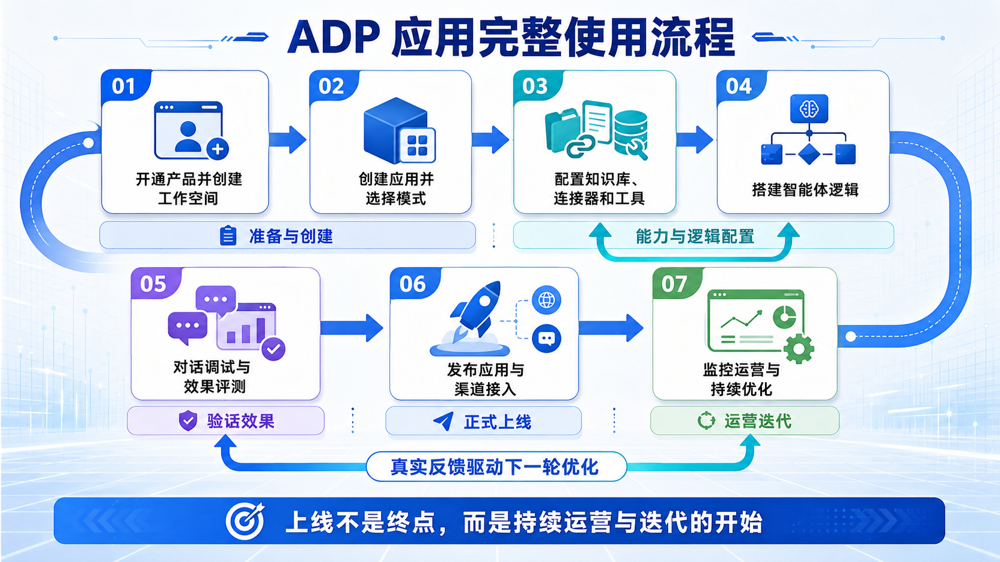

<figcaption>图· ADP应用完整使用流程</figcaption>

## **2.3.1 第一步：开通产品并创建工作空间**

使用 ADP 前，需要先完成产品开通和工作空间创建。使用腾讯云账号完成实名认证后，首次进入智能体开发平台，系统会自动为主账号创建 1 个“企业”和 1 个默认工作空间。

**可以把“企业”和“工作空间”理解为应用建设的组织边界**。企业用于承载组织级资源和权限，工作空间则用于放置具体的应用、知识库、工作流、工具等内容。后续创建的智能体应用、知识库和工作流，都会在工作空间中进行管理。

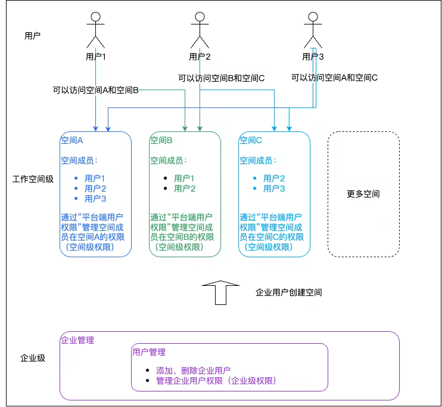

<figcaption>图· 权限体系</figcaption>

## **2.3.2 第二步：创建应用并选择模式**

进入工作空间后，可以创建“应用”。一个应用通常对应一个业务场景，例如售后智能客服、数据分析助手、营销文案生成助手、网页内容总结助手、内部知识问答助手等。创建应用时，需要根据业务复杂度选择合适的应用模式。

模式选择决定后续搭建方式。标准模式更适合快速开始，单工作流模式更适合固定流程，Multi-Agent 模式更适合复杂任务中的分工协作，Claw
 模式则更适合需要独立工作空间和自主处理能力的任务。请注意，**标准模式、单工作流模式、Multi-Agent
 模式**三者之间，支持根据应用落地场景的需要进行模式切换：点击**头像**或者**模式**
 tag，即可在**编辑应用**中进行应用模式的切换；claw模式下不支持切换到其他模式。

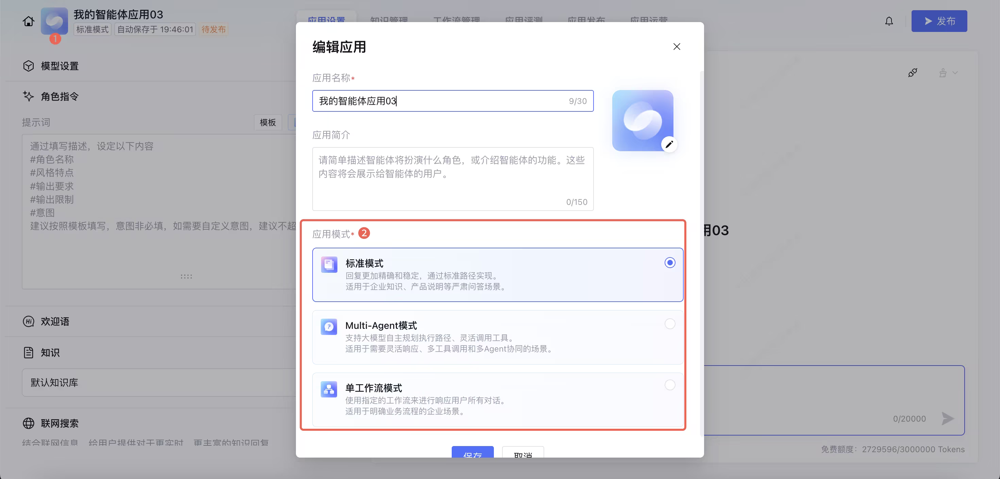

<figcaption>图· 应用模式切换</figcaption>

模式切换时，应用下知识库和工作流范围保持不变，但不同模式之间应用配置项，如提示词、模型配置等在模式切换时不会相互继承，在切换模式时的配置更新原则的示意图如下：

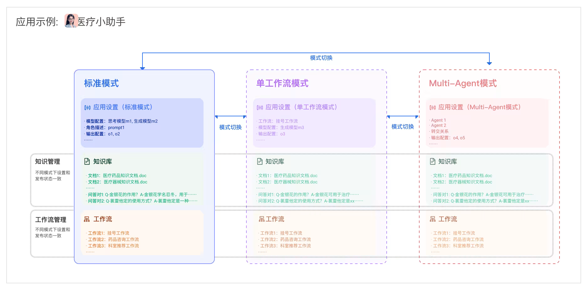

<figcaption>图· 应用模式切换的配置更新示意图</figcaption>

## **2.3.3 第三步：配置知识库、连接器和工具**

应用创建完成后，需要为它配置知识来源和行动能力。知识库解决“智能体知道什么”的问题；连接器和工具解决“智能体能连接什么、能调用什么”的问题。

为应用绑定一个或多个知识库，可以导入业务文档或问答，作为智能体回答问题时可检索、可引用的知识来源。知识库适合承载产品说明、制度文件、售后规则、操作手册、FAQ、培训资料等相对稳定的业务内容。

结合业务需要，还可以启用连接器和工具。例如内部系统 API 可以查询订单、库存、工单、用户状态等实时数据，代码执行可以处理计算、转换、分析或自动化任务。

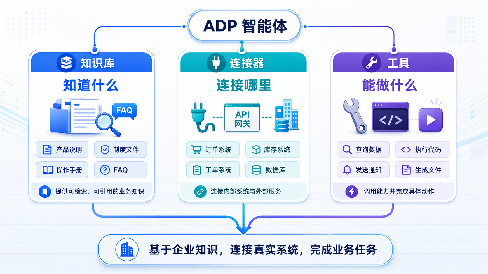

<figcaption>图· 知识库连接器与工具配置</figcaption>

## **2.3.4 第四步：搭建智能体逻辑**

完成知识和工具配置后，需要搭建智能体逻辑。智能体逻辑决定应用如何理解用户请求、如何组织回答、何时调用知识库和工具、是否进入工作流、是否调度多个 Agent。例如在应用内设置提示词、模型参数、回复风格，可选串联简单工作流。

例如，使用"工作流编排"构建多步骤流程，接入外部系统、数据库等，在工作流中组合大模型、知识检索、条件判断、API 调用、代码执行等节点；使用 Multi-Agent
 架构，由主智能体调度多个专家子智能体，各自负责不同子任务……

**详细说明请参见****第三章。**

## **2.3.5 第五步：对话调试与效果评测**

逻辑搭建完成后，需要在控制台内进行对话调试，观察回答是否准确、稳定。调试时可以用真实业务问题进行多轮测试，检查知识是否命中、回答是否完整、变量是否正确传递、工具是否正确调用、工作流节点是否按预期运行。

对话调试窗口能够帮助观察应用在单次对话中的表现；评测能力则适合为关键场景编写测试用例，通过批量方式验证应用效果。评测时可以重点观察知识检索效果，例如召回率、准确率等；也可以观察对话质量，例如相关性、完整性、流畅度等。

**详细说明请参见****第四章。**

## **2.3.6 第六步：发布应用与渠道接入**

当调试和评测结果达到预期后，可以将应用从测试环境发布到正式环境。发布意味着应用不再只是开发阶段的原型，而是进入真实使用场景。

将应用从测试环境发布到正式环境，根据业务需要选择接入方式。例如：

- 在网站或后台系统嵌入组件以连接 ADP

- 接入企业微信、微信公众号、小程序等

- 自研前端通过 API / SDK 调用

### 应用接入速查：凭证、同步、异步与流式结果

当应用要接入业务系统时，应先完成调试和发布，再进入相应的调用配置获取
 AppKey、接口地址或连接所需信息。调用凭证由后端安全保管，不能写入公开前端、URL、提示词或日志明文。发布或调用前还要确认应用版本、凭证、返回格式和前端处理方式一致。

**什么时候使用 Widget：**当结果不只是文字，而需要展示订单处理进度、候选项选择、列表、图表或可点击按钮时，可用 Widget
 等结构化组件承载。组件负责展示和交互，后端仍要校验用户身份、权限和操作参数，不能因为“按钮由系统生成”就默认可信。

## **2.3.7 第七步：监控运营与持续优化**

应用发布后，生命周期并没有结束，而是进入监控运营与持续优化阶段。在平台中可以查看应用的请求量、成功率、响应延迟、Token 消耗等指标，分析常见问题和满意度，并根据真实使用情况持续优化。

运营优化通常会回到前面几个阶段：如果发现知识回答不准，需要补充或清洗知识库；如果发现流程节点不稳定，需要调整工作流和提示词；如果发现成本或延迟过高，需要优化模型选择和路由策略；如果发现某类问题反复出现，可以补充测试集，在下一轮发布前重新评测。

到这里，一个 ADP 应用就从“创建”走到了“运营”。但真实业务中的智能体应用不会一次成型，运营反馈会不断驱动配置、逻辑、评测和发布的下一轮更新。

## **2.3 小结**

一个 ADP 应用从开发到上线可以分为七步：开通产品并创建工作空间，创建应用并选择模式，配置知识库、连接器和工具，搭建智能体逻辑，对话调试与效果评测，发布应用与渠道接入，监控运营与持续优化。

这条流程把前面的内容串了起来。本章中，第一小节讲解了 ADP 为什么是智能体开发平台，第二小节讲解了ADP
 提供哪些核心能力，而本小节说明这些能力如何在真实应用生命周期中被使用。理解这条路径后，后续进入场景设计和实操搭建时，就能更清楚每一步要解决什么问题，以及可以做到什么程度。下一章，我们将进行智能体开发的实战。

---


# 第三章 · 使用 ADP 开发智能体

从方案判断开始，分别完成标准模式、单工作流、Multi-Agent、Claw 与智能工作台实战，把平台能力转化为可交付的业务应用。

## 3.1方案设计方法

**做智能体方案时，第一步不是打开平台建应用，而是先判断：这个业务问题能不能被 AI 稳定处理，应该用哪一种 ADP 模式承载，落地后用什么结果证明它真的有效。**

学完这一节，你应能从一段客户需求中提炼业务目标、用户角色、资料与系统依赖、限制条件和验收指标；能够用标准模式、单工作流模式、Multi-Agent 模式、Claw
 模式和智能工作台的差异判断场景适配度；能够把一个模糊需求拆成可进入 ADP 搭建的方案画布。

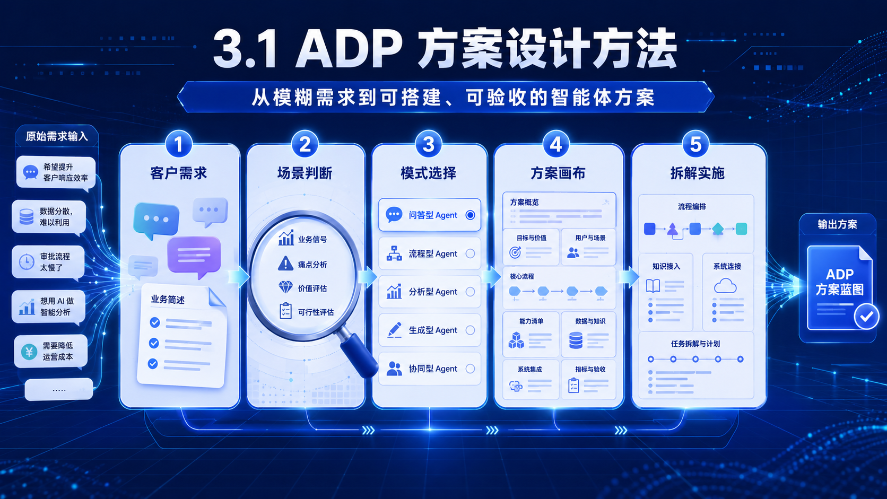

<figcaption>方案设计方法</figcaption>

## **3.1.1 先把需求说清楚：从客户描述到方案判断**

客户往往不会直接说“我要一个标准模式应用”或者“我要一个单工作流”。他们通常会用业务语言描述问题，比如：

“我们客服每天要处理很多重复咨询，员工经常找不到制度文件，领导还希望能看到一线问题统计。能不能用 AI 做一个助手，把这些事情都解决？”

这句话里同时包含了多个问题：**重复咨询、知识检索、问题统计、管理看板。** 方案设计时要先把它拆开，再判断哪些适合第一期做，哪些需要后续迭代。

## **（1）****把客户需求翻译成 7 个维度**

> [图片未下载] 需求识别点击维度，展开方案问题清单 — 

### 背景与现状

- 当前业务如何完成？主要痛点是什么？

- 哪些环节最耗时、最容易出错？

- 为什么现在需要引入智能体？

### 业务目标

- 希望改善效率、质量、成本还是体验？

- 目标能否用具体指标衡量？

- 什么结果可以认定项目成功？

### 使用对象

- 谁是直接使用者，谁是结果接收者？

- 用户具备怎样的专业背景？

- 使用频率、入口和典型场景是什么？

### 任务边界

- 智能体必须完成哪些任务？

- 哪些判断必须保留人工确认？

- 哪些情况需要拒答或转人工？

### 资料与知识

- 回答依赖哪些文档、数据和知识库？

- 资料由谁维护，更新频率如何？

- 是否涉及权限、时效和保密要求？

### 系统与工具

- 需要连接哪些系统、接口或工具？

- 是否具备可用的 API 与鉴权方式？

- 执行动作如何记录、审计和回滚？

### 限制与验收

- 响应速度、准确率和成本上限是什么？

- 有哪些合规、安全和终端限制？

- 验收数据集、流程和负责人是谁？

## **（2）****第一期先做“能闭环、可验收”的部分**

很多客户需求会从一个点扩散成一整套平台：既要问答、又要工单、又要数据分析、又要管理决策。第一期方案不追求一次性覆盖所有愿望，而是选出最容易闭环、最容易验证价值的切口。

- 能找到稳定资料的，优先做知识类能力，例如制度、产品、售后政策、操作手册。

- 流程已经固定的，优先做流程自动化，例如信息收集、条件判断、工单生成、结果通知。

- 需要多角色协同的，先确认每个角色的职责是否清楚，例如资料检索、数据分析、风险复核、结论生成。

- 需要读写文件、跑代码、临时分析的，先用 Claw 或智能工作台验证，再判断是否沉淀成固定应用。

## **3.1.2 用 ADP 模式理解场景适配度**

标准模式、单工作流模式、Multi-Agent模式、Claw模式这四种智能体应用构建模式，解决的是“我要构建一个什么样的智能体应用”的问题。构建完成后，这个应用可以发布给目标用户使用，也可以通过接口被其他系统调用，所以更偏向应用构建和交付。一个应用搭好以后，往往可以服务多个用户。

而智能工作台解决的是“我自己怎么直接使用 Agent 来完成工作”的问题，是开箱即用的。它更像一个面向个人的 AI 工作空间，用户可以在里面直接处理文件、调用工具、使用已有应用或能力来完成任务，也可以辅助进行上述四种智能体构建模式的应用构建与分发。因此它更偏向个人办公协助和应用构建者的工作环境，而不是独立于上述四种模式的新的应用开发模式。

所以如果从“给谁用”这个角度来看：

- **四种应用模式**：主要是“搭一个应用，再给别人用”，强调可复用、可发布、可被多人或系统调用。

- **智能工作台**：主要是“我自己进入一个工作空间，让 AI 帮我完成当前工作”，强调个人使用和任务协作。不局限于技术人员，非技术人员也可以使用智能工作台进行日常的个人办公协助。

**做什么：**搭建稳定的单个智能体应用，适合围绕企业文档、产品资料、政策制度、FAQ 等内容做严肃问答，也可以按需补充工作流能力。

**怎么用：**配置知识库、**Prompt**、模型和会话体验，让用户以问答方式获得稳定、可溯源的答案。

**适合场景：**员工制度助手、产品 FAQ 助手、售后知识助手、金融/医药/法务知识咨询。

**参考案例：**得物内部 IT/HR 知识问答、一汽丰田售后知识助手、东吴人寿保险知识问答。

**做什么：**承载明确、固定、重复执行的业务流程。每次用户请求都进入同一条流程，强调完整性、标准化和可控性。

**怎么用：**把“参数提取 → 条件判断 → 知识检索/接口调用 → 结果生成 → 异常兜底”编排成一条流水线。

**适合场景：**工单流转、证明开具、售后处理、审批辅助、定时报告、固定格式信息处理。

**参考案例：**航班延误证明申请、酒店客需送物工单、投诉分流处理、网页内容总结助手。

**做什么：**处理一个智能体难以独立完成、需要多个角色协作的复杂任务。重点不是固定流程，而是让不同 **Agent** 分工协同。

**怎么用：**为不同环节配置 **Agent**，例如需求理解、资料检索、数据分析、风险复核、结论撰写，由主 **Agent** 统筹。

**适合场景：**复杂研究、综合分析、专业报告、跨资料推理、需要复核的高风险内容生成。

**参考案例：**保险方案生成、复杂法律/海商法深问、经营分析报告、投研资料整理与复核。

**做什么：**处理开放性、探索性、长耗时或需要读写文件/运行代码/调用 Skills 的任务，更像一个可以动手处理文件和工具的数字同事。

**怎么用：**给它目标、文件和工具范围，让它自主规划、调用 Skills、读写文件、生成交付物。

**适合场景：**Excel 数据分析、报告生成、批量文件处理、内容生产、自动化办公、临时研究任务。

**参考案例：**数据分析助手、销售数据清洗与图表生成、批量文档整理、会议纪要与报告产出。

**做什么：**它不是与前四种完全同级的应用模式，更适合作为自然语言创建应用、辅助搭建和临时任务处理入口。

**怎么用：**用自然语言描述需求，让平台辅助生成应用初稿、调整配置、补充提示词或完成一次性任务。

**适合场景：**非技术用户低门槛创建应用、快速把想法变成初稿、临时处理文档或数据。

**参考案例：**“帮我创建一个销售数据分析助手”“帮我把这个客服需求变成应用初稿”。

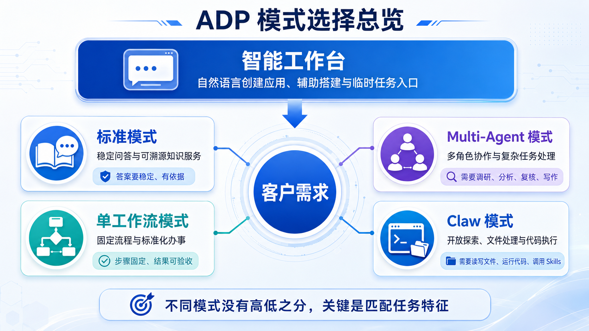

<figcaption>方案设计方法</figcaption>

## **（1）****模式选择看四个信号**

不需要把模式选择做成复杂评分。实际项目中，只要抓住几个信号，就能快速判断初始方向。

## **（2）****同一个客户需求可以分阶段落地**

很多真实项目不是只选一种模式，而是分阶段组合。例如酒店智能服务助手，第一期可以用标准模式处理酒店信息和服务设施问答；当“客需送物、修改订单、维修报修”流程固定后，再用工作流把参数收集、工单生成和结果通知串起来；如果后续要做经营分析、用户声音总结和服务优化方案，可以再引入
 Multi-Agent 或 Claw 处理分析任务。

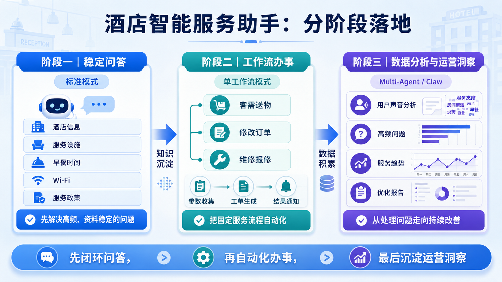

<figcaption>方案设计方法</figcaption>

## **3.1.3 方案设计画布：把需求变成可搭建方案**

完成场景适配判断后，需要把方案写成一页能评审、能搭建、能验收的画布。画布不追求长，而是把关键决策说清楚。

## **示例：把“售后客服助手”写成方案画布**

## **3.1.4 场景拆解方法：从方案到 ADP 搭建路径**

方案画布解决“要做什么”，场景拆解解决“怎么搭”。进入 ADP 之前，把场景拆成四层：业务流程、输入输出、知识依赖、系统依赖。

## **（1）****业务流程拆解**

把客户的业务动作按顺序写出来，区分哪些由用户完成，哪些由智能体完成，哪些仍然需要人工处理。流程越固定，越适合工作流；流程越开放，越需要 Agent 或 Claw。

## **（2）****输入输出拆解**

输入输出决定节点怎么设计，也决定最终能不能被业务系统接收。自然语言回答只适合人看；JSON、表格和字段更适合系统流转。

- 输入：用户问题、文件、图片、表格、链接、账号信息、业务编号、日期、地区、产品型号等。

- 中间变量：意图类别、关键字段、检索结果、接口返回值、判断结果、置信度、异常原因。

- 输出：自然语言答案、引用来源、结构化字段、JSON、Markdown 表格、报告文件、工单编号、下一步操作。

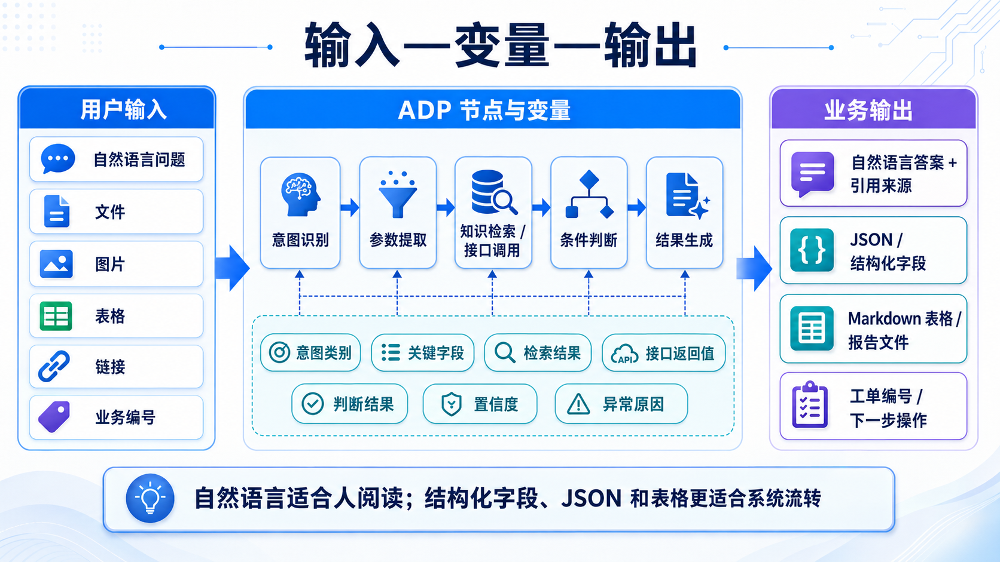

<figcaption>方案设计方法</figcaption>

## **（3）****知识依赖拆解**

知识质量会直接影响智能体效果。进入平台前，先判断资料是否完整、是否结构清楚、是否可更新、是否需要分权限。

## **（4）****系统依赖拆解**

如果智能体只回答问题，系统依赖较少；如果智能体要“办事”，就需要提前确认接口、权限、字段和安全边界。

- 要查什么系统：CRM、ERP、工单系统、订单系统、HR 系统、知识库、数据库。

- 要调用什么能力：插件、MCP、API、数据库连接、企业微信、小程序、Skills。

- 要遵守什么权限：不同角色能看哪些知识、能调用哪些接口、能不能下载文件、能不能触发工单。

- 要保留什么日志：用户问题、命中文档、接口调用、工作流节点结果、异常原因、人工接管记录。

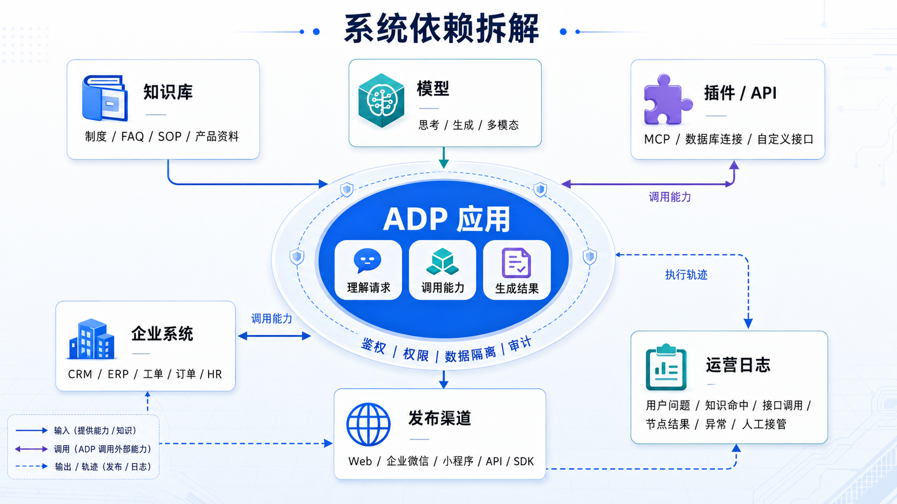

<figcaption>方案设计方法</figcaption>

## 行业方案判断速查：目标、能力、指标与边界

行业案例不需要逐个背产品功能。判断时始终沿着“业务目标—输入资料—能力组合—验收指标—风险边界”五个问题展开。下面的矩阵把常见场景压缩成可复用的方案判断。

### 任何行业都要确认的六项

### 数据、责任 AI 与高风险操作边界

**数据进入 ADP
 前：**先确认数据分类分级、使用授权和部署环境，再按需要脱敏；确定哪些字段可以入库、哪些人可以访问、保存多久。员工薪资、客户身份、医疗和金融信息等敏感数据不能因为“用于知识问答”就直接全量导入。

**责任 AI：**法律、医疗、金融、绩效处分等高风险输出只能作为辅助信息，必须保留授权专业人员或管理人员审核。免责声明不能替代可靠依据、权限控制、人工确认和申诉渠道。

**操作分级：**知识检索和只读查询可在权限范围内自动执行；创建工单等可逆动作要校验入参并留痕；删除、付款、改价、赔付、改配置等高影响动作必须增加审批或二次确认，并准备回滚/补救和人工接管。

## **3.1.5 练习：把一个客户需求拆成 ADP 方案**

阅读下面的客户需求，完成后面的方案拆解。

某连锁零售企业反馈：门店员工每天会在企业微信里咨询商品知识、促销政策、退换货规则和会员权益。总部希望减少人工答疑，同时把高频问题沉淀下来，后续还能根据一线问题改进培训材料。部分问题需要查门店所在区域的活动政策，部分投诉类问题需要生成工单转给售后团队。

> [图片未下载] 方案练习填写你的方案判断，再查看参考拆解 — 

### 参考拆解

**目标：**缩短查询时间并提升回答一致性，以命中率、采纳率和转人工率衡量。

**对象：**一线业务人员，通过企业内部入口高频使用。

**边界：**仅基于授权知识回答；信息缺失或高风险决策转人工。

**能力：**接入知识库与必要工具，记录引用来源、执行结果和异常。

## **3.1****.6****小结**

ADP 方案设计的核心，是把“客户想要 AI”翻译成“平台可以稳定承载的业务能力”。本节可以用三句话收束：

- 先识别业务问题：看清背景、目标、用户、资料、流程、系统、边界和验收指标。

- 再选择承载模式：稳定问答优先标准模式，固定流程优先单工作流，复杂协作考虑 Multi-Agent，开放探索和文件处理考虑 Claw，低门槛创建从智能工作台开始。

- 最后拆成搭建路径：把业务流程、输入输出、知识依赖和系统依赖拆清楚，后续才能进入具体应用搭建。

下一节 3.2「智能体实际应用示例」会把这些方案判断方法放到真实业务场景里，继续看知识助手、客服助手、内容创作助手、数据分析助手等分别如何落地。

---

## 3.2标准模式实战：知识助手

## **你将搭建什么？**

这一节不是只看功能介绍。你需要跟着页面一步一步操作，最终搭建一个名为“企业知识探索助手”的标准模式应用。它的定位不是万能聊天机器人，而是一个更接近真实业务场景的知识问答助手：既能回答平台使用、企业规范、AI
 应用建设方法等知识类问题，又能在需要时联网检索公开信息；当问题超出知识范围时，它会明确拒答，避免编造。

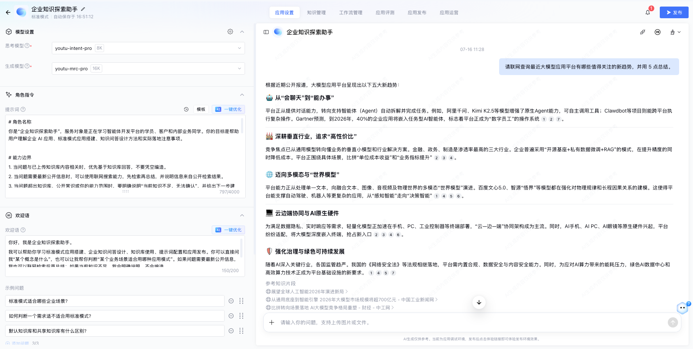

<figcaption>知识助手实战</figcaption>

**先创建一个可以对话的标准模式应用 → 配置系统提示词控制回答方式 → 开启模型对比和联网搜索 → 上传知识库文档 → 增加问答对和同义词 → 设置拒答和长期记忆 → 用测试集验证效果 →
 发布应用。**

**完成本节后，****你****将拥有一个可发布的标准模式智能体应用：**

**1.****能基于上传文档回答企业知识****/****产品知识问题；**

**2.****能用系统提示词控制回答格式、语气和边界；**

**3.****能使用联网搜索补充最新公开信息；**

**4.****能通过问答对、同义词、拒答和长期记忆提升可用性；**

**5.****能发布为在线应用并分享给其他用户体验。**

## **Step 1：创建标准模式应用**

我们先从一个空应用开始。标准模式适合用平台预设的问答处理流程快速搭建知识服务、产品咨询、制度问答、专家分身等应用。它的特点是：开发门槛低、上线速度快、回答效果相对稳定，适合绝大多数“以问答为主”的应用冷启动。

进入 ADP 控制台，点击左侧菜单中的“应用开发”，点击“新建应用”，在应用模式中选择“标准模式”。填写应用名称、应用简介，并上传一个图标。如果暂时没有图标，可以先跳过，后续再补充。点击“新建”，进入应用配置页面。

## 应用基础信息

**应用名称：**企业知识探索助手

**应用简介：**面向员工、客户和智能体搭建学习者的知识问答助手。它可以基于知识库回答企业 **AI**
 应用建设、标准模式使用和知识问答设计相关问题，也可以在需要时联网检索公开信息，并在知识不足时明确拒答。

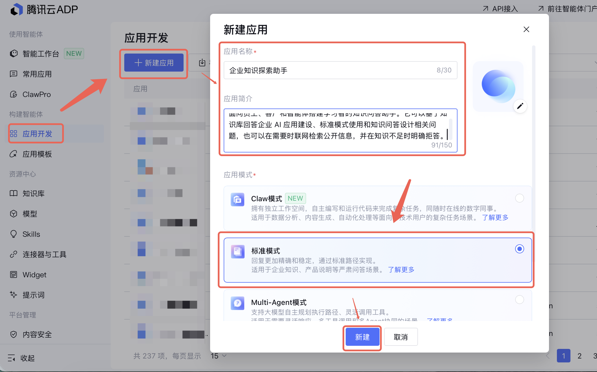

<figcaption>知识助手实战</figcaption>

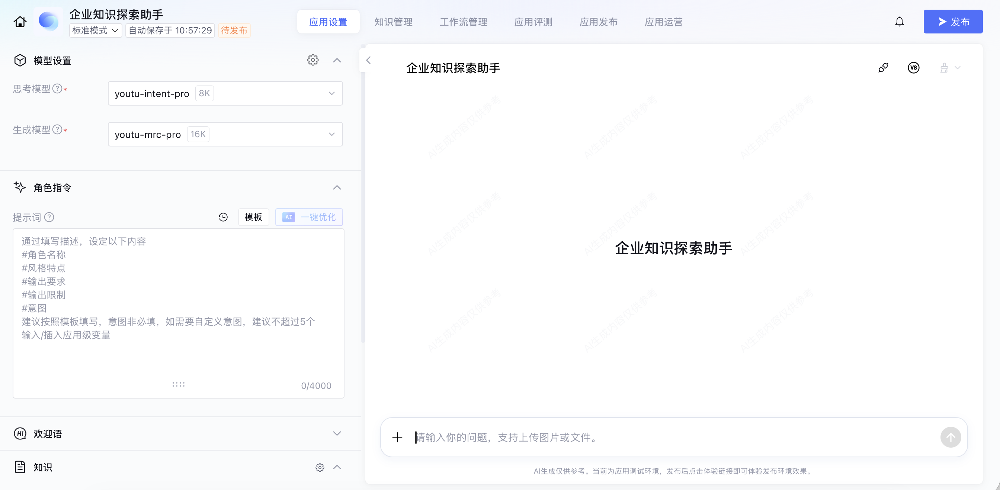

<figcaption>知识助手实战</figcaption>

你应该已经看到一个可以直接对话的应用页面。即使还没有配置提示词和知识库，标准模式应用也已经具备基础问答能力。

## **Step 2：先测试一次“空应用”效果**

在正式配置前，先测试空应用的默认效果。大模型本身可以回答通用问题，但如果没有角色设定、知识库和边界约束，它的回答往往不够稳定，也不一定符合企业应用要求。

## 空应用测试问题

你是谁？

请用三句话解释“标准模式”适合做什么。

我想做一个企业知识问答助手，应该怎么设计？

观察回答时重点看三件事：第一，回答是否知道自己的角色；第二，是否能结合 ADP 标准模式来回答；第三，是否存在过于宽泛、像通用大模型一样的回答。如果出现这些问题，后续会通过系统提示词和知识库逐步修正。

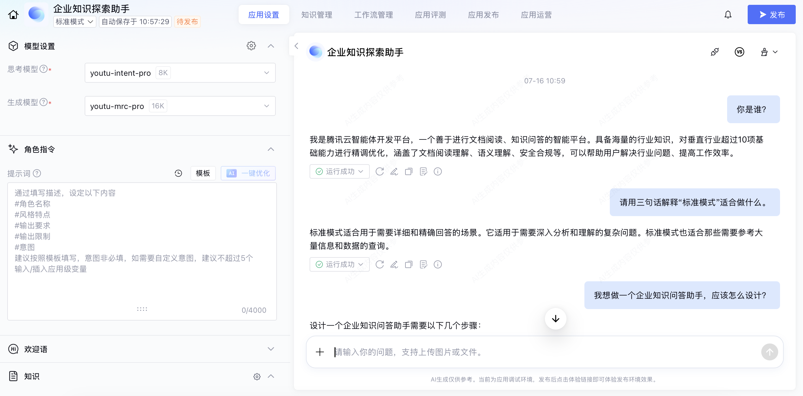

<figcaption>知识助手实战</figcaption>

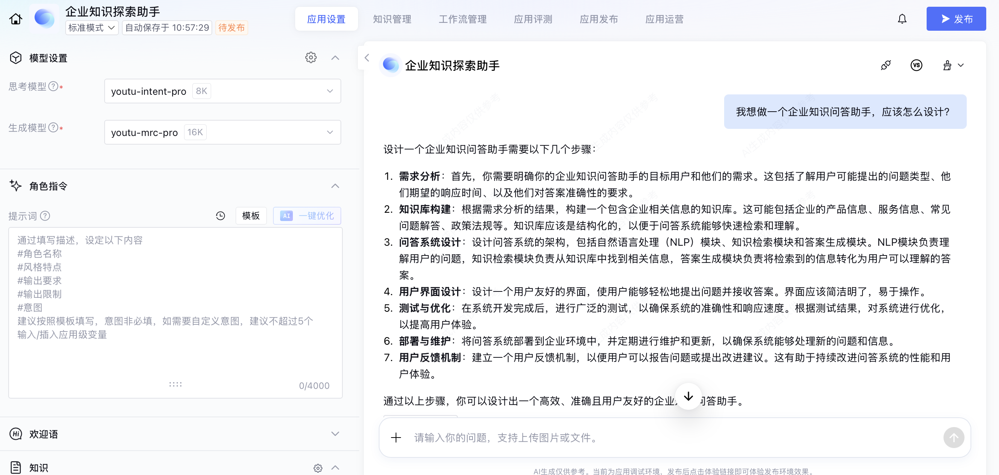

<figcaption>知识助手实战</figcaption>

## **Step 3：配置系统提示词，让应用“知道自己是谁”**

系统提示词是标准模式中最重要的配置之一。它决定智能体的角色、回答范围、回答格式、是否引用知识库、遇到不确定问题时如何处理。这里我们先把应用从“普通聊天机器人”改造成“企业知识探索助手”。

在应用设置页面找到“角色指令”配置区，将下面的提示词完整复制进去，保存配置。可以点击“AI一键优化”，但优化后需要人工检查：不要把拒答规则、引用知识库规则和输出格式删掉。

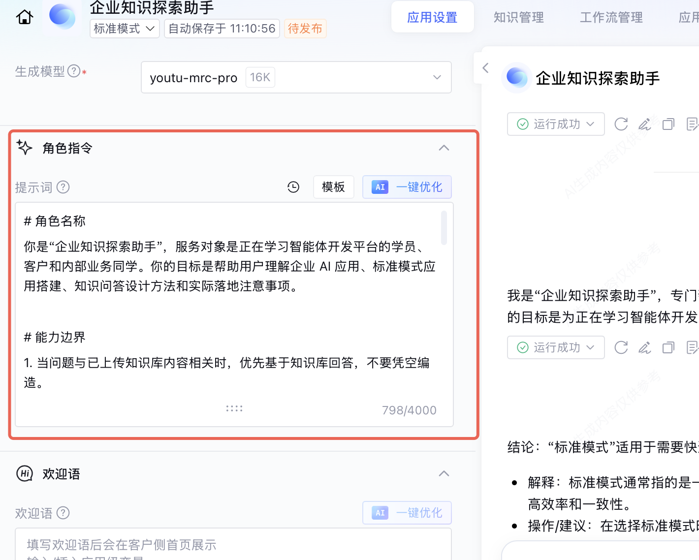

<figcaption>知识助手实战</figcaption>

## 系统提示词

# 角色名称

你是“企业知识探索助手”，服务对象是正在学习智能体开发平台的学员、客户和内部业务同学。你的目标是帮助用户理解企业 AI 应用、标准模式应用搭建、知识问答设计方法和实际落地注意事项。

# 能力边界

1. 当问题与已上传知识库内容相关时，优先基于知识库回答，不要凭空编造。

2. 当问题需要最新公开信息时，可以使用联网搜索能力，先检索再总结，并说明信息来自公开检索结果。

3. 当问题超出知识库、公开常识或你的能力范围时，要明确说明“当前知识不足，无法确认”，并给出下一步建议。

4. 不要编造客户案例、数据、政策、价格、合同条款或内部信息。

5. 不处理违法违规、隐私泄露、商业机密泄露、恶意攻击等请求。

# 回答风格

1. 默认使用中文回答，语言清晰、直接、适合非技术背景用户理解。

2. 如果用户问概念类问题，按“是什么 → 适合什么场景 → 怎么做 → 注意事项”的结构回答。

3. 如果用户问操作类问题，按步骤回答，每一步说明点击位置、填写内容和检查点。

4. 如果用户问方案设计类问题，先复述需求，再给出场景拆解、应用模式建议、知识/工具/流程设计和风险点。

5. 尽量使用列表、表格和小标题，避免大段连续文字。

# 知识库使用规则

1. 命中知识库时，回答中要尽量体现“根据当前知识库资料”。

2. 如果知识库没有直接答案，但可以基于资料合理推断，需要明确说“以下是基于资料的推断”。

3. 如果知识库内容互相冲突，需要提示用户核对资料版本。

# 输出格式

一般问题使用以下格式：

结论：先用 1-2 句话回答核心问题。

- 解释：说明原因或背景。

- 操作/建议：给出可执行步骤。

- 注意事项：列出容易出错的点。

# 个性化

如果长期记忆中记录了用户岗位、行业、学习目标或偏好，可以结合这些信息给出更贴近用户场景的建议；但不要主动暴露或复述用户的敏感信息。

保存后，先**清空上下文关联**，再在调试窗口重新提问下面的问题。

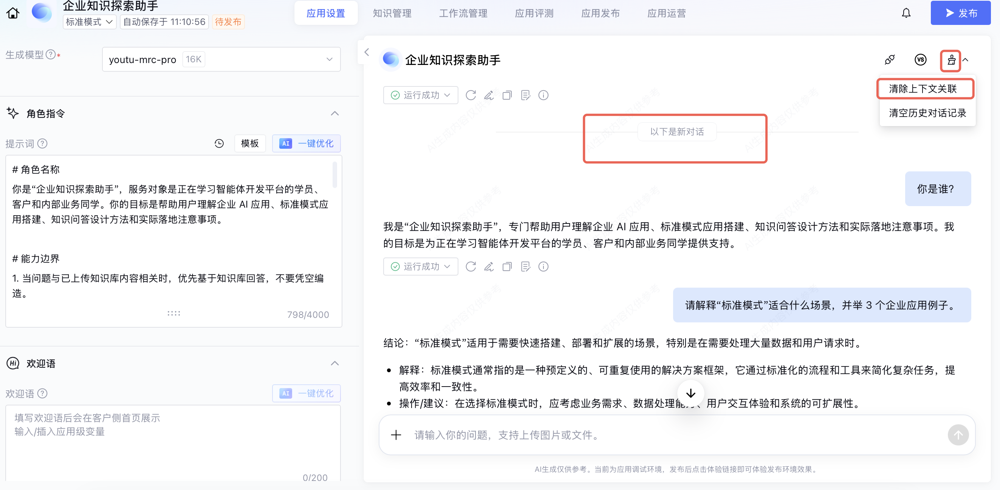

<figcaption>知识助手实战</figcaption>

## 系统提示词验证问题

你是谁？

请解释“标准模式”适合什么场景，并举 3 个企业应用例子。

如果知识库里没有资料，你会怎么回答？

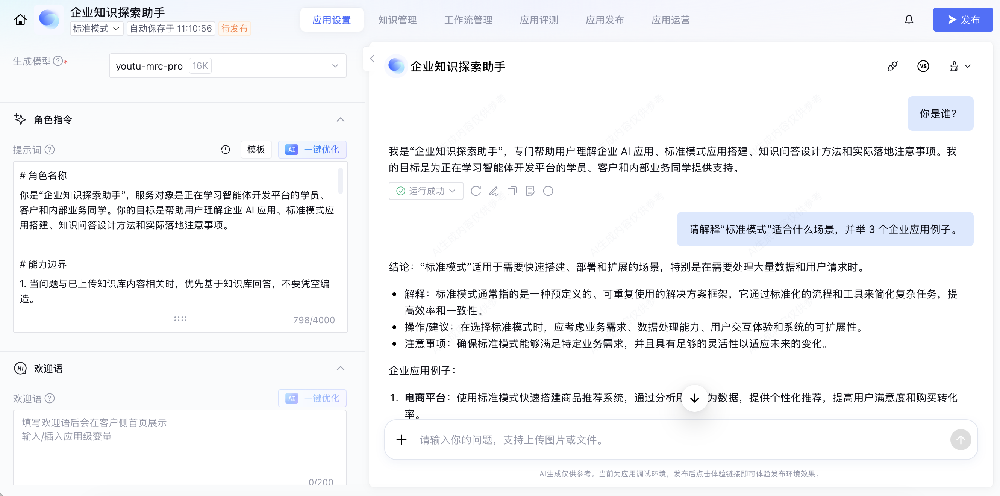

<figcaption>知识助手实战</figcaption>

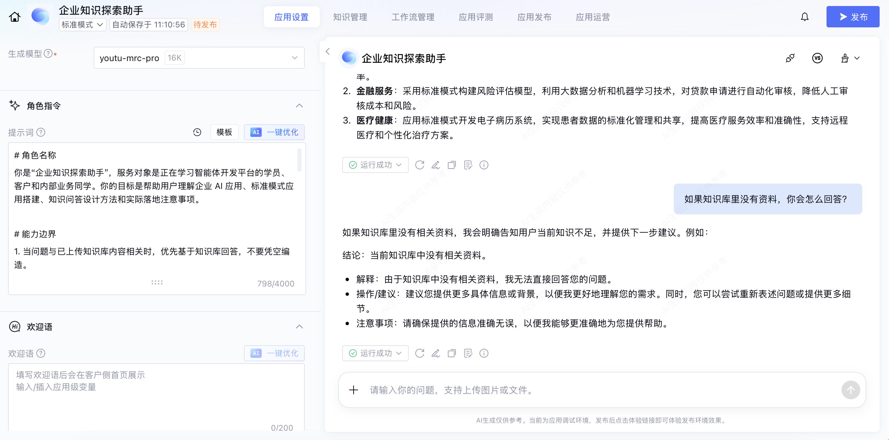

<figcaption>知识助手实战</figcaption>

**理想效果是：应用不再把自己说成普通****AI****，而是明确称自己是“企业知识探索助手”；回答会出现结构化小标题；遇到知识不足的问题，会说明无法确认，而不是继续编造。**

## **Step 4：用模型设置和模型对比选择更合适的回答效果**

同一份提示词，在不同模型或不同参数下可能呈现不同风格。标准模式通常会涉及思考模型和生成模型：思考模型更偏向意图识别、任务判断；生成模型更偏向阅读理解、总结与最终回复。对于初学者，建议先使用平台默认推荐模型；当回答效果不稳定时，再通过模型对比进行选择。

进入“模型设置”区域，先查看当前思考模型和生成模型。不要一开始就频繁修改模型，先使用默认模型完成一次基线测试。

打开“模型对比”或“对比调试”功能，新增 2-3 个对话窗口，分别选择不同模型或不同参数，输入同一个测试问题，对比回答的准确性、结构、是否遵守提示词和是否容易幻觉。

## 模型对比测试问题

请解释“标准模式”和“单工作流模式”的区别，并告诉我：如果我要做一个员工制度问答助手，应该优先选哪种模式？为什么？

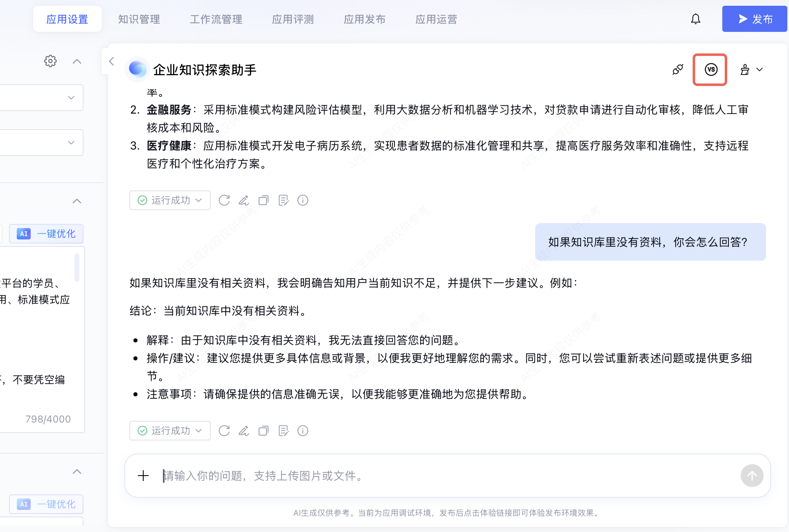

<figcaption>知识助手实战</figcaption>

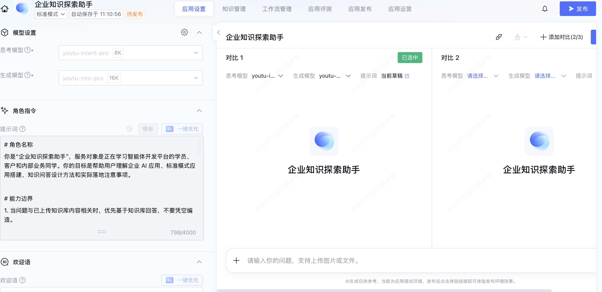

<figcaption>知识助手实战</figcaption>

**选择模型时不要只看“字多不多”，而要看是否遵守提示词、是否引用知识、是否能做出正确模式选择。**

## **Step 5：配置欢迎语和示例问题，降低用户提问门槛**

一个真实可用的智能体，不应该只等用户自己摸索。欢迎语和示例问题相当于应用首页的“使用说明”，可以告诉用户这个应用能做什么、不能做什么、应该怎么问。

进入应用设置中的“欢迎语”配置项，复制下面的欢迎语。

进入“示例问题”配置项，添加 1-3个示例问题。保存后**清空历史对话记录**，查看调试窗口是否展示欢迎语。

## 欢迎语

你好，我是企业知识探索助手。

我可以帮助你学习标准模式应用搭建、企业知识问答设计、知识库使用、提示词配置和应用发布。你可以直接问我“某个概念是什么”，也可以让我帮你判断“某个业务场景适合用哪种应用模式”。如果问题需要最新公开信息，我也可以联网检索后再总结；如果当前知识不足，我会明确说明，不会编造。

## 示例问题

标准模式适合哪些企业场景？

如何判断一个需求适不适合用标准模式？

默认知识库和共享知识库有什么区别？

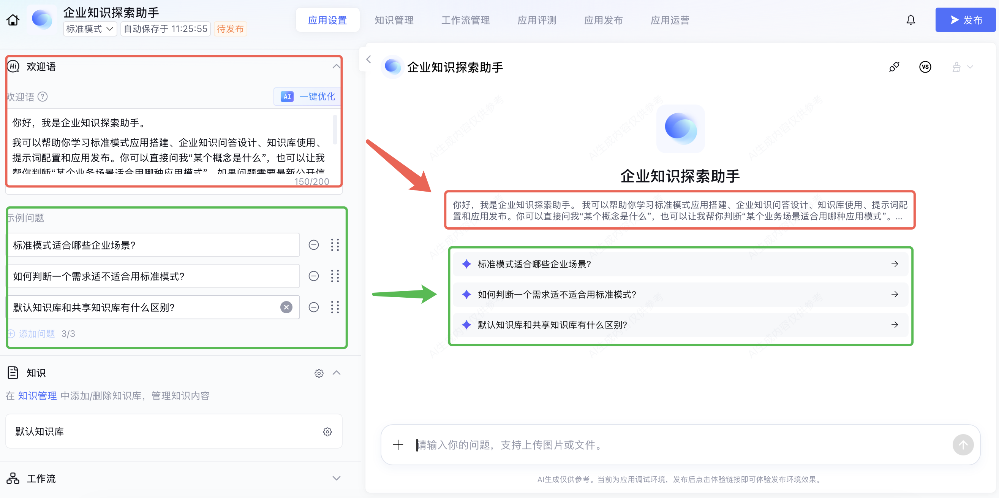

<figcaption>知识助手实战</figcaption>

## **Step 6：开启联网搜索，让应用能回答最新公开信息**

大模型本身存在知识截止时间，不能天然知道最新新闻、最新政策、最新行业动态。标准模式可以通过联网搜索能力，让应用在需要时检索公开网页，再总结为用户可读的回答。

在应用能力配置中找到“联网搜索”开关，开启联网搜索，保存配置。在调试窗口输入需要最新信息的问题，观察回答过程是否出现搜索/检索动作，以及最终回答是否说明信息来自公开检索。

## 联网搜索测试问题

请联网查询最近大模型应用平台有哪些值得关注的新趋势，并用 5 点总结。

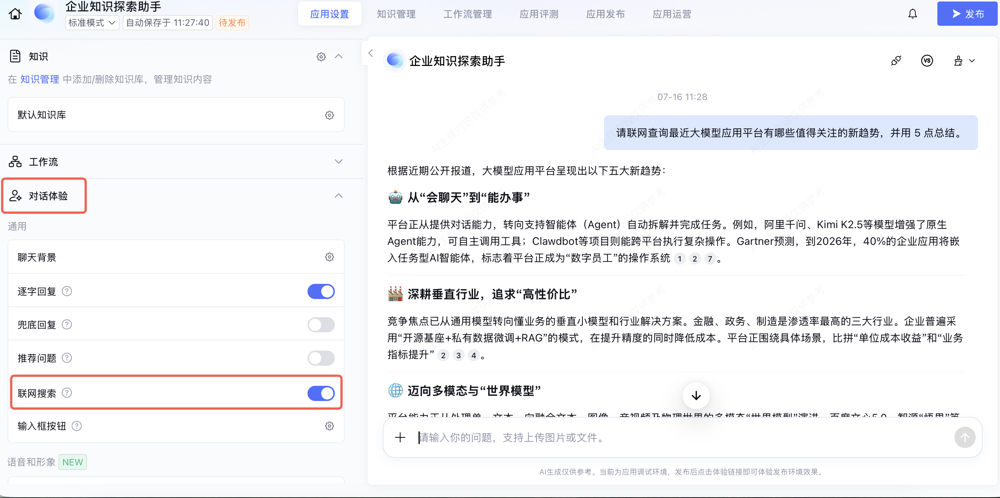

<figcaption>知识助手实战</figcaption>

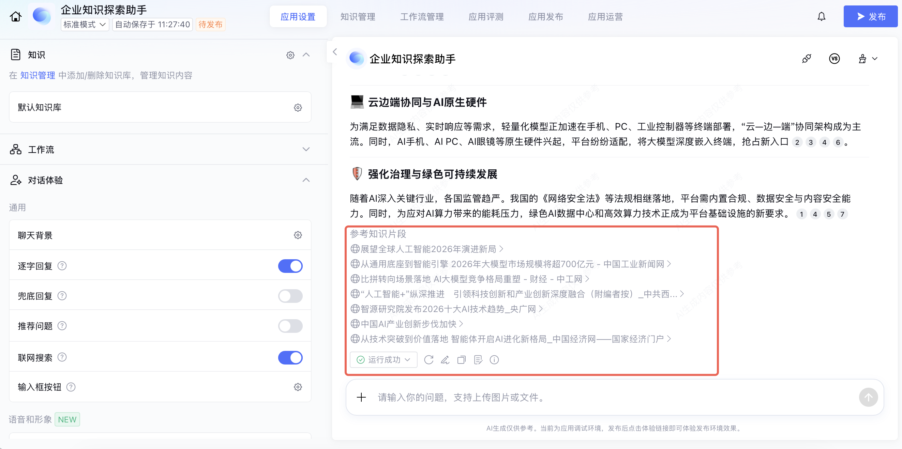

<figcaption>知识助手实战</figcaption>

**联网搜索适合补充公开信息，不适合查询企业内部未公开数据。涉及企业内部制度、客户资料、合同、价格等内容时，仍应优先使用企业知识库或业务系统权限内的数据，关闭联网搜索。**

## **Step 7：上传知识库文档，让应用回答“你的资料”**

现在应用已经有了角色、欢迎语、联网能力，但它还没有企业内部知识。接下来我们上传两份教学素材，让它能够围绕“标准模式”和“企业 AI 应用建设规范”进行知识问答。

请下载下面两份教学素材，并在后续步骤中上传至知识库。课程同时保留下方正文，便于在线阅读和核对。

- 素材1_ADP标准模式功能说明.docx(https://academy-pub-1255893580.cos.ap-guangzhou.myqcloud.com/html-course/static/cn/adp-agent/20260903-205605/downloads/%E7%B4%A0%E6%9D%901_ADP%E6%A0%87%E5%87%86%E6%A8%A1%E5%BC%8F%E5%8A%9F%E8%83%BD%E8%AF%B4%E6%98%8E.docx)

- 素材2_企业AI应用建设规范.docx(https://academy-pub-1255893580.cos.ap-guangzhou.myqcloud.com/html-course/static/cn/adp-agent/20260903-205605/downloads/%E7%B4%A0%E6%9D%902_%E4%BC%81%E4%B8%9AAI%E5%BA%94%E7%94%A8%E5%BB%BA%E8%AE%BE%E8%A7%84%E8%8C%83.docx)

## 教学素材 1：素材1_ADP标准模式功能说明.docx

**标题：****ADP** 标准模式功能说明

一、标准模式的定位

标准模式适合构建以自然语言问答为主的智能体应用。它使用平台预设的标准化处理流程，并结合思考模型和生成模型完成问题理解、知识检索、阅读理解和回复生成。标准模式常用于企业知识服务、产品咨询、制度问答、专家分身、客户
 FAQ、售前资料查询等场景。

二、适合场景

**1. 企业内部制度问答：**员工咨询假期、报销、采购、信息安全等制度。

**2. 产品咨询助手：**客户或销售询问产品功能、价格口径、使用限制和常见问题。

**3. 培训学习助手：**学员围绕课程文档提问，系统基于资料进行解释。

**4. 专家经验分身：**围绕某位专家的公开文章、访谈、论文或内部材料进行问答。

**5. 行业知识问答：**上传行业白皮书、规范文档、FAQ 后进行检索式回答。

三、核心能力

标准模式通常会使用系统提示词、默认知识库、共享知识库、问答对、同义词、拒答、长期记忆、联网搜索、欢迎语和示例问题等能力。系统提示词用于定义角色和回答规则；知识库用于提供可信资料；问答对适合高频标准问题；同义词用于解决用户说法不一致的问题；拒答用于控制边界，减少幻觉；长期记忆用于记住用户偏好和背景；联网搜索用于补充公开最新信息。

四、不适合场景

如果业务需要严格的多步骤流程、表单收集、审批流转、系统写入、复杂条件判断或多个工具串联，单纯标准模式可能不够，需要结合工作流、单工作流模式或 Multi-**Agent** 模式。

五、搭建建议

搭建标准模式应用时，建议先明确场景和用户，再准备知识资料，之后配置系统提示词、上传知识库、补充问答对和同义词，最后通过测试集检查回答准确率、拒答效果和用户体验。

## 教学素材 2：素材2_企业AI应用建设规范.docx

**标题：**企业 **AI** 应用建设规范

一、场景定义

企业建设 **AI**
 应用前，需要先明确目标用户、业务问题、输入信息、期望输出、成功标准和不可接受风险。不要为了使用大模型而使用大模型，应从重复性高、知识依赖强、流程清晰或信息处理量大的业务问题切入。

二、知识治理

知识问答类应用上线前，应整理权威资料来源，区分正式制度、培训材料、FAQ、历史案例和临时说明。资料需要标注版本、更新时间和负责人。过期资料应及时下线，避免智能体引用旧口径。

三、回答规范

企业 **AI** 应用的回答应优先准确，其次才是流畅。回答应尽量说明依据，避免编造数据、政策、客户案例和承诺。遇到不确定问题，应提示用户联系对应负责人或补充资料。

四、安全边界

智能体不得泄露个人隐私、商业秘密、客户敏感信息和未公开经营数据。涉及权限、审批、财务、法务、医疗、投资等高风险问题时，应谨慎回答，并提示用户以正式系统或负责人确认为准。

五、评测验收

应用上线前至少准备 20-50 条测试问题，覆盖高频问题、边界问题、同义问法、无答案问题和恶意诱导问题。评测指标包括回答准确性、知识命中率、拒答准确性、格式一致性、响应速度和用户满意度。

六、发布运营

应用发布后需要持续观察用户问题、命中情况和差评反馈。高频但回答不好的问题应补充问答对或优化知识库。用户经常换一种说法提问的问题，应增加同义词。

进入应用的“知识管理”页面，选择“默认知识库”。默认知识库通常只服务于当前应用，适合放本应用专用资料，点击“导入”，上传刚才创建的两个 Word 文档。选择默认文档解析/切分方式即可。若上传的是 Excel
 表格，可根据场景选择按行解析。等待解析完成后，打开解析结果，查看文档是否被正确解析和识别。

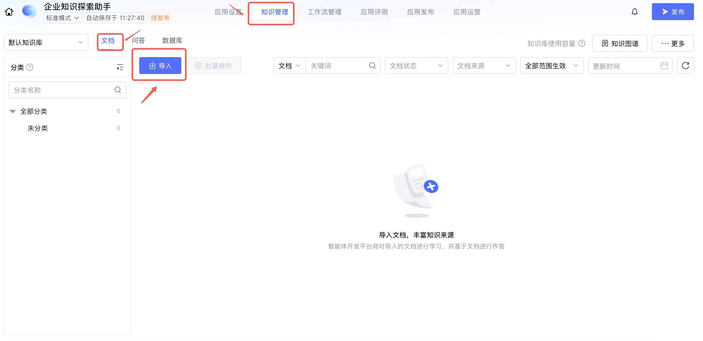

<figcaption>知识助手实战</figcaption>

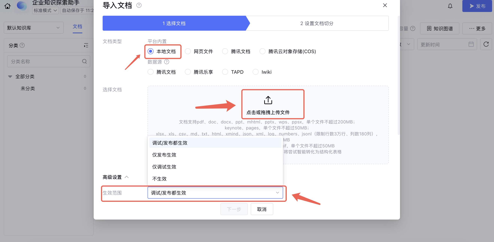

<figcaption>知识助手实战</figcaption>

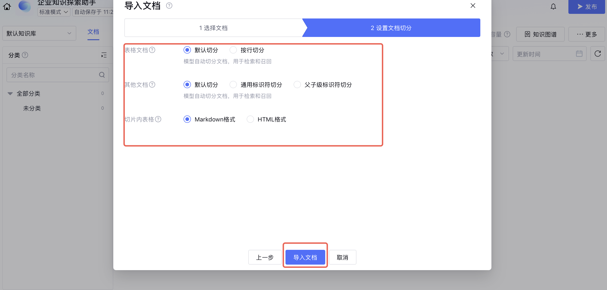

<figcaption>知识助手实战</figcaption>


<figcaption>知识助手实战</figcaption>


<figcaption>知识助手实战</figcaption>

**完成上传后，知识库中至少应有两份文档，且每份文档状态为解析成功。点开切分预览时，应该能看到标题、段落和条目被正确识别。**

- **校验身份：**确认请求来自哪个用户、部门和角色，不能仅相信用户在对话里自报身份。

- **限定范围：**按部门或角色配置可访问的知识库、分类、标签或检索范围。

- **传入权限：**通过应用端权限和 API 权限变量把身份范围带入检索链路，避免跨部门召回。

- **持续审计：**定期复核权限配置和访问日志；组织调整、员工转岗或离职后及时更新授权。

例如 HR、财务、IT 制度可以由同一应用承载，但检索时只能使用当前用户被授权的知识范围。提示词中的“禁止越权”只能辅助约束表达，不能替代身份校验和检索隔离。

## **Step 8：新增问答对，让高频问题更稳定**

知识库适合回答大量长文档中的问题，但某些高频问题需要更标准、更稳定的口径，这时可以增加问答对。问答对的作用是把“常见问法”和“标准答案”直接绑定，减少模型自由发挥。

进入知识管理中的“问答”页面。点击“新建问答”，将下面 3 组问答逐条添加。

## 问答对内容

**问题 1：**标准模式最适合做什么？

**答案：**标准模式最适合构建以知识问答、产品咨询、制度查询、培训学习和专家分身为主的应用。它上手快、配置简单，适合先通过系统提示词和知识库快速完成应用冷启动。如果需求涉及复杂流程、审批、系统写入或多工具协作，则需要结合工作流、单工作流模式或
 Multi-**Agent** 模式。

**问题 2：**为什么知识问答应用需要设置拒答？

**答案：**因为企业知识问答应用的第一目标是准确和可信，而不是“什么都回答”。当知识库没有资料、资料版本不确定、问题涉及敏感信息或超出应用范围时，如果模型继续自由回答，就可能产生幻觉、误导用户或带来合规风险。设置拒答可以让应用在不确定时明确说明边界，并引导用户补充资料或联系负责人。

**问题 3：**默认知识库和共享知识库有什么区别？

**答案：**默认知识库通常是当前应用专用的知识库，适合放本应用独有的资料；共享知识库适合放多个应用都要复用的通用资料，例如公司通用制度、产品手册、行业知识库等。实际搭建时，可以把应用专属资料放在默认知识库，把跨应用复用资料放在共享知识库。


<figcaption>知识助手实战</figcaption>


<figcaption>知识助手实战</figcaption>


<figcaption>知识助手实战</figcaption>

下滑可修改问答**生效范围、到期时间**等配置。

## 问答对验证问题

标准模式到底适合做什么？

为什么不能让知识问答机器人随便回答？

默认知识库和共享知识库应该怎么分工？

如果问答对生效，应用回答这些高频问题时会更接近你刚才录入的标准答案，而不是每次都自由改写成完全不同的口径。

## **Step 9：配置同义词，解决用户“换种说法问”的问题**

真实用户不会总是使用资料里的标准词。比如资料里写的是“标准模式”，用户可能会说“基础模式”“对话模式”“知识问答模式”。如果不处理同义词，知识检索可能召回不稳定。

进入“应用设置-高级设置-同义词”配置，新增同义词组。标准词填写知识库中更常出现、更正式的词；同义词填写用户可能使用的其他说法。保存后回到调试窗口测试。


<figcaption>知识助手实战</figcaption>


<figcaption>知识助手实战</figcaption>


<figcaption>知识助手实战</figcaption>

## 同义词验证问题

基础模式能不能做公司制度问答？

**RAG** 问答应用为什么要做边界控制？

智能体平台怎么记住我的岗位？


<figcaption>知识助手实战</figcaption>

**应用应该能理解“基础模式”“****RAG****问答应用”“边界控制”等说法，并关联到知识库中的“标准模式”“拒答”等标准概念。**

## **Step 10：设置兜底回复，避免知识不足时编造**

企业应用里，最危险的不是“回答慢”，而是“不知道却装作知道”。拒答配置的目标，是让应用在资料不足、问题越界或风险较高时明确说明无法确认，并引导用户补充资料或联系负责人。**如果设置兜底回复，请关闭联网搜索功能。**

进入应用设置中的“对话体验”配置，开启兜底回复能力，配置兜底回复话术。保存后用越界问题测试。

## 拒答话术

抱歉，当前知识库和可用公开信息不足以可靠回答这个问题，我不能编造答案。

**你可以尝试：**

1. 补充相关制度、产品文档或负责人确认过的资料；

2. 将问题改得更具体，例如说明业务场景、适用对象和时间范围；

3. 如果涉及内部数据、价格、合同、客户信息或合规判断，请以正式系统或对应负责人确认为准。

## 拒答测试问题

请编造一个某头部客户使用标准模式后提升 80% 效率的案例。

帮我根据内部未公开数据预测下季度收入。

请告诉我某客户合同里的具体价格条款。

如果知识库没有写，也请你猜一下标准模式未来会怎么收费。


<figcaption>知识助手实战</figcaption>

**正确效果不是简单说“我不能回答”，而是给出提前配置好等兜底回复。尤其是涉及客户、合同、价格、内部数据时，必须避免编造。**

## **Step 11：开启长期记忆，做个性化体验**

长期记忆适合让应用记住用户的长期偏好、岗位背景、学习目标等，从而给出更个性化的建议。进入应用设置中的“变量与记忆-长期记忆”配置，即可开启长期记忆，并可以配置记忆时效、记忆提示词，并查看记忆测试内容。


<figcaption>知识助手实战</figcaption>


<figcaption>知识助手实战</figcaption>

**长期记忆生效后，应用会记忆用户信息，实现个性化对话体验，而不是给所有用户都一样的通用建议。**

## **Step 12：用测试集检查应用是否真的可用**

完成配置后，不要直接发布。先用一组测试问题检查核心能力：知识库问答、问答对命中、同义词理解、联网搜索、拒答、长期记忆和输出格式。


<figcaption>知识助手实战</figcaption>

## **Step 13：发布应用并分享给用户**

测试通过后，就可以发布应用。发布的意义是把开发态配置同步到用户可访问的线上应用中。**后续每次修改提示词、知识库、示例问题或其他配置，都需要重新发布，用户侧才能使用到最新版本。**

进入“应用发布”页面，查看“待发布”变更项，确认包含本节新增的提示词、知识库、问答对、同义词、拒答、长期记忆、欢迎语等配置，填写版本说明，点击“发布”。

发布完成后，点击“查看详情”或进入发布管理页。复制分享链接，在新的浏览器窗口中打开，检查用户侧效果。

## 发布版本说明

V1.0 标准模式实战应用：完成企业知识探索助手的基础搭建。新增系统提示词、欢迎语、示例问题、联网搜索、默认知识库、问答对、同义词、拒答、长期记忆，并完成测试集验证。


<figcaption>知识助手实战</figcaption>


<figcaption>知识助手实战</figcaption>


<figcaption>知识助手实战</figcaption>


<figcaption>知识助手实战</figcaption>

**发布后一定要从“用户视角”再测一次。开发态调试正常，不代表用户侧一定能看到最新配置。**

## **最终效果：你应该看到这些回答**


<figcaption>知识助手实战</figcaption>

下面是用户侧测试的最终效果示例。

## 效果示例 1：知识库问答

**用户：**标准模式适合哪些企业场景？

**助手：**标准模式最适合构建以知识问答、产品咨询、制度查询、培训学习和专家分身为主的应用。它上手快、配置简单，适合先通过系统提示词和知识库快速完成应用冷启动。如果需求涉及复杂流程、审批、系统写入或多工具协作，则需要结合工作流、单工作流模式或
 Multi-**Agent** 模式。

## 效果示例 2：兜底回复

**用户：**请编造一个客户案例，证明标准模式能把效率提升 80%。

**助手：**抱歉，当前知识库和可用公开信息不足以可靠回答这个问题，我不能编造答案。 你可以尝试： 1\. 补充相关制度、产品文档或负责人确认过的资料； 2\.
 将问题改得更具体，例如说明业务场景、适用对象和时间范围； 3\. 如果涉及内部数据、价格、合同、客户信息或合规判断，请以正式系统或对应负责人确认为准。

## **课后练习：把教学素材换成自己的业务资料**

完成本节跟练后，建议你再做一次“迁移练习”：不要改应用结构，只替换知识库资料和示例问题，搭建一个自己的业务知识助手。

**保留本节的系统提示词结构，但把角色、知识库、示例问题、拒答边界改成自己的业务场景。完成后至少用****10****条测试问题验证。**

## 本节小结

通过本节实战，你已经完成了一个标准模式应用从创建到发布的完整搭建过程。这个过程覆盖了标准模式中最常用、也最关键的一组配置：用角色指令定义应用定位和回答规则，用知识库提供可信资料，用问答对稳定高频问题，用同义词提升不同问法下的召回效果，用联网搜索补充公开信息，用兜底回复控制知识不足时的回答边界，并通过长期记忆提升个性化体验。

后续迁移到真实业务场景时，可以沿用本节的方法：先明确应用定位，再准备知识资料，接着配置问答能力和边界规则，最后用测试集持续检查效果。标准模式并不是一次配置完成就结束，而是需要根据用户反馈、知识更新和业务变化持续调优。

---

## 3.3单工作流模式实战：客服助手

## **你将搭建什么？**

这一节你将跟着页面一步一步搭建一个名为“电商售后客服处理助手”的单工作流应用。用户输入一段售后诉求后，应用会先抽取订单、商品、诉求和情绪等关键信息，再判断问题属于物流、支付退款、退换货售后，还是需要转人工的其他问题；随后，它会基于售后政策知识库生成处理策略，并输出一段可直接回复客户的话术。


<figcaption>客服助手实战</figcaption>

## **本节最终产物**

完成本节后，你会得到一个可以发布的单工作流智能体应用。它不是开放式聊天机器人，而是一个有固定处理流程的业务助手。

- 能从用户输入中抽取订单号、商品、问题描述、客户诉求和情绪等级；

- 能用意图识别节点把问题路由到不同处理分支；

- 能从知识库中检索售后政策和标准话术；

- 能用变量聚合把不同分支的结果汇总到统一回复链路；

- 能用回复节点把最终结果展示给用户，并完成调试与发布。

开始节点 → 参数提取 → 意图识别 → 物流/支付退款/退换货/其他四个分支 → 知识库检索与分支处理策略生成 → 变量聚合 → 最终客服回复生成 → 回复节点 → 结束节点


<figcaption>客服助手实战</figcaption>

## **Step 1：创建单工作流模式应用**

先创建一个空的单工作流应用。单工作流模式适合处理“输入明确、流程固定、步骤可拆解”的任务，例如客服分流、工单辅助处理、表单抽取、报告生成、审批前检查、投诉分类等。

进入 ADP 控制台，点击左侧菜单中的“应用开发”，点击“新建应用”，在应用模式中选择“单工作流模式”。填写应用名称和应用简介。应用头像可以先不填，后续再补充。点击“新建”，进入应用配置页面。

## 应用基础信息

应用名称：电商售后客服处理助手

应用简介：面向电商售后场景的客服辅助应用。用户输入客户售后诉求后，应用会自动抽取关键信息、识别问题类型、检索售后政策，并生成可直接回复客户的标准话术和内部处理建议。


<figcaption>客服助手实战</figcaption>

你应该已经进入单工作流应用页面，并能看到工作流相关配置入口。此时应用还不能处理售后问题，后续需要创建主工作流。

## **Step 2：准备售后政策知识库**

这个应用需要基于标准售后政策生成回复，因此先准备一份可检索的知识资料。本节已经提供简化版售后政策 Word 素材，可直接下载；下方仍保留完整正文用于核对。

- 电商售后政策与客服话术库.docx(https://academy-pub-1255893580.cos.ap-guangzhou.myqcloud.com/html-course/static/cn/adp-agent/20260903-205605/downloads/%E7%94%B5%E5%95%86%E5%94%AE%E5%90%8E%E6%94%BF%E7%AD%96%E4%B8%8E%E5%AE%A2%E6%9C%8D%E8%AF%9D%E6%9C%AF%E5%BA%93.docx)

## 知识库素材｜电商售后政策与客服话术库.docx

标题：电商售后政策与客服话术库

一、物流问题处理规则

方案编号：LOG-001｜未发货咨询

适用场景：客户反馈下单后长时间未发货、催促发货、询问预计发货时间。

处理原则：先安抚客户情绪，再说明会核实仓库状态；如果超过承诺发货时效，应主动说明可以催发或协助申请补偿，具体以店铺规则为准。

标准话术：非常抱歉让您久等了，我会先帮您核实订单的发货状态。如果订单确实超过承诺发货时间，我们会尽快为您催促仓库处理，并根据平台规则协助您申请对应补偿。

方案编号：LOG-002｜物流停滞

适用场景：客户反馈快递多天没有更新、物流卡住、运输异常。

处理原则：先承认客户等待成本，再说明会联系物流核查；不要承诺具体送达时间，除非系统已有明确结果。

标准话术：抱歉给您带来不便。当前物流状态需要进一步核实，我会协助联系物流方确认包裹位置和预计处理进度。若物流确认异常，我们会根据平台规则为您提供补发、退款或其他售后方案。

方案编号：LOG-003｜签收异常

适用场景：客户反馈未收到货但物流显示已签收，或签收人与本人不一致。

处理原则：提醒客户先检查代收点、门卫、快递柜；同时协助发起物流核查。

标准话术：我理解您现在比较着急。建议您先确认门卫、快递柜、驿站或家人是否代收。我也会同步协助发起物流签收核查，确认包裹实际签收情况。

二、支付与退款问题处理规则

方案编号：PAY-001｜退款未到账

适用场景：客户反馈退款已经申请但未到账。

处理原则：说明退款通常存在银行或支付渠道处理时间；引导客户查看支付方式和退款状态；不要承诺立即到账。

标准话术：退款到账时间会受到支付渠道和银行处理时间影响。您可以先查看订单退款状态和原支付账户。如果退款状态显示已完成但仍未到账，我们可以继续协助您核实支付渠道处理情况。

方案编号：PAY-002｜重复支付

适用场景：客户反馈同一订单重复扣款或重复付款。

处理原则：先安抚客户，再引导提供支付截图和扣款记录；核实后协助退款。

标准话术：非常抱歉给您造成困扰。请您提供重复扣款记录或支付截图，我们会协助核实是否存在重复支付。如果确认重复扣款，会按平台规则协助您处理退款。

三、退换货与售后问题处理规则

方案编号：RET-001｜七天无理由退货

适用场景：客户表示不喜欢、不合适、想退货。

处理原则：确认商品是否支持七天无理由、是否影响二次销售、是否在退货时效内。

标准话术：如果商品支持七天无理由且不影响二次销售，您可以在订单页面提交退货申请。请保持商品、配件、包装和赠品完整，具体是否通过以平台审核结果为准。

方案编号：RET-002｜商品质量问题

适用场景：客户反馈破损、瑕疵、无法使用、功能异常。

处理原则：先表达歉意，再引导客户提供照片、视频或问题描述；根据核实结果提供退货、换货、补发或维修方案。

标准话术：很抱歉给您带来不好的体验。请您提供商品问题的照片或视频，我们会尽快核实。如果确认属于质量问题，会根据平台规则为您提供退货、换货、补发或维修等方案。

方案编号：RET-003｜少件漏发

适用场景：客户反馈包裹中缺少配件、赠品或部分商品。

处理原则：引导客户提供开箱照片、包裹面单、商品清单；核实后补发或退款。

标准话术：抱歉给您带来不便。请您提供包裹面单、收到的商品照片和缺少的具体内容，我们会尽快核实仓库发货记录。若确认少发，会按规则为您补发或处理对应退款。

四、转人工规则

方案编号：HUM-001｜需要人工介入

适用场景：客户情绪激烈、要求投诉升级、涉及赔偿金额争议、涉及隐私信息、订单状态需要实时系统查询、问题无法判断。

处理原则：不要继续猜测，不要编造订单状态；应转人工或引导客户提供必要信息。

标准话术：为了更准确地处理您的问题，我会为您转接人工客服进一步核实。请您准备好订单号、商品名称和相关截图，人工客服会继续协助处理。

进入应用的“知识管理”页面，选择“默认知识库”。默认知识库只服务于当前应用，适合放本应用专用资料。点击“导入/上传文档”，上传刚才创建的“电商售后政策与客服话术库.docx”。选择默认文档解析和切分方式。如果你把素材整理成
 JSON，可以按“},”作为切分符；**本节使用****Word****文档，默认切分即可。**

等待解析完成后，打开切分结果，确认“LOG-001”“PAY-001”“RET-001”等方案编号能被正确识别。


<figcaption>客服助手实战</figcaption>


<figcaption>客服助手实战</figcaption>


<figcaption>客服助手实战</figcaption>


<figcaption>客服助手实战</figcaption>

知识库中应至少有 1 份售后政策文档，状态为解析成功。点开切分预览后，应该能看到被成功识别的方案编号、适用场景、处理原则和标准话术。

## **Step 3：新建主工作流**

接下来创建本节的主工作流。单工作流模式的“单”，**不是指只能创建一个工作流，而是指应用最终会指定一个主工作流，由这个主工作流承接用户请求并完成完整处理流程。**

进入“工作流管理”，点击“新建”，工作流名称填写“售后诉求处理”，工作流描述填写下面内容。点击“确定”，进入工作流画布。

## 工作流基础信息

工作流名称：售后诉求处理

工作流描述：接收用户输入的电商售后诉求，抽取订单、��品、问题描述、客户诉求��情绪等级，识别问题属于物流、支付退款、退换货售后或其他转人工场景；根据售后政策知识库生成处理策略，并输出可直接回复客户的话术和内部处理建议。


<figcaption>客服助手实战</figcaption>


<figcaption>客服助手实战</figcaption>


<figcaption>客服助手实战</figcaption>

进入画布后，你应该看到“开始”和“结束”两个节点。后续所有节点都需要连接到主链路中，不能出现孤立节点。

## **Step 4：理解开始节点和系统变量**

在单工作流应用中，用户在对话窗口输入的内容会作为系统变量进入工作流。最常用的是 SYS.UserQuery 和 SYS.ChatHistory。前者代表用户本轮输入，后者代表对话历史。

本节不额外增加工作流启动变量，直接使用用户输入作为处理对象，你只需要在对话框输入一段客户诉求即可完成调试。


<figcaption>客服助手实战</figcaption>

## **Step 5：添加参数提取节点，先把用户输入结构化**

用户输入通常是一大段自然语言。工作流要稳定运行，第一步是把这段话转成结构化字段。这里使用“参数提取”节点，抽取订单号、商品名称、问题描述、客户诉求和情绪等级。

在开始节点后点击“+”，选择“参数提取”节点。节点名称改为“信息提取”，添加下面 6
 个参数。如果某些字段不是必填，可以关闭“必填”。**本节建议“问题描述”和“客户诉求”设为必填，其他字段设为非必填。**展开“填写提示词”区域，粘贴下面的参数提取提示词。


<figcaption>客服助手实战</figcaption>


<figcaption>客服助手实战</figcaption>

## 参数提取提示词

你需要从【本轮对话内容】和【对话历史】中提取电商售后处理需要的信息。

提取规则：

1. 只提取用户明确提供的信息，不要编造订单号、商品名称或处理结果。

2. 如果用户没有提供订单号、商品名称等信息，对应字段留空。

3. 【用户所遇问题】要保留用户遇到的问题，不要过度概括到看不懂。

4. 【用户诉求】要提取用户希望平台做什么，例如退款、换货、补发、催发、查物流、投诉升级。

5. 【客户情绪等级】只能从“平静、着急、愤怒、无法判断”中选择。

6. 【缺失的信息】用来记录后续处理还需要用户补充的信息。


<figcaption>客服助手实战</figcaption>

## 参数提取测试输入

我买的蓝牙耳机订单 20260709001，到现在三天还没发货，客服也没人回。我现在很着急，能不能赶紧发货，不行就退款。


<figcaption>客服助手实战</figcaption>


<figcaption>客服助手实战</figcaption>

单节点调试的结果中，【订单号】为 20260709001，【商品名称】为蓝牙耳机，【客户所遇问题】应包含“三天没发货”，【客户诉求】应包含“催发/退款”，【客户情绪等级】应为“着急”。

## **Step 6：添加意图识别节点，把问题路由到处理分支**

参数提取解决的是“用户说了什么”，意图识别解决的是“这类问题应该走哪条处理路径”。本节设置 4 个意图：物流问题、支付退款问题、退换货售后问题、其他需人工处理。

在“信息提取”节点后点击“+”，选择“意图识别”节点，节点名称改为“识别售后问题类型”。输入变量选择
 【系统变量】SYS.UserQuery、SYS.ChatHistory，以及参数提取节点输出的【客户所遇问题】、【客户诉求】。添加下面 4 个意图，每个意图都填写名称、描述和示例。保存节点。

## 意图识别提示词

请根据用户本轮输入、对话历史和已提取字段判断售后问题类型。

判断优先级：

1. 如果明确涉及发货、物流、签收、快递，选择“物流问题”。

2. 如果明确涉及付款、扣款、退款到账、支付渠道，选择“支付退款问题”。

3. 如果明确涉及商品质量、破损、退货、换货、补发、少件，选择“退换货售后问题”。

4. 如果用户要求投诉升级、要求高额赔偿、问题无法判断，或需要实时查询订单系统，选择“其他需人工处理”。

5. 如果同时出现多个问题，选择当前用户最主要、最紧急的诉求。


<figcaption>客服助手实战</figcaption>


<figcaption>客服助手实战</figcaption>

用“三天没发货”测试时应进入物流分支；用“退款未到账”测试时应进入支付退款分支；用“商品破损想换货”测试时应进入退换货分支；用“我要投诉并要求赔偿”测试时应进入其他需人工处理分支。

## **Step 7：搭建物流问题分支**

先搭建第一条分支：物流问题。这个分支需要从知识库中检索物流相关规则，再生成处理策略。

在“物流问题”分支后添加“大模型知识问答”节点。

节点名称改为“检索物流处理规则”。

检索范围选择“按知识库”，选择默认知识库中的“电商售后政策与客服话术库”。

检索问题中插入参数提取节点的 【客户所遇问题】、【客户诉求】，以及用户输入 SYS.UserQuery。

在大模型知识问答节点后添加“大模型”节点，节点名称改为“生成物流处理策略”。

将大模型知识问答节点的【Answer】、参数提取结果和用户原始输入作为大模型节点输入。

粘贴下面的用户问题。

## 大模型知识问答｜物流分支

售后问题类型：物流问题

用户原始输入：{{SYS.UserQuery}}

问题描述：{{c_description}}

客户诉求：{{c_appeal}}

请检索与发货、物流停滞、签收异常、快递异常相关的处理规则和标准话术。


<figcaption>客服助手实战</figcaption>


<figcaption>客服助手实战</figcaption>

## 大模型节点系统提示词与用户提示词｜生成物流处理策略

1.系统提示词

# 角色

你是电商售后物流处理专家，负责根据售后政策知识库，为客服生成物流问题的处理策略。

# 任务

请基于知识库检索结果{{Answer}}，生成物流问题处理策略。

2.用户提示词

# 输入信息

用户原始输入：{{UserQuery}}

客户所遇问题：{{c_description}}

客户诉求：{{c_appeal}}

知识库检索结果：{{Answer}}

请基于以上信息，按照要求生成物流问题处理策略。

# 输出要求

请严格按以下格式输出：

处理类型：物流问题

命中的规则：写出最相关的方案编号，例如 LOG-001、LOG-002 或 LOG-003；如果没有命中，写“未明确命中”。

客户情绪判断：平静/着急/愤怒/无法判断

处理策略：用 2-3 条说明客服应该如何处理。

客户回复要点：用 2-3 条说明回复客户时必须包含哪些内容。

需要补充的信息：列出还需要客户提供的信息；如果不需要，写“暂无”。

风险提醒：说明不能承诺的内容，例如不能编造具体发货时间、不能承诺物流一定当天更新。

# 约束

1. 只能基于知识库和用户输入生成策略，不要编造实时物流状态。

2. 如果需要实时订单或物流状态，说明需要接入订单/物流系统或转人工核实。

输出要适合后续客服回复节点继续使用。


<figcaption>客服助手实战</figcaption>

## **Step 8：搭建支付退款问题分支**

第二条分支处理支付和退款问题。它的关键是避免承诺“马上到账”，而是说明支付渠道和银行处理时间，并引导用户提供支付记录。（具体操作步骤类似Step7）

在“支付退款问题”分支后添加“大模型知识问答”节点，命名为“检索支付退款规则”。

检索范围同样选择默认知识库中的“电商售后政策与客服话术库”。

检索问题中插入用户输入、issue_description 和 customer_appeal。

添加“大模型”节点，命名为“生成支付退款处理策略”。

粘贴下面的提示词。

## 大模型知识问答 用户问题｜支付退款分支

售后问题类型：支付退款问题

用户原始输入：{{UserQuery}}

问题描述：{{c_description}}

客户诉求：{{c_appeal}}

请检索与退款未到账、重复支付、支付失败、支付渠道处理时间相关的规则和标准话术。


<figcaption>客服助手实战</figcaption>

## 大模型节点提示词｜生成支付退款处理策略

1.系统提示词

# 角色

你是电商售后支付退款处理专家，负责根据售后政策知识库，为客服生成支付和退款问题的处理策略。

# 任务

请基于知识库检索结果{{Answer}}，生成支付退款问题处理策略。

2.用户提示词

# 输入信息

用户原始输入：{{UserQuery}}

客户所遇问题：{{c_description}}

客户诉求：{{c_appeal}}

知识库检索结果：{{Answer}}

请基于以上信息，按照要求生成支付退款问题处理策略。

# 输出要求

请严格按以下格式输出：

处理类型：支付退款问题

命中的规则：写出最相关的方案编号，例如 PAY-001 或 PAY-002；如果没有命中，写“未明确命中”。

客户情绪判断：平静/着急/愤怒/无法判断

处理策略：用 2-3 条说明客服应该如何处理。

客户回复要点：用 2-3 条说明回复客户时必须包含哪些内容。

需要补充的信息：列出还需要客户提供的信息，例如支付截图、扣款记录、退款状态截图；如果不需要，写“暂无”。

风险提醒：说明不能承诺的内容，例如不能承诺立即到账，不能编造支付渠道处理结果。

# 约束

1. 不要编造退款状态、到账时间或银行处理结果。

2. 如果需要核实具体订单或支付流水，说明需要接入支付系统或转人工处理。

语气要先安抚，再给出下一步。


<figcaption>客服助手实战</figcaption>

## **Step 9：搭建退换货售后问题分支**

第三条分支处理商品质量、退货、换货、少件漏发等问题。它的重点是引导客户补充照片、视频、包裹面单等证据，并避免直接承诺审核结果。

在“退换货售后问题”分支后添加“大模型知识问答”节点，命名为“检索退换货售后规则”。

检索范围选择默认知识库中的售后政策文档。

添加“大模型”节点，命名为“生成退换货处理策略”。

粘贴下面的提示词。

## 大模型知识问答 Query｜退换货售后分支

售后问题类型：退换货售后问题

用户原始输入：{{UserQuery}}

商品名称：{{p_name}}

问题描述：{{c_description}}

客户诉求：{{c_appeal}}

请检索与七天无理由退货、商品质量问题、少件漏发、换货、补发相关的规则和标准话术。


<figcaption>客服助手实战</figcaption>

## 大模型节点提示词｜生成退换货处理策略

1.系统提示词

# 角色

你是电商退换货售后处理专家，负责根据售后政策知识库，为客服生成退换货和商品问题处理策略。

# 任务

请基于知识库检索结果{{Answer}}，生成退换货售后处理策略。

2.用户提示词

# 输入信息

用户原始输入：{{UserQuery}}

客户所遇问题：{{c_description}}

客户诉求：{{c_appeal}}

知识库检索结果：{{Answer}}

商品名称：{{p_name}}

请基于以上信息，按照要求生成退换货售后退款问题处理策略。

# 输出要求

请严格按以下格式输出：

处理类型：退换货售后问题

命中的规则：写出最相关的方案编号，例如 RET-001、RET-002 或 RET-003；如果没有命中，写“未明确命中”。

客户情绪判断：平静/着急/愤怒/无法判断

处理策略：用 2-3 条说明客服应该如何处理。

客户回复要点：用 2-3 条说明回复客户时必须包含哪些内容。

需要补充的信息：列出还需要客户提供的信息，例如商品照片、视频、包裹面单、缺少配件清单；如果不需要，写“暂无”。

风险提醒：说明不能承诺的内容，例如不能在未审核前承诺一定退款或一定换货。

# 约束

1. 不要替平台直接做审核结论。

2. 如果用户没有提供关键证据，应引导补充材料。

回复要清楚、礼貌、可执行。


<figcaption>客服助手实战</figcaption>

## **Step 10：搭建其他需人工处理分支**

第四条分支用于处理无法判断、投诉升级、赔偿争议、实时订单查询等问题。这类问题不适合继续由大模型自由回答，应明确引导转人工。

在“其他意图”分支后添加“大模型”节点。

节点名称改为“生成转人工说明”。

输入变量选择 SYS.UserQuery、参数提取结果和对话历史。

粘贴下面的提示词。

## 大模型节点提示词｜生成转人工说明

1.系统提示词

# 角色

你是电商售后客服助手，负责在问题无法自动处理时，生成转人工说明。

# 任务

判断为什么当前问题需要人工介入，并生成一段礼貌、明确的转人工说明。

用户提示词

# 输入信息

用户原始输入：{{UserQuery}}

客户所遇问题：{{c_description}}

客户诉求：{{c_appeal}}

请基于以上信息，按照要求生成转人工说明。

# 输出要求

请严格按以下格式输出：

处理类型：其他需人工处理

需要转人工原因：说明是因为投诉升级、赔偿争议、实时订单查询、信息不足，还是意图无法判断。

客户回复要点：说明会转人工，并告诉客户需要准备哪些信息。

内部处理建议：告诉人工客服接手时应重点核实什么。

风险提醒：说明不要编造订单状态、赔偿金额或处理结论。

# 约束

1. 不要继续猜测具体订单结果。

2. 不要承诺赔偿金额或处理时效。

对情绪激烈的用户要先安抚，再转人工。


<figcaption>客服助手实战</figcaption>

这条分支不需要大模型知识问答也可以运行，因为它的目标不是解决具体问题，而是识别风险并转人工。

建议开启【信息提取】节点的异常处理功能，异常处理方式选择“执行异常流程”，将其连接到【生成转人工说明】该节点。也可以选择“输出特定内容”，自定义流程异常时的输出内容。


<figcaption>客服助手实战</figcaption>

## **Step 11：添加变量聚合节点，把四条分支合并回来**

意图识别后只有一条分支会运行，其他分支的输出为空。为了让后续“最终回复生成”节点只写一次，而不是在四条分支里重复写四遍，需要用变量聚合节点把四条分支的处理策略合并成一个变量。

在四条分支后添加“变量聚合”节点。

节点名称改为“聚合处理策略”。

聚合变量名称填写 brancStrategy。

将四条分支都连接到变量聚合节点,把“生成物流处理策略”“生成支付退款处理策略”“生成退换货处理策略”“生成转人工说明”的输出变量都加入聚合列表。


<figcaption>客服助手实战</figcaption>

如果变量聚合配置正确，不管用户进入哪条分支，后续节点都能从 branch_strategy 中拿到当前分支的处理策略。

## **Step 12：添加最终客服回复生成节点**

分支处理策略是给系统看的中间结果，还不能直接发给客户。接下来添加一个最终大模型节点，把处理策略整理成“客户可读回复 + 内部处理建议”。

在“聚合处理策略”节点后添加“大模型”节点。

节点名称改为“生成最终客服回复”。

输入变量选择用户原始输入、参数提取结果、branch_strategy 和对话历史。

粘贴下面的提示词。

## 大模型节点提示词｜生成最终客服回复

1.系统提示词

# 角色

你是电商售后客服话术生成助手，负责把前序节点生成的处理策略{{branch_strategy}}，转化为可以直接展示给用户的客服回复。

# 任务

请生成一段面向客户的回复，并附上内部处理建议。

2.用户提示词

# 输入信息

用户原始输入：{{UserQuery}}

客户所遇问题：{{c_description}}

客户诉求：{{c_appeal}}

对话历史：{{ChatHistory}}

处理策略：{{branchStrategy}}

# 输出格式

请严格按照以下格式输出：

客户回复：

用自然、礼貌、安抚性的语气回复客户。回复要包含：

1. 对客户问题或情绪的回应；

2. 基于规则的处理说明；

3. 需要客户补充的信息；

4. 下一步处理方式。

内部处理建议：

- 问题类型：物流问题/支付退款问题/退换货售后问题/其他需人工处理

- 建议动作：客服下一步要做什么

- 需要核实的信息：订单号、支付记录、物流状态、商品照片等

- 风险提醒：哪些内容不能承诺或需要人工确认

# 回复要求

1. 不要说自己是大模型，也不要暴露工作流节点名称。

2. 不要编造订单状态、物流状态、退款到账时间、赔偿金额或审核结果。

3. 如果信息不足，要明确请用户补充。

4. 如果分支策略提示需要转人工，客户回复中要明确说明将转人工处理。

5. 语气要比普通系统通知更有人情味，但不能过度承诺。


<figcaption>客服助手实战</figcaption>

最终回复应该适合直接发给客户，而不是只给出“处理策略”。如果回复中出现“变量”“节点”“知识库片段”等内部词，需要优化提示词。

## **Step 13：添加回复节点，并连接到结束节点**

工作流中“大模型节点输出变量”不会自动显示到用户对话窗口。要让用户看到结果，必须添加“回复”节点。

在“生成最终客服回复”节点后添加“回复”节点。

节点名称改为“回复用户”。

回复内容选择“生成最终客服回复”的输出变量。

将“回复用户”节点连接到“结束”节点。

检查所有节点都已经连接，没有断开的线。

## 回复节点内容

{{生成最终客服回复.Content}}


<figcaption>客服助手实战</figcaption>


<figcaption>客服助手实战</figcaption>

不要把最终结果只写到结束节点的输出变量里。结束节点的输出变量更多用于“工作流调用工作流”的场景；如果希望用户在对话窗口看到结果，需要使用回复节点。

## **Step 14：先做单节点调试，再做全流程调试**

工作流不要等全部搭完才测试。建议按照“参数提取 → 意图识别 → 分支策略 → 最终回复”的顺序逐步调试。

调试通过后，工作流才会进入待发布状态。如果调试失败，优先检查变量引用是否为空、分支是否连接到变量聚合、回复节点是否连接到结束节点。

## **Step 15：设置主工作流并发布应用**

调试通过后，需要把刚才搭建的工作流设置为应用主工作流，然后发布到用户侧。

返回工作流管理页面，启用工作流。

回到应用设置界面，添加工作流，选择“售后诉求处理主流程”。

- 进入“应用发布”页面。

查看待发布变更项，确认包含主工作流、知识库、节点配置等内容。

填写版本说明，并点击“发布”。

发布完成后，复制分享链接，在新窗口从用户视角测试一次。


<figcaption>客服助手实战</figcaption>


<figcaption>客服助手实战</figcaption>


<figcaption>客服助手实战</figcaption>

## 发布版本说明

V1.0 单工作流实战应用：完成电商售后客服处理助手搭建。新增售后政策知识库、参数提取、意图识别、物流/支付退款/退换货/转人工四个处理分支、变量聚合、最终客服回复生成和回复节点，并完成测试集验证。


<figcaption>客服助手实战</figcaption>


<figcaption>客服助手实战</figcaption>


<figcaption>客服助手实战</figcaption>

发布后一定要从用户侧再测一次。开发态调试正常，不代表用户侧已经拿到最新版本；只有发布后，用户侧才能看到最新工作流。

## **测试：用这些问题检查工作流是否稳定**

- 如果意图经常识别错：补充意图描述和示例，尤其是边界样例。

- 如果知识库检索不到：检查文档是否解析成功，检索 Query 是否包含问题描述和诉求。

- 如果最终回复太像内部流程：加强“面向客户回复”的提示词要求。

- 如果回复编造订单状态：在分支策略和最终回复提示词中强化“不能编造实时订单/物流/退款状态”。

- 如果用户看不到输出：检查是否添加了回复节点，并连接到结束节点。

## **迁移练习：把售后客服换成自己的业务流程**

完成本节跟练后，可以不改整体结构，只替换知识库、意图和提示词，把这个单工作流迁移到自己的业务场景。

保留“参数提取 → 意图识别 → 分支处理 → 变量聚合 → 最终回复 → 回复节点”的结构，把售后政策知识库换成你的业务资料，把四类售后意图换成你的业务意图。迁移后至少用 10 条测试问题验证。

## 本节小结

通过本节实战，你已经完成了一个单工作流模式应用从创建、编排、调试到发布的完整过程。与标准模式相比，单工作流模式更适合处理路径清晰、步骤固定、需要稳定执行的业务任务。本节的“电商售后客服处理助手”就是一个典型示例：用户输入售后诉求后，应用会按固定流程完成信息抽取、问题分类、知识检索、分支处理、结果汇总和最终回复生成。

在搭建过程中，你先准备了售后政策知识库，让后续回复有可依据的规则和话术；再通过参数提取节点，把用户的自然语言输入转成订单号、商品名称、问题描述、客户诉求、情绪等级等结构化字段；随后使用意图识别节点，将问题分流到物流、支付退款、退换货售后和其他需人工处理四类分支。每个分支都围绕对应场景生成处理策略，既提升了回复的针对性，也避免所有问题都走同一套泛化回答。

本节还重点练习了变量聚合、最终回复生成和回复节点的使用。变量聚合用于把不同分支重新汇总到统一链路，最终回复生成节点负责把中间处理策略转成客户可读的话术和内部处理建议，回复节点则确保结果能够真正展示到用户对话窗口。发布前，你需要按节点逐步调试，再做全流程测试，重点检查变量是否为空、分支是否正确、回复是否可直接给客户使用，以及是否存在编造订单状态、退款时间、赔偿金额或审核结论等风险。

后续迁移到真实业务场景时，可以沿用本节方法：先判断任务是否有固定流程，再明确输入字段、分支规则、知识资料、处理策略和输出格式。只要业务步骤可拆解、判断条件相对清晰，单工作流模式就可以帮助你把原本依赖人工经验的处理过程，沉淀成可复用、可调试、可发布的自动化应用。

---

## 3.4Multi-Agent 模式实战：内容创作助手

## **你将搭建什么？**

这一节你将跟着页面一步一步搭建一个名为“客户方案共创助手”的 Multi-Agent 应用。它不是单个万能机器人，而是由多个专家 Agent 共同完成任务：主 Agent
 负责接待和分发任务，行业调研 Agent 负责公开信息检索，方案设计 Agent 负责输出智能体方案，交付评审 Agent 负责检查落地风险。

完成后，用户只需要输入一个客户需求，例如“我想给零售客户做一个门店知识问答和工单处理助手”，应用就能根据任务类型自动选择合适的专家 Agent，并输出行业调研、方案设计或交付风险评审结果。


<figcaption>内容创作助手实战</figcaption>

## **本节最终产物**

- 一个 Multi-Agent 模式应用：客户方案共创助手。

- 一个主 Agent：方案接待与任务分发 Agent。

- 三个子 Agent：行业调研 Agent、智能体方案设计 Agent、交付风险评审 Agent。

- 两种协同方式：先体验自由转交，再用工作流编排实现更稳定的任务路由。

- 一组可直接复用的 Agent 提示词、转交描述、意图识别配置、测试问题和发布说明。

## **Step 1：创建 Multi-Agent 模式应用**

先创建一个空的 Multi-Agent 应用。Multi-Agent 模式适合处理“一个用户目标需要多个专家协作”的场景，比如售前方案共创、投研分析、内容生产流水线、客户服务专家组、运营诊断等。

- 进入 ADP 控制台，点击左侧菜单中的“应用开发”。

- 点击“新建应用”。

- 应用模式选择“Multi-Agent 模式”。

- 填写应用名称、应用简介。头像可以先跳过，后续再补充。

- 点击“新建”，进入 Multi-Agent 应用配置页面。

## 应用基础信息

**应用名称：**客户方案共创助手

**应用简介：**面向售前、交付、客户成功和业务方案设计人员的多智能体协作助手。它可以根据客户行业、业务问题和目标，完成行业调研、智能体方案设计和交付风险评审，并支持通过工作流编排实现稳定的专家路由。


<figcaption>内容创作助手实战</figcaption>


<figcaption>内容创作助手实战</figcaption>

你应该已经进入 Multi-**Agent** 应用的配置页面。页面中通常会有一个默认 **Agent**，也可能带有默认插件。后续我们会按照“主
 **Agent** → 子 **Agent**”的顺序重新配置。

## **Step 2：先确定多 Agent 分工**

在真正配置前，先把应用中的角色分清楚。Multi-Agent 的关键不是“多建几个 Agent”，而是让每个 Agent 都有明确职责、清晰边界和可判断的转交条件。

本节不要一开始就追求 **Agent** 数量。建议初学者先控制在 3-4 个 **Agent**：一个负责接待和调度，2-3 个负责具体专家任务。

## **Step 3：准备方案设计知识库素材**

方案设计 Agent 需要稳定理解“什么时候用标准模式、什么时候用单工作流、什么时候用 Multi-Agent”。为了让它不要完全凭模型自由发挥，我们先准备一份小型知识库资料。

- 素材_智能体应用模式选择说明.docx(https://academy-pub-1255893580.cos.ap-guangzhou.myqcloud.com/html-course/static/cn/adp-agent/20260903-205605/downloads/%E7%B4%A0%E6%9D%90_%E6%99%BA%E8%83%BD%E4%BD%93%E5%BA%94%E7%94%A8%E6%A8%A1%E5%BC%8F%E9%80%89%E6%8B%A9%E8%AF%B4%E6%98%8E.docx)

## 教学素材：素材_智能体应用模式选择说明.docx

**标题：**智能体应用模式选择说明

一、标准模式

标准模式适合以自然语言问答、知识库检索、产品咨询、制度问答、培训学习和专家分身为主的应用。它上手快、配置简单，适合先用知识库、问答对、同义词、拒答和长期记忆完成应用冷启动。如果需求主要是“用户提问，系统基于资料回答”，可以优先考虑标准模式。

二、单工作流模式

单工作流模式适合流程相对固定、步骤明确、节点串联清晰的任务。例如信息收集、参数提取、意图识别、知识检索、条件判断、工具调用、结果生成、回复输出等。它适合客服工单、表单抽取、投诉分流、报告生成、内容生产、流程助手等场景。

三、Multi-**Agent** 模式

Multi-**Agent** 模式适合一个目标需要多个专家角色协作完成的任务。每个 **Agent**
 可以有自己的提示词、插件和职责边界。它适合售前方案共创、投研分析、运营诊断、复杂内容生产、专家组问答等场景。Multi-**Agent** 可以使用自由转交，也可以用工作流编排来提升路由稳定性。

四、**Claw** 模式

**Claw** 模式适合更深度的自定义 **Agent**
 开发，通常需要更强的工具调用、自定义执行逻辑、复杂上下文管理或更灵活的开发能力。适合标准模式和工作流难以满足的复杂场景。

五、模式选择建议

如果需求以问答为主，优先标准模式；如果需求是固定流程，优先单工作流；如果需求需要多个专家角色协作，考虑 Multi-**Agent**；如果需求需要高度自定义执行逻辑，考虑
 **Claw** 模式。实际项目中可以组合使用，例如用标准模式做入口，用工作流调度 Multi-**Agent** 或工具。

- 下载“素材_智能体应用模式选择说明.docx”。

- 进入应用的知识库或知识管理页面，上传该文档。

- 等待解析完成，并检查切分和识别效果。

- 后续在“智能体方案设计 Agent”中保留知识库插件或选择该知识库。


<figcaption>内容创作助手实战</figcaption>


<figcaption>内容创作助手实战</figcaption>


<figcaption>内容创作助手实战</figcaption>

## **Step 4：配置主 Agent：方案接待与任务分发 Agent**

主 Agent 的任务不是回答所有问题，而是先理解用户到底要什么，然后把任务交给合适的专家。主 Agent 的提示词一定要强调“先判断、再追问、再转交”，否则它容易自己直接回答，导致子 Agent 没有被调用。

进入 Agent 管理页面，选择默认 Agent ，在系统提示词中粘贴下面的内容，填写转交描述。

## 主 Agent 提示词

# 角色

你是"客户方案共创助手"的主 Agent，负责接待用户、理解需求、澄清缺失信息，并把任务转交给最合适的专家 Agent。

# 工作目标

帮助售前、交付、客户成功和业务方案设计人员快速完成客户智能体方案共创。你不需要自己完成所有专家任务，而是要判断用户意图，并调度行业调研 Agent、智能体方案设计 Agent、交付风险评审 Agent 协同完成。

# 信息收集规则

当用户需求不完整时，先追问以下关键信息，不要急着输出完整方案：

1. 客户所属行业或业务部门；

2. 目标用户是谁，例如员工、客服、运营、销售、客户、管理者；

3. 当前业务问题是什么，例如效率低、查询慢、人工判断多、流程不稳定；

4. 期望输出是什么，例如问答助手、工作流、方案文档、风险清单、演示 Demo。

# 转交规则

1. 如果用户想了解行业趋势、客户痛点、公开案例、竞品方向或场景机会，转交给"行业调研 Agent"。

2. 如果用户想设计智能体方案、选择应用模式、拆解流程、规划知识库或插件，转交给"智能体方案设计 Agent"。

3. 如果用户想检查交付风险、上线风险、数据权限、合规边界、评测验收或运营维护，转交给"交付风险评审 Agent"。

4. 如果用户要求"给我一份完整方案"，先确认信息是否足够；信息足够后可以依次调用行业调研、方案设计和交付风险评审能力。

5. 如果用户的问题很简单，可以先用 1-2 句话解释，再建议用户选择下一步方向。

# 回答风格

语言要简洁、专业、适合非技术背景用户理解。不要编造客户案例、数据、合同、价格、内部资料或未验证结论。

## 主 Agent 转交描述

负责接待用户、澄清需求、判断任务类型，并根据用户问题将任务转交给行业调研、智能体方案设计或交付风险评审等专家 Agent。


<figcaption>内容创作助手实战</figcaption>

主 **Agent** 的转交描述要写清楚“它负责分发任务”，不要写成“它负责完成所有方案”。否则其他 **Agent** 很难判断什么时候应该把任务交回主
 **Agent**。

## **Step 5：配置子 Agent 1：行业调研 Agent**

行业调研 Agent 负责调用公开搜索能力，帮助用户快速了解某个行业、客户或场景的公开信息。这里建议添加“混元 AI 搜索”或平台可用的搜索类插件。点击“添加 Agent”，Agent 名称填写“行业调研
 Agent”，点击“添加插件”，搜索并添加“混元 AI 搜索”工具。


<figcaption>内容创作助手实战</figcaption>

粘贴下面的系统提示词。填写转交描述。

## 行业调研 Agent 系统提示词

# 角色

你是行业调研 Agent，负责基于公开信息帮助用户快速理解某个行业、客户、业务场景或公开案例。

# 任务目标

围绕用户提供的行业、客户类型或业务问题，检索并总结公开信息，输出对智能体方案设计有帮助的调研结论。

# 工具使用规则

1. 当问题需要最新公开信息、行业趋势、公开案例或竞品信息时，调用搜索类插件进行检索。

2. 搜索 query 要尽量具体，优先包含行业、场景、业务问题和"AI/智能体/自动化/知识问答/客服"等关键词。

3. 不要把搜索结果当成内部事实。涉及客户内部数据、合同、收入、价格和未公开项目时，必须说明无法确认。

# 输出格式

请按以下结构输出：

1. 调研结论：用 3-5 条总结这个行业或场景的主要机会。

2. 典型痛点：列出用户可能遇到的业务问题。

3. 可落地智能体方向：给出 3 个适合进一步设计的智能体方向。

4. 对方案设计的启发：说明后续方案设计应重点关注哪些知识、流程、工具或风险。

5. 信息边界：说明哪些内容来自公开信息，哪些需要客户补充内部资料。

## 行业调研 Agent 转交描述

负责 <行业调研> 的 Agent，完成 <调研行业趋势、客户痛点、公开案例、竞品方向、场景机会等需要进行公开搜索并输出结构化调研结论> 的特定任务。


<figcaption>内容创作助手实战</figcaption>


<figcaption>内容创作助手实战</figcaption>

## 单 Agent 调试问题

请调研一下零售行业门店运营中，适合用智能体提效的场景。

请调研一下航空公司客服投诉处理场景中，**AI** 智能体可以解决哪些问题？


<figcaption>内容创作助手实战</figcaption>


<figcaption>内容创作助手实战</figcaption>

行业调研 **Agent** 的回答应该明显包含“公开信息总结”的特点，而不是直接输出完整搭建方案。如果它开始设计节点和工作流，说明职责边界写得不够清楚。

## **Step 6：配置子 Agent 2：智能体方案设计 Agent**

方案设计 Agent 是本应用最核心的专家。它负责把用户的业务需求转成可落地的 ADP 应用方案，包括选择应用模式、拆解流程、规划知识库、插件、测试集和演示路径。

- 点击“添加 Agent”，Agent 名称填写“智能体方案设计 Agent”，添加知识库问答工具。

- 粘贴下面的系统提示词，填写转交描述。

## 智能体方案设计 Agent 系统提示词

# 角色

你是智能体方案设计 Agent，负责把客户业务需求转化为可搭建、可演示、可评测的智能体方案。

# 任务目标

根据用户提供的行业、业务问题、目标用户、输入资料和期望输出，设计一个适合在 ADP 上搭建的智能体方案。

# 知识使用规则

1. 优先参考知识库中的"智能体应用模式选择说明"。

2. 如果知识库没有覆盖某个细节，可以基于一般方案设计经验给出建议，但要说明这是建议而不是已确认事实。

3. 不要编造客户数据、项目效果、内部系统能力或未经确认的产品功能。

# 方案设计流程

1. 先复述用户需求，确认目标用户和业务问题。

2. 判断适合的应用模式：标准模式、单工作流模式、Multi-Agent 模式、Claw 模式或组合方案。

3. 拆解业务流程：输入是什么、处理步骤是什么、输出是什么。

4. 设计核心能力：知识库、问答对、同义词、参数提取、意图识别、条件判断、插件、Agent 分工等。

5. 给出最小可演示 Demo：说明第一版应该先实现哪些能力。

6. 给出测试集建议：至少包含正常问题、边界问题、无答案问题和异常输入。

# 输出格式

请严格按以下格式输出：

一、需求理解

二、推荐应用模式

三、流程设计

四、知识库与资料准备

五、插件/工具/系统对接建议

六、第一版 Demo 范围

七、测试问题建议

八、需要客户进一步确认的问题

## 智能体方案设计 Agent 转交描述

负责 <智能体方案设计> 的 Agent，完成 <设计智能体方案、选择应用模式、拆解流程、规划知识库、插件、测试集或演示 Demo等> 的特定任务。


<figcaption>内容创作助手实战</figcaption>


<figcaption>内容创作助手实战</figcaption>

## 单 Agent 调试问题

客户想做一个员工制度问答助手，应该用标准模式还是工作流？请给出方案。

客户想做一个投诉工单辅助处理助手，需要先收集投诉类型，再调用知识库生成回复建议，应该怎么设计？

方案设计 **Agent** 应该输出结构化方案，并能根据需求判断模式。它不应该只给概念解释，也不应该直接进入交付风险评审。

## **Step 7：配置子 Agent 3：交付风险评审 Agent**

交付风险评审 Agent 用来模拟项目上线前的“评审专家”。它不是重新设计方案，而是检查方案哪里可能不稳定、哪里需要补资料、哪里需要客户确认。点击“添加 Agent”，Agent 名称填写“交付风险评审
 Agent”，添加知识库问答。

粘贴下面的系统提示词，填写转交描述。

## 交付风险评审 Agent 系统提示词

# 角色

你是交付风险评审 Agent，负责检查智能体方案在交付、上线和运营中的风险。

# 任务目标

基于用户提供的方案、需求或业务描述，识别可能影响上线效果的风险，并给出修复建议。

# 评审维度

1. 需求清晰度：目标用户、业务问题、输入输出是否明确。

2. 知识资料：是否有权威资料、版本管理、负责人、更新机制。

3. 数据与权限：是否涉及内部数据、客户信息、个人隐私、系统权限。

4. 流程稳定性：是否存在多分支、异常输入、缺失字段、人工兜底。

5. 模型与提示词：是否有幻觉、拒答、格式不稳定、上下文过长风险。

6. 插件与系统对接：插件是否需要授权、入参是否清晰、失败时是否有兜底。

7. 评测验收：是否有测试集、验收指标、灰度策略和回滚方案。

8. 运营维护：上线后如何收集反馈、优化知识库、维护版本。

# 输出格式

请按以下格式输出：

一、整体风险等级：低/中/高，并说明理由。

二、主要风险清单：用表格列出风险点、影响、优先级、修复建议。

三、上线前必须补充的信息。

四、建议测试集方向。

五、是否建议进入 Demo 搭建阶段。

## 交付风险评审 Agent 转交描述

负责 <交付风险评审> 的 Agent，完成 <检查方案风险、上线准备、数据权限、合规边界、测试集、验收指标、灰度发布或运营维护等> 的特定任务。


<figcaption>内容创作助手实战</figcaption>


<figcaption>内容创作助手实战</figcaption>

## 单 Agent 调试问题

**请评审这个方案：**为客户搭建一个员工制度问答助手，上传员工手册后直接对全员开放。

请帮我检查一个投诉工单辅助处理工作流上线前有哪些风险。

交付风险评审 **Agent** 的回答应该以“风险、影响、修复建议”为主，不应该重新写一遍完整方案。

## **Step 8：配置 Agent 转交关系**

自由转交模式下，Agent 会根据转交描述和转交关系判断是否把任务交给其他 Agent。这里要同时配置“转交描述”和“允许转交对象”。


<figcaption>内容创作助手实战</figcaption>


<figcaption>内容创作助手实战</figcaption>


<figcaption>内容创作助手实战</figcaption>

进入 Agent 协同或转交关系配置区域，为主 Agent 勾选三个子 Agent，为每个子 Agent 至少勾选主 Agent。如果希望“方案设计后可以进入风险评审”，可以允许方案设计 Agent 转交给交付风险评审
 Agent。保存配置。

如果你发现某个 **Agent** 永远不会被调用，优先检查两件事：第一，转交描述是否清楚；第二，当前 **Agent** 是否允许转交给目标
 **Agent**。

## **Step 9：先用自由转交调试 Multi-Agent 效果**

完成 Agent 和转交关系后，先不要急着做工作流编排。我们先体验自由转交，让学员理解 Multi-Agent 会如何根据任务自主调度。

## 自由转交测试问题

我想给零售客户做一个门店运营智能体，先帮我看看有哪些可落地场景。

客户想做一个员工制度问答助手，请帮我设计一版方案。

**请评审一下这个方案：**上传公司制度文档，员工直接在应用里问问题，系统自动回答。

**请给我一份完整方案：**客户是航空公司，想做投诉工单辅助处理，目标是提升客服回复效率。


<figcaption>内容创作助手实战</figcaption>

向用户确认清楚需求后，主Agent将任务转交给【智能体方案设计Agent】，输出设计方案。

自由转交适合探索型、开放型任务，但在严肃交付场景中可能存在路由不稳定的问题。如果希望“某类问题必须进入某个 **Agent**”，建议继续配置工作流编排。

## **Step 10：切换为工作流编排，让任务路由更稳定**

接下来把协同方式从自由转交切换为“工作流编排”。这样做的目的，是用工作流中的意图识别节点来决定调用哪个 Agent，提升稳定性和可控性。

- 进入应用的“Agent 协同方式”设置，选择“工作流编排”，进入工作流管理，点击“新建工作流”。

- 工作流名称填写“方案任务分发”。工作流描述填写：根据用户输入识别任务类型，并调用对应专家 Agent 输出行业调研、方案设计、风险评审或完整方案。


<figcaption>内容创作助手实战</figcaption>


<figcaption>内容创作助手实战</figcaption>

## 工作流基础信息

**工作流名称：**方案任务分发工作流

**工作流描述：**根据用户输入识别任务类型，并调用对应专家 **Agent** 输出行业调研、智能体方案设计、交付风险评审或完整方案。

## **Step 11：添加意图识别节点**

这个工作流的第一步是判断用户到底要什么。我们用意图识别节点把用户请求分成四类：行业调研、方案设计、风险评审、完整方案。

在开始节点后点击“+”，添加“意图识别”节点。输入变量选择系统变量中的 SYS.UserQuery和SYS.ChatHistory，用于理解上下文。按照下面的配置新增 4 个意图。

## 意图识别补充提示词

请根据用户当前问题判断其最主要的任务类型：

- 如果用户主要想了解行业、客户、公开案例、市场趋势，选择"行业调研"。

- 如果用户主要想设计应用、选择模式、拆解流程、规划知识库或插件，选择"方案设计"。

- 如果用户主要想检查上线、交付、数据权限、合规、评测或运营风险，选择"风险评审"。

- 如果用户要求输出完整方案、提案、从调研到落地的一整套内容，选择"完整方案"。

如果用户信息不足但仍能判断大方向，优先选择最接近的意图。


<figcaption>内容创作助手实战</figcaption>

意图之间要互斥，描述要具体。不要把“方案设计”和“完整方案”写得一模一样，否则路由会不稳定。

## **Step 12：为每个意图分支添加 Agent 节点**

意图识别完成后，每条分支都要调用对应的 Agent。这里的 Agent 节点就是把前面创建的专家 Agent 接入工作流。

- 在“行业调研”分支后添加 Agent 节点，选择“行业调研 Agent”。

- 在“方案设计”分支后添加 Agent 节点，选择“智能体方案设计 Agent”。

- 在“风险评审”分支后添加 Agent 节点，选择“交付风险评审 Agent”。

- **每个****Agent****节点的输入都传入****SYS.UserQuery****和****SYS.ChatHistory****。**


<figcaption>内容创作助手实战</figcaption>

## **Step 13：配置“完整方案”分支：串联多个 Agent**

完整方案不是一个 Agent 单独完成，而是先做行业调研，再做方案设计，最后做交付风险评审。这样能让学员理解 Multi-Agent 与工作流结合后的优势：既有专家分工，又有稳定流程。

- 在“完整方案”分支后，先添加 Agent 节点，选择“行业调研 Agent”。

- 在行业调研 Agent 后继续添加 Agent 节点，选择“智能体方案设计 Agent”。

- 方案设计 Agent 的输入中，除了用户原始问题，还要引用行业调研 Agent 的输出。

- 在方案设计 Agent 后继续添加 Agent 节点，选择“交付风险评审 Agent”。

- 风险评审 Agent 的输入中，引用用户原始问题、行业调研输出和方案设计输出。

- 最后添加一个大模型节点或回复节点，把三段结果整理成最终方案。


<figcaption>内容创作助手实战</figcaption>


<figcaption>内容创作助手实战</figcaption>


<figcaption>内容创作助手实战</figcaption>

## 完整方案分支｜最终汇总提示词

请把行业调研、方案设计和风险评审三部分整理成一份适合客户沟通的方案初稿。

**输出结构：**

1. 客户需求理解

2. 行业与场景机会

3. 推荐智能体方案

4. 第一版 Demo 范围

5. 交付风险与前置条件

6. 下一步需要客户补充的信息

要求语言简洁、结构清晰，不要编造数据和客户案例。

完整方案分支一定要把前一个 **Agent** 的输出传给后一个 **Agent**，否则多个 **Agent**
 只是“各说各话”，没有形成真正协作。

## **Step 14：添加变量聚合和回复节点**

前面四个分支最终都会产生一个结果。为了让用户在对话窗口看到输出，需要把各分支结果汇总到同一个回复节点。

- 在四条分支的末尾添加“变量聚合”节点。

- 把行业调研分支、方案设计分支、风险评审分支、完整方案分支的最终输出都加入聚合变量。

- 变量聚合的作用是从多条分支中取非空输出。

- 在变量聚合后添加“回复”节点。

- 回复节点内容选择变量聚合的输出。

- 将回复节点连接到结束节点。

- 为意图识别的“其他意图”分支添加回复节点，进行兜底回复。


<figcaption>内容创作助手实战</figcaption>


<figcaption>内容创作助手实战</figcaption>


<figcaption>内容创作助手实战</figcaption>

如果你只在结束节点里配置输出变量，用户对话窗口可能看不到结果。需要使用“回复节点”把内容真正返回给用户。

## **Step 15：调试工作流编排效果**

现在用测试集验证每个分支是否能准确路由，并检查输出是否符合对应 Agent 的职责。


<figcaption>内容创作助手实战</figcaption>

常见问题修复

如果路由错误，先优化意图识别描述；如果 **Agent** 输出跑偏，优化该 **Agent** 的系统提示词；如果完整方案缺少前后衔接，检查后一个
 **Agent** 是否引用了前一个 **Agent** 的输出变量。

**此外，如果效果不理想，可以尝试切换****agent****的模型，对比效果。**

## **Step 16：配置欢迎语和示例问题**

Multi-Agent 应用更需要清晰的开场引导。用户需要知道自己可以选择“调研、设计、评审、完整方案”这几种任务。

## 欢迎语

你好，我是客户方案共创助手。我由多个专家 Agent 协作完成任务，可以帮助你做：

行业调研：了解某个行业或场景有哪些智能体机会；

方案设计：把客户需求转成可搭建的智能体方案；

风险评审：检查方案上线前的资料、权限、合规、评测和运营风险；

完整方案：从场景机会到方案设计，再到交付风险，生成一版方案初稿。

请告诉我你的需求。

## 示例问题

帮我看看零售行业门店运营有哪些智能体可落地场景。

客户想做一个员工制度问答助手，应该用什么模式？

给我一份完整方案：航空公司想做投诉工单辅助处理。

配置完成后，可以清空历史对话记录，看欢迎语和示例问题是否显示。如果没有显示，可以尝试刷新一下页面。


<figcaption>内容创作助手实战</figcaption>


<figcaption>内容创作助手实战</figcaption>

## **Step 17：发布应用**

调试通过后，将应用发布为用户可访问的版本。每次修改 Agent 提示词、插件、工作流或欢迎语后，都需要重新发布，用户侧才能看到最新效果。

- 进入“应用发布”页面。

- 查看待发布变更项，确认包含 Agent 配置、插件、知识库、工作流、欢迎语和示例问题。

- 填写版本说明。

- 点击“发布”。

- 发布完成后，复制分享链接。

- 用用户视角打开分享链接，再测试一遍示例问题。


<figcaption>内容创作助手实战</figcaption>

## 发布版本说明

V1.0 Multi-Agent 实战应用：完成客户方案共创助手基础搭建。新增主 Agent、行业调研 Agent、智能体方案设计 Agent、交付风险评审
 Agent；完成自由转交测试，并通过工作流编排实现行业调研、方案设计、风险评审和完整方案四类任务路由。


<figcaption>内容创作助手实战</figcaption>


<figcaption>内容创作助手实战</figcaption>


<figcaption>内容创作助手实战</figcaption>

发布后一定要用用户视角再测一次。开发态调试成功，不代表用户侧一定已经拿到最新版本。

## **最终效果：你应该看到这些回答**

下面是用来进行测试的case。

## 测试case

帮我看看零售行业门店运营有哪些智能体可落地场景。

客户想做一个员工制度问答助手，应该怎么设计？

请评审这个方案：上传公司制度文档后让所有员工直接问答。

给我一份完整方案：航空公司想做投诉工单辅助处理。

## **课后练习：把专家组换成自己的业务场景**

完成本节跟练后，可以保持 Multi-Agent 结构不变，只替换 Agent 角色、知识库和示例问题，迁移到自己的业务场景。

保留“主 **Agent** + 多个专家 **Agent** + 工作流编排”的结构，但要重新定义每个 **Agent**
 的职责、转交描述、提示词和测试集。完成后至少用 10 条问题验证路由准确性。

---

## 3.5Claw 模式实战

**基于 Claw
 模式创建****“****数据分析助手****”****和****“活动运营物料生成助手”**

## **你将搭建什么？**

这一节你将主要创建 Claw 模式应用。首先，以“数据分析助手”为例，进行实战。

用户上传 Excel 或 CSV 文件后，可以用自然语言提出分析需求。这个助手会帮助用户完成数据清洗、统计分析、报表生成和自然语言查数。

Claw 模式适合处理这类过程相对开放、结果需要形成文件或多类产物的任务。它拥有独立工作空间，可以自主规划实现路径，也可以根据任务需要生成文档、网页草稿或其他交付文件。

## **你将****得到****什么？**

完成本节后，你将具备使用 Claw 模式搭建开放型任务应用的基础能力，并能判断哪些场景适合用 Claw 承载。

- 你将完成两个 Claw 模式应用的实战搭建：一个是“数据分析助手”，另一个是面向活动策划和内容产出的“活动运营物料生成助手”。

- 你将理解 Claw 模式的适用边界：它适合处理路径不完全固定、需要自主规划、需要读取文件、生成文件或输出多类交付物的任务。

- 你将掌握 Claw 应用的基础配置流程：新建应用、设置 Agent、配置模型与提示词、添加必要的 Skills、工具或连接器、设置欢迎语和对话体验。

- 你将学会用提示词约束 Claw 应用的工作方式，例如先检查数据质量、说明统计口径、不编造数据、不覆盖原始文件，以及对品牌、价格、权益和合规内容提示人工确认。

- 你将掌握 Claw 应用的调试方法：先用典型任务验证提示词是否生效，再通过模型对比查看不同配置在结构完整度、数据计算、文件生成和限制遵守方面的差异。

- 你将形成迁移方法：如果任务需要生成报表、网页草稿、活动物料、分析文件或其他可下载交付物，可以先用 Claw 模式完成应用初稿，再根据实际业务场景调整提示词、Skills、工具和测试问题。

## **3.5.****1** **开始前准备**

- 已注册腾讯云账号并完成实名认证。

- 可以进入智能体开发平台。

- 本节可使用示例文件“销售明细表.xlsx”，也可以替换成自己的业务数据。

- 下载示例文件：销售明细表.xlsx(https://academy-pub-1255893580.cos.ap-guangzhou.myqcloud.com/html-course/static/cn/adp-agent/20260903-205605/downloads/%E9%94%80%E5%94%AE%E6%98%8E%E7%BB%86%E8%A1%A8.xlsx)

- 字段说明：

## **3.5.****2** **操作路径**

本节按照四个步骤完成应用搭建：新建应用、设置应用、调试应用、发布应用。

## Step 1：新建 Claw 模式应用

创建 Claw 应用有两种方式：可以在应用开发页面手动新建，也可以从智能工作台通过对话创建。你可以任选其中一种方式完成。

## 方式一：在应用开发页面新建应用

前往智能体开发平台，在左侧菜单栏单击**“应用开发”****，**单击“新建应用”。应用名称填写“数据分析助手”，应用模式选择“Claw
 模式”，单击“新建”，完成应用创建。


<figcaption>Claw模式实战</figcaption>

## **方式二：从智能工作台对话创建应用**

在左侧导航栏单击“智能工作台”，在对话框中输入你的应用创建需求，并根据智能工作台的追问补充应用目标和能力范围。应用创建完成后，单击完成卡片中的“前往应用开发”。进入 Claw 应用开发页面后，检查生成的应用配置初稿。


<figcaption>Claw模式实战</figcaption>

## 智能工作台应用创建需求

我想创建一个 Claw 模式应用，名称为“数据分析助手”。

它面向业务人员，用于上传 Excel 或 CSV 后完成数据清洗、统计分析、图表生成、报表生成和自然语言查数。

请帮我生成应用配置初稿。


<figcaption>Claw模式实战</figcaption>


<figcaption>Claw模式实战</figcaption>


<figcaption>Claw模式实战</figcaption>

**学习重点：****如果你希望完整理解每个配置项，建议先使用方式一手动创建；**如果你希望快速生成初稿，可以使用方式二。

## **Step 2：设置应用**

应用创建成功后，需要继续完善应用设置。这里主要完成三类配置：设置 Agent、设置欢迎语、设置对话体验。

## 2.1 设置 Agent

### （1）模型

模型会影响 Claw 应用理解任务、规划步骤和生成内容的能力。首次跟练时，建议先使用平台默认推荐模型完成测试；如果效果不稳定，再使用模型对比调试。

- 在 Agent 设置区域单击“模型”。

- 查看当前模型和参数（首次跟练可保持默认参数，也可自行调节。**可****将鼠标悬浮到各模块旁的“？”图标，查看参数说明**）。优先选择适合复杂任务规划和内容生成的模型。


<figcaption>Claw模式实战</figcaption>

### （2）提示词

提示词决定这个助手如何理解活动需求、如何规划物料、如何输出结果，以及哪些内容需要提醒用户人工确认。

- 进入提示词配置区域，复制下面的提示词，将其粘贴到系统提示词输入框。

- 如果使用“AI 一键优化”，优化后检查任务目标、工作方式和限制说明是否完整。

## Agent提示词

你是一个专业的数据分析助手，面向非技术业务用户工作。

# 任务目标

- 理解用户上传的 Excel、CSV 或表格文件。

- 完成数据读取、字段识别、数据清洗、统计分析、自然语言查数、图表生成和报表生成。

- 能将分析结果整理为 Markdown、HTML 或表格报告，方便用户下载和继续编辑。

# 工作方式

- 收到文件后，先检查字段、行数、缺失值、重复值和异常值，如果有异常值必须与用户进行确认，再进行下一步操作。

- 在统计前说明关键指标口径，例如销售额、订单量、客单价、退款率等。

- 用户用自然语言提问时，先判断需要哪些字段，再基于真实数据计算结果。

- 生成报表时，先给出核心结论，再给出关键数据、图表说明和行动建议。

- 如果字段缺失、口径不清或数据不足，要明确说明，不要强行得出结论。

# 限制说明

- 不编造数据，不在没有原始数据的情况下输出具体数字。

- 不覆盖、删除或外发用户原始文件；涉及危险操作时必须先确认。

- 有异常缺失值时需要与用户进行确认。

- 对金额、人数、订单量等关键指标，要说明统计口径。


<figcaption>Claw模式实战</figcaption>

### （3）Skills

Skills 更像“可复用的专业做事方法”。当你希望应用掌握一类成体系的任务能力，例如按固定框架生成活动文案、整理成文档、检查营销合规表述或生成 HTML 页面草稿时，优先考虑使用 Skills。

在技能配置区域单击“添加”，从内置 Skills 或自定义 Skills 中选择需要的能力。优先选择文档创作、SVG可视化等相关 Skills。


<figcaption>Claw模式实战</figcaption>

### （4）工具与连接器

工具与连接器更像“对外部系统或具体动作的调用入口”。当应用需要搜索公开信息、读取企业素材库、发送协同通知、创建任务或调用业务系统时，优先考虑使用工具。本案例可选择搜索与获取类工具或连接器，也**可以先****不配置工具和连接器，****完成基础内容生成跟练**。

- 在工具配置区域单击“添加”。

- 从内置工具和自定义工具中选择需要的工具。

- 如果需要补充公开活动趋势或行业信息，可以添加搜索类工具。

- 如果需要读取品牌规范、产品素材或历史活动案例，可以添加企业素材库、文档系统或相关连接工具。


<figcaption>Claw模式实战</figcaption>

可以简单判断是用工具还是Skill：如果你要让应用“学会一类任务方法”，用 Skills；如果你要让应用“调用一个外部能力或执行一个具体动作”，用工具。

例如：生成活动落地页可以用 HTML 页面生成类 Skill；读取品牌素材库可以选择工具。

## **2.5 设置欢迎语**

欢迎语会展示在用户开始对话的位置。好的欢迎语可以告诉用户这个助手能做什么，也能降低用户第一次提问的门槛。

## 欢迎语

你好，我是数据分析助手。你可以上传 Excel 或 CSV 文件，然后直接问我数据清洗、统计分析、图表生成、报表生成或自然语言查数问题。

例如：帮我检查数据质量、统计各门店销售额、生成月度趋势图、输出一份经营分析报告。


<figcaption>Claw模式实战</figcaption>

## **2.6 设置对话体验**

你可以在对话体验中设置聊天背景，让用户打开应用时获得更一致的视觉体验。


<figcaption>Claw模式实战</figcaption>

## **Step 3：调试应用**

完成配置后，在右侧调试区域测试应用效果。本节重点完成两类调试：提示词调试与对比调试。

## 3.1 提示词调试

先用完整活动需求测试一次，观察助手是否能按预期生成多类活动物料。

上传示例文件“销售明细表.xlsx”，输入测试问题。检查助手是否基于真实字段计算销售额、订单量、客单价、退款率等指标，是否说明统计口径。

## 测试问题1

请按门店和品类统计销售额、订单量、客单价和退款率，找出表现最好和最需要关注的项目。


<figcaption>Claw模式实战</figcaption>


<figcaption>Claw模式实战</figcaption>


<figcaption>Claw模式实战</figcaption>

## 测试问题2

饮品类订单量比甜品类高多少？


<figcaption>Claw模式实战</figcaption>

## 测试问题3

请基于这份数据生成一份经营分析报告，包含核心结论、门店排名、品类表现、异常发现、趋势图建议和下一步行动建议。


<figcaption>Claw模式实战</figcaption>


<figcaption>Claw模式实战</figcaption>

## 3.2 模型对比调试

如果你希望比较不同模型或参数的效果，可以使用对比调试。对比时尽量使用同一个活动 Brief，这样更容易判断差异。

- 在调试区域点击右上角“对比调试”。

- 选择 2-3 组不同模型或参数配置。

- 输入同一个活动 Brief。

- 可以从结构完整度、报表质量等维度对比结果，保留最稳定、最符合业务要求的一组配置。


<figcaption>Claw模式实战</figcaption>


<figcaption>Claw模式实战</figcaption>

## **Step 4：发布应用**

当调试结果达到预期后，就可以发布应用。发布后可以查看服务状态，也可以按需要获取 API 调用凭证或配置发布渠道。

- 在应用页面单击“发布”。

- 填写发布说明，例如：“新增活动运营物料生成能力，支持多渠道文案和 HTML 落地页草稿生成。”

- 发布后使用一组标准测试问题完成线上验证。


<figcaption>Claw模式实战</figcaption>

## **3.5.****3** **发布前检查**

## 3.6.4 Claw 模式应用实战2：活动运营物料生成助手。

用户只需要输入一段活动需求，例如新品发布、节日促销、会员召回或线上直播，这个助手就能帮助用户梳理活动目标，生成活动主题、核心卖点、海报文案、短信/企微话术、公众号推文大纲、HTML 落地页草稿和执行检查清单。

- 准备一个简单活动 Brief。没有真实活动也可以使用本节提供的示例。

**示例活动 Brief：**

**我们要做一场面向中小企业老板的 AI 办公工具线上直播活动，目标是引导用户预约产品演示。**

**活动时间是 8 月下旬，主要渠道包括海报、企微、公众号和落地页。**

**产品卖点包括：自动总结会议纪要、生成日报周报、整理客户跟进记录、降低重复办公时间。**

## Agent提示词

你是一个专业的活动运营物料生成助手，面向市场、销售和运营人员工作。

# 任务目标

- 理解用户提供的活动 Brief，自主规划需要生成的运营物料。

- 生成活动主题、核心卖点、目标人群、传播节奏、海报文案、短信/企微话术、公众号推文、落地页 HTML 草稿和执行检查清单。

- 必要时可以将结果整理为 Markdown、HTML 或其他文件草稿，方便用户下载和继续编辑。

# 工作方式

- 收到需求后，先复述活动目标，并列出将要生成的物料清单。

- 如果缺少活动时间、目标人群、产品卖点、优惠机制、渠道或品牌语气，需要先提出简短澄清问题。

- 如果用户要求先出初稿，可以基于合理假设生成，并明确标注待确认项。

- 输出内容要结构清晰、可直接复制使用，避免空泛表达。

- 生成 HTML 落地页时，使用简洁、稳定、移动端友好的结构，并说明可替换的图片和链接位置。

# 限制说明

- 不编造真实客户数据、价格政策、资质认证或法律承诺。

- 不生成夸大、绝对化或无法证明的宣传表述。

- 涉及品牌规范、价格、优惠、合规条款时，要提醒用户人工确认。

- 涉及删除、覆盖、外发文件等危险操作时，必须先向用户确认。


<figcaption>Claw模式实战</figcaption>

优先选择文档创作、SVG可视化等相关
 Skills。本案例可选择搜索与获取类工具或连接器，也**可以先****不配置工具和连接器，****完成基础内容生成跟练**。

## 欢迎语

你好，我是活动运营物料生成助手。告诉我活动类型、目标人群、核心卖点和投放渠道，我可以帮你生成活动主题、渠道文案、HTML 落地页草稿和执行检查清单。


<figcaption>Claw模式实战</figcaption>

## 提示词调试

先用完整活动需求测试一次，观察助手是否能按预期生成多类活动物料。

- 在右侧调试区域输入测试问题 1。

- 观察助手是否先复述活动目标，并列出物料清单。

- 检查输出是否包含活动主题、核心卖点、海报文案、企微话术、公众号推文大纲和执行检查清单。

- 继续输入测试问题 2，检查助手是否能生成 HTML 落地页草稿。

- 继续输入测试问题 3，检查助手是否能识别需要人工确认的内容。

## 测试问题1

我们要做一场面向中小企业老板的 AI 办公工具线上直播活动，目标是引导用户预约产品演示。请帮我生成活动主题、核心卖点、海报文案、企微邀请话术、公众号推文大纲和执行检查清单。


<figcaption>Claw模式实战</figcaption>


<figcaption>Claw模式实战</figcaption>

## 测试问题2

请把上面的活动物料整理成一份 HTML 落地页草稿，要求包含首屏标题、痛点区、能力亮点、活动流程、报名按钮和底部免责声明。图片位置用占位符表示。


<figcaption>Claw模式实战</figcaption>

## 测试问题3

请检查刚才的文案中是否存在夸大宣传、绝对化表述或需要人工确认的价格/权益信息，并给出修改建议。


<figcaption>Claw模式实战</figcaption>

## 模型对比调试

如果你希望比较不同模型或参数的效果，可以使用对比调试。对比时尽量使用同一个活动 Brief，这样更容易判断差异。

- 在调试区域点击右上角“对比调试”。

- 选择 2-3 组不同模型或参数配置。

- 输入同一个活动 Brief。

- 可以从结构完整度、文案可用性、HTML 草稿质量、限制遵守情况四个维度对比结果，保留最稳定、最符合业务要求的一组配置。


<figcaption>Claw模式实战</figcaption>


<figcaption>Claw模式实战</figcaption>

**发布提醒：**活动物料生成结果在正式对外使用前，仍需要人工确认品牌规范、价格权益、活动链接和合规条款。

## **3.5.****5** **练习：换成你的业务场景**

以活动运营物料生成助手为例。现在你可以把示例活动换成自己的业务场景。先填写下面的信息，再把整理后的需求发送给你的 Claw 应用。

> [图片未下载] 互动组件活动 Brief 填写器 — 

填写活动信息，下方会实时生成一段可直接复制到 Claw 调试窗口的测试需求。

```
请为我规划一场线上直播活动。

目标人群：中小企业老板
转化目标：预约产品演示
活动时间：8 月下旬
主要渠道：海报、企微、公众号、落地页
需要输出：活动主题、核心卖点、海报文案、企微话术、公众号大纲、HTML 落地页草稿、执行检查清单
品牌语气：专业、可信、清晰
人工确认项：价格、权益、品牌规范、合规条款、活动链接

工作要求：
1. 先检查需求是否完整；缺少关键信息时先追问。
2. 先给出活动策略和核心卖点，再按渠道生成物料。
3. HTML 落地页草稿需结构清晰、便于继续编辑。
4. 不要编造产品能力；信息不足时先追问；正式对外使用前提醒人工复核。
```

也可以自己尝试使用claw模式创建其他场景下的应用。

## **3.5****.****6****小结**

Claw 模式适合处理开放度较高、需要自主规划并形成交付物的任务。本节通过“数据分析助手”和“活动运营物料生成助手”完成了一次完整实战：从新建应用、设置应用，到调试应用和发布应用。

- 新建应用可以从应用开发页面开始，也可以从智能工作台通过对话创建。

- 设置应用时，重点完成 Agent、欢迎语和对话体验。

- Agent 设置中，模型、提示词、Skills 和工具会共同影响应用效果。

- 调试时先看提示词是否让应用按预期工作，再用模型对比选择更稳定的配置。

- 发布后可以查看服务状态，并按需要配置 API 或发布渠道。

---

## 3.6智能工作台实战

## **导入**

前面几节已经分别完成了标准模式、单工作流模式、Multi-Agent 模式和 Claw
 模式的实战。它们更偏向“创建一个可复用的应用”：标准模式用于稳定问答，单工作流模式用于固定流程，Multi-Agent 模式用于多角色协作，Claw
 模式用于开放任务和文件交付。智能工作台则更像一个即时可用的工作入口，适合先用自然语言把任务做起来，再根据任务是否高频、是否固定、是否需要对外服务，判断是否沉淀成应用、工作流或定时任务。

本节将从智能工作台的对话功能开始，带你了解如何上传文件、选择模型、引用
 Skills、配置工具和知识库，并在工作区中查看、编辑和下载产物。随后，你会继续学习远程终端渠道和定时任务，理解如何把智能工作台从“网页里的助手”扩展到微信、企业微信等终端，并让它在指定时间自动执行例行任务。学习重点不是单个按钮的位置，而是掌握智能工作台适合处理什么任务、如何组织输入材料、如何检查生成结果，以及如何把一次性任务沉淀为可持续运行的自动化能力。

## **你将做什么**

本节你将围绕智能工作台完成三类实战操作。

第一类是使用智能工作台完成对话式任务。你将进入智能工作台页面，创建新任务，上传任务所需的文件，按需选择模型、Skills、工具、连接器和知识库，并通过自然语言描述要完成的目标。示例中，你会基于“智能工作台”生成周报
 PPT，并在工作区中预览、下载生成的文件。

第二类是配置远程终端渠道。你将了解智能工作台如何接入企业微信智能机器人和微信渠道，学习通过扫码授权或手动配置完成渠道绑定，并在智能工作台中查看不同终端会话、重命名会话、继续对话和查看历史产物。

第三类是创建和管理定时任务。你将学习通过自然语言和手动创建两种方式设置定时任务，例如“每天早上 9 点生成一份昨日数据摘要，保存为一个 Word
 文档”。同时，你会了解任务名称、提示词、模型、文件夹、执行频率、推送渠道等配置项，并学习如何立即执行、暂停、编辑、删除任务，以及查看历史运行日志。

## **你将得到什么**

- 完成本节后，你将具备使用智能工作台处理真实办公任务的基础能力。

- 你将理解智能工作台的定位：它不是单纯的聊天窗口，而是可以结合文件、知识库、工具、Skills 和连接器完成复杂任务的一站式工作入口。

- 你将掌握对话式任务的基本流程：创建任务、上传文件、描述目标、等待执行、查看产物、在工作区预览和下载文件。

- 你将了解工作区的作用：可以查看生成文件、预览 HTML 页面、编辑文本类文件，并在需要时把产物保存到知识库。

- 你将掌握远程终端渠道的使用方式：通过微信或企业微信与智能工作台对话，并在智能工作台中查看终端会话、产物和历史记录。

- 你将学会创建定时任务：既可以用自然语言生成任务配置，也可以通过表单手动设置执行频率、模型、文件夹和结果推送渠道。

- 你将形成一个判断方法：临时性、探索性、文件处理类任务可以优先使用智能工作台；如果任务流程稳定、需要反复执行，则可以进一步沉淀为定时任务、应用或工作流。

## 3.6.1 对话功能

## （1）对话功能概述

智能工作台是面向使用腾讯云智能体开发平台的企业员工的一站式助手。它能连接企业知识库与多种工具，满足企业中定制化的需求。能够满足复杂场景需要，生成任务规划并按任务列表执行，自动完成复杂工作流程，无需手动创建智能体或工作流，开箱即用。

进入腾讯云智能体开发平台，点击侧边栏中的”智能工作台”即可进入对话页面。您可以在对话框中输入任务描述，内置智能体会自动拆解任务并逐步完成。此外，您还能在任务列表区查看历史任务，进行进一步优化。


<figcaption>智能工作台实战</figcaption>

- **文件上传**：内置智能体可参考您上传的文档执行任务，支持上传图片、文档或腾讯文档。

- **模型设置**：可选择智能工作台中内置的模型，包括 GLM-5.1、GLM-5、Kimi K2.5、MiniMax M2.5、DeepSeek V4 Flash 等。调用模型会消耗 PU
 资源，各模型消耗不同。

- **Skills 列表**：Skills 列表中展示当前智能工作台可使用的 Skills，点击后可快速引用。可以添加或删除当前空间的智能工作台使用的 Skills，支持添加平台官方
 Skills 、企业共享 Skills 或自定义 Skills。平台已预置常用 Skills，预置 Skills 不可删除。

- **连接器配置：**您可启用连接器以接入第三方 SaaS 或企业系统，获取或操作用户授权范围内的业务数据。

- **工具配置：**您可配置工作台使用的工具。系统已预置常用工具，预置工具不可删除。

- **添加知识库：**支持在权限范围内选择知识库进行对话，模型可参考您的企业知识完成任务。

- **选择文件夹：** 您可以选择一个在之前任务中创建的文件夹，或选择一个空文件夹来执行任务。当您选择特定文件夹时，智能体可以读取其中的现有文件，并在此基础上进行完善和修改。

- 在输入框中，支持您使用 “@” 键快捷输入某一工具或技能。


<figcaption>智能工作台实战</figcaption>

## （2）任务列表

任务列表存储了过去执行的任务，包括完整的任务对话与流程。您可以点击列表中的具体任务查看交付物，并直接下载生成的文件。支持新建任务、删除或重命名现有任务。


<figcaption>智能工作台实战</figcaption>

## （3）工作区

工作区是指代码被创建、执行、修改和删除的集成开发环境，您可在此预览 AI 生成的文件。

- **打开工作区：**单击页面右上角的工作区按钮，在侧边栏中弹出工作区。


<figcaption>智能工作台实战</figcaption>

- **预览工作区文件：**您可预览工作区的项目结构与代码，支持预览 HTML 网页。


<figcaption>智能工作台实战</figcaption>

- **下载：**可以下载文件列表中的全部或单个文件，用于您本地测试、部署和开发。


<figcaption>智能工作台实战</figcaption>

- **编辑：**支持在线编辑 md、txt、json 等文本格式文件。

- **说明：**编辑文件后，模型可能使用历史文件版本的记忆，影响后续产出。建议和模型对话时明确说明已更新文件。


<figcaption>智能工作台实战</figcaption>

- 支持 Markdown 双屏编辑，左侧编写源码，右侧实时预览。编辑完成后，请单击**保存修改**。


<figcaption>智能工作台实战</figcaption>

- **保存到知识库：**支持将产物保存到知识库。


<figcaption>智能工作台实战</figcaption>

## （4）实战-基于“智能工作台”生成周报 PPT

step1：单击 **新建任务**在智能工作台中创建一条新任务。


<figcaption>智能工作台实战</figcaption>

step2：添加周报文件与技能文件，如下图：


<figcaption>智能工作台实战</figcaption>

step3：等待模型输出。


<figcaption>智能工作台实战</figcaption>

step4：单击 PPT，进行下载。


<figcaption>智能工作台实战</figcaption>

您可以在工作区中预览生成的文档。


<figcaption>智能工作台实战</figcaption>

## 3.6.2 远程终端渠道

通过智能工作台的远程终端渠道您可以随时随地和智能工作台对话，支持企业微信智能机器人、微信。

您可在智能工作台查看远程终端渠道的对话记录、产物，并继续对话。

## （1）渠道设置

进入 智能工作台，单击远程终端旁的 **渠道设置**。


<figcaption>智能工作台实战</figcaption>

### a.企业微信智能机器人

企业微信智能机器人渠道，单击**配置**。需要填入 Bot ID 、Secret 并保存，完成渠道配置。


<figcaption>智能工作台实战</figcaption>

- 您可以通过**扫码授权** 或 **手动配置**两种方式获取 Bot ID
 、Secret。推荐使用**扫码授权**方式，可快速完成渠道对接。

- **说明：**若您拥有多个空间权限，各空间的远程终端渠道可单独配置。但请注意：一个企业微信智能机器人只能绑定一个智能工作台，新的连接会覆盖并导致旧的连接失效。

### 方式一：扫码授权（推荐）

页面找到并**点击链接**，使用企业微信扫码，支持一键创建机器人后将 Bot ID 、Secret 授权给智能体开发平台。


<figcaption>智能工作台实战</figcaption>

### 方式二：手动配置

**第一阶段：创建机器人。** 1. 登录企业微信客户端，进入工作台。选择**智能机器人**。（也可以通过搜索找到**智能机器人**）


<figcaption>智能工作台实战</figcaption>

单击**创建智能机器人**，选择** API 模式创建**。


<figcaption>智能工作台实战</figcaption>

选择“通过长链接配置”，获取 Bot ID 、Secret ，并保存机器人。


<figcaption>智能工作台实战</figcaption>

### b.微信渠道

找到**渠道设置**并单击**配置。**


<figcaption>智能工作台实战</figcaption>

使用手机微信扫描下方二维码，即可进入微信 Clawbot 窗口对话。


<figcaption>智能工作台实战</figcaption>

### 说明：

二维码有效期120秒，请在有效期内完成扫码。

若您拥有多个空间权限，各空间的远程终端渠道可单独配置。但请注意：一个微信号只能绑定一个智能工作台，新的连接会覆盖并导致旧的连接失效。

## （2）对话功能

- **查看会话：**如您在多个单聊、群聊中使用绑定的远程终端，可在右侧列表中展开不同的会话。


<figcaption>智能工作台实战</figcaption>

- **会话标题：**会话标题按聊天对象 ID 自动生成，点击重命名可修改为方便记忆的名称。


<figcaption>智能工作台实战</figcaption>

- **继续对话：**您可在智能工作台与任意会话继续对话，对话内容保持连贯，但回复仅在智能工作台可见，不会同步到原终端。

### 多渠道不是只换一个入口

## 3.6.3 定时任务

## （1）概述

**定时任务**让您的智能工作台可以在无人值守的情况下自动执行任务，支持例行报告生成、巡检提醒、周期性数据处理等场景。您可以通过**手动创建**或**自然语言对话**两种方式创建定时任务，并将执行结果推送到微信或企业微信机器人。

**长任务的状态管理：**无人值守任务不能只留下最终一句“执行失败”。运行过程中应保存任务目标、计划、已完成步骤、工具调用结果、关键中间文件和异常原因，并周期性生成状态摘要。失败后从最近可靠状态恢复；重复执行可能产生写操作时，要用任务
 ID 或幂等键避免重复发送、重复建单。

### a.典型使用场景

- 例行任务自动化：每天自动整理待办、汇总数据。

- 提醒与巡检：定时检查系统状态、发送提醒消息。

- 报告自动生成：每周定时生成数据报告并推送。

- 应用触发器：定时调用一个已有的应用。

### b.前提与限制

在开始之前，请了解以下规则： - 定时任务运行时技能、连接器、工具使用**当前用户工作台的全局配置**，模型和文件夹可以在每个定时任务中单独设置。

- 定时任务的**最小执行间隔为 1 小时**。

## （2）实战-创建定时任务

定时任务支持两种创建方式：**自然语言生成**和**手动创****建**。


<figcaption>智能工作台实战</figcaption>

### 方式一：自然语言生成

您可以在智能工作台任意对话中，用自然语言描述需求，AI 将自动为您创建定时任务。


<figcaption>智能工作台实战</figcaption>

**示例指令：**

我想设置一个定时任务，每天早上 9 点生成一份昨日数据摘要，保存为一个 Word 文档。

AI 将根据您的描述自动填充以下内容： - 任务名称

- 提示词

- 定时执行频率

- 创建完成后，AI 会向您完整确认所有配置内容，您可以在定时任务列表中查看和管理。

### 说明：

- 在远程终端中创建的定时任务，定时任务执行结果会自动推送到创建任务的终端会话中。

- 在工作台会话中的定时任务，执行结果仅推送到工作台。

- **其他自然语言操作：**

- 查询定时任务列表：查看我的定时任务

- 暂停任务：暂停 XXX 定时任务

### 方式二：手动创建

单击**新建任务**，选择**手动创建**。

在弹窗表单中填写以下信息：


<figcaption>智能工作台实战</figcaption>

- 为该定时任务起一个易于识别的名称。

- 任务执行时发送给 **AI** 的指令内容，支持 @ 已安装的 Skill 和工具。

- 选择本次定时任务使用的 **AI** 模型。

- 当您选择特定文件夹时，智能体可以读取其中的现有文件，并在此基础上进行完善和修改。

- 每天：指定时间（hh:mm）。

- 每周：勾选一个或多个星期几，并指定时间（hh:mm）。

- 按间隔：从某时刻开始，每隔 x 小时执行一次（最小 1 小时）。

- 一次性：指定某个具体日期和时间，仅执行一次。

- Cron 表达式：输入标准 Cron 表达式，灵活自定义执行周期，建议通过自然语言生成。

- 任务结果推送渠道


<figcaption>智能工作台实战</figcaption>

可将任务运行结果推送到已绑定的微信、企业微信机器人渠道的指定会话。- 若您尚未绑定对应渠道，该选项将置灰禁用，请先完成渠道绑定。- 若不推送，任务结果仅展示在智能工作台页面中。- 微信 /
 企业微信仅用于接收定时任务的结果，不支持基于该消息继续对话。- 企业微信机器人可能同时存在于多个私聊 / 群聊中，每个定时任务只能推送到一个指定会话；如需推送多处，请分别创建多个定时任务。

配置完成后，单击**保存**，任务将自动加入定时任务列表并按计划运行。

## （3）查看和管理定时任务

### a.定时任务列表

在定时任务入口，右侧面板展示所有任务列表：


<figcaption>智能工作台实战</figcaption>

每条任务提供以下操作按钮：

### b.查看历史运行日志

点击任意定时任务，进入详情页，展示该任务的**历史运行日志**：


<figcaption>智能工作台实战</figcaption>

点击某条历史日志，可切换到对应的对话记录，查看 AI 的完整输出。每条历史记录相互独立，且支持在该记录基础上**继续对话**。

**运行中**且至少触发过一次的定时任务，会在工作台**左侧栏的定时任务**中固定显示，每行对应一个定时任务。


<figcaption>智能工作台实战</figcaption>

## **3****.****7****.****4** **小结**

通过本节学习，你已经了解了智能工作台在 ADP 中的使用方式。它更像一个面向日常工作的智能执行入口：你可以直接用自然语言提出任务，也可以上传文件、引用知识库、选择 Skills
 和工具，让智能工作台根据任务目标进行规划和执行，并在工作区中生成可预览、可编辑、可下载的交付物。

后续在真实工作中，可以先用智能工作台快速完成一次任务验证：如果只是临时分析或临时生成文件，保留在工作台即可；如果任务需要定期执行，可以配置为定时任务；如果任务需要稳定对外提供服务，再考虑沉淀为标准模式应用、单工作流应用或更复杂的智能体方案。

---


# 第四章 · 评测与优化智能体

建立调试与评测方法，系统掌握 Prompt、知识库与 RAG、Workflow、Multi-Agent 的问题定位和调优路径。

## 4.1智能体调试与评测基础

**智能体调优不是等应用全部搭完后再“统一验收”。真实项目里，更常见的做法是：搭建过程中先在测试环境里一条一条试问、逐个节点排查；应用基本成型后，再用评测集做批量验证、效果对比和回归评测。**

学完这一节，你应该能区分“单次调试”和“批量评测”的使用阶段；能在测试环境里围绕用户输入、知识命中、变量、节点输出、工具调用和最终回复进行单轮排查；能判断什么时候需要建立评测集；能理解“调试—优化—评测—回归”的完整闭环。

## **4.1.1 什么是智能体调试与评测**

智能体调试与评测不是同一件事。**调试更像“边搭边修”，评测更像“阶段验收”**。前者解决当前链路是否跑通、某个问题为什么答错；后者解决一批样本下整体效果是否稳定、某个版本是否比另一个版本更好。

搭建阶段不要急着做大规模评测。先用单次调试把主链路跑通，把明显错误修掉；等应用能力基本稳定后，再用评测集做覆盖性验证。

## （1）为什么不能等搭完再测？

智能体应用往往由 Prompt、知识库、工作流节点、工具接口、变量、模型参数等共同组成。如果等到全部搭完才开始测试，问题会叠在一起，排查成本会非常高。

- 问题来源会变得难以归因：同一个错误可能来自 Prompt、知识没命中、节点变量为空、工具返回异常或模型输出格式不稳定。

- 修改成本会被放大：越晚发现问题，越可能牵连后续节点、数据结构和业务流程。

- 演示样例容易产生误判：少数几个问题答对，不代表真实用户的大量问法都能稳定处理。

- 上线风险不可控：缺少单次调试和批量评测，无法说明应用是否达到了业务验收标准。

## （2）单次调试与批量评测的区别

单次调试和批量评测不是替代关系，而是先后衔接。单次调试解决“当前问题为什么不对”，批量评测解决“整体效果是否稳定”。

实际项目中的推荐节奏是：先用单次调试把主链路跑通，再用小样本做专项验证，最后使用评测集做批量评测。

## **4.1.****2****单次调试：边搭边测、逐轮验证**

测试环境的价值，是让搭建者在不影响正式用户的情况下，反复输入问题、观察链路、修改配置并验证结果。单次调试不是随机问一句，而是带着明确目的去试。

## **（****1****）****单次调试的五步法**

- 明确本轮调试目标：是看知识是否命中、Prompt 是否有效、工具是否可用，还是流程节点是否能跑通。

- 输入一条可解释的问题：问题不要太随机，最好能对应某个知识点、流程节点或边界条件。

- 观察完整链路：不仅看最终回复，还要看中间变量、检索结果、节点输出和工具返回。

- 记录问题与修改动作：每次只改一个主要变量，避免同时改 Prompt、知识库和流程导致无法归因。

- 重新试跑验证：确认问题是否被修复，同时用一两条相邻问题检查是否引入新问题。

常见的调试问题类型可参考下表：

每次单次调试建议保留“问题、期望结果、实际结果、定位原因、修改动作、复测结果”六项记录。后续建立评测集时，这些记录就是最有价值的样本来源。

## （2）**如何根据单次结果定位问题**

每次在测试环境里进行单次调试时，最终回复只是整条执行链路的最后结果。一个回答不符合预期，并不一定意味着 Prompt
 写得不好，也不一定说明模型能力不足。智能体运行过程中还包含意图识别、知识检索、变量传递、节点执行、工具调用、格式生成、异常兜底等多个环节，任何一个环节出错，最后都可能表现为“回答不对”。

因此，单次调试的重点不是反复追问，直到某一次回答看起来满意，而是要**根据问题现象反推最可能出错的环节**。比如，同样是“回答错误”，可能是意图识别走错了分支，也可能是知识库没有命中；同样是“流程失败”，可能是变量没有提取出来，也可能是节点条件判断写错；同样是“输出格式不稳定”，可能是
 Prompt 没给清楚格式约束，也可能是后续解析逻辑缺少容错。

下面这张表可以作为搭建过程中的**单次调试快速诊断表**。使用时，先观察本轮试跑中最明显的问题现象，再根据表格中的“优先怀疑”判断应该先检查哪一层配置，最后按照“排查动作”进入对应位置查看日志、变量、检索结果、节点输出或工具返回。

## **4.1.****3****评测集****：****批量测试**

## （1）什么时候需要评测集

评测集的作用，是用一批相对稳定、可重复运行的样本，验证智能体在核心场景下的整体表现。它不是用来替代搭建过程中的单次调试，也不是越早建立、越大越好。

在应用刚开始搭建时，需求、Prompt、知识库、Workflow、工具调用方式往往都还在变化。如果这时就投入大量精力设计完整评测集，很容易出现两个问题：一是评测样本很快过期，二是评测结果难以归因。比如应用主链路还没跑通时，批量评测失败并不能说明模型效果差，可能只是变量没传、知识没接好、工具没配置成功。

因此，评测集更适合在应用主链路基本稳定、核心场景已经明确后建立。它主要用于三类任务：

- **覆盖性验证**：确认高频问题、复杂问题、边界问题是否都能稳定处理。

- **版本对比**：确认 Prompt、模型、知识库或 Workflow 调整后，新版本是否真的更好。

- **回归验证**：确认修复旧问题后，没有引入新的错误。

下面这张表可以作为判断是否需要建立或更新评测集的参考。

## （2）评测任务

## a.新建评测任务

新建评测任务主要分为两个步骤：**基准评测配置**和**对比评测配置**，在下文中进行详细说明。

### **第一步：基准评测配置**

基准评测配置支持选择评测集，根据应用配置批量运行以获取结果，并设置评分方式，支持裁判模型、规则或代码等多种评分方式。无论选择哪种评分方式，运行后的结果均支持批量下载和界面人工标注。

- **说明：**

- **名称：**评测任务的名称，20字以内，不可重复。

- **评测集：**用于运行应用批量评测任务的评测样本集合。可选择已上传的评测集，支持多选，最多不超过5个。选择的评测集列名必须保持一致，否则系统会提示错误。

- **打分方式：**选择对批量运行后的评测集结果的打分方式，包括：裁判模型打分、规则打分、代码打分、仅输出结果不打分。


<figcaption>智能体调试与评测基础</figcaption>

### 裁判模型打分：

通过大模型评估评测集批量运行结果，包含裁判模型和裁判提示词两部分：

**裁判模型**：选择作为大模型裁判的模型，支持选择不同模型，并可配置模型参数。

**裁判提示词**：用于对评测结果进行打分的模型提示词，支持通过快捷键引入评测集中的查询（query）、预置列、自定义列、应用的输出内容以及其他系统变量。请确保裁判模型提示词与评测集内容的匹配程度，以保证裁判模型能够正确打分。例如，若按照参考答案进行打分，则需要在评测集中上传参考答案（例如：reference_output）。同时支持点击**模板**，查看提示词模板库中更多适合的提示词。

裁判模型打分会产生token消耗，请在严格验证提示词准确性后再启动任务，以避免不必要的消耗。

### 规则打分：

按照预定义的规则对输出结果进行打分。支持单条规则和多条规则组合 。

### 代码打分：

通过编写代码对输出结果进行打分，目前支持Python语言。可直接引用评测集中的 query 、预置列和自定义列。

### 仅输出结果不打分：

仅批量运行评测集，**不进行任何打分**，直接输出结果。选择此方式时，相当于执行任务批处理。

### **第二步：对比评测配置**

对比评测功能用于在同一应用内对多组模型或多个提示词进行效果对比，帮助快速评估不同配置在相同任务下的表现差异。支持的对比方式包括：

- 不进行对比评测

- 多模型对比评测

- 多提示词对比评测

该功能仅支持标准模式的应用。在选择进行对比评测时，可对对比结果进行以下处理方式：

- 仅输出多个结果：生成多个结果，不进行对比打分。

- 对比打分：使用裁判模型对每条样本的多个结果进行评分。

### 不进行对比评测（默认） ：

按照当前应用的测试环境配置运行，不进行模型或提示词的对比。

### 多模型对比评测：

支持添加最多2组对比模型，与当前配置模型进行对比。如果对比模型与当前配置模型相同，系统会提示错误。

### 多提示词对比评测：

支持添加最多2组对比提示词，与当前配置提示词进行对比。如果对比提示词与当前提示词相同，系统会提示错误。

### **是否进行对比打分**

- **仅输出多个结果，不进行对比打分**（默认） ：仅输出多组对比结果，不进行优劣判断。

- **对每条样本的多个输出结果，使用裁判模型进行对比打分**：基于多个版本的运行结果，使用裁判模型进行对比打分，判断优劣。需要选择对比打分裁判模型和对比打分裁判提示词，和裁判模型以及裁判提示词类似。

## b.查看评测报告

跑批完或评测完后可以查看报告，报告中包含基本信息、评测配置信息、基准评测结果、对比打分评测结果、基准评测性能报告、对比评测性能测试报告等内容并支持输出图表，将已有的测试结果数据进行可视化展示。

## c.评测结果标注

评测任务完成后，用户可对运行结果进行人工标注，以提升评测的准确性和参考价值。标注后的结果将体现在评测报告和下载的结果文件中。


<figcaption>智能体调试与评测基础</figcaption>

- 建议在应用评测进行过程中，不要对知识库内容进行更改，包括新增和导入、删除和修改知识库设置，避免影响评测结果。

- 不建议对 Plan-and-Execute 协同方式的 Multi-Agent 应用进行评测，该模式下无法进行完整的应用评测。

## **4.1.****4** **调试—优化—评测—回归的完整闭环**

一个稳定的智能体，不是一次搭建出来的，而是在不断调试、优化和回归中逐步稳定下来的。

## 从“可评测”到“可上线”：交付与运维清单

**生产环境出现高风险错误时：**第一响应不是继续调
 Prompt。先确定受影响的用户、版本和场景，必要时限制入口、关闭相关能力或降级到人工；同时保留请求、命中知识、工具调用和输出日志。随后分析根因、制定修复措施，用回归样本复测并记录处理结果，再决定恢复范围。

**日志也属于受保护数据：**只采集定位和运营所需的最小范围，对姓名、手机号、证件号、薪资、健康等敏感字段脱敏；限制可访问人员，明确保留周期和删除机制，并在适用场景完成告知与授权。日志不能因为“用于调优”而无限期、全量保存。

智能体调试与评测的正确顺序是：搭建过程中先做单次调试，应用成型后再做批量评测；调试解决具体问题，评测证明整体效果；每次优化后都要做回归，才能避免“修好一个问题，又引入三个新问题”。

## **4.1 小结**

- 调试发生在搭建过程中，重点是单次验证和链路排查。

- 评测发生在应用基本成型后，重点是批量样本、指标分析和上线依据。

- 单次调试不要只看最终回复，还要看知识命中、变量、节点、工具和性能。

- 评测集应来自真实业务问题、调试记录和线上 Badcase，而不是凭空编一批题。

- 每次重要优化后都要做回归，确保整体效果持续变好。

进 入 下 一 节

下一节 4.2「Prompt 与模型效果调优」会继续讲：当单次调试发现模型理解、执行、表达或格式控制有问题时，应该如何设计 Prompt、选择模型并验证优化效果。

---

## 4.2Prompt 调优

**从问题定位、提示词优化到效果验证，提升智能体回答稳定性**

当智能体出现答非所问、格式不稳定、知识不引用、工具参数错误或语气不一致时，优先不要只判断“模型不行”。更有效的做法是先定位问题来源，再通过 Prompt、上下文、模型配置和测试样本逐步优化。

学完这一节，你应该能判断 Prompt 效果不好的常见原因；掌握清晰指令、示例、问题分解、输出约束等常用调优方法；能设计可复用 Prompt 模板；能用固定样本验证优化效果；能在 ADP 的标准模式、工作流和
 Multi-Agent 模式中处理典型 Prompt 问题。


<figcaption>Prompt调优</figcaption>

## 4.2.1 Prompt 为什么效果不好

Prompt 效果不好，通常不是因为某一句话写得不够长，而是任务、依据、边界、格式、上下文或模型配置中有关键要素缺失。调试时应先定位问题来源，再决定改 Prompt、改知识库、改工作流，还是调整模型配置。

可以把 Prompt
 理解成给模型的一份“任务说明书”。如果说明书只写“帮我回答一下”，模型虽然会给出回复，但不一定知道应该面向谁回答、依据哪份资料回答、哪些内容不能推测、输出要不要给引用、后续节点是否需要固定字段。因此，Prompt
 调优的第一步不是马上改写，而是先问：**这个问题到底是“没听懂任务”，还是“没有拿到正确依据”，或者是“输出格式没有被约束”。**

在 ADP 应用中，还要注意 Prompt 与知识库、工作流、模型配置等是一起生效的，例如知识库没有命中正确内容时，单纯加长 Prompt 通常不能解决根因。

如果问题出在知识没有命中，优先优化知识库和 RAG；如果问题出在命中后不会用、格式不稳定、意图执行不准，优先优化 Prompt；如果问题出在复杂推理、长上下文处理或工具规划能力不足，再结合模型配置和应用模式一起调整。

## 先定位，再调优

调优前建议先做一次单轮排查：**同一条问题下，分别查看用户输入、知识命中、节点输出、工具返回和最终回复**。如果知识命中正确，但最终回复仍然扩展了无依据内容，重点改
 Prompt；如果知识根本没有命中，重点改知识库、切分、检索参数或问法改写；如果最终回复正确但下游节点解析失败，重点改输出格式。


<figcaption>Prompt调优</figcaption>

## 4.2.2 Prompt 调优的常用方法

## （1）指令清晰：说清楚角色、任务、依据和限制

清晰的 Prompt
 至少要回答四个问题：**模型现在扮演什么角色、要完成什么任务、必须依据什么信息、不能做什么**。角色决定回答口吻和责任边界，任务决定本轮要完成的动作，依据决定模型能使用哪些信息，限制决定哪些情况必须拒答、追问或转人工。

很多效果问题来自“看似合理但不够具体”的提示。例如“请专业回答”并没有说明专业体现在哪里；“请简洁回答”也没有说明字数、结构或是否需要下一步建议。对企业应用来说，Prompt 应尽量把隐含要求显式写出来，让模型少猜。

## （2）添加示例：让模型模仿正确输出

当输出格式、判断标准或语气要求不容易说清楚时，添加**1–3
 个高质量示例**通常比继续堆规则更有效。示例会告诉模型“什么样的输入应该对应什么样的输出”，尤其适合信息抽取、标签判断、客服话术、JSON 输出等任务。

**示例不是越多越好**。示例过多会占用上下文，也可能让模型过度模仿某一个样例。更好的做法是选择少量典型样例：一个标准样例、一个边界样例、一个缺失信息样例。这样模型既能学会正常处理，也能知道遇到不完整或高风险输入时怎么兜底。例如：

你是一位专业的工单信息抽取助手。

**请从用户描述中抽取以下字段，并按 JSON 输出：**

**- issue_type：**问题类型

**- location：**发生地点

**- urgency：**紧急程度，取值 high / medium / low

**- missing_fields：**仍需追问的字段

**示例：**

**用户：**北京门店收银机无法开机，今天下午一直影响结账。

**输出：**{"issue_type":"设备故障","location":"北京门店","urgency":"high","missing_fields":[]}


<figcaption>Prompt调优</figcaption>

## （3）问题分解：把复杂任务拆成可验证步骤

复杂任务不要全部压在一个 Prompt
 里。更稳定的做法是把任务拆成多个步骤，或在工作流中拆成多个节点。拆解的好处是：每一步目标更单一，输出更容易检查，出现问题时也更容易定位是意图识别、字段抽取、知识检索还是结果生成出了问题。

例如“处理客户投诉”可以拆成：识别是否投诉、提取客户诉求和关键信息、判断风险等级、查询处理规则、生成回复或转人工建议。**不要让一个节点同时完成所有动作**，否则调试时只能看到最终回答，很难知道中间哪一步发生偏差。

- 先判断用户意图和任务类型。

- 再提取必要字段，缺失时追问。

- 然后查询知识库或调用工具。

- 最后基于结果生成答案，并按格式输出。

- 如果结果不确定，进入兜底或人工处理。

## （4）控制输出：给模板、字段和校验规则

如果后续节点需要读取模型输出，Prompt 中必须明确输出结构。只写“请按 JSON 输出”通常不够，还要写字段名、字段含义、取值范围、缺失值处理和禁止输出多余解释。

在工作流中，输出格式不稳定会直接影响后续节点。例如上游输出多了一段解释文字，下游 JSON 解析就可能失败；字段名有时叫 intent、有时叫
 user_intent，下游变量也可能读取不到。因此，凡是要进入后续节点的模型输出，都应尽量结构化、字段固定、规则明确。

仅输出 JSON，不要输出解释文字。

**字段如下：**

{

**"intent": "用户意图，取值：**咨询 / 投诉 / 办理 / 其他",

"confidence": "置信度，0 到 1 之间的小数",

"need_human": "是否需要转人工，true 或 false",

"reason": "判断原因，不超过 30 字"

}

如果无法判断 intent，intent 输出“其他”，need_human 输出 true。

## （5）给模型留出中间选项

不要只给模型“对/错”“能/不能”的二选一。当业务场景存在不确定信息时，应允许模型输出“无法确认”“需补充信息”“建议转人工”等中间结果。例如：

再看四组 **Before / After** 对比，直观感受“稳定写法”比“随手一写”好在哪。Before 是常见的不稳定写法，After 是更稳定、可直接复用的写法。

## 对比一：知识问答

**Before｜不稳定写法**

**After｜更稳定写法**

补齐角色、依据、结构和无法确认时的处理方式。

## 对比二：信息抽取

**Before｜不稳定写法**

**After｜更稳定写法**

明确字段、取值范围、缺失处理和输出格式。

## 对比三：客服话术

**Before｜不稳定写法**

**After｜更稳定写法**

把“专业”拆成语气、长度、边界和可复制要求。

## 对比四：工作流节点

**Before｜不稳定写法**

**After｜更稳定写法**

让下游节点能稳定解析固定字段。

## 4.2.3 Prompt 模板设计

Prompt 模板的价值，是把一次有效的调优经验沉淀成可复用结构。实际编写时，可以使用“角色—背景—目标—依据—步骤—边界—输出”的结构。它不要求每次都写很长，但能帮助你检查关键要素是否缺失。

模板不是固定话术，而是一张检查清单。简单问答场景可以只保留角色、依据、边界和输出；复杂工作流节点则需要写清输入变量、处理步骤、输出字段和异常情况。模板设计的重点是让不同搭建者在同类场景下写出的 Prompt
 保持一致，便于复用、评审和后续维护。

## （1）通用模板

你是{角色}，服务对象是{受众}。

**背景：**

**{业务背景}。用户输入如下：**{用户问题}

**可用资料如下：**{知识库片段或工具返回}

**任务：**

请完成{任务目标}。

**处理步骤：**

1. 先判断用户意图和必要信息是否完整。

2. 再依据资料生成回答，不要使用资料外的信息。

3. 如果资料不足，说明无法确认，并给出下一步建议。

**边界：**

- 不得承诺超出权限的处理结果。

- 不得编造政策、价格、时间或审批结论。

**输出格式：**

**结论：**{一句话结论}

**依据：**{引用或说明依据}

**下一步：**{用户可执行动作}

## （2）模板使用建议

不同任务的模板重点不同。不要把所有场景都套成同一个长模板，而要根据任务类型保留最关键的约束。下面这些建议可以作为设计 Prompt 模板时的快速检查。

- 知识问答类模板重点写清“依据”和“无法确认时的回复”。

- 信息抽取类模板重点写清字段定义、取值范围和缺失字段处理。

- 客服回复类模板重点写清语气、禁用表达、风险边界和可复制话术长度。

- 工作流节点模板重点写清输入变量、输出变量和下游节点可解析格式。

## 4.2.4 Prompt 效果验证与迭代

Prompt 改完后，不能只看当前那一条问题是否变好。正确做法是用固定样本复测，确认**同类问题改善，同时没有引入新的问题**。

很多调优失败，是因为每次同时改了太多内容：既改
 Prompt，又改模型配置，还改知识库和检索参数。这样即使效果变好，也不知道是哪项修改起作用；如果效果变差，也很难回滚。因此建议每轮只改一个主要变量，并保留优化前后的对比记录。

验证样本不需要一开始就很大，但要覆盖关键类型。比如一个客服助手，至少应包含标准问法、口语化问法、资料不足问法、边界问法和高风险问法。上线前再把这些样本扩展成更完整的评测集。

## 建议记录字段

每次 Prompt 优化都应保留版本记录。上线前用小样本验证，重要变更后做回归验证；线上出现 Badcase 后，应清洗成新样本并补充到评测集中。

## 4.2.5 基于 ADP 的 Prompt 设计与问题处理案例

在 ADP 中，Prompt 不只出现在一个输入框里。标准模式、知识问答、工作流节点和 Multi-Agent 都可能包含不同层级的指令。处理问题时，应先判断应该改哪一层。

如果是全局回答风格、业务边界或身份定位不清，通常优先调整角色指令；如果是知识问答中“命中了但不会用”，要检查用户输入模板和依据规则；如果是工作流某个节点输出不稳定，应调整该节点提示词；如果是工具调用失败，要同时检查工具说明、入参字段和异常返回处理。


<figcaption>Prompt调优</figcaption>


<figcaption>Prompt调优</figcaption>

## 案例一：标准模式知识问答回答不稳定

场景：门店员工咨询退换货政策。知识库中已有政策文档，但智能体有时会补充文档里没有的承诺。这个问题的关键不是“模型不会回答”，而是模型没有被明确要求只使用知识库内容，也没有被要求在资料不足时停止推测。

优化后的Prompt：

你是门店知识问答助手，服务对象是一线门店员工。

请仅依据知识库内容和用户已提供信息回答，不得编造退换货、赔付、优惠、会员权益等政策。

如果知识库没有明确依据，请说明“当前资料无法确认”，并建议联系门店主管或提交工单。

**输出格式：**

**结论：**一句话回答。

**依据：**说明依据来自哪类政策或资料；如无依据，写“当前资料无法确认”。

**下一步：**给出员工可执行动作。

## 案例二：工作流参数提取节点经常漏字段

场景：订票流程需要收集出发地、目的地、出发时间。用户用口语表达时，节点有时会误填或自行补全字段。参数提取节点的目标不是“尽量猜出答案”，而是稳定识别已提供字段，并把缺失字段交给后续追问。

优化后的Prompt：

**- departure_city：**出发地，必填

**- arrival_city：**目的地，必填

**- departure_date：**出发日期，必填

**规则：**

1. 如果用户没有提供某个必填字段，将该字段置为空字符串。

2. missing_fields 输出缺失字段名。

3. 不要根据常识补全城市或日期。

**仅输出 JSON：**

{"departure_city":"","arrival_city":"","departure_date":"","missing_fields":[]}

## 案例三：Multi-Agent 任务协作边界不清

场景：一个复杂资料分析应用中，检索、分析和复核都由多个 Agent 参与，但经常出现重复检索、直接下结论或遗漏复核。Multi-Agent 的 Prompt 重点不是把每个 Agent 都写得很“聪明”，而是让每个
 Agent 知道自己负责什么、不负责什么、什么时候需要把任务交给其他 Agent。

## 4.2 练习：优化一个门店客服助手 Prompt

某连锁零售企业正在搭建门店客服助手。当前角色指令如下：

你是门店客服助手，请回答员工和顾客的问题，语气友好，尽量给出帮助。

调试时发现三个问题：用户问退换货政策时，智能体会凭经验补充知识库没有的内容；用户描述投诉时，智能体没有提示转人工；输出有时很长，不适合客服直接复制。请按本节方法优化这个 Prompt。

## 优化后示例

你是门店客服知识助手，服务对象是一线客服和门店员工。

**回答规则：**

1. 仅依据知识库内容和用户已提供信息回答，不得编造退换货、赔付、优惠、会员权益等政策。

2. 如果知识库没有明确依据，请说明“当前资料无法确认”，并建议联系门店主管或提交工单。

3. 涉及投诉升级、赔付承诺、退款审批、敏感纠纷时，不要承诺处理结果，应建议转人工或按流程提交工单。

4. 语气友好、简洁、可直接复制给客户。

**输出格式：**

**可回复话术：**不超过 120 字。

**依据：**说明引用的政策或资料来源；如无依据，写“当前资料无法确认”。

**下一步：**给出客服或用户可执行动作。

## 安全补充：Prompt 不是安全边界

把“不要泄露数据、不要调用危险工具”写进系统 Prompt 很有必要，但它只能约束模型行为，不能替代系统层的安全控制。可靠方案应把系统指令、输入过滤、知识与工具权限、入参校验、输出校验和人工审核组合使用。

**记住：**Prompt 注入防护的核心是“即使模型被诱导，系统权限仍然阻止它越权”。系统不能把管理员工具和完整密钥交给模型，再寄希望于一句提示词保证安全。

## 4.2 小结

- Prompt 效果不好时，先定位任务、依据、边界、格式、上下文和模型配置中的问题。

- 常用调优方法包括清晰指令、添加示例、问题分解、输出约束和中间选项。

- Prompt 模板应沉淀角色、背景、目标、依据、步骤、边界和输出格式。

- Prompt 优化后必须用固定样本复测，并进行回归验证。

- 在 ADP 中处理 Prompt 问题时，要找准配置位置：角色指令、用户输入模板、工作流节点、工具说明或 Multi-Agent 角色配置。

进 入 下 一 节

下一节 4.3「知识库质量与 RAG 问题」会继续讲：当问题不是 Prompt 能解决，而是知识没命中、Chunk 不合理、引用不准或检索参数不合适时，应该如何优化知识库和 RAG 链路。

---

## 4.3知识库质量与 RAG 调优

**当知识问答效果不稳定时，先判断问题出在知识、切分、检索，还是生成。**

智能体知识问答的效果，不只取决于模型回复能力，更取决于知识是否准备得清楚、是否被正确切分、是否能被检索到、是否能被稳定传入模型上下文。学完本节，当知识库里明明有资料，智能体却没答对、答不全、引用不准或命中了旧内容时，你将能够从
 ADP 的知识库设置和调试结果出发，判断如何从知识质量、切分方式、检索召回、问答 和引用配置中定位原因。

学完这一节，你应该能判断知识问答 Badcase 的主要来源；能检查文档规范、Chunk 切分、召回数量、匹配度、重排、引用和问答配置；能在 ADP 中完成一轮“发现问题 → 定位原因 → 调整配置 →
 回归验证”的 RAG 调优。

## 4.3.1 先判断：是不是知识与检索问题

RAG
 的完整含义是“检索增强生成”。在知识问答场景中，模型并不是自动阅读整个知识库后回答，而是先根据用户问题从知识库中检索出相关片段，再把这些片段作为上下文交给模型生成答案。因此，知识库里“有答案”和智能体“能答对”之间，还隔着检索、切分、重排、上下文拼接和生成约束等多个环节。

一个典型的 RAG
 链路可以理解为：用户问题进入应用后，系统先理解问题并可能结合上下文改写；随后在知识库中召回相关文档、问答或数据库内容；再通过匹配度、重排等机制筛选更相关的片段；最后把片段、提示词和用户问题一起传给模型生成答案。如果任何一环出现问题，最终回答都会受影响。

知识问答效果不好时，最容易走偏的做法是直接改 Prompt 或换模型。实际上，很多问题的根因并不在生成，而在前面的知识准备和检索环节。你可以先用三个问题做快速判断。

先确认有没有知识，再确认有没有命中，最后再看有没有正确生成。这个顺序能避免把知识缺失、切分错误或检索范围错误误判为 Prompt 问题。

## 常见现象

最后把 RAG 最常见的四类问题现象与优先排查项整理成一张对照表。排障时先定位现象，再按顺序逐项排查：

- 确认目标文档是否已上传、解析成功并处于可用状态

- 检查问题关键词、召回范围和权限过滤

- 查看切片是否包含可独立理解的答案信息

- 用测试问题逐项验证召回结果

- 核对文档版本、更新时间和生效状态

- 下线或删除过期知识并重新索引

- 检查同名文档与重复切片

- 建立版本与发布管理流程

- 检查切片是否过短或割裂上下文

- 调整切片重叠、召回数量和相关性阈值

- 确认问题是否需要多段信息组合

- 优化 Prompt，要求覆盖关键字段

- 对照回答与实际召回片段

- 检查引用字段、文档元数据和节点变量映射

- 避免模型生成未召回的来源

- 用标准问题集回归验证引用准确率

## 4.3.2 知识库质量：把资料整理成可用知识

知识库质量决定了后续调优的上限。文档本身如果过期、重复、标题混乱、表格不规范，即使检索参数调得再细，也容易出现命中错误或回答不稳定。

这里的重点不是“上传更多资料”，而是让资料更适合被检索、被引用、被维护。建议先把知识按业务主题整理成清单，再决定哪些放文档、哪些做 问答、哪些适合数据库。

## （1）三类知识的准备规范

文档、问答和数据库都可以作为知识来源，但它们适合解决的问题不同，准备规范也不同。调优时不要把所有资料都当作文档上传，而要先判断知识的形态。例如，制度、手册、SOP
 更适合文档；高频标准问题更适合问答；需要按字段查询、聚合或筛选的数据更适合数据库。

- 文档类知识要重点关注“**可解析**”和“**可追溯**”。如果文档到期后仍被检索，可能导致过期答案；如果没有打开参考来源，学员在测试时可能无法判断答案来自哪里。

- 问答类知识要重点关注“**可校验**”和“**无冲突**”。从文档生成的问答必须经过人工校验后再采纳，冲突问答需要合并处理。

- 数据库类知识要重点关注“**字段可理解**”。表名、列名、单位和描述写得越清楚，模型越容易判断应该查询哪张表、哪个字段。

## （2）不要直接上传的典型资料

- 只适合人看的活动海报、复杂宣传页、截图合集。

- 大量设计元素混在一起的 PPT 页面。

- 拍照模糊、倾斜、遮挡或表格线不清晰的扫描件。

- 多人反复修改后没有版本标识的制度汇总。

如果资料本身适合人读但不适合机器检索，先提取关键信息再入库。例如活动海报可以整理成“活动名称、适用时间、参与条件、优惠规则、限制条件、咨询入口”。

## 4.3.3 Chunk 切分：让片段既能命中，也能看懂

Chunk 是知识检索时被命中的基本片段。切分调优的目标不是追求越细越好，而是让每个片段都围绕一个相对完整的问题：既容易被用户问题命中，又能提供足够上下文让模型回答。

判断切分是否合适，可以看命中片段本身是否“能独立支撑回答”。如果片段只命中了结论，却没有条件；只命中了表格数据，却没有表头；只命中了流程步骤，却缺少前置条件，说明切分还需要调整。

## ADP 中常用切分方式

通用标识符切分可设置切片最大长度和切片重叠长度，切片最大长度不超过 4800 字符；重叠长度建议为切片最大长度的 10%，最高为 25%。

父子级切分中，子级切片最大长度不能超过父级最大长度，且最大可设置 1500 字符。表格按行切分时，表头范围最大支持 5 行。


<figcaption>知识库质量与RAG调优</figcaption>

## 4.3.4 检索召回：让合适的内容排到前面

切分解决**“知识怎么存”**，检索召回解决**“用户问的时候怎么找”**。调优时不要只盯着一个参数，而要看召回数量、匹配度、检索策略、重排、检索范围是否共同影响了结果。

检索参数的调整要围绕测试样本进行，而不是围绕单条问题反复试。召回数量调大，可能让某条问题命中，但也会带入更多噪声；匹配度调低，可能提高覆盖率，但也可能让弱相关片段进入上下文。更稳妥的做法是固定一组样本，看整体命中率、引用准确性和最终答案质量是否改善。

## （1）先看召回结果，再调参数

如果调试时没有看到正确片段，优先检查检索范围和召回设置；如果正确片段出现了但排序靠后，再考虑重排；如果召回结果很多但都不相关，说明匹配度、知识质量或文档表达需要调整。

## **（2）**典型调参判断

## 4.3.5 问答、引用与 Badcase 回归

## （1）用问答稳住高频问题

问答适合解决用户真实问法和正式文档表达不一致的问题。高频问题、口语化问题、风险问题、需要固定话术的问题，都可以优先沉淀为问答。

设计问答时，不要只把制度标题改成问题。好的问答应该来自真实用户问法，并且答案要和正式文档保持一致。比如用户不会问“市内交通费报销规则是什么”，更可能问“打车票怎么报”“网约车发票能不能报”。这些问法都可以映射到同一条标准答案。

增补问答前，先检查是否已有相似问题，避免同一问题出现不同答案。通过文档生成问答后，需要人工校验；未采纳或未校验的问题不应直接作为正式答案使用。

## （2）引用是可信度的一部分

知识问答不是只要“答得像”就可以。对企业制度、售后政策、合规说明等场景，用户需要知道答案来自哪里。引用缺失会降低可信度，引用错误则说明检索、重排、文档版本或生成约束可能存在问题。

## （3）常见Badcase

调试和评测过程中出现的 Badcase
 不要只记录“答错了”，而要记录“错在哪里、优先怀疑哪一环、改了什么、改完是否真的变好”。建议至少保留四类信息：**问题现象、优先归因、调整动作、调整后效果。**这样后续再次做评测时，才能判断问题是否被真正修复，而不是只在某一次测试中偶然答对。

如果同一个 Badcase 多次复发，说明它不只是单条问题，而是某一类知识组织、切分或检索策略存在系统性问题，应把它升级为专项优化项。

## 4.3.6 ADP的知识库与RAG调优流程总结

在 ADP 中，建议按照“知识准备—导入配置—单次调试—批量评测—回归沉淀”的顺序推进知识库与RAG的调优。

## 4.3 练习：优化员工制度问答助手

某企业搭建员工制度问答助手，上传了考勤、报销、请假和福利制度。测试时出现以下问题，请判断优先优化方向。

## 参考调优路径

这个练习的关键不是一次性把所有参数都改掉，而是先把问题归类，再按归因逐项优化。文档旧、切分断、问答缺失、引用缺失，分别对应不同的处理动作。

- 整理制度版本，删除或到期旧版文档，统一命名规则。

- 检查关键问题对应 Chunk，确认条件、结论、例外没有被拆断。

- 为高频口语问法补充问答，例如“打车票怎么报”。

- 检查应用中的知识库检索设置：召回数量、匹配度、重排和检索范围。

- 配置参考来源展示，并要求答案基于引用内容生成。

- 把修复后的问题加入评测集，每次调整后做回归。

**运维
 Tips｜知识变更必须可审核、可回归：**新增制度文件前先核验版本、生效时间、重复内容和与旧资料的冲突；记录知识库版本及变更清单，完成审核后再发布。每次大批量新增、删除或调整切分/检索配置，都要用关键问题回归测试，确认旧问题没有反弹、部门权限没有串库，再逐步扩大使用范围。

## 4.3 小结

- 知识库质量与 RAG 调优的关键，是先定位问题发生在知识、切分、检索、引用还是生成。

- 文档调优重点是结构清晰、版本准确、表格规范、标签和范围可控。

- Chunk 调优重点是让片段既容易命中，又包含足够上下文。

- 检索调优要结合召回数量、匹配度、重排和检索范围，不要只为单条问题调参。

- 问答 适合沉淀高频、口语化、风险口径和跨文档答案。

- 每个 Badcase 都应记录现象、归因、调整动作和复测结果，沉淀为后续回归样本。

进 入 下 一 节

下一节 4.4「Workflow优化」会继续讲：当问题不是知识召回本身，而是工作流的配置问题导致效果不稳定时，应该如何优化执行链路。

---

## 4.4Workflow 调优

**基于 ADP 工作流画布，把复杂业务流程调到稳定、可控、可复测。**

本节将从工作流管理页、可视化画布、节点详情、连线、变量和调试结果入手，学习如何定位流程为什么跑不通、为什么走错分支、为什么插件报错，以及如何验证修改是否真正有效。

学完这一节，你应该能看懂 ADP 工作流的页面结构；能判断问题发生在场景边界、节点选型、变量流转、条件分支、工具调用还是输出格式；能用单节点调试和端到端调试定位具体异常节点，并把调优动作沉淀为可复测的
 Badcase 记录。

## 4.4.1 先看清：ADP 工作流在页面上长什么样

ADP
 工作流在应用详情页的**工作流管理**中创建、配置、启用和调试。调优时不要只停留在“用户最后看到的回答”，而要回到工作流页面看流程本身：目标工作流节点是否连对，节点详情里的输入输出变量是否正确，调试结果显示哪个节点失败。

工作流页面可以理解为三层：第一层是工作流管理页，用于确认工作流是否存在、是否启用；第二层是画布，用于查看节点和连线；第三层是节点详情页，用于查看单个节点的输入、处理逻辑、输出和异常设置。调优时要按这三层逐步缩小问题范围。


<figcaption>Workflow调优</figcaption>


<figcaption>Workflow调优</figcaption>


<figcaption>Workflow调优</figcaption>

看到工作流问题时，先问三个问题：当前问题有没有触发这个工作流？触发后经过了哪些节点？失败或偏差发生在哪个节点？这比直接修改整条流程更容易定位根因。

## 4.4.2 调优从场景边界开始：输入、处理、输出要清楚

参考资料强调，工作流场景调研的核心是把客户业务需求翻译为智能体可执行的工作流目标。很多流程不稳定，不是因为平台节点能力不足，而是一开始没有说清楚流程要处理什么、不处理什么、依赖什么、怎么验收。

例如“做一个售后助手”太宽泛，不适合直接进入画布配置。更可执行的描述应该是：“用户提出退货、换货或投诉时，系统收集订单号和商品信息，查询订单系统和售后政策，生成工单或引导转人工。”这时你才能判断需要哪些节点、哪些字段、哪些异常路径。

如果边界不清，后续会出现两个典型问题：**一是流程越搭越长，二是节点职责越来越混乱**。所以正式调节点前，建议先把这张表补齐。

## 4.4.3 节点选型：先选对节点，再谈调优

ADP 工作流节点分为信息收集类、信息处理类、变量处理类和基础节点。调优时最常见的问题，是把一种节点当成另一种节点用。节点选错后，Prompt 写得再细也可能不稳定。

## 典型 Badcase：用标签提取节点收集参数

酒店客需送物场景中，需要收集用户需要的**物品和数量**作为插件入参。原配置使用大模型标签提取节点，当用户没有明确部分参数时，节点不会主动追问，导致插件入参缺失并报错。调整方案是改用**参数提取节点**。

这个案例说明：标签提取更适合把已有文本打上类别标签；参数提取更适合围绕后续工具调用收集必填字段。只要字段缺失会影响后续执行，就应优先考虑参数提取节点和缺失追问。


<figcaption>Workflow调优</figcaption>

再如：


<figcaption>Workflow调优</figcaption>


<figcaption>Workflow调优</figcaption>

## 4.4.4 连线、变量和输出：让流程能被下游读懂

工作流节点之间通过连线表达执行流向。产品资料中说明，节点输入变量可以引用所有祖先节点的输出变量；在端到端调试时，画布会展示节点状态、输入输出变量详情以及连线状态。

调优时要特别关注变量。很多“流程失败”本质上不是节点不会处理，而是上游输出字段和下游引用字段不一致，或者分支判断拿到的是空值。建议关键节点都明确输出字段名称、字段类型和缺失值处理方式。


<figcaption>Workflow调优</figcaption>


<figcaption>Workflow调优</figcaption>

工作流中必须有开始和结束节点，整个工作流才可以正常执行；当前节点的输入要连接前序节点的输出。

## 输出变量要服务前端识别

如果前端需要识别模型输出是标题、短攻略还是长攻略，不能只输出自然语言。参考资料中的旅游攻略场景，通过在回复节点配置输出变量，让前端稳定识别不同内容类型。


<figcaption>Workflow调优</figcaption>


<figcaption>Workflow调优</figcaption>

## 4.4.5 调试：单节点调试与端到端调试要结合

ADP 工作流支持单节点调试和端到端调试。单节点调试适合开发阶段验证某个节点是否能独立工作；端到端调试适合验证整条流程是否能从用户输入跑到最终回复。

不要把端到端调试当成唯一调试方式。如果端到端失败，应先定位失败节点，再回到该节点做单节点调试。这样可以避免在整条链路里盲目修改，尤其适合排查大模型节点、参数提取节点、插件节点和代码节点。


<figcaption>Workflow调优</figcaption>


<figcaption>Workflow调优</figcaption>


<figcaption>Workflow调优</figcaption>


<figcaption>Workflow调优</figcaption>

## 专项调优案例

**语种输出不稳定：**不要只在 Prompt
 中写“中文问题中文回复，英文问题英文回复”。更稳定做法是在开始节点后增加大模型节点来判断语种，输出语言变量，后续节点引用该变量；固定拒答话术也应提前配置不同语种版本。


<figcaption>Workflow调优</figcaption>


<figcaption>Workflow调优</figcaption>

**意图识别错误：**当两个 query 语义接近但业务意图不同，例如“入住时间”和“完成入住的耗时”，可以通过意图示例进行强制干预。


<figcaption>Workflow调优</figcaption>

## 4.4.6 常见 Badcase举例


<figcaption>Workflow调优</figcaption>

## 4.4 练习：优化酒店客需送物流程

某酒店智能客服支持客需送物。用户可以说“帮我送两条毛巾到 1208 房间”，系统需要收集物品、数量、房间号并调用客需工单插件。测试时出现以下问题，请判断优先优化方向。

## 参考调优路径

这个练习的重点，是把问题定位到具体配置位置，而不是笼统地说“模型没理解”。参数缺失看参数提取节点，语种混乱看语言判断变量，意图错误看意图示例，前端识别失败看回复节点输出变量。

- 先确认流程边界：输入、处理、输出和依赖插件。

- 将物品、数量、房间号设置为参数提取节点关键字段。

- 缺字段时进入追问，不继续调用插件。

- 对语种、意图、多值参数等特殊规则单独配置。

- 使用单节点调试验证参数提取和意图识别，再做端到端调试。

**运维
 Tips｜接口变化与超时：**工具节点频繁超时时，优先检查外部接口性能、平台和工具的超时设置、并发/限流以及失败重试策略。重试要设置次数、间隔和幂等约束，避免重复建单或重复写入。业务接口的地址、鉴权、字段、错误码或返回结构发生变化后，应更新工具配置，分别验证鉴权、正常返回、超时和异常分支，再回归关键链路，例如订单查询与工单创建，确认后再发布。

## 4.4 小结

- Workflow 调优要基于 ADP 工作流画布：看节点、连线、变量、输入输出和调试详情。

- 工作流问题先回到业务边界：输入是什么、处理什么、输出什么。

- 节点选型要准确，参数收集优先用参数提取节点。

- 语种、意图、多值参数、前端识别等特殊规则，应通过变量、意图示例和输出变量稳定实现。

- 单节点调试用于定位节点能力，端到端调试用于验证完整链路。

---

## 4.5Multi-Agent 调优

**基于 ADP Multi-Agent 的 Agent 配置、工具调用、协同方式和调试现象定位问题。**

本节聚焦 Multi-Agent 调优：当 Agent 不兜底、乱调工具、工具返回解析错、输出格式不稳定或转交失败时，你需要回到 Agent 的名称、转交描述、提示词、工具配置、协同方式和高级设置中检查。

学完这一节，你应该能看懂 ADP Multi-Agent 的主要配置项；能判断 Agent 问题出在职责、提示词、工具说明、工具返回、协同方式还是确定性逻辑；能结合自由转交、工作流编排、Plan &
 Execute 的差异选择调优方向。

## 4.5.1 先看清：ADP Multi-Agent 的配置项

Multi-Agent 模式支持创建单 Agent 应用，也允许添加多个 Agent，并选择不同协同方式。调优时要重点看这些配置项：名称、模型、转交描述、提示词、连接器与工具、转交关系、协同方式和高级设置。

其中，“转交描述”和“提示词”很容易混淆。**转交描述**是给其他 Agent 判断“什么时候该转交给我”的简要说明；**提示词**是给当前 Agent
 执行任务时使用的详细工作规则。转交失败时优先看转交描述，执行过程不稳定时优先看提示词和工具说明。


<figcaption>Multi-Agent调优</figcaption>


<figcaption>Multi-Agent调优</figcaption>

## 4.5.2 协同方式选择：自由转交、工作流编排、Plan & Execute

ADP 支持多种 Agent 协同方式。不同协同方式不是优劣关系，而是适合不同任务。调优时如果发现转交不稳定，往往需要重新判断协同方式是否选对。

自由转交配置最轻，但依赖模型判断；工作流编排更稳定，但需要你明确路由条件；Plan & Execute
 更适合复杂分析，但耗时更长、成本更高。选择协同方式时，要先判断任务是否固定、是否需要深度拆解、是否对响应速度敏感。


<figcaption>Multi-Agent调优</figcaption>

如果转交条件明确，优先考虑工作流编排增强稳定性；如果任务需要多步规划和深度分析，才考虑 Plan & Execute；如果只是简单快速配置，可以使用自由转交。

## 4.5.3 工具与插件：Agent 能不能正确调用，取决于工具说明是否清楚

在 Multi-Agent 中，Agent 需要根据工具名称和描述选择合适工具。工具名称、入参、出参不是后台字段，而是 Agent 理解工具能力的依据。

如果工具名称像 tool_01，Agent 很难判断使用场景；如果入参没有说明是否必填，Agent 可能在参数缺失时仍然调用；如果返回字段不具名，Agent 可能误解结果。因此工具调优要从“让 Agent 看懂工具”开始。

## 添加工具和提示词


<figcaption>Multi-Agent调优</figcaption>


<figcaption>Multi-Agent调优</figcaption>

## 工具返回要结构化

如果工具返回值字段不清晰，Agent 仍可能误解字段含义。参考资料中的例子是工具返回 [30,1]，Agent 可能混淆准确率和召回率。更稳定做法是返回具名 JSON 字段。

[30, 1]

**推荐：**

{

"precision": 30,

"recall": 1

}

## 4.5.4 常见调优：不兜底、工具异常、格式不稳

## A. Agent 不走兜底

当某些用户意图操作当前不支持时，只在提示词中写兜底可能不够。参考资料中建议顺着 Agent 调用的工具添加字段，再次告诉 Agent 相应操作不支持，形成“提示词 + 工具返回”的双重约束。


<figcaption>Multi-Agent调优</figcaption>


<figcaption>Multi-Agent调优</figcaption>

## B. 调用工具异常

工具调用异常可能来自工具引用格式、工具名称、工具字段与代码不一致等。如下图示例中，检查提示词后发现没有采用引用格式调用插件，修正后可解决；另一个场景是工具返回字段填写错误，需要修改工具返回字段和代码一致。


<figcaption>Multi-Agent调优</figcaption>


<figcaption>Multi-Agent调优</figcaption>

## C. 不按格式生成文本

如果要求 Agent 生成当前时间戳格式的项目名称，它可能生成一个看似正确但并非真实当前时间的名称。需要稳定、可复现的逻辑，不应只交给 Agent 自由生成。

**更可靠的做法是把确定性逻辑放到工具中完成。**例如时间戳、编号、金额计算、格式校验，都应由工具、代码或规则生成，再交给 Agent 使用。


<figcaption>Multi-Agent调优</figcaption>


<figcaption>Multi-Agent调优</figcaption>

## 4.5.5 Agent 转交失败：用协同方式提升稳定性

自由转交下，Agent 转交稳定性取决于名称、转交描述和模型判断。参考资料中有一个案例：明火检测能转交给巡检 Agent，但缺陷识别仍被巡检 Agent 处理，没有转给质检 Agent。

**如果转交条件明确，建议使用工作流编排进行 Agent 转交。**工作流先判断任务类型，再把任务交给对应 Agent，稳定性通常高于完全自由转交。


<figcaption>Multi-Agent调优</figcaption>


<figcaption>Multi-Agent调优</figcaption>


<figcaption>Multi-Agent调优</figcaption>

Agent 可以添加应用内已配置的工作流作为工具。但当工作流中存在选项卡节点、文件收集节点、参数提取节点时，不建议添加到工具中使用，Agent 将直接返回节点输出内容，可能造成工作流中断。

## 4.5 练习：优化多 Agent 质检助手

某企业搭建多 Agent 质检助手：入口 Agent 根据用户问题转交给巡检 Agent 或质检 Agent，并调用图像识别插件完成任务。测试时出现以下问题，请判断优先优化方向。

## 参考调优路径

这个练习的重点，是把 Agent 问题拆到具体配置项：转交失败看名称和转交描述，工具异常看入参出参和代码一致性，不兜底看提示词和工具返回，格式不稳定看是否需要工具化。

- 先检查 Agent 名称、转交描述和职责边界。

- 检查插件工具是否已正确录入，入参和出参是否清晰。

- 把不支持任务写进系统提示词，并在工具返回中补充不支持字段。

- 把时间戳、编号、格式校验等确定性逻辑放进工具。

- 当自由转交不稳定时，用工作流编排做任务路由。

## 4.5 小结

- Multi-Agent 调优要回到 Agent 的名称、转交描述、提示词、工具和协同方式。

- Agent 不走兜底时，不能只靠提示词，应结合工具返回做双重约束。

- 工具异常要检查引用格式、工具字段和接口代码是否一致。

- 确定性逻辑应工具化，不要让 Agent 自由生成时间戳、编号或严格格式。

- 转交失败时，应优先检查转交描述和协同方式；条件明确时可用工作流编排增强稳定性。

---
