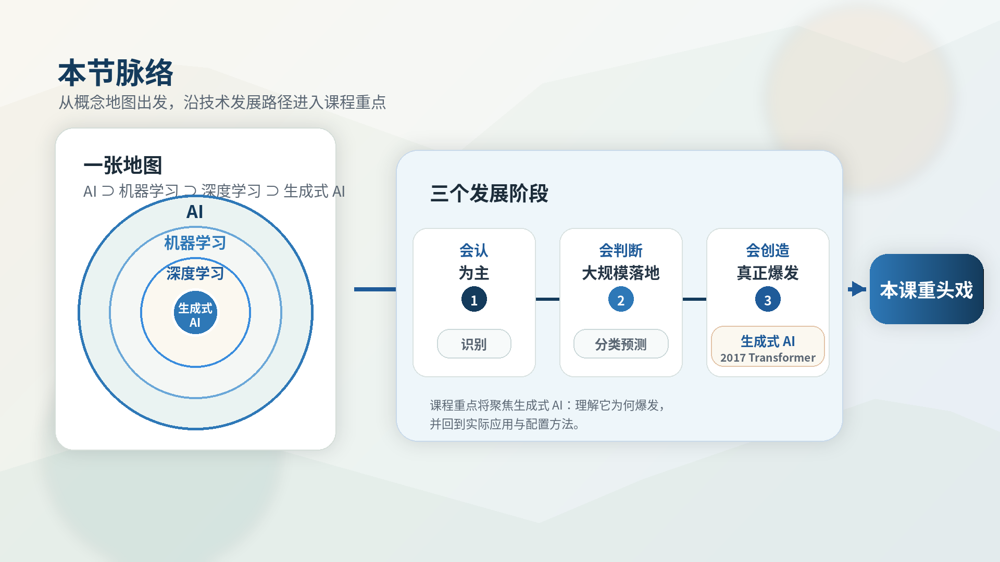
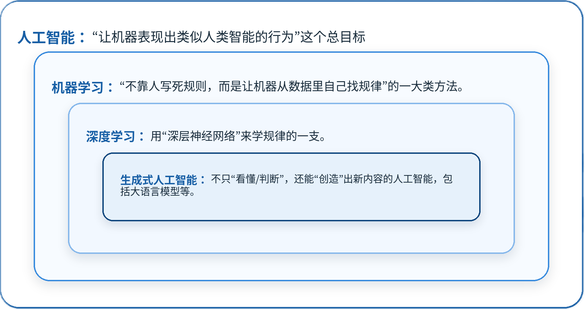
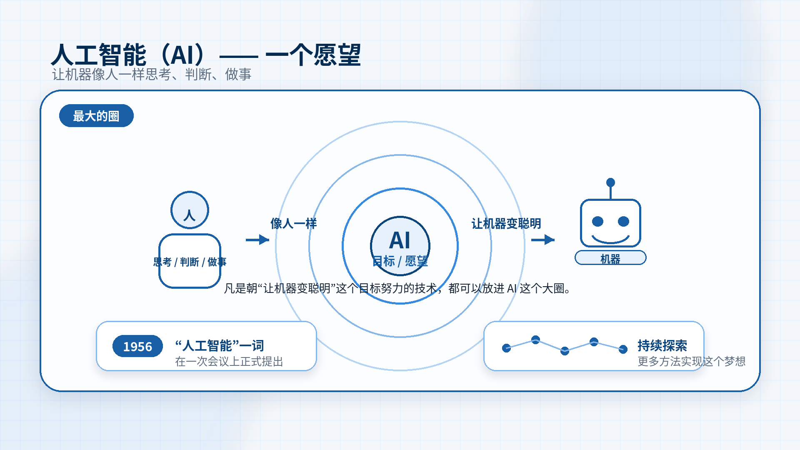
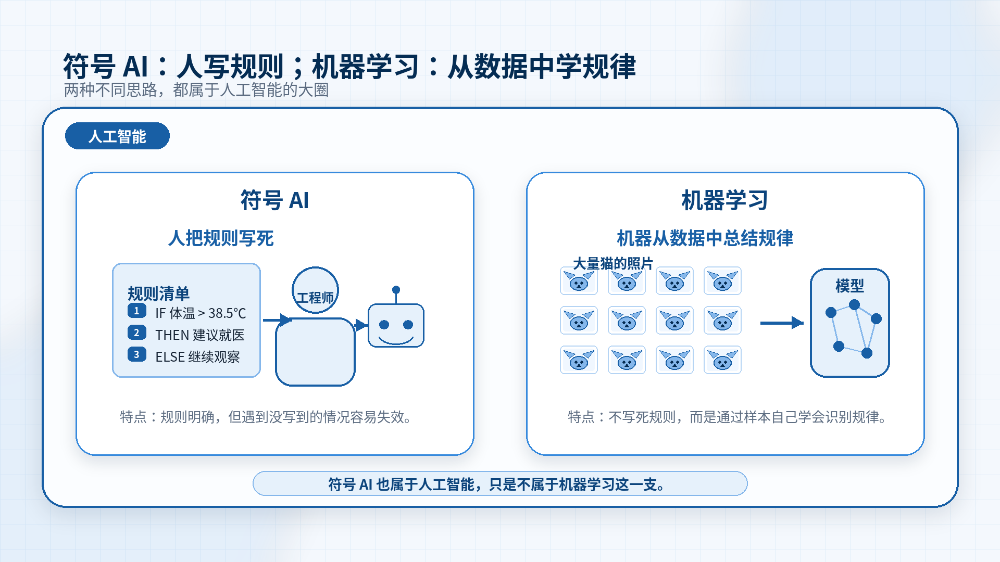
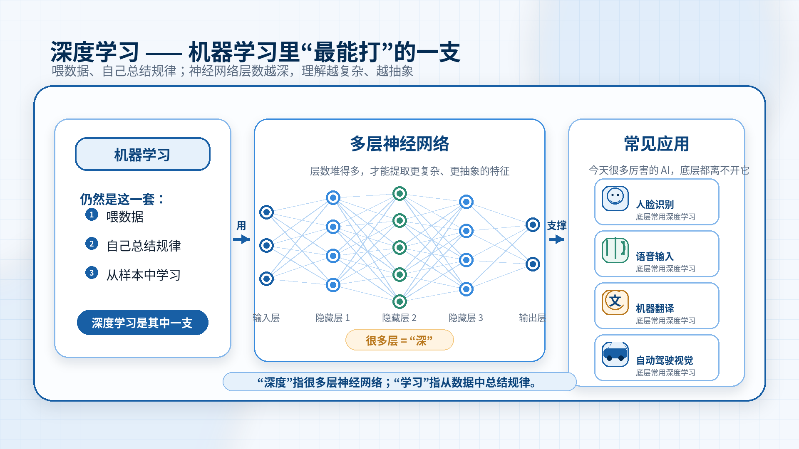
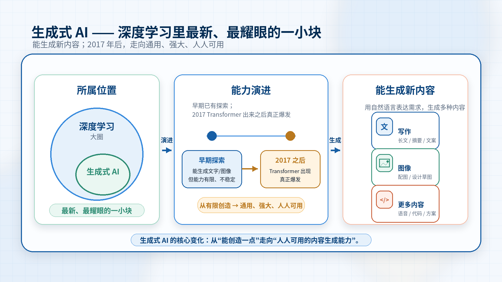
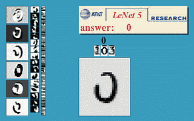

# 1.1 AI 基础

> 章节：AI 和 Agent 基础 ｜ 来源：[腾讯云 ADP-FDE 认证课程](https://cloud.tencent.com/edu/learning/course-4742-84527-84531) ｜ 整理日期：2026-09-26

## 1.1AI 基础

认识 **AI**，第一步不是记住那些名词、学习相关操作，而是先理清**AI**相关名词的关系：人工智能、机器学习、深度学习、生成式
 **AI** 到底是什么、有什么关系，**AI** 又是沿着怎样的时间线，一步步走到如今能够进行“创造”的。

学完这一节，你将能够说清人工智能、机器学习、深度学习、生成式 AI 之间的关系，不再被这些名词困扰；能够说出 AI 会“认”、会“判断”、会“创造”的三个发展阶段。

<figcaption>图· 本节脉络</figcaption>

在讲任何技术细节之前，我们要先在脑子里画一张“地图”。因为绝大多数人对 AI 的困惑，不是某个技术太难，而是名词太多、关系太乱——今天听到“机器学习”，明天听到“深度学习”，后天又冒出来一个“生成式
 AI”“大模型”，它们到底谁是什么、有什么关系，完全搞不清楚。

所以本节只做两件事：**第一，用一张****图****讲清这些名词的关系；第二，用****“****三个发展阶段****”****这条时间线，告诉我们
 AI
 是怎么从****“****会认字****”****一路进化到****“****会创作****”****的。**

## 1.1.1 AI 是什么

## 一张图解释人工智能、机器学习、深度学习、生成式 AI 的关系

想象四个从大到小、层层嵌套的圈：

<figcaption>图· AI与机器学习层级关系</figcaption>

读懂这张图：

## 人工智能（AI） ——一个愿望

**人工智能****是最大的圈，它****更像****是一个****“****愿望****”，或者说一个“目标”：**让机器能像人一样思考、判断、做事。我们可以认为，凡是朝这个目标努力的技术，都算
 AI。这个概念并不新，早在 1956 年，一群科学家就在一次会议上正式提出了“人工智能”这个词，到今天已经七十年了。也就是说，人类“想让机器变聪明”的这个梦想，很早就开始做了，几十年来，人们一直在探索更多方法来实现这个梦想。

<figcaption>图· 人工智能概念</figcaption>

## 机器学习 ——实现这个愿望最主流的一条路

要让机器变聪明，历史上有过两种截然不同的思路。早期的思路是“人把规则写死”，即工程师把一条条规则提前编好告诉机器，比如“体温超过 38.5
 度就建议就医”，机器只会照着这些规则执行，遇到没写到的情况就束手无策，这类技术叫“符号
 AI”。而机器学习走的是另一条路，**不再靠人一条条写规则，而是喂给机器大量的数据，让它自己从数据里去总结规律。**打个比方，教小孩认猫，不是给他背一本"猫的定义手册"，而是给他看成百上千张猫的照片，看多了他自己就会认了。机器学习就是这个思路，也正是今天
 AI 最主流的实现方式。这里要提醒一句：即使是很早期的、靠人写符号规则的“符号 AI”，也属于人工智能这个大圈，只是不属于机器学习这一支。

<figcaption>图· 符号AI与机器学习</figcaption>

## 深度学习 ——机器学习里“最能打”的一支

今天我们听到的几乎所有厉害的
 AI，底层都是深度学习。机器学习本身也有很多种方法，其中最能打、这十几年最出风头的一支，就是深度学习。它的名字听起来玄乎，其实拆开看很好懂：“学习”，说明它仍然是机器学习那一套——喂数据、自己总结规律；“深度”，指的是它用了一种叫"神经网络"的结构，而且这个结构层数堆得很多、很"深"，层数越深，它能理解的东西就越复杂、越抽象。所以叫深度学习。也正因为这个能力，今天我们听到的几乎所有厉害的
 AI——人脸识别、语音输入、机器翻译、自动驾驶的视觉——底层用的基本都是深度学习。

<figcaption>图· 深度学习神经网络</figcaption>

## 生成式 AI ——深度学习里最新、最耀眼的一小块

生成式 AI，顾名思义，就是"能生成新内容"的 AI。其实，“会创造”并不是生成式 AI 才有的能力。 在它之前，AI 就已经有一些“创造”的尝试了——比如早期能生成文字的模型、能生成逼真人脸图像的技术，都属于生成式 AI
 的早期探索。只是那时候的创造能力比较有限，写几句还行，写长文就语无伦次；生成的东西质量也不够稳定，更谈不上人人可用。

真正让生成式 AI 脱胎换骨的，是 2017 年之后的一系列突破（我们下一节讲的 Transformer 就是关键）。从那以后，生成式 AI 做到了又通用、又强大、又人人可用。我们不需要懂技术，打开
 ChatGPT、元宝、DeepSeek，随便说句话它就能帮你写、帮你画。所以我们说，生成式 AI 是深度学习里最新、也最耀眼的一小块。

<figcaption>图· 生成式AI</figcaption>

## 1.1.2 AI的发展阶段

理解了空间上的包含关系，我们再来看时间上的发展阶段。**AI** 从诞生到今天，大致可以分成三个阶段，以“会认”为主的 **AI** → “会判断”的
 **AI** 大规模落地 → “会创造”的 **AI** 真正爆发。

AI
 最早期能做的事情，说起来很朴素：**识别，也就是让机器****“****看懂****”****一个东西是什么。**

时间回到 1956 年，一群科学家在美国达特茅斯学院开了一次会，正式提出了“人工智能”这个词，这一年被公认为 AI 的元年。不过在最初的几十年里，AI
 走得并不顺。早期人们主要靠“人来写规则”的思路，把知识一条条编成规则灌给机器，也就是所谓的“专家系统”。这类系统在特定领域（比如医疗诊断、化学分析）能派上用场，但毛病很明显：规则全靠人一条条手写，一旦遇到没写到的情况就束手无策，做起来又费力又不灵活。AI
 甚至经历过两次“寒冬”，人们对AI的热情退去、投入锐减。

真正让“会认”这件事落地的，是后来“让机器自己从数据里学”的思路。一个标志性的成果，是上世纪八九十年代的手写数字识别。以 Yann LeCun 等人的工作为代表，AI
 第一次能比较可靠地认出人手写的数字，并被真正用到了实处——比如银行自动识别支票上的手写金额、邮局自动分拣信封上的邮政编码。这在当时是了不起的进步，因为它证明了，机器不必靠人写死规则，也能从大量例子里自己总结出规律。

<figcaption>图· Yann LeCun 官网 LeNet demo 页面，手写数字识别示例</figcaption>

这个阶段的
 AI，可以用一句话概括它的本事：“给它一个东西，它告诉我们这是什么。”是猫还是狗、是数字几——它擅长“认”，但也仅此而已，它不会思考，更不会创造。尽管本事朴素，这一阶段却是后面一切的根基，机器证明了它能从数据里学到规律。

会“认”之后，AI 的下一步是学会“判断和预测”——不只是识别眼前这个东西是什么，还能基于数据做出决策、给出预测。

这一阶段之所以能起来，背后有两个现实推手：一是**互联网普及**，企业手里第一次攒下了海量数据；二是**计算机算力不断变强，**数据多了、算力够了，“让机器从数据里学规律”这条路才真正跑得通。于是，机器学习的各种经典算法开始大放异彩——比如决策树、支持向量机、随机森林等等。它们不像早期专家系统那样靠人写死规则，而是自己从大量历史数据里总结出判断的依据。

也正是在这个阶段，AI 第一次大规模从实验室走进了真实产业，而且都是能直接产生商业价值的场景。例如：

- **垃圾邮件过滤：**给它一封邮件，它判断这是不是垃圾邮件。

- **商品推荐：**根据我们过去买过、看过什么，预测我们可能还想买什么。亚马逊、淘宝等电商的推荐系统，正是从这个时期发展起来的。

- 除此之外，还有**银行的信用评分与风控反欺诈、广告的点击率预测、搜索引擎的结果排序**等，背后都是这一套判断与预测的能力。

它的本事，可以概括成一句话：**给它一堆情况，它帮我们做判断、下预测。**这一阶段的 AI 已经相当实用，甚至可以说，我们今天生活里习以为常的很多智能功能，都是在这时打下的底子。

但我们也会发现，这时候的AI自己主动创造新东西的能力不太行。要突破这个天花板，就要进入真正改变格局的第三阶段。

大约在 2017 年，一篇名为《Attention is All You Need》的文章提出了深度学习的一个全新架构——**Transformer。**在它之前，处理文字（序列）主要用
 RNN/LSTM，有个大毛病：得一个字一个字顺着读，读长句子时前面容易忘，而且没法并行、训练慢。Transformer
 **关键的贡献，是引入了一种叫“注意力机制”的设计，让模型既能一眼看全整句话、抓住词与词之间的关联，又能大规模并行计算。**这样，模型可以判断哪个词和哪个词最相关，长距离依赖不再健忘；也可以喂进海量数据、把模型堆得特别大。正是这两点，为“把模型做得又大又强”扫清了障碍。

紧接着在 2018～2019 年前后，基于 Transformer 的一批模型横空出世：谷歌推出了 BERT，OpenAI 推出了 GPT
 系列。研究者发现了一个规律——只要把模型堆得更大、喂进更多数据，它的能力就会持续变强。于是模型越做越大，从 GPT-2 到 GPT-3，参数量呈指数级增长，生成式 AI 开始起飞。到了 2022 年底，OpenAI 发布
 ChatGPT，第一次让普通人也能上手，短短两个月用户破亿，AI 就此彻底出圈，走进了大众视野。

“会创造”并非这时才出现，但正是从这一阶段起，它才第一次做到又通用、又强大、又人人可用：

我们说一句话，它能写出一整篇文章（ChatGPT、豆包、元宝、DeepSeek……）；

我们描述一个画面，它能画出一张图（Midjourney……）；

我们给一段文字，它能生成一段视频（Sora……）、一首歌（Suno……）。

这些，都属于生成式AI。短短几年间，AI
 从一个只会“认”和“判断”的工具，变成了**人人都能用的能写、能画、能作曲、能编程的“创造者”**，几乎渗透进内容、编程、设计等各行各业。其中，大语言模型是生成式 AI
 的一种，而且是最主流、最核心的一种。

## 1.1.3 小结

本小节中，AI 相关的名词虽多，核心是一张地图加一条时间线。人工智能、机器学习、深度学习、生成式 AI 层层包含；AI
 从“会认”为主，到“会判断”大规模落地，到“会创造”的真正爆发，再到后面即将讲到的Agent，AI正变得越来越强大。

下一节 1.2「大语言模型的进化之路：从“会接龙”到“会做事”」会把“会创造”大规模爆发的这个阶段展开，看大语言模型如何通过Prompt、记忆、RAG、工具、MCP 补齐短板，长成能做事的AI。
