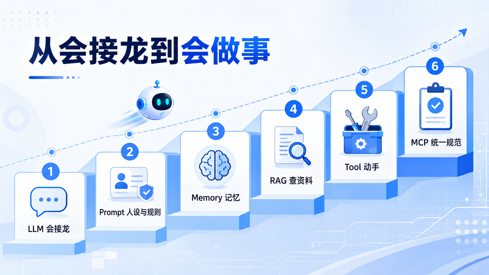
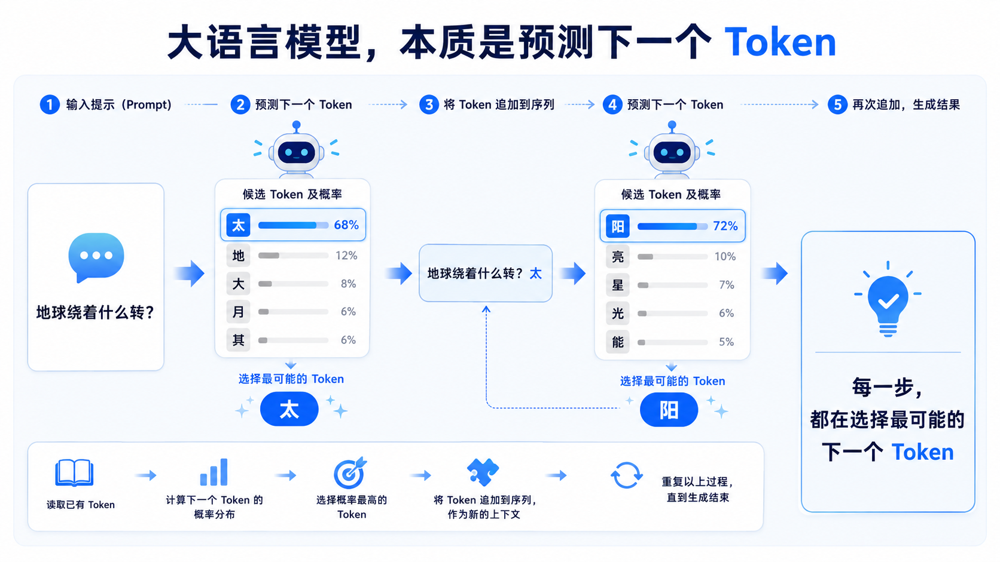
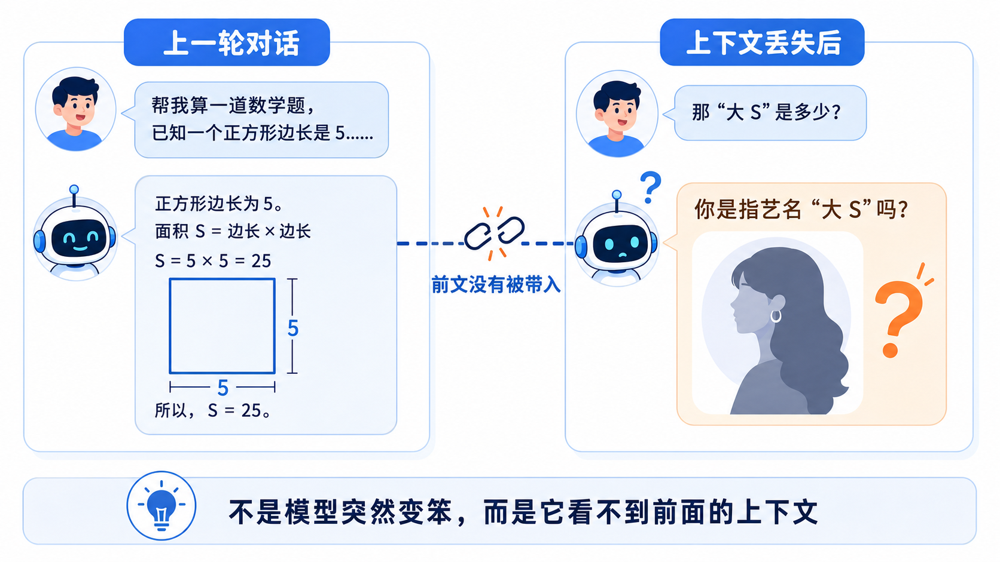
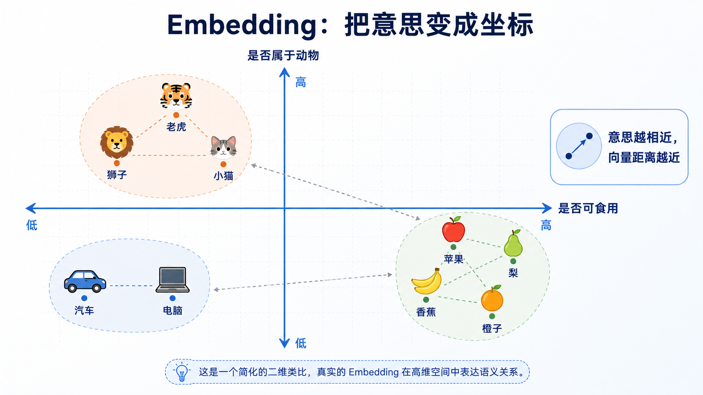
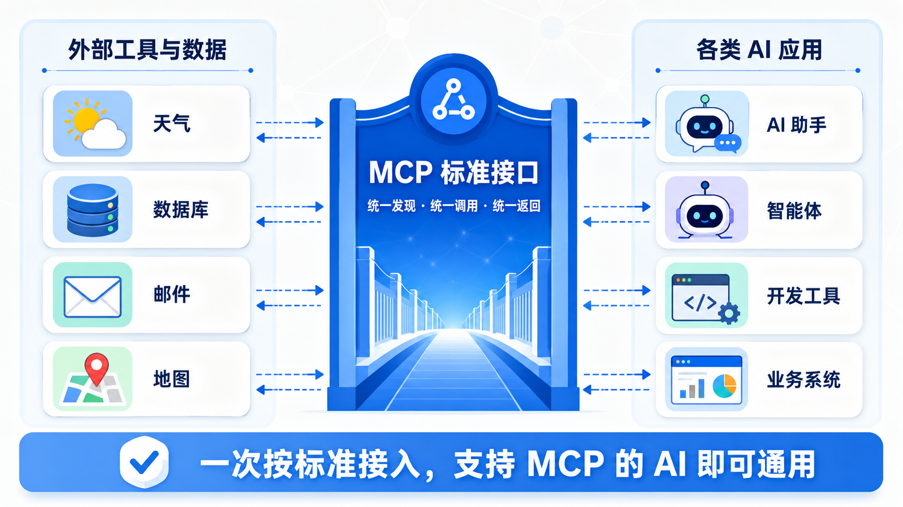

# 1.2 大语言模型的进化之路：从“会接龙”到“会做事”

> 章节：AI 和 Agent 基础 ｜ 来源：[腾讯云 ADP-FDE 认证课程](https://cloud.tencent.com/edu/learning/course-4742-84527-84532) ｜ 整理日期：2026-09-26

## 1.2大语言模型的进化之路：从“会接龙”到“会做事”

**大语言模型是生成式 AI 的一种，而且是最主流、最核心的一种。大语言模型本质上只会做文字接龙，但依靠 Prompt、记忆、RAG、工具、MCP
 逐步补齐短板，它逐渐从只会做文字接龙的AI成长为能做事的AI。**

学完这一节，你将能够用一句话讲清大语言模型的本质，并解释它为什么会“幻觉”；能够说清大语言模型如何依靠Prompt、记忆、RAG、Tool Use、MCP 完成从“会说”到“会做”的能力跃迁。

<figcaption>图· 大语言模型从会接龙到会做事的能力演进</figcaption>

## 1.2.1 Transformer：大语言模型的起点

说到大语言模型，首先就得提一提Transformer。上一节我们提到，Transformer是一个深度学习的架构，不是一个具体的产品。Transformer引入了一种叫“注意力机制”的设计，让模型既能一眼看全整句话、抓住词与词之间的关联，又能大规模并行计算，**为“把模型做得又大又强”扫清了障碍。**我们可以把“架构”理解成**一张建筑图纸**。图纸本身不能住人，但按照这张图纸，我们可以盖出千千万万栋不同的楼。Transformer
 就是这样一张革命性的“图纸”，2017 年被提出后，此后几乎所有厉害的生成式 AI 模型，都是照着这张图纸盖出来的。GPT、BERT、混元、DeepSeek……这些名字听起来五花八门，但它们本质上都是基于
 Transformer 这张“图纸”盖出来的不同的“楼”。**照着** **Transformer
 这张图纸，盖出来的第一批、也是最重要的一类"楼"****，就是****大语言模型。**

## 1.2.2 大语言模型如何从“会接龙”走向“会做事”

### 1.2.2 大语言模型（**LLM**）：本质就是“文字接龙”

大语言模型（LLM）的本质，其实并不神秘：它就是一个能力极强的“文字接龙机器”。给它一段文字，它便预测下一个字（**更准确地说是下一个“token”，可以****简单****理解为一个字或词**）最可能是什么，然后接上去；接完之后，再把新的这段文字重新读一遍，继续预测下一个，如此循环往复，直到生成一整段话。

例如：当模型看到“地球绕着什么转？”时，它先接出一个“太”字；再看着“地球绕着什么转？太”，接出“阳”字；如此一个字一个字地续下去，最终输出完整的回答。可以说，模型每走一步，做的都是同一件事——在无数可能的字里，挑出最合理的下一个，本质上是在不停地做“选择题”。我们平时用的
 ChatGPT、Claude、DeepSeek、元宝，底层做的都是这件事。

<figcaption>图· 大语言模型预测下一个 Token 的过程</figcaption>

作为一个“文字接龙机器”，它天生有两个毛病。

首先，它可能会一本正经地胡说八道，也就是所谓的AI
 幻觉。由于它只负责接出“读起来最通顺、最合理”的内容，并不真正核实事实对错，因此当它遇到不确定的问题时，往往不会承认“我不知道”，而是会顺着语感编出一个看似有理有据、实则并不存在的答案。有时候即便给模型接上了外部工具或资料，它也未必有足够的判断力，比如工具返回“上海气温一万度”这种明显离谱的数字，模型有时会照单全收地讲出来，有时才会察觉不对。这说明，它的“通顺”并不等于“正确”。

其次，它对“当下”一无所知。它不清楚自己是谁、现在几点、外面天气如何，因为这些信息根本不在它接龙时所看到的那段文字里，也不在它训练时学到的旧知识中。此外，它每次能“读进眼里”的文字还有长度上限（即“上下文窗口”），文字一旦太长，即便没有超限，也常常会接得不准。

于是，如何驯化这个既强大又毛躁的工具、让它变得可控可用，就成了关键。而驯化的方法之一，就是提示词（Prompt）。

这里解释一个贯穿全课程的关键概念——**token（中文译作“词元”）**。前面说模型是在“预测下一个字”，这只是一种通俗的说法；严格来讲，模型每一步预测和生成的基本单位并不是“一个字”，而是“一个
 token”。

**所谓
 token，就是模型处理文字时所切分出的最小单位****。**它可能是一个汉字，可能是一个英文单词，也可能只是单词的一部分或一个标点。换句话说，模型眼中的文字，并不是一个个字符，而是一串被切好的
 token；它所谓的“接龙”，本质上就是在已有的一串 token 后面，不断预测并接上最合理的下一个 token。

token 的意义不止于文字。随着技术发展，token 可以是文字，也可以是图像、表格，甚至是声音、视频的基本单位。正因为把各种复杂的内容都拆解成了有限的基本单位（token），生成式 AI
 才能用“从有限的选择里，不断决定下一个”的统一方式，去生成几乎无穷无尽的内容，这也正是它能同时写文章、画图、作曲的底层原理。

此外，token 还是一个非常实际的计量单位：我们平时听到的“模型能处理多长的内容”“调用一次花了多少钱”，通常都不是按字数、而是按 token 数来计算的。理解了
 token，后面许多概念（比如上下文长度、调用成本）也就更容易理解了。

### 1.2.3 提示词（**Prompt**）：给模型赋予设定

既然模型只会根据我们给的文字往下接，那么一个很自然的想法便产生了：我们能不能**在它正式接龙之前，先塞给它一段文字，把它应当知道的设定、背景、规则都预先告诉它？**我们完全可以在这段输入里“做文章”，用文字提前为它立好规矩。这正是提示词（Prompt）的核心思想。

- **系统提示词（System Prompt）**

它是系统预先为模型设定好的“人设与规则”，用户通常看不到。比如：“你的名字叫元宝，不叫小助手；请始终以礼貌、专业的语气回答，不讨论与业务无关的话题。”把这样一段文字，在用户提问之前就一并喂给模型，它接龙时便“知道”自己是谁、该用什么口吻、什么该说什么不该说。在真实的产品里，系统提示词往往远不止一句人设，还会包含与身份相关的信息、可以使用哪些工具及其用法、行为规范、能调用哪些技能、以及此前的记忆去哪里查找等等。也因此，用户可能明明只问了一个简单问题，模型那一端实际收到的系统提示词却可能超过四千个
 token——这些幕后的文字，用户完全看不见，却在默默地塑造着模型的每一次回答。

- **用户提示词（User Prompt）**

很好理解，它就是我们每次在对话框里输入的那句话，比如“帮我写一首诗”“把这段话翻译成英文”。它表达的是我们当下的具体需求。

归根结底，提示词是我们能够主动控制、并喂给模型的那段文字。系统提示词负责稳定的“人设与规则”，用户提示词负责当下的“具体任务”，二者叠加在一起送入模型。有了它们，一个原本只会漫无目的瞎接龙的模型，便有了稳定的身份与边界，开始真正像一个可用的助手。

### 1.2.4 记忆与上下文工程：让 **AI** 记住我们

如果只有提示词，大模型仍然记不住事。原因回到它的本质：它每一次接龙，能“看到”的只有当前这一次输入的文字，**一旦某些信息不在这段文字里，它就无从知晓。**

<figcaption>图· 上下文丢失示例</figcaption>

在这个例子中，用户先对 AI 说“帮我算一道数学题，……”，AI 算了一通；接着我们追问“那‘大 S’是多少？”这里的“大 S”，显然指的是公式里的面积 S。可 AI
 没有“记住”前面在聊数学，它直接蹦出一个“徐熙媛（艺名大 S）”来。这就是没有记忆、丢失上下文时的尴尬。它并不是变笨了，而是它“眼前”那段文字里，根本没有前面聊过数学的痕迹。

之所以会这样，还牵涉到一个现实限制。语言模型每次能够读入（以及输出）的文字长度是有限的，这个上限叫作“上下文窗口”（Context Window）。不同模型的上限各不相同，今天较好的模型往往能一次处理上百万个
 token；但即便如此，输入越长，哪怕还没触及上限，模型也常常会接得不那么准。这意味着，我们不能天真地把所有历史对话一股脑塞给它，而必须有策略地组织到底让它看到哪些内容。

正因如此，人们提出各种解决这个问题的办法，统称**上下文工程（Context
 Engineering）**：想办法把应当让模型看到的所有背景信息，都恰当地组织好、再喂给它。前面讲的提示词（Prompt），其实就是上下文工程的一部分；而其中另一个关键部分，就是记忆（Memory）。

- **短期记忆：**

指的是**本次会话里说过的话**，模型能够记住。但它的“短”就体现在，一旦我们换到一个新的对话框，之前的内容便不复存在，模型又会“失忆”般地从头开始。

- **长期记忆：**

指的是**跨越所有会话、绑定在我们这个账号上的信息**，而不只是当前对话框里的内容。比如它记住了“我们从事财务工作、偏好简洁的回答、所在公司叫某某”，那么无论哪天、开哪个新对话，它都能延续这些信息。模型正是借由这种方式，才显得“记得”我们是谁、之前聊过什么。可以看出，所谓长期记忆，本质上仍是把该记住的内容，在恰当的时候重新组织成文字、再喂回给模型。

有了上下文工程，AI
 便同时具备了会接龙、有人设、能记事这几项能力。但如果只有这些，就仍然存在一些问题。例如，它所掌握的知识，都是训练时学到的旧知识，而且还可能记错（幻觉）。如果我们想让它准确回答“我们公司最新的报销制度”这类它压根没学过的内容，又该怎么办？这时候，就需要
 RAG 登场了。

### 1.2.5 **Embedding** 与 **RAG**：让 **AI**
 先查资料再回答

我们想让 **AI** 在回答之前，先去我们指定的资料里查一查，找到相关内容，再基于查到的内容来回答，这样它就不那么容易瞎编。这个“先查资料、再回答”的机制，就是大名鼎鼎的
 **RAG**（Retrieval-Augmented Generation，检索增强生成）。

但在讲 RAG 的流程之前，必须先理解一个更重要的底层概念——**Embedding（向量化）**，否则我们会不明白AI 到底是怎么“查”资料的。

计算机不认识文字，只认识数字。**Embedding 做的事，就是把一段文字（一个词、一句话、一段话）转换成一串数字（我们叫它“向量”）**。
 而且这个转换很神奇：**意思相近的文字，转换出来的数字串也会很接近。**例如在一个二维坐标轴中，横轴表示“是否可食用”，纵轴表示“是否属于动物”。那么“苹果”就在右下角（可食用、不是动物），“梨”离苹果很近（也是水果），而“老虎”在左上角（不可食用、属于动物），
 “汽车”则可能在左下角（既不是动物，也不是食物）。每个词在这个平面上的位置，就是它的 Embedding。意思相近的词距离更近，意思不同的词距离更远。

<figcaption>图· Embedding 把语义转换为向量坐标</figcaption>

但实际的Embedding不是二维，而是几百维甚至一千多维。我们的大脑无法想象这么高的维度，但数学模型可以。有意思的是，这些高维向量之间有代数关系：教师 − 学校 + 医院 ≈
 医生、巴黎-法国+中国≈北京。向量竟然学到了类比的逻辑！

**Embedding应用举例：**

①语义搜索：可以用语义关系而不是关键词去搜索，比如搜"悲伤的爱情故事"会找到所有情感相似的作品。

②推荐系统：推荐与用户兴趣向量"最接近"的商品。

③分类：相同类别的文档向量会聚集在一起。

④聚类：自动发现文本之间的相似性。

**理解了 Embedding，RAG 的流程就一目了然了****。**简单来讲，它其实就三步：

step1：把资料变成坐标点（导入与向量化）：提前把所有文档切分成小段（chunk），用Embedding把每一段都变成一个坐标点，存进一个知识库里。

step2：拿问题去就近找（检索召回）：当我们提问“差旅费怎么报？”，系统先把我们这句问题也 Embedding成一个坐标点，然后去知识库里找离它最近的那几个坐标点——这几段文字，就是和我们问题最相关的资料。

step3：把资料塞给模型再作答（增强生成）：把找到的这几段资料，连同我们的问题，一起塞进提示词喂给大模型，让它看着这些资料来回答。

这样一来，AI 的回答就有了**准确、实时、可溯源**的依据，“幻觉"问题被大大缓解。**这就是为什么企业做 AI，第一步几乎都是搭知识库**——本质就是在为 RAG
 准备“坐标点”。

### 1.2.6 工具调用（**Tool Use**）：让 **AI** 能“动手做事”

有了Prompt、Memory和RAG，AI
 已经会说、会记、会查了。但它依然**只会****“****说****”****，不会****“****做****”****。**
 要突破这一点，就要让 AI 学会用工具。

举一个例子：模型本身并没有查询实时天气的能力（天气是随时变化的，训练时根本学不到今天的数据），但我们又希望它能帮我们查天气，怎么办？

答案是，让模型去调用一个现成的、已经封装好的天气查询工具。**工具本质上可以看作一个函数（Function）**，使用工具就是去调用这些函数，这个动作也被称为“Function
 Call”。更重要的是，模型使用工具时，只需要知道“怎么用”，而不需要知道它“内部是怎么实现的”，就像我们用计算器，只管按键取结果，不必了解它内部的电路。

在上述例子中，我们可以把天气查询功能想象成一个数学函数T(X, Y) 。

T(X, Y) —— 其中 X 是地点，Y 是日期。当我们告诉模型“想查询上海今天的天气”，模型并不会自己瞎猜，而是先输出一段调用工具的指令，系统在后台执行这个工具（形如 T（上海，今天））、取回结果（例如“摄氏 32
 度”），这段结果通常并不直接展示给用户，而是重新交还给模型，模型再据此接龙出一句自然、通顺的回答。可以看到，模型自己并不“懂”天气，它扮演的角色，是判断“该在什么时候、调用哪个工具、填什么参数”，再把工具返回的结果组织成自然语言回复我们。

工具远不止查天气这一种。大语言模型常用的工具包括执行代码的 Python、搜索引擎，乃至调用另一个更强的
 AI——不同工具能力不同，也各有成本。除此之外，发送邮件、查询数据库、下单、在系统里生成一张工单，都可以被封装成工具供模型调用。只要把某项能力做成一个标准的“函数”交给它，它就能在合适的时机自行取用。

### 1.2.7 **MCP**：让工具调用有一门“普通话”

前面提到，工具本质上就是一个个可供模型调用的函数。当工具越来越多，一个新的麻烦便浮现出来：这些工具**各说各的“方言”**。例如，有的要求我们用英语来问，有的要求中文，有的又规定了另一套完全不同的参数格式；又或者这个工具把地点字段叫作
 city，那个工具叫 location，还有的干脆叫“地点”。如果没有统一的规矩，就会陷入一种极其低效的局面，**每一个工具，都要为全球成千上万家 AI
 公司分别对接、各自维护一套不同的接口**；反过来，**每一家 AI 公司，也要为成千上万个工具逐一适配**。这是一种“多对多”的重复劳动，无论对工具方还是模型方，都是一场灾难。

解决办法其实很朴素，和人类社会解决语言不通的思路如出一辙：大家坐下来，约定一套统一的、通用的协议。我们可以把它理解成一份公认的“说明书”或“标准接口规范”——**所有 AI
 公司都按照这一套标准格式去调用工具，所有工具方也只需按照这同一套标准来对外提供服务。这个用于工具调用的通用标准协议，就叫作 MCP（Model Context Protocol，模型上下文协议）**，由
 Anthropic 公司在 2024 年前后提出，如今已被越来越多的厂商采纳，逐渐成为业界通行的做法。

<figcaption>图· MCP 标准接口连接外部工具与 AI 应用</figcaption>

它带来的改变是显著的。以前，一个工具方要想让自己的能力被各家 AI 使用，往往得反复对接、重复开发；有了 MCP，它只需要按照这套标准，把自己的能力“挂”出来一次，任何支持 MCP 的 AI
 就都能直接调用，无需再单独适配。就好比商家只要把菜单印成统一的标准格式，天下的顾客都能照着点单，不必每进一家店就重新学一套规则。

正是有了 MCP 这样的统一协议，AI 才能更方便、更规范地连接起各种各样的外部工具和数据，工具生态也随之迅速繁荣起来。

## 1.2.8 小结

本小节我们把让大语言模型变得更好用的重要基础能力大致了解了一遍：

- 会接龙的模型（**LLM**）

- 给它人设（**Prompt**）

- 让它记事（**Memory**）

- 让它查资料（**Embedding** + **RAG**）

- 让它动手（**Tool Use**）

- 统一动手的规矩（**MCP**）

事实上，大约在 2022 年之前，市面上的 **AI** 工具虽然已经很能干，但是复杂、需要分步执行的长任务它仍然做不了。要突破这个瓶颈，**AI**
 须得从一问一答的工具，进化成能自己规划、分步骤把复杂任务做完的智能体。

下一节 1.3「智能体（**Agent**）基础」将继续解释这些能力如何被组织成 Goal–Action–Observation 循环，使 **AI**
 能自主规划并完成多步骤任务。
