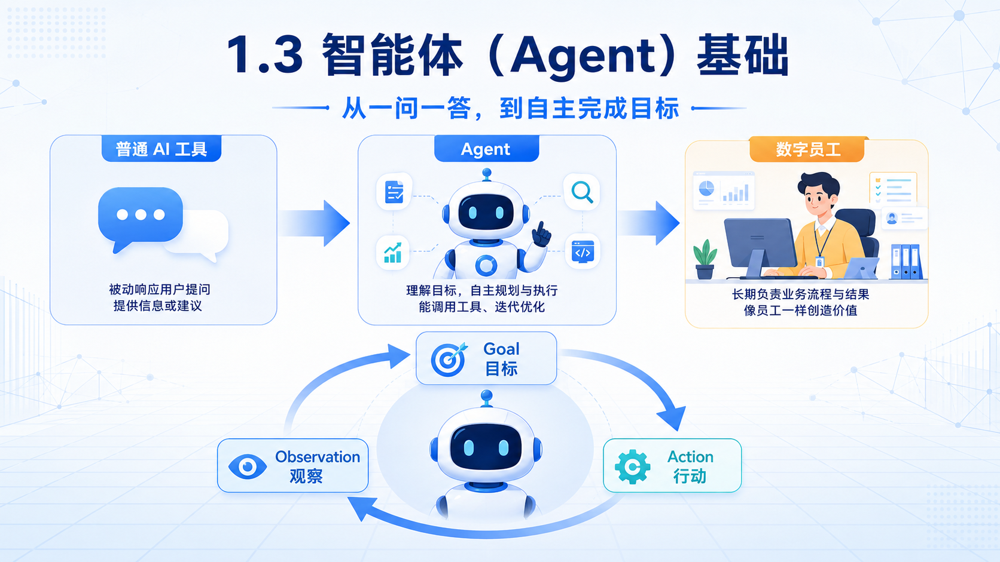
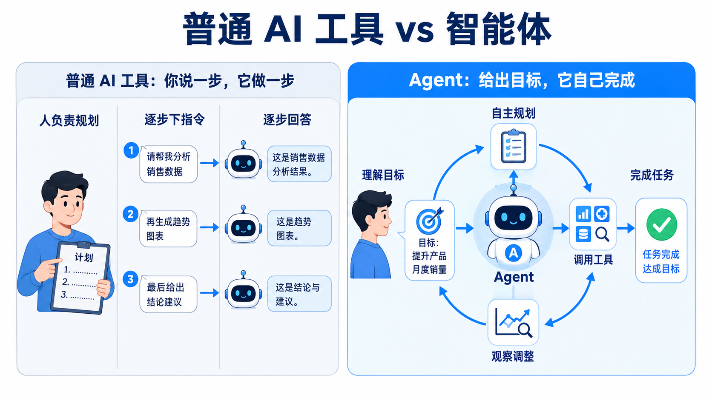
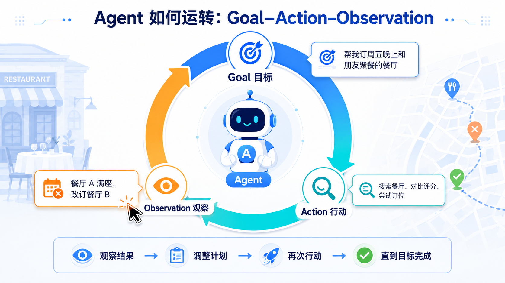
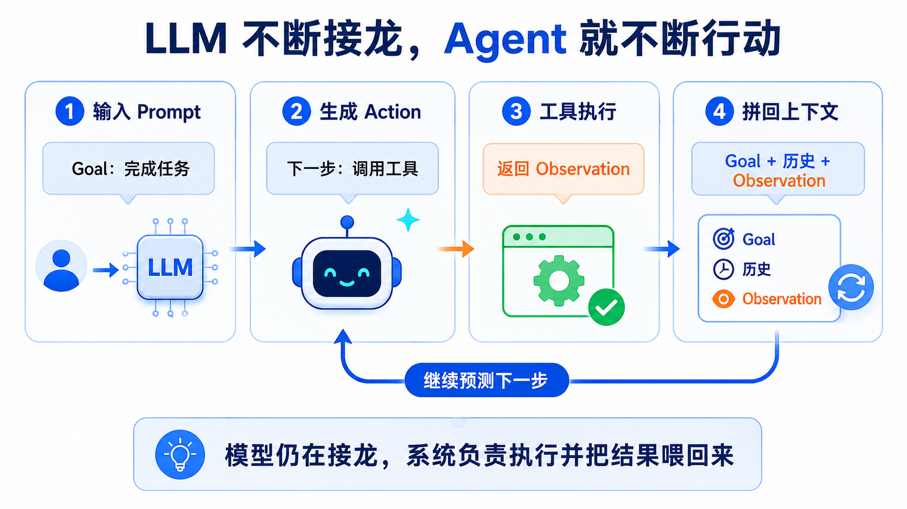
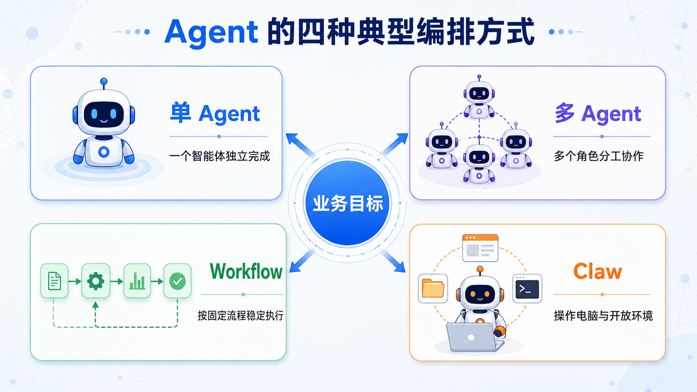
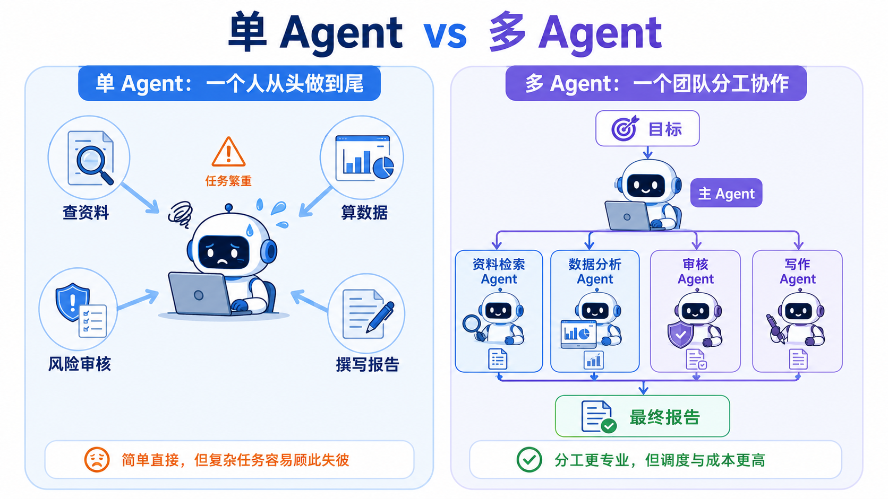
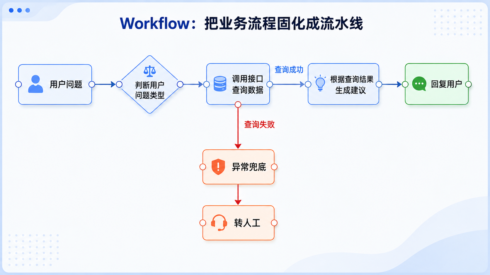
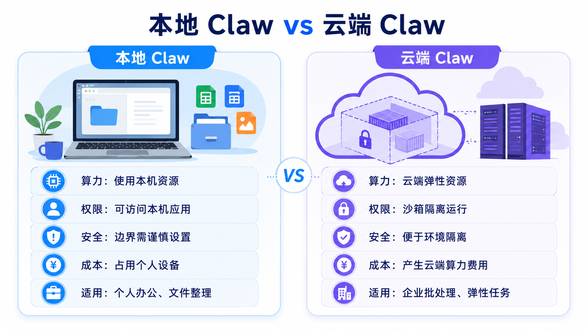
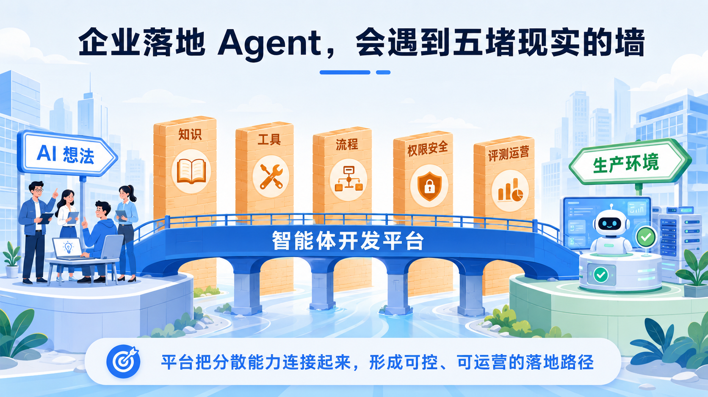

# 1.3 智能体（Agent）基础

> 章节：AI 和 Agent 基础 ｜ 来源：[腾讯云 ADP-FDE 认证课程](https://cloud.tencent.com/edu/learning/course-4742-84527-84533) ｜ 整理日期：2026-09-26

## 1.3智能体（Agent）基础

**2022 年前后****，****一方面，ChatGPT 通过 RLHF
 和指令微调，让模型第一次能稳定地****“****听人话****”****、照指令干活；另一方面，思维链（CoT）的发现教会了模型****“****分步骤思考****”****，大幅提升复杂推理能力****。****两块拼图凑齐——****“****会听指令
 + 会分步想****”****，2023 年初立刻涌现出 AutoGPT、BabyAGI 等一批 AI Agent 项目，智能体时代的大门就此打开。**

学完这一节，你将理解智能体与普通大语言模型工具的区别；能说清 Goal–Action–Observation 循环如何让 Agent 运转；能区分单 Agent、多 Agent、Workflow、Claw
 等典型编排方式；能理解企业为什么需要 ADP 这样的智能体开发平台。

<figcaption>图· 智能体从一问一答走向自主完成目标</figcaption>

## **1.3.1 什么是智能体**

智能体（Agent）是一种 AI 系统：人只需要给它一个目标，它就能自己拆解任务、规划步骤、调用工具去执行，并根据每一步结果不断调整，直到把目标完成。

过去我们熟悉的大语言模型，是一种一问一答的工具：我们问一句，它答一句；要它完成一件复杂的事，就得由我们把每一步都想清楚，再一条条指令喂给它。真正动脑筋去规划的，其实是我们，而不是 AI。

而智能体，把“规划”这件事也交给了 AI。我们不再需要告诉它“第一步做什么、第二步做什么”，只需要告诉它“我最终想要什么”，剩下的“该分几步、每一步做什么、做完之后怎么办”，都由它自己决定。普通的 AI
 工具像一个“听指令的执行者”，你说一步它做一步；而智能体更像一个“能扛事的员工”，你交给它一个任务，它自己想办法把它办成。这也正是 AI 从“工具”进化为“数字员工”的原因所在。

<figcaption>图· 普通 AI 工具与智能体的关键差异</figcaption>

## **智能体如何运转：Goal–Action–Observation 循环**

智能体最核心的运行方式，可以用三个词概括，它们构成一个不断循环的圈：

三步不断循环——观察结果、决定下一步、再观察新的结果——直到目标最终达成。它和过去那种“一问一答”的工具有着本质区别：过去我们得手把手地把每一步指令都下清楚，少说一步它就卡在那里；而智能体只需要接住一个目标，剩下的拆解、尝试、遇阻后的调整，都由它自己完成。

<figcaption>图· Agent 的 Goal Action Observation 循环</figcaption>

## **从大语言模型角度看：Agent 仍然是在“接龙”**

从大语言模型的角度看，智能体要解决的问题，无非就是“目标（Goal）、观察（Observation）、行动（Action）”这几样东西交替出现，而语言模型在整个过程中，其实一直都在做接龙。AI
 智能体依靠的，正是语言模型现有的能力，而非某种全新的、被重新训练出来的智慧。

换句话说，智能体的“聪明”，并不是凭空多出来的。我们所做的，只是把“目标是什么”“上一步做了什么”“观察到了什么结果”这些信息，统统作为文字，一次次喂给那个我们已经熟悉的大语言模型，让它据此接龙出“下一步应该做什么”。模型接出的这一步，被拿去真正执行，执行的结果又被重新整理成文字，再喂回给它，开始下一轮接龙。如此循环往复，一个看似会“自己规划、自己办事”的智能体，就运转起来了。

<figcaption>图· LLM 通过行动和观察持续完成任务</figcaption>

支撑这个循环顺畅运转的，是上一节讲过的关键机制：靠提示词（Prompt）为它设定目标与规则，靠记忆（Memory）让它记住之前发生了什么，靠工具调用（Tool Use）让它能真正“动手”执行并取回真实世界的观察结果，再靠
 MCP 这样的统一协议让它方便地接入各种工具。

可以说，智能体并不是某种神秘的新物种，而是大语言模型现有的能力，加上 Prompt / Memory / Tool / MCP
 这套机制，被组织起来、循环运转的结果。理解了这一点，前面铺垫的每一块拼图，也就在这里全部派上了用场。

## **1.3.2 Agent 编排方式**

前面提到，智能体靠 Goal–Action–Observation 循环运转。但同样是这套循环，落地时可以有不同的编排方式：可以是一个 Agent 独自完成，也可以是多个 Agent 分工协作；可以让 AI
 自主规划，也可以把流程提前固定成工作流；还可以让 AI 具备操作电脑、处理文件和调用命令的能力。

<figcaption>图· Agent 的四种典型编排方式</figcaption>

## **（1）单 Agent 与多 Agent：一个人干 vs 一个团队协作**

单 Agent，就是一个 AI 智能体，独自面对目标：自己规划、自己调用工具、自己观察结果、自己完成整件事。从头到尾，都是它一个人在跑“目标—行动—观察”的循环。

它的优点是简单、直接，适合相对单一、不太复杂的任务。比如“帮我查一下明天上海到北京的高铁票，并整理成一张表”，这类目标清晰、步骤不多的任务，交给一个能力不错的单 Agent 就足够了。

但它的局限也很明显。当任务变得庞大而复杂，既要查资料、又要算数据、还要审核和撰写报告，让同一个 Agent 从头包到尾，就会像让一个人同时兼任所有工种一样，既容易顾此失彼，也难以保证每个环节的质量。

为了应对复杂任务，可以采用多智能体（Multi-Agent）的形式：把一个大任务交给一个“AI 团队”来协作完成。它会先把任务拆解成多个步骤，再把每一步分派给专门的子
 Agent：一个负责查资料，一个负责算数据，一个负责风险把关，一个负责撰写结论。

多 Agent 的好处，是把“分工”和“专精”带进 AI
 的世界：复杂任务被拆细后，每一环都能做得更专业；引入审核、复核角色，也让最终结果更少出错。当然，代价是调度更复杂，消耗的算力和成本也更高，所以并非任何任务都值得动用一整个团队。

<figcaption>图· 单 Agent 与多 Agent 的差异</figcaption>

## **（2）工作流（Workflow）：把流程固化成流水线**

在实际业务里，还有另一种截然不同、甚至思路正好相反的编排方式，叫作工作流（Workflow）。并不是所有任务都需要 AI
 “随机应变”。现实中有大量业务，其实每一次都按照几乎一模一样的步骤在走——先做什么、再做什么、遇到某种情况该走哪个分支，都是固定的、可以事先写清楚的。

对于这类业务，与其让 AI
 每次都重新“动脑筋规划”（既慢，又可能跑偏），不如干脆把流程提前固定下来。工作流的做法，就像画一张流程图：把每一个环节做成一个个节点，再用连线把它们按顺序、按条件串接起来，编排成一条固定的流水线，然后让 AI
 严格沿着这条线一步一步执行。

在这里，AI 不再是那个自由发挥的“规划者”，而更像流水线上一个训练有素、只做规定动作的“操作员”。遇到分支时，智能体会根据实际情况选择走工作流的哪条分支。

> [图片未下载] 节点探索点击节点查看输入、处理和输出 — 

选择一个节点，查看它在流程中的输入、处理逻辑和输出。

### 判断问题类型

用户的自然语言问题和当前会话上下文。

识别咨询意图，判断问题属于数据查询、知识问答还是需要人工处理。

标准化的问题类型与后续执行分支。

### 调用接口查询数据

已识别的问题类型、查询条件和用户权限。

调用经过授权的业务接口，并记录调用参数、状态和返回结果。

结构化业务数据；失败时转入异常兜底。

### 根据查询结果生成建议

接口返回数据、回答规则与必要的业务知识。

由模型基于真实结果组织解释与建议，不补造缺失信息。

可供用户理解的自然语言草稿。

### 回复用户

生成的回答草稿、格式规范与安全检查结果。

应用输出格式并完成最后校验。

最终回复和必要的引用或提示。

### 异常兜底 / 转人工

接口失败、数据缺失、权限不足或低置信度结果。

停止继续自动执行，保存上下文并向用户说明原因。

明确的失败提示，或携带完整上下文转交人工。

<figcaption>图· Workflow 将业务流程固化成流水线</figcaption>

## **（3）Claw 模式：能操作电脑的 AI**

2025 年初，一个新范式火了起来，业内常把这一类产品称为 Claw。很多人第一次听到，觉得它玄乎又神秘，但其实它的原理和前面讲的东西并没有本质区别——它只是在原有基础上，多做了一件事：**让 AI
 能够发出操作电脑的指令。**

以前的 AI，无论多么强大，输出的本质上都只是文字——它能把一件事说得头头是道，却终究只是“说”，真正动手去做的还得是人。而 Claw 这类
 AI，输出的可以是对电脑的操作指令：移动鼠标、点击、按下键盘、打开文档、填写表单、执行命令等。于是，AI 不再只是隔着屏幕跟人说话，而是能真正“动手”操作电脑，替人把事情从头做到尾。

看似神奇，但底层逻辑在工具调用中已经可以理解。电脑操作本质上也是一组工具：键盘输入、鼠标移动与点击、打开或关闭程序、执行命令。只要把这些操作封装成工具交给 AI 调用，就实现了“AI 操作电脑”。所以它本质上和 Tool
 Use、MCP 是一回事：按照约定好的方式，让 AI 发出标准化的指令。

> [图片未下载] 演示视频Claw 模式同步执行演示：点击“发送给 Claw”后，任务拆解、执行步骤与工作区产物同步变化；可暂停、重播或拖动进度条查看任一阶段。 — 

Claw 范式还有一个很吸引人的创新：它可以和聊天工具连在一起。于是我们会获得一种“远程操控”的体验——就像用手机给电脑发了一条消息，电脑那头的 AI
 就自己动起来，把活干完。从技术上看，这些指令本身并不复杂，但这种“我随手发个消息，电脑就自动帮我办事”的体验，一下子击中了大众。

## **tip1：****Claw 还很新：安全、权限与复杂长任务问题必须心里有数**

- **安全问题：**它能真正操作电脑，一旦被滥用或理解错误，后果可能很严重。例如误执行删除文件、泄露数据或受网页中的恶意指令影响。

- **权限问题：**既然它能接触文件和系统，“该让它碰哪些、不该碰哪些”的边界非常重要。

- **复杂长任务仍然吃力：**Claw 的手脚虽然灵活，但“大脑”仍取决于背后的语言模型，面对特别长、步骤特别多的任务仍可能失控或跑偏。

下面用四个任务检验一下判断力：为每项任务选择最合适的执行策略。判断时要关注**权限、可逆性和外部影响**。

- A可自动执行

- B需要人工确认

- C不应执行

- A可自动执行

- B需要人工确认

- C不应执行

- A可自动执行

- B需要人工确认

- C不应执行

- A可自动执行

- B需要人工确认

- C不应执行

## **tip2：****本地 Claw vs 云端 Claw**

<figcaption>图· 本地 Claw 与云端 Claw 对比</figcaption>

## **1.3.3 为什么企业造智能体，需要一个平台**

学到这里，你可能会产生一种“我已经很懂 AI 了”的兴奋感。但事实上，个人日常使用 AI，和一家企业要把智能体真用起来、用得好、用得放心，是截然不同的。

一个人玩 AI，缺了什么问题不大。但一家企业要把智能体落地到真实业务里，例如智能客服、知识助手、经营分析、流程自动化，马上会撞上一堆现实的墙。

<figcaption>图· 企业落地 Agent 面临的五类现实障碍</figcaption>

## **（1）****企业级 Agent 必须具备的六大特性**

企业级 Agent 不是演示用的玩具，而是要进入真实业务系统。因此，它必须具备可控性、可测性、可审计性、可运维性、可复用性和可集成性。

> [图片未下载] 互动学习企业级 Agent 六大特性 — 

点击卡片翻面，查看定义、业务示例及 ADP 中的对应能力。

系统始终受人类掌控，可暂停、停止并设置权限边界。

**业务示例：**删除客户信息前必须等待人工审批。

**ADP：**权限边界、人工干预、发布审批、工具范围控制。

能够验证 Agent 是否按预期工作，并重现问题。

**业务示例：**上线前使用测试集验证准确率和流程完成率。

**ADP：**调试工具、评测数据集、对话日志、节点运行记录。

任何决策和行动都有完整、可回溯的记录。

**业务示例：**回溯某次拒答参考了哪个规则、何时执行。

**ADP：**知识引用来源、操作留痕、接口调用和决策回溯。

系统容易监控、调试、升级与回滚。

**业务示例：**成功率下降时告警并定位失败任务类型。

**ADP：**用量监控、效果分析、版本管理、异常定位与回滚。

知识、工具、规则和模板可被多个 Agent 复用。

**业务示例：**一个政策知识库授权给多个业务助手。

**ADP：**知识库共享、工具复用、Prompt 与 Workflow 沉淀。

能够通过标准接口连接企业现有系统。

**业务示例：**接入 CRM、ERP、工单系统或数据库。

**ADP：**API、数据库、MCP 和企业系统连接能力。

## **（2）****ADP：企业造智能体的一站式平台**

换句话说，企业要“可控、可运营、能规模化”地落地智能体，就必须有一个把这些能力和特性全部整合好、开箱即用的一站式平台。这样的平台，不是一个通用聊天机器人，也不是某个单独的 Claw
 工具，而是专门为“企业造智能体”而生的开发与运营底座。

腾讯云 ADP（智能体开发平台，Agent Development Platform）正是这样一个平台。它把本章讲到的大模型、知识库（RAG）、提示词、变量与记忆、连接器与工具（含 MCP）、工作流、多 Agent，乃至
 Claw 模式，全部做成了可视化、可配置、可运营的产品能力，让不懂代码的业务人员，也能亲手把一个智能体造出来。

正是这些特性，让企业能够真正“安心”地把智能体用在生产环境里——不是做一个演示用的玩具，而是搭建一套可控、可运营、能长期迭代的业务系统。它的优势在哪、能提供哪些具体能力？这正是下一章“ADP 产品能力”要展开的内容。

## **1.3 小结**

- 智能体不是神秘的新物种，而是大语言模型加上 Prompt、Memory、Tool Use、MCP 等机制后形成的能自己规划、自己行动，从而完成多步骤的复杂任务目标的人工智能系统。

- Agent 的核心运行逻辑是 Goal–Action–Observation 循环：给目标、做行动、看结果、再调整。

- Agent 可以有多种编排方式：单 Agent 适合简单任务，多 Agent 适合复杂协作，Workflow 适合固定流程，Claw 适合开放探索和电脑操作任务。

- 企业落地 Agent 不能只靠一个聊天工具，还需要知识、工具、流程、权限、安全、评测和运营的一站式平台支撑。ADP 正是把这些能力产品化、可视化、可运营化的智能体开发平台。

下一节进入第 2 章“ADP 产品能力”。在理解 Agent 的基本概念后，接下来会看到 ADP 如何把应用、知识库、Workflow、工具、模型、发布和运营能力组织成一套企业级智能体开发平台。
