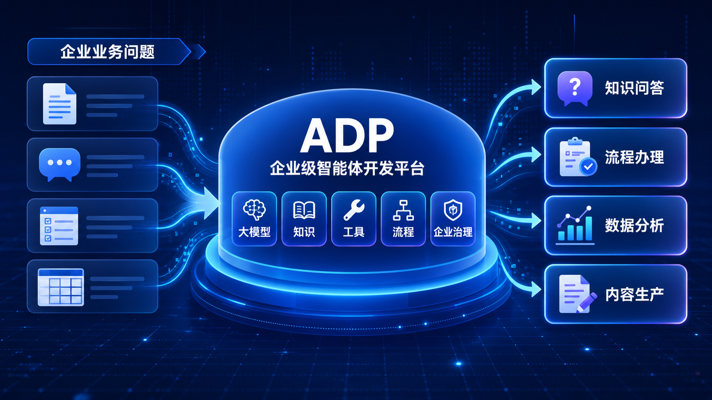
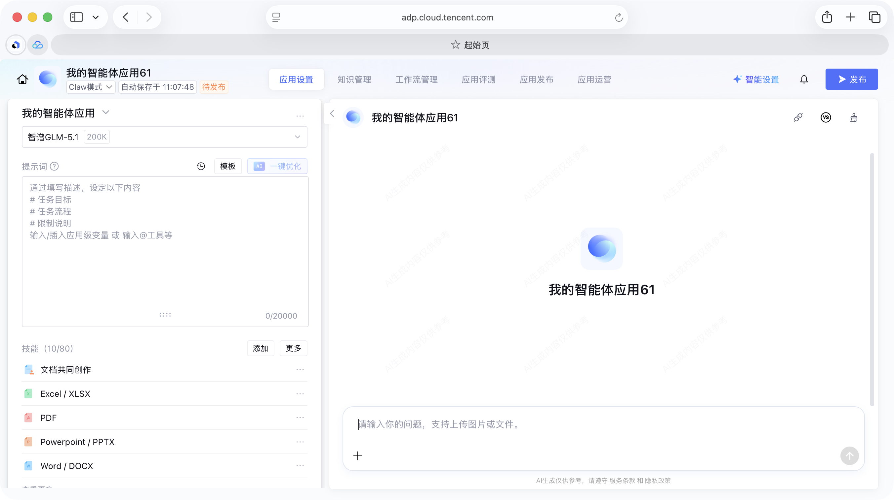
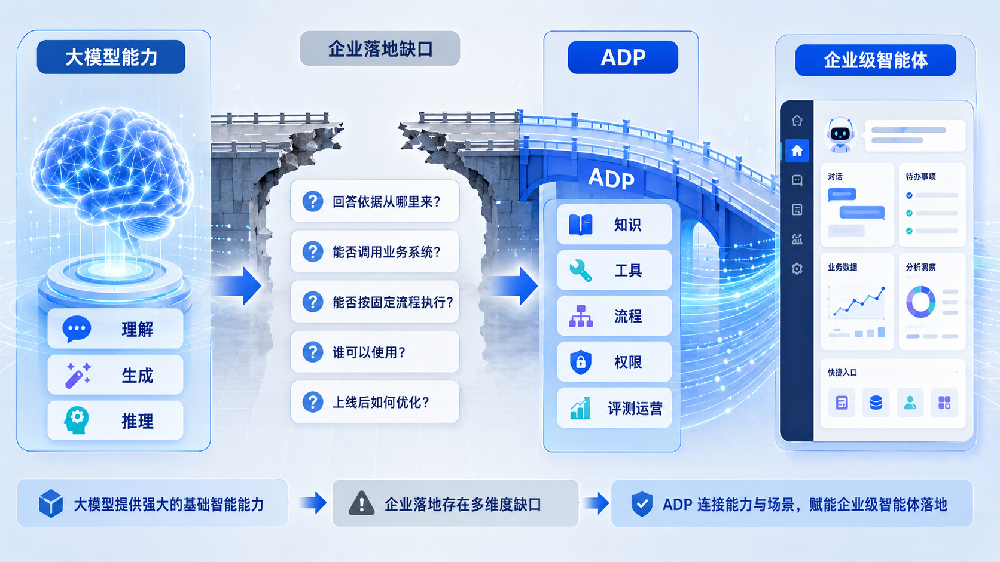
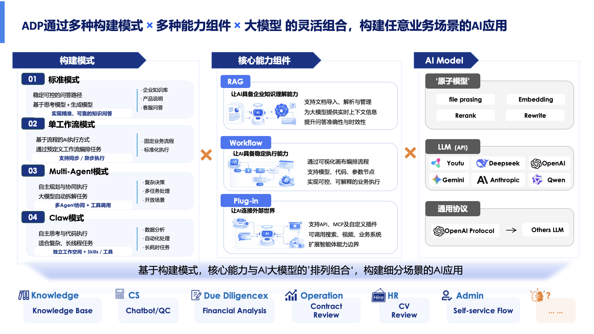

# 2.1 ADP 是什么：企业级智能体开发平台

> 章节：ADP 产品能力 ｜ 来源：[腾讯云 ADP-FDE 认证课程](https://cloud.tencent.com/edu/learning/course-4742-84528-84534) ｜ 整理日期：2026-09-26

## 2.1ADP 是什么：企业级智能体开发平台

**腾讯云智能体开发平台****（Tencent Cloud Agent Development Platform，下文简称 Tencent Cloud
 ADP）****是面向企业的智能体开发平台****，可以****帮助企业构建、上线和持续运营智能体应用。它把大模型、知识、工具、流程和企业治理连接起来，让智能体真正进入业务场景。**

<figcaption>图· ADP企业级智能体开发平台概览</figcaption>

学完这一节，你应能说明 ADP 的产品定位；理解企业为什么不能只靠一个大模型；读懂 ADP 产品能力地图中“构建模式 × 核心能力组件 × AI Model”的关系；了解ADP的四大优势；初步判断哪些任务适合用
 ADP 构建智能体。

## **2.1.1 ADP 的产品定位**

ADP 是面向企业的智能体开发平台。它围绕大模型能力，整合应用构建、知识库、工具连接、Workflow、多 Agent、权限发布、调试评测和运营分析，帮助企业把 AI
 能力变成可使用、可管理、可上线、可持续优化的智能体应用。

ADP 不是普通 Chatbot，也不是单一大模型接口，而是企业构建智能体应用的生产与运营平台。

ADP 面向的不是单一角色，而是企业内围绕 AI 应用建设协同工作的多类人群。例如，业务团队关心能不能解决问题，IT 团队关心能不能安全接入和管理，售前与交付团队关心能不能快速搭建可复用方案。

## **为了避免把 ADP 理解窄，需要先区分它和几类常见产品的关系。**

<figcaption>图· ADP智能体搭建页面。可以进行应用设置、知识管理、工作流管理、发布运营、工具设置等</figcaption>

- A只是一个聊天机器人

- B企业级 Agent 开发平台

- C可以连接知识、工具和流程

- D可以支持应用上线和运营

## **2.1.2****ADP的智能体范式**

理解 ADP
 的定位之后，再看企业为什么需要这样的平台。大模型让机器具备了理解、生成和推理能力，这是智能体能够工作的基础。但在企业场景里，“能回答”只是第一步。真正进入业务时，还需要继续追问：回答依据来自哪里？能不能查企业内部资料？能不能调用业务系统？能不能按固定流程执行？谁可以使用？上线之后怎么评测、监控和优化？

<figcaption>图· 大模型到ADP能力补足</figcaption>

大模型是智能体的能力基础，但企业级智能体不是“模型接口 + 聊天框”。企业真正需要的是一套能把模型、知识、工具、流程和治理能力组合起来的平台。ADP
 可以把大模型能力包装成不同智能体范式：有的负责稳定问答，有的负责按流程办事，有的负责多角色协同，有的负责处理更开放的复杂任务，也有的帮助用户用自然语言快速创建和辅助搭建应用。这与我们上一章介绍的当前已有的智能体范式是一致的。

这里的几种范式用于帮助你理解 ADP
 如何把大模型能力变成不同类型的智能体应用。本节不会展开具体的操作教程，**第三章****会再详细讲每种模式的适用边界、搭建方式和实战案例。**

> [图片未下载] 翻卡对比从大模型到企业级智能体，还缺什么？ — 

### 只靠大模型，还缺什么？

点击卡片翻面，查看 ADP 为企业落地补足的能力。

请用鼠标点击卡片翻面。

## **2.1.3 ADP 的产品能力****地图**

理解 ADP 的产品能力，不需要先陷入复杂的后台菜单。我们可以把ADP 看成“构建模式、核心能力组件和 AI
 Model”的灵活组合：不同业务场景，可以选择不同构建模式，接入不同能力组件，再结合合适的大模型能力，最终形成面向业务的 AI 应用。

能力地图中的构建模式、核心能力组件、模型能力和底部场景都是代表性示例，并不是 ADP 的完整能力清单。这里的目标不是穷举所有功能，而是帮助你理解 ADP 如何通过“模式 + 能力组件 + 模型”的组合构建不同业务场景。

<figcaption>图· ADP 能力地图：构建模式 × 核心能力组件 × AI Model 的灵活组合</figcaption>

ADP能力地图

ADP 通过多种构建模式 × 多种能力组件 × 大模型的灵活组合，构建不同业务场景的 AI 应用。

## **（1）****如何阅读这张能力地图**

构建模式决定应用怎么运行。图中示例包括标准模式、单工作流模式、Multi-Agent 模式，分别对应稳定问答、固定流程和多 Agent 协作。

核心能力组件决定应用能做什么。图中示例包括 RAG、Workflow、Plug-in，分别补齐知识理解、流程执行和外部连接能力。

AI Model 提供底层智能能力。图中示例包括原子模型、LLM API 和通用协议，用于支撑文档解析、检索、生成、推理和模型接入。

构建模式负责承载应用形态，核心能力组件负责补齐知识、流程和工具，AI Model 负责提供底层智能。三者组合起来，就可以面向不同业务场景构建不同类型的 AI 应用。例如：

## **（2）ADP的实际应用**

ADP的能力可以应用在各类业务场景中。只要业务中存在大量知识问答、重复咨询、文档处理、流程办理、系统查询、数据分析或内容生产，或者其他复杂的、多步骤的任务，就可以进一步判断是否适合用 ADP 构建智能体。例如：

## **（3）ADP的****部署形态：公有云和私有化**

**公有云部署**：腾讯云 ADP 提供的标准服务，用户通过云端账户直接使用，无需自建基础设施，按使用量计费，快速上手。

**私有化部署**：适合对数据隐私、合规性、网络隔离有严格要求的客户，支持在客户专有的云环境或本地部署，保证数据完全由企业自主管理。

## **2.1.****4****ADP的四大产品优势**

为什么企业选 ADP，而不是自己拿开源框架从头拼？因为 ADP 在四个方面提供了“企业级”的保障。

## **（1）****优势一：更精准的对话效果。**

在真实业务里，"对话效果好不好"不只取决于大模型本身，更取决于系统能不能**准确看懂企业文档、高效检索、给出可靠答案**。ADP 在这方面积累深厚：

- **企业级文档理解**：依托腾讯优图实验室多年的 OCR 与文档解析技术积累，支持 10+ 文档文件类型、200MB
 单文档处理，对复杂图文混排、表格、公式等版面进行智能识别与结构化处理。在说明书、规章制度等场景中，能够准确提取文档中的文本和图片内容，为后续问答提供高质量的知识底座，同时支持对图片内容的直接理解与回答。

- **自研向量（Embedding）模型**：还记得第一章介绍的 Embedding 吗？ADP基于多阶段训练管线和精细化数据工程，自研的 2B 级 Embedding 模型在 C-MTEB
 基准测试中达到 SOTA 水平。结合基于 LLM 的 Reranker 模型(支持 8k+ 长文本、分层知识蒸馏)，实现高召回、高精准的检索效果。

- **智能 RAG（Agentic RAG）与结构化数据问答**：不仅能“匹配一段文本”，还可以通过多轮检索、跨文档推理和多工具协同，回答跨知识源的复杂问题。结合 Text-to-SQL
 能力，支持对上万行表格或数据库执行条件筛选并聚合问答，让"问文档、问表格、问数据库"可以在同一应用中统一完成。

## **（2）****优势二：完整的一站式开发与运营框架。**

- **多种智能体架构**：支持 LLM+RAG、Multi-Agent、Workflow 等主流范式，兼顾简单问答和复杂任务代理。

- **贯穿应用全生命周期**：从配置、开发、调试、评测、发布到运营，全链路都有配套能力，一套平台承载从试点到规模化。

- **企业级评测体系**：内置裁判模型、规则、代码等多种评估方式，支持一键批量对比不同模型、提示词和工作流版本，生成量化效果报告。

- **运营与用量管理**：提供用量、数据分析、对话记录日志等管理后台，便于精细化运营和查看使用成本。

- **零代码 / 低代码优先**：绝大部分功能通过可视化配置完成，复杂场景再补少量代码，兼顾业务和技术团队。

- **丰富模板与最佳实践**：预置教育、传媒、医疗、金融等多行业模板，以及多场景 Demo 与"应用开发要点"，降低试错成本。

- **可解释与持续优化**：每条回答附带命中文档片段、相似度评分和检索路径。配合应用日志分析和评测能力，帮助业务与运营人员了解大模型"为什么这么答"，基于实际效果持续调整知识组织与检索策略。

## **（3）****优势三：灵活的模型与开放生态。**

- **多模型统一接入**：支持主流大模型与自建模型一键导入 Tencent Cloud ADP。

- **企业级连接器与工具生态**：内置 200+ 高质量连接器和工具，覆盖知识问答、检索、图片/音视频处理、数据分析等场景，全面支持 MCP 协议和自定义扩展。

- **多种集成方式**：智能体 API 提供 RESTful API、SDK 等集成方式，支持发布至企业微信以及小程序等常用渠道，适配不同技术栈与接入场景。

## **（4）****优势四：企业级安全、性能与可观测性。**

- **高性能架构**：流式响应，首字时间 < 1 秒，支持高并发和扩缩容。

- **安全可靠**：多租户数据强隔离，内容安全审核，细粒度权限体系与操作审计。

- **精细化权限体系**：平台 / 空间 / 应用 / 知识库等多层级权限，数据权限与功能权限解耦，适配集团型企业复杂组织结构。

- **完善的监控与告警**：实时监控请求量、成功率、延迟、Token 消耗等核心指标。

- **智能体数据洞察能力**：智能体对话记录分析、热点问题挖掘、问答效果标注，效果趋势分析。

## **2.1****.5****小结**

ADP 是企业级 Agent 开发平台。它不是单独的大模型，也不是普通 Chatbot，而是通过构建模式、核心能力组件和大模型能力的灵活组合，支持公有云和私有化两种部署形态，让智能体能够进入企业业务并持续运行。

- ADP 的定位是企业级 Agent 开发平台，帮助企业把模型能力转化为可上线的智能体应用。

- 企业不能只靠一个大模型，因为真实业务还需要知识、工具、流程、权限、评测和运营。

- ADP 的产品能力可以理解为：构建模式 × 核心能力组件 × AI Model。

- ADP的四大优势。

本节内容已经回答了“ADP 是什么”。接下来，我们会进一步拆开看：一个智能体在 ADP 中究竟由哪些核心模块搭建起来。你将看到应用、模型、Prompt、变量、记忆、知识库、工具、Workflow等之间如何协同工作。
