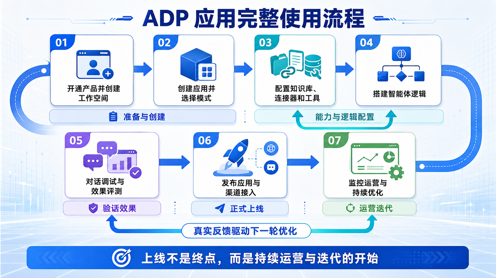
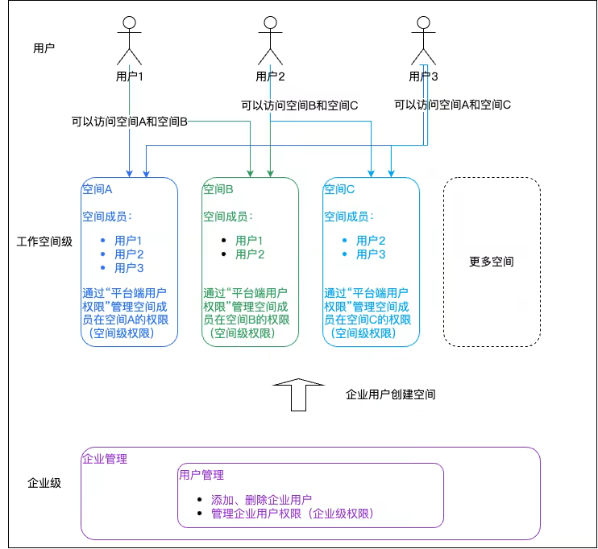
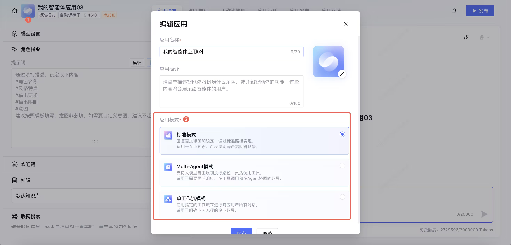
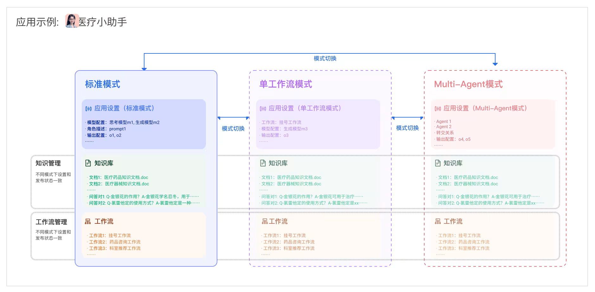
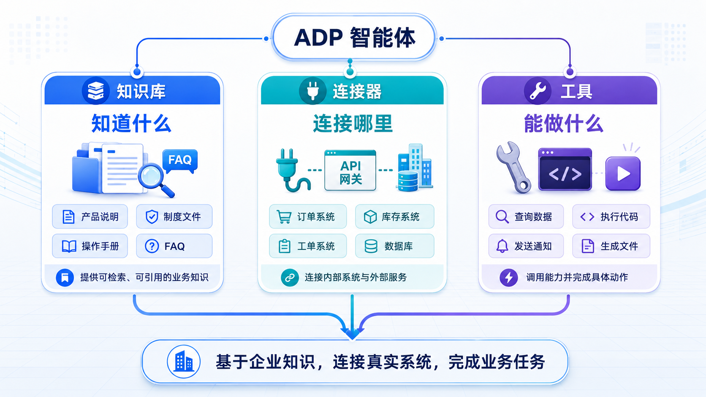

# 2.3 从开发到上线：ADP 应用的完整使用流程

> 章节：ADP 产品能力 ｜ 来源：[腾讯云 ADP-FDE 认证课程](https://cloud.tencent.com/edu/learning/course-4742-84528-84538) ｜ 整理日期：2026-09-26

## 2.3从开发到上线：ADP 应用的完整使用流程

**前面****我们****已经了解了 ADP
 的产品定位、核心能力和任务执行方式。接下来****我们来整体梳理一下在ADP创建并应用智能体的全流程，****把这些能力放回真实使用路径中：从开通平台、创建应用，到配置知识和工具、搭建智能体逻辑，再到调试评测、发布接入和持续运营。**

1. 理解 ADP 应用从开通工作空间到运营优化的完整路径。

2. 能判断创建、配置、调试、评测、发布、接入、运营各阶段分别要解决什么问题。

3. 形成“上线不是终点，而是进入持续运营与迭代”的认知。

**完整流程**

ADP 应用的完整使用流程可以概括为七步：开通产品并创建工作空间 → 创建应用并选择模式 → 配置知识库、连接器和工具 → 搭建智能体逻辑 → 对话调试与效果评测 → 发布应用与渠道接入 → 监控运营与持续优化。

<figcaption>图· ADP应用完整使用流程</figcaption>

## **2.3.1 第一步：开通产品并创建工作空间**

使用 ADP 前，需要先完成产品开通和工作空间创建。使用腾讯云账号完成实名认证后，首次进入智能体开发平台，系统会自动为主账号创建 1 个“企业”和 1 个默认工作空间。

**可以把“企业”和“工作空间”理解为应用建设的组织边界**。企业用于承载组织级资源和权限，工作空间则用于放置具体的应用、知识库、工作流、工具等内容。后续创建的智能体应用、知识库和工作流，都会在工作空间中进行管理。

<figcaption>图· 权限体系</figcaption>

## **2.3.2 第二步：创建应用并选择模式**

进入工作空间后，可以创建“应用”。一个应用通常对应一个业务场景，例如售后智能客服、数据分析助手、营销文案生成助手、网页内容总结助手、内部知识问答助手等。创建应用时，需要根据业务复杂度选择合适的应用模式。

模式选择决定后续搭建方式。标准模式更适合快速开始，单工作流模式更适合固定流程，Multi-Agent 模式更适合复杂任务中的分工协作，Claw
 模式则更适合需要独立工作空间和自主处理能力的任务。请注意，**标准模式、单工作流模式、Multi-Agent
 模式**三者之间，支持根据应用落地场景的需要进行模式切换：点击**头像**或者**模式**
 tag，即可在**编辑应用**中进行应用模式的切换；claw模式下不支持切换到其他模式。

<figcaption>图· 应用模式切换</figcaption>

模式切换时，应用下知识库和工作流范围保持不变，但不同模式之间应用配置项，如提示词、模型配置等在模式切换时不会相互继承，在切换模式时的配置更新原则的示意图如下：

<figcaption>图· 应用模式切换的配置更新示意图</figcaption>

## **2.3.3 第三步：配置知识库、连接器和工具**

应用创建完成后，需要为它配置知识来源和行动能力。知识库解决“智能体知道什么”的问题；连接器和工具解决“智能体能连接什么、能调用什么”的问题。

为应用绑定一个或多个知识库，可以导入业务文档或问答，作为智能体回答问题时可检索、可引用的知识来源。知识库适合承载产品说明、制度文件、售后规则、操作手册、FAQ、培训资料等相对稳定的业务内容。

结合业务需要，还可以启用连接器和工具。例如内部系统 API 可以查询订单、库存、工单、用户状态等实时数据，代码执行可以处理计算、转换、分析或自动化任务。

<figcaption>图· 知识库连接器与工具配置</figcaption>

## **2.3.4 第四步：搭建智能体逻辑**

完成知识和工具配置后，需要搭建智能体逻辑。智能体逻辑决定应用如何理解用户请求、如何组织回答、何时调用知识库和工具、是否进入工作流、是否调度多个 Agent。例如在应用内设置提示词、模型参数、回复风格，可选串联简单工作流。

例如，使用"工作流编排"构建多步骤流程，接入外部系统、数据库等，在工作流中组合大模型、知识检索、条件判断、API 调用、代码执行等节点；使用 Multi-Agent
 架构，由主智能体调度多个专家子智能体，各自负责不同子任务……

**详细说明请参见****第三章。**

## **2.3.5 第五步：对话调试与效果评测**

逻辑搭建完成后，需要在控制台内进行对话调试，观察回答是否准确、稳定。调试时可以用真实业务问题进行多轮测试，检查知识是否命中、回答是否完整、变量是否正确传递、工具是否正确调用、工作流节点是否按预期运行。

对话调试窗口能够帮助观察应用在单次对话中的表现；评测能力则适合为关键场景编写测试用例，通过批量方式验证应用效果。评测时可以重点观察知识检索效果，例如召回率、准确率等；也可以观察对话质量，例如相关性、完整性、流畅度等。

**详细说明请参见****第四章。**

## **2.3.6 第六步：发布应用与渠道接入**

当调试和评测结果达到预期后，可以将应用从测试环境发布到正式环境。发布意味着应用不再只是开发阶段的原型，而是进入真实使用场景。

将应用从测试环境发布到正式环境，根据业务需要选择接入方式。例如：

- 在网站或后台系统嵌入组件以连接 ADP

- 接入企业微信、微信公众号、小程序等

- 自研前端通过 API / SDK 调用

### 应用接入速查：凭证、同步、异步与流式结果

当应用要接入业务系统时，应先完成调试和发布，再进入相应的调用配置获取
 AppKey、接口地址或连接所需信息。调用凭证由后端安全保管，不能写入公开前端、URL、提示词或日志明文。发布或调用前还要确认应用版本、凭证、返回格式和前端处理方式一致。

**什么时候使用 Widget：**当结果不只是文字，而需要展示订单处理进度、候选项选择、列表、图表或可点击按钮时，可用 Widget
 等结构化组件承载。组件负责展示和交互，后端仍要校验用户身份、权限和操作参数，不能因为“按钮由系统生成”就默认可信。

## **2.3.7 第七步：监控运营与持续优化**

应用发布后，生命周期并没有结束，而是进入监控运营与持续优化阶段。在平台中可以查看应用的请求量、成功率、响应延迟、Token 消耗等指标，分析常见问题和满意度，并根据真实使用情况持续优化。

运营优化通常会回到前面几个阶段：如果发现知识回答不准，需要补充或清洗知识库；如果发现流程节点不稳定，需要调整工作流和提示词；如果发现成本或延迟过高，需要优化模型选择和路由策略；如果发现某类问题反复出现，可以补充测试集，在下一轮发布前重新评测。

到这里，一个 ADP 应用就从“创建”走到了“运营”。但真实业务中的智能体应用不会一次成型，运营反馈会不断驱动配置、逻辑、评测和发布的下一轮更新。

## **2.3 小结**

一个 ADP 应用从开发到上线可以分为七步：开通产品并创建工作空间，创建应用并选择模式，配置知识库、连接器和工具，搭建智能体逻辑，对话调试与效果评测，发布应用与渠道接入，监控运营与持续优化。

这条流程把前面的内容串了起来。本章中，第一小节讲解了 ADP 为什么是智能体开发平台，第二小节讲解了ADP
 提供哪些核心能力，而本小节说明这些能力如何在真实应用生命周期中被使用。理解这条路径后，后续进入场景设计和实操搭建时，就能更清楚每一步要解决什么问题，以及可以做到什么程度。下一章，我们将进行智能体开发的实战。
