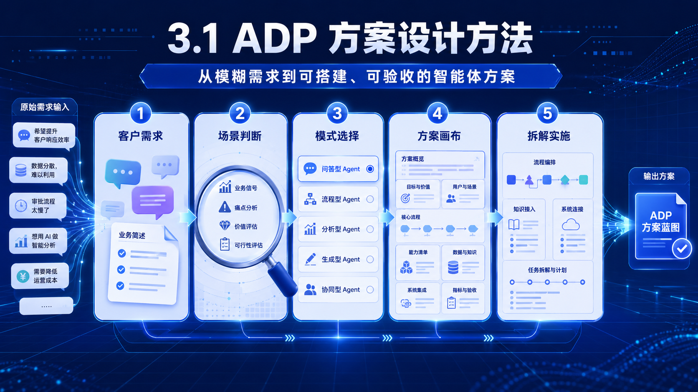
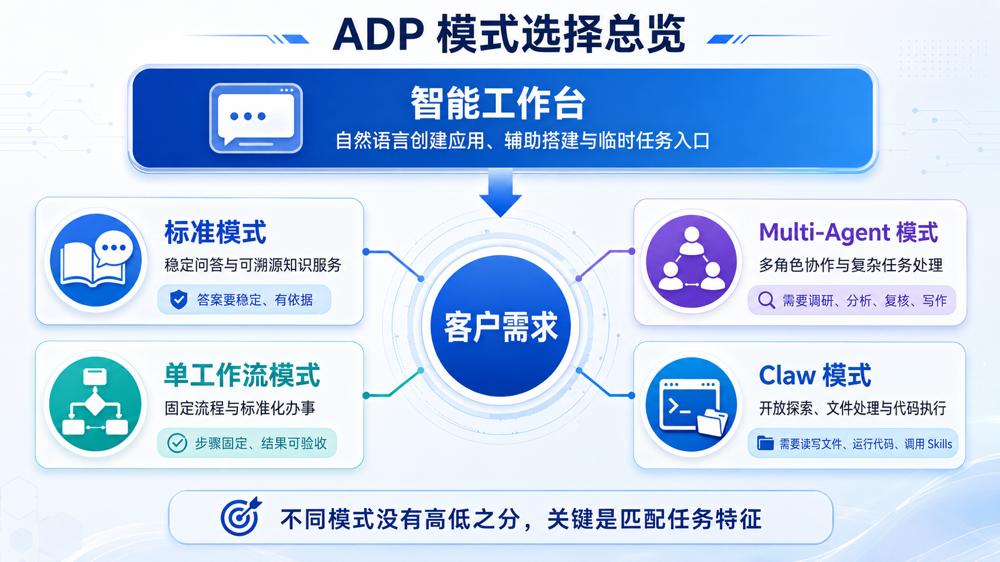
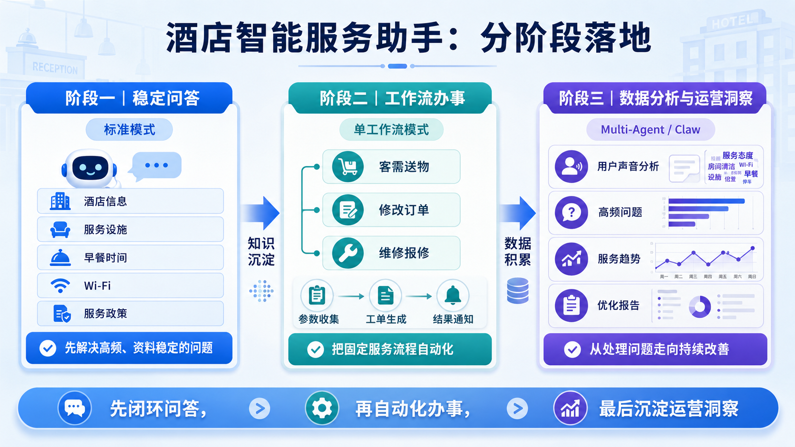
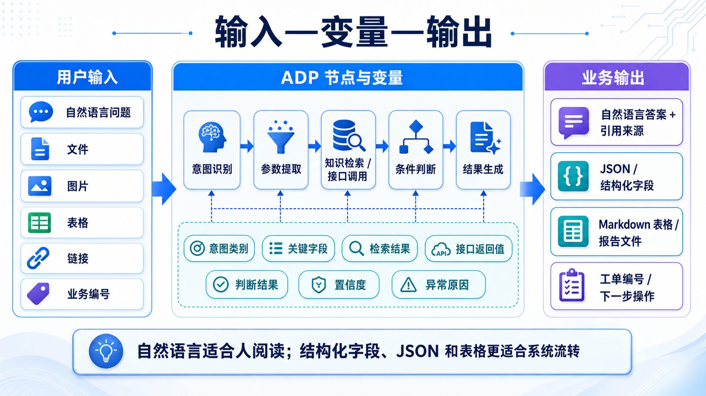
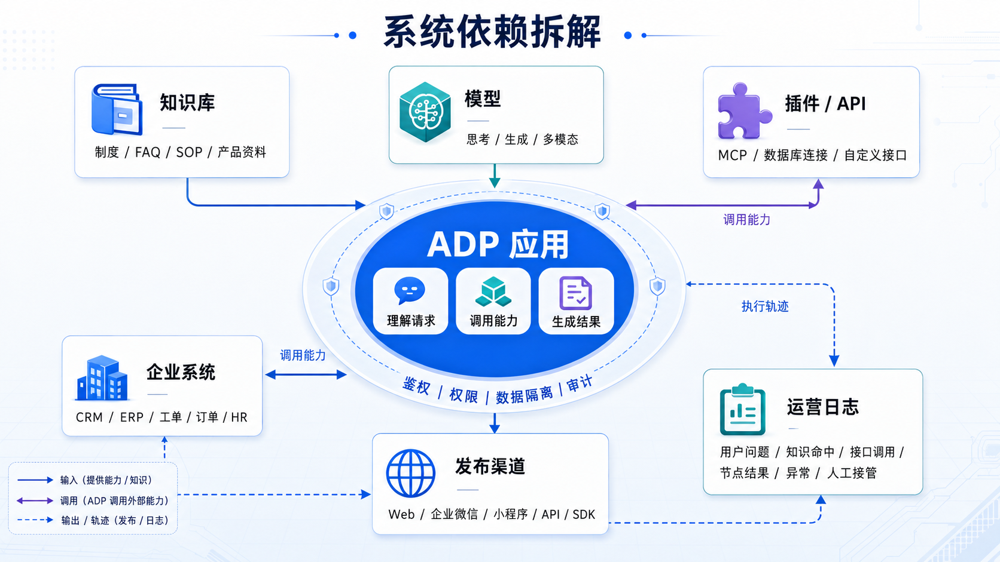

# 3.1 方案设计方法

> 章节：使用 ADP 开发智能体 ｜ 来源：[腾讯云 ADP-FDE 认证课程](https://cloud.tencent.com/edu/learning/course-4742-84529-84539) ｜ 整理日期：2026-09-26

## 3.1方案设计方法

**做智能体方案时，第一步不是打开平台建应用，而是先判断：这个业务问题能不能被 AI 稳定处理，应该用哪一种 ADP 模式承载，落地后用什么结果证明它真的有效。**

学完这一节，你应能从一段客户需求中提炼业务目标、用户角色、资料与系统依赖、限制条件和验收指标；能够用标准模式、单工作流模式、Multi-Agent 模式、Claw
 模式和智能工作台的差异判断场景适配度；能够把一个模糊需求拆成可进入 ADP 搭建的方案画布。

<figcaption>方案设计方法</figcaption>

## **3.1.1 先把需求说清楚：从客户描述到方案判断**

客户往往不会直接说“我要一个标准模式应用”或者“我要一个单工作流”。他们通常会用业务语言描述问题，比如：

“我们客服每天要处理很多重复咨询，员工经常找不到制度文件，领导还希望能看到一线问题统计。能不能用 AI 做一个助手，把这些事情都解决？”

这句话里同时包含了多个问题：**重复咨询、知识检索、问题统计、管理看板。** 方案设计时要先把它拆开，再判断哪些适合第一期做，哪些需要后续迭代。

## **（1）****把客户需求翻译成 7 个维度**

> [图片未下载] 需求识别点击维度，展开方案问题清单 — 

### 背景与现状

- 当前业务如何完成？主要痛点是什么？

- 哪些环节最耗时、最容易出错？

- 为什么现在需要引入智能体？

### 业务目标

- 希望改善效率、质量、成本还是体验？

- 目标能否用具体指标衡量？

- 什么结果可以认定项目成功？

### 使用对象

- 谁是直接使用者，谁是结果接收者？

- 用户具备怎样的专业背景？

- 使用频率、入口和典型场景是什么？

### 任务边界

- 智能体必须完成哪些任务？

- 哪些判断必须保留人工确认？

- 哪些情况需要拒答或转人工？

### 资料与知识

- 回答依赖哪些文档、数据和知识库？

- 资料由谁维护，更新频率如何？

- 是否涉及权限、时效和保密要求？

### 系统与工具

- 需要连接哪些系统、接口或工具？

- 是否具备可用的 API 与鉴权方式？

- 执行动作如何记录、审计和回滚？

### 限制与验收

- 响应速度、准确率和成本上限是什么？

- 有哪些合规、安全和终端限制？

- 验收数据集、流程和负责人是谁？

## **（2）****第一期先做“能闭环、可验收”的部分**

很多客户需求会从一个点扩散成一整套平台：既要问答、又要工单、又要数据分析、又要管理决策。第一期方案不追求一次性覆盖所有愿望，而是选出最容易闭环、最容易验证价值的切口。

- 能找到稳定资料的，优先做知识类能力，例如制度、产品、售后政策、操作手册。

- 流程已经固定的，优先做流程自动化，例如信息收集、条件判断、工单生成、结果通知。

- 需要多角色协同的，先确认每个角色的职责是否清楚，例如资料检索、数据分析、风险复核、结论生成。

- 需要读写文件、跑代码、临时分析的，先用 Claw 或智能工作台验证，再判断是否沉淀成固定应用。

## **3.1.2 用 ADP 模式理解场景适配度**

标准模式、单工作流模式、Multi-Agent模式、Claw模式这四种智能体应用构建模式，解决的是“我要构建一个什么样的智能体应用”的问题。构建完成后，这个应用可以发布给目标用户使用，也可以通过接口被其他系统调用，所以更偏向应用构建和交付。一个应用搭好以后，往往可以服务多个用户。

而智能工作台解决的是“我自己怎么直接使用 Agent 来完成工作”的问题，是开箱即用的。它更像一个面向个人的 AI 工作空间，用户可以在里面直接处理文件、调用工具、使用已有应用或能力来完成任务，也可以辅助进行上述四种智能体构建模式的应用构建与分发。因此它更偏向个人办公协助和应用构建者的工作环境，而不是独立于上述四种模式的新的应用开发模式。

所以如果从“给谁用”这个角度来看：

- **四种应用模式**：主要是“搭一个应用，再给别人用”，强调可复用、可发布、可被多人或系统调用。

- **智能工作台**：主要是“我自己进入一个工作空间，让 AI 帮我完成当前工作”，强调个人使用和任务协作。不局限于技术人员，非技术人员也可以使用智能工作台进行日常的个人办公协助。

**做什么：**搭建稳定的单个智能体应用，适合围绕企业文档、产品资料、政策制度、FAQ 等内容做严肃问答，也可以按需补充工作流能力。

**怎么用：**配置知识库、**Prompt**、模型和会话体验，让用户以问答方式获得稳定、可溯源的答案。

**适合场景：**员工制度助手、产品 FAQ 助手、售后知识助手、金融/医药/法务知识咨询。

**参考案例：**得物内部 IT/HR 知识问答、一汽丰田售后知识助手、东吴人寿保险知识问答。

**做什么：**承载明确、固定、重复执行的业务流程。每次用户请求都进入同一条流程，强调完整性、标准化和可控性。

**怎么用：**把“参数提取 → 条件判断 → 知识检索/接口调用 → 结果生成 → 异常兜底”编排成一条流水线。

**适合场景：**工单流转、证明开具、售后处理、审批辅助、定时报告、固定格式信息处理。

**参考案例：**航班延误证明申请、酒店客需送物工单、投诉分流处理、网页内容总结助手。

**做什么：**处理一个智能体难以独立完成、需要多个角色协作的复杂任务。重点不是固定流程，而是让不同 **Agent** 分工协同。

**怎么用：**为不同环节配置 **Agent**，例如需求理解、资料检索、数据分析、风险复核、结论撰写，由主 **Agent** 统筹。

**适合场景：**复杂研究、综合分析、专业报告、跨资料推理、需要复核的高风险内容生成。

**参考案例：**保险方案生成、复杂法律/海商法深问、经营分析报告、投研资料整理与复核。

**做什么：**处理开放性、探索性、长耗时或需要读写文件/运行代码/调用 Skills 的任务，更像一个可以动手处理文件和工具的数字同事。

**怎么用：**给它目标、文件和工具范围，让它自主规划、调用 Skills、读写文件、生成交付物。

**适合场景：**Excel 数据分析、报告生成、批量文件处理、内容生产、自动化办公、临时研究任务。

**参考案例：**数据分析助手、销售数据清洗与图表生成、批量文档整理、会议纪要与报告产出。

**做什么：**它不是与前四种完全同级的应用模式，更适合作为自然语言创建应用、辅助搭建和临时任务处理入口。

**怎么用：**用自然语言描述需求，让平台辅助生成应用初稿、调整配置、补充提示词或完成一次性任务。

**适合场景：**非技术用户低门槛创建应用、快速把想法变成初稿、临时处理文档或数据。

**参考案例：**“帮我创建一个销售数据分析助手”“帮我把这个客服需求变成应用初稿”。

<figcaption>方案设计方法</figcaption>

## **（1）****模式选择看四个信号**

不需要把模式选择做成复杂评分。实际项目中，只要抓住几个信号，就能快速判断初始方向。

## **（2）****同一个客户需求可以分阶段落地**

很多真实项目不是只选一种模式，而是分阶段组合。例如酒店智能服务助手，第一期可以用标准模式处理酒店信息和服务设施问答；当“客需送物、修改订单、维修报修”流程固定后，再用工作流把参数收集、工单生成和结果通知串起来；如果后续要做经营分析、用户声音总结和服务优化方案，可以再引入
 Multi-Agent 或 Claw 处理分析任务。

<figcaption>方案设计方法</figcaption>

## **3.1.3 方案设计画布：把需求变成可搭建方案**

完成场景适配判断后，需要把方案写成一页能评审、能搭建、能验收的画布。画布不追求长，而是把关键决策说清楚。

## **示例：把“售后客服助手”写成方案画布**

## **3.1.4 场景拆解方法：从方案到 ADP 搭建路径**

方案画布解决“要做什么”，场景拆解解决“怎么搭”。进入 ADP 之前，把场景拆成四层：业务流程、输入输出、知识依赖、系统依赖。

## **（1）****业务流程拆解**

把客户的业务动作按顺序写出来，区分哪些由用户完成，哪些由智能体完成，哪些仍然需要人工处理。流程越固定，越适合工作流；流程越开放，越需要 Agent 或 Claw。

## **（2）****输入输出拆解**

输入输出决定节点怎么设计，也决定最终能不能被业务系统接收。自然语言回答只适合人看；JSON、表格和字段更适合系统流转。

- 输入：用户问题、文件、图片、表格、链接、账号信息、业务编号、日期、地区、产品型号等。

- 中间变量：意图类别、关键字段、检索结果、接口返回值、判断结果、置信度、异常原因。

- 输出：自然语言答案、引用来源、结构化字段、JSON、Markdown 表格、报告文件、工单编号、下一步操作。

<figcaption>方案设计方法</figcaption>

## **（3）****知识依赖拆解**

知识质量会直接影响智能体效果。进入平台前，先判断资料是否完整、是否结构清楚、是否可更新、是否需要分权限。

## **（4）****系统依赖拆解**

如果智能体只回答问题，系统依赖较少；如果智能体要“办事”，就需要提前确认接口、权限、字段和安全边界。

- 要查什么系统：CRM、ERP、工单系统、订单系统、HR 系统、知识库、数据库。

- 要调用什么能力：插件、MCP、API、数据库连接、企业微信、小程序、Skills。

- 要遵守什么权限：不同角色能看哪些知识、能调用哪些接口、能不能下载文件、能不能触发工单。

- 要保留什么日志：用户问题、命中文档、接口调用、工作流节点结果、异常原因、人工接管记录。

<figcaption>方案设计方法</figcaption>

## 行业方案判断速查：目标、能力、指标与边界

行业案例不需要逐个背产品功能。判断时始终沿着“业务目标—输入资料—能力组合—验收指标—风险边界”五个问题展开。下面的矩阵把常见场景压缩成可复用的方案判断。

### 任何行业都要确认的六项

### 数据、责任 AI 与高风险操作边界

**数据进入 ADP
 前：**先确认数据分类分级、使用授权和部署环境，再按需要脱敏；确定哪些字段可以入库、哪些人可以访问、保存多久。员工薪资、客户身份、医疗和金融信息等敏感数据不能因为“用于知识问答”就直接全量导入。

**责任 AI：**法律、医疗、金融、绩效处分等高风险输出只能作为辅助信息，必须保留授权专业人员或管理人员审核。免责声明不能替代可靠依据、权限控制、人工确认和申诉渠道。

**操作分级：**知识检索和只读查询可在权限范围内自动执行；创建工单等可逆动作要校验入参并留痕；删除、付款、改价、赔付、改配置等高影响动作必须增加审批或二次确认，并准备回滚/补救和人工接管。

## **3.1.5 练习：把一个客户需求拆成 ADP 方案**

阅读下面的客户需求，完成后面的方案拆解。

某连锁零售企业反馈：门店员工每天会在企业微信里咨询商品知识、促销政策、退换货规则和会员权益。总部希望减少人工答疑，同时把高频问题沉淀下来，后续还能根据一线问题改进培训材料。部分问题需要查门店所在区域的活动政策，部分投诉类问题需要生成工单转给售后团队。

> [图片未下载] 方案练习填写你的方案判断，再查看参考拆解 — 

### 参考拆解

**目标：**缩短查询时间并提升回答一致性，以命中率、采纳率和转人工率衡量。

**对象：**一线业务人员，通过企业内部入口高频使用。

**边界：**仅基于授权知识回答；信息缺失或高风险决策转人工。

**能力：**接入知识库与必要工具，记录引用来源、执行结果和异常。

## **3.1****.6****小结**

ADP 方案设计的核心，是把“客户想要 AI”翻译成“平台可以稳定承载的业务能力”。本节可以用三句话收束：

- 先识别业务问题：看清背景、目标、用户、资料、流程、系统、边界和验收指标。

- 再选择承载模式：稳定问答优先标准模式，固定流程优先单工作流，复杂协作考虑 Multi-Agent，开放探索和文件处理考虑 Claw，低门槛创建从智能工作台开始。

- 最后拆成搭建路径：把业务流程、输入输出、知识依赖和系统依赖拆清楚，后续才能进入具体应用搭建。

下一节 3.2「智能体实际应用示例」会把这些方案判断方法放到真实业务场景里，继续看知识助手、客服助手、内容创作助手、数据分析助手等分别如何落地。
