# 3.3 单工作流模式实战：客服助手

> 章节：使用 ADP 开发智能体 ｜ 来源：[腾讯云 ADP-FDE 认证课程](https://cloud.tencent.com/edu/learning/course-4742-84529-84541) ｜ 整理日期：2026-09-26

## 3.3单工作流模式实战：客服助手

## **你将搭建什么？**

这一节你将跟着页面一步一步搭建一个名为“电商售后客服处理助手”的单工作流应用。用户输入一段售后诉求后，应用会先抽取订单、商品、诉求和情绪等关键信息，再判断问题属于物流、支付退款、退换货售后，还是需要转人工的其他问题；随后，它会基于售后政策知识库生成处理策略，并输出一段可直接回复客户的话术。

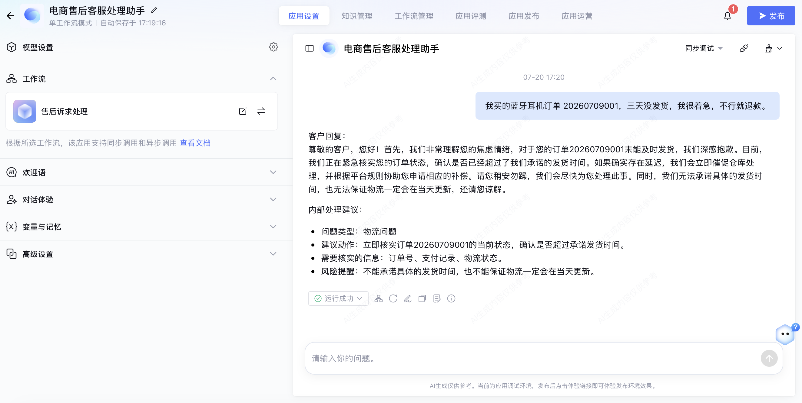

<figcaption>客服助手实战</figcaption>

## **本节最终产物**

完成本节后，你会得到一个可以发布的单工作流智能体应用。它不是开放式聊天机器人，而是一个有固定处理流程的业务助手。

- 能从用户输入中抽取订单号、商品、问题描述、客户诉求和情绪等级；

- 能用意图识别节点把问题路由到不同处理分支；

- 能从知识库中检索售后政策和标准话术；

- 能用变量聚合把不同分支的结果汇总到统一回复链路；

- 能用回复节点把最终结果展示给用户，并完成调试与发布。

开始节点 → 参数提取 → 意图识别 → 物流/支付退款/退换货/其他四个分支 → 知识库检索与分支处理策略生成 → 变量聚合 → 最终客服回复生成 → 回复节点 → 结束节点

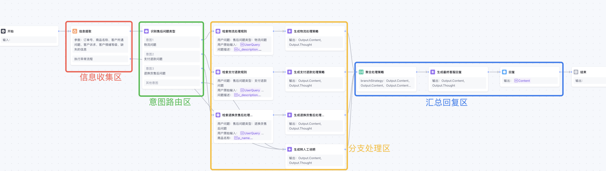

<figcaption>客服助手实战</figcaption>

## **Step 1：创建单工作流模式应用**

先创建一个空的单工作流应用。单工作流模式适合处理“输入明确、流程固定、步骤可拆解”的任务，例如客服分流、工单辅助处理、表单抽取、报告生成、审批前检查、投诉分类等。

进入 ADP 控制台，点击左侧菜单中的“应用开发”，点击“新建应用”，在应用模式中选择“单工作流模式”。填写应用名称和应用简介。应用头像可以先不填，后续再补充。点击“新建”，进入应用配置页面。

## 应用基础信息

应用名称：电商售后客服处理助手

应用简介：面向电商售后场景的客服辅助应用。用户输入客户售后诉求后，应用会自动抽取关键信息、识别问题类型、检索售后政策，并生成可直接回复客户的标准话术和内部处理建议。

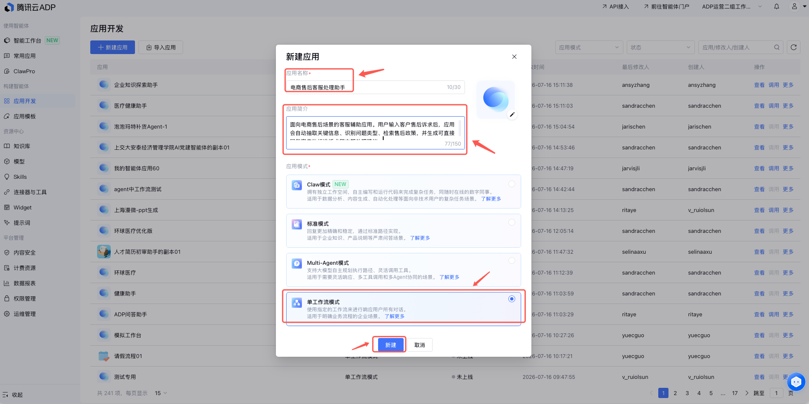

<figcaption>客服助手实战</figcaption>

你应该已经进入单工作流应用页面，并能看到工作流相关配置入口。此时应用还不能处理售后问题，后续需要创建主工作流。

## **Step 2：准备售后政策知识库**

这个应用需要基于标准售后政策生成回复，因此先准备一份可检索的知识资料。本节已经提供简化版售后政策 Word 素材，可直接下载；下方仍保留完整正文用于核对。

- 电商售后政策与客服话术库.docx(https://academy-pub-1255893580.cos.ap-guangzhou.myqcloud.com/html-course/static/cn/adp-agent/20260903-205605/downloads/%E7%94%B5%E5%95%86%E5%94%AE%E5%90%8E%E6%94%BF%E7%AD%96%E4%B8%8E%E5%AE%A2%E6%9C%8D%E8%AF%9D%E6%9C%AF%E5%BA%93.docx)

## 知识库素材｜电商售后政策与客服话术库.docx

标题：电商售后政策与客服话术库

一、物流问题处理规则

方案编号：LOG-001｜未发货咨询

适用场景：客户反馈下单后长时间未发货、催促发货、询问预计发货时间。

处理原则：先安抚客户情绪，再说明会核实仓库状态；如果超过承诺发货时效，应主动说明可以催发或协助申请补偿，具体以店铺规则为准。

标准话术：非常抱歉让您久等了，我会先帮您核实订单的发货状态。如果订单确实超过承诺发货时间，我们会尽快为您催促仓库处理，并根据平台规则协助您申请对应补偿。

方案编号：LOG-002｜物流停滞

适用场景：客户反馈快递多天没有更新、物流卡住、运输异常。

处理原则：先承认客户等待成本，再说明会联系物流核查；不要承诺具体送达时间，除非系统已有明确结果。

标准话术：抱歉给您带来不便。当前物流状态需要进一步核实，我会协助联系物流方确认包裹位置和预计处理进度。若物流确认异常，我们会根据平台规则为您提供补发、退款或其他售后方案。

方案编号：LOG-003｜签收异常

适用场景：客户反馈未收到货但物流显示已签收，或签收人与本人不一致。

处理原则：提醒客户先检查代收点、门卫、快递柜；同时协助发起物流核查。

标准话术：我理解您现在比较着急。建议您先确认门卫、快递柜、驿站或家人是否代收。我也会同步协助发起物流签收核查，确认包裹实际签收情况。

二、支付与退款问题处理规则

方案编号：PAY-001｜退款未到账

适用场景：客户反馈退款已经申请但未到账。

处理原则：说明退款通常存在银行或支付渠道处理时间；引导客户查看支付方式和退款状态；不要承诺立即到账。

标准话术：退款到账时间会受到支付渠道和银行处理时间影响。您可以先查看订单退款状态和原支付账户。如果退款状态显示已完成但仍未到账，我们可以继续协助您核实支付渠道处理情况。

方案编号：PAY-002｜重复支付

适用场景：客户反馈同一订单重复扣款或重复付款。

处理原则：先安抚客户，再引导提供支付截图和扣款记录；核实后协助退款。

标准话术：非常抱歉给您造成困扰。请您提供重复扣款记录或支付截图，我们会协助核实是否存在重复支付。如果确认重复扣款，会按平台规则协助您处理退款。

三、退换货与售后问题处理规则

方案编号：RET-001｜七天无理由退货

适用场景：客户表示不喜欢、不合适、想退货。

处理原则：确认商品是否支持七天无理由、是否影响二次销售、是否在退货时效内。

标准话术：如果商品支持七天无理由且不影响二次销售，您可以在订单页面提交退货申请。请保持商品、配件、包装和赠品完整，具体是否通过以平台审核结果为准。

方案编号：RET-002｜商品质量问题

适用场景：客户反馈破损、瑕疵、无法使用、功能异常。

处理原则：先表达歉意，再引导客户提供照片、视频或问题描述；根据核实结果提供退货、换货、补发或维修方案。

标准话术：很抱歉给您带来不好的体验。请您提供商品问题的照片或视频，我们会尽快核实。如果确认属于质量问题，会根据平台规则为您提供退货、换货、补发或维修等方案。

方案编号：RET-003｜少件漏发

适用场景：客户反馈包裹中缺少配件、赠品或部分商品。

处理原则：引导客户提供开箱照片、包裹面单、商品清单；核实后补发或退款。

标准话术：抱歉给您带来不便。请您提供包裹面单、收到的商品照片和缺少的具体内容，我们会尽快核实仓库发货记录。若确认少发，会按规则为您补发或处理对应退款。

四、转人工规则

方案编号：HUM-001｜需要人工介入

适用场景：客户情绪激烈、要求投诉升级、涉及赔偿金额争议、涉及隐私信息、订单状态需要实时系统查询、问题无法判断。

处理原则：不要继续猜测，不要编造订单状态；应转人工或引导客户提供必要信息。

标准话术：为了更准确地处理您的问题，我会为您转接人工客服进一步核实。请您准备好订单号、商品名称和相关截图，人工客服会继续协助处理。

进入应用的“知识管理”页面，选择“默认知识库”。默认知识库只服务于当前应用，适合放本应用专用资料。点击“导入/上传文档”，上传刚才创建的“电商售后政策与客服话术库.docx”。选择默认文档解析和切分方式。如果你把素材整理成
 JSON，可以按“},”作为切分符；**本节使用****Word****文档，默认切分即可。**

等待解析完成后，打开切分结果，确认“LOG-001”“PAY-001”“RET-001”等方案编号能被正确识别。

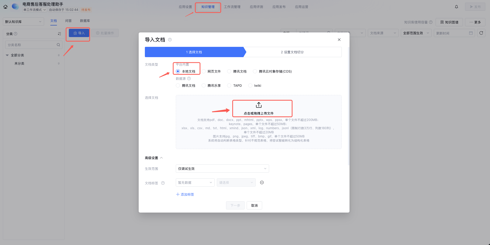

<figcaption>客服助手实战</figcaption>

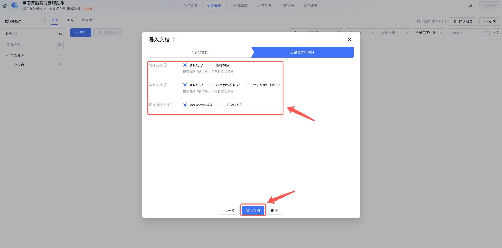

<figcaption>客服助手实战</figcaption>

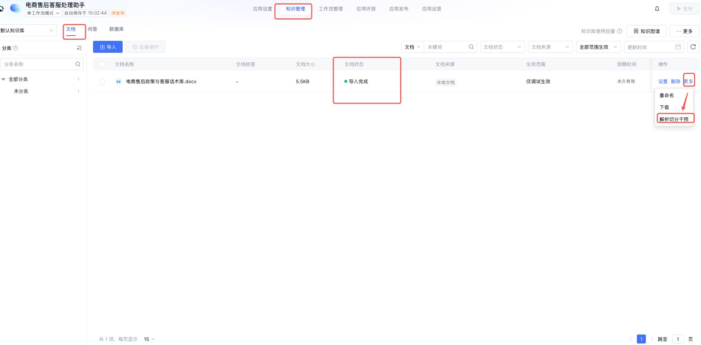

<figcaption>客服助手实战</figcaption>

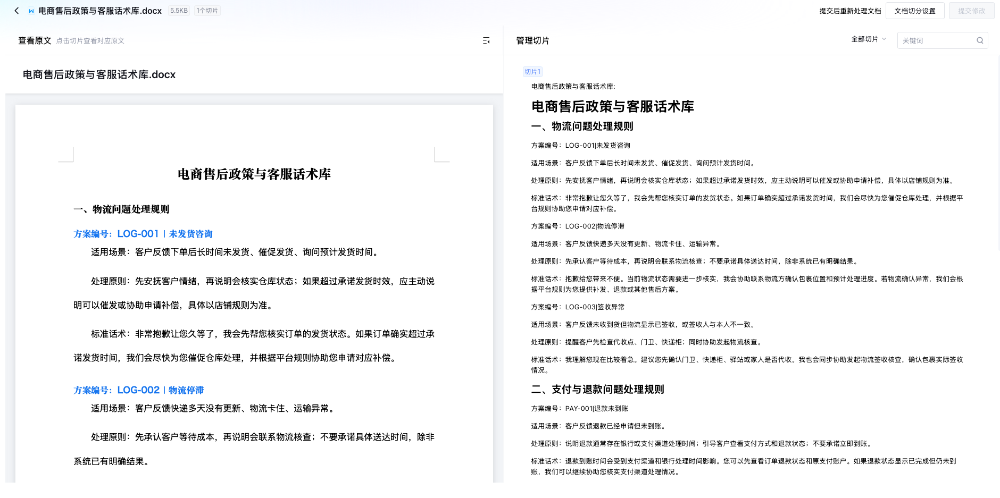

<figcaption>客服助手实战</figcaption>

知识库中应至少有 1 份售后政策文档，状态为解析成功。点开切分预览后，应该能看到被成功识别的方案编号、适用场景、处理原则和标准话术。

## **Step 3：新建主工作流**

接下来创建本节的主工作流。单工作流模式的“单”，**不是指只能创建一个工作流，而是指应用最终会指定一个主工作流，由这个主工作流承接用户请求并完成完整处理流程。**

进入“工作流管理”，点击“新建”，工作流名称填写“售后诉求处理”，工作流描述填写下面内容。点击“确定”，进入工作流画布。

## 工作流基础信息

工作流名称：售后诉求处理

工作流描述：接收用户输入的电商售后诉求，抽取订单、��品、问题描述、客户诉求��情绪等级，识别问题属于物流、支付退款、退换货售后或其他转人工场景；根据售后政策知识库生成处理策略，并输出可直接回复客户的话术和内部处理建议。

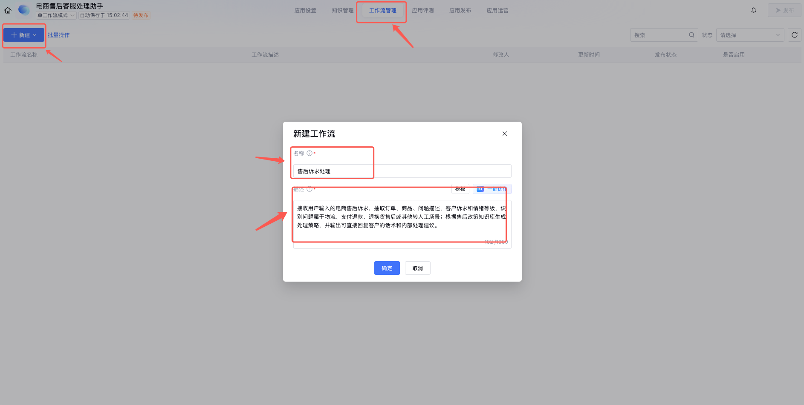

<figcaption>客服助手实战</figcaption>

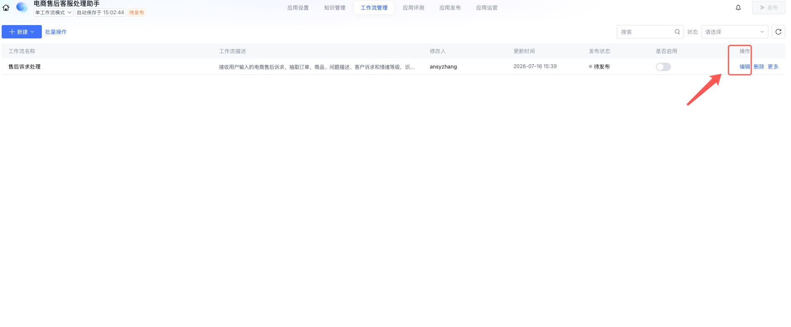

<figcaption>客服助手实战</figcaption>

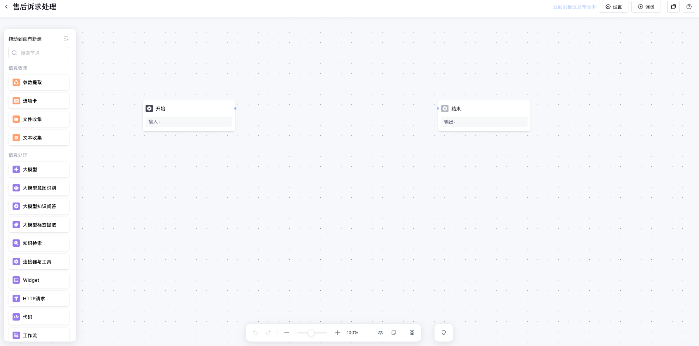

<figcaption>客服助手实战</figcaption>

进入画布后，你应该看到“开始”和“结束”两个节点。后续所有节点都需要连接到主链路中，不能出现孤立节点。

## **Step 4：理解开始节点和系统变量**

在单工作流应用中，用户在对话窗口输入的内容会作为系统变量进入工作流。最常用的是 SYS.UserQuery 和 SYS.ChatHistory。前者代表用户本轮输入，后者代表对话历史。

本节不额外增加工作流启动变量，直接使用用户输入作为处理对象，你只需要在对话框输入一段客户诉求即可完成调试。

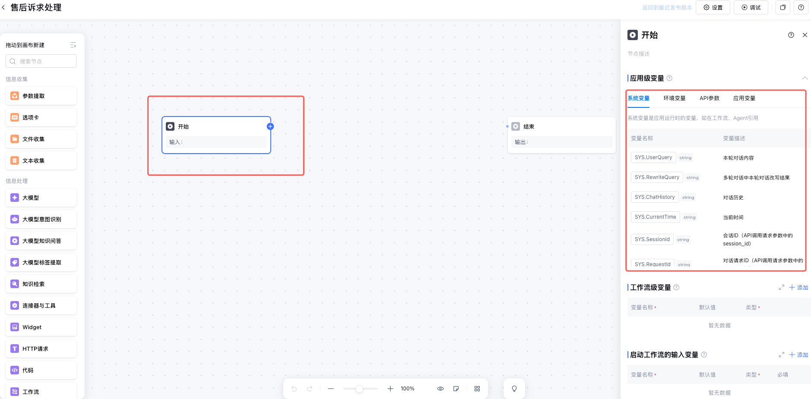

<figcaption>客服助手实战</figcaption>

## **Step 5：添加参数提取节点，先把用户输入结构化**

用户输入通常是一大段自然语言。工作流要稳定运行，第一步是把这段话转成结构化字段。这里使用“参数提取”节点，抽取订单号、商品名称、问题描述、客户诉求和情绪等级。

在开始节点后点击“+”，选择“参数提取”节点。节点名称改为“信息提取”，添加下面 6
 个参数。如果某些字段不是必填，可以关闭“必填”。**本节建议“问题描述”和“客户诉求”设为必填，其他字段设为非必填。**展开“填写提示词”区域，粘贴下面的参数提取提示词。

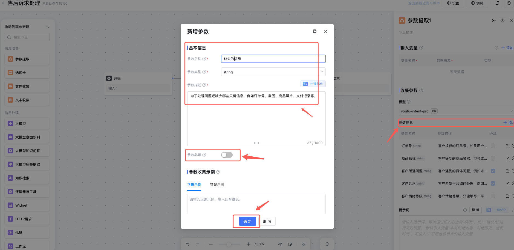

<figcaption>客服助手实战</figcaption>

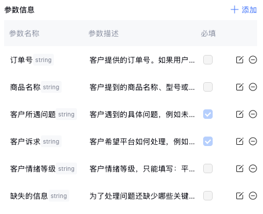

<figcaption>客服助手实战</figcaption>

## 参数提取提示词

你需要从【本轮对话内容】和【对话历史】中提取电商售后处理需要的信息。

提取规则：

1. 只提取用户明确提供的信息，不要编造订单号、商品名称或处理结果。

2. 如果用户没有提供订单号、商品名称等信息，对应字段留空。

3. 【用户所遇问题】要保留用户遇到的问题，不要过度概括到看不懂。

4. 【用户诉求】要提取用户希望平台做什么，例如退款、换货、补发、催发、查物流、投诉升级。

5. 【客户情绪等级】只能从“平静、着急、愤怒、无法判断”中选择。

6. 【缺失的信息】用来记录后续处理还需要用户补充的信息。

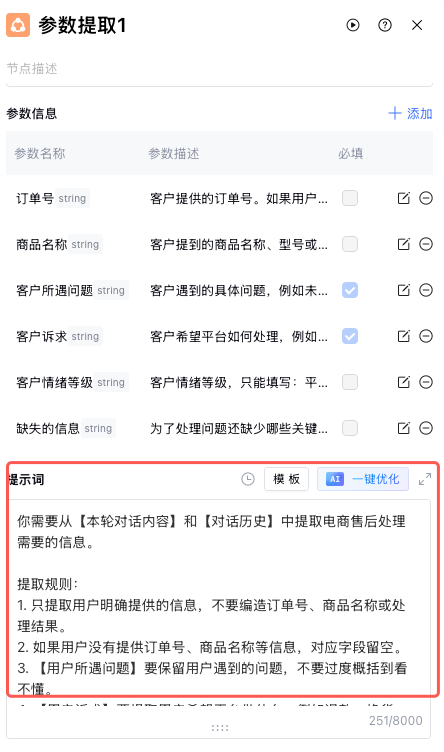

<figcaption>客服助手实战</figcaption>

## 参数提取测试输入

我买的蓝牙耳机订单 20260709001，到现在三天还没发货，客服也没人回。我现在很着急，能不能赶紧发货，不行就退款。

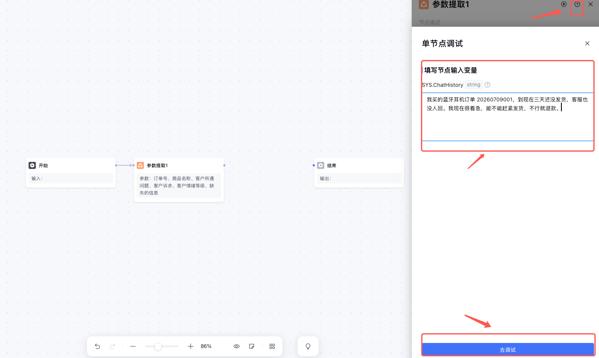

<figcaption>客服助手实战</figcaption>

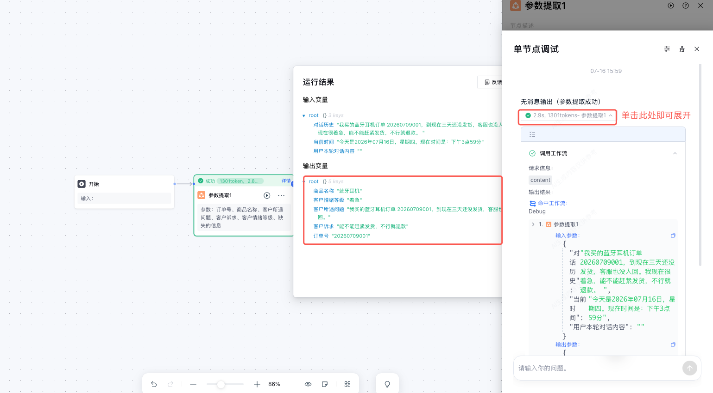

<figcaption>客服助手实战</figcaption>

单节点调试的结果中，【订单号】为 20260709001，【商品名称】为蓝牙耳机，【客户所遇问题】应包含“三天没发货”，【客户诉求】应包含“催发/退款”，【客户情绪等级】应为“着急”。

## **Step 6：添加意图识别节点，把问题路由到处理分支**

参数提取解决的是“用户说了什么”，意图识别解决的是“这类问题应该走哪条处理路径”。本节设置 4 个意图：物流问题、支付退款问题、退换货售后问题、其他需人工处理。

在“信息提取”节点后点击“+”，选择“意图识别”节点，节点名称改为“识别售后问题类型”。输入变量选择
 【系统变量】SYS.UserQuery、SYS.ChatHistory，以及参数提取节点输出的【客户所遇问题】、【客户诉求】。添加下面 4 个意图，每个意图都填写名称、描述和示例。保存节点。

## 意图识别提示词

请根据用户本轮输入、对话历史和已提取字段判断售后问题类型。

判断优先级：

1. 如果明确涉及发货、物流、签收、快递，选择“物流问题”。

2. 如果明确涉及付款、扣款、退款到账、支付渠道，选择“支付退款问题”。

3. 如果明确涉及商品质量、破损、退货、换货、补发、少件，选择“退换货售后问题”。

4. 如果用户要求投诉升级、要求高额赔偿、问题无法判断，或需要实时查询订单系统，选择“其他需人工处理”。

5. 如果同时出现多个问题，选择当前用户最主要、最紧急的诉求。

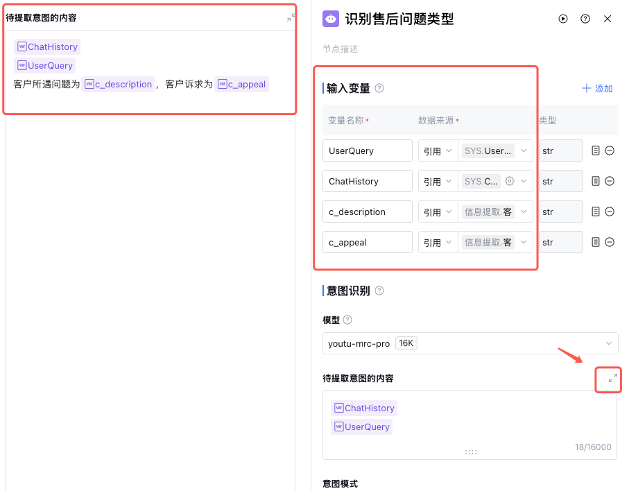

<figcaption>客服助手实战</figcaption>

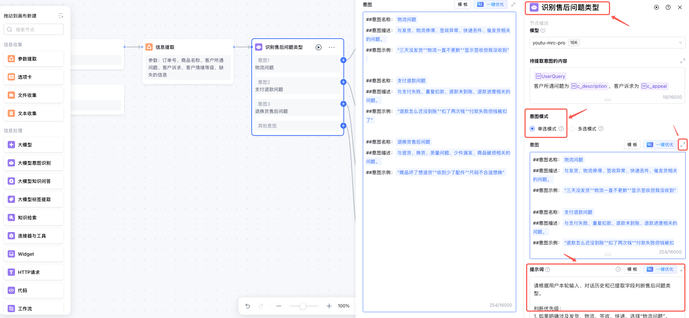

<figcaption>客服助手实战</figcaption>

用“三天没发货”测试时应进入物流分支；用“退款未到账”测试时应进入支付退款分支；用“商品破损想换货”测试时应进入退换货分支；用“我要投诉并要求赔偿”测试时应进入其他需人工处理分支。

## **Step 7：搭建物流问题分支**

先搭建第一条分支：物流问题。这个分支需要从知识库中检索物流相关规则，再生成处理策略。

在“物流问题”分支后添加“大模型知识问答”节点。

节点名称改为“检索物流处理规则”。

检索范围选择“按知识库”，选择默认知识库中的“电商售后政策与客服话术库”。

检索问题中插入参数提取节点的 【客户所遇问题】、【客户诉求】，以及用户输入 SYS.UserQuery。

在大模型知识问答节点后添加“大模型”节点，节点名称改为“生成物流处理策略”。

将大模型知识问答节点的【Answer】、参数提取结果和用户原始输入作为大模型节点输入。

粘贴下面的用户问题。

## 大模型知识问答｜物流分支

售后问题类型：物流问题

用户原始输入：{{SYS.UserQuery}}

问题描述：{{c_description}}

客户诉求：{{c_appeal}}

请检索与发货、物流停滞、签收异常、快递异常相关的处理规则和标准话术。

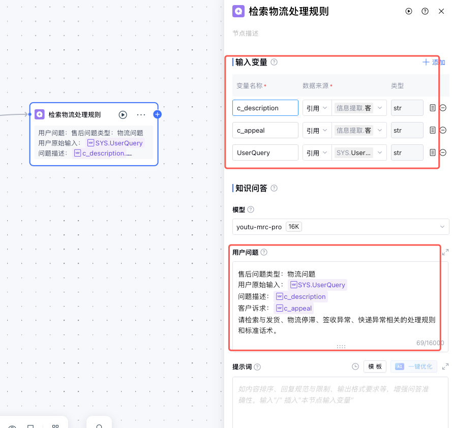

<figcaption>客服助手实战</figcaption>

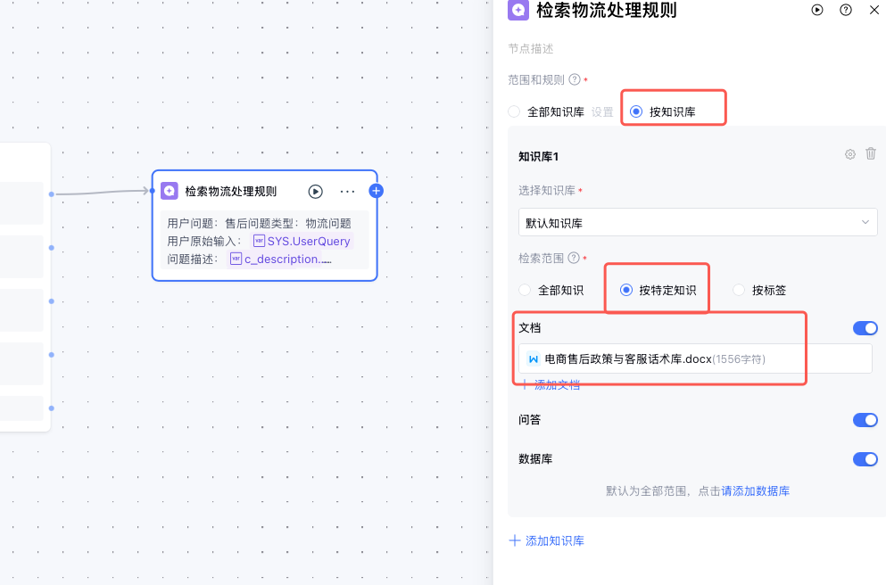

<figcaption>客服助手实战</figcaption>

## 大模型节点系统提示词与用户提示词｜生成物流处理策略

1.系统提示词

# 角色

你是电商售后物流处理专家，负责根据售后政策知识库，为客服生成物流问题的处理策略。

# 任务

请基于知识库检索结果{{Answer}}，生成物流问题处理策略。

2.用户提示词

# 输入信息

用户原始输入：{{UserQuery}}

客户所遇问题：{{c_description}}

客户诉求：{{c_appeal}}

知识库检索结果：{{Answer}}

请基于以上信息，按照要求生成物流问题处理策略。

# 输出要求

请严格按以下格式输出：

处理类型：物流问题

命中的规则：写出最相关的方案编号，例如 LOG-001、LOG-002 或 LOG-003；如果没有命中，写“未明确命中”。

客户情绪判断：平静/着急/愤怒/无法判断

处理策略：用 2-3 条说明客服应该如何处理。

客户回复要点：用 2-3 条说明回复客户时必须包含哪些内容。

需要补充的信息：列出还需要客户提供的信息；如果不需要，写“暂无”。

风险提醒：说明不能承诺的内容，例如不能编造具体发货时间、不能承诺物流一定当天更新。

# 约束

1. 只能基于知识库和用户输入生成策略，不要编造实时物流状态。

2. 如果需要实时订单或物流状态，说明需要接入订单/物流系统或转人工核实。

输出要适合后续客服回复节点继续使用。

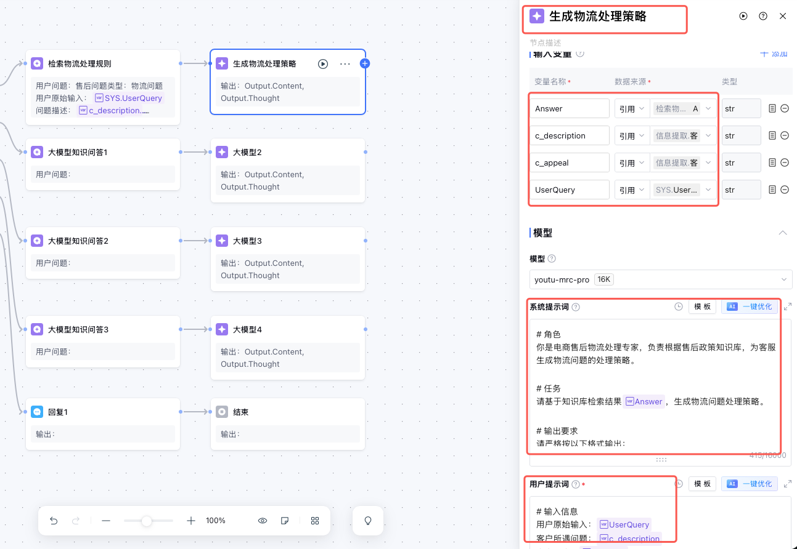

<figcaption>客服助手实战</figcaption>

## **Step 8：搭建支付退款问题分支**

第二条分支处理支付和退款问题。它的关键是避免承诺“马上到账”，而是说明支付渠道和银行处理时间，并引导用户提供支付记录。（具体操作步骤类似Step7）

在“支付退款问题”分支后添加“大模型知识问答”节点，命名为“检索支付退款规则”。

检索范围同样选择默认知识库中的“电商售后政策与客服话术库”。

检索问题中插入用户输入、issue_description 和 customer_appeal。

添加“大模型”节点，命名为“生成支付退款处理策略”。

粘贴下面的提示词。

## 大模型知识问答 用户问题｜支付退款分支

售后问题类型：支付退款问题

用户原始输入：{{UserQuery}}

问题描述：{{c_description}}

客户诉求：{{c_appeal}}

请检索与退款未到账、重复支付、支付失败、支付渠道处理时间相关的规则和标准话术。

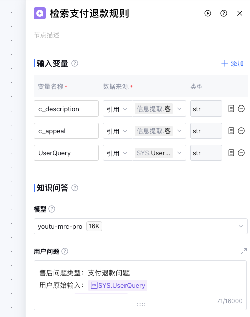

<figcaption>客服助手实战</figcaption>

## 大模型节点提示词｜生成支付退款处理策略

1.系统提示词

# 角色

你是电商售后支付退款处理专家，负责根据售后政策知识库，为客服生成支付和退款问题的处理策略。

# 任务

请基于知识库检索结果{{Answer}}，生成支付退款问题处理策略。

2.用户提示词

# 输入信息

用户原始输入：{{UserQuery}}

客户所遇问题：{{c_description}}

客户诉求：{{c_appeal}}

知识库检索结果：{{Answer}}

请基于以上信息，按照要求生成支付退款问题处理策略。

# 输出要求

请严格按以下格式输出：

处理类型：支付退款问题

命中的规则：写出最相关的方案编号，例如 PAY-001 或 PAY-002；如果没有命中，写“未明确命中”。

客户情绪判断：平静/着急/愤怒/无法判断

处理策略：用 2-3 条说明客服应该如何处理。

客户回复要点：用 2-3 条说明回复客户时必须包含哪些内容。

需要补充的信息：列出还需要客户提供的信息，例如支付截图、扣款记录、退款状态截图；如果不需要，写“暂无”。

风险提醒：说明不能承诺的内容，例如不能承诺立即到账，不能编造支付渠道处理结果。

# 约束

1. 不要编造退款状态、到账时间或银行处理结果。

2. 如果需要核实具体订单或支付流水，说明需要接入支付系统或转人工处理。

语气要先安抚，再给出下一步。

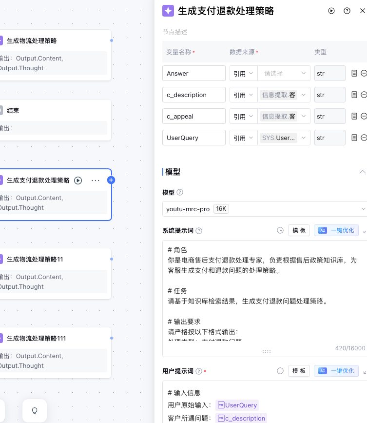

<figcaption>客服助手实战</figcaption>

## **Step 9：搭建退换货售后问题分支**

第三条分支处理商品质量、退货、换货、少件漏发等问题。它的重点是引导客户补充照片、视频、包裹面单等证据，并避免直接承诺审核结果。

在“退换货售后问题”分支后添加“大模型知识问答”节点，命名为“检索退换货售后规则”。

检索范围选择默认知识库中的售后政策文档。

添加“大模型”节点，命名为“生成退换货处理策略”。

粘贴下面的提示词。

## 大模型知识问答 Query｜退换货售后分支

售后问题类型：退换货售后问题

用户原始输入：{{UserQuery}}

商品名称：{{p_name}}

问题描述：{{c_description}}

客户诉求：{{c_appeal}}

请检索与七天无理由退货、商品质量问题、少件漏发、换货、补发相关的规则和标准话术。

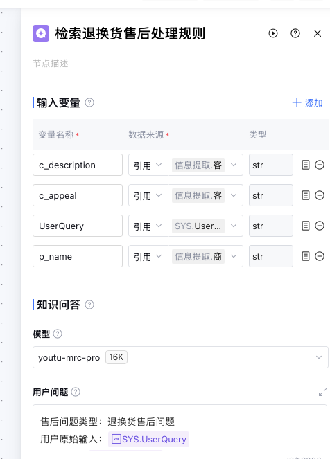

<figcaption>客服助手实战</figcaption>

## 大模型节点提示词｜生成退换货处理策略

1.系统提示词

# 角色

你是电商退换货售后处理专家，负责根据售后政策知识库，为客服生成退换货和商品问题处理策略。

# 任务

请基于知识库检索结果{{Answer}}，生成退换货售后处理策略。

2.用户提示词

# 输入信息

用户原始输入：{{UserQuery}}

客户所遇问题：{{c_description}}

客户诉求：{{c_appeal}}

知识库检索结果：{{Answer}}

商品名称：{{p_name}}

请基于以上信息，按照要求生成退换货售后退款问题处理策略。

# 输出要求

请严格按以下格式输出：

处理类型：退换货售后问题

命中的规则：写出最相关的方案编号，例如 RET-001、RET-002 或 RET-003；如果没有命中，写“未明确命中”。

客户情绪判断：平静/着急/愤怒/无法判断

处理策略：用 2-3 条说明客服应该如何处理。

客户回复要点：用 2-3 条说明回复客户时必须包含哪些内容。

需要补充的信息：列出还需要客户提供的信息，例如商品照片、视频、包裹面单、缺少配件清单；如果不需要，写“暂无”。

风险提醒：说明不能承诺的内容，例如不能在未审核前承诺一定退款或一定换货。

# 约束

1. 不要替平台直接做审核结论。

2. 如果用户没有提供关键证据，应引导补充材料。

回复要清楚、礼貌、可执行。

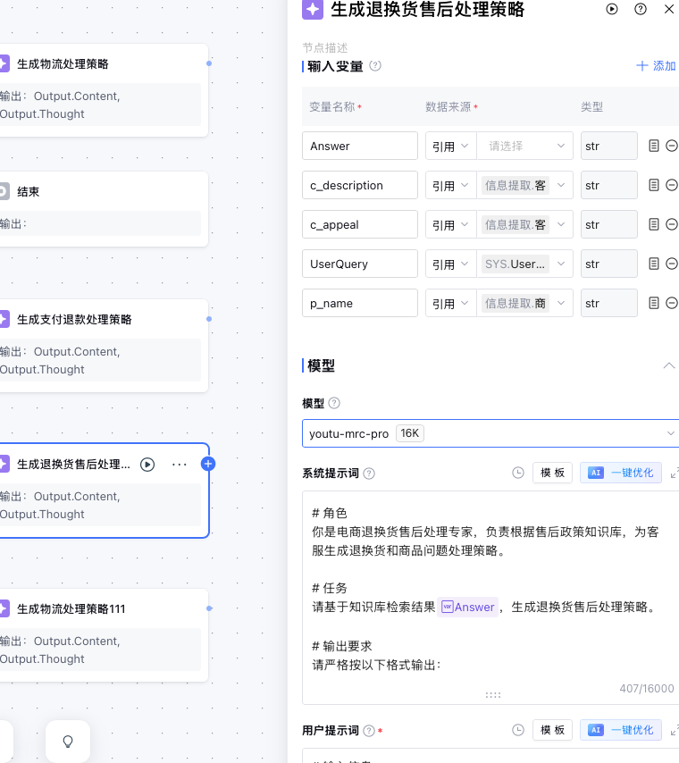

<figcaption>客服助手实战</figcaption>

## **Step 10：搭建其他需人工处理分支**

第四条分支用于处理无法判断、投诉升级、赔偿争议、实时订单查询等问题。这类问题不适合继续由大模型自由回答，应明确引导转人工。

在“其他意图”分支后添加“大模型”节点。

节点名称改为“生成转人工说明”。

输入变量选择 SYS.UserQuery、参数提取结果和对话历史。

粘贴下面的提示词。

## 大模型节点提示词｜生成转人工说明

1.系统提示词

# 角色

你是电商售后客服助手，负责在问题无法自动处理时，生成转人工说明。

# 任务

判断为什么当前问题需要人工介入，并生成一段礼貌、明确的转人工说明。

用户提示词

# 输入信息

用户原始输入：{{UserQuery}}

客户所遇问题：{{c_description}}

客户诉求：{{c_appeal}}

请基于以上信息，按照要求生成转人工说明。

# 输出要求

请严格按以下格式输出：

处理类型：其他需人工处理

需要转人工原因：说明是因为投诉升级、赔偿争议、实时订单查询、信息不足，还是意图无法判断。

客户回复要点：说明会转人工，并告诉客户需要准备哪些信息。

内部处理建议：告诉人工客服接手时应重点核实什么。

风险提醒：说明不要编造订单状态、赔偿金额或处理结论。

# 约束

1. 不要继续猜测具体订单结果。

2. 不要承诺赔偿金额或处理时效。

对情绪激烈的用户要先安抚，再转人工。

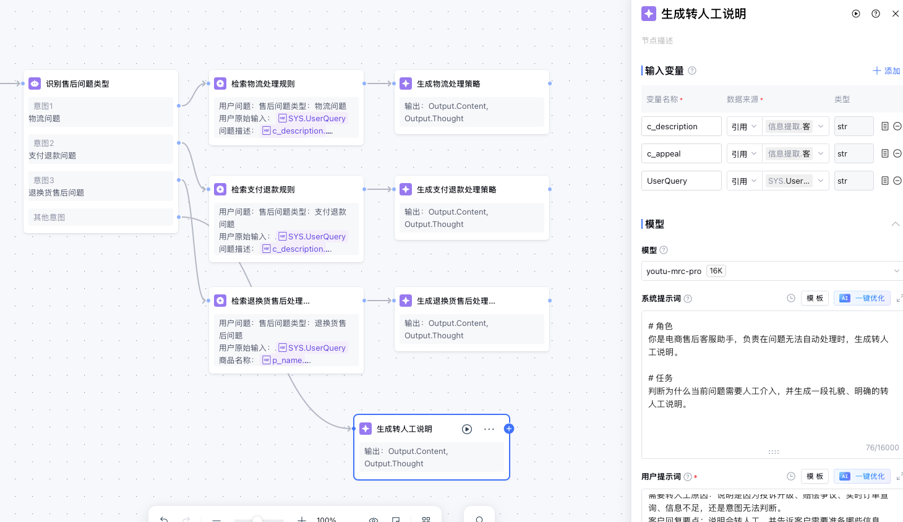

<figcaption>客服助手实战</figcaption>

这条分支不需要大模型知识问答也可以运行，因为它的目标不是解决具体问题，而是识别风险并转人工。

建议开启【信息提取】节点的异常处理功能，异常处理方式选择“执行异常流程”，将其连接到【生成转人工说明】该节点。也可以选择“输出特定内容”，自定义流程异常时的输出内容。

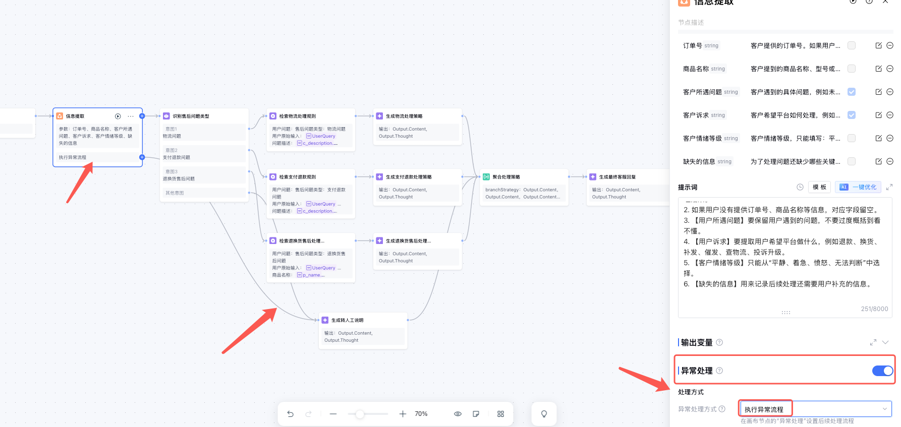

<figcaption>客服助手实战</figcaption>

## **Step 11：添加变量聚合节点，把四条分支合并回来**

意图识别后只有一条分支会运行，其他分支的输出为空。为了让后续“最终回复生成”节点只写一次，而不是在四条分支里重复写四遍，需要用变量聚合节点把四条分支的处理策略合并成一个变量。

在四条分支后添加“变量聚合”节点。

节点名称改为“聚合处理策略”。

聚合变量名称填写 brancStrategy。

将四条分支都连接到变量聚合节点,把“生成物流处理策略”“生成支付退款处理策略”“生成退换货处理策略”“生成转人工说明”的输出变量都加入聚合列表。

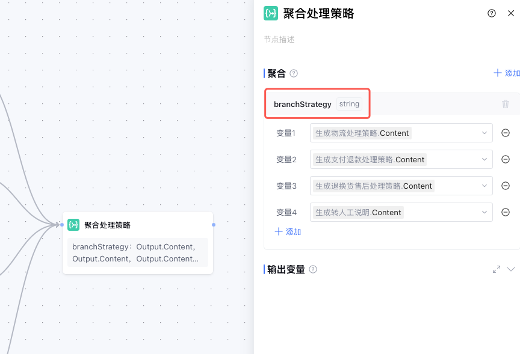

<figcaption>客服助手实战</figcaption>

如果变量聚合配置正确，不管用户进入哪条分支，后续节点都能从 branch_strategy 中拿到当前分支的处理策略。

## **Step 12：添加最终客服回复生成节点**

分支处理策略是给系统看的中间结果，还不能直接发给客户。接下来添加一个最终大模型节点，把处理策略整理成“客户可读回复 + 内部处理建议”。

在“聚合处理策略”节点后添加“大模型”节点。

节点名称改为“生成最终客服回复”。

输入变量选择用户原始输入、参数提取结果、branch_strategy 和对话历史。

粘贴下面的提示词。

## 大模型节点提示词｜生成最终客服回复

1.系统提示词

# 角色

你是电商售后客服话术生成助手，负责把前序节点生成的处理策略{{branch_strategy}}，转化为可以直接展示给用户的客服回复。

# 任务

请生成一段面向客户的回复，并附上内部处理建议。

2.用户提示词

# 输入信息

用户原始输入：{{UserQuery}}

客户所遇问题：{{c_description}}

客户诉求：{{c_appeal}}

对话历史：{{ChatHistory}}

处理策略：{{branchStrategy}}

# 输出格式

请严格按照以下格式输出：

客户回复：

用自然、礼貌、安抚性的语气回复客户。回复要包含：

1. 对客户问题或情绪的回应；

2. 基于规则的处理说明；

3. 需要客户补充的信息；

4. 下一步处理方式。

内部处理建议：

- 问题类型：物流问题/支付退款问题/退换货售后问题/其他需人工处理

- 建议动作：客服下一步要做什么

- 需要核实的信息：订单号、支付记录、物流状态、商品照片等

- 风险提醒：哪些内容不能承诺或需要人工确认

# 回复要求

1. 不要说自己是大模型，也不要暴露工作流节点名称。

2. 不要编造订单状态、物流状态、退款到账时间、赔偿金额或审核结果。

3. 如果信息不足，要明确请用户补充。

4. 如果分支策略提示需要转人工，客户回复中要明确说明将转人工处理。

5. 语气要比普通系统通知更有人情味，但不能过度承诺。

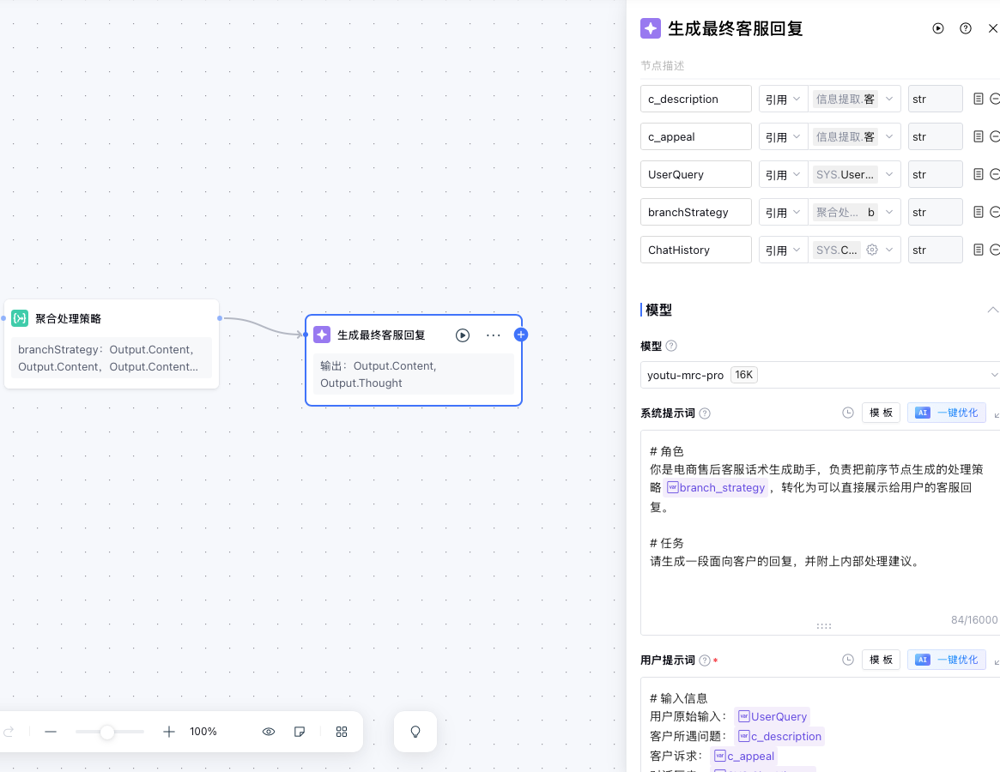

<figcaption>客服助手实战</figcaption>

最终回复应该适合直接发给客户，而不是只给出“处理策略”。如果回复中出现“变量”“节点”“知识库片段”等内部词，需要优化提示词。

## **Step 13：添加回复节点，并连接到结束节点**

工作流中“大模型节点输出变量”不会自动显示到用户对话窗口。要让用户看到结果，必须添加“回复”节点。

在“生成最终客服回复”节点后添加“回复”节点。

节点名称改为“回复用户”。

回复内容选择“生成最终客服回复”的输出变量。

将“回复用户”节点连接到“结束”节点。

检查所有节点都已经连接，没有断开的线。

## 回复节点内容

{{生成最终客服回复.Content}}

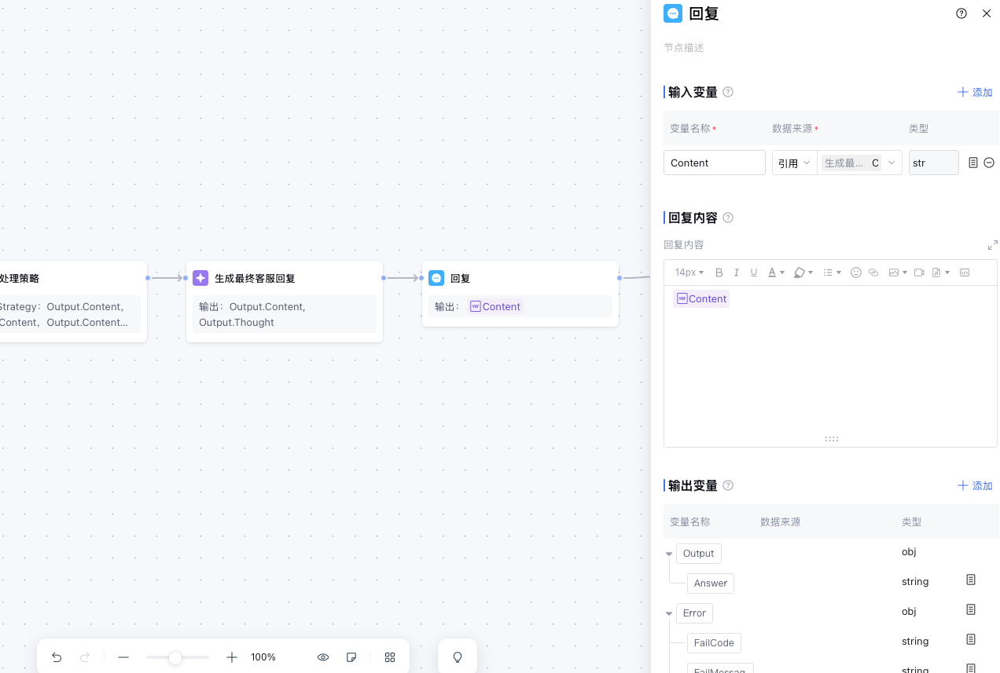

<figcaption>客服助手实战</figcaption>

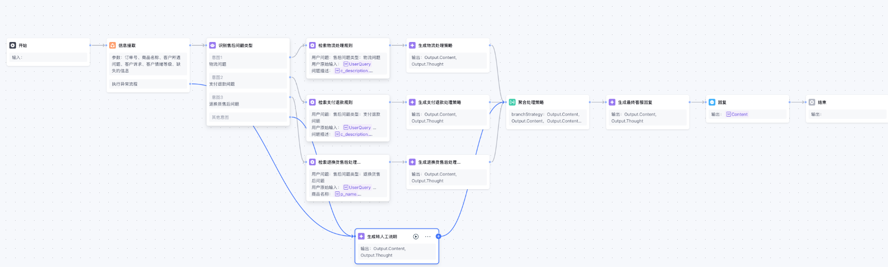

<figcaption>客服助手实战</figcaption>

不要把最终结果只写到结束节点的输出变量里。结束节点的输出变量更多用于“工作流调用工作流”的场景；如果希望用户在对话窗口看到结果，需要使用回复节点。

## **Step 14：先做单节点调试，再做全流程调试**

工作流不要等全部搭完才测试。建议按照“参数提取 → 意图识别 → 分支策略 → 最终回复”的顺序逐步调试。

调试通过后，工作流才会进入待发布状态。如果调试失败，优先检查变量引用是否为空、分支是否连接到变量聚合、回复节点是否连接到结束节点。

## **Step 15：设置主工作流并发布应用**

调试通过后，需要把刚才搭建的工作流设置为应用主工作流，然后发布到用户侧。

返回工作流管理页面，启用工作流。

回到应用设置界面，添加工作流，选择“售后诉求处理主流程”。

- 进入“应用发布”页面。

查看待发布变更项，确认包含主工作流、知识库、节点配置等内容。

填写版本说明，并点击“发布”。

发布完成后，复制分享链接，在新窗口从用户视角测试一次。

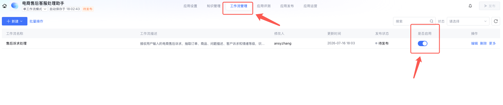

<figcaption>客服助手实战</figcaption>

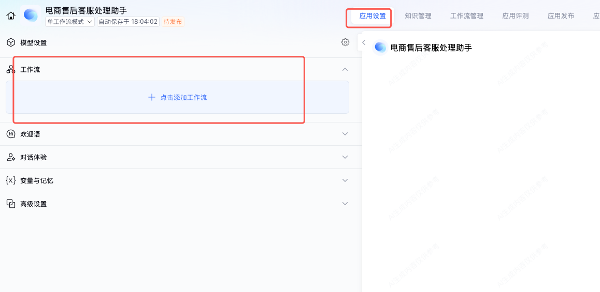

<figcaption>客服助手实战</figcaption>

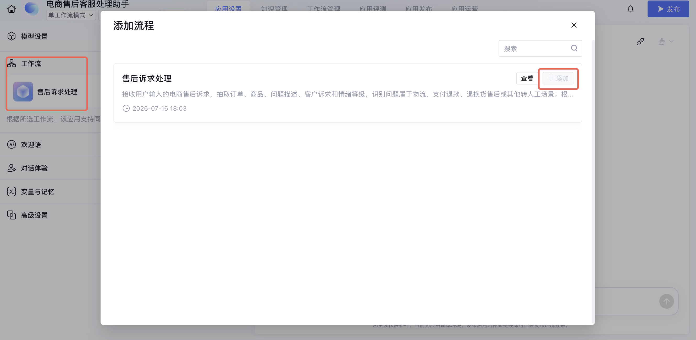

<figcaption>客服助手实战</figcaption>

## 发布版本说明

V1.0 单工作流实战应用：完成电商售后客服处理助手搭建。新增售后政策知识库、参数提取、意图识别、物流/支付退款/退换货/转人工四个处理分支、变量聚合、最终客服回复生成和回复节点，并完成测试集验证。

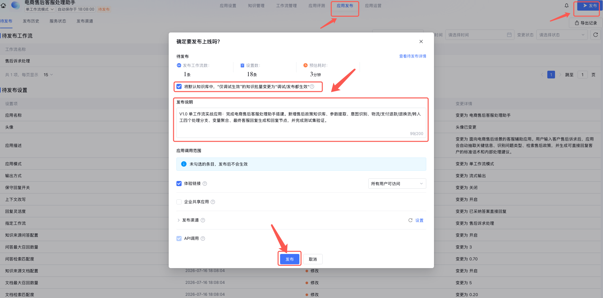

<figcaption>客服助手实战</figcaption>

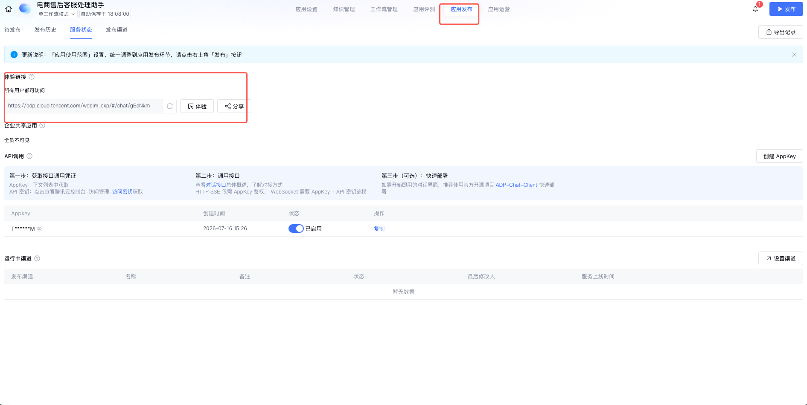

<figcaption>客服助手实战</figcaption>

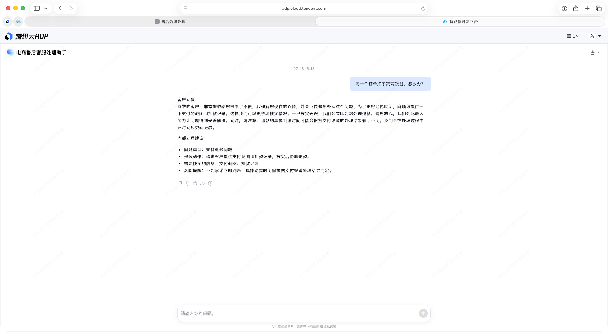

<figcaption>客服助手实战</figcaption>

发布后一定要从用户侧再测一次。开发态调试正常，不代表用户侧已经拿到最新版本；只有发布后，用户侧才能看到最新工作流。

## **测试：用这些问题检查工作流是否稳定**

- 如果意图经常识别错：补充意图描述和示例，尤其是边界样例。

- 如果知识库检索不到：检查文档是否解析成功，检索 Query 是否包含问题描述和诉求。

- 如果最终回复太像内部流程：加强“面向客户回复”的提示词要求。

- 如果回复编造订单状态：在分支策略和最终回复提示词中强化“不能编造实时订单/物流/退款状态”。

- 如果用户看不到输出：检查是否添加了回复节点，并连接到结束节点。

## **迁移练习：把售后客服换成自己的业务流程**

完成本节跟练后，可以不改整体结构，只替换知识库、意图和提示词，把这个单工作流迁移到自己的业务场景。

保留“参数提取 → 意图识别 → 分支处理 → 变量聚合 → 最终回复 → 回复节点”的结构，把售后政策知识库换成你的业务资料，把四类售后意图换成你的业务意图。迁移后至少用 10 条测试问题验证。

## 本节小结

通过本节实战，你已经完成了一个单工作流模式应用从创建、编排、调试到发布的完整过程。与标准模式相比，单工作流模式更适合处理路径清晰、步骤固定、需要稳定执行的业务任务。本节的“电商售后客服处理助手”就是一个典型示例：用户输入售后诉求后，应用会按固定流程完成信息抽取、问题分类、知识检索、分支处理、结果汇总和最终回复生成。

在搭建过程中，你先准备了售后政策知识库，让后续回复有可依据的规则和话术；再通过参数提取节点，把用户的自然语言输入转成订单号、商品名称、问题描述、客户诉求、情绪等级等结构化字段；随后使用意图识别节点，将问题分流到物流、支付退款、退换货售后和其他需人工处理四类分支。每个分支都围绕对应场景生成处理策略，既提升了回复的针对性，也避免所有问题都走同一套泛化回答。

本节还重点练习了变量聚合、最终回复生成和回复节点的使用。变量聚合用于把不同分支重新汇总到统一链路，最终回复生成节点负责把中间处理策略转成客户可读的话术和内部处理建议，回复节点则确保结果能够真正展示到用户对话窗口。发布前，你需要按节点逐步调试，再做全流程测试，重点检查变量是否为空、分支是否正确、回复是否可直接给客户使用，以及是否存在编造订单状态、退款时间、赔偿金额或审核结论等风险。

后续迁移到真实业务场景时，可以沿用本节方法：先判断任务是否有固定流程，再明确输入字段、分支规则、知识资料、处理策略和输出格式。只要业务步骤可拆解、判断条件相对清晰，单工作流模式就可以帮助你把原本依赖人工经验的处理过程，沉淀成可复用、可调试、可发布的自动化应用。
