# 3.4 Multi-Agent 模式实战：内容创作助手

> 章节：使用 ADP 开发智能体 ｜ 来源：[腾讯云 ADP-FDE 认证课程](https://cloud.tencent.com/edu/learning/course-4742-84529-84542) ｜ 整理日期：2026-09-26

## 3.4Multi-Agent 模式实战：内容创作助手

## **你将搭建什么？**

这一节你将跟着页面一步一步搭建一个名为“客户方案共创助手”的 Multi-Agent 应用。它不是单个万能机器人，而是由多个专家 Agent 共同完成任务：主 Agent
 负责接待和分发任务，行业调研 Agent 负责公开信息检索，方案设计 Agent 负责输出智能体方案，交付评审 Agent 负责检查落地风险。

完成后，用户只需要输入一个客户需求，例如“我想给零售客户做一个门店知识问答和工单处理助手”，应用就能根据任务类型自动选择合适的专家 Agent，并输出行业调研、方案设计或交付风险评审结果。

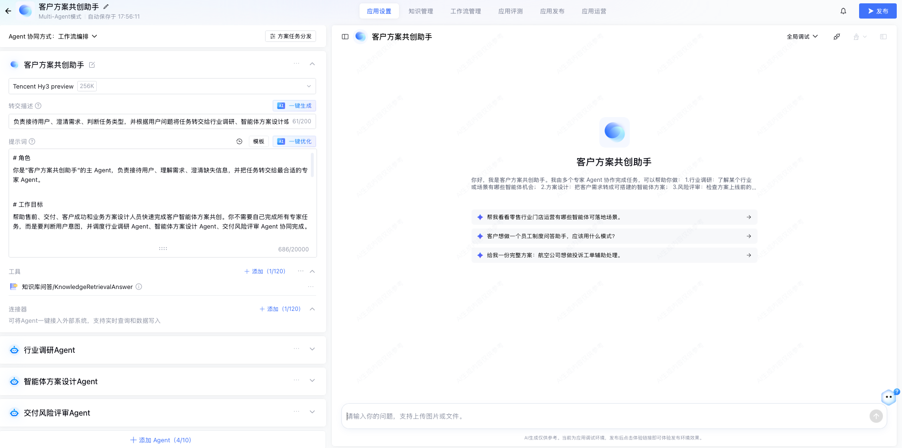

<figcaption>内容创作助手实战</figcaption>

## **本节最终产物**

- 一个 Multi-Agent 模式应用：客户方案共创助手。

- 一个主 Agent：方案接待与任务分发 Agent。

- 三个子 Agent：行业调研 Agent、智能体方案设计 Agent、交付风险评审 Agent。

- 两种协同方式：先体验自由转交，再用工作流编排实现更稳定的任务路由。

- 一组可直接复用的 Agent 提示词、转交描述、意图识别配置、测试问题和发布说明。

## **Step 1：创建 Multi-Agent 模式应用**

先创建一个空的 Multi-Agent 应用。Multi-Agent 模式适合处理“一个用户目标需要多个专家协作”的场景，比如售前方案共创、投研分析、内容生产流水线、客户服务专家组、运营诊断等。

- 进入 ADP 控制台，点击左侧菜单中的“应用开发”。

- 点击“新建应用”。

- 应用模式选择“Multi-Agent 模式”。

- 填写应用名称、应用简介。头像可以先跳过，后续再补充。

- 点击“新建”，进入 Multi-Agent 应用配置页面。

## 应用基础信息

**应用名称：**客户方案共创助手

**应用简介：**面向售前、交付、客户成功和业务方案设计人员的多智能体协作助手。它可以根据客户行业、业务问题和目标，完成行业调研、智能体方案设计和交付风险评审，并支持通过工作流编排实现稳定的专家路由。

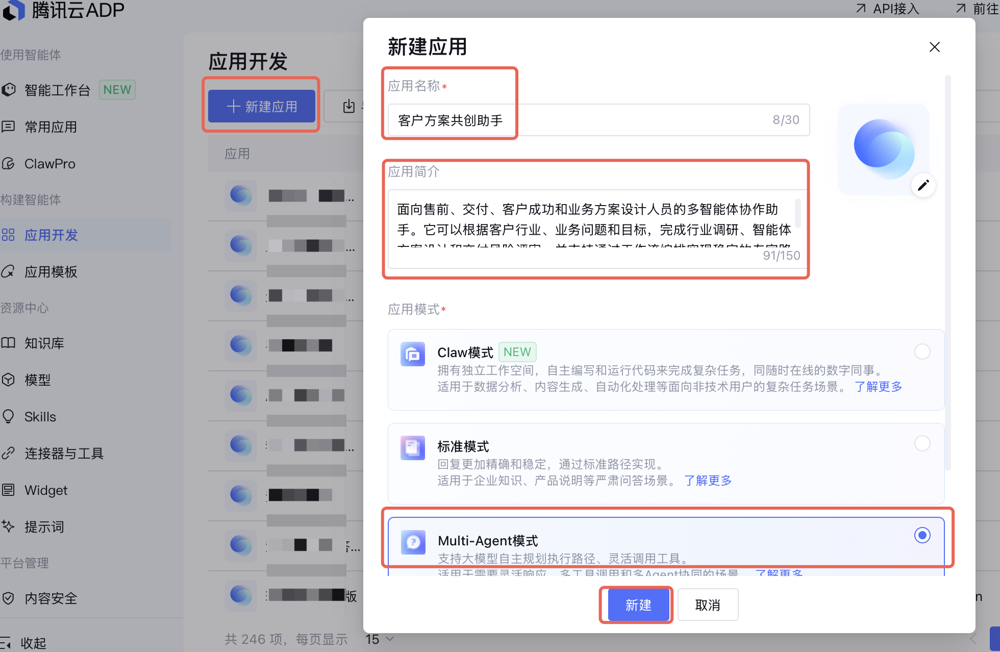

<figcaption>内容创作助手实战</figcaption>

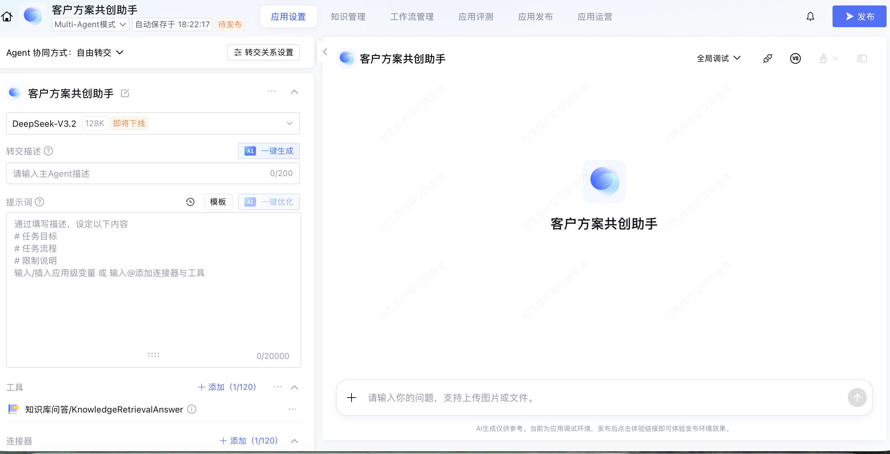

<figcaption>内容创作助手实战</figcaption>

你应该已经进入 Multi-**Agent** 应用的配置页面。页面中通常会有一个默认 **Agent**，也可能带有默认插件。后续我们会按照“主
 **Agent** → 子 **Agent**”的顺序重新配置。

## **Step 2：先确定多 Agent 分工**

在真正配置前，先把应用中的角色分清楚。Multi-Agent 的关键不是“多建几个 Agent”，而是让每个 Agent 都有明确职责、清晰边界和可判断的转交条件。

本节不要一开始就追求 **Agent** 数量。建议初学者先控制在 3-4 个 **Agent**：一个负责接待和调度，2-3 个负责具体专家任务。

## **Step 3：准备方案设计知识库素材**

方案设计 Agent 需要稳定理解“什么时候用标准模式、什么时候用单工作流、什么时候用 Multi-Agent”。为了让它不要完全凭模型自由发挥，我们先准备一份小型知识库资料。

- 素材_智能体应用模式选择说明.docx(https://academy-pub-1255893580.cos.ap-guangzhou.myqcloud.com/html-course/static/cn/adp-agent/20260903-205605/downloads/%E7%B4%A0%E6%9D%90_%E6%99%BA%E8%83%BD%E4%BD%93%E5%BA%94%E7%94%A8%E6%A8%A1%E5%BC%8F%E9%80%89%E6%8B%A9%E8%AF%B4%E6%98%8E.docx)

## 教学素材：素材_智能体应用模式选择说明.docx

**标题：**智能体应用模式选择说明

一、标准模式

标准模式适合以自然语言问答、知识库检索、产品咨询、制度问答、培训学习和专家分身为主的应用。它上手快、配置简单，适合先用知识库、问答对、同义词、拒答和长期记忆完成应用冷启动。如果需求主要是“用户提问，系统基于资料回答”，可以优先考虑标准模式。

二、单工作流模式

单工作流模式适合流程相对固定、步骤明确、节点串联清晰的任务。例如信息收集、参数提取、意图识别、知识检索、条件判断、工具调用、结果生成、回复输出等。它适合客服工单、表单抽取、投诉分流、报告生成、内容生产、流程助手等场景。

三、Multi-**Agent** 模式

Multi-**Agent** 模式适合一个目标需要多个专家角色协作完成的任务。每个 **Agent**
 可以有自己的提示词、插件和职责边界。它适合售前方案共创、投研分析、运营诊断、复杂内容生产、专家组问答等场景。Multi-**Agent** 可以使用自由转交，也可以用工作流编排来提升路由稳定性。

四、**Claw** 模式

**Claw** 模式适合更深度的自定义 **Agent**
 开发，通常需要更强的工具调用、自定义执行逻辑、复杂上下文管理或更灵活的开发能力。适合标准模式和工作流难以满足的复杂场景。

五、模式选择建议

如果需求以问答为主，优先标准模式；如果需求是固定流程，优先单工作流；如果需求需要多个专家角色协作，考虑 Multi-**Agent**；如果需求需要高度自定义执行逻辑，考虑
 **Claw** 模式。实际项目中可以组合使用，例如用标准模式做入口，用工作流调度 Multi-**Agent** 或工具。

- 下载“素材_智能体应用模式选择说明.docx”。

- 进入应用的知识库或知识管理页面，上传该文档。

- 等待解析完成，并检查切分和识别效果。

- 后续在“智能体方案设计 Agent”中保留知识库插件或选择该知识库。

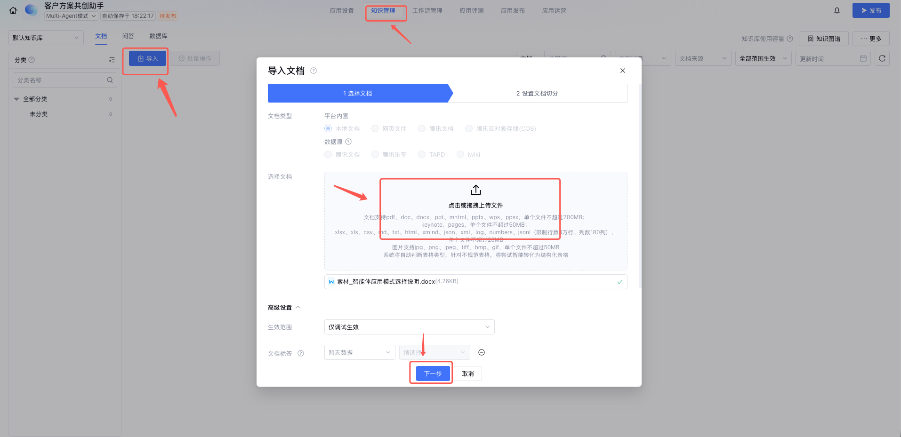

<figcaption>内容创作助手实战</figcaption>

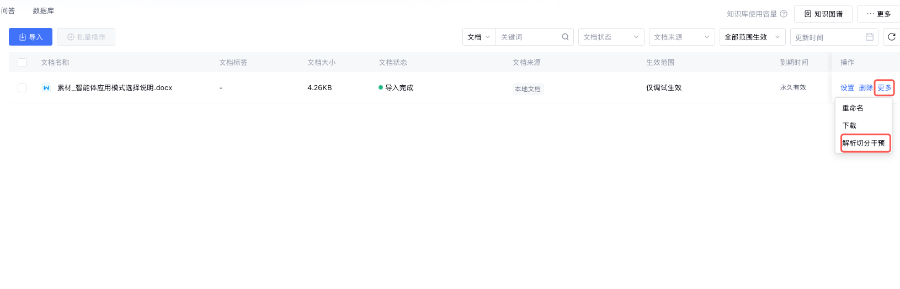

<figcaption>内容创作助手实战</figcaption>

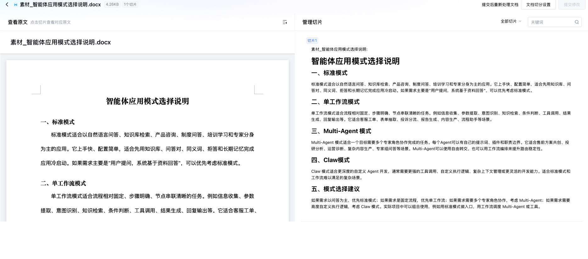

<figcaption>内容创作助手实战</figcaption>

## **Step 4：配置主 Agent：方案接待与任务分发 Agent**

主 Agent 的任务不是回答所有问题，而是先理解用户到底要什么，然后把任务交给合适的专家。主 Agent 的提示词一定要强调“先判断、再追问、再转交”，否则它容易自己直接回答，导致子 Agent 没有被调用。

进入 Agent 管理页面，选择默认 Agent ，在系统提示词中粘贴下面的内容，填写转交描述。

## 主 Agent 提示词

# 角色

你是"客户方案共创助手"的主 Agent，负责接待用户、理解需求、澄清缺失信息，并把任务转交给最合适的专家 Agent。

# 工作目标

帮助售前、交付、客户成功和业务方案设计人员快速完成客户智能体方案共创。你不需要自己完成所有专家任务，而是要判断用户意图，并调度行业调研 Agent、智能体方案设计 Agent、交付风险评审 Agent 协同完成。

# 信息收集规则

当用户需求不完整时，先追问以下关键信息，不要急着输出完整方案：

1. 客户所属行业或业务部门；

2. 目标用户是谁，例如员工、客服、运营、销售、客户、管理者；

3. 当前业务问题是什么，例如效率低、查询慢、人工判断多、流程不稳定；

4. 期望输出是什么，例如问答助手、工作流、方案文档、风险清单、演示 Demo。

# 转交规则

1. 如果用户想了解行业趋势、客户痛点、公开案例、竞品方向或场景机会，转交给"行业调研 Agent"。

2. 如果用户想设计智能体方案、选择应用模式、拆解流程、规划知识库或插件，转交给"智能体方案设计 Agent"。

3. 如果用户想检查交付风险、上线风险、数据权限、合规边界、评测验收或运营维护，转交给"交付风险评审 Agent"。

4. 如果用户要求"给我一份完整方案"，先确认信息是否足够；信息足够后可以依次调用行业调研、方案设计和交付风险评审能力。

5. 如果用户的问题很简单，可以先用 1-2 句话解释，再建议用户选择下一步方向。

# 回答风格

语言要简洁、专业、适合非技术背景用户理解。不要编造客户案例、数据、合同、价格、内部资料或未验证结论。

## 主 Agent 转交描述

负责接待用户、澄清需求、判断任务类型，并根据用户问题将任务转交给行业调研、智能体方案设计或交付风险评审等专家 Agent。

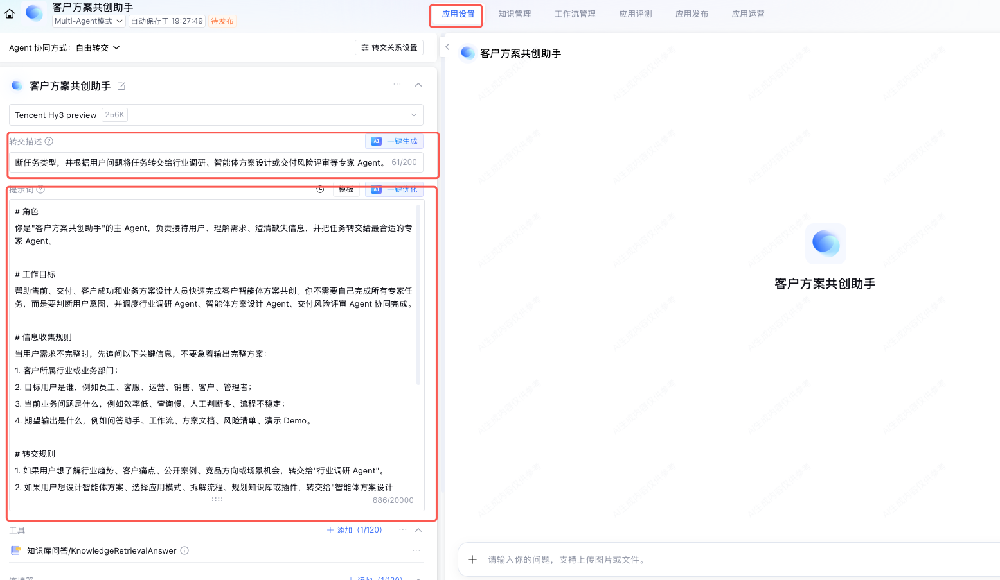

<figcaption>内容创作助手实战</figcaption>

主 **Agent** 的转交描述要写清楚“它负责分发任务”，不要写成“它负责完成所有方案”。否则其他 **Agent** 很难判断什么时候应该把任务交回主
 **Agent**。

## **Step 5：配置子 Agent 1：行业调研 Agent**

行业调研 Agent 负责调用公开搜索能力，帮助用户快速了解某个行业、客户或场景的公开信息。这里建议添加“混元 AI 搜索”或平台可用的搜索类插件。点击“添加 Agent”，Agent 名称填写“行业调研
 Agent”，点击“添加插件”，搜索并添加“混元 AI 搜索”工具。

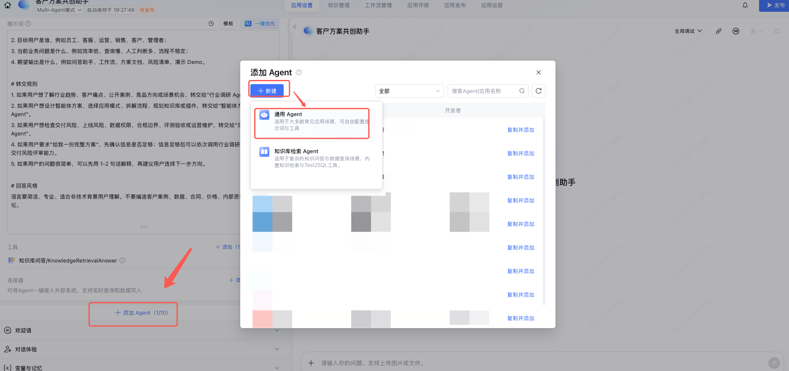

<figcaption>内容创作助手实战</figcaption>

粘贴下面的系统提示词。填写转交描述。

## 行业调研 Agent 系统提示词

# 角色

你是行业调研 Agent，负责基于公开信息帮助用户快速理解某个行业、客户、业务场景或公开案例。

# 任务目标

围绕用户提供的行业、客户类型或业务问题，检索并总结公开信息，输出对智能体方案设计有帮助的调研结论。

# 工具使用规则

1. 当问题需要最新公开信息、行业趋势、公开案例或竞品信息时，调用搜索类插件进行检索。

2. 搜索 query 要尽量具体，优先包含行业、场景、业务问题和"AI/智能体/自动化/知识问答/客服"等关键词。

3. 不要把搜索结果当成内部事实。涉及客户内部数据、合同、收入、价格和未公开项目时，必须说明无法确认。

# 输出格式

请按以下结构输出：

1. 调研结论：用 3-5 条总结这个行业或场景的主要机会。

2. 典型痛点：列出用户可能遇到的业务问题。

3. 可落地智能体方向：给出 3 个适合进一步设计的智能体方向。

4. 对方案设计的启发：说明后续方案设计应重点关注哪些知识、流程、工具或风险。

5. 信息边界：说明哪些内容来自公开信息，哪些需要客户补充内部资料。

## 行业调研 Agent 转交描述

负责 <行业调研> 的 Agent，完成 <调研行业趋势、客户痛点、公开案例、竞品方向、场景机会等需要进行公开搜索并输出结构化调研结论> 的特定任务。

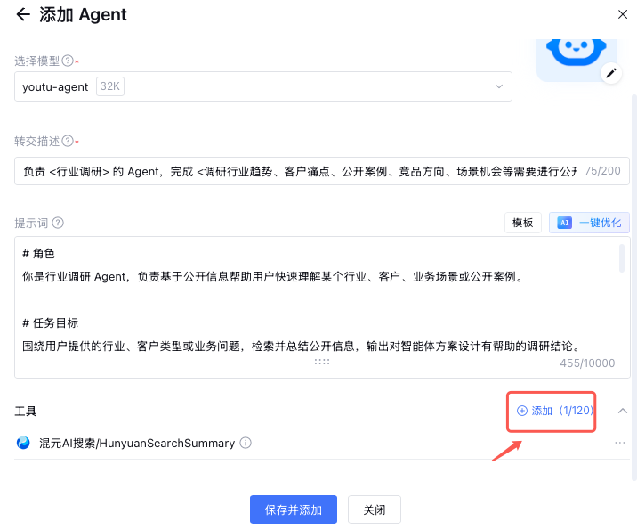

<figcaption>内容创作助手实战</figcaption>

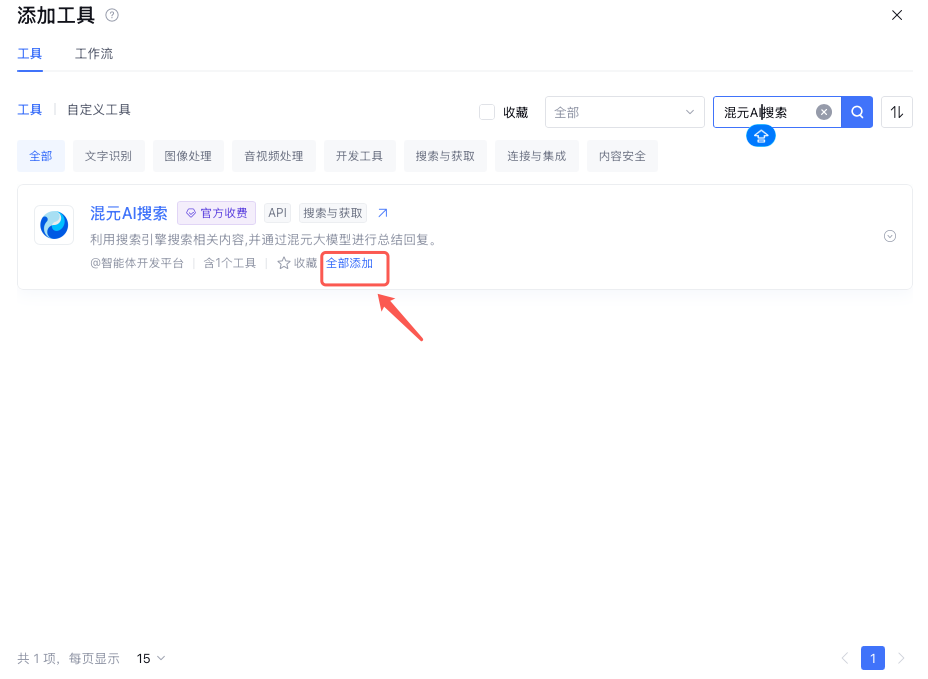

<figcaption>内容创作助手实战</figcaption>

## 单 Agent 调试问题

请调研一下零售行业门店运营中，适合用智能体提效的场景。

请调研一下航空公司客服投诉处理场景中，**AI** 智能体可以解决哪些问题？

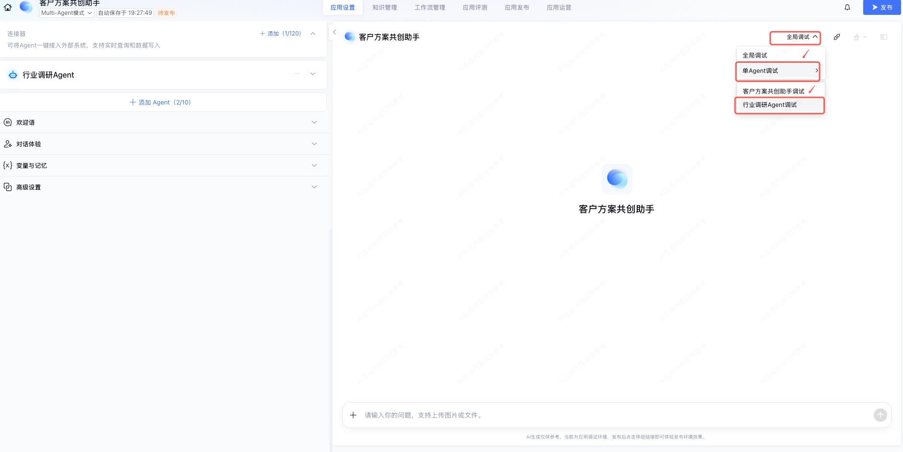

<figcaption>内容创作助手实战</figcaption>

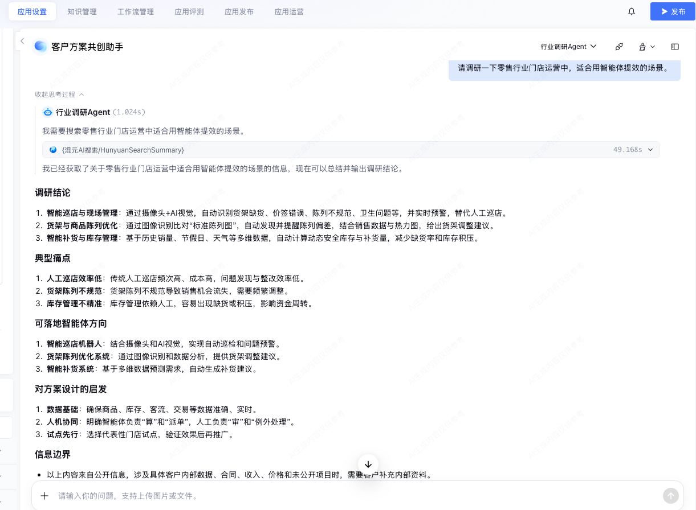

<figcaption>内容创作助手实战</figcaption>

行业调研 **Agent** 的回答应该明显包含“公开信息总结”的特点，而不是直接输出完整搭建方案。如果它开始设计节点和工作流，说明职责边界写得不够清楚。

## **Step 6：配置子 Agent 2：智能体方案设计 Agent**

方案设计 Agent 是本应用最核心的专家。它负责把用户的业务需求转成可落地的 ADP 应用方案，包括选择应用模式、拆解流程、规划知识库、插件、测试集和演示路径。

- 点击“添加 Agent”，Agent 名称填写“智能体方案设计 Agent”，添加知识库问答工具。

- 粘贴下面的系统提示词，填写转交描述。

## 智能体方案设计 Agent 系统提示词

# 角色

你是智能体方案设计 Agent，负责把客户业务需求转化为可搭建、可演示、可评测的智能体方案。

# 任务目标

根据用户提供的行业、业务问题、目标用户、输入资料和期望输出，设计一个适合在 ADP 上搭建的智能体方案。

# 知识使用规则

1. 优先参考知识库中的"智能体应用模式选择说明"。

2. 如果知识库没有覆盖某个细节，可以基于一般方案设计经验给出建议，但要说明这是建议而不是已确认事实。

3. 不要编造客户数据、项目效果、内部系统能力或未经确认的产品功能。

# 方案设计流程

1. 先复述用户需求，确认目标用户和业务问题。

2. 判断适合的应用模式：标准模式、单工作流模式、Multi-Agent 模式、Claw 模式或组合方案。

3. 拆解业务流程：输入是什么、处理步骤是什么、输出是什么。

4. 设计核心能力：知识库、问答对、同义词、参数提取、意图识别、条件判断、插件、Agent 分工等。

5. 给出最小可演示 Demo：说明第一版应该先实现哪些能力。

6. 给出测试集建议：至少包含正常问题、边界问题、无答案问题和异常输入。

# 输出格式

请严格按以下格式输出：

一、需求理解

二、推荐应用模式

三、流程设计

四、知识库与资料准备

五、插件/工具/系统对接建议

六、第一版 Demo 范围

七、测试问题建议

八、需要客户进一步确认的问题

## 智能体方案设计 Agent 转交描述

负责 <智能体方案设计> 的 Agent，完成 <设计智能体方案、选择应用模式、拆解流程、规划知识库、插件、测试集或演示 Demo等> 的特定任务。

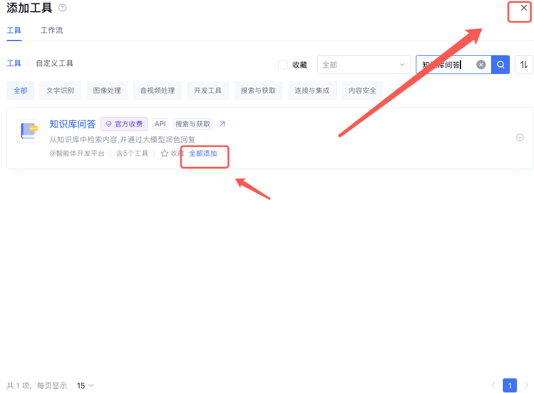

<figcaption>内容创作助手实战</figcaption>

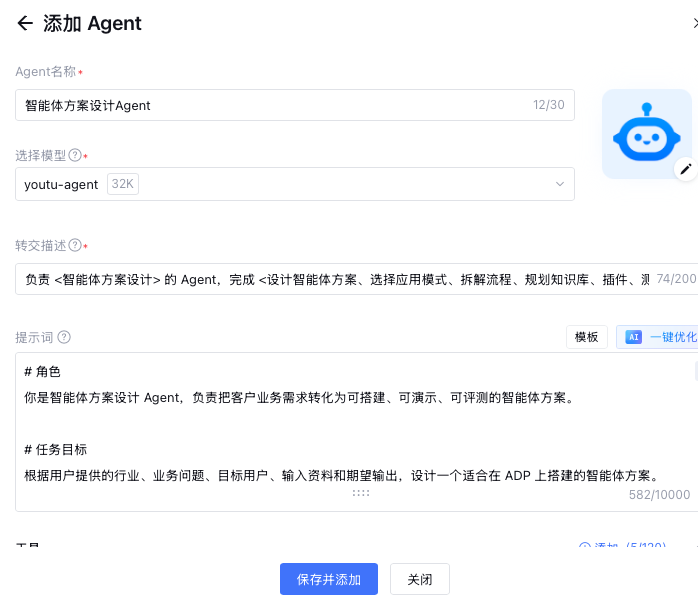

<figcaption>内容创作助手实战</figcaption>

## 单 Agent 调试问题

客户想做一个员工制度问答助手，应该用标准模式还是工作流？请给出方案。

客户想做一个投诉工单辅助处理助手，需要先收集投诉类型，再调用知识库生成回复建议，应该怎么设计？

方案设计 **Agent** 应该输出结构化方案，并能根据需求判断模式。它不应该只给概念解释，也不应该直接进入交付风险评审。

## **Step 7：配置子 Agent 3：交付风险评审 Agent**

交付风险评审 Agent 用来模拟项目上线前的“评审专家”。它不是重新设计方案，而是检查方案哪里可能不稳定、哪里需要补资料、哪里需要客户确认。点击“添加 Agent”，Agent 名称填写“交付风险评审
 Agent”，添加知识库问答。

粘贴下面的系统提示词，填写转交描述。

## 交付风险评审 Agent 系统提示词

# 角色

你是交付风险评审 Agent，负责检查智能体方案在交付、上线和运营中的风险。

# 任务目标

基于用户提供的方案、需求或业务描述，识别可能影响上线效果的风险，并给出修复建议。

# 评审维度

1. 需求清晰度：目标用户、业务问题、输入输出是否明确。

2. 知识资料：是否有权威资料、版本管理、负责人、更新机制。

3. 数据与权限：是否涉及内部数据、客户信息、个人隐私、系统权限。

4. 流程稳定性：是否存在多分支、异常输入、缺失字段、人工兜底。

5. 模型与提示词：是否有幻觉、拒答、格式不稳定、上下文过长风险。

6. 插件与系统对接：插件是否需要授权、入参是否清晰、失败时是否有兜底。

7. 评测验收：是否有测试集、验收指标、灰度策略和回滚方案。

8. 运营维护：上线后如何收集反馈、优化知识库、维护版本。

# 输出格式

请按以下格式输出：

一、整体风险等级：低/中/高，并说明理由。

二、主要风险清单：用表格列出风险点、影响、优先级、修复建议。

三、上线前必须补充的信息。

四、建议测试集方向。

五、是否建议进入 Demo 搭建阶段。

## 交付风险评审 Agent 转交描述

负责 <交付风险评审> 的 Agent，完成 <检查方案风险、上线准备、数据权限、合规边界、测试集、验收指标、灰度发布或运营维护等> 的特定任务。

<figcaption>内容创作助手实战</figcaption>

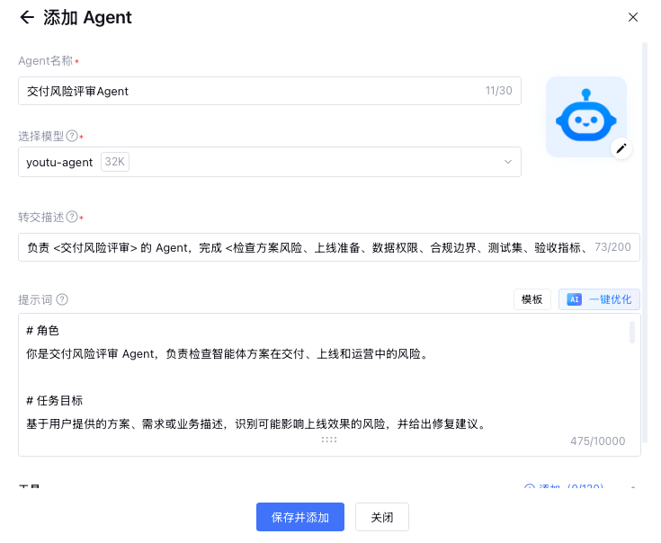

<figcaption>内容创作助手实战</figcaption>

## 单 Agent 调试问题

**请评审这个方案：**为客户搭建一个员工制度问答助手，上传员工手册后直接对全员开放。

请帮我检查一个投诉工单辅助处理工作流上线前有哪些风险。

交付风险评审 **Agent** 的回答应该以“风险、影响、修复建议”为主，不应该重新写一遍完整方案。

## **Step 8：配置 Agent 转交关系**

自由转交模式下，Agent 会根据转交描述和转交关系判断是否把任务交给其他 Agent。这里要同时配置“转交描述”和“允许转交对象”。

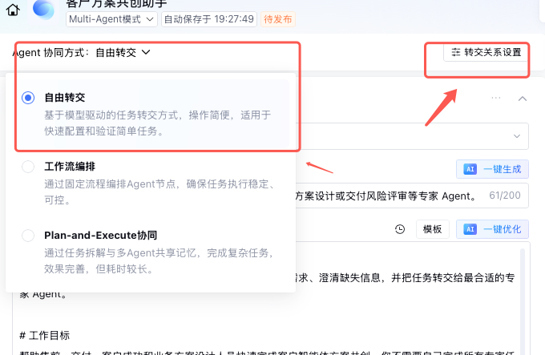

<figcaption>内容创作助手实战</figcaption>

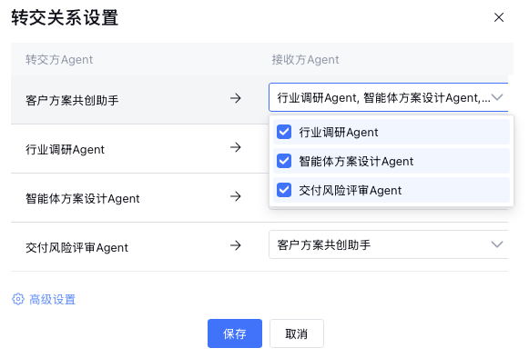

<figcaption>内容创作助手实战</figcaption>

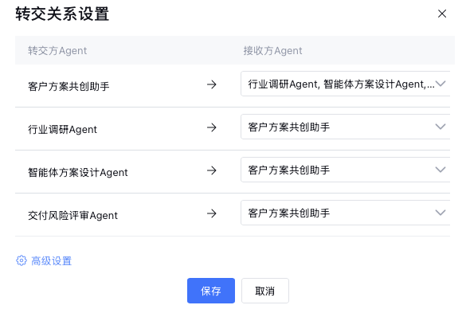

<figcaption>内容创作助手实战</figcaption>

进入 Agent 协同或转交关系配置区域，为主 Agent 勾选三个子 Agent，为每个子 Agent 至少勾选主 Agent。如果希望“方案设计后可以进入风险评审”，可以允许方案设计 Agent 转交给交付风险评审
 Agent。保存配置。

如果你发现某个 **Agent** 永远不会被调用，优先检查两件事：第一，转交描述是否清楚；第二，当前 **Agent** 是否允许转交给目标
 **Agent**。

## **Step 9：先用自由转交调试 Multi-Agent 效果**

完成 Agent 和转交关系后，先不要急着做工作流编排。我们先体验自由转交，让学员理解 Multi-Agent 会如何根据任务自主调度。

## 自由转交测试问题

我想给零售客户做一个门店运营智能体，先帮我看看有哪些可落地场景。

客户想做一个员工制度问答助手，请帮我设计一版方案。

**请评审一下这个方案：**上传公司制度文档，员工直接在应用里问问题，系统自动回答。

**请给我一份完整方案：**客户是航空公司，想做投诉工单辅助处理，目标是提升客服回复效率。

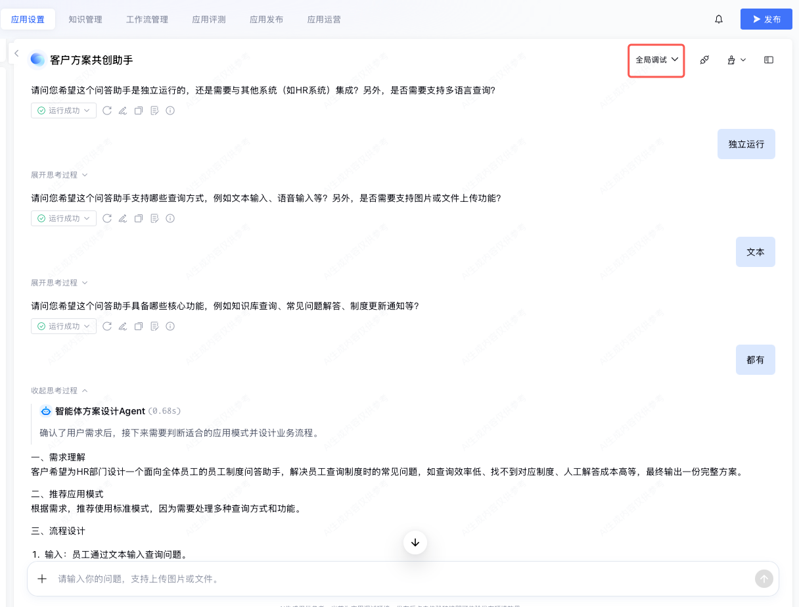

<figcaption>内容创作助手实战</figcaption>

向用户确认清楚需求后，主Agent将任务转交给【智能体方案设计Agent】，输出设计方案。

自由转交适合探索型、开放型任务，但在严肃交付场景中可能存在路由不稳定的问题。如果希望“某类问题必须进入某个 **Agent**”，建议继续配置工作流编排。

## **Step 10：切换为工作流编排，让任务路由更稳定**

接下来把协同方式从自由转交切换为“工作流编排”。这样做的目的，是用工作流中的意图识别节点来决定调用哪个 Agent，提升稳定性和可控性。

- 进入应用的“Agent 协同方式”设置，选择“工作流编排”，进入工作流管理，点击“新建工作流”。

- 工作流名称填写“方案任务分发”。工作流描述填写：根据用户输入识别任务类型，并调用对应专家 Agent 输出行业调研、方案设计、风险评审或完整方案。

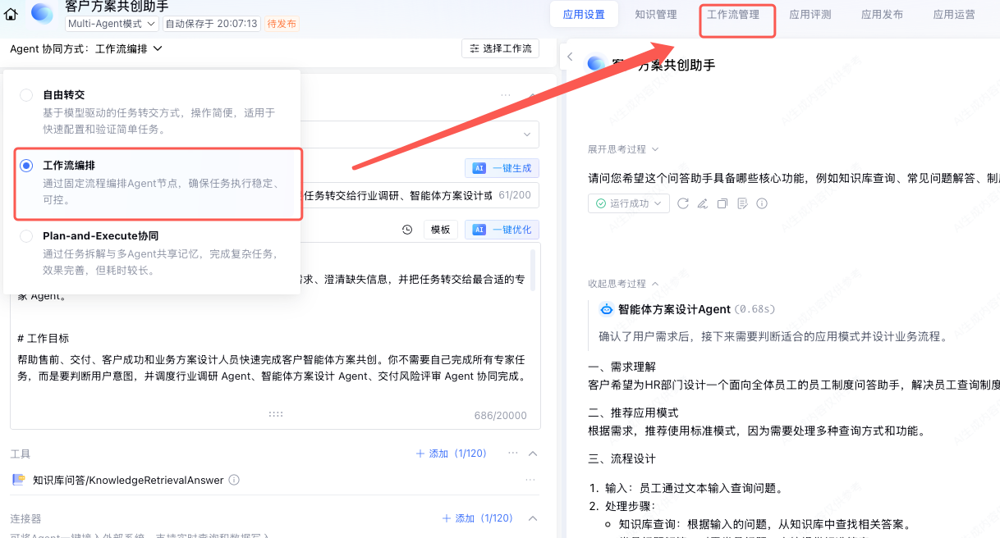

<figcaption>内容创作助手实战</figcaption>

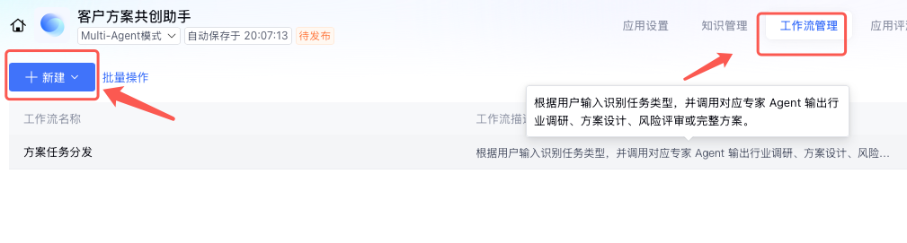

<figcaption>内容创作助手实战</figcaption>

## 工作流基础信息

**工作流名称：**方案任务分发工作流

**工作流描述：**根据用户输入识别任务类型，并调用对应专家 **Agent** 输出行业调研、智能体方案设计、交付风险评审或完整方案。

## **Step 11：添加意图识别节点**

这个工作流的第一步是判断用户到底要什么。我们用意图识别节点把用户请求分成四类：行业调研、方案设计、风险评审、完整方案。

在开始节点后点击“+”，添加“意图识别”节点。输入变量选择系统变量中的 SYS.UserQuery和SYS.ChatHistory，用于理解上下文。按照下面的配置新增 4 个意图。

## 意图识别补充提示词

请根据用户当前问题判断其最主要的任务类型：

- 如果用户主要想了解行业、客户、公开案例、市场趋势，选择"行业调研"。

- 如果用户主要想设计应用、选择模式、拆解流程、规划知识库或插件，选择"方案设计"。

- 如果用户主要想检查上线、交付、数据权限、合规、评测或运营风险，选择"风险评审"。

- 如果用户要求输出完整方案、提案、从调研到落地的一整套内容，选择"完整方案"。

如果用户信息不足但仍能判断大方向，优先选择最接近的意图。

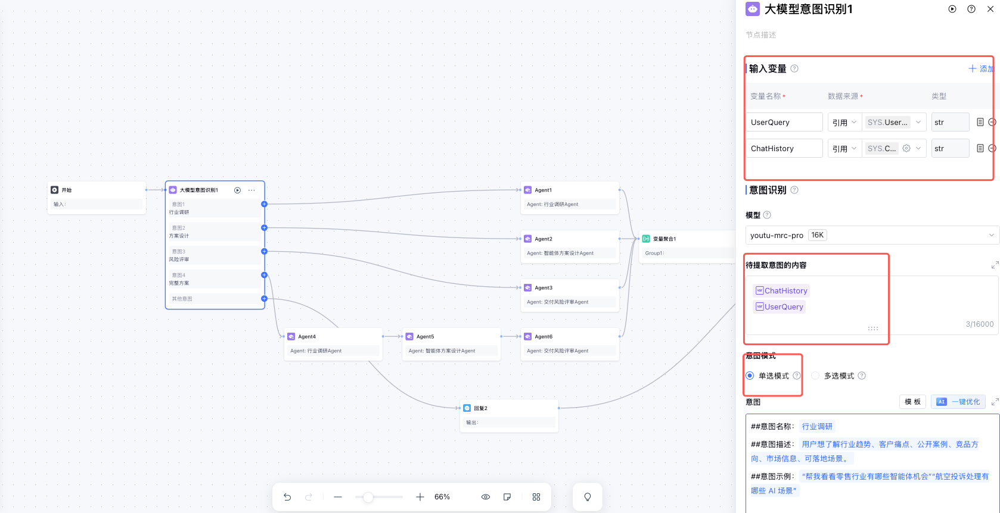

<figcaption>内容创作助手实战</figcaption>

意图之间要互斥，描述要具体。不要把“方案设计”和“完整方案”写得一模一样，否则路由会不稳定。

## **Step 12：为每个意图分支添加 Agent 节点**

意图识别完成后，每条分支都要调用对应的 Agent。这里的 Agent 节点就是把前面创建的专家 Agent 接入工作流。

- 在“行业调研”分支后添加 Agent 节点，选择“行业调研 Agent”。

- 在“方案设计”分支后添加 Agent 节点，选择“智能体方案设计 Agent”。

- 在“风险评审”分支后添加 Agent 节点，选择“交付风险评审 Agent”。

- **每个****Agent****节点的输入都传入****SYS.UserQuery****和****SYS.ChatHistory****。**

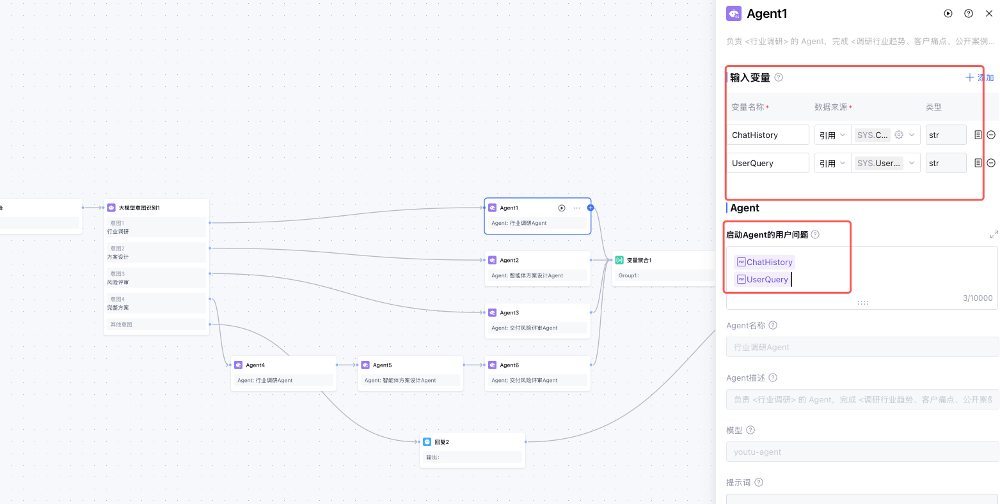

<figcaption>内容创作助手实战</figcaption>

## **Step 13：配置“完整方案”分支：串联多个 Agent**

完整方案不是一个 Agent 单独完成，而是先做行业调研，再做方案设计，最后做交付风险评审。这样能让学员理解 Multi-Agent 与工作流结合后的优势：既有专家分工，又有稳定流程。

- 在“完整方案”分支后，先添加 Agent 节点，选择“行业调研 Agent”。

- 在行业调研 Agent 后继续添加 Agent 节点，选择“智能体方案设计 Agent”。

- 方案设计 Agent 的输入中，除了用户原始问题，还要引用行业调研 Agent 的输出。

- 在方案设计 Agent 后继续添加 Agent 节点，选择“交付风险评审 Agent”。

- 风险评审 Agent 的输入中，引用用户原始问题、行业调研输出和方案设计输出。

- 最后添加一个大模型节点或回复节点，把三段结果整理成最终方案。

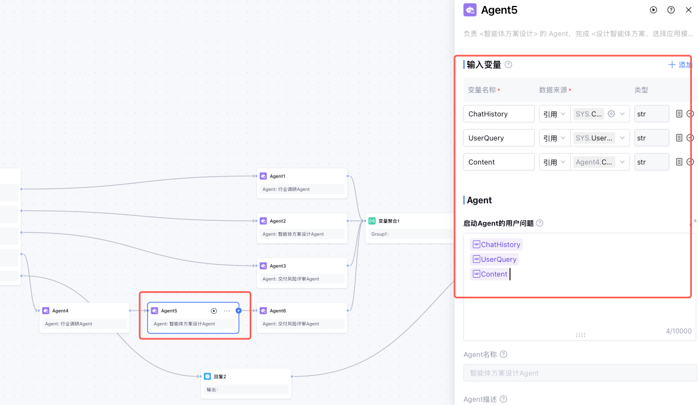

<figcaption>内容创作助手实战</figcaption>

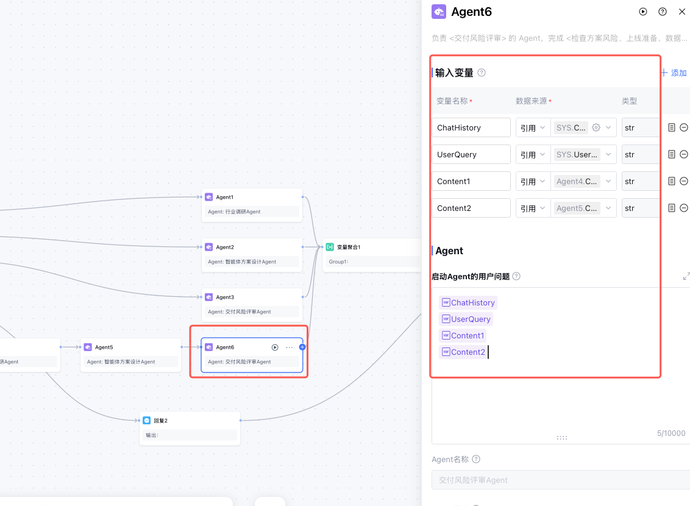

<figcaption>内容创作助手实战</figcaption>

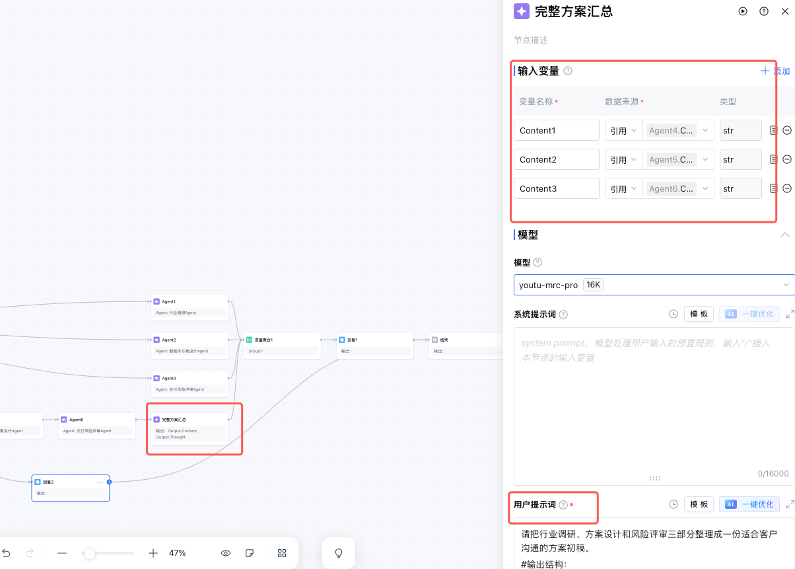

<figcaption>内容创作助手实战</figcaption>

## 完整方案分支｜最终汇总提示词

请把行业调研、方案设计和风险评审三部分整理成一份适合客户沟通的方案初稿。

**输出结构：**

1. 客户需求理解

2. 行业与场景机会

3. 推荐智能体方案

4. 第一版 Demo 范围

5. 交付风险与前置条件

6. 下一步需要客户补充的信息

要求语言简洁、结构清晰，不要编造数据和客户案例。

完整方案分支一定要把前一个 **Agent** 的输出传给后一个 **Agent**，否则多个 **Agent**
 只是“各说各话”，没有形成真正协作。

## **Step 14：添加变量聚合和回复节点**

前面四个分支最终都会产生一个结果。为了让用户在对话窗口看到输出，需要把各分支结果汇总到同一个回复节点。

- 在四条分支的末尾添加“变量聚合”节点。

- 把行业调研分支、方案设计分支、风险评审分支、完整方案分支的最终输出都加入聚合变量。

- 变量聚合的作用是从多条分支中取非空输出。

- 在变量聚合后添加“回复”节点。

- 回复节点内容选择变量聚合的输出。

- 将回复节点连接到结束节点。

- 为意图识别的“其他意图”分支添加回复节点，进行兜底回复。

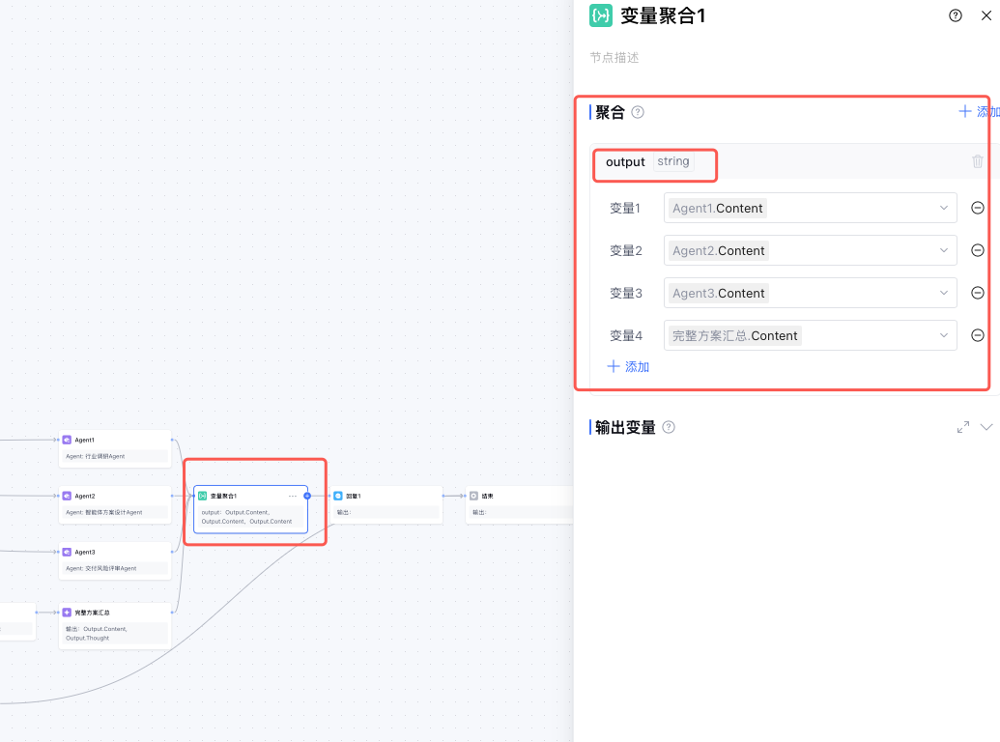

<figcaption>内容创作助手实战</figcaption>

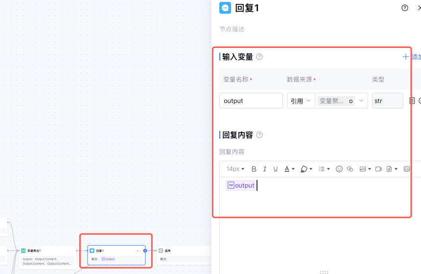

<figcaption>内容创作助手实战</figcaption>

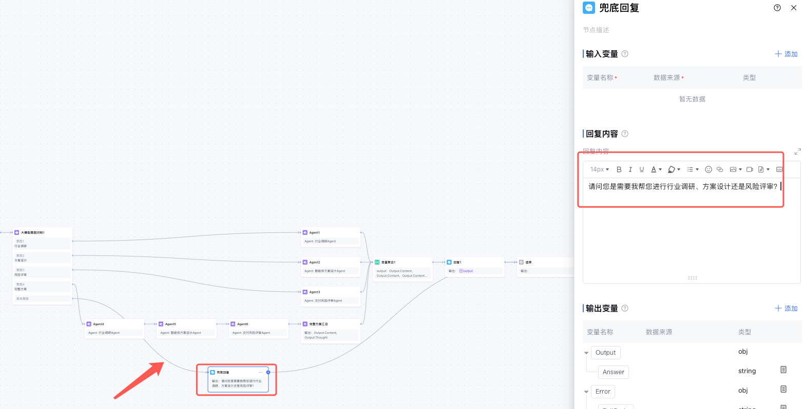

<figcaption>内容创作助手实战</figcaption>

如果你只在结束节点里配置输出变量，用户对话窗口可能看不到结果。需要使用“回复节点”把内容真正返回给用户。

## **Step 15：调试工作流编排效果**

现在用测试集验证每个分支是否能准确路由，并检查输出是否符合对应 Agent 的职责。

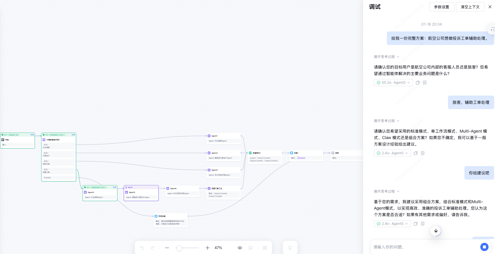

<figcaption>内容创作助手实战</figcaption>

常见问题修复

如果路由错误，先优化意图识别描述；如果 **Agent** 输出跑偏，优化该 **Agent** 的系统提示词；如果完整方案缺少前后衔接，检查后一个
 **Agent** 是否引用了前一个 **Agent** 的输出变量。

**此外，如果效果不理想，可以尝试切换****agent****的模型，对比效果。**

## **Step 16：配置欢迎语和示例问题**

Multi-Agent 应用更需要清晰的开场引导。用户需要知道自己可以选择“调研、设计、评审、完整方案”这几种任务。

## 欢迎语

你好，我是客户方案共创助手。我由多个专家 Agent 协作完成任务，可以帮助你做：

行业调研：了解某个行业或场景有哪些智能体机会；

方案设计：把客户需求转成可搭建的智能体方案；

风险评审：检查方案上线前的资料、权限、合规、评测和运营风险；

完整方案：从场景机会到方案设计，再到交付风险，生成一版方案初稿。

请告诉我你的需求。

## 示例问题

帮我看看零售行业门店运营有哪些智能体可落地场景。

客户想做一个员工制度问答助手，应该用什么模式？

给我一份完整方案：航空公司想做投诉工单辅助处理。

配置完成后，可以清空历史对话记录，看欢迎语和示例问题是否显示。如果没有显示，可以尝试刷新一下页面。

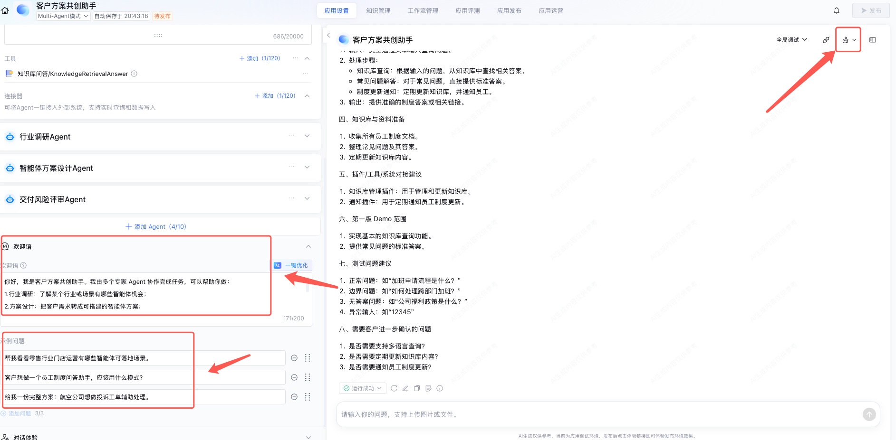

<figcaption>内容创作助手实战</figcaption>

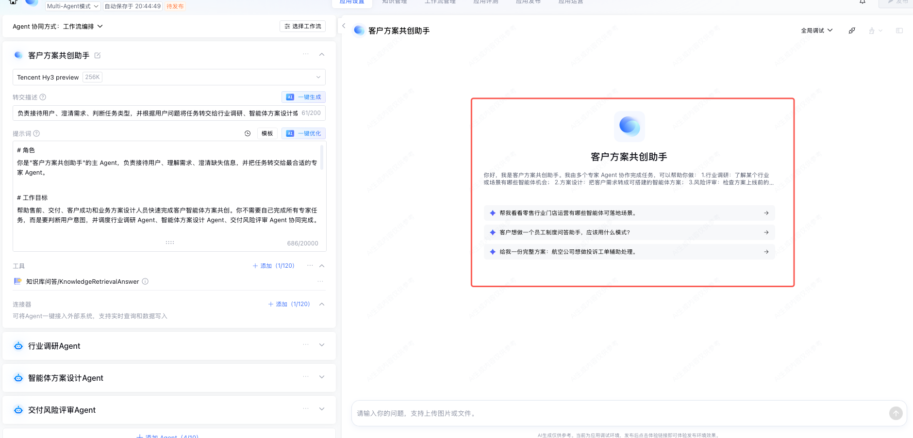

<figcaption>内容创作助手实战</figcaption>

## **Step 17：发布应用**

调试通过后，将应用发布为用户可访问的版本。每次修改 Agent 提示词、插件、工作流或欢迎语后，都需要重新发布，用户侧才能看到最新效果。

- 进入“应用发布”页面。

- 查看待发布变更项，确认包含 Agent 配置、插件、知识库、工作流、欢迎语和示例问题。

- 填写版本说明。

- 点击“发布”。

- 发布完成后，复制分享链接。

- 用用户视角打开分享链接，再测试一遍示例问题。

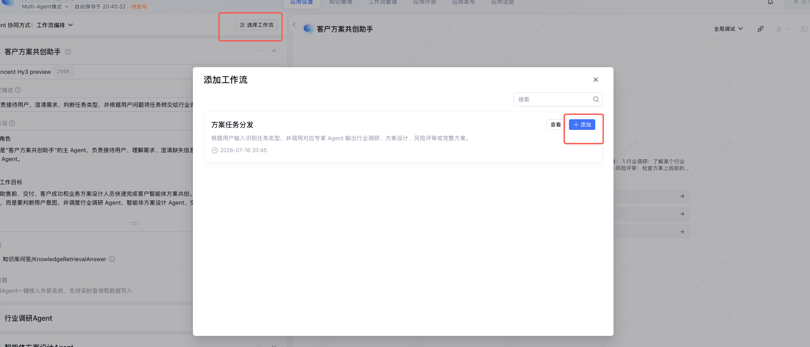

<figcaption>内容创作助手实战</figcaption>

## 发布版本说明

V1.0 Multi-Agent 实战应用：完成客户方案共创助手基础搭建。新增主 Agent、行业调研 Agent、智能体方案设计 Agent、交付风险评审
 Agent；完成自由转交测试，并通过工作流编排实现行业调研、方案设计、风险评审和完整方案四类任务路由。

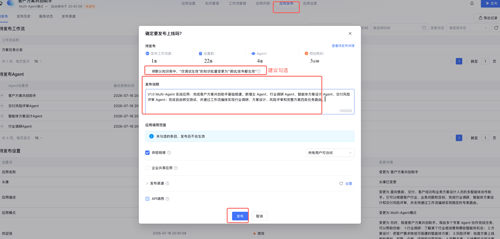

<figcaption>内容创作助手实战</figcaption>

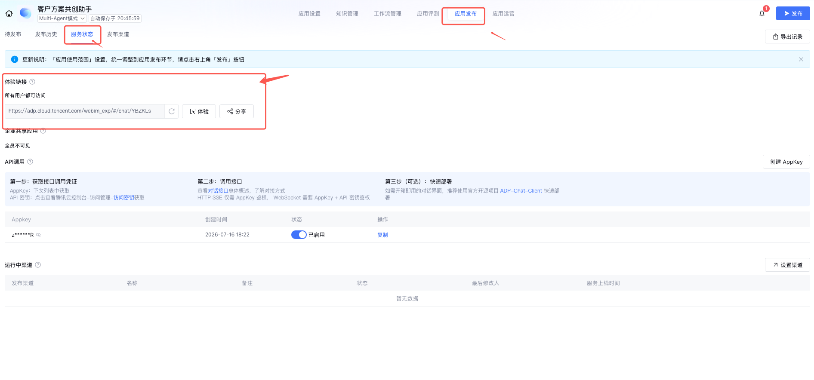

<figcaption>内容创作助手实战</figcaption>

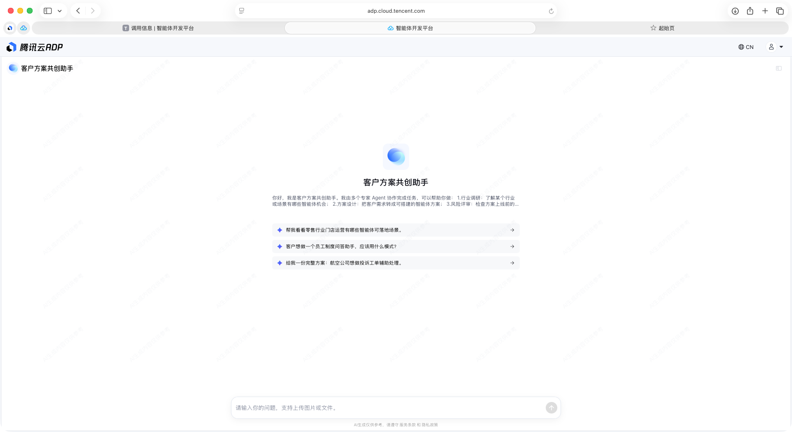

<figcaption>内容创作助手实战</figcaption>

发布后一定要用用户视角再测一次。开发态调试成功，不代表用户侧一定已经拿到最新版本。

## **最终效果：你应该看到这些回答**

下面是用来进行测试的case。

## 测试case

帮我看看零售行业门店运营有哪些智能体可落地场景。

客户想做一个员工制度问答助手，应该怎么设计？

请评审这个方案：上传公司制度文档后让所有员工直接问答。

给我一份完整方案：航空公司想做投诉工单辅助处理。

## **课后练习：把专家组换成自己的业务场景**

完成本节跟练后，可以保持 Multi-Agent 结构不变，只替换 Agent 角色、知识库和示例问题，迁移到自己的业务场景。

保留“主 **Agent** + 多个专家 **Agent** + 工作流编排”的结构，但要重新定义每个 **Agent**
 的职责、转交描述、提示词和测试集。完成后至少用 10 条问题验证路由准确性。
