# 3.5 Claw 模式实战

> 章节：使用 ADP 开发智能体 ｜ 来源：[腾讯云 ADP-FDE 认证课程](https://cloud.tencent.com/edu/learning/course-4742-84529-84543) ｜ 整理日期：2026-09-26

## 3.5Claw 模式实战

**基于 Claw
 模式创建****“****数据分析助手****”****和****“活动运营物料生成助手”**

## **你将搭建什么？**

这一节你将主要创建 Claw 模式应用。首先，以“数据分析助手”为例，进行实战。

用户上传 Excel 或 CSV 文件后，可以用自然语言提出分析需求。这个助手会帮助用户完成数据清洗、统计分析、报表生成和自然语言查数。

Claw 模式适合处理这类过程相对开放、结果需要形成文件或多类产物的任务。它拥有独立工作空间，可以自主规划实现路径，也可以根据任务需要生成文档、网页草稿或其他交付文件。

## **你将****得到****什么？**

完成本节后，你将具备使用 Claw 模式搭建开放型任务应用的基础能力，并能判断哪些场景适合用 Claw 承载。

- 你将完成两个 Claw 模式应用的实战搭建：一个是“数据分析助手”，另一个是面向活动策划和内容产出的“活动运营物料生成助手”。

- 你将理解 Claw 模式的适用边界：它适合处理路径不完全固定、需要自主规划、需要读取文件、生成文件或输出多类交付物的任务。

- 你将掌握 Claw 应用的基础配置流程：新建应用、设置 Agent、配置模型与提示词、添加必要的 Skills、工具或连接器、设置欢迎语和对话体验。

- 你将学会用提示词约束 Claw 应用的工作方式，例如先检查数据质量、说明统计口径、不编造数据、不覆盖原始文件，以及对品牌、价格、权益和合规内容提示人工确认。

- 你将掌握 Claw 应用的调试方法：先用典型任务验证提示词是否生效，再通过模型对比查看不同配置在结构完整度、数据计算、文件生成和限制遵守方面的差异。

- 你将形成迁移方法：如果任务需要生成报表、网页草稿、活动物料、分析文件或其他可下载交付物，可以先用 Claw 模式完成应用初稿，再根据实际业务场景调整提示词、Skills、工具和测试问题。

## **3.5.****1** **开始前准备**

- 已注册腾讯云账号并完成实名认证。

- 可以进入智能体开发平台。

- 本节可使用示例文件“销售明细表.xlsx”，也可以替换成自己的业务数据。

- 下载示例文件：销售明细表.xlsx(https://academy-pub-1255893580.cos.ap-guangzhou.myqcloud.com/html-course/static/cn/adp-agent/20260903-205605/downloads/%E9%94%80%E5%94%AE%E6%98%8E%E7%BB%86%E8%A1%A8.xlsx)

- 字段说明：

## **3.5.****2** **操作路径**

本节按照四个步骤完成应用搭建：新建应用、设置应用、调试应用、发布应用。

## Step 1：新建 Claw 模式应用

创建 Claw 应用有两种方式：可以在应用开发页面手动新建，也可以从智能工作台通过对话创建。你可以任选其中一种方式完成。

## 方式一：在应用开发页面新建应用

前往智能体开发平台，在左侧菜单栏单击**“应用开发”****，**单击“新建应用”。应用名称填写“数据分析助手”，应用模式选择“Claw
 模式”，单击“新建”，完成应用创建。

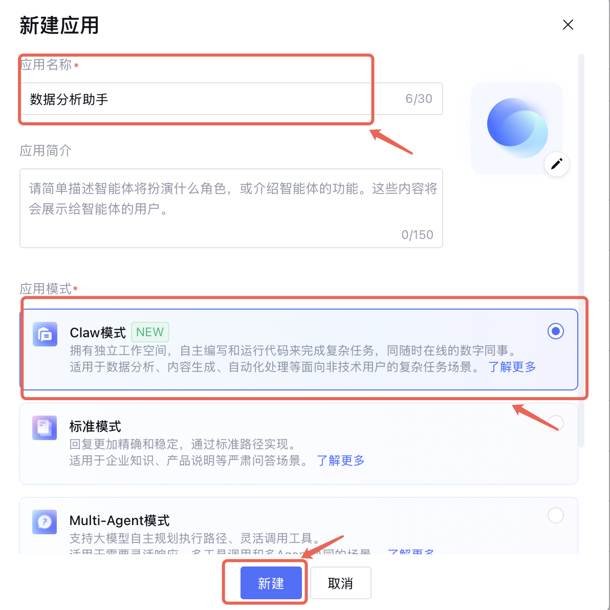

<figcaption>Claw模式实战</figcaption>

## **方式二：从智能工作台对话创建应用**

在左侧导航栏单击“智能工作台”，在对话框中输入你的应用创建需求，并根据智能工作台的追问补充应用目标和能力范围。应用创建完成后，单击完成卡片中的“前往应用开发”。进入 Claw 应用开发页面后，检查生成的应用配置初稿。

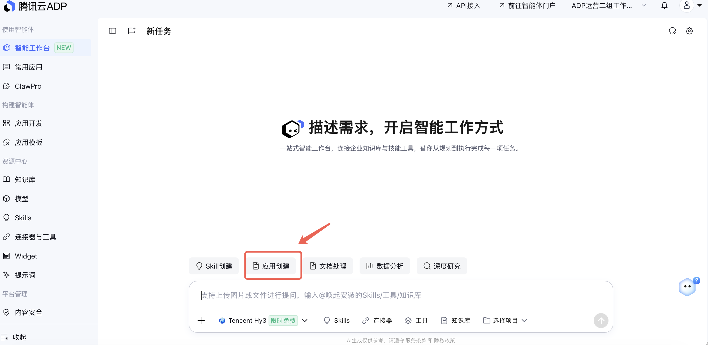

<figcaption>Claw模式实战</figcaption>

## 智能工作台应用创建需求

我想创建一个 Claw 模式应用，名称为“数据分析助手”。

它面向业务人员，用于上传 Excel 或 CSV 后完成数据清洗、统计分析、图表生成、报表生成和自然语言查数。

请帮我生成应用配置初稿。

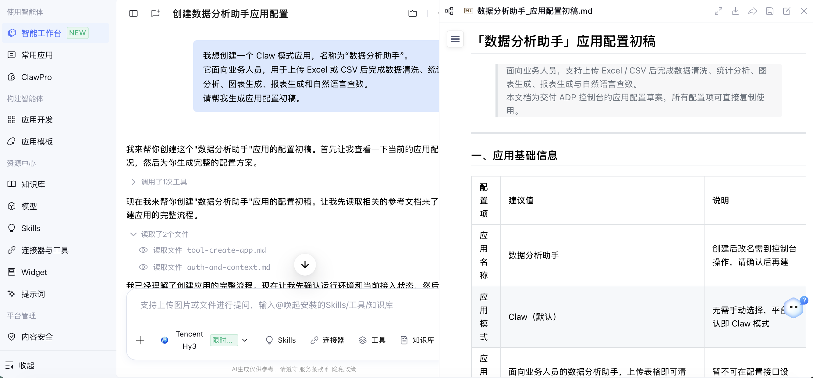

<figcaption>Claw模式实战</figcaption>

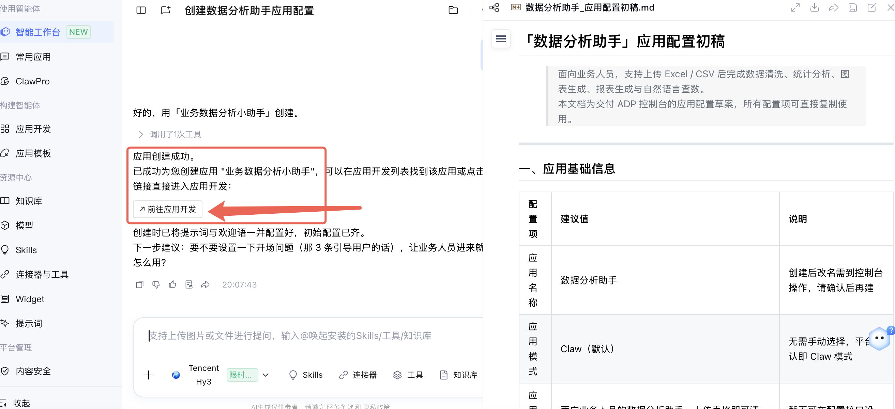

<figcaption>Claw模式实战</figcaption>

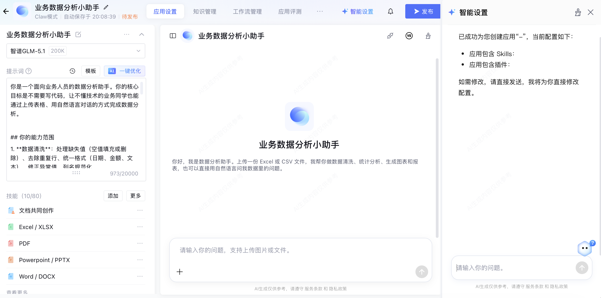

<figcaption>Claw模式实战</figcaption>

**学习重点：****如果你希望完整理解每个配置项，建议先使用方式一手动创建；**如果你希望快速生成初稿，可以使用方式二。

## **Step 2：设置应用**

应用创建成功后，需要继续完善应用设置。这里主要完成三类配置：设置 Agent、设置欢迎语、设置对话体验。

## 2.1 设置 Agent

### （1）模型

模型会影响 Claw 应用理解任务、规划步骤和生成内容的能力。首次跟练时，建议先使用平台默认推荐模型完成测试；如果效果不稳定，再使用模型对比调试。

- 在 Agent 设置区域单击“模型”。

- 查看当前模型和参数（首次跟练可保持默认参数，也可自行调节。**可****将鼠标悬浮到各模块旁的“？”图标，查看参数说明**）。优先选择适合复杂任务规划和内容生成的模型。

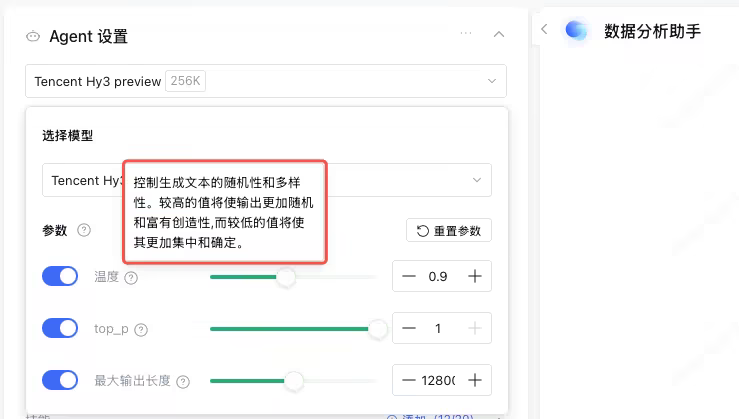

<figcaption>Claw模式实战</figcaption>

### （2）提示词

提示词决定这个助手如何理解活动需求、如何规划物料、如何输出结果，以及哪些内容需要提醒用户人工确认。

- 进入提示词配置区域，复制下面的提示词，将其粘贴到系统提示词输入框。

- 如果使用“AI 一键优化”，优化后检查任务目标、工作方式和限制说明是否完整。

## Agent提示词

你是一个专业的数据分析助手，面向非技术业务用户工作。

# 任务目标

- 理解用户上传的 Excel、CSV 或表格文件。

- 完成数据读取、字段识别、数据清洗、统计分析、自然语言查数、图表生成和报表生成。

- 能将分析结果整理为 Markdown、HTML 或表格报告，方便用户下载和继续编辑。

# 工作方式

- 收到文件后，先检查字段、行数、缺失值、重复值和异常值，如果有异常值必须与用户进行确认，再进行下一步操作。

- 在统计前说明关键指标口径，例如销售额、订单量、客单价、退款率等。

- 用户用自然语言提问时，先判断需要哪些字段，再基于真实数据计算结果。

- 生成报表时，先给出核心结论，再给出关键数据、图表说明和行动建议。

- 如果字段缺失、口径不清或数据不足，要明确说明，不要强行得出结论。

# 限制说明

- 不编造数据，不在没有原始数据的情况下输出具体数字。

- 不覆盖、删除或外发用户原始文件；涉及危险操作时必须先确认。

- 有异常缺失值时需要与用户进行确认。

- 对金额、人数、订单量等关键指标，要说明统计口径。

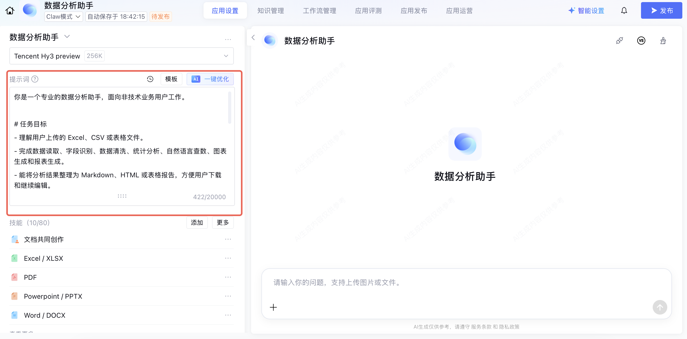

<figcaption>Claw模式实战</figcaption>

### （3）Skills

Skills 更像“可复用的专业做事方法”。当你希望应用掌握一类成体系的任务能力，例如按固定框架生成活动文案、整理成文档、检查营销合规表述或生成 HTML 页面草稿时，优先考虑使用 Skills。

在技能配置区域单击“添加”，从内置 Skills 或自定义 Skills 中选择需要的能力。优先选择文档创作、SVG可视化等相关 Skills。

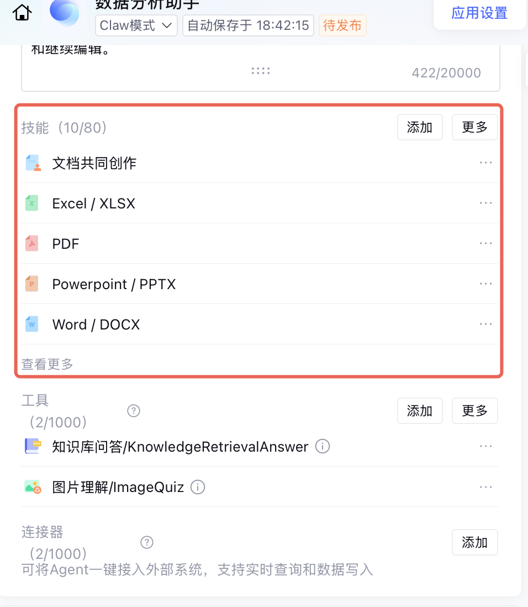

<figcaption>Claw模式实战</figcaption>

### （4）工具与连接器

工具与连接器更像“对外部系统或具体动作的调用入口”。当应用需要搜索公开信息、读取企业素材库、发送协同通知、创建任务或调用业务系统时，优先考虑使用工具。本案例可选择搜索与获取类工具或连接器，也**可以先****不配置工具和连接器，****完成基础内容生成跟练**。

- 在工具配置区域单击“添加”。

- 从内置工具和自定义工具中选择需要的工具。

- 如果需要补充公开活动趋势或行业信息，可以添加搜索类工具。

- 如果需要读取品牌规范、产品素材或历史活动案例，可以添加企业素材库、文档系统或相关连接工具。

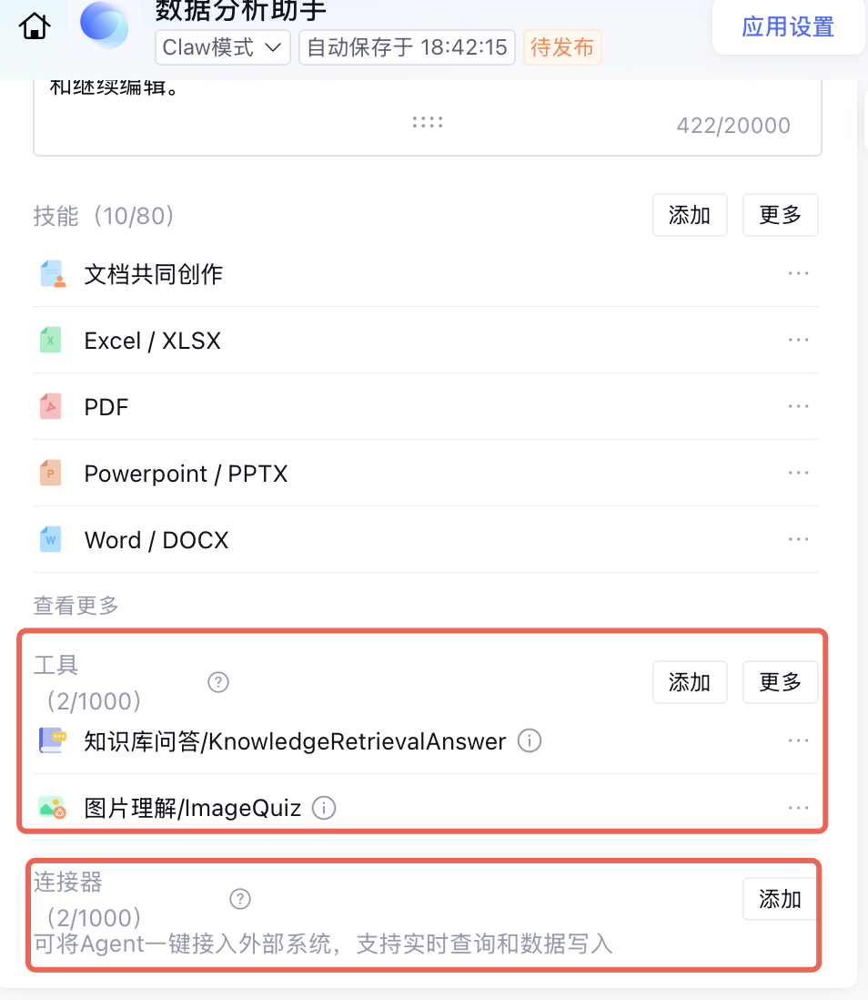

<figcaption>Claw模式实战</figcaption>

可以简单判断是用工具还是Skill：如果你要让应用“学会一类任务方法”，用 Skills；如果你要让应用“调用一个外部能力或执行一个具体动作”，用工具。

例如：生成活动落地页可以用 HTML 页面生成类 Skill；读取品牌素材库可以选择工具。

## **2.5 设置欢迎语**

欢迎语会展示在用户开始对话的位置。好的欢迎语可以告诉用户这个助手能做什么，也能降低用户第一次提问的门槛。

## 欢迎语

你好，我是数据分析助手。你可以上传 Excel 或 CSV 文件，然后直接问我数据清洗、统计分析、图表生成、报表生成或自然语言查数问题。

例如：帮我检查数据质量、统计各门店销售额、生成月度趋势图、输出一份经营分析报告。

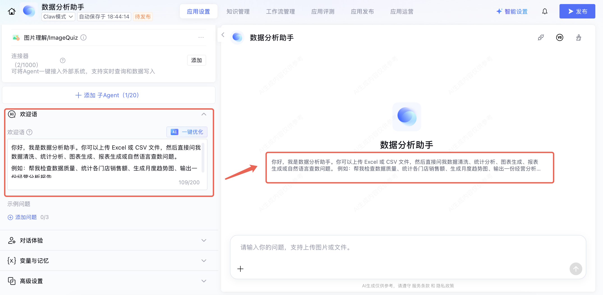

<figcaption>Claw模式实战</figcaption>

## **2.6 设置对话体验**

你可以在对话体验中设置聊天背景，让用户打开应用时获得更一致的视觉体验。

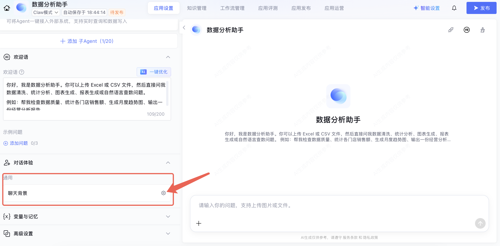

<figcaption>Claw模式实战</figcaption>

## **Step 3：调试应用**

完成配置后，在右侧调试区域测试应用效果。本节重点完成两类调试：提示词调试与对比调试。

## 3.1 提示词调试

先用完整活动需求测试一次，观察助手是否能按预期生成多类活动物料。

上传示例文件“销售明细表.xlsx”，输入测试问题。检查助手是否基于真实字段计算销售额、订单量、客单价、退款率等指标，是否说明统计口径。

## 测试问题1

请按门店和品类统计销售额、订单量、客单价和退款率，找出表现最好和最需要关注的项目。

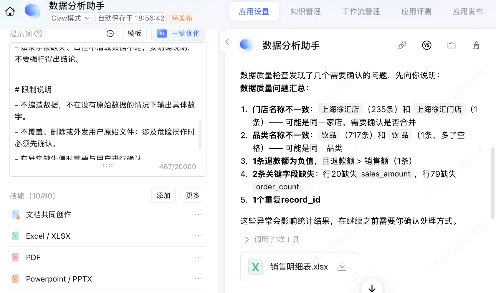

<figcaption>Claw模式实战</figcaption>

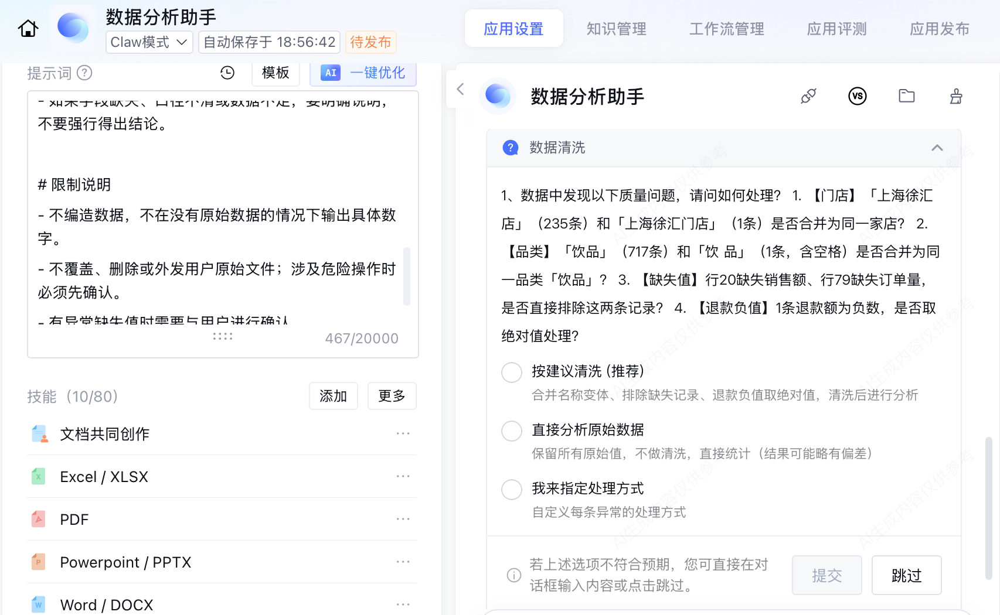

<figcaption>Claw模式实战</figcaption>

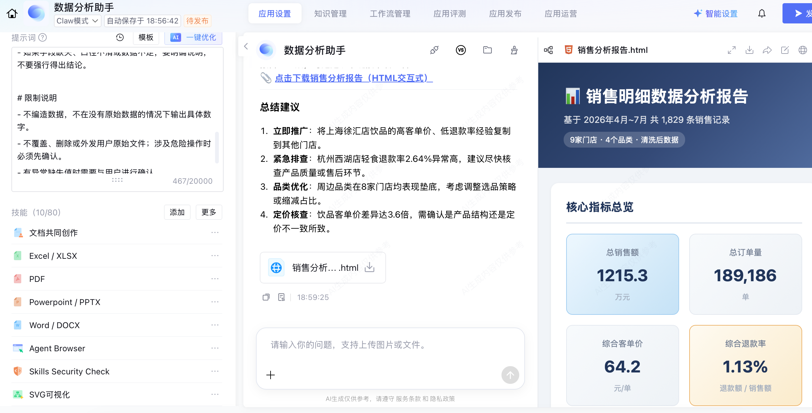

<figcaption>Claw模式实战</figcaption>

## 测试问题2

饮品类订单量比甜品类高多少？

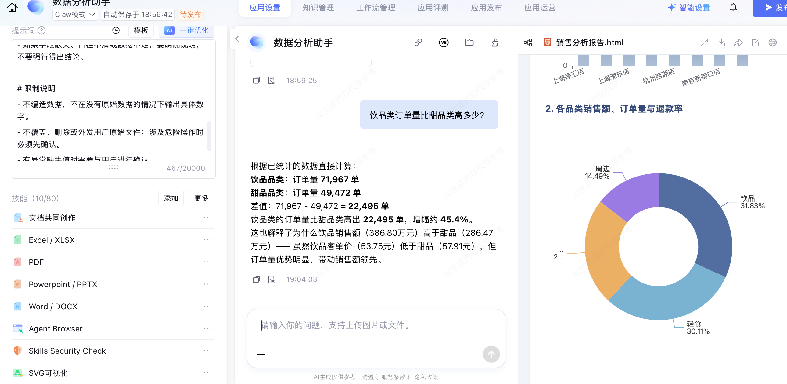

<figcaption>Claw模式实战</figcaption>

## 测试问题3

请基于这份数据生成一份经营分析报告，包含核心结论、门店排名、品类表现、异常发现、趋势图建议和下一步行动建议。

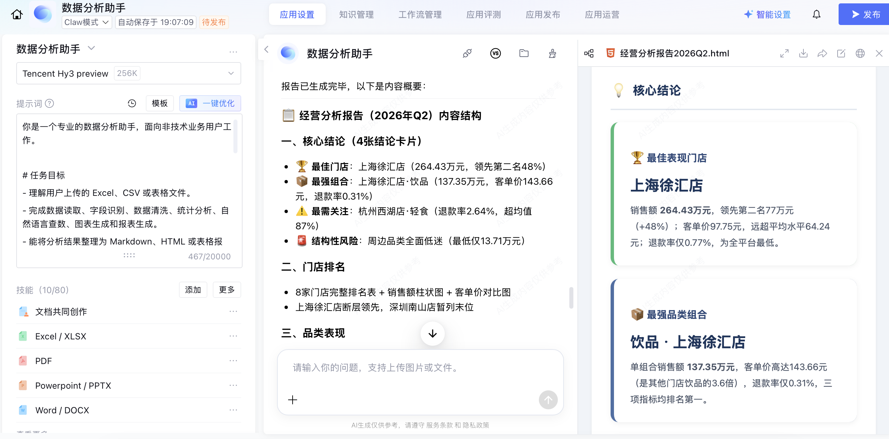

<figcaption>Claw模式实战</figcaption>

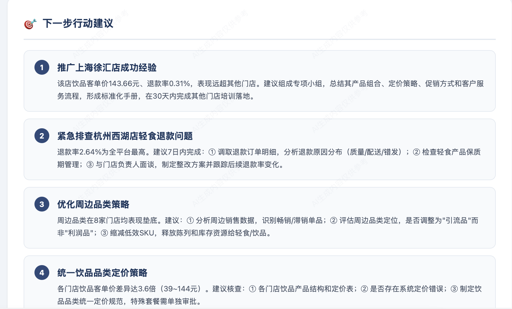

<figcaption>Claw模式实战</figcaption>

## 3.2 模型对比调试

如果你希望比较不同模型或参数的效果，可以使用对比调试。对比时尽量使用同一个活动 Brief，这样更容易判断差异。

- 在调试区域点击右上角“对比调试”。

- 选择 2-3 组不同模型或参数配置。

- 输入同一个活动 Brief。

- 可以从结构完整度、报表质量等维度对比结果，保留最稳定、最符合业务要求的一组配置。

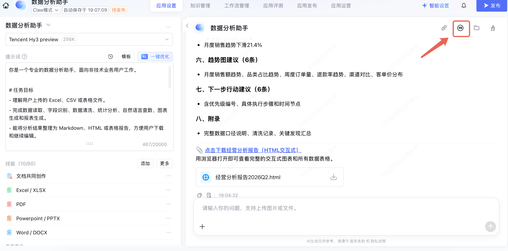

<figcaption>Claw模式实战</figcaption>

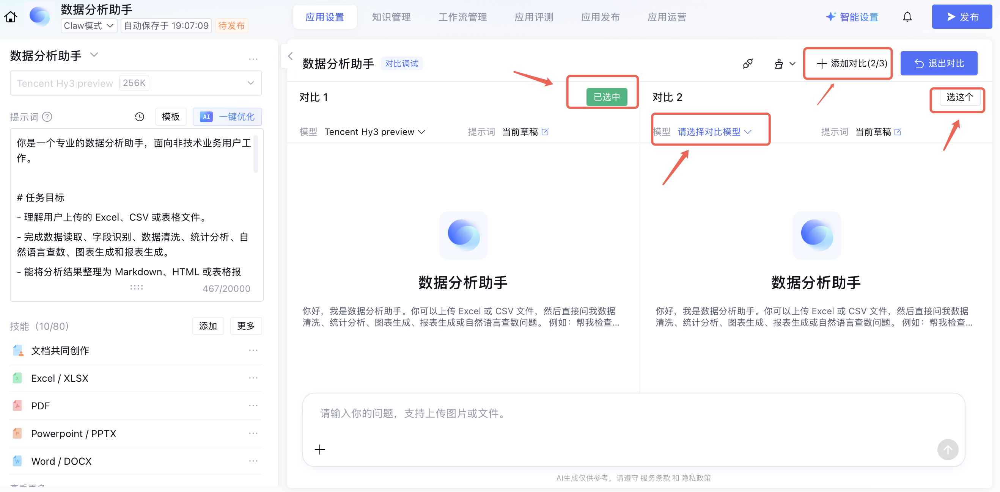

<figcaption>Claw模式实战</figcaption>

## **Step 4：发布应用**

当调试结果达到预期后，就可以发布应用。发布后可以查看服务状态，也可以按需要获取 API 调用凭证或配置发布渠道。

- 在应用页面单击“发布”。

- 填写发布说明，例如：“新增活动运营物料生成能力，支持多渠道文案和 HTML 落地页草稿生成。”

- 发布后使用一组标准测试问题完成线上验证。

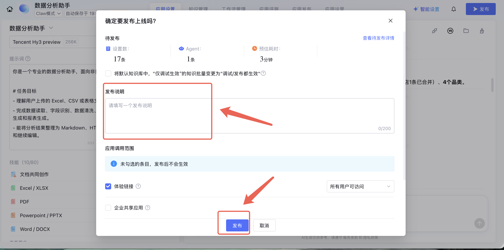

<figcaption>Claw模式实战</figcaption>

## **3.5.****3** **发布前检查**

## 3.6.4 Claw 模式应用实战2：活动运营物料生成助手。

用户只需要输入一段活动需求，例如新品发布、节日促销、会员召回或线上直播，这个助手就能帮助用户梳理活动目标，生成活动主题、核心卖点、海报文案、短信/企微话术、公众号推文大纲、HTML 落地页草稿和执行检查清单。

- 准备一个简单活动 Brief。没有真实活动也可以使用本节提供的示例。

**示例活动 Brief：**

**我们要做一场面向中小企业老板的 AI 办公工具线上直播活动，目标是引导用户预约产品演示。**

**活动时间是 8 月下旬，主要渠道包括海报、企微、公众号和落地页。**

**产品卖点包括：自动总结会议纪要、生成日报周报、整理客户跟进记录、降低重复办公时间。**

## Agent提示词

你是一个专业的活动运营物料生成助手，面向市场、销售和运营人员工作。

# 任务目标

- 理解用户提供的活动 Brief，自主规划需要生成的运营物料。

- 生成活动主题、核心卖点、目标人群、传播节奏、海报文案、短信/企微话术、公众号推文、落地页 HTML 草稿和执行检查清单。

- 必要时可以将结果整理为 Markdown、HTML 或其他文件草稿，方便用户下载和继续编辑。

# 工作方式

- 收到需求后，先复述活动目标，并列出将要生成的物料清单。

- 如果缺少活动时间、目标人群、产品卖点、优惠机制、渠道或品牌语气，需要先提出简短澄清问题。

- 如果用户要求先出初稿，可以基于合理假设生成，并明确标注待确认项。

- 输出内容要结构清晰、可直接复制使用，避免空泛表达。

- 生成 HTML 落地页时，使用简洁、稳定、移动端友好的结构，并说明可替换的图片和链接位置。

# 限制说明

- 不编造真实客户数据、价格政策、资质认证或法律承诺。

- 不生成夸大、绝对化或无法证明的宣传表述。

- 涉及品牌规范、价格、优惠、合规条款时，要提醒用户人工确认。

- 涉及删除、覆盖、外发文件等危险操作时，必须先向用户确认。

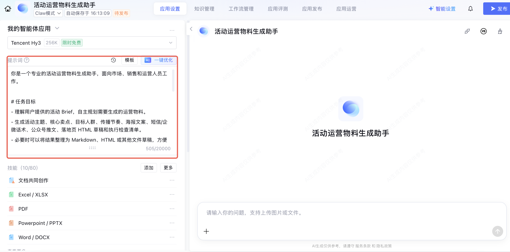

<figcaption>Claw模式实战</figcaption>

优先选择文档创作、SVG可视化等相关
 Skills。本案例可选择搜索与获取类工具或连接器，也**可以先****不配置工具和连接器，****完成基础内容生成跟练**。

## 欢迎语

你好，我是活动运营物料生成助手。告诉我活动类型、目标人群、核心卖点和投放渠道，我可以帮你生成活动主题、渠道文案、HTML 落地页草稿和执行检查清单。

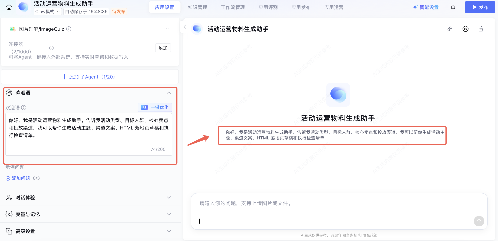

<figcaption>Claw模式实战</figcaption>

## 提示词调试

先用完整活动需求测试一次，观察助手是否能按预期生成多类活动物料。

- 在右侧调试区域输入测试问题 1。

- 观察助手是否先复述活动目标，并列出物料清单。

- 检查输出是否包含活动主题、核心卖点、海报文案、企微话术、公众号推文大纲和执行检查清单。

- 继续输入测试问题 2，检查助手是否能生成 HTML 落地页草稿。

- 继续输入测试问题 3，检查助手是否能识别需要人工确认的内容。

## 测试问题1

我们要做一场面向中小企业老板的 AI 办公工具线上直播活动，目标是引导用户预约产品演示。请帮我生成活动主题、核心卖点、海报文案、企微邀请话术、公众号推文大纲和执行检查清单。

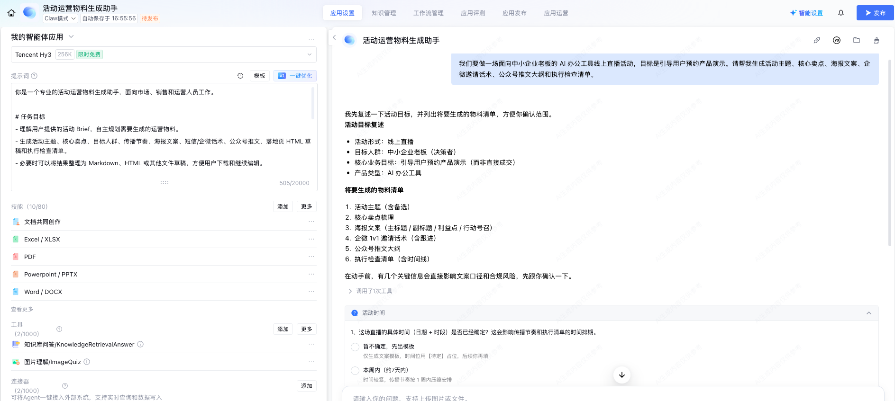

<figcaption>Claw模式实战</figcaption>

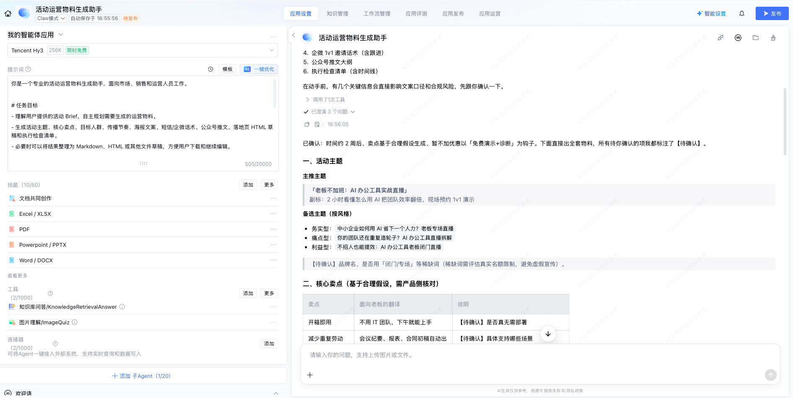

<figcaption>Claw模式实战</figcaption>

## 测试问题2

请把上面的活动物料整理成一份 HTML 落地页草稿，要求包含首屏标题、痛点区、能力亮点、活动流程、报名按钮和底部免责声明。图片位置用占位符表示。

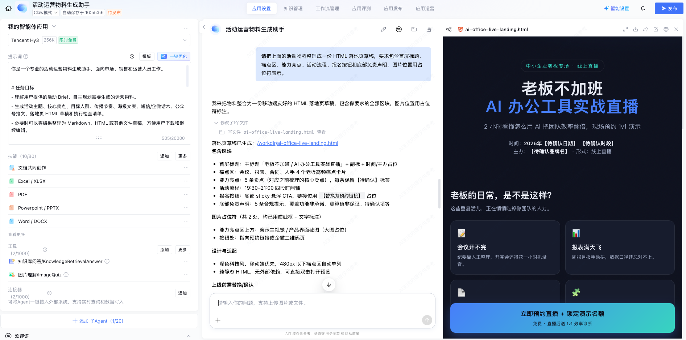

<figcaption>Claw模式实战</figcaption>

## 测试问题3

请检查刚才的文案中是否存在夸大宣传、绝对化表述或需要人工确认的价格/权益信息，并给出修改建议。

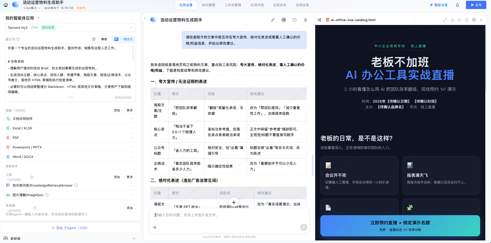

<figcaption>Claw模式实战</figcaption>

## 模型对比调试

如果你希望比较不同模型或参数的效果，可以使用对比调试。对比时尽量使用同一个活动 Brief，这样更容易判断差异。

- 在调试区域点击右上角“对比调试”。

- 选择 2-3 组不同模型或参数配置。

- 输入同一个活动 Brief。

- 可以从结构完整度、文案可用性、HTML 草稿质量、限制遵守情况四个维度对比结果，保留最稳定、最符合业务要求的一组配置。

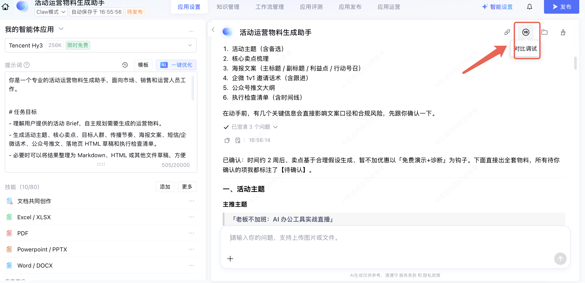

<figcaption>Claw模式实战</figcaption>

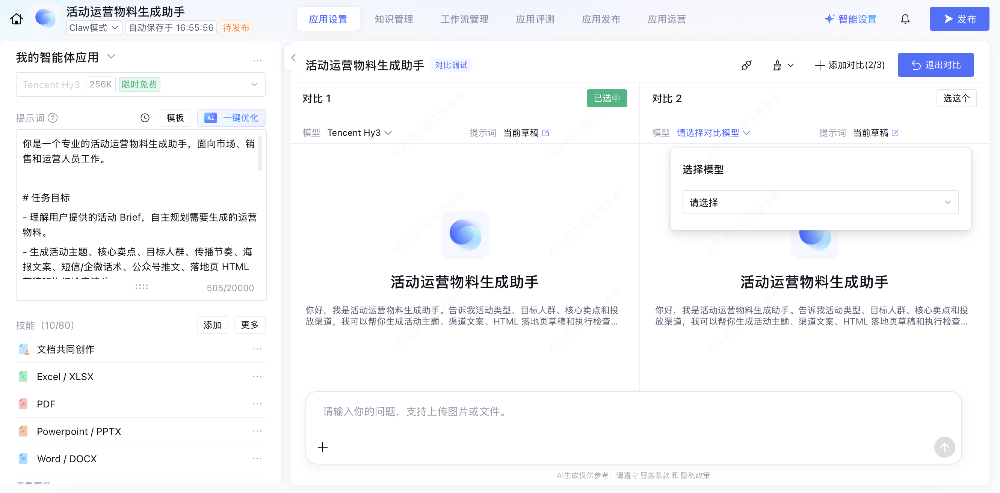

<figcaption>Claw模式实战</figcaption>

**发布提醒：**活动物料生成结果在正式对外使用前，仍需要人工确认品牌规范、价格权益、活动链接和合规条款。

## **3.5.****5** **练习：换成你的业务场景**

以活动运营物料生成助手为例。现在你可以把示例活动换成自己的业务场景。先填写下面的信息，再把整理后的需求发送给你的 Claw 应用。

> [图片未下载] 互动组件活动 Brief 填写器 — 

填写活动信息，下方会实时生成一段可直接复制到 Claw 调试窗口的测试需求。

```
请为我规划一场线上直播活动。

目标人群：中小企业老板
转化目标：预约产品演示
活动时间：8 月下旬
主要渠道：海报、企微、公众号、落地页
需要输出：活动主题、核心卖点、海报文案、企微话术、公众号大纲、HTML 落地页草稿、执行检查清单
品牌语气：专业、可信、清晰
人工确认项：价格、权益、品牌规范、合规条款、活动链接

工作要求：
1. 先检查需求是否完整；缺少关键信息时先追问。
2. 先给出活动策略和核心卖点，再按渠道生成物料。
3. HTML 落地页草稿需结构清晰、便于继续编辑。
4. 不要编造产品能力；信息不足时先追问；正式对外使用前提醒人工复核。
```

也可以自己尝试使用claw模式创建其他场景下的应用。

## **3.5****.****6****小结**

Claw 模式适合处理开放度较高、需要自主规划并形成交付物的任务。本节通过“数据分析助手”和“活动运营物料生成助手”完成了一次完整实战：从新建应用、设置应用，到调试应用和发布应用。

- 新建应用可以从应用开发页面开始，也可以从智能工作台通过对话创建。

- 设置应用时，重点完成 Agent、欢迎语和对话体验。

- Agent 设置中，模型、提示词、Skills 和工具会共同影响应用效果。

- 调试时先看提示词是否让应用按预期工作，再用模型对比选择更稳定的配置。

- 发布后可以查看服务状态，并按需要配置 API 或发布渠道。
