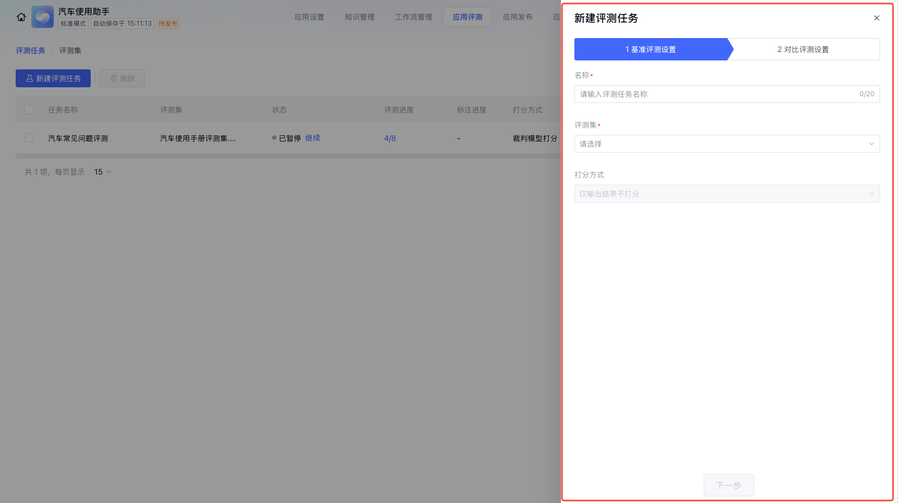
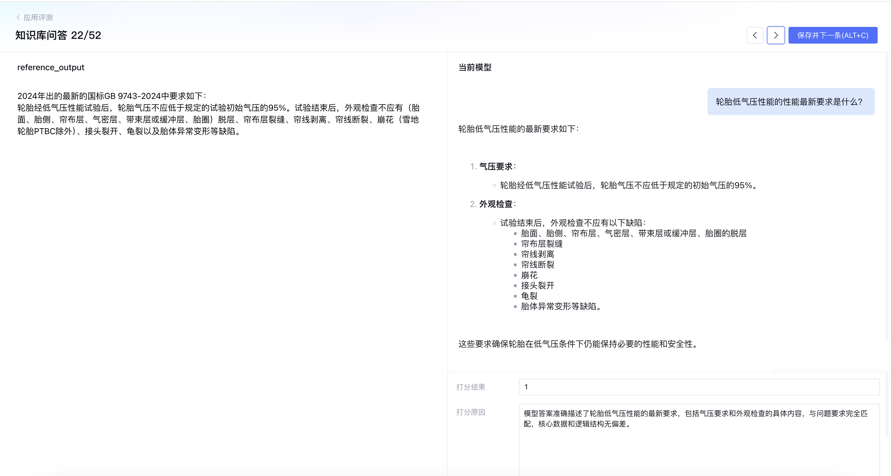

# 4.1 智能体调试与评测基础

> 章节：评测与优化智能体 ｜ 来源：[腾讯云 ADP-FDE 认证课程](https://cloud.tencent.com/edu/learning/course-4742-84530-84545) ｜ 整理日期：2026-09-26

## 4.1智能体调试与评测基础

**智能体调优不是等应用全部搭完后再“统一验收”。真实项目里，更常见的做法是：搭建过程中先在测试环境里一条一条试问、逐个节点排查；应用基本成型后，再用评测集做批量验证、效果对比和回归评测。**

学完这一节，你应该能区分“单次调试”和“批量评测”的使用阶段；能在测试环境里围绕用户输入、知识命中、变量、节点输出、工具调用和最终回复进行单轮排查；能判断什么时候需要建立评测集；能理解“调试—优化—评测—回归”的完整闭环。

## **4.1.1 什么是智能体调试与评测**

智能体调试与评测不是同一件事。**调试更像“边搭边修”，评测更像“阶段验收”**。前者解决当前链路是否跑通、某个问题为什么答错；后者解决一批样本下整体效果是否稳定、某个版本是否比另一个版本更好。

搭建阶段不要急着做大规模评测。先用单次调试把主链路跑通，把明显错误修掉；等应用能力基本稳定后，再用评测集做覆盖性验证。

## （1）为什么不能等搭完再测？

智能体应用往往由 Prompt、知识库、工作流节点、工具接口、变量、模型参数等共同组成。如果等到全部搭完才开始测试，问题会叠在一起，排查成本会非常高。

- 问题来源会变得难以归因：同一个错误可能来自 Prompt、知识没命中、节点变量为空、工具返回异常或模型输出格式不稳定。

- 修改成本会被放大：越晚发现问题，越可能牵连后续节点、数据结构和业务流程。

- 演示样例容易产生误判：少数几个问题答对，不代表真实用户的大量问法都能稳定处理。

- 上线风险不可控：缺少单次调试和批量评测，无法说明应用是否达到了业务验收标准。

## （2）单次调试与批量评测的区别

单次调试和批量评测不是替代关系，而是先后衔接。单次调试解决“当前问题为什么不对”，批量评测解决“整体效果是否稳定”。

实际项目中的推荐节奏是：先用单次调试把主链路跑通，再用小样本做专项验证，最后使用评测集做批量评测。

## **4.1.****2****单次调试：边搭边测、逐轮验证**

测试环境的价值，是让搭建者在不影响正式用户的情况下，反复输入问题、观察链路、修改配置并验证结果。单次调试不是随机问一句，而是带着明确目的去试。

## **（****1****）****单次调试的五步法**

- 明确本轮调试目标：是看知识是否命中、Prompt 是否有效、工具是否可用，还是流程节点是否能跑通。

- 输入一条可解释的问题：问题不要太随机，最好能对应某个知识点、流程节点或边界条件。

- 观察完整链路：不仅看最终回复，还要看中间变量、检索结果、节点输出和工具返回。

- 记录问题与修改动作：每次只改一个主要变量，避免同时改 Prompt、知识库和流程导致无法归因。

- 重新试跑验证：确认问题是否被修复，同时用一两条相邻问题检查是否引入新问题。

常见的调试问题类型可参考下表：

每次单次调试建议保留“问题、期望结果、实际结果、定位原因、修改动作、复测结果”六项记录。后续建立评测集时，这些记录就是最有价值的样本来源。

## （2）**如何根据单次结果定位问题**

每次在测试环境里进行单次调试时，最终回复只是整条执行链路的最后结果。一个回答不符合预期，并不一定意味着 Prompt
 写得不好，也不一定说明模型能力不足。智能体运行过程中还包含意图识别、知识检索、变量传递、节点执行、工具调用、格式生成、异常兜底等多个环节，任何一个环节出错，最后都可能表现为“回答不对”。

因此，单次调试的重点不是反复追问，直到某一次回答看起来满意，而是要**根据问题现象反推最可能出错的环节**。比如，同样是“回答错误”，可能是意图识别走错了分支，也可能是知识库没有命中；同样是“流程失败”，可能是变量没有提取出来，也可能是节点条件判断写错；同样是“输出格式不稳定”，可能是
 Prompt 没给清楚格式约束，也可能是后续解析逻辑缺少容错。

下面这张表可以作为搭建过程中的**单次调试快速诊断表**。使用时，先观察本轮试跑中最明显的问题现象，再根据表格中的“优先怀疑”判断应该先检查哪一层配置，最后按照“排查动作”进入对应位置查看日志、变量、检索结果、节点输出或工具返回。

## **4.1.****3****评测集****：****批量测试**

## （1）什么时候需要评测集

评测集的作用，是用一批相对稳定、可重复运行的样本，验证智能体在核心场景下的整体表现。它不是用来替代搭建过程中的单次调试，也不是越早建立、越大越好。

在应用刚开始搭建时，需求、Prompt、知识库、Workflow、工具调用方式往往都还在变化。如果这时就投入大量精力设计完整评测集，很容易出现两个问题：一是评测样本很快过期，二是评测结果难以归因。比如应用主链路还没跑通时，批量评测失败并不能说明模型效果差，可能只是变量没传、知识没接好、工具没配置成功。

因此，评测集更适合在应用主链路基本稳定、核心场景已经明确后建立。它主要用于三类任务：

- **覆盖性验证**：确认高频问题、复杂问题、边界问题是否都能稳定处理。

- **版本对比**：确认 Prompt、模型、知识库或 Workflow 调整后，新版本是否真的更好。

- **回归验证**：确认修复旧问题后，没有引入新的错误。

下面这张表可以作为判断是否需要建立或更新评测集的参考。

## （2）评测任务

## a.新建评测任务

新建评测任务主要分为两个步骤：**基准评测配置**和**对比评测配置**，在下文中进行详细说明。

### **第一步：基准评测配置**

基准评测配置支持选择评测集，根据应用配置批量运行以获取结果，并设置评分方式，支持裁判模型、规则或代码等多种评分方式。无论选择哪种评分方式，运行后的结果均支持批量下载和界面人工标注。

- **说明：**

- **名称：**评测任务的名称，20字以内，不可重复。

- **评测集：**用于运行应用批量评测任务的评测样本集合。可选择已上传的评测集，支持多选，最多不超过5个。选择的评测集列名必须保持一致，否则系统会提示错误。

- **打分方式：**选择对批量运行后的评测集结果的打分方式，包括：裁判模型打分、规则打分、代码打分、仅输出结果不打分。

<figcaption>智能体调试与评测基础</figcaption>

### 裁判模型打分：

通过大模型评估评测集批量运行结果，包含裁判模型和裁判提示词两部分：

**裁判模型**：选择作为大模型裁判的模型，支持选择不同模型，并可配置模型参数。

**裁判提示词**：用于对评测结果进行打分的模型提示词，支持通过快捷键引入评测集中的查询（query）、预置列、自定义列、应用的输出内容以及其他系统变量。请确保裁判模型提示词与评测集内容的匹配程度，以保证裁判模型能够正确打分。例如，若按照参考答案进行打分，则需要在评测集中上传参考答案（例如：reference_output）。同时支持点击**模板**，查看提示词模板库中更多适合的提示词。

裁判模型打分会产生token消耗，请在严格验证提示词准确性后再启动任务，以避免不必要的消耗。

### 规则打分：

按照预定义的规则对输出结果进行打分。支持单条规则和多条规则组合 。

### 代码打分：

通过编写代码对输出结果进行打分，目前支持Python语言。可直接引用评测集中的 query 、预置列和自定义列。

### 仅输出结果不打分：

仅批量运行评测集，**不进行任何打分**，直接输出结果。选择此方式时，相当于执行任务批处理。

### **第二步：对比评测配置**

对比评测功能用于在同一应用内对多组模型或多个提示词进行效果对比，帮助快速评估不同配置在相同任务下的表现差异。支持的对比方式包括：

- 不进行对比评测

- 多模型对比评测

- 多提示词对比评测

该功能仅支持标准模式的应用。在选择进行对比评测时，可对对比结果进行以下处理方式：

- 仅输出多个结果：生成多个结果，不进行对比打分。

- 对比打分：使用裁判模型对每条样本的多个结果进行评分。

### 不进行对比评测（默认） ：

按照当前应用的测试环境配置运行，不进行模型或提示词的对比。

### 多模型对比评测：

支持添加最多2组对比模型，与当前配置模型进行对比。如果对比模型与当前配置模型相同，系统会提示错误。

### 多提示词对比评测：

支持添加最多2组对比提示词，与当前配置提示词进行对比。如果对比提示词与当前提示词相同，系统会提示错误。

### **是否进行对比打分**

- **仅输出多个结果，不进行对比打分**（默认） ：仅输出多组对比结果，不进行优劣判断。

- **对每条样本的多个输出结果，使用裁判模型进行对比打分**：基于多个版本的运行结果，使用裁判模型进行对比打分，判断优劣。需要选择对比打分裁判模型和对比打分裁判提示词，和裁判模型以及裁判提示词类似。

## b.查看评测报告

跑批完或评测完后可以查看报告，报告中包含基本信息、评测配置信息、基准评测结果、对比打分评测结果、基准评测性能报告、对比评测性能测试报告等内容并支持输出图表，将已有的测试结果数据进行可视化展示。

## c.评测结果标注

评测任务完成后，用户可对运行结果进行人工标注，以提升评测的准确性和参考价值。标注后的结果将体现在评测报告和下载的结果文件中。

<figcaption>智能体调试与评测基础</figcaption>

- 建议在应用评测进行过程中，不要对知识库内容进行更改，包括新增和导入、删除和修改知识库设置，避免影响评测结果。

- 不建议对 Plan-and-Execute 协同方式的 Multi-Agent 应用进行评测，该模式下无法进行完整的应用评测。

## **4.1.****4** **调试—优化—评测—回归的完整闭环**

一个稳定的智能体，不是一次搭建出来的，而是在不断调试、优化和回归中逐步稳定下来的。

## 从“可评测”到“可上线”：交付与运维清单

**生产环境出现高风险错误时：**第一响应不是继续调
 Prompt。先确定受影响的用户、版本和场景，必要时限制入口、关闭相关能力或降级到人工；同时保留请求、命中知识、工具调用和输出日志。随后分析根因、制定修复措施，用回归样本复测并记录处理结果，再决定恢复范围。

**日志也属于受保护数据：**只采集定位和运营所需的最小范围，对姓名、手机号、证件号、薪资、健康等敏感字段脱敏；限制可访问人员，明确保留周期和删除机制，并在适用场景完成告知与授权。日志不能因为“用于调优”而无限期、全量保存。

智能体调试与评测的正确顺序是：搭建过程中先做单次调试，应用成型后再做批量评测；调试解决具体问题，评测证明整体效果；每次优化后都要做回归，才能避免“修好一个问题，又引入三个新问题”。

## **4.1 小结**

- 调试发生在搭建过程中，重点是单次验证和链路排查。

- 评测发生在应用基本成型后，重点是批量样本、指标分析和上线依据。

- 单次调试不要只看最终回复，还要看知识命中、变量、节点、工具和性能。

- 评测集应来自真实业务问题、调试记录和线上 Badcase，而不是凭空编一批题。

- 每次重要优化后都要做回归，确保整体效果持续变好。

进 入 下 一 节

下一节 4.2「Prompt 与模型效果调优」会继续讲：当单次调试发现模型理解、执行、表达或格式控制有问题时，应该如何设计 Prompt、选择模型并验证优化效果。
