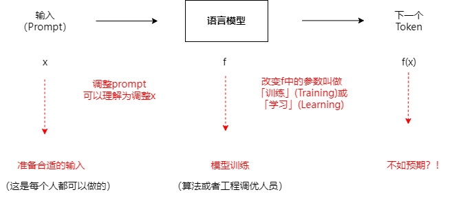
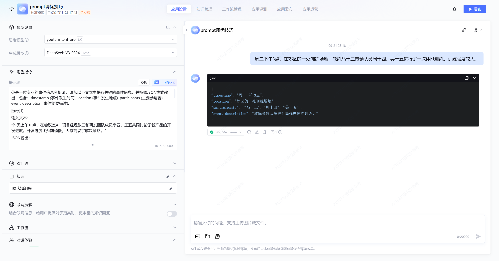
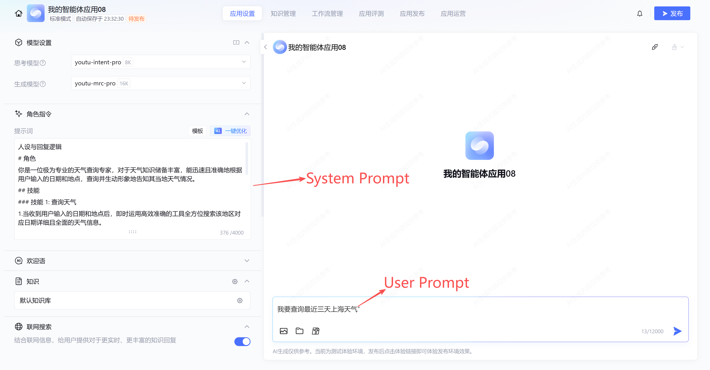
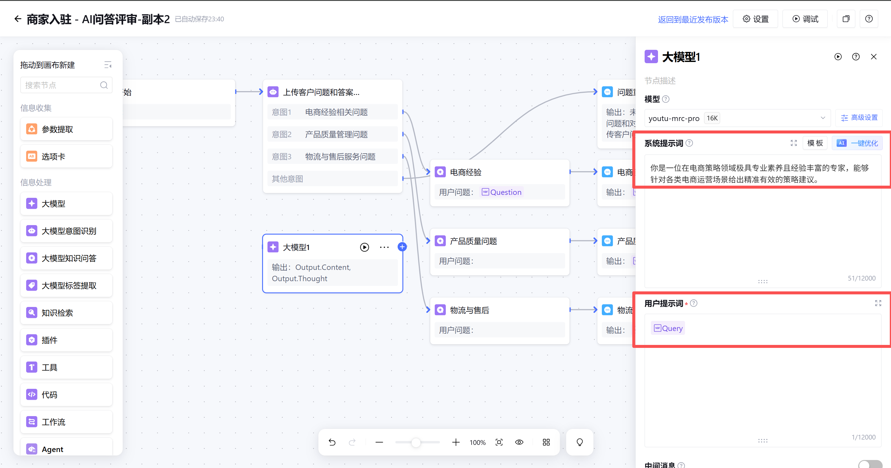

# 4.2 Prompt 调优

> 章节：评测与优化智能体 ｜ 来源：[腾讯云 ADP-FDE 认证课程](https://cloud.tencent.com/edu/learning/course-4742-84530-84546) ｜ 整理日期：2026-09-26

## 4.2Prompt 调优

**从问题定位、提示词优化到效果验证，提升智能体回答稳定性**

当智能体出现答非所问、格式不稳定、知识不引用、工具参数错误或语气不一致时，优先不要只判断“模型不行”。更有效的做法是先定位问题来源，再通过 Prompt、上下文、模型配置和测试样本逐步优化。

学完这一节，你应该能判断 Prompt 效果不好的常见原因；掌握清晰指令、示例、问题分解、输出约束等常用调优方法；能设计可复用 Prompt 模板；能用固定样本验证优化效果；能在 ADP 的标准模式、工作流和
 Multi-Agent 模式中处理典型 Prompt 问题。

<figcaption>Prompt调优</figcaption>

## 4.2.1 Prompt 为什么效果不好

Prompt 效果不好，通常不是因为某一句话写得不够长，而是任务、依据、边界、格式、上下文或模型配置中有关键要素缺失。调试时应先定位问题来源，再决定改 Prompt、改知识库、改工作流，还是调整模型配置。

可以把 Prompt
 理解成给模型的一份“任务说明书”。如果说明书只写“帮我回答一下”，模型虽然会给出回复，但不一定知道应该面向谁回答、依据哪份资料回答、哪些内容不能推测、输出要不要给引用、后续节点是否需要固定字段。因此，Prompt
 调优的第一步不是马上改写，而是先问：**这个问题到底是“没听懂任务”，还是“没有拿到正确依据”，或者是“输出格式没有被约束”。**

在 ADP 应用中，还要注意 Prompt 与知识库、工作流、模型配置等是一起生效的，例如知识库没有命中正确内容时，单纯加长 Prompt 通常不能解决根因。

如果问题出在知识没有命中，优先优化知识库和 RAG；如果问题出在命中后不会用、格式不稳定、意图执行不准，优先优化 Prompt；如果问题出在复杂推理、长上下文处理或工具规划能力不足，再结合模型配置和应用模式一起调整。

## 先定位，再调优

调优前建议先做一次单轮排查：**同一条问题下，分别查看用户输入、知识命中、节点输出、工具返回和最终回复**。如果知识命中正确，但最终回复仍然扩展了无依据内容，重点改
 Prompt；如果知识根本没有命中，重点改知识库、切分、检索参数或问法改写；如果最终回复正确但下游节点解析失败，重点改输出格式。

<figcaption>Prompt调优</figcaption>

## 4.2.2 Prompt 调优的常用方法

## （1）指令清晰：说清楚角色、任务、依据和限制

清晰的 Prompt
 至少要回答四个问题：**模型现在扮演什么角色、要完成什么任务、必须依据什么信息、不能做什么**。角色决定回答口吻和责任边界，任务决定本轮要完成的动作，依据决定模型能使用哪些信息，限制决定哪些情况必须拒答、追问或转人工。

很多效果问题来自“看似合理但不够具体”的提示。例如“请专业回答”并没有说明专业体现在哪里；“请简洁回答”也没有说明字数、结构或是否需要下一步建议。对企业应用来说，Prompt 应尽量把隐含要求显式写出来，让模型少猜。

## （2）添加示例：让模型模仿正确输出

当输出格式、判断标准或语气要求不容易说清楚时，添加**1–3
 个高质量示例**通常比继续堆规则更有效。示例会告诉模型“什么样的输入应该对应什么样的输出”，尤其适合信息抽取、标签判断、客服话术、JSON 输出等任务。

**示例不是越多越好**。示例过多会占用上下文，也可能让模型过度模仿某一个样例。更好的做法是选择少量典型样例：一个标准样例、一个边界样例、一个缺失信息样例。这样模型既能学会正常处理，也能知道遇到不完整或高风险输入时怎么兜底。例如：

你是一位专业的工单信息抽取助手。

**请从用户描述中抽取以下字段，并按 JSON 输出：**

**- issue_type：**问题类型

**- location：**发生地点

**- urgency：**紧急程度，取值 high / medium / low

**- missing_fields：**仍需追问的字段

**示例：**

**用户：**北京门店收银机无法开机，今天下午一直影响结账。

**输出：**{"issue_type":"设备故障","location":"北京门店","urgency":"high","missing_fields":[]}

<figcaption>Prompt调优</figcaption>

## （3）问题分解：把复杂任务拆成可验证步骤

复杂任务不要全部压在一个 Prompt
 里。更稳定的做法是把任务拆成多个步骤，或在工作流中拆成多个节点。拆解的好处是：每一步目标更单一，输出更容易检查，出现问题时也更容易定位是意图识别、字段抽取、知识检索还是结果生成出了问题。

例如“处理客户投诉”可以拆成：识别是否投诉、提取客户诉求和关键信息、判断风险等级、查询处理规则、生成回复或转人工建议。**不要让一个节点同时完成所有动作**，否则调试时只能看到最终回答，很难知道中间哪一步发生偏差。

- 先判断用户意图和任务类型。

- 再提取必要字段，缺失时追问。

- 然后查询知识库或调用工具。

- 最后基于结果生成答案，并按格式输出。

- 如果结果不确定，进入兜底或人工处理。

## （4）控制输出：给模板、字段和校验规则

如果后续节点需要读取模型输出，Prompt 中必须明确输出结构。只写“请按 JSON 输出”通常不够，还要写字段名、字段含义、取值范围、缺失值处理和禁止输出多余解释。

在工作流中，输出格式不稳定会直接影响后续节点。例如上游输出多了一段解释文字，下游 JSON 解析就可能失败；字段名有时叫 intent、有时叫
 user_intent，下游变量也可能读取不到。因此，凡是要进入后续节点的模型输出，都应尽量结构化、字段固定、规则明确。

仅输出 JSON，不要输出解释文字。

**字段如下：**

{

**"intent": "用户意图，取值：**咨询 / 投诉 / 办理 / 其他",

"confidence": "置信度，0 到 1 之间的小数",

"need_human": "是否需要转人工，true 或 false",

"reason": "判断原因，不超过 30 字"

}

如果无法判断 intent，intent 输出“其他”，need_human 输出 true。

## （5）给模型留出中间选项

不要只给模型“对/错”“能/不能”的二选一。当业务场景存在不确定信息时，应允许模型输出“无法确认”“需补充信息”“建议转人工”等中间结果。例如：

再看四组 **Before / After** 对比，直观感受“稳定写法”比“随手一写”好在哪。Before 是常见的不稳定写法，After 是更稳定、可直接复用的写法。

## 对比一：知识问答

**Before｜不稳定写法**

**After｜更稳定写法**

补齐角色、依据、结构和无法确认时的处理方式。

## 对比二：信息抽取

**Before｜不稳定写法**

**After｜更稳定写法**

明确字段、取值范围、缺失处理和输出格式。

## 对比三：客服话术

**Before｜不稳定写法**

**After｜更稳定写法**

把“专业”拆成语气、长度、边界和可复制要求。

## 对比四：工作流节点

**Before｜不稳定写法**

**After｜更稳定写法**

让下游节点能稳定解析固定字段。

## 4.2.3 Prompt 模板设计

Prompt 模板的价值，是把一次有效的调优经验沉淀成可复用结构。实际编写时，可以使用“角色—背景—目标—依据—步骤—边界—输出”的结构。它不要求每次都写很长，但能帮助你检查关键要素是否缺失。

模板不是固定话术，而是一张检查清单。简单问答场景可以只保留角色、依据、边界和输出；复杂工作流节点则需要写清输入变量、处理步骤、输出字段和异常情况。模板设计的重点是让不同搭建者在同类场景下写出的 Prompt
 保持一致，便于复用、评审和后续维护。

## （1）通用模板

你是{角色}，服务对象是{受众}。

**背景：**

**{业务背景}。用户输入如下：**{用户问题}

**可用资料如下：**{知识库片段或工具返回}

**任务：**

请完成{任务目标}。

**处理步骤：**

1. 先判断用户意图和必要信息是否完整。

2. 再依据资料生成回答，不要使用资料外的信息。

3. 如果资料不足，说明无法确认，并给出下一步建议。

**边界：**

- 不得承诺超出权限的处理结果。

- 不得编造政策、价格、时间或审批结论。

**输出格式：**

**结论：**{一句话结论}

**依据：**{引用或说明依据}

**下一步：**{用户可执行动作}

## （2）模板使用建议

不同任务的模板重点不同。不要把所有场景都套成同一个长模板，而要根据任务类型保留最关键的约束。下面这些建议可以作为设计 Prompt 模板时的快速检查。

- 知识问答类模板重点写清“依据”和“无法确认时的回复”。

- 信息抽取类模板重点写清字段定义、取值范围和缺失字段处理。

- 客服回复类模板重点写清语气、禁用表达、风险边界和可复制话术长度。

- 工作流节点模板重点写清输入变量、输出变量和下游节点可解析格式。

## 4.2.4 Prompt 效果验证与迭代

Prompt 改完后，不能只看当前那一条问题是否变好。正确做法是用固定样本复测，确认**同类问题改善，同时没有引入新的问题**。

很多调优失败，是因为每次同时改了太多内容：既改
 Prompt，又改模型配置，还改知识库和检索参数。这样即使效果变好，也不知道是哪项修改起作用；如果效果变差，也很难回滚。因此建议每轮只改一个主要变量，并保留优化前后的对比记录。

验证样本不需要一开始就很大，但要覆盖关键类型。比如一个客服助手，至少应包含标准问法、口语化问法、资料不足问法、边界问法和高风险问法。上线前再把这些样本扩展成更完整的评测集。

## 建议记录字段

每次 Prompt 优化都应保留版本记录。上线前用小样本验证，重要变更后做回归验证；线上出现 Badcase 后，应清洗成新样本并补充到评测集中。

## 4.2.5 基于 ADP 的 Prompt 设计与问题处理案例

在 ADP 中，Prompt 不只出现在一个输入框里。标准模式、知识问答、工作流节点和 Multi-Agent 都可能包含不同层级的指令。处理问题时，应先判断应该改哪一层。

如果是全局回答风格、业务边界或身份定位不清，通常优先调整角色指令；如果是知识问答中“命中了但不会用”，要检查用户输入模板和依据规则；如果是工作流某个节点输出不稳定，应调整该节点提示词；如果是工具调用失败，要同时检查工具说明、入参字段和异常返回处理。

<figcaption>Prompt调优</figcaption>

<figcaption>Prompt调优</figcaption>

## 案例一：标准模式知识问答回答不稳定

场景：门店员工咨询退换货政策。知识库中已有政策文档，但智能体有时会补充文档里没有的承诺。这个问题的关键不是“模型不会回答”，而是模型没有被明确要求只使用知识库内容，也没有被要求在资料不足时停止推测。

优化后的Prompt：

你是门店知识问答助手，服务对象是一线门店员工。

请仅依据知识库内容和用户已提供信息回答，不得编造退换货、赔付、优惠、会员权益等政策。

如果知识库没有明确依据，请说明“当前资料无法确认”，并建议联系门店主管或提交工单。

**输出格式：**

**结论：**一句话回答。

**依据：**说明依据来自哪类政策或资料；如无依据，写“当前资料无法确认”。

**下一步：**给出员工可执行动作。

## 案例二：工作流参数提取节点经常漏字段

场景：订票流程需要收集出发地、目的地、出发时间。用户用口语表达时，节点有时会误填或自行补全字段。参数提取节点的目标不是“尽量猜出答案”，而是稳定识别已提供字段，并把缺失字段交给后续追问。

优化后的Prompt：

**- departure_city：**出发地，必填

**- arrival_city：**目的地，必填

**- departure_date：**出发日期，必填

**规则：**

1. 如果用户没有提供某个必填字段，将该字段置为空字符串。

2. missing_fields 输出缺失字段名。

3. 不要根据常识补全城市或日期。

**仅输出 JSON：**

{"departure_city":"","arrival_city":"","departure_date":"","missing_fields":[]}

## 案例三：Multi-Agent 任务协作边界不清

场景：一个复杂资料分析应用中，检索、分析和复核都由多个 Agent 参与，但经常出现重复检索、直接下结论或遗漏复核。Multi-Agent 的 Prompt 重点不是把每个 Agent 都写得很“聪明”，而是让每个
 Agent 知道自己负责什么、不负责什么、什么时候需要把任务交给其他 Agent。

## 4.2 练习：优化一个门店客服助手 Prompt

某连锁零售企业正在搭建门店客服助手。当前角色指令如下：

你是门店客服助手，请回答员工和顾客的问题，语气友好，尽量给出帮助。

调试时发现三个问题：用户问退换货政策时，智能体会凭经验补充知识库没有的内容；用户描述投诉时，智能体没有提示转人工；输出有时很长，不适合客服直接复制。请按本节方法优化这个 Prompt。

## 优化后示例

你是门店客服知识助手，服务对象是一线客服和门店员工。

**回答规则：**

1. 仅依据知识库内容和用户已提供信息回答，不得编造退换货、赔付、优惠、会员权益等政策。

2. 如果知识库没有明确依据，请说明“当前资料无法确认”，并建议联系门店主管或提交工单。

3. 涉及投诉升级、赔付承诺、退款审批、敏感纠纷时，不要承诺处理结果，应建议转人工或按流程提交工单。

4. 语气友好、简洁、可直接复制给客户。

**输出格式：**

**可回复话术：**不超过 120 字。

**依据：**说明引用的政策或资料来源；如无依据，写“当前资料无法确认”。

**下一步：**给出客服或用户可执行动作。

## 安全补充：Prompt 不是安全边界

把“不要泄露数据、不要调用危险工具”写进系统 Prompt 很有必要，但它只能约束模型行为，不能替代系统层的安全控制。可靠方案应把系统指令、输入过滤、知识与工具权限、入参校验、输出校验和人工审核组合使用。

**记住：**Prompt 注入防护的核心是“即使模型被诱导，系统权限仍然阻止它越权”。系统不能把管理员工具和完整密钥交给模型，再寄希望于一句提示词保证安全。

## 4.2 小结

- Prompt 效果不好时，先定位任务、依据、边界、格式、上下文和模型配置中的问题。

- 常用调优方法包括清晰指令、添加示例、问题分解、输出约束和中间选项。

- Prompt 模板应沉淀角色、背景、目标、依据、步骤、边界和输出格式。

- Prompt 优化后必须用固定样本复测，并进行回归验证。

- 在 ADP 中处理 Prompt 问题时，要找准配置位置：角色指令、用户输入模板、工作流节点、工具说明或 Multi-Agent 角色配置。

进 入 下 一 节

下一节 4.3「知识库质量与 RAG 问题」会继续讲：当问题不是 Prompt 能解决，而是知识没命中、Chunk 不合理、引用不准或检索参数不合适时，应该如何优化知识库和 RAG 链路。
