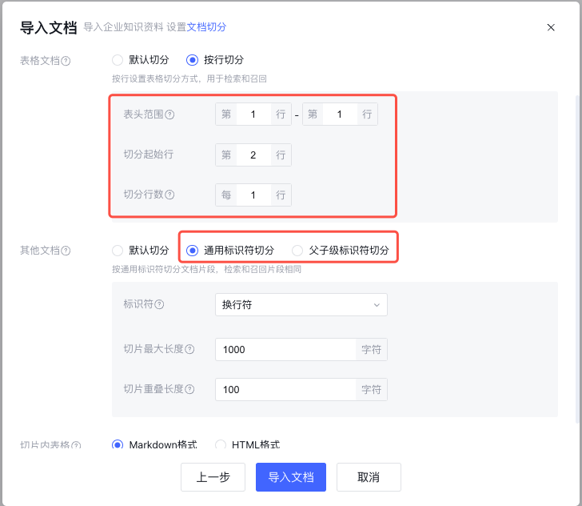

# 4.3 知识库质量与 RAG 调优

> 章节：评测与优化智能体 ｜ 来源：[腾讯云 ADP-FDE 认证课程](https://cloud.tencent.com/edu/learning/course-4742-84530-84547) ｜ 整理日期：2026-09-26

## 4.3知识库质量与 RAG 调优

**当知识问答效果不稳定时，先判断问题出在知识、切分、检索，还是生成。**

智能体知识问答的效果，不只取决于模型回复能力，更取决于知识是否准备得清楚、是否被正确切分、是否能被检索到、是否能被稳定传入模型上下文。学完本节，当知识库里明明有资料，智能体却没答对、答不全、引用不准或命中了旧内容时，你将能够从
 ADP 的知识库设置和调试结果出发，判断如何从知识质量、切分方式、检索召回、问答 和引用配置中定位原因。

学完这一节，你应该能判断知识问答 Badcase 的主要来源；能检查文档规范、Chunk 切分、召回数量、匹配度、重排、引用和问答配置；能在 ADP 中完成一轮“发现问题 → 定位原因 → 调整配置 →
 回归验证”的 RAG 调优。

## 4.3.1 先判断：是不是知识与检索问题

RAG
 的完整含义是“检索增强生成”。在知识问答场景中，模型并不是自动阅读整个知识库后回答，而是先根据用户问题从知识库中检索出相关片段，再把这些片段作为上下文交给模型生成答案。因此，知识库里“有答案”和智能体“能答对”之间，还隔着检索、切分、重排、上下文拼接和生成约束等多个环节。

一个典型的 RAG
 链路可以理解为：用户问题进入应用后，系统先理解问题并可能结合上下文改写；随后在知识库中召回相关文档、问答或数据库内容；再通过匹配度、重排等机制筛选更相关的片段；最后把片段、提示词和用户问题一起传给模型生成答案。如果任何一环出现问题，最终回答都会受影响。

知识问答效果不好时，最容易走偏的做法是直接改 Prompt 或换模型。实际上，很多问题的根因并不在生成，而在前面的知识准备和检索环节。你可以先用三个问题做快速判断。

先确认有没有知识，再确认有没有命中，最后再看有没有正确生成。这个顺序能避免把知识缺失、切分错误或检索范围错误误判为 Prompt 问题。

## 常见现象

最后把 RAG 最常见的四类问题现象与优先排查项整理成一张对照表。排障时先定位现象，再按顺序逐项排查：

- 确认目标文档是否已上传、解析成功并处于可用状态

- 检查问题关键词、召回范围和权限过滤

- 查看切片是否包含可独立理解的答案信息

- 用测试问题逐项验证召回结果

- 核对文档版本、更新时间和生效状态

- 下线或删除过期知识并重新索引

- 检查同名文档与重复切片

- 建立版本与发布管理流程

- 检查切片是否过短或割裂上下文

- 调整切片重叠、召回数量和相关性阈值

- 确认问题是否需要多段信息组合

- 优化 Prompt，要求覆盖关键字段

- 对照回答与实际召回片段

- 检查引用字段、文档元数据和节点变量映射

- 避免模型生成未召回的来源

- 用标准问题集回归验证引用准确率

## 4.3.2 知识库质量：把资料整理成可用知识

知识库质量决定了后续调优的上限。文档本身如果过期、重复、标题混乱、表格不规范，即使检索参数调得再细，也容易出现命中错误或回答不稳定。

这里的重点不是“上传更多资料”，而是让资料更适合被检索、被引用、被维护。建议先把知识按业务主题整理成清单，再决定哪些放文档、哪些做 问答、哪些适合数据库。

## （1）三类知识的准备规范

文档、问答和数据库都可以作为知识来源，但它们适合解决的问题不同，准备规范也不同。调优时不要把所有资料都当作文档上传，而要先判断知识的形态。例如，制度、手册、SOP
 更适合文档；高频标准问题更适合问答；需要按字段查询、聚合或筛选的数据更适合数据库。

- 文档类知识要重点关注“**可解析**”和“**可追溯**”。如果文档到期后仍被检索，可能导致过期答案；如果没有打开参考来源，学员在测试时可能无法判断答案来自哪里。

- 问答类知识要重点关注“**可校验**”和“**无冲突**”。从文档生成的问答必须经过人工校验后再采纳，冲突问答需要合并处理。

- 数据库类知识要重点关注“**字段可理解**”。表名、列名、单位和描述写得越清楚，模型越容易判断应该查询哪张表、哪个字段。

## （2）不要直接上传的典型资料

- 只适合人看的活动海报、复杂宣传页、截图合集。

- 大量设计元素混在一起的 PPT 页面。

- 拍照模糊、倾斜、遮挡或表格线不清晰的扫描件。

- 多人反复修改后没有版本标识的制度汇总。

如果资料本身适合人读但不适合机器检索，先提取关键信息再入库。例如活动海报可以整理成“活动名称、适用时间、参与条件、优惠规则、限制条件、咨询入口”。

## 4.3.3 Chunk 切分：让片段既能命中，也能看懂

Chunk 是知识检索时被命中的基本片段。切分调优的目标不是追求越细越好，而是让每个片段都围绕一个相对完整的问题：既容易被用户问题命中，又能提供足够上下文让模型回答。

判断切分是否合适，可以看命中片段本身是否“能独立支撑回答”。如果片段只命中了结论，却没有条件；只命中了表格数据，却没有表头；只命中了流程步骤，却缺少前置条件，说明切分还需要调整。

## ADP 中常用切分方式

通用标识符切分可设置切片最大长度和切片重叠长度，切片最大长度不超过 4800 字符；重叠长度建议为切片最大长度的 10%，最高为 25%。

父子级切分中，子级切片最大长度不能超过父级最大长度，且最大可设置 1500 字符。表格按行切分时，表头范围最大支持 5 行。

<figcaption>知识库质量与RAG调优</figcaption>

## 4.3.4 检索召回：让合适的内容排到前面

切分解决**“知识怎么存”**，检索召回解决**“用户问的时候怎么找”**。调优时不要只盯着一个参数，而要看召回数量、匹配度、检索策略、重排、检索范围是否共同影响了结果。

检索参数的调整要围绕测试样本进行，而不是围绕单条问题反复试。召回数量调大，可能让某条问题命中，但也会带入更多噪声；匹配度调低，可能提高覆盖率，但也可能让弱相关片段进入上下文。更稳妥的做法是固定一组样本，看整体命中率、引用准确性和最终答案质量是否改善。

## （1）先看召回结果，再调参数

如果调试时没有看到正确片段，优先检查检索范围和召回设置；如果正确片段出现了但排序靠后，再考虑重排；如果召回结果很多但都不相关，说明匹配度、知识质量或文档表达需要调整。

## **（2）**典型调参判断

## 4.3.5 问答、引用与 Badcase 回归

## （1）用问答稳住高频问题

问答适合解决用户真实问法和正式文档表达不一致的问题。高频问题、口语化问题、风险问题、需要固定话术的问题，都可以优先沉淀为问答。

设计问答时，不要只把制度标题改成问题。好的问答应该来自真实用户问法，并且答案要和正式文档保持一致。比如用户不会问“市内交通费报销规则是什么”，更可能问“打车票怎么报”“网约车发票能不能报”。这些问法都可以映射到同一条标准答案。

增补问答前，先检查是否已有相似问题，避免同一问题出现不同答案。通过文档生成问答后，需要人工校验；未采纳或未校验的问题不应直接作为正式答案使用。

## （2）引用是可信度的一部分

知识问答不是只要“答得像”就可以。对企业制度、售后政策、合规说明等场景，用户需要知道答案来自哪里。引用缺失会降低可信度，引用错误则说明检索、重排、文档版本或生成约束可能存在问题。

## （3）常见Badcase

调试和评测过程中出现的 Badcase
 不要只记录“答错了”，而要记录“错在哪里、优先怀疑哪一环、改了什么、改完是否真的变好”。建议至少保留四类信息：**问题现象、优先归因、调整动作、调整后效果。**这样后续再次做评测时，才能判断问题是否被真正修复，而不是只在某一次测试中偶然答对。

如果同一个 Badcase 多次复发，说明它不只是单条问题，而是某一类知识组织、切分或检索策略存在系统性问题，应把它升级为专项优化项。

## 4.3.6 ADP的知识库与RAG调优流程总结

在 ADP 中，建议按照“知识准备—导入配置—单次调试—批量评测—回归沉淀”的顺序推进知识库与RAG的调优。

## 4.3 练习：优化员工制度问答助手

某企业搭建员工制度问答助手，上传了考勤、报销、请假和福利制度。测试时出现以下问题，请判断优先优化方向。

## 参考调优路径

这个练习的关键不是一次性把所有参数都改掉，而是先把问题归类，再按归因逐项优化。文档旧、切分断、问答缺失、引用缺失，分别对应不同的处理动作。

- 整理制度版本，删除或到期旧版文档，统一命名规则。

- 检查关键问题对应 Chunk，确认条件、结论、例外没有被拆断。

- 为高频口语问法补充问答，例如“打车票怎么报”。

- 检查应用中的知识库检索设置：召回数量、匹配度、重排和检索范围。

- 配置参考来源展示，并要求答案基于引用内容生成。

- 把修复后的问题加入评测集，每次调整后做回归。

**运维
 Tips｜知识变更必须可审核、可回归：**新增制度文件前先核验版本、生效时间、重复内容和与旧资料的冲突；记录知识库版本及变更清单，完成审核后再发布。每次大批量新增、删除或调整切分/检索配置，都要用关键问题回归测试，确认旧问题没有反弹、部门权限没有串库，再逐步扩大使用范围。

## 4.3 小结

- 知识库质量与 RAG 调优的关键，是先定位问题发生在知识、切分、检索、引用还是生成。

- 文档调优重点是结构清晰、版本准确、表格规范、标签和范围可控。

- Chunk 调优重点是让片段既容易命中，又包含足够上下文。

- 检索调优要结合召回数量、匹配度、重排和检索范围，不要只为单条问题调参。

- 问答 适合沉淀高频、口语化、风险口径和跨文档答案。

- 每个 Badcase 都应记录现象、归因、调整动作和复测结果，沉淀为后续回归样本。

进 入 下 一 节

下一节 4.4「Workflow优化」会继续讲：当问题不是知识召回本身，而是工作流的配置问题导致效果不稳定时，应该如何优化执行链路。
