# 4.4 Workflow 调优

> 章节：评测与优化智能体 ｜ 来源：[腾讯云 ADP-FDE 认证课程](https://cloud.tencent.com/edu/learning/course-4742-84530-84548) ｜ 整理日期：2026-09-26

## 4.4Workflow 调优

**基于 ADP 工作流画布，把复杂业务流程调到稳定、可控、可复测。**

本节将从工作流管理页、可视化画布、节点详情、连线、变量和调试结果入手，学习如何定位流程为什么跑不通、为什么走错分支、为什么插件报错，以及如何验证修改是否真正有效。

学完这一节，你应该能看懂 ADP 工作流的页面结构；能判断问题发生在场景边界、节点选型、变量流转、条件分支、工具调用还是输出格式；能用单节点调试和端到端调试定位具体异常节点，并把调优动作沉淀为可复测的
 Badcase 记录。

## 4.4.1 先看清：ADP 工作流在页面上长什么样

ADP
 工作流在应用详情页的**工作流管理**中创建、配置、启用和调试。调优时不要只停留在“用户最后看到的回答”，而要回到工作流页面看流程本身：目标工作流节点是否连对，节点详情里的输入输出变量是否正确，调试结果显示哪个节点失败。

工作流页面可以理解为三层：第一层是工作流管理页，用于确认工作流是否存在、是否启用；第二层是画布，用于查看节点和连线；第三层是节点详情页，用于查看单个节点的输入、处理逻辑、输出和异常设置。调优时要按这三层逐步缩小问题范围。

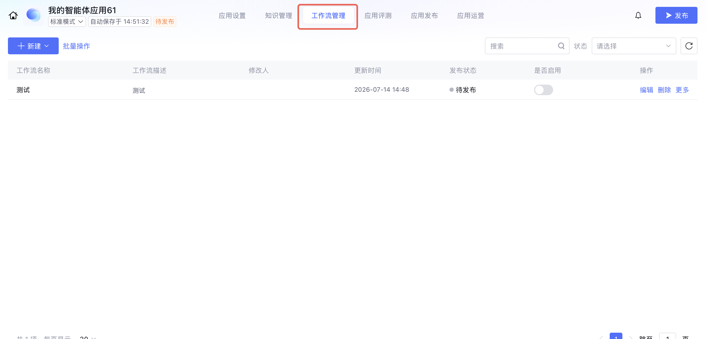

<figcaption>Workflow调优</figcaption>

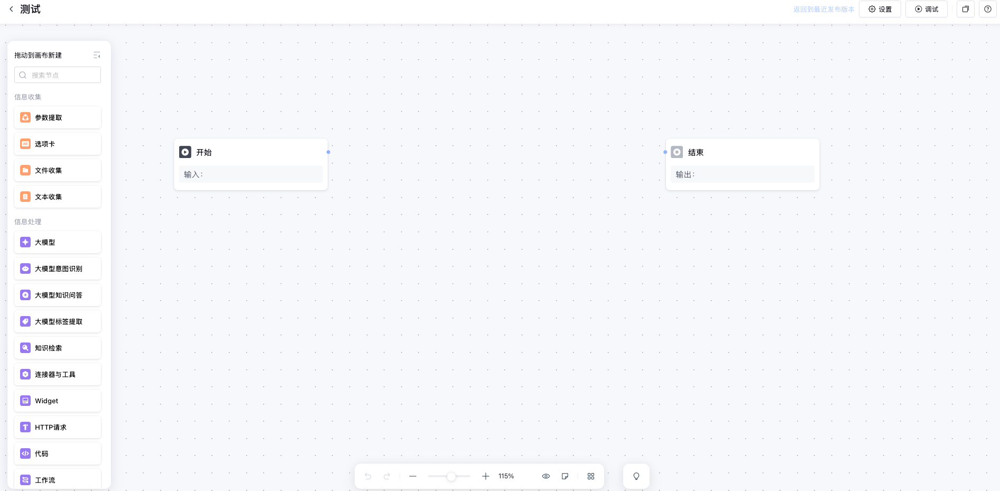

<figcaption>Workflow调优</figcaption>

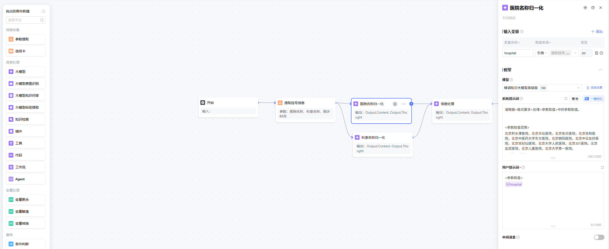

<figcaption>Workflow调优</figcaption>

看到工作流问题时，先问三个问题：当前问题有没有触发这个工作流？触发后经过了哪些节点？失败或偏差发生在哪个节点？这比直接修改整条流程更容易定位根因。

## 4.4.2 调优从场景边界开始：输入、处理、输出要清楚

参考资料强调，工作流场景调研的核心是把客户业务需求翻译为智能体可执行的工作流目标。很多流程不稳定，不是因为平台节点能力不足，而是一开始没有说清楚流程要处理什么、不处理什么、依赖什么、怎么验收。

例如“做一个售后助手”太宽泛，不适合直接进入画布配置。更可执行的描述应该是：“用户提出退货、换货或投诉时，系统收集订单号和商品信息，查询订单系统和售后政策，生成工单或引导转人工。”这时你才能判断需要哪些节点、哪些字段、哪些异常路径。

如果边界不清，后续会出现两个典型问题：**一是流程越搭越长，二是节点职责越来越混乱**。所以正式调节点前，建议先把这张表补齐。

## 4.4.3 节点选型：先选对节点，再谈调优

ADP 工作流节点分为信息收集类、信息处理类、变量处理类和基础节点。调优时最常见的问题，是把一种节点当成另一种节点用。节点选错后，Prompt 写得再细也可能不稳定。

## 典型 Badcase：用标签提取节点收集参数

酒店客需送物场景中，需要收集用户需要的**物品和数量**作为插件入参。原配置使用大模型标签提取节点，当用户没有明确部分参数时，节点不会主动追问，导致插件入参缺失并报错。调整方案是改用**参数提取节点**。

这个案例说明：标签提取更适合把已有文本打上类别标签；参数提取更适合围绕后续工具调用收集必填字段。只要字段缺失会影响后续执行，就应优先考虑参数提取节点和缺失追问。

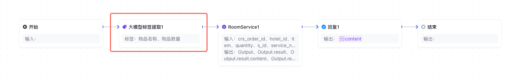

<figcaption>Workflow调优</figcaption>

再如：

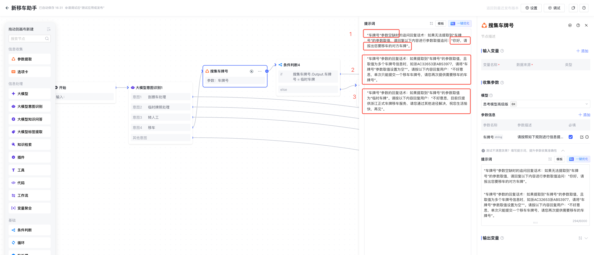

<figcaption>Workflow调优</figcaption>

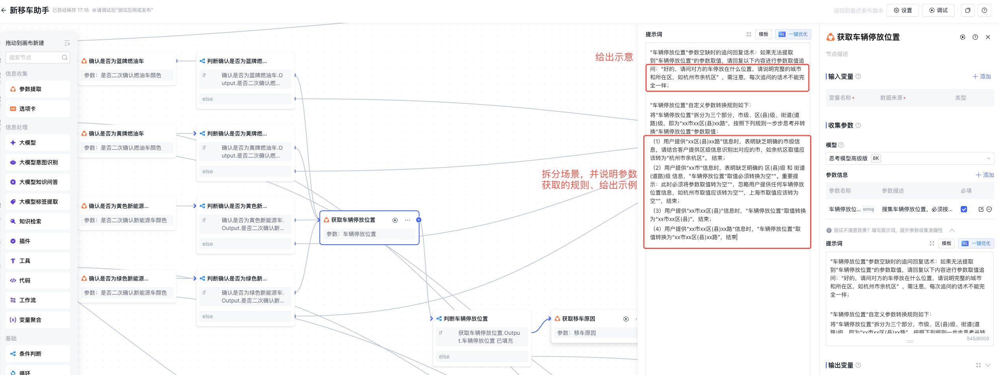

<figcaption>Workflow调优</figcaption>

## 4.4.4 连线、变量和输出：让流程能被下游读懂

工作流节点之间通过连线表达执行流向。产品资料中说明，节点输入变量可以引用所有祖先节点的输出变量；在端到端调试时，画布会展示节点状态、输入输出变量详情以及连线状态。

调优时要特别关注变量。很多“流程失败”本质上不是节点不会处理，而是上游输出字段和下游引用字段不一致，或者分支判断拿到的是空值。建议关键节点都明确输出字段名称、字段类型和缺失值处理方式。

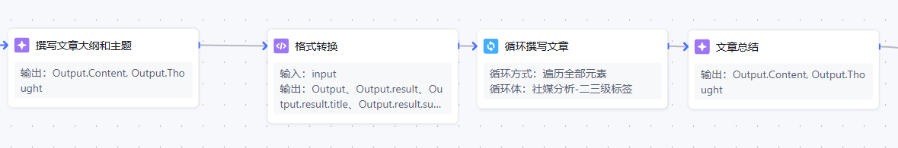

<figcaption>Workflow调优</figcaption>

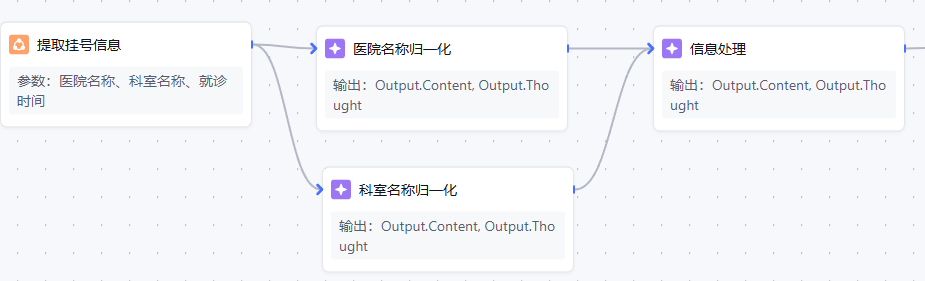

<figcaption>Workflow调优</figcaption>

工作流中必须有开始和结束节点，整个工作流才可以正常执行；当前节点的输入要连接前序节点的输出。

## 输出变量要服务前端识别

如果前端需要识别模型输出是标题、短攻略还是长攻略，不能只输出自然语言。参考资料中的旅游攻略场景，通过在回复节点配置输出变量，让前端稳定识别不同内容类型。

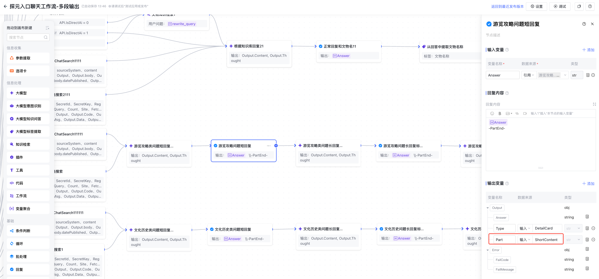

<figcaption>Workflow调优</figcaption>

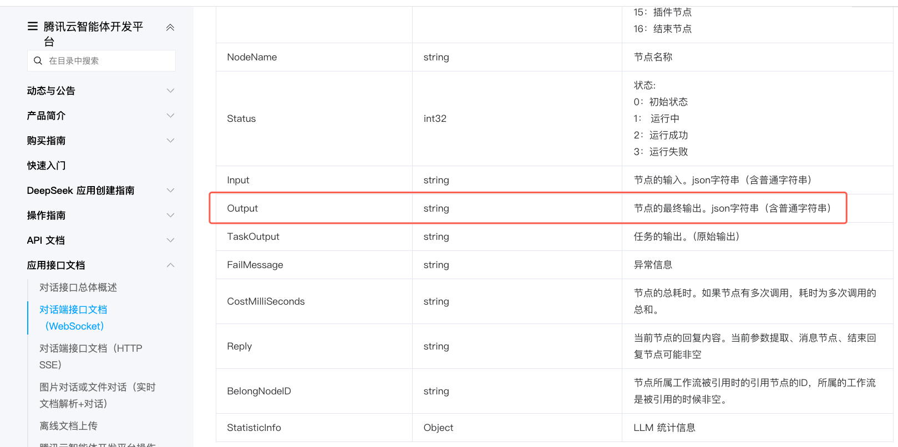

<figcaption>Workflow调优</figcaption>

## 4.4.5 调试：单节点调试与端到端调试要结合

ADP 工作流支持单节点调试和端到端调试。单节点调试适合开发阶段验证某个节点是否能独立工作；端到端调试适合验证整条流程是否能从用户输入跑到最终回复。

不要把端到端调试当成唯一调试方式。如果端到端失败，应先定位失败节点，再回到该节点做单节点调试。这样可以避免在整条链路里盲目修改，尤其适合排查大模型节点、参数提取节点、插件节点和代码节点。

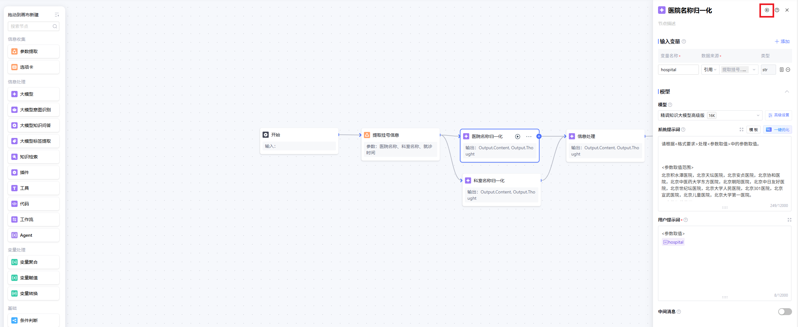

<figcaption>Workflow调优</figcaption>

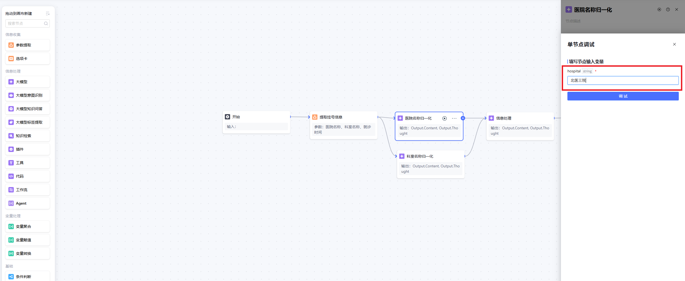

<figcaption>Workflow调优</figcaption>

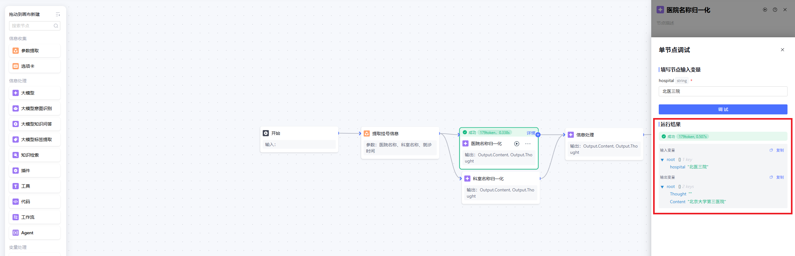

<figcaption>Workflow调优</figcaption>

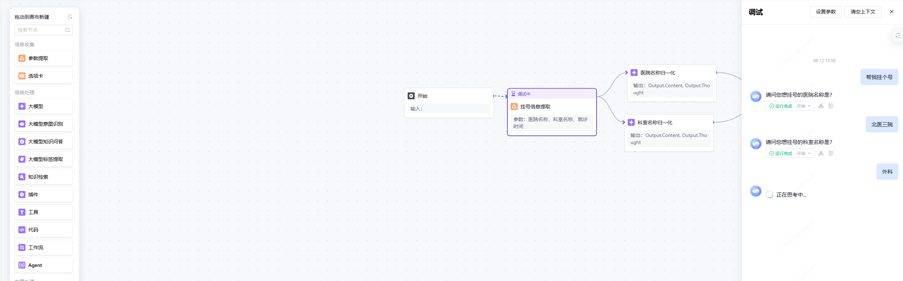

<figcaption>Workflow调优</figcaption>

## 专项调优案例

**语种输出不稳定：**不要只在 Prompt
 中写“中文问题中文回复，英文问题英文回复”。更稳定做法是在开始节点后增加大模型节点来判断语种，输出语言变量，后续节点引用该变量；固定拒答话术也应提前配置不同语种版本。

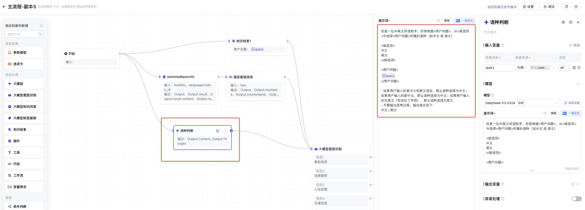

<figcaption>Workflow调优</figcaption>

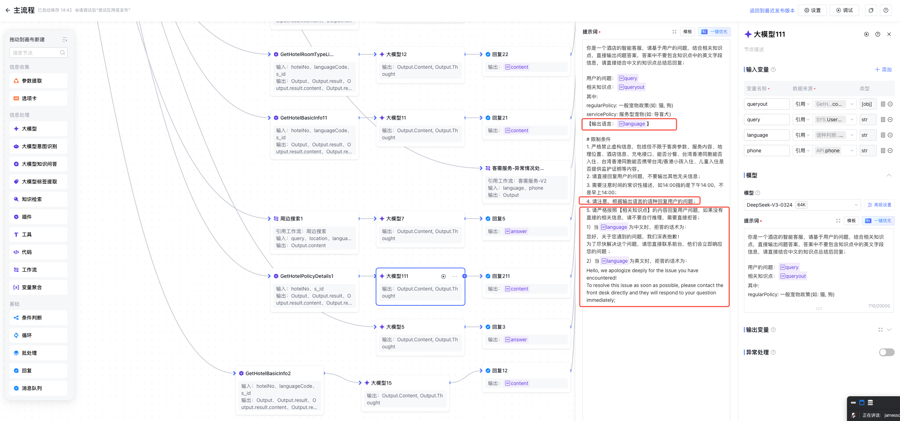

<figcaption>Workflow调优</figcaption>

**意图识别错误：**当两个 query 语义接近但业务意图不同，例如“入住时间”和“完成入住的耗时”，可以通过意图示例进行强制干预。

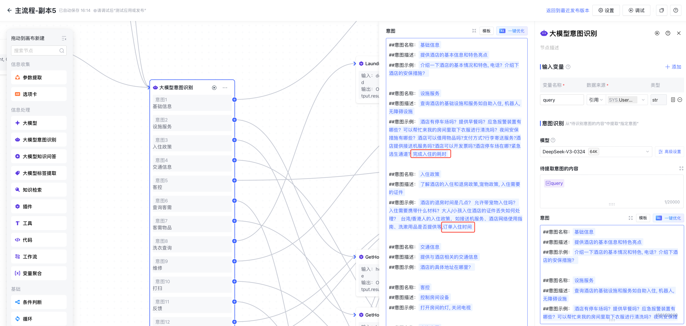

<figcaption>Workflow调优</figcaption>

## 4.4.6 常见 Badcase举例

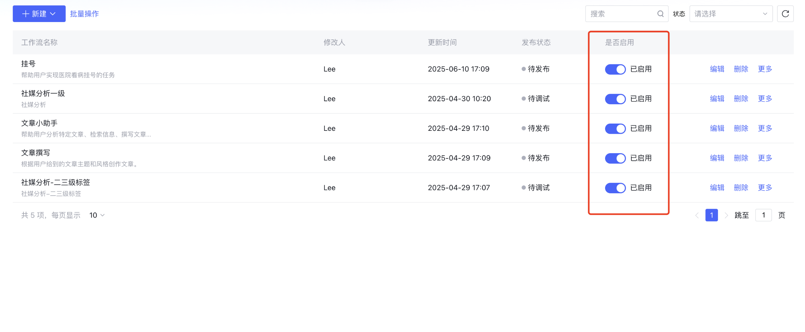

<figcaption>Workflow调优</figcaption>

## 4.4 练习：优化酒店客需送物流程

某酒店智能客服支持客需送物。用户可以说“帮我送两条毛巾到 1208 房间”，系统需要收集物品、数量、房间号并调用客需工单插件。测试时出现以下问题，请判断优先优化方向。

## 参考调优路径

这个练习的重点，是把问题定位到具体配置位置，而不是笼统地说“模型没理解”。参数缺失看参数提取节点，语种混乱看语言判断变量，意图错误看意图示例，前端识别失败看回复节点输出变量。

- 先确认流程边界：输入、处理、输出和依赖插件。

- 将物品、数量、房间号设置为参数提取节点关键字段。

- 缺字段时进入追问，不继续调用插件。

- 对语种、意图、多值参数等特殊规则单独配置。

- 使用单节点调试验证参数提取和意图识别，再做端到端调试。

**运维
 Tips｜接口变化与超时：**工具节点频繁超时时，优先检查外部接口性能、平台和工具的超时设置、并发/限流以及失败重试策略。重试要设置次数、间隔和幂等约束，避免重复建单或重复写入。业务接口的地址、鉴权、字段、错误码或返回结构发生变化后，应更新工具配置，分别验证鉴权、正常返回、超时和异常分支，再回归关键链路，例如订单查询与工单创建，确认后再发布。

## 4.4 小结

- Workflow 调优要基于 ADP 工作流画布：看节点、连线、变量、输入输出和调试详情。

- 工作流问题先回到业务边界：输入是什么、处理什么、输出什么。

- 节点选型要准确，参数收集优先用参数提取节点。

- 语种、意图、多值参数、前端识别等特殊规则，应通过变量、意图示例和输出变量稳定实现。

- 单节点调试用于定位节点能力，端到端调试用于验证完整链路。
