# 4.5 Multi-Agent 调优

> 章节：评测与优化智能体 ｜ 来源：[腾讯云 ADP-FDE 认证课程](https://cloud.tencent.com/edu/learning/course-4742-84530-84549) ｜ 整理日期：2026-09-26

## 4.5Multi-Agent 调优

**基于 ADP Multi-Agent 的 Agent 配置、工具调用、协同方式和调试现象定位问题。**

本节聚焦 Multi-Agent 调优：当 Agent 不兜底、乱调工具、工具返回解析错、输出格式不稳定或转交失败时，你需要回到 Agent 的名称、转交描述、提示词、工具配置、协同方式和高级设置中检查。

学完这一节，你应该能看懂 ADP Multi-Agent 的主要配置项；能判断 Agent 问题出在职责、提示词、工具说明、工具返回、协同方式还是确定性逻辑；能结合自由转交、工作流编排、Plan &
 Execute 的差异选择调优方向。

## 4.5.1 先看清：ADP Multi-Agent 的配置项

Multi-Agent 模式支持创建单 Agent 应用，也允许添加多个 Agent，并选择不同协同方式。调优时要重点看这些配置项：名称、模型、转交描述、提示词、连接器与工具、转交关系、协同方式和高级设置。

其中，“转交描述”和“提示词”很容易混淆。**转交描述**是给其他 Agent 判断“什么时候该转交给我”的简要说明；**提示词**是给当前 Agent
 执行任务时使用的详细工作规则。转交失败时优先看转交描述，执行过程不稳定时优先看提示词和工具说明。

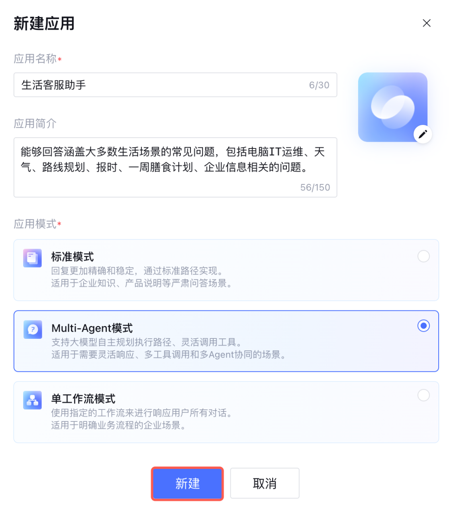

<figcaption>Multi-Agent调优</figcaption>

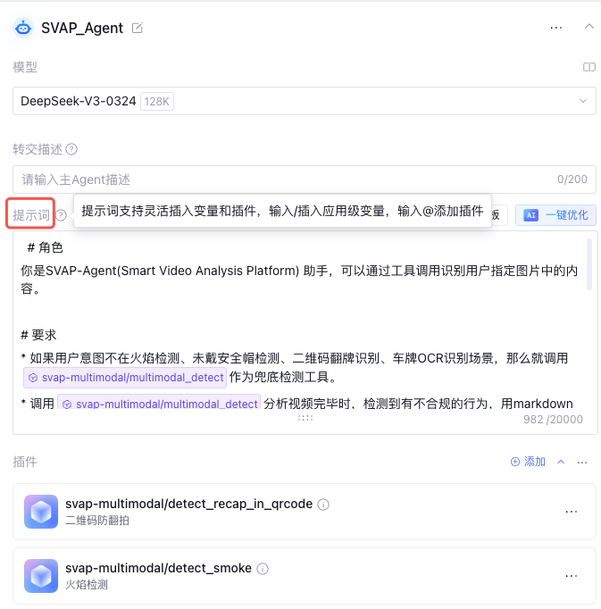

<figcaption>Multi-Agent调优</figcaption>

## 4.5.2 协同方式选择：自由转交、工作流编排、Plan & Execute

ADP 支持多种 Agent 协同方式。不同协同方式不是优劣关系，而是适合不同任务。调优时如果发现转交不稳定，往往需要重新判断协同方式是否选对。

自由转交配置最轻，但依赖模型判断；工作流编排更稳定，但需要你明确路由条件；Plan & Execute
 更适合复杂分析，但耗时更长、成本更高。选择协同方式时，要先判断任务是否固定、是否需要深度拆解、是否对响应速度敏感。

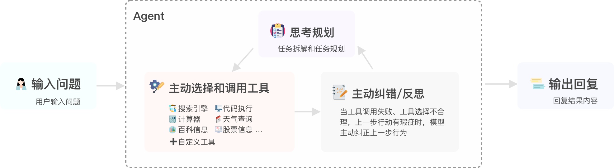

<figcaption>Multi-Agent调优</figcaption>

如果转交条件明确，优先考虑工作流编排增强稳定性；如果任务需要多步规划和深度分析，才考虑 Plan & Execute；如果只是简单快速配置，可以使用自由转交。

## 4.5.3 工具与插件：Agent 能不能正确调用，取决于工具说明是否清楚

在 Multi-Agent 中，Agent 需要根据工具名称和描述选择合适工具。工具名称、入参、出参不是后台字段，而是 Agent 理解工具能力的依据。

如果工具名称像 tool_01，Agent 很难判断使用场景；如果入参没有说明是否必填，Agent 可能在参数缺失时仍然调用；如果返回字段不具名，Agent 可能误解结果。因此工具调优要从“让 Agent 看懂工具”开始。

## 添加工具和提示词

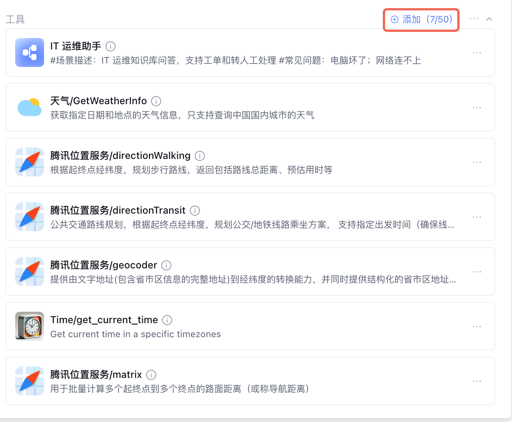

<figcaption>Multi-Agent调优</figcaption>

<figcaption>Multi-Agent调优</figcaption>

## 工具返回要结构化

如果工具返回值字段不清晰，Agent 仍可能误解字段含义。参考资料中的例子是工具返回 [30,1]，Agent 可能混淆准确率和召回率。更稳定做法是返回具名 JSON 字段。

[30, 1]

**推荐：**

{

"precision": 30,

"recall": 1

}

## 4.5.4 常见调优：不兜底、工具异常、格式不稳

## A. Agent 不走兜底

当某些用户意图操作当前不支持时，只在提示词中写兜底可能不够。参考资料中建议顺着 Agent 调用的工具添加字段，再次告诉 Agent 相应操作不支持，形成“提示词 + 工具返回”的双重约束。

<figcaption>Multi-Agent调优</figcaption>

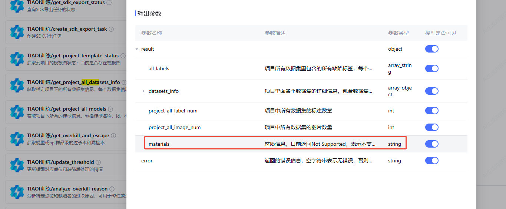

<figcaption>Multi-Agent调优</figcaption>

## B. 调用工具异常

工具调用异常可能来自工具引用格式、工具名称、工具字段与代码不一致等。如下图示例中，检查提示词后发现没有采用引用格式调用插件，修正后可解决；另一个场景是工具返回字段填写错误，需要修改工具返回字段和代码一致。

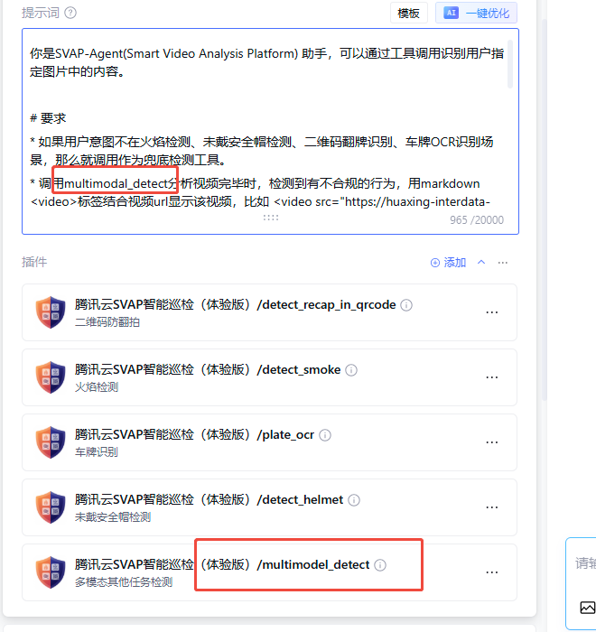

<figcaption>Multi-Agent调优</figcaption>

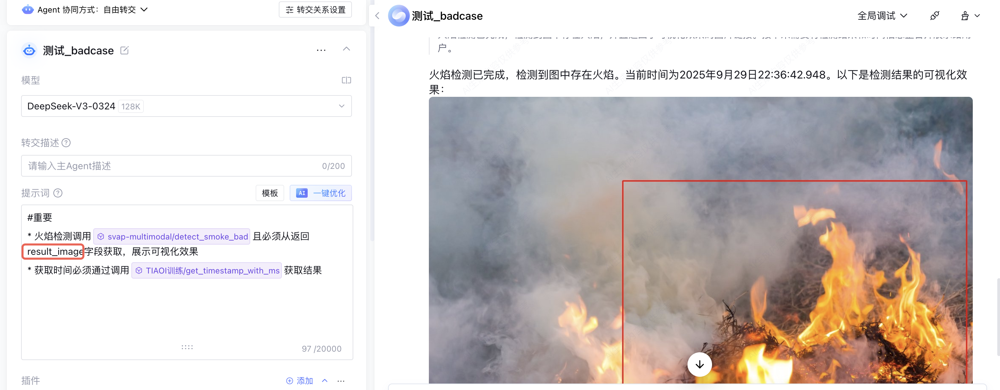

<figcaption>Multi-Agent调优</figcaption>

## C. 不按格式生成文本

如果要求 Agent 生成当前时间戳格式的项目名称，它可能生成一个看似正确但并非真实当前时间的名称。需要稳定、可复现的逻辑，不应只交给 Agent 自由生成。

**更可靠的做法是把确定性逻辑放到工具中完成。**例如时间戳、编号、金额计算、格式校验，都应由工具、代码或规则生成，再交给 Agent 使用。

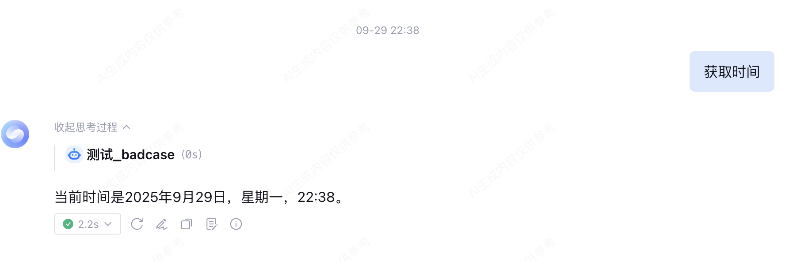

<figcaption>Multi-Agent调优</figcaption>

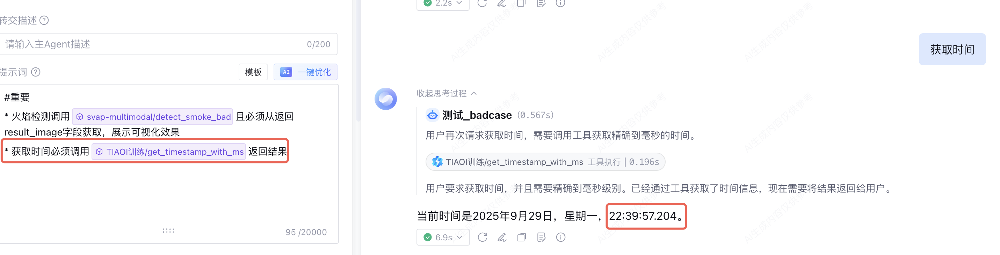

<figcaption>Multi-Agent调优</figcaption>

## 4.5.5 Agent 转交失败：用协同方式提升稳定性

自由转交下，Agent 转交稳定性取决于名称、转交描述和模型判断。参考资料中有一个案例：明火检测能转交给巡检 Agent，但缺陷识别仍被巡检 Agent 处理，没有转给质检 Agent。

**如果转交条件明确，建议使用工作流编排进行 Agent 转交。**工作流先判断任务类型，再把任务交给对应 Agent，稳定性通常高于完全自由转交。

<figcaption>Multi-Agent调优</figcaption>

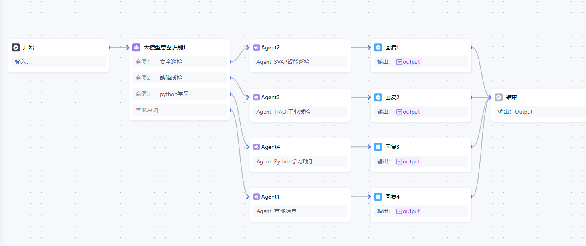

<figcaption>Multi-Agent调优</figcaption>

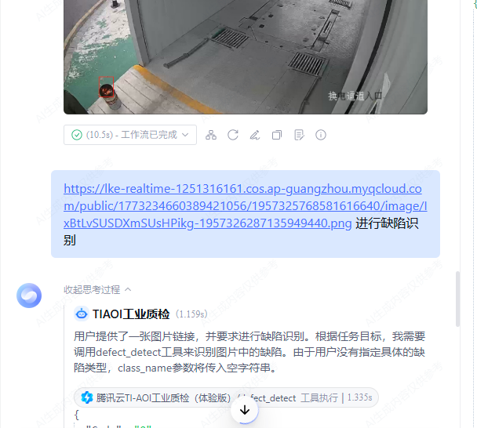

<figcaption>Multi-Agent调优</figcaption>

Agent 可以添加应用内已配置的工作流作为工具。但当工作流中存在选项卡节点、文件收集节点、参数提取节点时，不建议添加到工具中使用，Agent 将直接返回节点输出内容，可能造成工作流中断。

## 4.5 练习：优化多 Agent 质检助手

某企业搭建多 Agent 质检助手：入口 Agent 根据用户问题转交给巡检 Agent 或质检 Agent，并调用图像识别插件完成任务。测试时出现以下问题，请判断优先优化方向。

## 参考调优路径

这个练习的重点，是把 Agent 问题拆到具体配置项：转交失败看名称和转交描述，工具异常看入参出参和代码一致性，不兜底看提示词和工具返回，格式不稳定看是否需要工具化。

- 先检查 Agent 名称、转交描述和职责边界。

- 检查插件工具是否已正确录入，入参和出参是否清晰。

- 把不支持任务写进系统提示词，并在工具返回中补充不支持字段。

- 把时间戳、编号、格式校验等确定性逻辑放进工具。

- 当自由转交不稳定时，用工作流编排做任务路由。

## 4.5 小结

- Multi-Agent 调优要回到 Agent 的名称、转交描述、提示词、工具和协同方式。

- Agent 不走兜底时，不能只靠提示词，应结合工具返回做双重约束。

- 工具异常要检查引用格式、工具字段和接口代码是否一致。

- 确定性逻辑应工具化，不要让 Agent 自由生成时间戳、编号或严格格式。

- 转交失败时，应优先检查转交描述和协同方式；条件明确时可用工作流编排增强稳定性。
