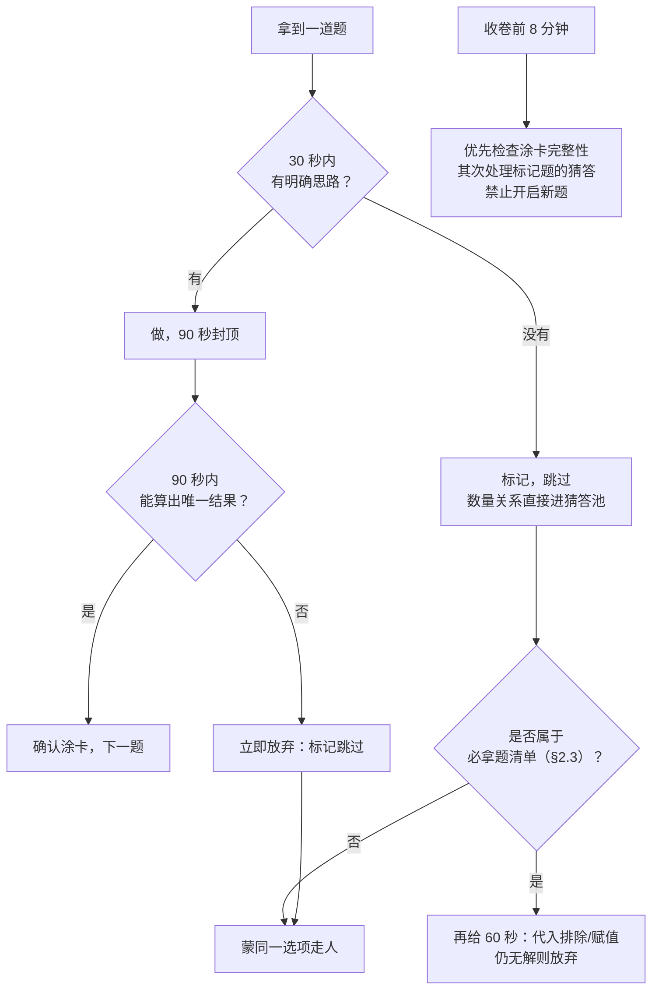
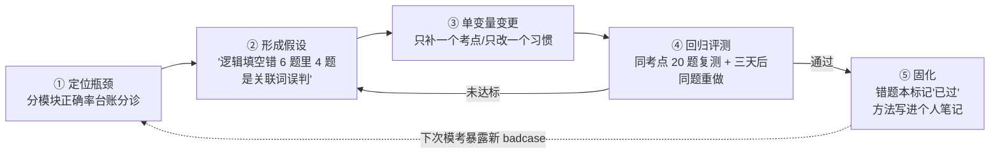

# 考公备考手册：行测 · 申论 · 面试全链路

> **信息基准日：2026-09-28。** 考情数据（招录规模、报考时间轴、合格分数线）为基准日当日经公开报道实抓转述核实，原始口径以国家公务员局与各省人事考试网公告原文为准；官方站点在本机网络环境下直连失败（证书/CDN 异常，与工作区既有网络环境记录一致），故来源一律标注"站点 + 报道标题 + 日期"，链接为站点级。抓不到或未逐项复核的数据**显式标注"未当日复核"**，不冒充实抓。
>
> **定位**：这是一本给"会自学的人"的考公方法论手册，不是机构广告册——不贩卖焦虑、不承诺上岸、不堆金句。全书围绕三件事：**看懂赛道**（§1 考情与规则）、**掌握题法**（§2-§6 行测/申论/面试逐模块打法）、**跑通闭环**（§7 以数据驱动的 90 天备考与复盘体系）。英文术语与官方称谓在首次出现处标注。
>
> **体例**：TL;DR → 考情与方法规范 → 最小示例（题法模板）→ 横向对比 + 真题精读 → 使用（90 天计划）→ 迭代（复盘闭环）→ FAQ。其中 §7.3 的复盘方法论借用本工作区 [tuning-handbook §1.1](../tuning-handbook/Agent调优手册.md) 的"定位→假设→单变量→回归→固化"闭环结构——度量驱动的调优纪律在刷题复盘上同样成立。

---

## §0 TL;DR

### 0.1 三条总纲

**总纲一：考公是信息战。** 岗位选择对结果的影响不亚于分数本身——同一个人，A 岗位可能进面、B 岗位可能差 10 分。信息战的三个战场：① **看懂岗位表**（专业目录口径、基层工作年限认定、备注栏限制条件，§1.3）；② **盯准时间轴**（公告→报名→笔试→出分→面试的每个窗口，错过报名 24 小时 = 一年白等，§1.2）；③ **认清身份规则**（应届生身份、服务期、择业期认定，§1.4）。每年都有人分数够高却输在"报错岗"或"错过调档材料"上。

**总纲二：考公是体力战。** 行测 120 分钟做 130-135 题（平均 53 秒/题）本质是一场**注意力配给**游戏；申论 180 分钟手写 2500+ 字是一场**写作耐力**测试。体力战的纪律：① 每天 fixed 时长 ≥ 3 小时（在职）/ 8 小时（全职）持续 90 天，比突击式每天 14 小时冲两周更有效；② 模考必须全真（真时长、真涂卡、真手写申论），只刷题不模考等于只练冲刺不练全程；③ 考前两周调生物钟到考试节奏（行测时段 9:00-11:00 保持兴奋）。

**总纲三：考公是取舍战。** 行测的满分策略不存在，**得分策略 = 会做的题全对 + 该放弃的题果断放弃**。资料分析、言语理解、判断推理三大模块（合计约 100 题）决定下限，数量关系与常识判断决定上限——多数人的最优解是把三大模块练到 80%+ 正确率，数量只做必拿题型、常识不恋战（各 40 秒内决策）。申论同理：小题按点给分、要点全比辞藻美值钱；大作文稳住二类文（60% 分值）比冒险冲一类文期望更高。

### 0.2 全程时间轴速览（一个考季）

以 2026 年度国考实录为锚（下一届同构，具体日期以新公告为准）：

| 阶段 | 时间窗（2026 年度实录） | 你该做什么 |
|---|---|---|
| 公告发布 | 2025-10-14（国家公务员局发布 [公告与职位表](http://www.scs.gov.cn)） | 读公告 → 下载职位表 → 按 §1.3 三遍筛选法锁定 3-5 个候选岗 |
| 网上报名 | 2025-10-15 8:00 — 10-24 18:00（每次限报 1 个职位） | 先观望 3-5 天看竞争热度，再提交；报名序号留档 |
| 资格审查 | 2025-10-15 — 10-26 18:00 | 关注审核状态；被退回按意见改报（10-24 18:00 前均可改） |
| 缴费确认 / 打印准考证 | 各省时间不一，关注专题网站 | 缴费后准考证打印留 3 份，订好考点周边住宿 |
| 公共科目笔试 | **2025-11-30**：上午 9:00-11:00 行测，下午 14:00-17:00 申论；部分职位专业科目在前一天（11-29）下午 | 按 §9 考试日清单执行 |
| 成绩与合格分数线 | 2026-01 中下旬 | 查分；对照 [首批面试名单](http://bm.scs.gov.cn) 中的"最低面试分数"判断进面 |
| 面试与后续 | 2026-02 至 04（各招录机关自行组织，税务等系统多为结构化小组面试） | 进面 → §6 全力准备；未进面 → 关注调剂（详见 §1.5）与省考 |
| 省考窗口 | 省考公告集中在 2025-11 至 2026-02 发布，2026 多省联考笔试 2026-03-15/16 | 国考省考共用行测申论能力，错峰可连考两次（§1.1） |

> 体检、政审（考察）、公示、录用报到通常在面试后 1-4 个月内完成；此段主要拼材料与信息响应速度，方法见 §9 FAQ 15。

### 0.3 全书导读（什么时候看哪章）

| 章节 | 干什么 | 什么时候看 |
|---|---|---|
| §1 考情全景 | 五类编制考试差异、时间轴、岗位表读法、应届身份 | 报名前精读，报名时对照操作 |
| §2 行测五模块题法 | 每模块"题型→识别信号→解法→限时标准"速查表 | 基础期逐模块精读，强化期只看表 |
| §3 行测套卷策略 | 题序、120 分钟时间预算、涂卡、放弃决策树 | 第一次做整卷前读一遍，模考后复盘对照 |
| §4 申论答题框架 | 五题型答题模板 + 材料标记法 + 15 种公文文种速查 | 基础期精读，每道申论题对照模板改答案 |
| §5 申论大作文 | 立意、标题分论点句式库、素材积累、开头结尾模板 | 申论中期（第 3-6 周）集中攻克 |
| §6 面试 | 三种面试形式、四题型框架、反模板化、真题精评 | 笔试后启动；提前了解可缓解笔试期焦虑 |
| §7 90 天备考计划 | 三阶段计划、两套每日时间表、复盘闭环、目标分数线 | **开跑前通读**，之后每周日按 §7.3 复盘 |
| §8 资源与工具 | 免费/付费取舍、刷题 APP、网课纪律、可复制模板 | 备考启动前配齐，不中途换体系 |
| §9 FAQ | 15 条高频纠结 + 考前一周与考试日清单 | 出现对应困惑时查；考前一周打印清单 |

---

## §1 考情全景（2026-09-28 当日实抓）

> 本章数据基准日 2026-09-28。来源：国家公务员局（www.scs.gov.cn）2026 年度考录公告（2025-10-14 发布）及公开报道转述（新浪财经/北京日报 2025-10-15、凤凰网 2026-05-20、搜狐教育 2026-08-31）；各省人事考试网 2026 年联考公告的聚合报道（2026-01 至 03）；军队人才网（81rc.81.cn）2026 年军队文职招考公告（2025-11-03）。**官方站点在本机环境直连失败，以上均为"官方口径 + 当日公开报道转述核实"级别，原文以公告为准。**

### 1.1 五类"编制考试"差异表

| 维度 | 国考（中央机关及其直属机构考录公务员） | 省考（省/市/自治区公务员考录） | 选调生（Selected Graduates，党政机关定向培养选调） | 事业编（Public Institution，参公或事业单位招聘） | 军队文职（Civilian Personnel） |
|---|---|---|---|---|---|
| 组织方 | 国家公务员局 | 各省公务员局/人事考试院 | 各级党委组织部 | 各省人社厅/招聘单位 | 中央军委政治工作部 |
| 最近一届规模 | **3.81 万人**（38,119，2026 年度） | 2026 多省联考 23 省+新疆兵团合计**约 12.59 万人**（各省另计） | 各省几百至数千；如四川 2026 计划 600（定向 300+常规 300） | 2026 上半年联考部分省合计超 2 万（广东集中招聘约 2 万） | **22,812 人**（2026 年度公开招考） |
| 笔试科目 | 行测 + 申论（副省级/市地级/行政执法类分卷）；8 个非通用语职位及部分专业职位加试专业科目 | 多数省份行测+申论；部分省份合并或加考本省特色科目 | 多数与省考同卷或单独命题，另有面试考察侧重 | 《职业能力倾向测验》（90 分钟）+《综合应用能力》（120 分钟），ABCDE 五类分类命题 | 公共科目（基本知识+岗位能力）+ 专业科目（部分岗位） |
| 竞争比口径 | 过审人数/招录计划：2026 年度约 **98:1**（过审 371.8 万，实考 283.1 万） | 省内口径差异大，热门省份平均 40-70:1（**未当日逐省复核**） | 门槛高（院校/党员/学干），竞争比普遍低于同省省考（**未当日复核**） | 差异极大，热门市直岗位可过百比一（**未当日复核**） | 平均约 20-30:1，部分岗位个位数（**未当日复核**） |
| 编制性质 | 行政编（公务员） | 行政编（公务员） | 行政编，培养定位为党政领导干部后备 | 事业编（参公管理岗位待遇按公务员法执行） | 军队人员的组成部分（非现役） |
| 适合谁 | 全国可报、岗位最全，应届与往届主力赛道 | 想留本省/回家乡者的主战场 | 应届优秀毕业生（党员/学干/获奖者优先），愿意下基层 | 求稳但可接受非公务员身份；考试内容与公务员高度相通 | 符合政治与身体条件、接受军队管理，待遇较好 |

> 三个报考常识：① 国考与省考**不冲突**，行测申论能力 90% 相通，多数考生"国考练兵、省考主攻"或两头连报；② 选调生一般**仅限应届**且部分需学校推荐（中央选调不对社会发布公告，校内渠道获知）；③ 事业编与公务员考试科目高度同源（职测≈行测、综应≈申论），可复用本手册方法。

### 1.2 报考时间轴（以 2026 年度公告为准；下一届待发）

截至基准日 2026-09-28，**2027 年度国考公告尚未发布**。按近三年规律（2024/2025/2026 年度均为 10 月中旬发公告、11 月底笔试），2027 年度预计 **2026-10 中旬发布**（搜狐教育 2026-08-31 报道亦持此预期）。以下为已实录的最近一届各赛道时间线：

| 赛道 | 公告 | 报名 | 笔试 | 出分/进面 |
|---|---|---|---|---|
| 2026 国考 | 2025-10-14 | 2025-10-15 8:00 — 10-24 18:00 | **2025-11-30** | 笔试成绩与合格分数线 2026-01 中下旬；首批面试名单随后 |
| 广东 2026 省考（提前批） | 2025-10 下旬 | 2025-11 | 2025-12-07（招 11,779 人，年龄放宽至 43 岁） | 2026 年初 |
| 2026 多省联考 | 各省 2026-01 前后 | 各省 1-2 月 | **2026-03-15/16**（湖北等 23 省+兵团） | 2026-04 前后 |
| 2026 事业单位联考（上半年） | 2026-01 起陆续 | 各省 2-3 月 | 多数省份 **2026-03-28/29**（部分省 5 月，如吉林四平 5-10） | 各省自行 |
| 2026 军队文职 | 2025-11-03 | 2025-11-03 — 11-09 | **2025-12-14** | 笔试成绩 2026-01-31 起查询；面试按岗位计划 120% 入围 |

> **信息战操作要点**：把"国家公务员局官网 + 目标省份人事考试网 + 军队人才网"加入每周一查清单；公告发布的**第一天**只做一件事——下载职位表开始筛选，报名**最后两天**系统常拥堵，不要拖到最后一晚。

### 1.3 岗位表怎么读

职位表是 Excel，动辄上千行，核心列与读法：

| 列 | 怎么读 | 常见坑 |
|---|---|---|
| 部门名称/用人司局/职位名称 | 判断"工作在哪儿、干什么" | 部门机关在京 ≠ 岗位在京，看"工作地点"列；"XX 司局"下的岗位可能派驻基层 |
| 职位属性 | 普通职位 / 特殊专业职位 / 非通用语职位 / 行政执法类 | 行政执法类单列试卷（市地级同题量），加试情况看公告 |
| 招考人数 | 人数越多理论上进面概率越大（面试比例固定） | 招 1 人的岗位存在"一人卡位"风险；面试比例 3:1 / 4:1 / 5:1 在"面试人员比例"列 |
| 专业 | 精确专业名或"XX 类" | **专业目录口径是第一坑**：国考以《普通高等学校本科专业目录》《研究生教育学科专业目录》为准，省份各有各的目录；"法学类"是否含你的专业，以目录原文+招录机关答复为准。拿不准就打公告附的咨询电话并留记录 |
| 学历/学位 | 大专/本科/硕士/博士；有的要求"以最高学历报考"或"仅限本科" | 在读硕士不能用本科学历报（在读非应届不得报考）；学历学位双证缺一不可 |
| 政治面貌 | 不限 / 中共党员 / 中共党员或共青团员 | 预备党员按党员算（以公告口径为准） |
| 基层工作最低年限 | 无限制 / 一年 / 两年 / 五年及以上 | **基层工作经历**指县级及以下党政机关、国有企事业单位、村（社区）组织及其他经济组织、社会组织等的工作经历；自由职业、个体经营并办理工商注册的经历按公告口径可计；**应届在校期间的社会实践、实习、兼职一般不算**。年限可累计、可跨单位（以公告原文为准） |
| 服务基层项目工作经历 | 大学生村官、"三支一扶"、西部计划、特岗教师等定向岗 | 非项目人员勿报；项目人员也常可报普通岗（看备注） |
| 备注 | **信息密度最高的列** | 高频限制：性别要求（"适合男性"多与一线执法/夜间勤务相关）、经常出差/夜班、需通过法律职业资格考试/CPA 等证书、四六级分数要求、服务期 X 年（最低服务年限内不得转任交流）、"需出具单位同意报考证明"（在职人员） |

**三遍筛选法**（报名第一天 2 小时内完成）：

1. **硬条件筛**：Excel 逐列过滤（学历→专业→政治面貌→基层年限→证书），得到"可报集合"，通常 5-30 个岗位。
2. **条件叠加排序**：限制条件越多的岗位竞争越小（"仅限应届 + 党员 + 四级 + 服务基层项目"四重叠加的岗位经常十来人竞争）；避开"三不限"（不限专业/学历/政治面貌）岗位——那是分数线收割机。
3. **性价比终筛**：工作地点（能不能接受，异地公务员的沉没成本极高，见 §9 FAQ 5）、部门口碑与业务方向、招录人数、本人笔试实力与该岗位近年进面分（用 §7.4 的口径查）。报名期间每天看一次报名人数统计（专题网站公布），第 4-6 天落笔提交。

### 1.4 应届生身份认定要点

"应届毕业生（Fresh Graduate）身份"是考公最值钱的身份，规则要点（以当年度公告与招录机关答复为准）：

1. **当年应届**：毕业证与学位证在规定时间（一般为当年 7 月底前）取得。定向生、委培生原则上不得报考。
2. **择业期内应届**：国家统一招生的普通高校毕业生离校时和在**两年择业期内**未落实工作单位（未签订劳动合同/聘用合同、无单位缴纳社保记录），户口、档案、组织关系保留在原毕业学校或就业主管部门（毕业生就业指导服务中心）、人才交流服务机构的，可按应届毕业生对待。这是"应届岗位"通常覆盖的范围——**社保记录是大多数审核口径的硬证据**。
3. **放宽趋势**：2024 年起多省份明确"应届生身份认定与社保缴纳脱钩"或延长择业期（如部分省份放宽至毕业 2-3 年内；广东省考 2026 年度同步放宽年龄上限）。（趋势为公开报道口径，**各省细则未当日逐省复核**，报考前以目标省份公告为准。）
4. **身份保护动作**：择业期内不缴职工社保、档案留在指定机构；一旦入职缴纳社保即丧失"择业期应届"身份。签了三方协议但未就业未缴社保的，多数口径仍可按应届对待（**以招录机关答复为准，拿不准就打电话**）。
5. 在读非应届（如研一、研二）**不能**以本科学历报考；在职公务员与参公人员不能再报公务员考试（遴选是另一条通道）。

### 1.5 分数线与"进面"口径

- **合格分数线 ≠ 进面分数线**。合格线是官方划的资格线（不够线一切免谈）；进面线是每个岗位进入面试者中的**笔试最低总分**，由该岗位竞争自然产生，官方在"首批面试名单"中逐岗位公布"最低面试分数"。
- **2026 国考合格分数线**（国家公务员局 2026-01 成绩公告口径，当日经公开报道核实）：中央机关及其省级直属机构综合管理类 **总分 105 / 行测单科 60**；市（地）级和县（区）级直属机构 **95 / 50**；西部和艰苦边远地区（山西、内蒙古、吉林、黑龙江等 15 省区市部分县乡岗位）**90 / 45**。另有大学生村官、服务基层项目等定向岗位降低合格线的专门条款（原文见公告）。
- **实际进面分参考**（2025 国考首批面试名单，21 世纪经济报道 2025-01 报道）：20 个省份岗位最低进面分超过 140 分，全国最高 149.8 分；经济发达地区与热门系统普遍在 130-140 区间，艰苦边远与限制条件多的岗位可低至 100 上下。**2026 年度岗位级进面分未当日复核**——报考时务必自查目标岗位近三年"最低面试分数"（国考专题网站历年首批面试名单可查，路径见 §7.4）。
- **没进面的两条活路**：① **调剂（Adjustment）**——首批面试名单公布后，对达到合格线但原岗位未进面者开放调剂报名（公告随首批名单发布）；② **递补**——有人放弃面试资格或体检政审淘汰，按笔试成绩依次递补，所以出分后别卸载考试 APP，保持电话畅通到录用公示。

---

## §2 行测五模块题法

> 行测 = 行政职业能力测验（Administrative Aptitude Test）。2025 年度起新增**政治理论**模块（20 题）单列，与常识判断合计约 35 题；全卷 120 分钟，副省级 135 题（数量关系 15 题）、市地级与行政执法类 130 题（数量关系 10 题）。2026 年度延续此结构（各模块题量以当年真题为准，**个别模块逐年微调未逐项复核**）。平均 53 秒/题，**限时标准是每道题的组成部分**——不限时做题 = 没做题。
>
> 每个模块给四列速查表：**题型 → 识别信号 → 解法 → 限时标准**。先记"识别信号"（考场上第一眼看到的），再练解法。

### 2.0 五模块总体取舍（先定战略再学战术）

| 模块 | 题量（副省/市地） | 建议用时 | 目标正确率 | 战略定位 |
|---|---|---|---|---|
| 政治理论 + 常识判断 | 35 / 35 | 8-10 分钟 | 60-70%（常识）+ 80%（政治理论） | 快速收割，**单题 ≤ 30 秒，不恋战** |
| 言语理解与表达 | 40 / 40 | 30-32 分钟 | 75-80% | 得分基本盘，靠方法不吃天赋 |
| 数量关系 | 15 / 10 | 8-10 分钟 | 做 60% 对 80%（全卷正确率 40-50%） | **主动放弃区**，只做必拿题型 |
| 判断推理 | 40 / 40 | 32-35 分钟 | 80% | 套路化最强、提分最快，重点投入 |
| 资料分析 | 20 / 20 | 25-28 分钟 | 85-90% | **性价比之王**，必须拿下的得分主阵地 |

### 2.1 政治理论与常识判断：取舍纪律——不恋战

常识判断（Common Knowledge Judgment）考"知识面"，范围无限，**复习边际收益最低**，正确策略是把时间花在别的模块，考场上把单题时间压到极限。

| 题型 | 识别信号 | 解法 | 限时 |
|---|---|---|---|
| 政治理论（2025 年度起新增） | 党的创新理论、重大会议表述、中国式现代化、新质生产力等规范提法 | **背规范表述不背理解**：以年度考前梳理的时政讲义为准；单选四个选项里选与权威提法一致的那一个；拿不准的凭第一语感 | 20-30 秒 |
| 政治常识 | 重大方针、外交、党史节点 | 时间轴记忆法（把大事件挂到年代上）；排除法先行 | 25 秒 |
| 法律常识 | 宪法/民法/刑法/行政法基本制度 | 记高频考点（民事行为能力年龄、正当防卫、行政处罚种类、劳动合同要点）；利用生活直觉+法理常识排除 | 30 秒 |
| 科技与生活 | 物理化学生物生活现象 | 生活化推理：选项里"绝对化表述"（一定、只能、全部）多为错；两个选项同源则都不选 | 25 秒 |
| 历史人文/地理经济 | 朝代对应、名著、节气、地理分界线 | 排除法+首尾定位（朝代排序用已知锚点定首尾）；地理题画草图 | 30 秒 |

**纪律三条**：① 35 题合计 ≤ 10 分钟，单题超 40 秒立刻蒙一个走人（标记但不回头）；② 模块正确率目标 60-70%，**放弃 1/3 是设计不是失败**；③ 复习上只用碎片时间（每天 20-30 分钟时政+每周一份讲义），**禁止**用整块时间背常识。

### 2.2 言语理解：主旨/意图/逻辑填空的信号词法

言语理解与表达（Verbal Comprehension and Expression）约 40 题，三大题型：逻辑填空（约 15-20 题）、片段阅读（主旨/意图/细节，约 15 题）、语句表达（排序/填空，约 5 题）。

| 题型 | 识别信号 | 解法 | 限时 |
|---|---|---|---|
| 逻辑填空 | "填入横线部分最恰当的一项"，1-3 空 | **先看语境再看词义**：① 找关联词定逻辑（转折→前后相反；递进→后更重；并列→词义相近或相反；因果→有解释对应）；② 找呼应点（横线前后的解释句、例子、代词指代）；③ 空与空联动（先做有把握的那一空，用选项排除联动其他空）；④ 辨析近义词看**语素差异**（"品味"重过程、"品位"重层次）与搭配习惯 | 40-50 秒 |
| 主旨概括 | "这段文字主要说明/概括/谈论的是" | **找主题词 + 看结构**：高频词即主题词，正确答案必含主题词；结构上看关联词——"但是/然而"之后是重点，"因此/可见"之后是结论，"应该/必须/要"引导的对策优先；总分结构首句即主旨 | 50 秒 |
| 意图判断 | "这段文字意在/想要/意在强调" | 主旨 + 作者倾向：文段提问题→选对策项（针对问题的对策优先于问题复述）；文段给观点→主旨即意图；无对策项时退回主旨题做法 | 50 秒 |
| 细节理解 | "下列说法正确/符合文意/理解准确的是" | 选项回原文**逐项比对**：盯五类偷换——范围（部分↔全部）、程度（可能↔一定）、时态（将↔已经）、数量、主体；"无中生有"和"绝对化表述"优先排除 | 50 秒 |
| 语句排序 | "将以下句子重新排列" | ① 看选项定首句（首句特征：提出概念/背景引入；含指代词"这/它"、关联词后半段"但是""所以"开头的**不能**做首句）；② 捆绑集团（同一话题/代词与其指代对象/关联词配对）；③ 验证尾句（总结性、对策性句子收尾） | 50-60 秒 |
| 语句填空 | "填在横线处最恰当" | 看横线位置：句首→统领下文（概括后文）；句中→承上启下（兼顾前后话题）；句尾→总结全文或呼应主题词。**话题一致是铁律** | 50 秒 |

### 2.3 数量关系：放弃与必拿题清单 + 代入排除/赋值法

数量关系（Quantitative Relations）是行测最大的"弃题区"。战略：**市地级 10 题做 4-6 题、副省级 15 题做 6-8 题**，其余统一蒙同一选项（全蒙同一选项的期望 ≈ 20-25%，且省心；不要随机散蒙，见 §3.4）。

**必拿题清单**（识别信号明确、套路固定，练熟后 1 分钟内出答案）：

| 题型 | 识别信号 | 解法要点 |
|---|---|---|
| 和差倍比 | "A 是 B 的几倍 / A 比 B 多几成 / 三者之和" | 设未知数列方程；或用比例份数法（按比例设份数，回避真数值） |
| 经济利润 | 进价/售价/打折/利润率 | 设成本为 1 或 100（**赋值法**）；利润率=利润/成本（注意分母是成本） |
| 工程问题 | "一项工程，甲单独 X 天、乙单独 Y 天" | 赋总量为公倍数（如 60、120）；合作效率=效率之和 |
| 行程基础 | 速度/时间/路程，相遇追及 | 核心公式 s=vt；相遇路程和=速度和×时间，追及路程差=速度差×时间；比例法（时间同则路程比=速度比） |
| 年龄问题 | "今年/几年前/若干年后" | 年龄差恒定；用"年龄差不变"列方程或代入选项验证 |
| 几何基本型 | 规则图形面积/体积/周长 | 公式直算；相似比→面积比=相似比²、体积比=相似比³ |
| 简单排列组合 | "有多少种方式"（无复杂约束） | 分类相加、分步相乘；先排特殊元素 |
| 最值基础 | "至少……才能保证" | 最不利原则：最坏情况下再 +1 |

**优先放弃题**：多次相遇与复杂行程、复杂约束排列组合、数列递推构造、统筹优化（排队/过桥）、牛吃草变形、"最多最少"复杂最值构造。识别到信号 → 20 秒内没有思路 → 蒙选走人。

**两大保命方法**（覆盖必拿题 80%）：

1. **代入排除法（Back-solving）**：适用"出现具体数值+问具体量"的题（年龄、余数、页码、位数）。顺序：从选项中的**居中值**代起（选项呈等差时代中位项最省次数）；优先用整除特性/尾数/奇偶性先排一半再代。
2. **赋值法（Substitution）**：适用"只有比例没有具体量"的题（工程、利润、浓度、平均数）。赋值原则：谁不变赋谁（总量不变赋总量=公倍数；单价不变赋单价=1 或 100），两个未知量有比例关系时按比例赋值。

### 2.4 判断推理：四子类套路表

判断推理（Judgment and Reasoning）40 题四子类，是**套路化程度最高**的模块，方法训练收益最大。市地级卷另有"一题五问"的材料型逻辑判断（一篇材料带五个小问，按整体时间预算处理）。

**子类一：图形推理（10 题，限时 6-8 分钟）**

| 题型 | 识别信号 | 套路 |
|---|---|---|
| 位置规律 | 元素组成**相同**（同样的小图形在动） | 平移（方向/步长）、旋转（角度 45°/90°）、翻转（轴对称方向） |
| 样式规律 | 元素组成**相似**（同中有异） | 加减同异、黑白叠加（相同位置颜色运算）、自定义运算（前两图运算得第三图） |
| 属性规律 | 元素组成**凌乱**且图形规整 | 对称性（轴/中心，对称轴方向与数量）、曲直性、开闭性 |
| 数量规律 | 元素组成凌乱、图形不规整 | 数点（交点/切点）、线（笔画——一笔画：奇点数 0 或 2）、角（直角数）、面（封闭区域数）、素（元素种类与个数）；数不动就"数"下一个维度 |
| 空间重构 | 折纸盒/三视图/截面图 | 折纸盒用相对面排除+相邻面时针法；三视图抓轮廓与内部线条；截面图按"平面切立体"逐选项想象 |

**子类二：定义判断（10 题，限时 8 分钟）**：拆要件法——从定义中提取**主体、客体、目的、原因、方式、结果**六要件，选项逐件比对；多定义题（给出 2-3 个定义）只看被考的那个；"不属于"题圈大问号防选反。

**子类三：类比推理（10 题，限时 5 分钟）**

| 关系类型 | 识别信号 | 解法 |
|---|---|---|
| 语义关系 | 词性相近的实词 | 近义/反义/褒贬义；二级辨析：感情色彩、程度轻重、词性 |
| 逻辑关系 | 名词对名词 | 全同（北京：中国首都）、并列（矛盾/反对）、包容（种属"苹果：水果" vs 组成"轮胎：汽车"）、交叉（"党员：教师"） |
| 语法关系 | 动词/名词混排 | 造句法：主谓（司机：驾驶）、动宾（驾驶：汽车）、偏正（美丽：花朵） |
| 对应关系 | 名词跨类 | 功能（尺子：测量）、材料（木材：桌子）、因果关系、职业与工具/场所/对象、常识对应（节日：习俗） |

**子类四：逻辑判断（10 题，限时 10-12 分钟）**

| 题型 | 识别信号 | 套路 |
|---|---|---|
| 翻译推理 | 出现"如果…就…/只有…才…/除非…否则…" | 逻辑符号化：A→B 等价于 ¬B→¬A（**肯前推肯后，否后推否前**；"只有 B 才 A"= A→B；"除非 B 否则 ¬A"= A→B）。连锁推理串成链，从确定信息入手 |
| 加强削弱 | "以下哪项如果为真，最能支持/削弱" | 找论点（结论句）→ 论据；力度排序：**直接否定/肯定论点 > 搭桥/拆桥（论据↔论点） > 他因/另有他因 > 举反例/正面例**；无关项（话题不一致）秒排 |
| 分析推理 | 给出若干对象与条件匹配 | 确定信息优先 → 最大信息（出现最多的对象）切入 → 假设代入（选项代入/唯一代入）；列表格是万能工具 |
| 真假话 | "只有一人说真话/假话" | 找矛盾（A 与 ¬A 同真假）→ 矛盾之外全真/全假 → 回代验证；无矛盾找反对关系（"所有"与"有的"） |

### 2.5 资料分析：速算三件套 + 必背公式表

资料分析（Data Analysis）20 题 4 篇材料，是**唯一可以稳定做到 85-90% 正确率的模块**，也是行测"70 分俱乐部"的门票——优先级全模块第一。

**速算三件套**：

1. **截位直除（Rounding-and-Dividing）**：除法不硬算，看选项定精度——选项首两位不同→分子取整、分母截前两位；选项首两位相同→分母截前三位。一步除法出首两位即可锁定答案。
2. **分数比较（Fraction Comparison）**：比较大分数小分数用"横着看倍数"——分子除以分母，先看分子间的倍数关系与分母间的倍数关系，倍数变化大的一侧主导大小（分子倍数 > 分母倍数 → 分数变大）；数值接近时用**化同法**（分子分母同时放大到可直比）。
3. **增长量比较（Increment Comparison）**：口诀"**大大则大**"——现期量大且增长率大的，增长量必大；接近时用换算：增长率 r ≈ 1/n 时，增长量 ≈ 现期量/(n+1)（如 r≈16.7%≈1/6 → 增长量≈现期/7）。

**必背公式表**（基期= Base Period，现期= Current Period，增长率 r）：

| 概念 | 公式 | 备注与陷阱 |
|---|---|---|
| 增长量 | 现期 × r/(1+r)；速算：r≈1/n 时增长量≈现期/(n+1) | "增长了 X%"与"增长为 X 倍"是两回事 |
| 基期量 | 现期/(1+r)；r 小（<5%）时 ≈ 现期×(1−r) | 问"上年/2023 年"= 基期 |
| 现期比重 | 部分/整体 | "占"字前面的量是部分；看清楚谁占谁 |
| 基期比重 | 现期部分/现期整体 × (1+r整体)/(1+r部分) | 分子分母两个增长率别搞反 |
| 比重变化 | 部分增速 > 整体增速 → 比重上升；< → 下降 | **判定比计算重要**：多数题只问升降不问数值 |
| 平均数增长率 | (r分子 − r分母)/(1 + r分母) | 例：人均 = 总量/人数 |
| 隔年增长率 | r = r1 + r2 + r1×r2 | "2026 年比 2024 年增长"= 隔年；r1×r2 很小但别丢 |
| 年均增长量 | (末期 − 初期)/n | n = 年份差（如"2019—2024 年"n=5，**以当年官方口径为准**，个别年份定义不同） |
| 混合增长率 | 整体增速介于两分量之间，偏向基期量大的一边 | 线段法/十字交叉：距离与基期量成反比 |
| 发展速度与增速 | 增速 = 发展速度 − 1；翻 n 番 = 2ⁿ 倍 | "翻两番"= 4 倍不是 2 倍 |
| 拉动增长 | 分量增长量/整体基期量 | 问"拉动整体增长 X 个百分点" |
| 贡献率 | 分量增长量/整体增长量 | 与拉动增长是两个口径 |

**限时标准**：一篇材料（5 题）≤ 7 分钟，全模块 ≤ 28 分钟。练习顺序：先正确率（练到 85%）再提速；每天固定 2 篇材料（10 题）保手感，考前一个月每天 4 篇。

---

## §3 行测套卷策略

> 单模块正确率 ≠ 整卷分数。套卷训练的目标是把 135 分钟的体力分配、85 秒以内的单题决策与模块间的取舍纪律整合成一套**自动化流程**。本节按 120 分钟/135 题（副省级）给出默认参数，市地级同构（数量关系少 5 题）。

### 3.1 题序安排

国考不强制模块顺序，**默认顺序 = 试卷顺序不等于最优顺序**。推荐两套题序，模考验证后固定一套：

| 方案 | 顺序 | 适合谁 |
|---|---|---|
| A（稳妥型，推荐） | 资料 → 判断 → 言语 → 政治理论常识 → 数量 | 多数人：状态最好的前 30 分钟拿下性价比最高的资料分析 |
| B（稳场型） | 政治理论常识 → 资料 → 言语 → 判断 → 数量 | 开考紧张型：先用 8-10 分钟快答政治常识"热身收割"，再进主战场 |

原则：① **数量永远最后**（它的沉没成本最高，放最后天然带止损线）；② 不要把两个"读大段文字"的模块（言语、资料）直接背靠背连排，中间用政治常识缓冲 8 分钟；③ 一旦定了题序，**所有模考都用同一套**，考场上不做任何临场创新。

### 3.2 时间预算表（120 分钟分配）

| 时段 | 累计时间 | 内容 | 纪律 |
|---|---|---|---|
| 0-8 分钟 | 8 | 政治理论+常识 35 题 | 单题 ≤ 30 秒；不会的凭语感即选即走 |
| 8-36 分钟 | 36 | 资料分析 20 题 | 每篇 ≤ 7 分钟；第 4 篇若超时砍最后 1 题 |
| 36-68 分钟 | 68 | 言语理解 40 题 | 逻辑填空 ≤ 45 秒/题，片段阅读 ≤ 55 秒/题 |
| 68-102 分钟 | 102 | 判断推理 40 题 | 图形 ≤ 45 秒；定义/类比快走；逻辑判断可多花 |
| 102-112 分钟 | 112 | 数量关系（做必拿题 4-8 道） | 每题 90 秒封顶，到点标记放弃 |
| 112-120 分钟 | 120 | 涂卡收尾 + 机动 | **涂卡完整性检查优先于任何再解一题** |

> 模块内的弹性：言语/判断孰先孰后可对调（看个人强弱项，把强项放精力低谷段）。用手机计时器按上表分 5 段设闹钟，模考严格执行两三次后，体感会自动校准。

### 3.3 涂卡节奏

- **分段涂卡**：每做完一个模块立即涂卡（答题卡按模块分区），利用"换模块"的间隙活动手指、切换大脑。不建议全卷最后一次性涂——135 题连涂需 5 分钟以上且极易错位。
- 涂卡纪律：**做 5 题涂 5 题**亦可（资料分析篇内执行）；铅笔提前削成"鸭嘴形"两头备用；每涂完一区扫一眼题号与选项的**奇偶错位**（最惨烈的丢分是整行错位）。
- 修改答案必须擦净；机读识别对浅涂不友好，**涂满涂黑**。

### 3.4 放弃决策树



**猜答纪律**：数量关系与常识中放弃的题，**全卷统一蒙同一选项**（答案分布各年基本均匀，同一选项期望 ≈ 20-25%；且"统一蒙"不占用任何决策带宽）。模考时记录历年真题各选项分布，若所蒙选项在近年真题中明显偏低频可换，但**考场上绝不换**。

---

## §4 申论答题框架

> 申论（官方科目名即"申论"，无通行英文译名；功能上是一门**材料驱动的分析与写作测试**）180 分钟（国考，副省级/市地级/行政执法类分卷；省考多为 150 分钟）。核心评分逻辑一句话：**小题是客观题——按点给分，要点来自材料；大作文是立意题——立意准二类文保底，语言好锦上添花**。所以申论的功夫 80% 在"读材料"而不在"文笔"。

### 4.1 材料阅读标记法（所有题型共用）

拿到材料先用 40-50 分钟通读全部给定资料并标记五类句子，符号建议（写在试卷上，考官不扣分）：

| 符号 | 句子类型 | 特征信号 |
|---|---|---|
| 「观」 | 观点句 | 专家/干部/群众发言（"XX 表示/认为/指出"）、政策文件引述 |
| 「问」 | 问题句 | 转折词之后（"但/然而/却"）、"难题/瓶颈/不足/缺乏/痛点" |
| 「策」 | 对策句 | "应该/必须/建议/采取/推动/建立/完善"引导的句子；成功案例的做法 |
| 「例」 | 案例句 | 地名+人物+做法+成效（"浙江 X 村通过……实现了……"） |
| 「数」 | 数据句 | 具体数字、百分比、对比 |

标记的三个用途：① 小题答案**优先抄改标记句**（自己组织的语言永远不如材料的原词得分稳）；② 大作文立意从「观」「问」句提炼；③ 「例」「数」句是大作文论据的直接来源。

### 4.2 五题型逐型框架（审题三问 → 标记 → 合并 → 模板 → 字数）

**通用前置——审题三问**（每道小题 30 秒）：
1. **对象**：答什么？（概括问题/分析原因/提出对策/写一份什么文种）
2. **范围**：限定"给定资料 X"还是"全部资料"？范围不同材料占用完全不同。
3. **要求**：字数、分条与否、有无格式要求（"条理清晰""有层次""不考虑格式"都要在答案结构里兑现）。

#### 4.2.1 归纳概括（Summary）

| 环节 | 要点 |
|---|---|
| 要点抽取 | 回材料找全标记句，对象是"问题"就只收「问」句，"做法"就只收「策」句；**宁多勿漏**（多写不扣分，漏点必扣分） |
| 合并逻辑 | 同类合并三把刀：**同主体**（政府/企业/个人）、**同维度**（思想/制度/资金/技术/人才）、**同领域**（政治/经济/文化/社会/生态）；合并后仍保持每条一个独立含义 |
| 结构模板 | 总括句（1-2 句总述整体特征）+ 分条罗列（"1. ……。2. ……。"每条首句关键词加前置） |
| 字数控制 | 300 字题 = 预留 15% 弹性，每条 30-50 字；关键词前置，动词开头，少写形容词 |

#### 4.2.2 综合分析（Comprehensive Analysis）

| 子型 | 框架 |
|---|---|
| 词句理解 | **释义 → 多角度分析 → 总结/对策**：先用材料中的话解释词句本身（"XX 是指……"），再从原因/表现/影响/背景展开 3-4 层，最后一句总结或引申对策 |
| 评价分析 | **表态 → 论证 → 结论**：表态用有限肯定/辩证否定（"总体值得肯定，但也存在……"），论证部分从材料找正反两面依据，结论回扣表态并给完善方向 |
| 启示分析 | 从案例中**提取普适性经验**（把"某村修了路"抽象为"加强基础设施建设"），再分条罗列；启示题不看具体地名细节，只看可迁移的做法 |

#### 4.2.3 提出对策（Proposing Countermeasures）

- **来源四路**：材料直接给出的对策（照抄改写）→ 问题反推（材料列问题，逐条给解法）→ 成功经验借鉴（「例」句里的做法普遍化）→ 自身储备兜底（常规动作：加强宣传引导、完善制度机制、加大资金投入、强化监督考核、培养人才队伍——**仅在材料挖尽后使用，且必须具体化到题目场景**）。
- **对策三性**：针对性（对着材料的问题来，一问一策）、可行性（权限/财力/技术说得通）、可操作性（谁来做、做什么、怎么做有具体动作）。
- 结构：每条对策 = 动词短语开头（"完善……机制；加强……建设"）+ 具体展开 1-2 句。

#### 4.2.4 贯彻执行（Implementation / 公文写作）

- **格式三件套**（除非题目明示"不考虑格式"）：标题（"关于 + 事由 + 的 + 文种"，居中）、称谓（主送对象，顶格）、落款（发文单位 + 日期，右下角虚拟：单位写"XX 单位"，日期写"X 年 X 月 X 日"）。**文种决定称谓与语气**。
- **正文万能骨架**：开头（背景/目的/依据，1-2 句）→ 主体（按对象逻辑分条：事情怎么干/工作怎么安排/内容是什么）→ 结尾（呼吁、要求或总结，1-2 句）。
- 主体内容 90% 仍来自材料——贯彻执行考的是"**把材料内容装进正确格式**"，不是让你凭空创作。

#### 4.2.5 大作文 → 独立成 §5。

### 4.3 公文 15 种法定文种格式速查

《党政机关公文处理工作条例》（中办发〔2012〕14 号）规定法定文种 15 种。考场上"贯彻执行题"常用其中一部分 + 若干事务性文种（如倡议书、讲话稿），一并列入：

| 文种 | 用途一句话 | 行文方向 | 格式与语气要点 |
|---|---|---|---|
| 决议 | 重大事项经会议讨论通过 | 对内 | 开头常带"经 XX 会议审议通过" |
| 决定 | 对重要事项作出安排、奖惩 | 对内/下行 | 语气果断，"决定……" |
| 命令（令） | 公布行政法规、嘉奖等 | 下行 | 签发人要求最严格，考生场少考 |
| 公报 | 公布重要决定或重大情况 | 公开 | 常用于会议/统计公报 |
| 公告 | 向国内外宣布重要事项 | 公开 | 无称谓，语气庄重 |
| 通告 | 在一定范围内应当遵守的事项 | 公开 | 常带"特此通告" |
| 意见 | 对重要问题提出见解和处理办法 | 可上可下可平行 | "为……，现提出如下意见" |
| 通知 | 发布、传达、批转、布置 | 下行为主 | **考频最高**：标题+称谓+正文+落款；结尾"特此通知" |
| 通报 | 表彰先进、批评错误、传达重要精神 | 下行 | 叙事+评价+要求三段 |
| 报告 | 汇报工作、反映情况、回复询问 | 上行 | **不需批复**；可事后行文；结尾"特此报告" |
| 请示 | 向上级请求指示、批准 | 上行 | **一文一事、事前行文、需要批复**；结尾"妥否，请批示"——与报告的区别是申论高频考点 |
| 批复 | 答复请示 | 下行 | 引用来文 + 明确表态 |
| 议案 | 提请人大审议事项 | 特定 | 考试罕见 |
| 函 | 不相隶属机关之间商洽工作、询问答复 | 平行 | 语气平和："贵单位""盼复"；结尾"特此函达/盼复" |
| 纪要 | 记载会议主要情况和议定事项 | 对内 | 常考"会议纪要"：时间地点+议定事项分条 |
| （事务类）倡议书 | 面向公众发起倡导 | 公开 | 称谓（广大市民朋友们）+ 背景 + 倡议内容分条 + 呼吁落款 |
| （事务类）讲话稿 | 会议/活动发言 | 现场语境 | 称谓（各位领导、同志们）+ 开场（问候/意义）+ 主体分条 + 结尾展望，**要有口语感和现场感** |
| （事务类）调研报告 | 反映调查研究发现与建议 | 上行/内部 | 现状+问题+原因+建议四段结构 |

---

## §5 申论大作文

> 大作文 1000-1200 字（国考副省级/市地级一致，以题干为准），40-50 分值（各省不同）。评分事实：**立意（总论点是否来自材料、是否准确）决定一档 vs 二档，结构与论证决定二档内浮动，语言与亮点锦上添花**。二类文（60% 分值）是"稳"的底仓，不要为求新求异赌一类文。

### 5.1 立意来源：材料总论点的三步提炼

1. **抓题干关键词**：题干中的核心词句（往往是材料中观点句的浓缩）就是总论点的"种子"。
2. **找材料最高频的「观」「问」句**：通读全部材料后，把各则材料的核心观点串起来——它们共同指向的主题就是总论点。**立意必须服从材料**（申论大作文是"戴着镣铐跳舞"，自说自话的"好文章"= 跑题）。
3. **套入"主题 + 角度"句式验证**：总论点 = 材料主题（写什么）× 作答角度（怎么写：意义型/对策型/辩证关系型）。例：材料主题"基层治理"，题干问"治慧"（2023 年度国考副省级考过"治慧"一词的词句理解，此处仅作题型示意）——角度可以是"意义型：为什么……重要"或"辩证型：……与……的关系"。

**示例立意**（2025 年度国考副省级申论作文，考生回忆版大意：事物的劣势在特定条件下可以转化为优势，这种转化往往有赖于人的主观能动性——转述自公开的考生回忆版，见知乎"大白悟申论"2025 年相关解析）：总论点即题干原句（劣势可转化为优势），分论点可沿"为什么能转化（条件）→ 靠什么转化（主观能动性：认识/行动/坚持）→ 怎么促成转化（方法论）"铺开——题干即立意，这是申论作文最典型的"送分"结构。

### 5.2 标题与分论点句式库

**标题四种写法**（任选其一，别玩花活）：

1. 对仗式：`以 XX 之笔 绘 XX 之卷` / `让 XX 成为 XX 的底色`
2. 观点式（最稳）：`XX 是 XX 的必由之路` / `在 XX 中 XX`
3. 主题词式：`让 XX 回归 XX`（主题词必须来自材料）
4. 引申式：`XX（比喻）——谈 XX`（如"治水有道——论基层治理的巧劲"）

**分论点句式三模板**（三段论结构，每段首句即分论点，写在段首让阅卷人 10 秒看到骨架）：

- 意义型：`XX 有助于 XX` / `XX 是 XX 的 XX`（三个分论点分别从个人/社会/国家或经济/文化/民生维度展开）
- 对策型：`以 XX 之（力/基/翼），XX`（"以创新之力，激活发展动能；以制度之基，筑牢治理底座；以人才之翼，托举转型远景"）
- 辩证型：`XX 与 XX 相辅相成：既要 A，也要 B；更要 A 与 B 的统一`（拆成"既要/也要/更要"三段）

### 5.3 论证素材积累法：三类来源清单

论证 = 观点 + 论据 + 分析。论据积累三类来源，每周各沉淀 2-3 条，按主题归档（模板见 §8.4）：

| 来源类型 | 具体渠道 | 用法 |
|---|---|---|
| **政策表述** | 政府工作报告、中央一号文件、重要会议公报；人民日报评论版、"学习强国"要闻 | 学**规范提法**（"高质量发展""新质生产力""全过程人民民主"），政策语言自带"官方感"，用在开头结尾与分论点句；**背 20-30 句够用一整季** |
| **案例** | 人民日报/新华社"人物"栏目、感动中国、大国工匠、"中国好人"；材料自带案例（「例」句） | 记"人物/地方 + 做法 + 成效"三要素，一个案例 50 字；**材料里的案例可反向使用**（换个角度概括即新素材），考场上最省力 |
| **数据** | 政府工作报告里的宏观数字、统计公报、专题报告 | 每个主题记 1-2 个锚点数据即可（"XX 亿元""XX%""XX 万人"）；数据贵精不贵多，用对一处胜过堆十条 |

**反例纪律**：不背"万能名言"（李白爱迪生居里夫人三件套是阅卷人审美灾难），不用网传"人民日报金句 100 条"式材料原文照抄（撞车率极高），素材要**用自己的话压缩改写**一遍才算入库。

### 5.4 开头结尾模板四类

**开头**（100-150 字，三行内出总论点）：

1. **概括式（最稳）**：概括材料现象/问题（2 句）→ 分析过渡（1 句）→ 亮总论点（1 句）。
2. **转折式**：成绩一句 → "然而"转折到问题（1 句）→ 亮论点。适合问题导向的主题。
3. **引言式**：材料中的政策表述/领导引语起笔 → 扣题 → 亮论点。（引言必须来自材料或权威政策语言）
4. **排比式**：三个"当……"或"从……到……"的排比铺陈 → 收束到论点。气势型，慎用，排比内容必须全部来自材料。

**结尾**（80-120 字）：**回扣总论点 + 升华一句 + 展望一句**。禁四件事：不引入新论点、不喊脱离材料的口号、不写"综上所述"这种机械词（用"唯有如此，方能……"式收束）、不复述开头原句。

---

## §6 面试

> 笔试进面后进入面试环节（Interview），按 1:3 至 1:5 的面试比例入围。面试形式三种：**结构化面试（Structured Interview）**、**结构化小组面试（Structured Group Interview，税务系统典型）**、**无领导小组讨论（Leaderless Group Discussion，LGD）**。评分维度各招录机关公告略有差异，通用六要素：综合分析能力、计划组织协调能力、应变能力、人际沟通能力、言语表达能力、举止仪表。**面试是可训练的技能，不是性格测试**——沉默寡言者练到流畅的案例远多于健谈者翻车的案例。

### 6.1 三种形式：流程与得分点

| 维度 | 结构化面试 | 结构化小组（税务等系统） | 无领导小组讨论 |
|---|---|---|---|
| 流程 | 抽签 → 候考 → 入场 → 看题/听题 → 逐题作答（一般 3-4 题，15-25 分钟）→ 退场候分 | 3 人一组同场：轮流答题（如第一题按 A→B→C，第二题 B→C→A 轮转）→ 每人对另两位**点评**（各约 2 分钟）→ 被**回应**（各约 2 分钟）。2025 国考海关场考生回忆版考情：看题思考 2 分钟、答题每题 3 分钟、全程约 53 分钟 | 阅读材料（约 10 分钟）→ 个人陈述（每人 2-3 分钟）→ 自由讨论（40-60 分钟，可发言任意次）→ 总结陈词（1 人或每人） |
| 评分侧重 | 答题内容 + 表达仪表 | 答题内容 + **点评质量与回应风度**（能否真诚指出问题、被批评时是否得体） | 内容贡献 + **讨论推进力**（能否推动共识而不是自说自话） |
| 核心纪律 | 稳定输出：每题结构完整，宁可平庸完整不要惊险花哨 | 记笔记！点评必须**具体到对方说了什么**；回应"有则改之、无则说明"，不吵架不认怂两极端 | 不必抢 leader；提标准、归纳分歧、推进阶段是三种高价值动作；发言"质 > 量" |

### 6.2 四题型答题框架

| 题型 | 识别信号 | 框架 |
|---|---|---|
| 综合分析（现象/政策/观点） | "你怎么看/谈谈你的理解" | ① 破题表态（一句话定性：积极现象/负面问题/辩证看待）→ ② 多角度分析（主体法：政府/企业/群众；或维度法：原因/影响/背景）→ ③ 对策落实（2-3 条，落到"怎么办"）→ ④ 升华收尾（联系岗位或时代背景，一句） |
| 计划组织（调研/宣传/活动） | "组织一次 XX 活动/调研，你怎么开展" | ① 目的先行（这次活动要解决什么问题、达成什么效果——先说这个直接反模板）→ ② 事前（对象与需求摸底、方案与分工、协调资源）→ ③ 事中（执行 + **2-3 个亮点设计**：形式创新、覆盖特殊群体、风险预案）→ ④ 事后（效果评估：数据回收、长效机制、二次传播） |
| 人际关系（同事矛盾/领导误解） | "同事不配合/领导批评了你/新单位排挤" | ① 阳光心态定调（不预设恶意，先从自己找原因）→ ② 工作为重（把事推进放在情绪之前）→ ③ 沟通具体化（**说什么、怎么说、什么时候说**要有细节）→ ④ 长效预防（以后怎么避免同类问题） |
| 应急应变（突发场景） | "现场有群众情绪激动/设备故障/舆情突发" | ① 稳局面（先控制情绪与秩序——先处理心情再处理事情）→ ② 分轻重缓急（人身安全 > 秩序 > 财产/流程）→ ③ 多方协调（能调动的资源逐个点名）→ ④ 事后（复盘、上报、堵漏洞） |

### 6.3 反模板化技巧

考官一天听 30+ 场作答，"模板化开场 10 秒即识别"。五个去模板动作：

1. **题目关键词入答**：审题时圈出题干具体词（如"老年人""智能设备""社区"），答案里反复回扣这些词——模板句换任何题都成立，你的答案必须换题就不成立。
2. **少背金句，多说人话**：把"民之所忧我必念之"换成"大爷在窗口前排了三次队都没办成，这个问题必须解决"——具体场景的语言天然反模板。
3. **岗位知识前置准备**：报考单位的核心职能、本年度重点工作、服务对象特点，各准备 3 句话，答题时自然嵌入"结合 XX 部门的工作"——这是唯一无法互相模仿的素材。
4. **细节可信度**：时间（"24 小时内"）、对象（"社区的独居老人"）、数字（"分 3 个批次"）——细节密度决定真实感。
5. **允许复杂性**：敢于说"这个政策落地会有难度，比如基层人手不足"，再给应对——比"万能利好"显得有脑子。

### 6.4 真题精评（3 道，大意转述）

> 以下题目**均为考生回忆版的大意转述**（非逐字引用），出处为 2025 年度国考面试（2025 年 2 月下旬举行，海关系统等，经多家公考机构网站转载并注明"真题来自考生回忆"，如 sd.lgwy.net 2025-02-25 场考情、ahbxgwy.com 2025-02-27 场、gwysydw.com 2025-02-28 场；系统归属以机构转载为准）。精评框架为本手册 §6.2 的实战化演示。

**精评一 · 综合分析（2025 年度国考海关系统面试，考生回忆版，2025-02-27 场）**
- **题干大意**：市场中有些企业热衷于抢注知名度较高的商标，谈谈你的看法。
- **审题定位**：负面经济现象类综合分析，主体是"企业"，行为是"抢注（搭便车）"，隐含考点：知识产权保护、公平竞争、营商环境。
- **参考骨架**：① 定性：恶意抢注是典型的"搭便车"投机行为，损害原创企业权益、扰乱市场秩序，应予规制（态度鲜明但不极端——抢注行为违法或违背诚信原则，但"商标注册制度本身"中性）。② 分析动因（主体法）：企业端——注册成本低、维权周期长，违法收益大于成本；制度端——恶意认定的标准与执行仍有模糊地带；市场端——流量时代"蹭名牌"变现快。③ 危害：消费者混淆误购、劣币驱逐良币、削弱原创激励。④ 对策：审查环节强化恶意抢注认定（信用惩戒联动）、被抢注企业主动维权（异议/无效宣告程序）、行业与平台协同拦截（电商平台关键词过滤）。⑤ 收尾：联系海关本职——进出口环节对侵权商品的知识产权保护（海关备案与边境保护），自然带出岗位匹配。
- **得档要点**：能指出"成本-收益"失衡并给出制度+市场双端对策 → 一类文水平；只骂道德不给对策 → 二类下；只背"知识产权很重要" → 三类。

**精评二 · 情景处理（2025 年度国考面试考生回忆版流传题，多家机构转载，系统归属存在转载差异）**
- **题干大意**：你是驻村帮扶干部，开了网店帮村民销售土特产，遇到（销售不畅/发货纠纷/村民不信任等）一系列情况，你怎么办。
- **审题定位**：应急应变 + 计划组织复合题；隐含考点：群众工作能力、电商运营常识、资源协调。
- **参考骨架**：① 先分类：如果是当前突发矛盾（如发货出错引发差评），先止损——致歉、退换、补发，保住店铺评分与口碑；② 再治本：销售不畅的根子可能在选品（土特产标准化程度低）、物流（农村冷链成本高）、流量（不懂平台规则）——逐项给动作：与合作社统一分级包装标准、对接县域物流补贴与快递集散点、参加平台"助农专区"流量扶持、拍短视频做内容电商；③ 长效：培养本村"新农人"接手运营，与村集体收益绑定；④ 收尾：帮扶的终点是"造血"而不是"替卖"——这句价值观收尾比堆对策更打动考官。
- **得档要点**：把"网店卖货"拆成"产品-物流-流量-人才"完整链条 → 一类；只说"加大宣传力度" → 二类下。

**精评三 · 计划组织（2025 年度国考海关系统面试，考生回忆版，2025-02-28 场）**
- **题干大意**：需要学习本科室业务知识及相关法律法规，下个月要进行成果汇报展示，你怎么组织这次学习。
- **审题定位**：计划组织题（学习型活动），最大陷阱是答成"学习动员大会流程"——题眼是"**成果可检验**"（下月要汇报展示）。
- **参考骨架**：① 目的先行：不是"组织学习"，而是"让全科人员在一个月内达到能汇报、能上岗的业务水平"——一切安排围绕"可检验"；② 摸底定内容：梳理科室核心业务与法规清单，先做摸底测试找出大家的薄弱项，分"必学/选学"两级；③ 过程设计（亮点）：周一至周三分散自学（编学习手册+每日一题打卡），周四集中研讨（案例复盘：拿本科室真实案例做推演），阶段小考检验；④ 汇报呈现：不是念 PPT——用"业务知识竞赛/情景演练/一人一题微分享"形式，让展示本身成为二次学习；⑤ 收尾：形成常学常新的业务手册沉淀，学习成果进科室知识库。
- **得档要点**：紧扣"成果展示"反推动学习设计（逆向规划）→ 一类；流水账式"事前事中事后"不带目的 → 二类下。

> **税务系统补充**：税务面试为结构化小组（§6.1），答题环节 3 分钟/题极紧——训练时用秒表卡 2 分 50 秒收尾；点评回应环节的礼仪分占比较重，"具体+真诚"的点评模板：肯定一个具体点（"你刚才把政策依据讲得很清楚"）+ 建议一个具体点（"如果补充对小微企业的差异化影响会更完整"）。

---

## §7 90 天备考计划

> 前提假设：目标国考或省考，行测申论双科，可支配时间全职 8h/天或在职 3h/工作日。若你只有 60 天，按比例压缩各阶段但**不砍**冲刺期的模考次数；若你有 180 天，把基础期拉长而非强化期（题海不如盘活）。

### 7.1 三阶段总览

| 阶段 | 天数 | 主线任务 | 里程碑指标（可度量） |
|---|---|---|---|
| 基础期 | 30 天 | 分模块过方法论：行测五模块逐一学习（每周 1-2 个模块）+ 申论小题五题型逐型练 5 题 + 每日常识/时政碎片积累 | ① 每模块方法论笔记成型（§2 四列表自己默写出来）；② 分模块练习正确率：资料 ≥ 80%、言语/判断 ≥ 70%；③ 申论小题能独立写出结构完整的答案 |
| 强化期 | 35 天 | 题量与速度双升：行测分模块限时刷题（每日 1 模块 40 题）+ 每周 1 次半真模考（行测全卷）；申论隔天 1 小题 + 每周 1 大作文；开始素材本 | ① 资料分析 20 题 ≤ 28 分钟、正确率 ≥ 85%；② 半真模考稳定 65-70 分；③ 错题本（§7.3）入库 ≥ 150 题且"待复测"占比 < 30% |
| 冲刺期 | 25 天 | 全真模考 10-12 次（隔天一次，考后半天深度复盘）+ 申论整卷手写 4 套 + 面试前置课（开口练习）+ 时政冲刺 | ① 全真模考（含涂卡）连续 3 次 ≥ 目标分（§7.4）；② 申论整卷 180 分钟内写完且小题要点覆盖率自评 ≥ 80%；③ 生物钟调至考试时段 |

### 7.2 每日时间表（全职版 / 在职版）

**全职版（8 小时/天）**：

| 时段 | 内容 |
|---|---|
| 8:30-11:30 | 行测主科目（基础期：方法论学习+配套练习；强化/冲刺期：整卷或限时模块）——**对齐国考行测 9:00-11:00 时段** |
| 11:30-12:00 | 当日行测错题快速整理（入库，不细抠） |
| 14:30-17:00 | 申论（对齐国考申论 14:00-17:00 时段）：基础期题型模板精学，强化期隔天 1 小题+1 素材，冲刺期整卷手写 |
| 19:30-21:00 | 复盘闭环（§7.3）：错题重做、正确率台账更新、明日计划 |
| 21:00-21:30 | 常识/时政碎片（讲义、新闻联播要闻）+ 次日预习 |

**在职版（工作日 3 小时 + 周末 8 小时）**：

| 时段 | 内容 |
|---|---|
| 通勤/早间 40 分钟 | 常识时政音频 + 素材本口述（申论素材用耳朵过） |
| 晚间 19:30-21:30（120 分钟） | 周一三五：行测 1 模块限时 40 题 + 对答案；周二四：申论 1 小题（限时写）+ 对照材料补要点；周六日见下 |
| 周末全天 8h | 周六：上午行测半真模考 + 下午复盘；周日：上午申论小题 2 道 + 大作文（隔周），下午错题重做与周复盘（§7.3 第⑤步） |
| 纪律 | 在职版**不追求题量追求完成率**——每天 120 分钟雷打不动 > 周末报复性刷 12 小时；通勤音频是唯一可压缩项 |

### 7.3 错题本与复盘闭环（借用 tuning-handbook 度量驱动闭环）

> 方法论骨架承接 [tuning-handbook §1.1](../tuning-handbook/Agent调优手册.md) 的五步闭环（定位瓶颈 → 假设 → 单变量变更 → 回归评测 → 固化）——把"调优 agent"换成"调优自己的分数"，纪律完全同构。**不变量：复盘的入口是数据（分模块正确率台账），不是感觉**——"我觉得言语不行"没有信息量，"最近 3 次模考言语 40 题平均错 9 题、其中逻辑填空错 6 题"才有。



各步的考公化落地：

| 步骤 | 纪律 | 落地工具 |
|---|---|---|
| ① 定位瓶颈 | 每次练习/模考后，错题按**错因标签**分类（五类：知识缺 / 方法错 / 时间不够 / 粗心 / 心态崩），按模块×错因二维统计，**先修占比最大的那格** | 模考台账模板（§8.4）：每次模考记录五模块分数+错因分布 |
| ② 形成假设 | 把错题群翻译成可检验的假设："资料错 4 题里 3 题是比重变化判断" → 假设"判定口诀（部分增速>整体增速→比重上升）不熟"；**禁止**"我状态不好"这类不可操作归因 | 错题本六字段（§8.4）：原题大意/我的错解/正确方法/错因标签/复测记录/状态 |
| ③ 单变量变更 | **每轮只改一件事**：这一周只补"比重判定"，不同时改题序、不改作息、不换课——同时改多个变量，变好了无法归因、变差了无法回滚（tuning 原话） | 周计划里显式写"本周单变量：XXX" |
| ④ 回归评测 | 同考点重新做 20 题（正确率 ≥ 85% 算过）+ **三天后同题重做**（对抗"看解析都懂"的错觉）+ 下次模考看该类错误是否复发——**同类改善且不引入新退步**才算通过 | 错题本"复测记录"列：日期/正确率 |
| ⑤ 固化 | 通过的错题标记"已过"，提炼一句个人版方法笔记（自己的话 ≤ 20 字）；未通过超过两轮的错题升级为"重点歼灭对象"，回到②换假设（可能错因标错了） | 每周日晚 1 小时周复盘：过掉多少、新增多少、下周单变量定什么 |

**badcase 回流**（对应 tuning 的"线上 badcase 回流"）：模考中出现的**新类型错误**（错因标签里没有的）优先处理——新错误模式往往意味着方法论盲区，比重复旧错误信息量更大。

### 7.4 模考评分与目标分数线设定

**模考评分口径**（重要事实：官方从不公布行测单题分值，全卷 100 分为折算结果）：备考自用任何一套自洽折算都行，推荐机构通用口径——常识/政治理论每题 0.5-0.65、言语/判断每题 0.6-0.8、数量每题 0.8-1、资料每题 1（题值随难度微调）。**关键不是绝对分精确，而是历次模考用同一口径**，让纵向可比（呼应 §7.3 不变量）。申论自评难，用"要点覆盖率"替代：对照机构解析数自己漏了几个要点，漏 20% 以上算不及格；有条件在冲刺期买 2-4 次**人工批改**（见 §8.1）。

**目标分数线三步设定法**：

1. **查目标岗位近三年进面分**：国考在专题网站历年"首批面试名单"里逐岗位公布"最低面试分数"（入口：国家公务员局 [www.scs.gov.cn](http://www.scs.gov.cn) → 年度考录专题网站）；省考在各省人事考试院官网查进面名单。记下目标岗位（或同类同地区岗位）的近三年进面分区间。
2. **换算成自己的模考目标**：进面分 = 行测 + 申论合计。典型拆分（国考市地级经验口径，**未当日复核**，以本人强弱项调整）：进面 130 ≈ 行测 68-72 + 申论 60-64；进面 140 ≈ 行测 74-78 + 申论 65-70。申论拉分慢但下限稳（认真练小题 55-65 可保），行测是主动权所在。
3. **设三档**：冲（进面分 +5）/ 稳（进面分 +2）/ 保（进面分持平且行测单科远超合格线 60）。冲刺期模考达标标准：**连续 3 次全真模考 ≥ "稳"档**——单次高分是噪声，连续达标才是信号（tuning 的"回归门禁"思想：一次通过不算数）。

> 2026 国考合格线参考（§1.5）：中央/省级 105 分（行测 60），市地/县级 95 分（行测 50），西部艰苦边远 90 分（行测 45）。**合格线只是地板**，实际进面取决于岗位竞争——热门岗位 130-140 起步（2025 国考首批进面名单 20 省最低进面分超 140、最高 149.8，21 世纪经济报道 2025-01；2026 岗位级数据未当日复核）。

---

## §8 资源与工具

> 取舍总纪律：**真题 > 方法论课 > 刷题量 > 素材囤积**。免费资源够用 90 天全程；付费只买三样（真题精解、申论批改、进面后的面试班），且都发生在"明确知道自己缺什么"之后。下表功能定位为长期公开的通识信息；**具体产品、价格与功能未当日逐项复核**，购买前自行核实。

### 8.1 免费 / 付费资源取舍表

| 资源 | 免费（够用） | 值得付费 | 不值得 |
|---|---|---|---|
| 真题 | 国考近 10 年考生回忆版（各大机构网站与 APP 免费提供，回忆版之间差异极小）+ 省考真题（各省考试院部分公开） | 一本口碑好的纸质真题精解（详解比题重要） | "内部绝密题库""押题卷"——国考命题保密程度高，押题卷是智商税重灾区 |
| 方法论 | B 站免费系统课（每模块头部讲师的公开课足够入门） | 冲刺期单一模块的专项小班（确有短板且自我修复两轮无效后） | 全程协议班（数万元"不过退费"——算清退费条款的隐形条件：缺课/未过合格线/材料不全都影响退费比例） |
| 刷题 | 刷题 APP 免费题库（见 8.2） | 申论人工批改（冲刺期 2-4 次，考前改出 4 篇"定稿作文"） | 各种"会员加速""密卷"增值包 |
| 面试 | 进面后：B 站真题示范 + 找考友互练（§6 全框架足够自学） | 线下面试班（**仅进面后**、仅当口头表达极弱且预算允许——面试班的核心价值是"开口密度"与全真模拟，方法论本身免费可得） | 笔试阶段预付费"包进面"面试班 |
| 时政素材 | 人民日报评论版、新华社、"学习强国"、新闻联播要闻（碎片时间） | — | 付费"金句合集"（§5.3 反例纪律） |

### 8.2 刷题 APP 横评（定位速查）

| APP | 定位 | 一句话点评 |
|---|---|---|
| 粉笔 | 全流程主力（题库+模考大赛+视频解析） | 题库量大、模考大赛全国排名有校准作用，免费功能即可支撑全程 |
| 华图在线 | 题库+网课配套 | 与粉笔二选一为主力即可，解析风格略有差异可互补 |
| 中公题库 | 题库+公考资讯 | 同上，作为第二题库补充 |
| 半月谈 | 申论素材与范文 | 适合碎片时间读申论评论，当"素材本"的素材源之一 |
| 人民日报/学习强国 | 时政积累 | 每日 20 分钟，配合常识模块 |

> 用法纪律：**主力 APP 一个 + 素材源一个**，不要五六个 APP 来回跳；APP 刷题不能完全替代纸质整卷训练（涂卡、翻页手感必须在纸上演练）。

### 8.3 网课选择纪律

1. **只跟一个体系**：行测方法论各家差异是"讲法"不是"真相"，混听三家 = 三套术语互相打架。选定后 90 天不换。
2. **先试听再决定**：每个模块试听 2 节（一节方法 + 一节真题演练），能听懂且节奏合适再跟进。
3. **倍速 + 讲义**：方法论课 1.25-1.5 倍速过，讲义自己重做一遍笔记才算学过；**禁止囤课**——买了没看的课是负资产。
4. **押题课默认不买**：常识时政冲刺讲义（免费渠道或九块九级别）够用；"申论押题""面试反押题押题"是话术。

### 8.4 备考工具模板（直接复制）

**① 错题本条目模板**（建议存为 Markdown 表格或 Notion 数据库，一题一行）：

```markdown
| 字段 | 内容 |
|---|---|
| 编号 | E-2025-041 |
| 日期 | 2025-10-12 |
| 模块/考点 | 资料分析 / 比重变化判断 |
| 原题大意 | 2023 年 A 省某产业产值 X 亿元、增速 a%，全省 GDP 增速 b%，问比重比上年上升还是下降 |
| 我的错解 | 列基期比重公式硬算，2 分钟没算出来选了猜的 |
| 正确方法 | 部分增速 a% > 整体增速 b% → 比重上升，10 秒判定，无需计算 |
| 错因标签 | 方法错（用了笨办法，不知道判定口诀） |
| 复测记录 | 2025-10-15 同考点 20 题，19/20 ✅；2025-10-18 同题重做 ✅ |
| 状态 | 已过（方法笔记：比重变化只看两个增速比大小） |
```

**② 申论素材本条目模板**（按主题分文件夹，如"基层治理/数字经济/生态文明/民生保障/青年担当"）：

```markdown
## 主题：基层治理
### [政策表述] 
- 原句（≤30 字）："推动社会治理重心向基层下移"
- 出处：2024 年政府工作报告
- 可用场景：基层减负/网格化治理/干部下沉类作文的分论点或结尾

### [案例]
- 一句话（≤50 字）：浙江"枫桥经验"——发动和依靠群众，就地化解矛盾，
  "小事不出村、大事不出镇、矛盾不上交"
- 三要素：主体（枫桥镇）+ 做法（依靠群众自治化解矛盾）+ 成效（矛盾就地解决）

### [数据]
- 锚点数据 + 出处：全国基层网格员数量级/某地调解成功率（以官方公报为准，不确定不用）
- 使用注意：数据必须可溯源，宁可不引用也不要编造精确数字
```

**③ 模考台账模板**（每次模考后 10 分钟填完，是 §7.3 复盘闭环的数据源）：

```markdown
## 模考 #7 ｜ 2025-11-08 ｜ 全真（含涂卡）
| 模块 | 用时 | 得分 | 正确率 | 错因分布（知/法/时/粗/心） |
|---|---|---|---|---|
| 政治理论+常识 | 9min | 18/35 | 51% | 知 8 法 5 时 4 粗 0 心 0 |
| 言语理解 | 31min | 27/40 | 68% | 知 1 法 6 时 3 粗 3 心 0 |
| 数量关系 | 10min | 6/15 | 40% | 主动放弃 9 题，蒙中 3 |
| 判断推理 | 34min | 30/40 | 75% | 知 0 法 4 时 2 粗 4 心 0 |
| 资料分析 | 27min | 16/20 | 80% | 知 0 法 1 时 1 粗 2 心 0 |
| **合计** | 111min | **97/135** | — | — |

**本次 badcase**：图形推理连错 3 题（立体折叠类）——新错误类型，优先处理
**下周单变量**：图形推理空间重构专项（折纸盒相对面+时针法，20 题复测）
**对照目标**：稳档 130 中当前差距主要在言语逻辑填空（-6）与资料粗心（-2）
```

**④ 计时器用法**：日常练习用手机番茄钟（模块级 25/40 分钟档）；模考必须用**模拟考场的外置计时**（手表或放在桌上的静音钟，模拟真实考场没有手机的环境）；申论整卷练习配厨房计时器放在手边，训练"看表分配字数"的肌肉记忆。

---

## §9 FAQ（15 条）与考前清单

### 9.1 高频纠结 15 问

**Q1 在职备考时间根本不够，怎么办？**
把"够"重新定义：在职版 3h/天 × 90 天 = 270 小时，足以完成 §7 的三阶段（全职也就 720 小时，效率打折后有效学习时间差距没那么悬殊）。三个动作：① 砍掉"完整主义"——不追求每个模块都学满，按 §2.0 战略权重分配（资料>判断>言语>数量/常识）；② 通勤与午休全部资产化（时政音频、素材口述）；③ 周末模考固定化，工作日只做模块题。真不够的标准是连续两周完不成周计划的 60%——那就把目标从国考顺延到省考（多出 3-4 个月），**顺延不丢人，断更才致命**。

**Q2 行测卡在 65 分瓶颈期怎么破？**
65 分卡点几乎都是"三缺一"组合：资料分析没到 85%+（去 §2.5 补速算三件套，这是最大失分区）、数量关系没做取舍纪律（该蒙 8 题还在硬做 12 题，拖垮其他模块时间）、粗心错 > 4 题/卷（涂错、看反、漏题——用模考台账的错因分布自查，粗心占比高就做"标记-回查"习惯训练）。用 §7.3 闭环逐个击破，每次只改一个变量。65→70 的增长不是"多学知识"，是"少犯错流程"。

**Q3 申论字丑影响多大，要不要练字？**
影响真实存在但被高估：阅卷是扫描件快评，要求是"**清晰可辨、卷面整洁**"，不是书法。对策：① 每天申论练习全部手写在申论答题卡格纸上（这个动作本身就是在练"格子字"）；② 字号撑满格子的 80%、不出格、不连笔，横平竖直即可；③ 涂改用单横线，不涂黑团。**不需要**买字帖练一个月楷书——那时间拿去刷资料分析回报率高一个数量级。

**Q4 要不要报班？**
按决策树走：笔试阶段——方法论免费资源完全够（§8.1），付费的唯一合理场景是"冲刺期申论人工批改 2-4 次"；面试阶段——进面后若口头表达显著偏弱且预算允许，报一个**短期（3-7 天）线下班**买"开口密度与全真模拟"，方法论依旧可以自学。**一律不买**：全程协议班、包过班、天价押题。判断标准一句话：这笔钱买的是"练习密度"还是"心理安慰"？前者可买，后者是税。

**Q5 岗位选择纠结：异地市直 vs 本地乡镇 vs 部委？**
决策框架三问：① **能不能接受异地一辈子**（公务员流动极难，遴选竞争比考试还残酷，异地不是跳板是定居）；② **家庭与生活半径**（对象、父母、子女教育——五年最低服务期内这些都会被反复考验）；③ **职业预期**（部委平台高但生活成本与晋升周期长；市直均衡；乡镇直面群众、锻炼人但事务杂且部分岗位服务期长）。功利排序的普遍经验：**本地 > 异地市区 > 异地乡镇**（同级比较下），部委单独赛道看个人志向。用 §1.3 三遍筛选法把选项缩到 2-3 个，再用"如果都进面我去哪个"做终局检验——报名那一刻就要按"一定会考上"做决定。

**Q6 数量关系全放弃能上岸吗？**
能，而且是被验证过的主流策略之一：市地级 10 题全蒙 ≈ 2-2.5 分期望，省出的 10 分钟给资料分析多检查 1 篇、给言语多稳 3 题——期望上不亏甚至更稳。**前提是其他四模块正确率达到 §2.0 的目标线**。反之，如果你的目标岗位进面分 140+（神仙打架区），数量必须做 60%——分层看对手，不抄任何人的作业。

**Q7 资料分析总是超时怎么办？**
超时的根因 90% 是"该估算的时候在精算"：① 每道题先看选项——选项差距大就放心截两位（§2.5 截位直除）；② 综合分析题（"下列说法正确的是"）从 D 选项或最简单的增长率判断题做起，找到能确定的就停（时间紧时）；③ 每篇材料的第 1 题通常是"直接查找+简单计算"，30 秒内拿下建立节奏；④ 限时训练要"跳级"：平时就按 6 分钟/篇练，考场 7 分钟/篇才从容。

**Q8 常识范围太广，到底背什么？**
分层：① 政治理论（20 题，必背）——考前三个月的时政讲义+重要会议文件表述，这是唯一"背了就有分"的部分；② 法律/科技/人文高频考点（每年都有稳定重复的主题：宪法修正、民法典要点、科技成就、传统文化节气）——找一份口碑好的年度常识手册过 2 遍；③ 其余——**放弃**。碎片时间全给常识（§7.2 两版时间表的固定动作），整块时间一分钟都不给。

**Q9 应届身份与社保：签了三方/实习缴了社保还算应届吗？**
口径主线：择业期内（两年）未落实工作单位 = 未缴职工社保。**三方协议本身**多数口径不影响应届身份（未实际就业），但**实习期间单位代缴社保**会形成记录、部分严格口径下即丧失择业期应届身份。各招录机关执行口径存在差异，且近年多省在放宽（§1.4）——拿不准的岗位**打公告咨询电话，得到口头答复后记录时间与答复人**，这是唯一可靠的确认方式。

**Q10 国考省考能同时备考吗？教材通用吗？**
能且应该。行测申论能力 95% 相通（差异：国考题量更大、副省级难度略高；省考有本省特色题型与本地时政偏好）。策略：以国考节奏练能力（题量大的卷子能做完，省考就是降维），省考公告出来后用 2 周针对性过一遍本省题型与近三年省考真题即可。教材通用，**不需要**买两套。

**Q11 申论大作文写不满字数/写超了怎么办？**
写不满字的根因不是没话说是**没结构**：用 §5.2 分论点三模板搭好骨架后，每个分论点段 = 观点句 + 材料案例改写 + 分析 2 句 + 小结 1 句 ≈ 250 字，三段+开头结尾 ≈ 1050 字，字数自然到。写超了的根因是开头结尾啰嗦：开头 150 字封顶、结尾 120 字封顶，超出部分删形容词不删论点。平时练习**只在答题卡格纸上写**，对"每行 25 字"形成体感。

**Q12 面试一紧张就大脑空白、说不出话怎么办？**
这是技能问题不是性格问题，三层解法：① 内容层——紧张源于"怕说错"，把 §6.2 四框架背到"肌肉记忆"级别（每型 10 题以上练习量），有骨架就有话；② 表达层——每天对镜/录音练 2 题出声作答（在职者通勤练），语速放慢 20%，停顿是合法的（喝口水、看题本 3 秒，都比"嗯……啊……"强）；③ 暴露层——紧张度服从暴露曲线：自练 → 线上考友互练 → 线下班模拟/家人围观，每层练到"无聊"再进下一层。面试班的核心价值就是把第③层的暴露密度买到手。

**Q13 笔试第一，面试会被逆袭吗？守擂怎么打？**
会被逆袭，但概率被夸大：多数岗位综合成绩按笔试 50%+面试 50% 折算（各招录机关公告为准，部分单位笔试占比 60%），笔试领先 3 分意味着面试只需不被反超 3 分以上——**守擂是数学上的优势位**。守擂三纪律：① 按新人标准全流程准备（领先者松懈是逆袭剧本的第一幕）；② 不求惊艳求稳定——结构完整、表达流畅、姿态平和，把"翻车风险"压到最低；③ 面试公告发布后立刻核对资格复审材料清单（学历学位、单位同意报考证明、四六级证书等），材料翻车=不战而败。

**Q14 二战/三战值不值？心态怎么保？**
先做归因再决定：用两次考试的模考台账/成绩对照——若"岗位进面分逐年上涨且已超自己天花板"，换岗位比换自己快；若"行测卡在固定分数"，Q2 的三缺一大概率没修完，二战先修流程再谈努力。决定二战的三条硬纪律：① 给自己一个**截止日期**（"最多二战"），无限期备考是心态崩塌的主因；② 经济上可承受（在职二战优于裸辞二战，除非一战已进面）；③ 复盘上一年的错题本比刷新题更重要——二战的正确姿势是"把 70 分的流程补到 75"，不是重学一遍。

**Q15 基层服务期、最低服务年限是什么？对以后调动/遴选有什么影响？**
不少岗位（尤其乡镇、定向选调、艰苦边远）在职位表备注"最低服务年限 5 年"（含试用期），期间**不得转任、交流到其他机关**——报名前想清楚，这是合同不是建议。服务期满后可通过遴选（上级机关面向基层公开遴选，竞争比高但通道真实存在）、调动等途径流动；选调生另有到村任职、基层锻炼的强制安排（§1.1），培养通道与普通公务员不同，组织部门有跟踪培养机制。**报任何带服务期的岗位前，把"五年后我想在哪里"这个问题回答给自己听。**

### 9.2 考前一周清单

- [ ] 模考降频：考前 7 天再全真模考 2 次，最后 3 天只做轻量保手感（每天 1 篇资料 + 1 道申论小题），**不做新难题**
- [ ] 错题本"已过"清单快速翻 2 遍（只看方法笔记一句话，不看原题）
- [ ] 时政冲刺讲义过 2 遍（政治理论 20 题的临期性价比最高）
- [ ] 准考证打印 3 份（分开放：包内/身上/家中备份）、身份证、黑色签字笔 3 支、2B 铅笔 2 支（一头削扁）、橡皮、机械手表（确认考场允许）、透明文件袋
- [ ] 订好考点周边住宿（准考证一出就订，晚了涨价翻倍）、踩点路线（考前一天实地走一遍，记录门禁/存包/厕所在哪）
- [ ] 申论素材本"政策表述"20 句最后过一遍；大作文开头结尾模板各默写 1 次
- [ ] 作息对齐考试：7:00 起床、11:30 午休、23:00 前入睡，连续执行 ≥ 5 天
- [ ] 手机卸载/屏蔽清单：备考群免打扰，考前十天不刷任何"今年难度预测"类内容

### 9.3 考试日清单

**行测日流程（以国考 11-30 为例）**：

- [ ] 6:50 起床，7:20 早餐（七分饱，别尝试新食物），8:10 到考点
- [ ] 8:30 入场：手机关机交存包处，只带证件+文具+手表入座
- [ ] 发卷到开考的间隙：**不抢答**（抢答违纪），用来看资料分析的材料图表页建立熟悉度
- [ ] 开考后严格按 §3.2 时间表执行，闹钟级自律交给练习形成的心跳
- [ ] 数量关系放弃题**当场蒙完并涂卡**，不留给最后（最后的你只会更慌）
- [ ] 最后 8 分钟：涂卡完整性检查 > 标记题回猜 > 禁止开新题

**申论日流程（同日下午）**：

- [ ] 午饭 11:45 前结束，午休 20-30 分钟（定闹钟 13:00 起），不午休者闭目养神
- [ ] 发卷先花 3 分钟**只读题干**：五道题的对象、范围、字数全部圈出，形成"要什么"的地图
- [ ] 40-50 分钟通读材料并完成 §4.1 标记，然后逐题作答（材料标记是小题所有要点的矿）
- [ ] 大作文留足 60 分钟：10 分钟列提纲（总论点+三分论点+素材对应）+ 50 分钟书写
- [ ] 每 30 分钟看一次表；最后一小时若小题未完，砍细节保要点完整性
- [ ] 交卷前 5 分钟：核对每题是否写在了对应答题区域（串区是申论最惨烈的事故）

---

## 附：来源清单与维护

**考情数据来源（基准日 2026-09-28 当日实抓，均为"官方口径 + 当日公开报道转述核实"级）**：

1. 国家公务员局官网（[www.scs.gov.cn](http://www.scs.gov.cn)）与中央机关及其直属机构 2026 年度考试录用公务员专题网站（[bm.scs.gov.cn](http://bm.scs.gov.cn)）：2026 年度公告（2025-10-14 发布）、招录 3.81 万人、报名 2025-10-15 至 10-24、笔试 2025-11-30、笔试成绩与合格分数线公告（2026-01）、首批面试名单（含各岗位"最低面试分数"）。本机直连失败（证书/CDN 异常），数据经报道转述核实，原文以官网为准。
2. 公告解读与报名数据：《2026 年度国家公务员报名、笔试时间，定了》（新浪财经/北京日报，2025-10-15）；过审 371.8 万、报录比 98:1、实考 283.1 万（凤凰网《年轻人，面临"成公"考题》2026-05-20 转述官方数据）；2027 年度公告预期 2026-10 中旬（搜狐教育 2026-08-31）。
3. 2026 多省联考：23 省+新疆兵团、笔试 2026-03-15/16、合计招录约 12.59 万人；广东提前批 2025-12-07 笔试、招 11,779 人（各省人事考试院公告聚合报道，2026-01 至 03）。
4. 事业单位联考与军队文职：2026 上半年联考多数省份 3-28/29 笔试（各省人社厅公告，2026-01 至 03）；2026 军队文职招考 22,812 人、报名 2025-11-03 至 09、笔试 2025-12-14（军队人才网 [81rc.81.cn](http://81rc.81.cn) 招考公告，2025-11-03）。
5. 进面分参考：2025 国考首批面试名单 20 省最低进面分超 140、最高 149.8（21 世纪经济报道，2025-01）。**2026 年度岗位级进面分未当日复核**；报考前按 §7.4 方法自查目标岗位近三年数据。
6. 面试真题出处：2025 年度国考面试考生回忆版（2025-02 下旬海关系统等场次；sd.lgwy.net、ahbxgwu.com→ahbxgwy.com、gwysydw.com、nxlingyiedu.com 等机构网站转载，均注明"真题来自考生回忆，仅供参考"）。本手册精评为**大意转述**，非逐字引用。
7. 公文文种：中办、国办《党政机关公文处理工作条例》（中办发〔2012〕14 号）。

**方法论来源**：行测五模块题法与套卷策略为公考训练领域长期稳定的通识方法整理（模块取舍、速算三件套、信号词法、四列速查表为本手册的组织方式）；申论五题型框架、公文格式速查依据官方文种规范与普遍通行的训练体系；面试三形式流程与评分要素依据各招录机关面试公告的通用口径；§7.3 复盘闭环结构借自 [tuning-handbook §1.1](../tuning-handbook/Agent调优手册.md)（定位→假设→单变量→回归→固化），应用层（错题六字段、模考台账、单变量周计划）为本手册原创设计。

**维护说明**：

- 考情数据随年度公告滚动更新：每年 10 月中旬（国考公告）、1-2 月（省考公告）、11 月初（军队文职）为三个例行复核点；复核时只需更新 §1 差异表的时间轴行与 §7.4 的分数区间。
- 分数线与进面分为逐年变化数据，引用时必须带年份与口径（合格线/最低进面分），禁止跨年直接比较。
- 真题引用纪律：一律"考生回忆版大意转述 + 年份 + 出处"，不逐字复制真题原文，不引用无出处的"网传真题"。
- 与工作区其他手册的交叉引用：§7.3 借用 [tuning-handbook](../tuning-handbook/Agent调优手册.md) 闭环结构；§9 备考计划的"三遍法"节奏参考 [interview-handbook](../interview-handbook/README.md) 的冲刺路线写法（那里是 AI 应用岗面试，这里是公考全链路——方法论同构，赛道不同）。
- 姊妹备考册：[cet4-handbook](../cet4-handbook/英语四级备考手册.md)（英语四级）——本册 §4 套卷策略/放弃决策树与其 §9 真题三遍用法/模考换算同构互参，两册的计划与复盘体例一致，可组合使用。
