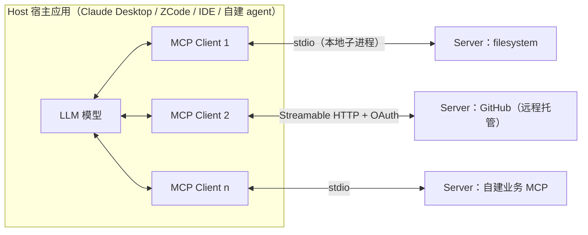

# MCP 搭建文档：格式规范 · 架构构成 · 企业范例 · 使用与迭代

> 信息基准日：2026-09-27。协议规范以**现行版 2026-07-28** 为主、**legacy 版（2025-11-25 及更早）** 为对照——大量现存客户端与教程仍按 legacy 实现，两代差异是本文反复强调的主线。企业仓库信息（star 数、参数名、目录结构）均为当日对 GitHub README 与源码的实际抓取，随时间会漂移，以仓库现状为准。
>
> 规范来源：modelcontextprotocol.io 各版本规范页与官方 schema 仓库（每节末尾标 URL）。本工作区惯例是结论带 `文件:行号`，本文是网络调研文档，等价做法是**结论带来源链接**。

---

## 0. TL;DR

- **MCP**（Model Context Protocol，模型上下文协议）是 Anthropic 于 2024-11 开源的开放协议，跑在 **JSON-RPC 2.0**（一种基于 JSON 的远程过程调用协议）之上，把 "M 个 AI 应用 × N 个工具/数据源" 的 M×N 集成问题变成 **M+N**：应用侧实现一次 client，服务侧实现一次 server。
- 架构三角色：**Host**（宿主应用，管安全与用户同意）→ **Client**（宿主创建，与一个 server 一对一通信）→ **Server**（用 Tools / Resources / Prompts 三原语暴露能力）。
- **三大原语按控制权分**：Tools 是**模型控制**（LLM 自己决定何时调用）、Resources 是**应用控制**（宿主决定何时注入上下文）、Prompts 是**用户控制**（用户显式选用）。
- 协议在 **2026-07-28 版发生大改**：从"有连接会话"改为**无状态**——取消 `initialize` 握手，改为每个请求用 `_meta` 自带协议版本与能力，server 用 `server/discover` 暴露元信息。旧版机制归入 legacy，仍被广泛使用。
- 搭 server 的最短路径：Python（官方 SDK，`@mcp.tool()` 装饰器，十几行）或 TypeScript（`registerTool` + Zod schema）。真正的工程量在**工具设计**（命名、描述、schema、注解、错误设计）与**暴露面治理**（分组、只读、按需启用）。
- 企业范例的两大标杆：**github/github-mcp-server**（Go，双形态部署，21 个 toolset 分组 + 改名别名兼容，教科书级的迭代管理）与 **microsoft/playwright-mcp**（TS，浏览器自动化，可访问性快照省 token）。天平整体在从本地 stdio 向**远程托管 + OAuth** 倾斜（Notion 开源版已转维护、Stripe 收敛为托管端点）。
- 迭代三板斧：**协议版本**靠逐请求协商 + `data.supported` 版本清单；**工具改名**靠别名映射 + 迁移对照文档；**分发**靠 npm/PyPI/Docker + **MCP Registry**（官方注册表，server.json 描述文件）。

**阅读路线**：想搞懂协议 → 读 §1、§2；想动手搭 → 读 §3；想抄作业 → 读 §4；管接入与运维 → 读 §5；长期演进 → 读 §6；安全必读 §7。

---

## 1. MCP 是什么：架构与角色

### 1.1 一句话与生态位

在 MCP 之前，每个 AI 应用要接每个外部系统都得写一遍专属 glue code（胶水代码）。MCP 把这件事标准化成一个双方都遵守的协议：**应用不再为每个工具写适配，工具不再为每个应用写适配**。官方类比 USB-C：一个接口标准，设备（server）与主机（host）各实现一次即可互通。



### 1.2 三角色职责（2026-07-28 规范）

| 角色 | 职责要点 |
|---|---|
| **Host**（宿主） | 容器与协调者：创建并管理多个 client 实例；**控制连接权限与生命周期；强制执行安全策略与用户同意（consent）**；协调 LLM 集成；聚合跨 server 的上下文 |
| **Client**（客户端） | 由宿主创建，与**恰好一个** server 一对一通信；在每个请求上附加协议版本与能力；双向路由消息；**维护 server 之间的安全边界** |
| **Server**（服务器） | 用 resources / tools / prompts 暴露能力；职责单一、独立运行；可以是本地进程（stdio）或远程服务（HTTP） |

三条关键设计原则（写自建 server 时直接影响架构决策）：

1. **Server 极易构建、高度可组合**——所以最小实现可以只有十几行（§3.2）。
2. **Server 看不到整个对话，也看不见其他 server**——完整对话历史只留在 host，server 之间隔离，跨 server 交互由 host 控制。这决定了 server 的输入只能是"调用参数 + 明确声明的上下文"，不能指望拿到会话。
3. **能力渐进协商**——client/server 各自声明自己支持什么，缺的能力 graceful（优雅）降级而不是报错崩溃。

> 来源：https://modelcontextprotocol.io/specification/2026-07-28/architecture

### 1.3 版本时间线（先有全局再进细节）

| 规范版本 | 关键变化 |
|---|---|
| 2024-11-05 | 首版：JSON-RPC 2.0、三大原语、stdio + HTTP+SSE 传输 |
| 2025-03-26 | 引入 **Streamable HTTP**（流式 HTTP，取代旧 HTTP+SSE）与 **OAuth 2.1** 授权框架 |
| 2025-06-18 | 结构化工具输出 `structuredContent`、MIME 资源、完善授权规范 |
| 2025-11-25 | URL 模式 elicitation、任务（tasks）等；**initialize 握手时代的最后一版** |
| **2026-07-28** | **无状态化大改**：取消握手、逐请求 `_meta` 协商、`server/discover`、`resultType` 结果封装、sampling/roots 废弃 |

> 索引：https://modelcontextprotocol.io/llms.txt ｜ 各版规范页 `…/specification/<日期>/…`

---

## 2. 协议格式规范（搭建前必须吃透的部分）

## 2.1 消息层：JSON-RPC 2.0 的三类消息

所有 MCP 消息必须是合法的 JSON-RPC 2.0 消息，共三类：

```jsonc
// ① Request（请求）——要求对方执行并返回结果
{ "jsonrpc": "2.0", "id": 1, "method": "tools/call", "params": { "name": "get_weather", "arguments": { "location": "Seattle" } } }

// ② Response（响应）—— 成功带 result，失败带 error；id 必须与请求一致
{ "jsonrpc": "2.0", "id": 1, "result": { "resultType": "complete", "content": [ /* … */ ] } }
{ "jsonrpc": "2.0", "id": 1, "error": { "code": -32602, "message": "Invalid params: location is required" } }

// ③ Notification（通知）—— 单向广播，没有 id，接收方禁止回复
{ "jsonrpc": "2.0", "method": "notifications/tools/list_changed" }
```

MCP 在 JSON-RPC 之上的附加约束（容易踩的）：

- `id` 必须是字符串或整数，**不能是 `null`**；不得与在途请求重号。
- 现行版响应的 `result` **必须**带 `resultType` 字段：`"complete"`（完成）或 `"input_required"`（server 需要客户端补充输入，§2.5）。遇到旧版 server 不带该字段时按 `"complete"` 处理。
- 通知（notification）**不得**携带 `id`——写成带 id 的通知是常见实现错误。

错误码速查（JSON-RPC 保留段 -32000..-32099 中 MCP 的分配）：

| 错误码 | 含义 |
|---|---|
| -32700 / -32600 / -32601 / -32602 / -32603 | JSON-RPC 标准：解析错误 / 无效请求 / 方法不存在 / 参数无效 / 内部错误 |
| -32020 | HeaderMismatch：HTTP 头与 body 内容不一致（现行版） |
| -32021 | MissingRequiredClientCapability：请求用到了客户端未声明的能力 |
| -32022 | UnsupportedProtocolVersion：版本不支持，`data.supported` 会列出可用版本 |
| -32000..-32019 | legacy 实现自定义区（各 SDK 有约定俗成的用法） |

> 来源：https://modelcontextprotocol.io/specification/2026-07-28/basic

## 2.2 生命周期：握手（legacy）与无状态协商（现行）

**怎么记**：2026-07-28 之前，MCP 像"数据库连接"——先握手建立会话，会话内交换消息；之后像"HTTP API"——每个请求自描述（带版本、身份、能力），server 不依赖历史请求。

### 现行版（2026-07-28）：没有握手

- 每个请求在 `params._meta` 里带三个键：`io.modelcontextprotocol/protocolVersion`（必填）、`io.modelcontextprotocol/clientInfo`（建议带）、`io.modelcontextprotocol/clientCapabilities`（必填，可为空对象）。HTTP 传输上另有 `MCP-Protocol-Version` 请求头，值必须与 `_meta` 一致，否则 400 + `-32020`。
- server **必须**实现 **`server/discover`**：客户端可以（也可以不）在任何请求前调用它，一次性拿到 `supportedVersions`（支持的版本清单）、`capabilities`（能力）与 `instructions`（给模型的使用说明）。
- 版本不被支持时，server 返回 `-32022`，`data.supported` 列出可用版本，客户端挑一个双方都支持的**换版本重试**即可——不需要重连。
- 缺必填 `_meta` 的请求必须以 `-32602` 拒绝（HTTP 下状态码 400）。

### legacy（2025-11-25 及更早）：三段握手

**现存客户端、教程与企业 server 大多仍按这一代实现**，读懂它是看懂现有生态的前提：

```jsonc
// ① client → server：initialize 请求（必须是首个消息）
{
  "jsonrpc": "2.0", "id": 1, "method": "initialize",
  "params": {
    "protocolVersion": "2025-11-25",              // client 支持的最新版
    "capabilities": {                              // client 能力：roots/sampling/elicitation/tasks
      "roots": { "listChanged": true },
      "sampling": {},
      "elicitation": { "form": {}, "url": {} }
    },
    "clientInfo": { "name": "ExampleClient", "version": "1.0.0" }
  }
}
// ② server → client：返回自己的版本 + 能力（能力协商：双方运行期都必须遵守协商结果）
{
  "jsonrpc": "2.0", "id": 1,
  "result": {
    "protocolVersion": "2025-11-25",
    "capabilities": {
      "logging": {}, "prompts": { "listChanged": true },
      "resources": { "subscribe": true, "listChanged": true },
      "tools": { "listChanged": true }
    },
    "serverInfo": { "name": "ExampleServer", "version": "1.0.0" },
    "instructions": "Optional instructions for the client"   // 给模型看的使用说明
  }
}
// ③ client → server：initialized 通知，握手完成，进入正常操作
{ "jsonrpc": "2.0", "method": "notifications/initialized" }
```

协商规则：client 报自己支持的最新版；server 支持就**原样返回**，不支持则返回 server 自己的最新版；client 若也不支持响应里的版本则断开连接。HTTP 上握手后所有请求必须带 `MCP-Protocol-Version` 头。

> 来源：现行 https://modelcontextprotocol.io/specification/2026-07-28/basic/versioning ｜ legacy https://modelcontextprotocol.io/specification/2025-11-25/basic/lifecycle

## 2.3 三大原语（Server Features）

三者的能力声明都放在 server 的 capabilities 里；`listChanged: true` 表示列表变化时 server 会发通知（如 `notifications/tools/list_changed`）。

| 原语 | 控制权 | 方法 | 典型场景 |
|---|---|---|---|
| **Tools**（工具） | **model-controlled 模型控制**：LLM 看完工具列表自主决定何时调 | `tools/list`、`tools/call` | 查天气、发 PR、执行 SQL |
| **Resources**（资源） | **application-driven 应用控制**：宿主决定何时把数据注入上下文 | `resources/list`、`resources/read`、`resources/templates/list` | 文件内容、数据库 schema、日志 |
| **Prompts**（提示模板） | **user-controlled 用户控制**：用户显式选用（如斜杠命令） | `prompts/list`、`prompts/get` | `/review-pr`、`/summarize` |

这个"控制权三分"是 MCP 最值得记住的设计：同样是"给模型提供能力"，**谁来触发**决定了它该做成哪种原语。

### Tool 对象与 tools/list

```jsonc
// client → server
{ "jsonrpc": "2.0", "id": 1, "method": "tools/list", "params": { "cursor": "optional-cursor-value" } }

// server → client（现行版页面原文）
{
  "jsonrpc": "2.0", "id": 1,
  "result": {
    "resultType": "complete",
    "tools": [
      {
        "name": "get_weather",                       // 唯一标识：1–128 字符，仅限字母数字 _ - .
        "title": "Weather Information Provider",     // 可选显示名
        "description": "Get current weather information for a location",  // 给 LLM 看的说明书
        "inputSchema": {                             // 必须是 JSON Schema，根类型 object
          "type": "object",
          "properties": {
            "location": { "type": "string", "description": "City name or zip code" }
          },
          "required": ["location"]
        },
        "annotations": { "readOnlyHint": true },     // 行为提示，见 §2.6
        "icons": [ { "src": "https://example.com/weather-icon.png", "mimeType": "image/png", "sizes": ["48x48"] } ]
      }
    ],
    "nextCursor": "next-page-cursor",                // 还有更多结果时才出现（不透明游标分页）
    "ttlMs": 300000, "cacheScope": "public"          // 现行版新增的缓存提示
  }
}
```

### tools/call：两级错误设计（工程上最重要的一节）

```jsonc
// client → server
{ "jsonrpc": "2.0", "id": 2, "method": "tools/call",
  "params": { "name": "get_weather", "arguments": { "location": "New York" } } }

// 成功：content 数组是给人/模型看的内容
{ "jsonrpc": "2.0", "id": 2,
  "result": {
    "resultType": "complete",
    "content": [ { "type": "text", "text": "Current weather in New York:\nTemperature: 72°F" } ],
    "isError": false
  } }

// 工具执行失败：不抛 JSON-RPC error，而是 isError: true + 可读反馈，让模型能自我纠正
{ "jsonrpc": "2.0", "id": 4,
  "result": {
    "resultType": "complete",
    "content": [ { "type": "text", "text": "Invalid departure date: must be in the future. Current date is 08/08/2025." } ],
    "isError": true
  } }
```

两级错误的分工：

| 层级 | 用法 | 例子 |
|---|---|---|
| **协议错误**（JSON-RPC error） | 请求本身不合法，模型难以自行修复 | 工具不存在 `-32602`、参数 schema 校验失败 |
| **执行错误**（`isError: true`） | 工具跑了但失败，返回**模型可读、可据此改参重试**的反馈 | 日期越界、权限不足、上游 API 4xx |

`content` 数组的五种类型：`text`（文本）、`image` / `audio`（base64 + MIME）、`resource_link`（引用资源 URI）、`resource`（内嵌资源）。另有 `structuredContent` 字段可返回符合 `outputSchema` 的结构化 JSON（2025-06-18 引入；为兼容旧客户端，应同时在 text 里给序列化 JSON）。

### Resources 与 Prompts 的要点

- **Resources**：以 URI（统一资源标识符）标识，文本返回 `text` 字段、二进制返回 base64 的 `blob`；`resources/read` 一次可返回多个内容（比如读一个目录）。`uriTemplate`（URI 模板，RFC 6570）支持参数化资源如 `file:///{path}`。规范**禁止**对不存在的资源返回空数组，必须报 `-32602`。
- **Prompts**：`prompts/get` 返回 `messages` 数组（`role` + `content`），content 可嵌入 resource 实现"动态提示"；参数支持自动补全（completion API）。

> 来源：https://modelcontextprotocol.io/specification/2026-07-28/server/tools ｜ …/server/resources ｜ …/server/prompts

## 2.4 传输层（Transports）

### stdio（标准输入输出）——本地进程

client 把 server 作为**子进程**启动：server 从 `stdin` 读、向 `stdout` 写 JSON-RPC 消息。规则：

- 每条消息一行，**换行分隔，消息内不得有换行**。
- **日志只能写 `stderr`**；`stdout` 上禁止出现任何非 MCP 内容——`print("debug")` 打到 stdout 是新手第一大坑，会直接污染协议流。
- 关闭顺序：client 先关子进程的输入流 → 等退出 → 超时发 SIGTERM → 再超时 SIGKILL。协议无状态，子进程意外退出时 client 应直接重启并重试在途请求。

### Streamable HTTP（流式 HTTP）——远程服务

现行版（2026-07-28）把 HTTP 传输也简化成了最朴素的形状：

- **单一端点**（如 `https://example.com/mcp`），**只接受 POST**；每条 request/notification 就是一个独立 POST。
- 请求必须带：`Accept: application/json, text/event-stream`（两种响应都要能接）、`MCP-Protocol-Version`、`Mcp-Method`（承载方法名）、`Mcp-Name`（`tools/call` 等方法还要带工具名）。
- 对 request 响应 `application/json`（单对象）或 `text/event-stream`（SSE 流，可在最终结果前先推进度通知）；对 notification 接受则返回 **202 Accepted**。
- 取消请求 = 客户端关闭该请求的 SSE 流。
- 安全强制项：校验所有入连的 `Origin` 头（防 DNS rebinding，DNS 重绑定攻击），无效则 403；本地服务只绑 `127.0.0.1`；远程必须做认证（遵循 MCP 授权规范，OAuth 2.1 + PKCE）。

**legacy 版 Streamable HTTP（2025-03-26 ～ 2025-11-25）的差异**（排查老 server 时要知道）：端点支持 POST + GET 两个方法；initialize 响应头里 server 可分配 **`Mcp-Session-Id`** 会话 ID，之后所有请求必须携带，session 过期返回 404，客户端可发 HTTP DELETE 显式终止；GET 用来开独立的 SSE 流接收 server 主动消息；支持 `Last-Event-ID` 断线续传。**现行版把这一切都删了**：GET/DELETE 一律 405，无会话头，断线靠无状态重试。

> 早期还有一代 **HTTP + SSE 传输**（2024-11-05 定义，两个端点），已被 Streamable HTTP 取代并从主流 SDK 移除（AWS 官方 server 2025-05-26 明确移除 SSE 支持）。

### 选型

| 场景 | 选择 | 理由 |
|---|---|---|
| 个人/本地数据不出机器 | stdio | 零部署，进程随宿主生命周期 |
| 团队/多用户/SaaS 能力 | Streamable HTTP + OAuth | 集中鉴权审计，客户端只填一个 URL |
| 企业内网 | HTTP + 网关/注册表（§5.2） | 统一管控 |

> 来源：https://modelcontextprotocol.io/specification/2026-07-28/basic/transports/stdio ｜ …/basic/transports/streamable-http

## 2.5 客户端可选特性（Client Features）

三个"server 反过来找 client 要东西"的特性。现行版统一用 **`InputRequiredResult`**（`resultType: "input_required"`）机制：server 在应答里内嵌一个输入请求，client 收集结果后在重试的原请求中回传；legacy 版则是 server 直接向 client 发 JSON-RPC 请求。

| 特性 | 作用 | 方向 | 现行版状态 |
|---|---|---|---|
| **Sampling**（采样，`sampling/createMessage`） | server 请求用 client 的 LLM 做一次补全（server 不需要自己的 API key，client 保持控制） | server → client | **已废弃**（SEP-2577，保留至少 12 个月，新实现不建议采用） |
| **Roots**（根目录，`roots/list`） | client 告诉 server"你该在哪些目录下工作"（是信息指引，不是访问控制） | server → client | **已废弃**（建议改用工具参数或资源 URI） |
| **Elicitation**（信息采集，`elicitation/create`） | server 请求用户补充信息，结果三态：`accept` / `decline` / `cancel` | server → client → 用户 | **现行特性**，分两种模式：**form**（结构化表单，仅限扁平对象+原始类型）与 **url**（带外交互，用于密码/API key/支付等绝不能经过 MCP client 的敏感信息；规范禁止用 form 模式索要凭据） |

> 来源：https://modelcontextprotocol.io/specification/2026-07-28/client/elicitation 等对应页

## 2.6 工具注解（Tool Annotations）

写在 tool 定义的 `annotations` 字段，是 server 给 client 的**行为提示**：

| 字段 | 含义 | 默认值 |
|---|---|---|
| `title` | 人类可读标题 | — |
| `readOnlyHint` | true 表示不修改环境（只读） | **false** |
| `destructiveHint` | true 表示可能有破坏性更新（仅当非只读时有意义） | **true** |
| `idempotentHint` | true 表示同参数重复调用无额外效果（幂等）（仅当非只读时有意义） | **false** |
| `openWorldHint` | true 表示与开放世界外部实体交互（如网页搜索） | **true** |

⚠️ **规范原文的警告必须原样转述**：注解全部是 hint（提示），**不保证**如实描述工具行为；client **必须**把来自不受信 server 的注解视为不可信输入，**绝不能**仅凭注解做安全决策（比如"标了 readOnly 就免确认"）。client 可以用注解优化 UX（交互体验），不能用它替代权限模型。

> 来源：schema 定义 https://github.com/modelcontextprotocol/specification/blob/main/schema/2026-07-28/schema.ts ｜ https://modelcontextprotocol.io/specification/2026-07-28/server/tools

## 2.7 分页与缓存

- **不透明游标分页**（opaque cursor-based pagination）：server 返回当前页 + `nextCursor`；client 原样回传。client **不得**解析或假设 cursor 格式，**不得**假设固定页大小；空字符串也是合法 cursor；没有 `nextCursor` 才是结果结束。适用 `tools/list`、`resources/list`、`resources/templates/list`、`prompts/list`。
- 现行版新增结果缓存提示：`ttlMs`（类似 HTTP max-age）与 `cacheScope`（`public` 可跨授权上下文缓存 / `private` 仅同授权上下文）。

> 来源：https://modelcontextprotocol.io/specification/2026-07-28/server/utilities/pagination

---

## 3. 从零搭一个 MCP Server

## 3.1 选 SDK

官方 SDK（modelcontextprotocol org 维护）已引入分层制（Tier，按完备度与维护承诺）：

| 语言 | 仓库 | Tier |
|---|---|---|
| TypeScript / Python / C# / Go / Rust | github.com/modelcontextprotocol/{typescript,python,csharp,go,rust}-sdk | **Tier 1** |
| Java / Ruby | …java-sdk、…ruby-sdk | Tier 2 |
| Swift / PHP / Kotlin | …swift-sdk、…php-sdk、…kotlin-sdk | Tier 3 |

选型建议：**Python**（官方 SDK 自带 `mcp dev` + Inspector，迭代最快，AWS 官方 server 全用它）；**TypeScript**（生态最大，Standard Schema 支持 Zod/Valibot/ArkType）；**Go**（单二进制分发，github-mcp-server 已从自研迁移到官方 go-sdk，说明官方 SDK 已够生产级）。注意 2026 年 SDK 已进入 **v2**（TypeScript 拆分为 `@modelcontextprotocol/server` 等包；Python 同样 v2），v1 线有至少 6 个月的维护期——**网上大量教程是 v1 写法，照抄前先看规范/SDK 版本**。

> 来源：https://modelcontextprotocol.io/docs/sdk

## 3.2 最小可用 server

**Python**（官方 `mcp` 包；`uv add "mcp[cli]"`）：

```python
from mcp.server import MCPServer

mcp = MCPServer("Demo")

@mcp.tool()
def add(a: int, b: int) -> int:
    """Add two numbers."""          # docstring 就是发给 LLM 的 description
    return a + b

@mcp.resource("greeting://{name}")
def greeting(name: str) -> str:
    return f"Hello, {name}!"
```

```bash
uv run mcp dev server.py            # 打开 MCP Inspector 调试
uv run mcp run server.py --transport streamable-http   # 以 HTTP 传输运行
```

（v1 时代的写法是 `from mcp.server.fastmcp import FastMCP`，社区教程几乎都是它；v2 换成 `MCPServer`，装饰器风格不变。）

**TypeScript**（`npm install @modelcontextprotocol/server`）：

```typescript
import { McpServer } from '@modelcontextprotocol/server';
import { StdioServerTransport } from '@modelcontextprotocol/server/stdio';
import * as z from 'zod/v4';

const server = new McpServer({ name: 'greeting-server', version: '1.0.0' });

server.registerTool('greet', {
  description: 'Greet someone by name',
  inputSchema: z.object({ name: z.string() })
}, async ({ name }) => ({
  content: [{ type: 'text', text: `Hello, ${name}!` }]
}));

await server.connect(new StdioServerTransport());
```

> 来源：https://github.com/modelcontextprotocol/python-sdk ｜ https://github.com/modelcontextprotocol/typescript-sdk

## 3.3 工具设计规范（从企业范例里提炼的真金白银）

最小实现是十几行的事，**设计质量决定这个 server 有没有人用**。以下是六家官方 server 共性做法的提炼：

**① 命名**：`snake_case`（下划线命名）+ 动词开头（`get_` / `list_` / `create_` / `search_`），或统一业务前缀（playwright 全部 `browser_*`）；规范限制 1–128 字符、仅字母数字与 `_ - .`。一个 server 的工具应共享同一命名气质，不要 snake 与 kebab 混用。

**② description 是写给 LLM 的 API 文档**：说清做什么、什么时候该用（vs 不该用）、参数含义、失败时返回什么。它是模型选择工具的唯一依据，糊弄它 = 工具永远不被选中；往 description 里塞指令/广告还有注入风险（§7）。

**③ inputSchema 精确且最小**：必填项标 `required`；参数越少越好——每个参数都是模型可能填错的格子。要约束枚举值就写 `enum`。

**④ annotations 如实标注**：只读工具标 `readOnlyHint: true`，让 client 能对它放宽确认；写操作标 `destructiveHint`。乱标等于把信任体系搞坏。

**⑤ 错误返回要"可自纠"**：执行失败走 `isError: true`，消息里写清楚错在哪、现在是什么状态、该怎么改（参考 §2.3 的日期示例——"must be in the future. Current date is 08/08/2025" 连"今天几号"都告诉模型了）。

**⑥ 省 token 是一等设计目标**（企业范例的杀手锏）：
- **工具合并**：github-mcp-server 把 `get_issue` / `get_issue_comments` 等合并成 `issue_read`，用 `method` 参数承载子操作，压缩工具总数。
- **局部返回**：playwright 的 `browser_find` 在快照内搜索，避免每次全量快照；notion 提供 Markdown 原生读写端点。
- **Code Mode**：Cloudflare 的思路更进一步——让模型写一段代码去调 API，而不是在几十个工具里逐个挑（工具列表本身也占上下文）。

**⑦ 暴露面必须可收敛**：工具一多就要分组（§4.8 的 toolset/features/skills 四家方案）；提供只读开关；写操作单独隔离。这同时改善模型选工具的准确率、上下文体积与安全面。

**⑧ 别在工具里塞隐藏副作用**：一个工具做一件事；要分步就做多个工具。模型对"调用 A 会顺便改 B"毫无预期。

**搭建检查清单**：
- [ ] stdout 上只有协议消息，日志全走 stderr（stdio 模式）
- [ ] 每个工具：name 合规、description 写给人也写给模型、inputSchema 带 required、annotations 如实
- [ ] 执行错误返回 `isError: true` + 可自纠的消息，而不是抛协议错误
- [ ] 列表类结果支持分页 + `listChanged` 通知
- [ ] 写操作有只读开关/权限边界；HTTP 模式校验 Origin、强制认证
- [ ] server.json 写好，README 标注传输方式与鉴权方式（对齐企业惯例，§6.5）

---

## 4. 企业真实范例（GitHub 收集）

> 选样原则：**官方/大厂直接维护**、当前活跃、形态各异。star 数与仓库状态为 2026-09-27 实抓（标注"约"）。本节所有结论来自各仓库 README 与源码目录的当日抓取。

## 4.1 横向对比总表

| 仓库 | 维护方 | 语言/SDK | 传输方式 | 工具规模/组织 | 特色设计 |
|---|---|---|---|---|---|
| [github/github-mcp-server](https://github.com/github/github-mcp-server)（约 3.3 万星） | GitHub | Go / 官方 go-sdk | stdio + 远程 `api.githubcopilot.com/mcp/` | 上百工具 / **21 个 toolset** 分组 | `--toolsets`/`--tools` 按需启用、`--read-only`、改名别名兼容、Docker 官方镜像 |
| [microsoft/playwright-mcp](https://github.com/microsoft/playwright-mcp)（约 3.8 万星） | 微软 | TS / 官方 SDK | stdio（默认）+ HTTP（`--port`）+ Docker | 20 余个 `browser_*` 扁平工具 | **可访问性快照驱动**（非截图）、每工具标注只读性、`--secrets` 密钥打码 |
| [microsoft/mcp](https://github.com/microsoft/mcp)（约 3.7k） | 微软 | C#/.NET monorepo | Local/Remote 分型 | 数十个服务器目录式治理 | **官方 catalog（目录）仓库**模式，每 server 标注 Local/Remote |
| [awslabs/mcp](https://github.com/awslabs/mcp)（约 9.7k） | AWS | Python / FastMCP | **stdio only**（个别远程例外） | 40+ 服务器，每服独立 PyPI 包 | `uvx` 秒装；按用例组织文档；写权限开关命名不统一（反例教材） |
| [stripe/ai](https://github.com/stripe/ai)（约 1.8k） | Stripe | TS + Python | **仅远程** `mcp.stripe.com`（OAuth） | 未公开清单 | MCP 收敛为托管端点 + skills/插件分发（无独立 stdio 版） |
| [cloudflare/mcp-server-cloudflare](https://github.com/cloudflare/mcp-server-cloudflare)（约 4.3k） | Cloudflare | TS / SDK v2 | 远程为主，统一无状态 HTTP `/mcp` | 10+ 服务器（apps/ 每服一应用） | 每服务器独立子域；**Code Mode**（生成代码调 API） |
| [getsentry/sentry-mcp](https://github.com/getsentry/sentry-mcp)（约 0.9k） | Sentry | TS / pnpm monorepo | **同库双形态**：远程 `mcp.sentry.dev/mcp` + 本地 npx stdio | 按 skills 裁剪（`?skills=inspect,triage`） | FSL 许可证；`Sentry-Bearer`/`Bearer` 头分离；远程作为 API 中间件 |
| [makenotion/notion-mcp-server](https://github.com/makenotion/notion-mcp-server)（约 4.6k） | Notion | TS / **OpenAPI 生成** | stdio + Streamable HTTP；**官方主推远程** | 22 个工具，kebab-case 贴近 REST 端点 | OpenAPI spec 驱动生成；多租户 token 透传；**已转维护模式（警示）** |
| [supabase/mcp](https://github.com/supabase/mcp)（约 2.9k） | Supabase | TS / 官方 SDK | 远程 `mcp.supabase.com/mcp`（OAuth 2.1）优先 | **URL 参数即配置**：`?features=&read_only=&project_ref=` | `createToolSchemas()` 的 `projectScoped` 直接改工具 schema |
| [atlassian/atlassian-mcp-server](https://github.com/atlassian/atlassian-mcp-server)（约 1.1k） | Atlassian | JS（仓库是清单/skills 发布仓，服务端未开源） | 仅远程 `mcp.atlassian.com/v2/mcp` | **按需工具发现**（不全量下发） | OAuth scope 组 `read_/write_/search_/delete_` 映射工具权限 |
| [modelcontextprotocol/servers](https://github.com/modelcontextprotocol/servers)（约 9 万） | MCP 官方 | TS / Python | stdio（npx/uvx） | 7 个**教学参考** server：everything / fetch / filesystem / git / memory / sequentialthinking / time | everything server 是协议测试夹具；filesystem 的目录白名单是"最小权限"参考 |

> 两个组织迁移注意：Supabase 官方 MCP 已从 `supabase-community/supabase-mcp` 迁移到 **`supabase/mcp`**；Stripe 无独立 MCP 仓库，MCP 能力并入 **`stripe/ai`**。

## 4.2 精读一：github/github-mcp-server（Go 标杆，迭代管理的教科书）

**总体**：MIT 协议，Go 1.25，依赖**官方 go-sdk v1.7.0**（`go.mod` 实抓）+ go-github（REST）+ githubv4（GraphQL）。**双形态部署**：本地 stdio（`github-mcp-server stdio`）与远程托管（`https://api.githubcopilot.com/mcp/`）；官方 Docker 镜像 `ghcr.io/github/github-mcp-server`。

**① toolset（工具集）分组是它的招牌**。上百个工具按领域分 21 组：`context, repos, issues, pull_requests, actions, code_security, code_quality, dependabot, discussions, gists, git, governance, labels, notifications, orgs, projects, secret_protection, security_advisories, stargazers, users, copilot`。启动时选择：

```bash
github-mcp-server stdio --toolsets repos,issues          # 整组启用
github-mcp-server stdio --tools get_file_contents,issue_read   # 单工具粒度启用
github-mcp-server stdio --read-only                      # 只读模式（优先级最高，即使 --tools 点名写工具也会被跳过）
```

README 原话点破动机："Enabling only the toolsets that you need can help the LLM with tool choice and reduce the context size."（只启用需要的工具集，既能帮模型选对工具，又能减小上下文。）——**工具收敛不是为了省 token 的附带优化，而是提升 agent 成功率的核心手段**。

**② 目录结构**（`pkg/github/` 下按领域一文件，可直接抄的工程布局）：

```
cmd/github-mcp-server/      # 入口（main.go、generate_docs.go 文档生成器）
pkg/github/
  issues.go                 # issues toolset 的全部工具
  pullrequests.go           # PR toolset
  actions.go …              # 每个领域一个文件，各自注册所属工具
  server.go                 # 组装
  inventory.go              # 工具清单总账
  deprecated_tool_aliases.go  # 旧工具名 → 新名 别名映射（§6.2 的兼容机制）
  __toolsnaps__/            # 工具输出的快照测试目录
  feature_flags.go          # 特性开关
```

**③ 其他值得抄的点**：PAT（Personal Access Token，个人访问令牌）环境变量 `GITHUB_PERSONAL_ACCESS_TOKEN` 与浏览器 OAuth 双鉴权；文档由代码生成（改工具必须同步文档，CI 卡住）；仓库根有 **server.json**，同时声明本地 OCI 镜像包与远程端点——"一个描述文件讲清双形态"（§6.5）。

## 4.3 精读二：microsoft/playwright-mcp（TS 明星，省 token 设计的典范）

- **工具组织**：20 余个 `browser_click` / `browser_snapshot` / `browser_navigate` / `browser_fill_form` 等扁平命名工具，每个工具在 README 里明确标注 **Read-only: true/false**——工具文档里显式声明只读性，便于人与 client 双方判断风险。
- **核心设计**：以**可访问性树快照**（accessibility snapshot，每个元素带 ref 引用号）替代截图来"看"页面——模型用 ref 定位元素点击/填表，比视觉模型读截图**又准又省 token**；`browser_find` 支持在快照里局部搜索避免全量快照。
- **配置设计**：每个 CLI 参数都有对应的 `PLAYWRIGHT_MCP_*` 环境变量；`--caps` 按能力开关（vision/pdf/devtools）；`--secrets` 从 dotenv 文件读密钥并在**工具响应里打码**，密钥不进上下文。
- **一个有价值的"反 MCP"观点**：README 专门讨论了 CLI + skills 与 MCP 的取舍，认为编码 agent 场景下直接给模型 CLI 工具反而更省 token。**MCP 不是万能接口，暴露面越贴近模型能力越好**——企业级选型时值得记住这个自我批判。

## 4.4 精读三：awslabs/mcp + supabase/mcp + notion（三种生成/配置路线）

- **awslabs/mcp**（Python + FastMCP）：monorepo，`src/` 下**每个 server 一个独立 Python 包**、独立发 PyPI，用户 `uvx awslabs.xxx@latest` 一条命令跑起。40+ 服务器按"你要做什么/你怎么工作"组织文档。**反面教材**：写权限开关命名不统一——`--allow-write`、`--allow-sensitive-data-access`、`DDB-MCP-READONLY=true`、`--readonly True` 各行其是；多家对比后可知：**参数命名一致性本身就是治理问题**。
- **supabase/mcp**（TS）：把配置做成 **URL 参数**：`https://mcp.supabase.com/mcp?project_ref=xxx&read_only=true&features=database,docs`——工具裁剪、只读、项目绑定全在连接串里；`createToolSchemas()` 的 `projectScoped` 选项直接**改写工具入参 schema**（从工具里删掉 project_id）而不只是填值，是"配置进 schema"的新颖设计。
- **notion-mcp-server**（TS）：**从 OpenAPI spec 生成工具**（22 个，kebab-case 贴近 REST 端点如 `post-database-query`）——适合"已有成熟 REST API 想快速 MCP 化"的团队；支持多租户 token 透传。**警示**：README 顶部声明已转维护模式、官方主推远程托管版——开源 stdio 版正在被 SaaS 厂商逐步退役（见 §4.5）。

## 4.5 形态趋势：从"开源 stdio 仓库"到"托管端点 + 插件分发"

把十家放在一起看，天平明显在倾斜：

- **远程托管优先**：Notion（开源版停维护）、Stripe（无独立仓库，只有 `mcp.stripe.com`）、Atlassian、Cloudflare、Supabase 都把官方托管端点放在第一位，开源 stdio 版降级为自托管选项。
- **双形态并重**：GitHub 与 Sentry 仍认真维护两条路（同一套代码既服务远程中间件又服务本地 npx），github-mcp-server 甚至支持本地 OAuth 登录。
- **分发形态多元化**：除 npm/PyPI/Docker 外，仓库里开始出现各 agent 的插件清单（`.claude-plugin/`、`.cursor-plugin/`、`server.json`）随代码一起发。

对自建 server 的启示：**本地 stdio 起步，把"远程化"设计成演进路径而非重写**——工具层与业务层分离，鉴权从环境变量换成 OAuth 时不动工具定义。

## 4.6 提炼：跨企业的 6 条设计模式

1. **分组按需启用**是工具规模化的必要条件（github toolset / playwright caps / supabase features / sentry skills）。
2. **只读/写分级是标配**（github `--read-only`、supabase `readOnly=true`、playwright 工具级标注、atlassian OAuth scope 前缀组）。
3. **鉴权三层**：环境变量 token（本地）→ OAuth 2.1（远程托管）→ 多租户 token 透传（notion / sentry）。
4. **改名留别名**：兼容靠映射表，不靠祈祷（github `deprecated_tool_aliases.go`）。
5. **文档生成**：工具文档由代码生成（github `generate_docs.go`、playwright `update-readme.js`），杜绝文档与实现漂移。
6. **monorepo 多 server**：微软/AWS/Cloudflare 的成熟形态——共享基建、独立发布（每 server 独立 npm/PyPI 包或独立子域）。

---

## 5. 使用：客户端接入与部署形态

## 5.1 客户端配置（四大客户端真实格式）

共同规律：**stdio 用 `command` + `args`（+ 可选 `env`），远程用 `url`（+ 可选 `headers`）**；顶层键名有差异（VS Code 用 `servers`，ZCode 用嵌套 `mcp.servers`）。

**Claude Desktop**（`%APPDATA%\Claude\claude_desktop_config.json`，macOS 在 `~/Library/Application Support/Claude/`）：

```json
{
  "mcpServers": {
    "filesystem": {
      "command": "npx",
      "args": ["-y", "@modelcontextprotocol/server-filesystem", "/Users/you/Desktop"]
    }
  }
}
```

**Cursor**（全局 `~/.cursor/mcp.json` / 项目 `.cursor/mcp.json`，本地远程可混排）：

```json
{
  "mcpServers": {
    "local-server": {
      "command": "npx",
      "args": ["-y", "mcp-server"],
      "env": { "API_KEY": "value" }
    },
    "remote-server": {
      "url": "https://example.com/mcp",
      "headers": { "API_KEY": "value" }
    }
  }
}
```

**VS Code / GitHub Copilot**（工作区 `.vscode/mcp.json`，顶层键是 `servers`；`inputs` 支持安全提示输入，密钥不落盘）：

```json
{
  "servers": {
    "memory": { "command": "npx", "args": ["-y", "@modelcontextprotocol/server-memory"] },
    "github": {
      "type": "http",
      "url": "https://api.githubcopilot.com/mcp/",
      "headers": { "Authorization": "Bearer ${input:github_mcp_pat}" }
    }
  },
  "inputs": [
    { "type": "promptString", "id": "github_mcp_pat", "description": "GitHub PAT", "password": true }
  ]
}
```

**ZCode**（用户级 `~/.zcode/cli/config.json` 或工作区级 `.zcode/config.json`，顶层键 `mcp` 嵌套 `servers`；配置校验严格，未知键会导致该 server 被丢弃）：

```json
{
  "mcp": {
    "servers": {
      "mysql-local": {
        "type": "stdio",
        "command": "npx",
        "args": ["-y", "@benborla29/mcp-server-mysql"],
        "env": { "MYSQL_HOST": "127.0.0.1", "MYSQL_PORT": "3306" }
      },
      "remote-reader": {
        "type": "http",
        "url": "https://example.com/mcp",
        "headers": { "Authorization": "Bearer ..." }
      }
    }
  }
}
```

> 来源：modelcontextprotocol.io/docs/2026-07-28/develop/connect-local-servers ｜ cursor.com/docs/context/mcp ｜ code.visualstudio.com/docs/agents/reference/mcp-configuration ｜ ZCode 官方技能文档（本机 zcode-guide 插件）

## 5.2 部署三形态

| 形态 | 启动方式 | 适用 |
|---|---|---|
| **本地 stdio** | `npx -y <pkg>`（Node）、`uvx <pkg>`（Python）、`docker run -i --rm -e TOKEN ghcr.io/...`（Docker；注意前台运行、OAuth 要发布回调端口） | 个人开发、数据不出内网 |
| **远程托管** | 客户端只填 `url`，浏览器弹 OAuth 授权（如 Sentry `mcp.sentry.dev/mcp`、GitHub `api.githubcopilot.com/mcp/`） | 多用户、集中审计与授权 |
| **企业内网** | **MCP Gateway（网关）**聚合工具/统一认证/限流（Docker MCP Gateway、Microsoft MCP Gateway 等方案）；自建内部 Registry 实例 + 审批目录；VS Code 配置还支持 `sandbox` 字段做文件/网络沙箱 | 大规模治理 |

---

## 6. 迭代：版本演进、兼容与工程实践

## 6.1 协议版本兼容（服务方视角）

给 server 做长期维护，第一个迭代问题是"新旧客户端一起来怎么办"。现行规范给的答案是 **dual-era（双时代）服务器**：

- **现代客户端**（2026-07-28 逐请求 `_meta`）：每个请求自报版本；版本不支持就回 `-32022` + `data.supported` 清单，客户端自行换版本重试。HTTP 上可先探测：发现代请求，若返回 400 且 body 是可识别的现代错误码再走 legacy 逻辑。
- **legacy 客户端**（≤ 2025-11-25 握手）：stdio 上用 `server/discover` 探测（返回 `DiscoverResult` 即现代，超时/其他错误则回退 `initialize` 握手）。
- 工程建议：**server 端维护一个"支持版本清单"常量**，新规范落地时先加版本号再加行为，让 `-32022` 一直有准确答案。

新旧机制对照（排查兼容性 bug 速查）：

| 主题 | 现行（2026-07-28） | legacy（≤ 2025-11-25） |
|---|---|---|
| 握手 | 无；`_meta` 逐请求 + `server/discover` | `initialize` → `initialized` 三段握手 |
| server→client 请求 | `InputRequiredResult` 内嵌，重试回传 `inputResponses` | server 直接发 JSON-RPC request |
| 会话 | 显式无状态 | stdio 进程 / HTTP `Mcp-Session-Id` 会话 |
| 变更通知 | `subscriptions/listen` 订阅流 | 连接上广播式通知 |
| HTTP | 仅 POST 单端点；GET/DELETE 一律 405 | POST+GET 双方法 + 会话头 + Last-Event-ID |
| sampling / roots | 已废弃（保留 ≥12 个月） | 现行特性 |

## 6.2 工具签名变更：别名保底 + 迁移文档

**协议层没有标准的工具弃用（deprecation）字段**，实践全靠 server 作者自律。github-mcp-server 的做法是业界最佳：

1. **改名时登记别名**：`deprecated_tool_aliases.go` 里维护 `旧名 → 新名` 映射（如 `get_issue → issue_read`），server 静默解析旧名——用户的 `--tools` 白名单、远程请求头里的旧引用**不报错、不断档**。
2. **迁移对照表进文档**：`docs/tool-renaming.md` 维护完整弃用清单；notion v2.0.0 也给了完整的新旧工具名对照表。
3. **工具 description 里标注弃用并指向替代**（社区通行做法）。
4. **SDK 侧对等承诺**：TypeScript SDK v2 保留 v1 线至少 6 个月安全修复；Python SDK 建议用上界锁版本（`mcp>=1.28,<2`）渐进迁移。

## 6.3 发布节奏与 changelog

- **github-mcp-server**：semver（语义化版本），2026-07～09 几乎每 1–2 周一个版本（v1.6.0 → v1.12.2）；changelog 用 GitHub Releases 的 "What's Changed" 风格（逐条列 PR + 作者 + compare 链接），**不再维护仓库内 CHANGELOG.md**——这是当前的通行形态。
- **sentry-mcp**：0.x 阶段一个月数版（0.40/0.41/0.42 相邻两天发布），快速破坏性变更合法，靠版本号与 skills 参数兜底。
- 启示：工具层的变更是**高频常态**，把"改工具"做成流水线（定义 → 生成文档 → 快照测试 → 发布），而不是一次性事件。

## 6.4 测试与调试

| 工具 | 用法 |
|---|---|
| **MCP Inspector**（`@modelcontextprotocol/inspector`） | 官方调试器，三种形态：Web UI（`npx @modelcontextprotocol/inspector`）、CLI（`--cli`，**可脚本化**，`--format json` 配合 jq，专为 CI 设计）、TUI（`--tui`）。CI 冒烟测试套路：connect → list → call → assert |
| Python `mcp dev` | 本地开发一键起 Inspector |
| **快照测试** | github-mcp-server 的 `__toolsnaps__/`：把工具输出存成快照比对，防止工具行为悄悄漂移 |
| **e2e 测试** | github-mcp-server 仓库自带 `e2e/` 目录跑端到端 |
| 客户端侧 | Claude Desktop 日志 `~/Library/Logs/Claude/mcp*.log`（server 的 stderr 也在这）；VS Code 命令面板 "MCP: List Servers"；ZCode 设置 → MCP 面板看每个 server 的 connected/failed 状态 |
| 公开基准 | MCPMark（真实 server 压测）、MCP-Atlas（tool-use 大基准）、**MCPTox**（投毒安全评测）；Invariant 的 **mcp-scan** 扫描工具 |

## 6.5 分发与注册：MCP Registry（官方注册表）

- 官方实例 **https://registry.modelcontextprotocol.io**（2025-09-08 preview 上线，Go + PostgreSQL，可自托管）。
- 核心是 **server.json** 描述文件——github-mcp-server 仓库根目录就有一份，**同时声明本地包与远程端点**：

```json
{
  "$schema": "https://static.modelcontextprotocol.io/schemas/2025-12-11/server.schema.json",
  "name": "io.github.<user>/weather",
  "description": "An MCP server for weather information.",
  "repository": { "url": "https://github.com/<user>/mcp-weather-server", "source": "github" },
  "version": "1.0.1",
  "packages": [
    { "registryType": "npm", "identifier": "@<user>/mcp-weather-server",
      "version": "1.0.1", "transport": { "type": "stdio" } }
  ],
  "remotes": [
    { "type": "streamable-http", "url": "https://api.example.com/mcp/",
      "headers": [ { "name": "Authorization", "value": "{github_pat}" } ] }
  ]
}
```

- 发布流程：官方 CLI `mcp-publisher` → `init` 生成 server.json → `login github`（设备码授权；CI 用 GitHub OIDC）→ `validate` → `publish`。
- **命名空间即所有权**：GitHub 授权时 `name` 必须以 `io.github.<用户名>/` 开头；域名前缀需 DNS/HTTP 验证；npm 包需在 package.json 加 `mcpName` 字段与 server name 一致。
- 多渠道分发惯例：npm / PyPI / Docker 官方镜像 + server.json + 各 agent 插件清单（`.claude-plugin/` 等）随仓库一起发。

## 6.6 安全实践清单（迭代时要持续回归的项）

规范层面的强制/建议（modelcontextprotocol.io/specification/2025-06-18/basic/security_best_practices，后续版本延续）：

- **OAuth 2.1 + PKCE**（Proof Key for Code Exchange，防授权码拦截）；防 **confused deputy**（混乱代理人：OAuth 代理被绕过授权）——精确 redirect_uri 匹配、一次性 state、consent（用户同意）绑定到具体 client。
- **禁止 token passthrough**：server 不得把未签发给自己的 token 直接转发下游（绕过限流/审计）。
- SSRF（服务端请求伪造）防护：校验 OAuth 发现 URL 必须为 HTTPS、拉黑私网/云元数据地址（169.254.169.254）。
- 会话 ID 必须密码学安全随机、不可当认证手段。

工具层的攻击面（Invariant Labs 2025 披露，安全评测 MCPTox 实测投毒成功率 >72%）：

- **工具描述投毒**：description 里藏指令，客户端**加载工具列表即生效**，甚至不用等调用；
- **Rug pull（审批后偷换）**：用户批准后又换工具描述；
- **跨 server 遮蔽**：恶意 server 覆盖/污染可信 server 的工具与输出。

对应防御（落到自建与接入两侧）：

1. client 对**敏感操作弹确认**、把工具入参展示给用户、审计日志；**人始终在回路**（human in the loop），规范原文要求应用"SHOULD always be a human in the loop with the ability to deny tool invocations"。
2. **注解不可信**（§2.6），安全决策不依赖 hint。
3. **最小暴露面**：github 的 `--read-only`（优先级压过一切）、toolset 白名单；sentinel 原则是"能不给模型的工具就不给"。
4. 凭据卫生：最小 scope、分项目分 token、定期轮换、绝不入库、配置文件 `chmod 600`。
5. 用 mcp-scan 定期扫描接入的第三方 server。

---

## 7. 常见坑（FAQ 式速查）

| 坑 | 症状 | 解法 |
|---|---|---|
| `print()` 调试打到 stdout | stdio 模式 client 解析崩溃 | 日志一律 stderr（§2.4） |
| 教程是 v1 写法，SDK 已 v2 | import 报错 / 行为不符 | 认准 SDK 版本；Python 旧教程锁 `mcp>=1,<2` 过渡（§3.1） |
| 工具几十个不分组 | 模型选错工具、上下文膨胀 | toolset 分组 + 只读开关（§4.2） |
| 以为 annotations 是安全保证 | 只读标注的恶意工具干了写操作 | 注解仅是 hint，权限独立建模（§2.6） |
| 用旧版 SSE 传输对接新 server | 连不上 / 410 Gone | 迁移到 Streamable HTTP（§2.4） |
| 执行失败抛 JSON-RPC error | 模型拿到一串错误码无法自纠 | 改用 `isError: true` + 可读反馈（§2.3） |
| 分页 client 解析 cursor 内容 | 换 server 即坏 | cursor 是不透明 token，只透传（§2.7） |
| server 依赖会话记忆 | 升级 2026-07-28 行为后状态丢失 | 显式标识符（任务 ID/句柄）存状态（§2.1） |

---

## 8. 参考资料

**官方**：规范主页 https://modelcontextprotocol.io （各版：/specification/2024-11-05 … /specification/2026-07-28）｜ schema 源 https://github.com/modelcontextprotocol/specification ｜ SDK 列表 https://modelcontextprotocol.io/docs/sdk ｜ Registry https://github.com/modelcontextprotocol/registry ｜ Inspector https://github.com/modelcontextprotocol/inspector ｜ 参考服务器 https://github.com/modelcontextprotocol/servers

**企业范例**：github/github-mcp-server ｜ microsoft/mcp ｜ microsoft/playwright-mcp ｜ awslabs/mcp ｜ stripe/ai ｜ cloudflare/mcp-server-cloudflare ｜ getsentry/sentry-mcp ｜ makenotion/notion-mcp-server ｜ supabase/mcp ｜ atlassian/atlassian-mcp-server（链接见 §4.1 表内）

**安全**：规范 security_best_practices 页 ｜ Invariant Labs（mcp-scan、工具投毒披露）｜ MCPTox（arXiv）

---

*本文档由 2026-09-27 三路调研汇总写成（协议规范 / 企业仓库实抓 / 工程实践），配套的 agent 源码学习见本工作区各编号文件夹；MCP 在六家 agent 里的接入位置可对照《架构拆解》的"工具系统"与"扩展"两行横向对比表。*
