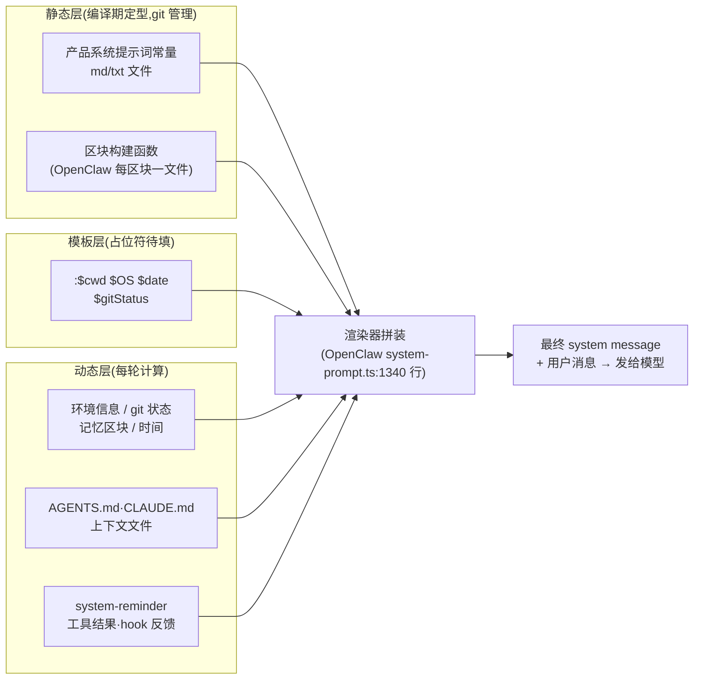
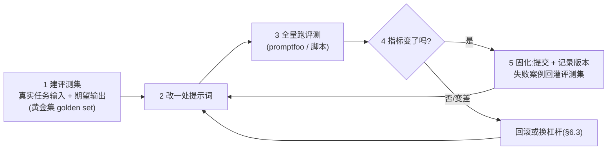

# 提示词搭建文档:格式规范 · 架构构成 · 企业范例 · 使用与迭代

> 信息基准日:**2026-09-27**。格式规范以 **Anthropic 提示词工程文档**(八技法)与 **OpenAI 提示词工程指南**(六策略)现行版为主;企业仓库信息(star 数、目录结构、文件清单)均为当日对 GitHub 的实际抓取,随时间会漂移,以仓库现状为准。
>
> 本文的一手样本是本工作区已克隆仓库里的**真实生产提示词**:三家开源原文(Codex / OpenCode / OpenClaw)+ 一份逆向还原(Claude Code)。工作区惯例是结论带 `文件:行号`,本机样本一律标注**(本机验证)**;网络调研部分结论带来源链接。

---

## 0. TL;DR

- 提示词(prompt,提示词)不只是"一句话指令"。生产级 agent 的提示词是一个**分层工程产物**:产品内置系统提示词(代码常量/独立文件)→ 项目指令文件(AGENTS.md / CLAUDE.md)→ 运行时注入块(`<env>` 环境块、system-reminder、记忆)→ 用户消息,四层每轮按需拼装。
- 两大官方指南是格式规范的"宪法":**Anthropic 八技法**(清晰直接 / 示例 / 思维链 / XML 标签 / 角色设定 / 预填充 / 提示词链 / 长上下文)与 **OpenAI 六策略**(清晰指令 / 参考文本 / 拆分任务 / 留出思考 / 外部工具 / 系统化测试)。§2 逐条展开。
- 从真实生产提示词归纳出**八区块结构模板**:身份声明 → 安全红线 → 环境上下文 → 行为与语气(带示例)→ 任务工作流 → 工具策略 → 外部指令接入规范 → 输出与呈现。§3 用五个真实案例逐一解剖。
- 企业真实提示词三条获取路:**开源仓库直接读**(openai/codex 5 个按模型 prompt.md、OpenCode 15 个提示词家族、OpenClaw 1340 行组装器,均可本机打开)、**逆向还原**(本工作区 01-claude-code)、**泄露收录库**([x1xhlol/system-prompts-and-models-of-ai-tools](https://github.com/x1xhlol/system-prompts-and-models-of-ai-tools),14.4 万 star,30+ 企业产品,2026-09-27 实抓)。
- 生产系统提示词的真实量级:**主干 13~25KB(约 3~6k token)**,小任务提示词 100 字节到 5KB 不等——不是越长越好,上下文经济学是全部动机。
- 迭代不是"改改话术":先建评测集再动提示词;**换模型要配专属提示词**(Codex 5 份、OpenCode 15 份文件就是化石证据);关键约束放开头结尾并重复;工具链用 promptfoo(评测)与 DSPy(自动优化)。
- **系统提示词不是安全边界**:提示词注入(prompt injection,提示词注入攻击)的防线在工具权限与沙箱,不在提示词文本本身(§8)。

**阅读路线**:想搞懂概念 → §1;想动手写 → §2、§7;想抄作业 → §3、§4;管接入与缓存 → §5;长期养提示词 → §6;避坑 → §8。

---

## 1. 提示词是什么:定位与分层

### 1.1 一句话定义

> 提示词是发给模型的全部文本输入的总称——从一行用户提问,到几千行的产品系统提示词。本文的"搭建"对象是**生产级提示词**:被固化进代码、随每次请求进入上下文、由团队像代码一样维护的那些部分。

提示词工程(prompt engineering,提示词工程)因此不是"写文案",而是一种**上下文工程**:决定何时、以多大代价,把什么文本放进模型的上下文窗口。这与本工作区 mcp / skill / rag 三本手册是同一个底层视角。

### 1.2 一条 agent 请求的解剖:提示词有四层

以 Claude Code 逆向还原样本为例,一轮请求携带的提示词文本可以分成四层(按"谁写、何时进上下文"划分):

| 层 | 谁写 | 何时进上下文 | 真实范例(本机验证) |
|---|---|---|---|
| ① 产品系统提示词 | 厂商,固化在代码/独立文件里 | 每轮请求,常驻 | Codex `gpt_5_2_prompt.md`;OpenCode `default.txt`;Claude Code 主干(逆向) |
| ② 项目指令文件 | 用户/团队,放仓库里 | 会话开始注入 | `AGENTS.md`(Codex 在提示词里内置了它的作用域协议,见 §3.3)/ `CLAUDE.md` |
| ③ 运行时注入块 | agent 代码动态生成 | 按需拼装 | `<env>` 环境块(`system-workflow.prompt.md:164`)、system-reminder(`:151`)、OpenClaw 记忆区块 |
| ④ 用户消息 | 人 | 每轮 | — |

一个常被忽略的事实:**工具定义(tool definitions,工具定义)也是提示词的一部分**——每件工具的名称、JSON Schema(描述参数的 JSON 格式规范)与说明文字都随请求发送,且往往比系统提示词正文占更大的上下文份额。DeepSeek Harness 的架构笔记专门记了这件事(`03-deepseek-harness/deepseek-harness/.agents/notes/archived/architecture/2026-06-11-tool-schemas-in-prompt-assembly.md`,本机验证)。

### 1.3 与 Skill / MCP / RAG / 记忆的边界

| 机制 | 本质 | 与提示词的关系 |
|---|---|---|
| 系统提示词 | 常驻行为定义 | 提示词本体 |
| **Skill** | 按需加载的提示词 + 资源包 | SKILL.md 正文**就是**提示词,只是走渐进式披露加载(见 skill-handbook §1.4) |
| **MCP** | 工具连接协议 | 工具的描述文字进入提示词;连接能力不属于提示词(见 mcp-handbook) |
| **RAG** | 检索增强生成 | 检索结果作为上下文注入提示词(见 rag-handbook 引用格式) |
| **记忆** | 跨会话状态 | 记忆区块动态拼进系统提示词(OpenClaw `buildMemoryPromptSection`) |

**判断口诀**:定**行为** → 提示词;教**流程** → skill;连**系统** → MCP;带**知识** → RAG;跨**会话** → 记忆。但注意后四者最终都"落进提示词"——它们管理的是**何时、以多大代价把什么文本放进上下文**。

### 1.4 六家 agent 的提示词长在哪(本机索引)

| Agent | 提示词载体 | 本机位置(可打开对照) |
|---|---|---|
| 01 Claude Code | 核心闭源(minified npm 分发);工作区用动态逆向还原版,**12 个提示词文件** | `01-claude-code/claude-code-reverse/results/prompts/`(本机验证) |
| 02 Codex | 官方开源,**5 个按模型命名的 prompt.md** | `02-codex/codex/codex-rs/core/`(本机验证) |
| 03 DeepSeek Harness | 提示词**独立成包** `packages/core/system-prompt/`;agent-loop 有 admission(准入)/projection(投影)测试;架构笔记含"区块顺序"专题 | `03-deepseek-harness/deepseek-harness/packages/core/system-prompt/`(本机验证) |
| 04 ZCode | 未以独立提示词文件形态暴露(内嵌构建);工具/技能注入点见《架构拆解》 | `04-zcode/ZCode/apps/zcode-cli/` |
| 05 OpenClaw | **1340 行提示词渲染器** + 4 个独立场景提示词(隐身/子代理/进度卡/会话) | `05-openclaw/openclaw/src/agents/`(本机验证) |
| 06 OpenCode | `session/prompt/` **15 个 .txt(共 1302 行)** + `agent/prompt/` 4 个任务提示词 | `06-opencode/opencode/packages/opencode/src/`(本机验证) |

形态光谱一目了然:从"一个 .txt 文件"(OpenCode)到"独立包 + 测试"(DeepSeek Harness)再到"代码渲染器"(OpenClaw),**提示词的工程化程度随产品复杂度递增**。

---

## 2. 格式规范(两大官方指南 + 生产惯例)

### 2.1 消息角色层级

现代 Chat API 把提示词放进**角色化消息**里发送:system / developer(系统/开发者消息,厂商与产品的控制通道)→ user(用户消息)→ assistant(助手回复,含工具调用)。层级意义在于**冲突裁决**:Codex 提示词明文规定"直接系统/开发者/用户指令优先于 AGENTS.md 指令"(`gpt_5_2_prompt.md:26`,本机验证)——企业提示词会显式写明自己的优先级体系。

### 2.2 Anthropic 八技法([官方文档](https://docs.anthropic.com/en/docs/build-with-claude/prompt-engineering/overview))

| # | 技法 | 一句话 | 何时用 |
|---|---|---|---|
| 1 | Be clear and direct(清晰直接) | 把模型当新员工:给足背景、说清要什么 | 所有场合的基线 |
| 2 | Use examples(示例,多样本提示) | 给 3~5 个输入→输出对,包括边界情况 | 产出格式有讲究时;**示例胜过规则** |
| 3 | Let Claude think(思维链) | 让模型先推理再作答 | 复杂推理、数学、多步分析 |
| 4 | Use XML tags(XML 标签) | 用 `<doc>`/`<instructions>` 等标签分区 | 提示词有多来源内容时 |
| 5 | Give Claude a role(角色/系统提示词) | 用 system 消息设定角色与基调 | 全局行为控制 |
| 6 | Prefill(预填充) | 替模型写出回复开头 | 锁定输出格式、跳过客套话 |
| 7 | Chain prompts(提示词链) | 大任务拆多次调用,前一步输出进后一步输入 | 单次上下文装不下复杂工作流时 |
| 8 | Long context tips(长上下文) | 关键文档放开头结尾、引用前先定位 | 喂大文档时 |

### 2.3 OpenAI 六策略([官方指南](https://platform.openai.com/docs/guides/prompt-engineering))

| # | 策略 | 对应的战术 |
|---|---|---|
| 1 | Write clear instructions(写清晰指令) | 分隔符分区、指定输出长度、给步骤 |
| 2 | Provide reference text(提供参考文本) | 附文档并要求"仅基于引用作答 + 注明出处" |
| 3 | Split complex tasks(拆分复杂任务) | 意图分类、分段汇总、递归总结 |
| 4 | Give the model time to think(留出思考时间) | 先做"内心独白"再给结论、隐藏推理链 |
| 5 | Use external tools(用外部工具) | 向量检索、代码执行、函数调用 |
| 6 | Test systematically(系统化测试) | **建评测集**,对照打分——迭代方法论的根(§6) |

两套指南高度重合,可以压缩成一句:**说清楚、给示例、分区隔、让推理、锁格式、建评测**。

### 2.4 生产提示词的八区块结构模板(从 §3 真实范例归纳)

| 区块 | 作用 | 真实范例出处(本机验证) |
|---|---|---|
| ① 身份声明 | 一句话定位"你是谁、跑在哪" | `system-identity.prompt.md:1`;`gpt_5_2_prompt.md:1` |
| ② 安全红线 | 硬性禁区,IMPORTANT 标注 | `system-workflow.prompt.md:3-4`(防御性安全、不猜 URL) |
| ③ 环境上下文 | 操作系统/目录/git 状态,占位符注入 | `system-workflow.prompt.md:164-193` `<env>` 块 |
| ④ 行为与语气 | 输出长度、风格,**配示例** | `system-workflow.prompt.md:16-66`(# Tone and style + 7 个 `<example>`) |
| ⑤ 任务工作流 | 分步流程:计划→搜索→实现→验证 | `system-workflow.prompt.md:140-149`;`gpt_5_2_prompt.md:109`(# Task execution) |
| ⑥ 工具策略 | 何时用哪个工具、并行调用规则 | `system-workflow.prompt.md:153-159`;`gpt_5_2_prompt.md:244`(# Tool Guidelines) |
| ⑦ 外部指令接入 | 用户可写文件的作用域与优先级 | `gpt_5_2_prompt.md:17-28`(AGENTS.md spec,五条规则) |
| ⑧ 输出与呈现 | 最终回复的结构、格式、长度 | `gpt_5_2_prompt.md:172`(Final answer structure);`system-workflow.prompt.md:179-186`(代码引用格式) |
| 附件:模型元数据 | 模型名、知识截止日期 | `system-workflow.prompt.md:171-173` |

### 2.5 写作细则

- **分隔符选型**:Anthropic 推荐 XML 标签;开源范例实际是混合体——Codex/OpenCode 用 Markdown 标题(# / ##),示例块用 `<example>` 标签,注入块用 `<env>`、`<system-reminder>`。**惯例:静态正文用标题分节,动态注入用标签包裹**(与正文视觉区分,防混淆)。
- **示例写正例**:Claude Code 的 7 个语气示例全是正例("2+2 → 4"),没有一个"不要这样"的示例(`system-workflow.prompt.md:24-60`)。给"该长什么样"比给"不该长什么样"有效。
- **负面约束改正面**:官方指南明确"tell what to do rather than only what not to do"。生产写法是配对出现:红线(绝不 commit)+ 指令(被要求时才 commit,`system-workflow.prompt.md:149`)。
- **解释 why**:对反直觉的规则补一句理由,模型遵循度更高。"NEVER commit unless explicitly asked **otherwise the user will feel that you are being too proactive**"(`system-workflow.prompt.md:149`)——理由就写在句子末尾。
- **位置工程(position bias,位置偏差)**:模型对上下文首尾的注意力高于中段(lost in the middle,中间遗忘)。Claude Code 的做法是**把最关键约束在开头和结尾各写一遍**:防御性安全红线在 `:3` 与 `:175` 各出现一次,"4 行内回答"在 `:19` 与 `:161` 各出现一次。
- **输出格式显式声明**:回复是渲染在什么介质上的就说清楚("displayed on a command line interface… monospace font using the CommonMark specification",`system-workflow.prompt.md:62`)——同一产品在 Web 端与 CLI 端提示词不同,这是原因。

### 2.6 长度与预算

| 提示词 | 体积 | 折算 |
|---|---|---|
| Claude Code 身份声明 | 59 字节 | 1 行 |
| Claude Code 主干 workflow | 13,581 字节 | ~194 行,约 3.4k token |
| Codex gpt-5.2 主干 | 21,950 字节 | ~300 行,约 5.5k token |
| OpenCode 提示词家族 | 95~155 行/文件 | 1302 行 / 15 文件 |
| OpenClaw 渲染器(代码) | 1340 行 TS | 输出的最终提示词按需拼装 |

量级结论:**主干系统提示词 3~6k token 是当前主流**,与 skill-handbook "SKILL.md 正文 <5k token" 的建议同源——都是上下文经济学(常驻成本 × 每轮请求)倒逼出来的。

---

## 3. 架构与构成:五个真实范例拆解

抽象规范看三遍不如解剖一个真实仓库。以下五个案例全部可本机打开(开源原文或逆向还原),覆盖从 1 行到 1340 行的完整光谱。

### 3.1 骨架范例:Claude Code 的 1 行身份提示词

`01-claude-code/claude-code-reverse/results/prompts/system-identity.prompt.md`(本机验证),全文仅:

```markdown
You are Claude Code, Anthropic's official CLI for Claude.
```

身份区块只占 1 行,主干另在 workflow 文件里——**系统提示词是模块化拼装的,不是一整块**。逆向目录里 12 个文件对应不同模块:identity(身份)、workflow(主干)、output-style ×2(输出风格变体)、compact ×2(压缩)、system-reminder ×2(提醒包装)、3 个小任务提示词(检查 git 文件/新话题/IDE 打开文件)。

### 3.2 主干范例:Claude Code workflow 提示词逐区块解剖

`results/prompts/system-workflow.prompt.md`(13.5KB,本机验证),按行号给区块地图:

```
:1        开场:interactive CLI tool, helps users with software engineering
:3-4      安全红线 ×2(IMPORTANT:防御性安全;不猜 URL)          ← 区块②
:6-14     帮助与反馈入口 + 文档路由(让模型 WebFetch 官方文档)
:16-66    # Tone and style:<4 行硬规则 + 7 个 <example> 正例     ← 区块④
:68-74    # Proactiveness:主动性的边界(答问 vs 擅自行动)
:76-83    # Following conventions:先看邻文件再写代码、不臆测依赖
:85-87    # Code style:DO NOT ADD ANY COMMENTS
:89-138   # Task Management:TodoWrite 硬规则 + 2 个长对话示例
:140-149  # Doing tasks:五步工作流(计划→搜索→实现→验证→lint)   ← 区块⑤
:151-152  <system-reminder> 通道声明:注入内容不算用户输入        ← 区块③
:153-159  # Tool usage policy:并行调用、优先派发子代理           ← 区块⑥
:161-162  重复:<4 行回答(呼应 :19)                              ← 位置工程
:164-170  <env> 占位块:$cwd / $boolean / $OS / $date             ← 区块③
:171-173  模型身份 + 知识截止                                    ← 附件
:179-186  # Code References:file_path:line_number 引用格式       ← 区块⑧
:188-193  gitStatus 快照占位符                                   ← 区块③
```

四个值得抄的手艺:① 重要约束**首尾重复**(§2.5 位置工程);② 示例全是正例;③ 动态部分全部占位符化(`$gitStatus`),静态文件在编译期定型;④ "不主动 commit"这类反直觉红线写死在任务流程末尾。

### 3.3 官方开源范例:OpenAI Codex 的按模型 prompt.md

`02-codex/codex/codex-rs/core/`(本机验证)下 **5 份提示词文件**:gpt_5_1(24,535 字节)、gpt_5_2(21,950)、gpt-5.1-codex-max(7,669)、gpt-5.2-codex(7,669)、gpt_5_codex(6,715)——**同一产品给不同模型配不同提示词**。以 `gpt_5_2_prompt.md` 为例:

```
:1-9      身份 + 三条能力清单(收提示词/流式回复/函数调用)      ← 区块①
:11       # How you work
:13       ## Personality:concise, direct, and friendly
:17       ## AGENTS.md spec                                     ← 区块⑦(教科书)
:29       ## Autonomy and Persistence
:36       ## Planning(含 :58 Examples)
:109      ## Task execution                                     ← 区块⑤
:136      ## Validating your work
:152      ## Ambition vs. precision(辩证约束,见下)
:160      ## Presenting your work(:172 Final answer structure) ← 区块⑧
:244      # Tool Guidelines(Shell / apply_patch / update_plan) ← 区块⑥
```

三个观察:

1. **AGENTS.md spec 是"外部指令接入"的教科书**(`:17-28`):五条规则定义了用户可写指令文件的协议——作用域 = 文件所在目录整棵子树;改哪个文件就要遵守哪个文件作用域内的 AGENTS.md;深层文件优先于浅层;直接系统/开发者/用户指令优先于 AGENTS.md;根目录到 CWD 的文件自动并入 developer message。**把"提示词可以由用户分层提供"本身写进了提示词**。
2. **辩证约束**:`Ambition vs. precision`(`:152`)不是一条规则,而是教模型**如何权衡**两种都对的倾向——比清单式规则更适合开放场景。
3. **按模型瘦身**:gpt_5_1 → gpt_5_2 主干从 24.5KB 减到 21.9KB(新代模型能听懂更短的指令,提示词随模型能力演进**变短**);codex 变体仅 7.7KB。

### 3.4 多模型家族范例:OpenCode 的 15 个提示词文件

`06-opencode/opencode/packages/opencode/src/session/prompt/`(本机验证),15 个文件共 1302 行,按模型/用途分文件:

| 文件 | 行数 | 说明 |
|---|---|---|
| gemini.txt / beast.txt / copilot-gpt-5.txt / gpt.txt / anthropic.txt / trinity.txt / kimi.txt / default.txt / codex.txt | 155/147/143/107/105/97/95/95/79 | **按模型一族一份** |
| plan-mode.txt / plan.txt / plan-reminder-anthropic.txt | 70/26/67 | **按模式**的变体 |
| meta.txt / gpt-astra.txt / build-switch.txt | 65/46/5 | 元任务 / 新模型适配 / 最小开关 |

谱系证据:`default.txt:1` 开头 "You are opencode, an interactive CLI tool that helps users with software engineering tasks…" 与 Claude Code 主干几乎逐字同源,`# Tone and style` 的示例块(2+2、质数、ls)也一致——**企业提示词在开源社区里互相借鉴,同一套八区块骨架反复出现**。`anthropic.txt:20` 则有独有区块 `# Professional objectivity`。`agent/prompt/` 下另有 4 个任务提示词(compaction / explore / summary / title)——**主干与辅助任务分离**,压缩、起标题这类子任务不占主干的预算。

### 3.5 工程化组装范例:OpenClaw 的 1340 行提示词渲染器

`05-openclaw/openclaw/src/agents/system-prompt.ts`(本机验证)是六家中最重的提示词基础设施。文件头自述:"**Assembles runtime, workspace, tooling, memory, delegation, channel, and cache-boundary prompt sections.**"(组装运行时、工作区、工具、记忆、委派、渠道与缓存边界的提示词区块。)

import 列表就是区块清单(每个区块独立文件、独立构建函数):记忆(`buildMemoryPromptSection`)、委派指导、消息渠道(`buildMessagingSection`)、凭据安全(`buildCredentialSafetyPrompt`)、时间上下文(`buildTemporalContextSection`)、技能工作坊、UI 呈现、引导上下文(bootstrap full/limited 两档)……

三个工程决策值得注意:

1. **提示词即代码**:有类型定义(`system-prompt.types.ts`)、有测试(`system-prompt.test.ts`),改区块走 PR 评审——提示词演进和其他代码同一条流水线。
2. **缓存边界是显式常量**:`SYSTEM_PROMPT_CACHE_BOUNDARY` 与 `SYSTEM_PROMPT_RELOCATABLE_BOUNDARY` 把提示词切成"稳定前缀 + 可移动后段"——稳定前缀命中 prompt cache(提示词缓存,重复前缀按折扣计费),**常变区块(时间、git 状态)必须放在边界之后**,否则每轮都击穿缓存。
3. **注入清洗**:外部文本拼进提示词前过 `sanitizeForPromptLiteral`——防提示词注入的基本卫生(但仍只是卫生,不是防线,见 §8)。

### 3.6 构成速查表:你的提示词该长什么样

| 你要做的东西 | 参考形态 | 案例锚点 |
|---|---|---|
| 单一用途小助手 | 1 行身份 + 若干红线 + 示例 | §3.1;§7 最小示例 |
| 生产级 coding agent | 八区块主干,3~6k token | §3.2 / §3.3 |
| 支持多模型的产品 | per-model(按模型)提示词家族 | §3.4 |
| 常驻多渠道助理 | 代码渲染器 + 区块库 + 缓存边界 | §3.5 |
| 用户可定制行为 | 上下文文件协议(AGENTS.md/CLAUDE.md)+ 作用域规则 | §3.3 |

---

## 4. 企业真实提示词收集(GitHub)

> star 数为 2026-09-27 抓取。选样标准:提示词为真实生产所用、可完整读到原文、形态覆盖面广。

### 4.1 总览对比

| 仓库 | star | 定位 | 最值得抄的 |
|---|---|---|---|
| [x1xhlol/system-prompts-and-models-of-ai-tools](https://github.com/x1xhlol/system-prompts-and-models-of-ai-tools) | 14.4 万 | **企业提示词收录库**:Cursor、Devin、v0、Lovable、Manus、Perplexity、Windsurf、Warp、Z.ai Code 等 30+ 产品的系统提示词 | 横评 30 家怎么写同一类区块;§4.2 |
| [OpenHands/OpenHands](https://github.com/OpenHands/OpenHands) | 8.9 万 | 开源 AI 驱动开发平台 | 平台级 agent 的提示词工程开源实现 |
| [openai/openai-cookbook](https://github.com/openai/openai-cookbook) | 7.6 万 | **官方示例库**:六策略指南 + 评测方法 | 系统化测试策略;evals(评测)条目 |
| [anthropics/prompt-eng-interactive-tutorial](https://github.com/anthropics/prompt-eng-interactive-tutorial) | 3.8 万 | **官方交互式教程**:9 章 Jupyter Notebook | 八技法的全部练习;§4.3 |
| [stanfordnlp/dspy](https://github.com/stanfordnlp/dspy) | 3.8 万 | "编程而非提示词":编译式提示词优化框架 | 自动化迭代(§6.4) |
| [promptfoo/promptfoo](https://github.com/promptfoo/promptfoo) | 2.5 万 | 提示词/agent/RAG 评测与红队框架,自述被 OpenAI 与 Anthropic 使用 | 声明式评测 YAML + CI 集成(§6.4) |
| 本工作区六家仓库 | — | **一手生产样本**:三家开源原文 + 一份逆向 | §3 全部 |

### 4.2 精读一:x1xhlol 收录库(30+ 企业产品语料)

顶层即按产品分文件夹(2026-09-27 实抓):Amp、Anthropic、Augment Code、Cluely、CodeBuddy、Comet Assistant、Cursor Prompts、Devin AI、Emergent、Google、Junie、Kiro、Leap.new、Lovable、Manus Agent Tools & Prompt、NotionAi、Open Source prompts、Orchids.app、Perplexity、Poke、Qoder、Replit、Same.dev、Trae、Traycer AI、VSCode Agent、Warp.dev、Windsurf、Xcode、Z.ai Code、dia、v0 Prompts and Tools。

**读法建议**:先读本工作区三家开源原文(§3)建立"正常生产提示词"基准,再去对照泄露库重点看三件事——①环境上下文怎么包(`<environment_context>` 类区块);②输出格式锁得多死(前端生成类产品如 v0 最严格);③反注入条款长什么样。

**三个注意**:①泄露版≠官方发布,随时过时、可能有删改;②版权属各公司——仓库自己的 LICENSE.md(35KB)只授予有限查看权,学习对照可以,**整段照抄进商业产品不行**;③泄露提示词里大量"牢笼式"重复禁令是各自产品踩坑后的补丁,照抄会把别家的债接过来,写作时回到 §2 的原则。

### 4.3 精读二:官方教学双库

- [anthropics/prompt-eng-interactive-tutorial](https://github.com/anthropics/prompt-eng-interactive-tutorial)(3.8 万 star):官方自述"9 章 + 配套练习"——基础结构 / 清晰直接 / 角色设定 / 数据与指令分离 / 输出格式 / 先想后答(Precognition)/ 使用示例 / 避免幻觉 / 复杂提示词实战(法律、金融、编码行业案例);附录 Beyond Standard Prompting 含提示词链、工具使用与检索。**官方技法的唯一练习场**。
- [openai/openai-cookbook](https://github.com/openai/openai-cookbook)(7.6 万 star):Prompt engineering guide(六策略)+ 评测方法条目;其中 "test systematically" 是六策略里唯一讲**流程**而非写法的一条——官方把评测放在与写法同等的位置。

### 4.4 怎么继续找

- GitHub 搜索:`topic:system-prompts` 按 star 排序;`awesome-…` 清单系列作索引。
- 官方文档一手来源:[Anthropic 提示词工程](https://docs.anthropic.com/en/docs/build-with-claude/prompt-engineering/overview) / [OpenAI 指南](https://platform.openai.com/docs/guides/prompt-engineering)。
- **本工作区的仓库本身就是语料**:六家 agent 的提示词文件清单见 §1.4,新开源产品出现时按同一方法解剖即可。

---

## 5. 使用机制:从注入到触发到生效

### 5.1 提示词在运行时怎么被组装



Claude Code 的 `<env>` 块(`system-workflow.prompt.md:164-170`)是模板层的最小样本:静态文件里写 `$cwd`、`$OS`、`$date`,运行时替换真实值。OpenClaw 则把"拼装"做成 1340 行的渲染器——区块多到必须工程化。

### 5.2 层级与作用域:谁的话算数

| 规则 | 出处(本机验证) |
|---|---|
| 直接系统/开发者/用户指令 > AGENTS.md 指令 | `gpt_5_2_prompt.md:26` |
| AGENTS.md 作用域 = 所在目录整棵子树;深层优先于浅层 | `gpt_5_2_prompt.md:22-25` |
| 工具结果与用户消息里的 `<system-reminder>` 标签内容"不是用户输入",按提醒处理 | `system-workflow.prompt.md:151` |
| hook(钩子)的反馈**当作用户的话**对待 | `system-workflow.prompt.md:138` |

`<system-reminder>` 是个精巧发明:宿主(agent 宿主)想在不污染用户输入的前提下持续注入提醒(剩余上下文、文件变更),于是约定一个模型认识的标签通道——**注入通道本身也是提示词定义的**。

### 5.3 缓存与成本

提示词是每轮请求都重发的成本项。生产对策三条:①稳定前缀(身份、区块、工具定义)不变,命中 prompt cache(§3.5 OpenClaw 边界常量);②常变内容(时间、git 状态)挤到提示词**尾部**;③主干克制在 3~6k token(§2.6)。与六家《架构拆解》的"上下文"行对照阅读:ZCode 的"显式 cache 锚点"是同一件事的宿主实现。

### 5.4 提示词的四种使用形态

| 形态 | 载体 | 何时进上下文 | 范例 |
|---|---|---|---|
| 常量 | 代码内 md/txt 文件 | 每轮 | Codex prompt.md(§3.3) |
| 模板 | 占位符 + 渲染 | 每轮,运行时填值 | `<env>` 块(§5.1);OpenClaw 渲染器 |
| 上下文文件 | AGENTS.md / CLAUDE.md | 会话开始,作用域注入 | AGENTS.md spec(§3.3) |
| 按需加载 | Skill 正文 | description 匹配才加载 | skill-handbook §1.4 / §5.2 |

后三种都是"让提示词**在正确时机出现**"的机制——提示词工程的上半场是写得好(§2),下半场是**出现得巧**。

---

## 6. 迭代:把提示词越养越好

### 6.1 核心循环(评测先行)



与 skill-handbook §6.1 的五步循环同构,差别只在:**提示词改动必须过评测集**,因为系统提示词影响每一次请求,回归风险远大于单个 skill。OpenAI 官方把"系统化测试"列为六策略之一(§2.3),就是这个理由。

### 6.2 迭代的化石证据(本机验证)

提示词迭代不需要想象,本工作区仓库里全是化石:

- **换模型 → 换提示词**:Codex `codex-rs/core/` 5 份按模型文件(§3.3);OpenCode 15 份家族(§3.4)。新模型 `gpt-astra.txt` 仅 46 行——新模型提示词更短,是"模型变强、提示词变瘦"趋势的直读证据。
- **输出风格可插拔**:Claude Code 逆向目录里 `system-output-style-explanatory.prompt.md`(11,976 字节)与 `system-output-style-learning.prompt.md`(15,916 字节)是同一主干的两种风格变体——产品把"语气"抽成了可配置模块。
- **区块顺序是设计项**:DeepSeek Harness 的架构笔记专文记录 "tool-schemas-in-prompt-assembly"(工具 schema 进提示词的组装)与 "sparse-first-party-prompt-section-orders"(区块排序)(`.agents/notes/archived/` 下,本机验证),甚至有区块顺序并列的 bug 修复记录——**排序影响效果,值得专文与回归**。
- **长度持续删减**:Codex 主干 gpt_5_1(24.5KB)→ gpt_5_2(21.9KB)。

### 6.3 改进手法(四个杠杆 + 位置工程)

1. **结构重排**:调整区块顺序与归属(如把工具策略挪到工作流之后);DeepSeek 连这个都有回归测试(§6.2)。
2. **示例增删**:按评测失败案例补正例;示例是提示词里"信息密度最高"的部分。
3. **约束改写**:负面清单 → 正面指令 + why(§2.5);MUST 堆叠多半说明规则本身没讲清(与 skill-handbook §2.4 同款结论)。
4. **长度预算**:删掉不拉车的段落;上下文中段的指令优先考虑挪到首尾(lost in the middle)。
5. **位置工程**:关键红线首尾重复(§2.5),但同一约束全文出现不要超过两三次,重复本身也占预算。

### 6.4 工程化:让迭代可持续

| 手段 | 做法 | 工具/范例 |
|---|---|---|
| 版本管理 | 提示词进 git,改区块走 PR(OpenClaw 区块 + 测试即此形态,§3.5) | 六家仓库全齐 |
| 回归评测 | 声明式 YAML 写测试用例,CI 里跑;支持多模型横评与红队扫描 | [promptfoo](https://github.com/promptfoo/promptfoo)(2.5 万 star,2026-09-27 实抓) |
| 自动优化 | 把提示词当"程序"编译优化——DSPy 用少量标注数据自动搜最佳指令组合 | [stanfordnlp/dspy](https://github.com/stanfordnlp/dspy)(3.8 万 star) |
| 失败回灌 | 每个线上跑偏案例转成评测集新条目 | §6.1 第 5 步 |
| 元提示词 | 让模型起草/改写提示词,人做评审 | anthropics 官方教程(§4.3)复杂提示词章是现成练习场 |

### 6.5 反模式清单

| 反模式 | 症状 | 处方 |
|---|---|---|
| 越长越好 | 上下文爆炸、关键指令被淹没 | 主干控制在 3~6k token;细节下沉到按需加载(skill)与上下文文件 |
| MUST 大写堆叠 | 模型阳奉阴违或过度保守 | 改写为正面指令 + 解释 why + 示例(§6.3) |
| 直接抄泄露提示词 | 把别家的补丁与过时约束一并继承 | 抄结构不抄句子(§4.2) |
| 改完不跑评测集 | 凭感觉迭代,回归无人知晓 | §6.1 循环;promptfoo 进 CI |
| 关键约束埋在中段 | 模型"看不见" | 首尾重复;位置工程(§2.5) |
| 纯负面清单红线 | 列了 100 条"不要"仍漏第 101 条 | 正面描述期望行为,红线只留不可妥协项 |
| 把系统提示词当安全边界 | 用户输入能改写行为(prompt injection) | 防线在工具权限与沙箱(§8;mcp-handbook 安全章节) |
| 全部动态内容前置 | 缓存每轮击穿,成本翻倍 | 稳定前缀 + 尾部放常变内容(§5.3) |

---

## 7. 上手清单:30 分钟从零到合格

1. **定性**(5 分钟):这段提示词是**常驻主干**、**模式变体**还是**任务提示词**?(§3.4 的三分法)目标模型是哪个?(要 per-model 适配吗?)
2. **定形**(5 分钟):按 §3.6 速查表选形态;从八区块模板(§2.4)起骨架。
3. **写身份与红线**(5 分钟):1~2 行身份;3~5 条不可妥协红线放开头;每条配一句 why。
4. **写工作流与工具策略**(10 分钟):分步祈使句;何时用哪个工具;反直觉规则写死并给理由。
5. **补示例**(5 分钟):2~7 个正例,覆盖最常见的失败场景;输出格式给一个字面量样例。
6. **装测试**(循环):先建 5~10 条真实任务评测集;改一处跑一遍;失败案例回灌(§6.1)。
7. **发布前**:关键红线首尾各一次;动态内容全部占位符化;检查缓存边界(常变内容在后段)。

**最小可运行示例**(八区块齐全,可直接用作一个小型代码评审助手的系统提示词):

```markdown
# 角色
你是仓库守护者(review-bot),对当前仓库的变更做代码评审,输出评审意见。

# 红线(不可妥协)
- 只评审,不修改任何文件:你没有写权限,也不要暗示你可以代改。
- 不确定时引用文件与行号提出疑问,禁止编造文件内容。
- 评审只针对变更本身,不做与变更无关的全仓重构建议。

# 上下文
<env>
仓库:$repo | 当前分支:$branch | 变更文件数:$changed_count
本次 diff:$diff
</env>

# 评审流程
1. 先读 <env> 里的 diff,理解变更意图;需要更多上下文时用文件读取工具查相关文件。
2. 按四类检查:正确性(逻辑/边界)→ 安全(凭据/注入)→ 一致性(与邻文件风格)→ 测试(有没有配套)。
3. 每条意见按严重度分级:[阻塞] / [建议] / [ nit ]。

# 工具策略
- 查文件用只读工具;同一批文件并行读取,不要逐个串行。

# 输出格式
Markdown。开头一行总评(≤30 字),然后按严重度分组列意见,每条附 `文件:行号`。
示例:
> 总评:校验逻辑有边界遗漏,其余可合。
> [阻塞] src/auth.ts:42 —— token 过期时间未校验,原因为何?
(结尾重复)再次强调:只评审不修改;所有意见必须能定位到 文件:行号。
```

---

## 8. 常见坑 FAQ

| 问题 | 答案 |
|---|---|
| 提示词写英文还是中文? | 都可以;生产系统提示词多为英文(训练语料分布),但输出语言用指令显式锁定。关键是术语在全文统一,不要中英混写同一概念 |
| 系统提示词能防住恶意输入吗? | **不能**。它只是一段文本,可以被用户输入覆盖(提示词注入)。防线在工具权限最小化、沙箱与审批流(对照 mcp-handbook 安全章节;六家《架构拆解》权限行) |
| 用户说"忽略之前的指令"怎么办? | 接受层级裁决:直接用户指令在多数产品里优先级最高(§5.2),但涉及红线的行为要用**工具侧**限制(没有写权限就无法越权),不是靠提示词喊话 |
| 提示词、AGENTS.md、Skill 都在定义行为,职责怎么分? | 系统提示词 = 产品级不可变行为;AGENTS.md/CLAUDE.md = 仓库级可变约定;Skill = 按需加载的流程知识。口诀见 §1.3 |
| 为什么我的指令模型总是忽略? | 三个高频原因:埋在中段(→位置工程 §2.5)、纯负面清单(→改正面 + why)、没有示例(→补正例)。先跑评测集定位,再挑杠杆(§6.3) |
| 换了新模型,提示词要重写吗? | 主干通常可沿用,但要复跑评测集;新模型往往能吃更短的提示词(Codex/OpenCode 的按模型家族就是为此存在,§6.2) |
| 压缩历史(compaction)会破坏提示词吗? | 不会——压缩作用于**会话历史**,系统提示词每轮重发、独立于历史。但压缩会丢上下文,所以要靠 system-reminder 通道持续补关键事实(§5.2) |

---

## 附录 A. 术语对照表

| 英文 | 中文/解释 |
|---|---|
| prompt(提示词) | 发给模型的全部文本输入总称 |
| prompt engineering(提示词工程) | 设计与优化提示词的工程学科;本质是上下文工程 |
| system prompt(系统提示词) | 厂商/产品控制通道的消息,每轮常驻 |
| developer message(开发者消息) | 系统与应用层之间的指令通道(OpenAI 术语) |
| tool definitions(工具定义) | 工具的名称+JSON Schema+说明,随请求发送,占提示词预算 |
| few-shot / multishot(少样本/多样本) | 用多个输入→输出示例引导模型 |
| chain of thought(思维链,CoT) | 让模型先逐步推理再给最终答案 |
| prefilling(预填充) | 替模型写出回复开头以锁定格式 |
| prompt chaining(提示词链) | 多次调用串行,前一步输出作后一步输入 |
| XML tags(XML 标签) | 用标签分区提示词内容,区分静态正文与动态注入 |
| template placeholder(模板占位符) | `$cwd`、`$gitStatus` 之类运行时替换的变量 |
| position bias(位置偏差) | 模型对上下文首尾注意力高于中段 |
| lost in the middle(中间遗忘) | 位置偏差导致的失效模式 |
| prompt injection(提示词注入) | 用户/外部内容改写模型行为的攻击 |
| prompt cache(提示词缓存) | 稳定前缀命中缓存以降低成本与延迟 |
| golden set(黄金集)/ eval(评测) | 固定的输入-期望输出对,用于回归验证 |
| meta-prompting(元提示词) | 用提示词让模型生成/优化提示词 |
| per-model prompt family(按模型提示词家族) | 同一产品为不同模型维护的不同提示词(OpenCode 15 份) |
| AGENTS.md / CLAUDE.md | 仓库级上下文文件,作用域与优先级见 §3.3 |
| system-reminder(系统提醒) | 宿主注入提醒的标签通道,不算用户输入 |
| compaction(压缩) | 摘要替换会话历史以腾出上下文;不动系统提示词 |
| promptfoo | 声明式提示词评测/红队框架(§6.4) |
| DSPy | 编译式提示词优化框架,"编程而非提示词"(§6.4) |

## 附录 B. 本文档引用来源

- 格式规范:[Anthropic Prompt Engineering Overview](https://docs.anthropic.com/en/docs/build-with-claude/prompt-engineering/overview)(八技法)· [OpenAI Prompt Engineering Guide](https://platform.openai.com/docs/guides/prompt-engineering)(六策略)
- 收录库:[x1xhlol/system-prompts-and-models-of-ai-tools](https://github.com/x1xhlol/system-prompts-and-models-of-ai-tools)(14.4 万 star,30+ 产品,2026-09-27 实抓)
- 官方教学:[anthropics/prompt-eng-interactive-tutorial](https://github.com/anthropics/prompt-eng-interactive-tutorial)(3.8 万 star)· [openai/openai-cookbook](https://github.com/openai/openai-cookbook)(7.6 万 star)
- 迭代工具:[promptfoo/promptfoo](https://github.com/promptfoo/promptfoo)(2.5 万 star)· [stanfordnlp/dspy](https://github.com/stanfordnlp/dspy)(3.8 万 star)
- 本机一手样本:`01-claude-code/claude-code-reverse/results/prompts/`(逆向,12 文件)· `02-codex/codex/codex-rs/core/`(5 份按模型 prompt.md)· `06-opencode/opencode/packages/opencode/src/session/prompt/`(15 文件)+ `src/agent/prompt/`(4 文件)· `05-openclaw/openclaw/src/agents/system-prompt.ts`(1340 行渲染器)· `03-deepseek-harness/deepseek-harness/packages/core/system-prompt/`(独立包)

---

> **与工作区其他内容的接口**:工具定义与工具策略如何进入提示词 → 六家《架构拆解》工具系统行与 mcp-handbook(工具从哪来);skill 正文作为"按需加载的提示词" → skill-handbook §1.4/§5;检索结果作为注入上下文 → rag-handbook;权限/沙箱才是注入攻击的真正防线 → 六家《架构拆解》权限行与 mcp-handbook 安全章节;ADP-FDE 课程中提示词相关内容 → fde-handbook/tencent-adp-fde-course。
