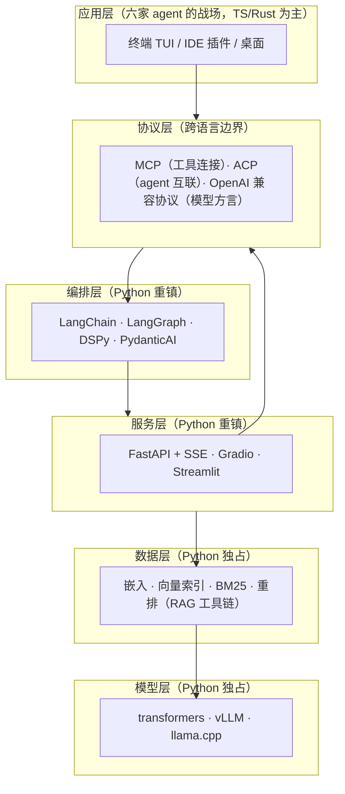
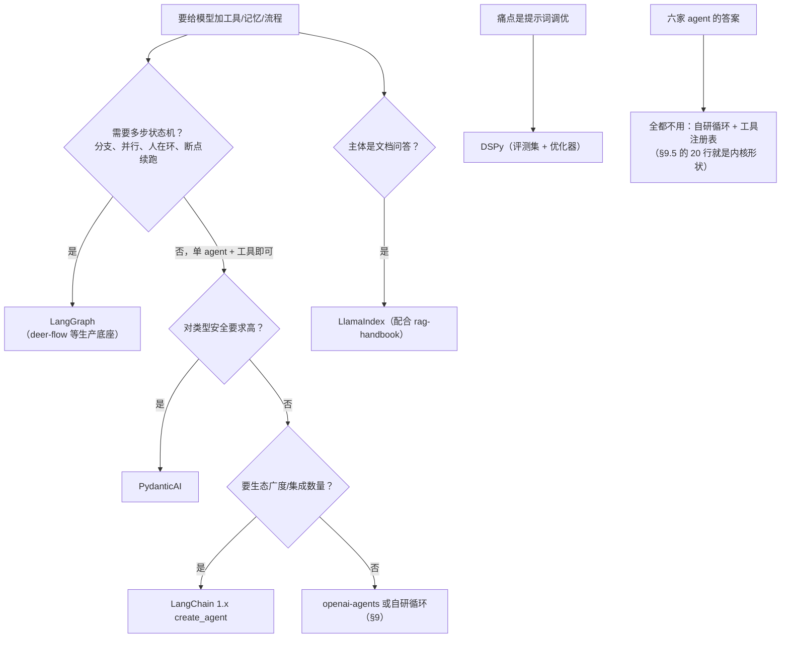

# Python 大模型应用开发手册：工程基座 · SDK 与框架 · 企业范例 · 使用与迭代

> 信息基准日：**2026-09-27**。本文所有库的 PyPI 版本与发布日来自 PyPI JSON API（`pypi.org/pypi/<包名>/json`）当日实抓，star 数与仓库状态来自 GitHub API 当日实抓（表格中标注"约"），Python 版本取自 python.org 首页当日快照——随时间漂移，以官网现状为准。
>
> 本工作区惯例是结论带 `文件:行号`；本文是网络调研文档，等价做法是**结论带来源链接**（每节末尾标 URL）。代码均为 Python 3 最小可运行示例，中文注释只讲**机制与不变量**，不念语法。

---

## 0. TL;DR

- **Python 在 agent 时代的生态位不是"写 agent 内核"，而是"模型侧的通用语"**。本工作区 01-06 六家 agent 源码全是 TypeScript/Rust（终端分发、启动速度、TUI 的战场），但 07-langchain / 08-langgraph 两份框架源码、以及 §10 盘点的全部企业级 Python 项目说明：**数据、模型、服务、胶水这四层，Python 仍是默认语言**。
- Python 在大模型应用里的**四类用法**：① 脚本（数据处理、评测、一次性 glue）；② 服务（FastAPI 后端 + SSE 流式）；③ 数据（RAG 工具链：嵌入/索引/重排）；④ 模型（transformers / vLLM 本地推理与训练）。选型先问自己落在哪一层。
- 工程基座 2026 年的现状是 **uv 一统**（包管理 + 虚拟环境 + Python 版本管理 + 锁文件四职合一，Rust 实现）+ **ruff 一体**（lint + format）+ **类型标注即协议**（Pydantic 模型 → JSON Schema → 工具定义/结构化输出，这条链是后面所有章节的地基）。
- 调 SDK 的行业事实：**OpenAI 协议是"通用方言"**——vLLM、Ollama、LiteLLM 及几乎所有国产网关都实现它；anthropic / google-genai 官方 SDK 各有不可替代的原生特性。先学方言，再学原生。
- 编排框架五家各有清晰的生态位：**LangGraph**（图状态机，BSP 超步引擎）、**LangChain 1.x**（agent 平台全家桶）、**LlamaIndex**（文档处理平台）、**DSPy**（把提示词当程序编译优化）、**PydanticAI**（类型优先的轻量 agent）。决策树见 §4.7；而本工作区六家 agent 的答案是"**全都不用，自研循环**"——最简自研循环只有 20 行（§9.5）。
- RAG 的 Python 侧是 rag-handbook 那套工程规范的工具化落地：sentence-transformers（嵌入）+ faiss/chromadb（索引）+ rank_bm25（稀疏）+ bge-reranker（重排），40 行搭出混合检索（§5.6）。
- 企业范例三强：**hermes-agent**（约 24.9 万 star，自改进闭环 + SQLite 状态层拆成 35 个模块）、**deer-flow 2.0**（字节，LangGraph 底座的 SuperAgent harness，2026-02-28 GitHub Trending 第一）、**OpenHands**（拆成 Agent Canvas 前端 + software-agent-sdk 四包的多仓库平台，ACP 协议兼容）。
- 评测三件套分工：**ragas 管离线打分、deepeval 管卡 CI、langfuse 管线上可见**（§8）；30 天上手清单见 §10.7。

**阅读路线**：想建立全景 → 读 §1；搭工程骨架 → §2；调模型 API → §3；选框架 → §4；做 RAG → §5（配合 rag-handbook）；本地跑模型 → §6；做服务与界面 → §7；评测上线 → §8；接协议/自研循环 → §9（配合 mcp-handbook）；抄企业作业 → §10。

---

## 1. Python 在 agent / FDE 时代的生态位

### 1.1 一句话与工作区现状对照

LLM（Large Language Model，大语言模型）应用是全栈工程，但每一层的"默认语言"不同。把本工作区已有的素材排开，结论一目了然：

| 工作区素材 | 语言 | 这一层在干什么 |
|---|---|---|
| `01` Claude Code ~ `06` OpenCode（六家 agent 内核） | **TS / Rust** | 终端 TUI、进程管理、权限沙箱——"贴着操作系统"的层 |
| `07` langchain / `08` langgraph 官方仓库 | **Python** | 模型调用编排、agent 图引擎——"贴着模型"的层 |
| mcp / rag / skill 三册手册的企业范例 | TS 为主 | server 生态偏 TS（分发走 npm），RAG 引擎偏 Python |
| 本文 §10 的企业项目（hermes-agent / deer-flow / OpenHands SDK / autogen / crewAI / letta） | **Python** | 模型应用层的"重型资产"全在 Python |

为什么 agent 内核不选 Python？六家的共性答案：终端产品要**单文件分发**（Rust/Go 二进制、TS 打包进 Node）、**毫秒级启动**、**异步 IO 密集**；而 Python 的优势恰好补在另一半——**模型生态的全部重量级库**（transformers、torch、vLLM、faiss）、**数据科学生态**（pandas/numpy）、**极低的原型成本**。一句话：**TS/Rust 管"壳"，Python 管"模型与数据"**。两边通过 HTTP（OpenAI 兼容协议、MCP、ACP）拼起来，这正是 §9 的主题。

### 1.2 四类用法：脚本 / 服务 / 数据 / 模型

| 用法 | 典型场景 | 代表库 | 本工作区对照 |
|---|---|---|---|
| **① 脚本** | 数据清洗、批量评测、微调数据生成、一次性 glue code | pandas、datasets、ragas、openai SDK | `01-claude-code/analysis_claude_code/` 教材每课一个 Python 最小实现 |
| **② 服务** | 对外 API、SSE 流式对话、webhook 回调 | FastAPI、uvicorn、sse-starlette | OpenHands 的 Agent Server 就是"REST API for running agents" |
| **③ 数据** | 文档解析→切分→嵌入→检索→重排（RAG 工具链） | sentence-transformers、faiss、chromadb、rank_bm25 | rag-handbook 全章的工程规范，用 Python 落地（§5） |
| **④ 模型** | 本地推理、量化、微调、模型服务 | transformers、vLLM、llama-cpp-python | deer-flow 直接支持 vLLM 自托管端点（§10.3） |

FDE（Forward Deployed Engineer，前线部署工程师）视角（职业路线见 [fde-handbook/FDE转行手册.md](../fde-handbook/FDE转行手册.md)）：客户现场的数据格式千奇百怪、交付物常是"跑在客户内网的脚本与服务"——这恰好是 ①②③ 的组合；而 ④（自托管模型）是内网/气隙交付时的必选项。**Python 是 FDE 第一语言**的原因不是语言本身，而是它同时覆盖这四层。

### 1.3 全景分层图：Python 覆盖在哪



记住这张图的**不变量**：跨语言的边界永远走协议（图中的 PROTO 层），所以"会一门壳语言 + 精通 Python 模型侧"或反过来，都能成事。

---

## 2. 工程基座：uv、pyproject、pytest、ruff、类型标注

### 2.1 版本基准（当日实抓）

- **当前稳定版 Python 3.14.7**（python.org 首页 2026-09-27 实抓，[来源](https://www.python.org/)）。自 3.13 起官方引入了实验性的 free-threaded（自由线程，去 GIL）构建与 JIT 编译器，3.14 延续该方向——但大模型应用生态（torch/vLLM 系）对最新版本的兼容通常滞后半年到一年，**生产项目用 `>=3.12` 的下限约束最稳**。
- 基座库当日版本（PyPI JSON API 实抓）：

| 库 | 版本（发布日） | star（约） | 定位 |
|---|---|---|---|
| [uv](https://pypi.org/project/uv/) | 0.12.19（活跃周更） | [90.2k](https://github.com/astral-sh/uv) | 包管理 + 虚拟环境 + Python 版本管理 + 工具运行，四职合一 |
| [ruff](https://pypi.org/project/ruff/) | 0.16.9（活跃） | [49.8k](https://github.com/astral-sh/ruff) | lint + format 一体（替代 flake8/isort/black） |
| [pytest](https://pypi.org/project/pytest/) | 9.1.1（2026-06-19） | [14.5k](https://github.com/pytest-dev/pytest) | 测试框架事实标准 |
| [mypy](https://pypi.org/project/mypy/) | 2.3.1（2026-08-15） | [20.7k](https://github.com/python/mypy) | 静态类型检查 |
| [pydantic](https://pypi.org/project/pydantic/) | 2.13.5（2026-08-28） | [28.9k](https://github.com/pydantic/pydantic) | 类型标注驱动的数据校验（Rust 核心 pydantic-core） |

### 2.2 uv：为什么它终结了"环境问题"

uv 用 Rust 实现了 pip/venv/pyenv/pipx 的全部职能，两个数量级的速度差只是表面，**关键是它把"项目"变成了不可变的锁文件 + 可声明的元数据**：

```bash
uv init my-llm-app && cd my-llm-app   # 生成 pyproject.toml 骨架 + .python-version
uv python install 3.14                # uv 连 Python 解释器本身都管，不再需要系统安装
uv add openai pydantic                # 装依赖，写回 pyproject.toml 并更新 uv.lock
uv add --dev pytest ruff mypy         # 开发依赖进 [dependency-groups]，不进生产锁
uv run pytest                         # 不变量：uv run 总是"先确保环境正确，再执行"
uvx ruff check .                      # uvx = 一次性运行某个工具，不污染项目环境
```

三条不变量：**`uv.lock` 必须进 git**（它保证任何机器装出完全相同的依赖树）；**不要再用 `pip install` 手动装包**（绕过锁文件）；**`uv run` 是一切命令的前缀**（脚本、pytest、应用启动都走它，环境永不漂移）。

### 2.3 pyproject.toml：一个文件声明整个工程

```toml
[project]
name = "my-llm-app"
version = "0.1.0"
requires-python = ">=3.12"            # 下限约束：兼容生态，而非追新
dependencies = [
    "openai>=3.19,<4",                # 上界锁大版本：SDK 大版本换代频繁（§3.1）
    "pydantic>=2.13,<3",
]

[dependency-groups]                   # 开发依赖组（uv add --dev 写这里）
dev = ["pytest>=9.1", "ruff>=0.16", "mypy>=2.3"]

[tool.ruff]
line-length = 100
target-version = "py312"

[tool.pytest.ini_options]
testpaths = ["tests"]
```

对比旧世界：requirements.txt + setup.py + setup.cfg + tox.ini 四件套，全被一个 `pyproject.toml` 收编。**企业项目证据**：hermes-agent 与 OpenHands software-agent-sdk 的根目录都是 `pyproject.toml + uv.lock + .python-version` 三件套（§10.2/§10.4）。

### 2.4 类型标注与 Pydantic：大模型应用的"类型即协议"

Python 类型标注（type hints）在大模型应用里有超出可读性的意义：**类型信息会被运行时转成 JSON Schema，再变成模型看见的工具定义与结构化输出约束**（§3.4、§4.6、§9.2 全走这条路）。

```python
# uv run mypy .   —— mypy 在 CI 里跑；LLM 应用最值钱的检查点是"dict 乱传"
from pydantic import BaseModel, Field

class Expense(BaseModel):
    """报销单——这个模型就是给 LLM 的'结构化输出合同'"""
    city: str = Field(description="出差城市")           # description 会进 JSON Schema，模型靠它填对字段
    amount_cny: float = Field(gt=0, description="金额，人民币")
    category: str = Field(pattern="^(交通|住宿|餐饮)$")  # 枚举约束写进 schema，模型无从乱填

schema = Expense.model_json_schema()   # → JSON Schema：工具定义/结构化输出的原料（不变量）
```

**为什么这条链是不变量**：手写 JSON Schema 给模型看容易错，Pydantic 把"定义 → 校验 → 生成 schema"统一在一个类上；后面 §3 的结构化输出、§4 的框架工具注册、§9 的 MCP 工具，全都消费同一个 `model_json_schema()`。

### 2.5 pytest 与 ruff 的最小配合

```python
# tests/test_expense.py —— pytest 的断言就是普通 assert，不学新语法
from my_app.models import Expense
import pytest

def test_amount_must_be_positive():
    with pytest.raises(ValueError):
        Expense(city="上海", amount_cny=-1, category="交通")   # 校验失败即抛错

def test_category_enum():
    assert Expense(city="上海", amount_cny=100, category="交通").category == "交通"
```

```bash
uv run ruff format .    # 先格式化
uv run ruff check --fix # 再 lint 修复；两条命令进 pre-commit，CI 卡关
uv run pytest -q        # LLM 应用的测试分层见 §8.2：单元测试 mock 模型，评测才打真 API
```

---

## 3. 大模型调用 SDK 横评：openai / anthropic / google-genai / litellm

### 3.1 总表（版本 / star / 发布日均 2026-09-27 实抓）

| SDK | PyPI 版本（发布日） | star（约） | 定位 |
|---|---|---|---|
| [openai](https://pypi.org/project/openai/) | 3.19.2（2026-09-24） | [31.7k](https://github.com/openai/openai-python) | **行业"通用方言"**：vLLM/Ollama/LiteLLM/绝大多数网关都实现它的 HTTP 形状 |
| [anthropic](https://pypi.org/project/anthropic/) | 1.8.0（2026-09-22） | [3.9k](https://github.com/anthropics/anthropic-sdk-python) | Claude 原生 SDK：system 独立参数、content blocks、prompt caching |
| [google-genai](https://pypi.org/project/google-genai/) | 2.25.0（2026-09-22） | [4.0k](https://github.com/googleapis/python-genai) | Gemini 统一 SDK（取代旧的 google-generativeai）， Developer API 与 Vertex 一个入口 |
| [litellm](https://pypi.org/project/litellm/) | 1.102.1（2026-09-23） | [59.7k](https://github.com/BerriAI/litellm) | 聚合网关：100+ 提供商统一成 OpenAI 格式；README 自述"Rust core with Python SDK" |

选型直觉：**只用一家模型 → 原生 SDK**；**要多模型切换/网关治理 → litellm 或自建 OpenAI 兼容门面**；**本地模型 → 任何 OpenAI 兼容客户端指过去就行**（§6.3/§6.4 全是这个套路）。

### 3.2 openai SDK：方言的基准实现

```python
# uv add openai
from openai import OpenAI

# 不变量①：客户端是无状态 HTTP 封装，base_url 一换即可指向任何 OpenAI 兼容端点
#   如 vLLM: base_url="http://localhost:8000/v1"（§6.3）、Ollama: "http://localhost:11434/v1"（§6.4）
client = OpenAI()   # 默认读 OPENAI_API_KEY

# ② 基本调用：messages 是"完整历史全量发送"——服务端不替你记对话（无状态协议）
resp = client.chat.completions.create(
    model="gpt-5",
    messages=[{"role": "user", "content": "一句话解释 RAG"}],
)
print(resp.choices[0].message.content)

# ③ 流式：stream=True 返回"增量事件迭代器"，每个 delta 都要客户端自己拼成全文
stream = client.chat.completions.create(
    model="gpt-5",
    messages=[{"role": "user", "content": "从 1 数到 5"}],
    stream=True,
)
for chunk in stream:
    if delta := chunk.choices[0].delta.content:
        print(delta, end="", flush=True)

# ④ 工具调用是"两段式"：模型只点菜（返回 tool_calls），执行永远在你手里
import json
def get_weather(city: str) -> str:
    return f"{city} 晴 25°C"

tools = [{
    "type": "function",
    "function": {
        "name": "get_weather",
        "description": "查询城市当前天气",          # 模型选不选这个工具，全看这段话（mcp-handbook §3.3 同款纪律）
        "parameters": {                            # JSON Schema；生产里用 pydantic 生成（§2.4）
            "type": "object",
            "properties": {"city": {"type": "string", "description": "城市名"}},
            "required": ["city"],
        },
    },
}]

msgs = [{"role": "user", "content": "上海天气？"}]
msg = client.chat.completions.create(model="gpt-5", messages=msgs, tools=tools).choices[0].message
if msg.tool_calls:
    msgs.append(msg)                                        # 不变量②：模型的消息必须先回填历史
    for call in msg.tool_calls:
        result = get_weather(**json.loads(call.function.arguments))
        msgs.append({"role": "tool", "tool_call_id": call.id, "content": result})
    final = client.chat.completions.create(model="gpt-5", messages=msgs, tools=tools)
    print(final.choices[0].message.content)

# ⑤ 结构化输出：pydantic 模型 → JSON Schema → 服务端约束解码，拿到即合法实例
from pydantic import BaseModel
class City(BaseModel):
    name: str
    temperature_c: float

parsed = client.beta.chat.completions.parse(
    model="gpt-5", messages=[{"role": "user", "content": "上海现在多少度？"}],
    response_format=City,
)
print(parsed.choices[0].message.parsed)   # City(name="上海", temperature_c=25.0)
```

异步形态是**同形 API 换前缀**：`AsyncOpenAI` + `async for`（§7 的 FastAPI 流式服务用它，同步客户端会阻塞事件循环——这是 §10.6 FAQ 的第一名）。

### 3.3 anthropic SDK：原生的形状差异

```python
# uv add anthropic
import anthropic
client = anthropic.Anthropic()   # 读 ANTHROPIC_API_KEY

# 差异①：max_tokens 必填；system 是独立参数，不进 messages 数组
resp = client.messages.create(
    model="claude-sonnet-4-6",
    max_tokens=1024,
    system="用一句话回答",                       # OpenAI 把 system 塞进 messages，这里独立
    messages=[{"role": "user", "content": "解释 MCP"}],
)
print(resp.content[0].text)                     # 差异②：content 是"块数组"（text/tool_use/...），取 .text 要下标

# 流式用上下文管理器：text_stream 已把事件聚合成了纯文本增量
with client.messages.stream(
    model="claude-sonnet-4-6", max_tokens=1024,
    messages=[{"role": "user", "content": "讲个机制"}],
) as stream:
    for text in stream.text_stream:
        print(text, end="", flush=True)
```

工具调用与 OpenAI 同构（name/parameters 两段式），但 schema 字段叫 `input_schema`；system 独立 + 块数组是迁移时最常见的两个踩坑点。

### 3.4 google-genai SDK：一个 Client 通吃

```python
# uv add google-genai
from google import genai
from pydantic import BaseModel

client = genai.Client()   # 读 GEMINI_API_KEY；企业走 Vertex AI 时换参数，代码不变

resp = client.models.generate_content(model="gemini-2.5-flash", contents="一句话解释 LangGraph")
print(resp.text)

# 结构化输出：response_schema 直接收 pydantic 类型（连 list[模型] 都行）
class Step(BaseModel):
    title: str
    detail: str

resp = client.models.generate_content(
    model="gemini-2.5-flash",
    contents="把'部署一个 RAG 服务'拆成三个步骤",
    config={"response_mime_type": "application/json", "response_schema": list[Step]},
)
for step in resp.parsed:
    print(step.title)

# 流式与异步在 .aio 子客户端上（同步/异步是两棵平行的 API 树）
async def stream_demo():
    async for chunk in client.aio.models.generate_content_stream(
        model="gemini-2.5-flash", contents="讲个长一点的机制"
    ):
        print(chunk.text, end="", flush=True)
```

### 3.5 litellm：聚合层的位置

```python
# uv add litellm —— 模型字符串 "提供商/模型名" 是它的统一路由语法
from litellm import completion

resp = completion(model="anthropic/claude-sonnet-4-6",
                  messages=[{"role": "user", "content": "hi"}])
resp = completion(model="openai/gpt-5", messages=[{"role": "user", "content": "hi"}])  # 同一套代码
```

它不发明新抽象，只是把所有提供商**翻译成 OpenAI 形状**，外加成本核算、负载均衡、限流重试。经验法则：应用代码永远面向 OpenAI 形状写（方言），把"换模型"压到配置层——litellm 只是这个思路的成品。

### 3.6 能力横评小结

| 能力 | openai | anthropic | google-genai | litellm |
|---|---|---|---|---|
| 流式 | `stream=True` 事件迭代器 | `messages.stream` 上下文管理器 | `generate_content_stream` / `.aio` | 同 openai 形状 |
| 工具调用 | `tools` + 两段式 | 同构，schema 字段名 `input_schema` | 原生 function calling / 自动函数 | 翻译到各家 |
| 结构化输出 | `parse` + pydantic | 工具强约束（forced tool choice） | `response_schema` 原生支持 | 部分提供商透传 |
| 异步 | `AsyncOpenAI` 同形 | `AsyncAnthropic` 同形 | `.aio` 子客户端树 | 同 openai 形状 |

> 来源：各 SDK 的 PyPI 与 GitHub 仓库当日实抓；API 形状以官方文档为准（https://github.com/openai/openai-python ｜ https://github.com/anthropics/anthropic-sdk-python ｜ https://github.com/googleapis/python-genai）。

---

## 4. 编排框架横评：LangChain / LangGraph / LlamaIndex / DSPy / PydanticAI

### 4.1 总表与生态位（版本 / star 当日实抓）

| 框架 | PyPI 版本（发布日） | star（约） | 一句话生态位 |
|---|---|---|---|
| [langchain](https://pypi.org/project/langchain/) | 1.4.2（2026-09-18） | [147k](https://github.com/langchain-ai/langchain)（自述"The agent engineering platform"） | agent 平台全家桶：集成最多、组件最全 |
| [langgraph](https://pypi.org/project/langgraph/) | 1.2.12（2026-09-21） | [42.4k](https://github.com/langchain-ai/langgraph)（"Build resilient agents"） | **图状态机引擎**：状态+边+检查点+人在环 |
| [llama-index](https://pypi.org/project/llama-index/) | 0.14.25（2026-09-21） | [52.3k](https://github.com/run-llama/llama_index)（自述"document processing platform for AI"） | 文档处理平台：摄入/切分/检索抽象最厚 |
| [dspy](https://pypi.org/project/dspy/) | 3.4.0（2026-09-25） | [38.4k](https://github.com/stanfordnlp/dspy) | "编程而非提示词"：签名+编译器自动优化提示词 |
| [pydantic-ai](https://pypi.org/project/pydantic-ai/) | 2.51.0（2026-09-25） | [20.2k](https://github.com/pydantic/pydantic-ai) | 类型优先轻量 agent：pydantic 团队出品，端到端类型 |

⚠️ **版本换代警示**：LangChain 快照是 1.x——主包在仓库 `libs/langchain_v1`（`libs/langchain` 是 0.x 兼容层 `langchain-classic`），**网上大量 0.x 教程的 API 已换代**；transformers 已到 5.x、pydantic-ai 2.x、mcp 2.x——**大版本换代是 2025-2026 生态常态，抄教程前先对版本**。

### 4.2 LangChain 1.x：create_agent 与源码对照

本机就有完整源码可精读：[07-langchain/源码解析与学习路线.md](../07-langchain/源码解析与学习路线.md)（LCEL 管道符 `a | b` 的实现、ChatModel 三层调用链、v1 `create_agent` 在 `factory.py:892` 如何编译成 LangGraph 图——第五/七/十章）。

```python
# uv add langchain
from langchain.agents import create_agent

# v1 的门面：create_agent 把"模型 + 工具列表"编译成一个 LangGraph 图（源码可循，见上）
agent = create_agent(
    "openai:gpt-5",                              # 模型字符串走 init_chat_model 路由
    tools=[get_weather],                          # 工具直接给函数，schema 从签名生成（§2.4 的链）
)
result = agent.invoke({"messages": [{"role": "user", "content": "上海天气如何？"}]})
print(result["messages"][-1].content)
```

定位：**要生态广度（几百种集成、文档、部署配套）时选它**；代价是抽象层数多，出问题要往下钻到 LangGraph 才见引擎。

### 4.3 LangGraph：图状态机与源码对照

源码级精读见 [08-langgraph/源码解析与学习路线.md](../08-langgraph/源码解析与学习路线.md)（StateGraph/三种边、通道与 reducer 合并语义、BSP 超步主循环、每拍 checkpoint、interrupt 人在环——第五至九章）。最小图：

```python
# uv add langgraph
from langgraph.graph import StateGraph, MessagesState, START, END

# 不变量①：状态是"通道"集合；MessagesState 的 messages 键自带 add_messages reducer——
#          节点返回的列表是"追加"而不是"覆盖"（返回 [] 也清不掉历史）
def chatbot(state: MessagesState):
    return {"messages": [fake_llm(state["messages"])]}   # 换成任何 §3 的模型调用

g = StateGraph(MessagesState)
g.add_node("chatbot", chatbot)
g.add_edge(START, "chatbot")
g.add_edge("chatbot", END)
app = g.compile()          # 不变量②：compile 之前只是声明，之后才可执行

for event in app.stream({"messages": [("user", "上海天气？")]}):
    print(event)
```

它的不可替代性在**运行时语义**而非建图：每步自动 checkpoint（可时间旅行/断点续跑）、`interrupt()` 人在环（停在某节点等人类输入再恢复）、子图与多 agent 编排。**deer-flow 2.0 整个跑在 LangGraph 上**（§10.3），是它生产级能力的最好背书。

### 4.4 LlamaIndex：文档处理平台

RAG 最小管线在 [rag-handbook/RAG搭建文档.md](../rag-handbook/RAG搭建文档.md) §3.2 已给（`IngestionPipeline` + `SentenceSplitter` + `VectorStoreIndex` 十行），此处不重复。生态位提示：它的 `Document → Node` 抽象、摄取缓存与增量去重、检索后处理器（重排/过滤）链，是把 rag-handbook §2 那些规范**组件化**的最短路径；§5 本文给的是"不用框架、直接用库"的透明版本，两者可对照学习。

### 4.5 DSPy：把提示词当程序编译

DSPy 的世界观与 prompt-handbook 的"评测先行"方法论（见 [prompt-handbook/提示词搭建文档.md](../prompt-handbook/提示词搭建文档.md) §6）同源：**提示词不该手调，该由优化器对着评测集编译出来**。

```python
# uv add dspy
import os
import dspy

dspy.configure(lm=dspy.LM("openai/gpt-5", api_key=os.environ["OPENAI_API_KEY"]))

class QA(dspy.Signature):
    """回答问题，并给出置信度"""            # docstring 即指令，字段即输入输出契约
    question: str = dspy.InputField()
    answer: str = dspy.OutputField()
    confidence: float = dspy.OutputField()

cot = dspy.ChainOfThought(QA)              # 编译期自动决定"推理→作答"的模块拼装
print(cot(question="vLLM 的 PagedAttention 解决什么问题？").answer)
```

进阶是 `dspy.MIPROv2(metric=..., ...).compile(student, trainset=...)`：优化器自动改写指令、挑 few-shot 示例，让分数在**你的评测集**上最大化。选它的时机：任务输出可量化打分、且提示词调不动了——它是"调 prompt"这件事的工程化答案。

### 4.6 PydanticAI：类型优先的轻量 agent

```python
# uv add pydantic-ai
from pydantic import BaseModel
from pydantic_ai import Agent

class City(BaseModel):
    name: str
    temperature_c: float

agent = Agent(
    "openai:gpt-5",
    output_type=City,                          # 输出类型即结构化约束，类型错误直接抛
    instructions="只回答城市实时气温",          # 系统指令一等参数
)

@agent.tool                                    # 工具从函数签名生成 schema；ctx 注入依赖
def get_temperature(ctx, city: str) -> str:
    return "25.0"

result = agent.run_sync("上海现在多少度？")
print(result.output)                           # 已是 City 实例
```

没有图、没有链，就是"Agent + 类型 + 工具"三件事。适合：小团队、重类型安全、不想引入大框架的项目。

### 4.7 选型决策树



决策树最后一行的提醒值得展开：**本工作区六家生产级 agent（Claude Code/Codex/ZCode/OpenClaw/OpenCode/DeepSeek Harness）没有一个用编排框架**——它们把循环、工具注册、上下文管理写进自己的内核，换来对权限、压缩、并发的绝对控制。框架适合"应用"，自研适合"产品"。两者之间用 §9.5 的 20 行循环建立手感，是理解六家《架构拆解》主循环的前置练习。

---

## 5. RAG 工具链 Python 侧：把 rag-handbook 的规范落成库

**与 rag-handbook 的分工**：[rag-handbook/RAG搭建文档.md](../rag-handbook/RAG搭建文档.md) 讲**工程规范**（切分基线 256–512 token/重叠 10–20%、元数据三硬规则、混合检索+RRF+重排两阶段、黄金数据集回归）；本章讲**这些规范用什么 Python 库落地**。规范优先于工具——先读那边 §2，再回来对号入座。

| rag-handbook 的规范 | 本文对应库（版本 2026-09-27 实抓） |
|---|---|
| §2.4 嵌入（稠密向量） | sentence-transformers 6.1.0（⚠️ 仓库已迁 **huggingface/sentence-transformers**，旧链接 UKPLab 会 301） |
| §2.5 两阶段检索·稠密路 | faiss-cpu 1.15.1（Meta，C++ 内核）或 chromadb 1.5.9（Chroma，**核心已用 Rust 重写**） |
| §2.5 两阶段检索·稀疏路 | rank-bm25 0.2.2（1.4k star；**2022 年后未再发版**，小工具稳定可用，大规模上搜索引擎，见 rag-handbook §3.1） |
| §2.5 重排（交叉编码器） | FlagEmbedding 1.4.2（BGE 系列，12.2k star） |

### 5.1 嵌入：sentence-transformers

```python
# uv add sentence-transformers
from sentence_transformers import SentenceTransformer

model = SentenceTransformer("BAAI/bge-small-zh-v1.5")   # 中文小模型；首次运行自动从 HuggingFace 拉取
                                                        # 国内网络可设 HF_ENDPOINT=https://hf-mirror.com
docs = ["差旅报销制度：打车票凭发票报销", "年假：入职满一年 10 天"]

# 不变量：normalize=True 把向量归一化到单位长度，之后"内积 == 余弦相似度"，
#        换嵌入模型 = 换向量空间，新旧向量绝不可混存（rag-handbook §6.3）
emb = model.encode(docs, normalize_embeddings=True)
q = model.encode(["打车票怎么报"], normalize_embeddings=True)

import numpy as np
sims = emb @ q.T                                        # 一次矩阵乘法算完全部相似度
print(docs[int(np.argmax(sims))])
```

### 5.2 向量索引：faiss（精确/近似）与 chromadb（带元数据的落盘库）

```python
# uv add faiss-cpu
import faiss
import numpy as np

d = emb.shape[1]
index = faiss.IndexFlatIP(d)               # 内积索引 = 精确暴力检索：小语料（<10万）首选，零参数
index.add(emb.astype("float32"))
D, I = index.search(q.astype("float32"), 3) # 返回 top-3 分数与下标
print([docs[i] for i in I[0]])
```

```python
# uv add chromadb
import chromadb
client = chromadb.PersistentClient(path="./chroma")     # 数据落盘，进程可重启（默认内存模式会丢）
col = client.get_or_create_collection("docs")

col.add(ids=["d1", "d2"], documents=docs,
        metadatas=[{"version": "v3", "doc_type": "policy"}, {"version": "v3", "doc_type": "hr"}])
        # 元数据随行入库——rag-handbook §2.3 的"权限/版本与文档同批"在这里落地

res = col.query(query_texts=["打车票怎么报"], n_results=3,
                where={"doc_type": "policy"})            # 过滤发生在检索层，不在生成层（§6.5 的铁律）
print(res["documents"][0])
```

### 5.3 稀疏检索：BM25 与中文分词

```python
# uv add rank-bm25 jieba
import jieba
from rank_bm25 import BM25Okapi

tokenized = [list(jieba.cut(doc)) for doc in docs]   # 中文必须先分词：BM25 按词项匹配，
bm25 = BM25Okapi(tokenized)                          # 不分词的中文整句当一个词，召回为 0

scores = bm25.get_scores(list(jieba.cut("打车票")))
best = scores.argmax()
print(docs[best])                                    # 错误码/型号/人名这类精确词，BM25 是嵌入的盲区补丁
```

### 5.4 重排：交叉编码器为什么值回成本

```python
# uv add FlagEmbedding
from FlagEmbedding import FlagReranker

reranker = FlagReranker("BAAI/bge-reranker-base")     # 交叉编码器：query 和 doc 拼在一起进模型
pairs = [["打车票怎么报", doc] for doc in docs]        # 双塔（嵌入）各自编码只看相似度；
scores = reranker.compute_score(pairs)                # 交叉编码器逐对精算，贵但准——
best = scores.index(max(scores))                      # 这就是"召回 top-50 便宜、重排 top-5 昂贵"的分工
print(docs[best])
```

### 5.5 端到端最小混合检索（对应 rag-handbook §2.5 接口规范）

```python
"""40 行的混合检索骨架：稠密 + BM25 → RRF 融合 → 交叉重排。
   这是 rag-handbook §3.3 '生产化三步' 的无框架透明版，逐件可拆可换。"""

def hybrid_search(query: str, recall_k: int = 50, top_k: int = 5) -> list[str]:
    dense_hits = dense_search(query, recall_k)        # §5.1/§5.2 的稠密路（此处指代）
    sparse_hits = sparse_search(query, recall_k)      # §5.3 的 BM25 路

    fused: dict[str, float] = {}
    for ranked in (dense_hits, sparse_hits):
        for rank, (doc, _) in enumerate(ranked):
            fused[doc] = fused.get(doc, 0.0) + 1 / (60 + rank + 1)   # RRF：只看排名不看分数，
                                                                     # 免去两套分数量纲校准
    candidates = [doc for doc, _ in sorted(fused.items(), key=lambda x: -x[1])][:top_k * 4]

    scores = reranker.compute_score([[query, c] for c in candidates])
    return [c for _, c in sorted(zip(scores, candidates), reverse=True)][:top_k]
```

生产化清单（全部指向 rag-handbook 对应节）：元数据过滤与 ACL 进检索层（那边 §2.3/§6.5）、父子检索小块命中大块喂模型（§2.2）、黄金数据集回归 + RAGAS 指标（§6.2/§6.1，本文 §8.2 给代码）。

---

## 6. 本地推理与模型服务：transformers / vLLM / Ollama / llama-cpp-python

### 6.1 选型总表（版本 / star 当日实抓）

| 库 | 版本（发布日） | star（约） | 选它当…… |
|---|---|---|---|
| [transformers](https://pypi.org/project/transformers/) | 5.17.0（2026-09-09，已进 5.x 大版本） | [166.7k](https://github.com/huggingface/transformers) | 研究/微调/嵌入；模型定义层的事实标准 |
| [vllm](https://pypi.org/project/vllm/) | 0.30.0（2026-09-22） | [92.8k](https://github.com/vllm-project/vllm) | 生产吞吐：GPU 服务、高并发、PagedAttention |
| [ollama](https://ollama.com)（Go 服务端，非 PyPI） | v0.34.4（2026-09-24 release） | [181.8k](https://github.com/ollama/ollama) | 桌面/开发机一键起模型；PyPI 的 [ollama](https://pypi.org/project/ollama/) 0.6.2 是 Python 客户端 |
| [llama-cpp-python](https://pypi.org/project/llama-cpp-python/) | 0.3.35（2026-08-17） | [10.6k](https://github.com/abetlen/llama-cpp-python) | 纯 CPU / 嵌入进程内、单文件 GGUF 分发 |

### 6.2 transformers：模型定义层

```python
# uv add transformers torch   （体积大，装前想清楚；仅推理可考虑 CPU 版 torch）
from transformers import pipeline

pipe = pipeline("text-generation", model="Qwen/Qwen3-1.7B")  # 模型卡自动从 HuggingFace Hub 拉取
out = pipe("解释 KV cache", max_new_tokens=100, return_full_text=False)
print(out[0]["generated_text"])
# 机制：pipeline = 分词器 + 模型 + generate 自回归循环（逐 token 采样）；
#       训练/微调走 Trainer 类，推理与训练同库是它不可替代的原因
```

### 6.3 vLLM：吞吐引擎与"方言"回流

```python
# 离线批处理形态（脚本/评测/数据生成）
# uv add vllm   （需 GPU；CUDA 版本对齐官方安装页）
from vllm import LLM, SamplingParams

llm = LLM(model="Qwen/Qwen3-1.7B")
sp = SamplingParams(temperature=0.7, max_tokens=128)
outs = llm.generate(["写一句宣传语", "再写一句"], sp)    # 批量进、连续批处理（continuous batching）吞吐优先
print(outs[0].outputs[0].text)
```

```bash
# 服务形态：一条命令起 OpenAI 兼容端点 —— §3.2 的"方言"在这里回流：
# 客户端代码与调官方 API 完全一致，只改 base_url
vllm serve Qwen/Qwen3-1.7B --port 8000
# 之后：client = OpenAI(base_url="http://localhost:8000/v1", api_key="EMPTY")
```

机制一句话：PagedAttention 把 KV cache 按页管理（像操作系统虚拟内存），显存碎片近乎为零，这是吞吐数量级提升的根。**deer-flow 的配置里可以直接挂 vLLM 端点当模型提供商**（§10.3 的证据）。

### 6.4 Ollama：开发机标配

```bash
# 服务端从 ollama.com 安装（v0.34.4，2026-09-27 实抓）；模型库对国产模型极友好
# （仓库自述：Kimi / GLM / MiniMax / DeepSeek / Qwen / Gemma ...）
ollama pull qwen3:4b
ollama serve                        # 默认 127.0.0.1:11434，且自带 OpenAI 兼容端点 /v1
```

```python
# uv add ollama —— Python 客户端（PyPI ollama 0.6.2）
from ollama import chat

stream = chat(model="qwen3:4b",
              messages=[{"role": "user", "content": "一句话解释 RAG"}],
              stream=True)
for part in stream:
    print(part.message.content, end="", flush=True)
```

### 6.5 llama-cpp-python：进程内的最后一块拼图

```python
# uv add llama-cpp-python
from llama_cpp import Llama

llm = Llama(model_path="./Qwen3-4B-Q4_K_M.gguf", n_ctx=8192)   # 单文件 GGUF 权重，纯 CPU 可跑
out = llm.create_chat_completion(
    messages=[{"role": "user", "content": "你好"}], max_tokens=64)
print(out["choices"][0]["message"]["content"])
```

不装 GPU 驱动、不跑独立服务、模型跟着代码走——客户内网无 GPU 交付场景（FDE 视角）的兜底选项，代价是吞吐和上下文长度都逊于 vLLM。

**选型收束**：开发机 Ollama → 小服务 llama-cpp-python → 生产 vLLM → 训练/嵌入 transformers；四者都吐 OpenAI 兼容或近兼容接口，**上层代码不用改**——这是 §1.3 分层图"协议层"价值的直接体现。

---

## 7. API 服务与界面：FastAPI + SSE / Gradio / Streamlit

### 7.1 三种交付形态

| 形态 | 库（版本当日实抓） | 适用 | 特征 |
|---|---|---|---|
| **API 服务** | [FastAPI](https://pypi.org/project/fastapi/) 0.141.1 + [sse-starlette](https://pypi.org/project/sse-starlette/) 3.4.11（[star 102.7k](https://github.com/fastapi/fastapi)） | 给前端/第三方集成的正式后端 | 类型进 OpenAPI 文档；流式走 SSE |
| **Demo/内部工具** | [Gradio](https://pypi.org/project/gradio/) 6.28.0（[43.6k](https://github.com/gradio-app/gradio)） | 模型演示、快速给人试用 | `ChatInterface` 一函数起聊天界面 |
| **数据应用** | [Streamlit](https://pypi.org/project/streamlit/) 1.64.0（[45.8k](https://github.com/streamlit/streamlit)） | 仪表盘、带业务逻辑的原型 | 脚本即应用，每交互全脚本重跑 |

### 7.2 FastAPI + SSE 流式：LLM 服务的工业标准

SSE（Server-Sent Events，服务器推送事件）是单向 HTTP 长连接，帧格式是硬约定：**每帧以 `data: ` 开头、以空行结尾**。MCP 手册 §2.4 的 Streamable HTTP 传输用的也是同一族机制——学一次，两处通用。

```python
# uv add fastapi uvicorn sse-starlette openai
from collections.abc import AsyncIterator
from fastapi import FastAPI
from fastapi.responses import StreamingResponse
from openai import AsyncOpenAI

app = FastAPI()
llm = AsyncOpenAI()

@app.get("/chat")
async def chat(q: str) -> StreamingResponse:
    async def gen() -> AsyncIterator[str]:
        stream = await llm.chat.completions.create(      # 异步客户端（§3.2）：同步客户端会
            model="gpt-5",                               # 阻塞整个事件循环——服务端第一大坑
            messages=[{"role": "user", "content": q}],
            stream=True,
        )
        async for chunk in stream:
            if delta := chunk.choices[0].delta.content:
                yield f"data: {delta}\n\n"               # SSE 帧不变量：data: 前缀 + 空行结尾
        yield "data: [DONE]\n\n"                         # 自定义结束标记（前端据此收尾）
    return StreamingResponse(gen(), media_type="text/event-stream")

# uv run uvicorn main:app --reload    → 前端用 EventSource / fetch 流式读取
```

要点：① 生成器是**惰性**的——token 到一批才推一批，天然背压；② 客户端断开时生成器会被取消，内部记得做清理（取消即取消上游流）；③ 生产替换成 `sse-starlette` 的 `EventSourceResponse` 可获得心跳（ping）与标准事件字段。

### 7.3 Gradio：一函数起界面

```python
# uv add gradio openai
import gradio as gr
from openai import OpenAI
client = OpenAI()

def reply(message: str, history: list):
    msgs = [{"role": m["role"], "content": m["content"]} for m in history]
    msgs.append({"role": "user", "content": message})
    text = ""
    for chunk in client.chat.completions.create(model="gpt-5", messages=msgs, stream=True):
        if delta := chunk.choices[0].delta.content:
            text += delta
            yield text                       # 生成器逐步 yield → 界面逐步刷新（流式打字机）

gr.ChatInterface(reply, type="messages").launch()   # python demo.py 即起本地界面
```

### 7.4 Streamlit：脚本即应用

```python
# uv add streamlit openai    （运行：uv run streamlit run app.py）
import streamlit as st
from openai import OpenAI
client = OpenAI()

st.title("迷你助手")
if "history" not in st.session_state:
    st.session_state.history = []     # 不变量：每次交互整个脚本从头执行——
                                      # 一切状态必须放 session_state，否则每轮全丢
for m in st.session_state.history:
    with st.chat_message(m["role"]):
        st.write(m["content"])

if prompt := st.chat_input("说点什么…"):
    st.session_state.history.append({"role": "user", "content": prompt})
    with st.chat_message("user"):
        st.write(prompt)
    with st.chat_message("assistant"):
        stream = client.chat.completions.create(
            model="gpt-5",
            messages=st.session_state.history + [{"role": "user", "content": prompt}],
            stream=True)
        answer = st.write_stream(c.choices[0].delta.content or "" for c in stream)
    st.session_state.history.append({"role": "assistant", "content": answer})
```

**收束**：对外产品 → FastAPI（SSE 契约是前端的依赖）；内部演示 → Gradio；带表格/图表的业务原型 → Streamlit。三者可叠加：FastAPI 做正式后端，Gradio 挂个调试门面。

---

## 8. 评测与可观测：ragas / deepeval / langfuse

**与 rag-handbook 的分工**：那边 §6 讲评测方法论（黄金数据集 50–150 条、Badcase 四要素、反馈闭环），本章给 Python 侧的三件工具各一个可跑示例。分工铁律：**ragas 管离线打分、deepeval 管卡 CI、langfuse 管线上可见**——三件齐上才是闭环，只上一件等于没上。

### 8.1 ragas：RAG 专用指标（版本 0.4.3，⚠️ 仓库已迁 **vibrantlabsai/ragas**，近月发布放缓）

```python
# uv add ragas
from ragas import SingleTurnSample, evaluate
from ragas.metrics import Faithfulness, ResponseRelevancy, ContextPrecision, ContextRecall

# 一条样本四要素：问题 / 模型答案 / 检索到的上下文 / 参考答案（黄金数据集的行格式）
sample = SingleTurnSample(
    user_input="打车票能报吗？",
    response="可以，打车票凭发票报销。",
    retrieved_contexts=["差旅报销制度：打车票凭发票报销。"],
    reference="打车票凭发票可以报销。",
)
result = evaluate([sample], metrics=[
    Faithfulness(),        # 忠实度：答案的论断能否被上下文支持（评生成）
    ResponseRelevancy(),   # 答案相关性：是否回应了问题（评生成）
    ContextPrecision(),    # 上下文精确率：相关块是否排在前面（评检索）
    ContextRecall(),       # 上下文召回率：是否覆盖参考答案全部要点（评检索）
])
print(result.to_pandas())   # 指标有 LLM judge 参与，分数有抖动——看分布与趋势，别抠单次小数
```

前两个指标评**生成**、后两个评**检索**——排障时先用这个二分法定位环节（rag-handbook §1.2"先定位环节再调参"的代码化）。

### 8.2 deepeval：把评测塞进 pytest（版本 4.2.6）

```python
# uv add deepeval    # tests/test_rag.py
from deepeval import assert_test
from deepeval.test_case import LLMTestCase
from deepeval.metrics import FaithfulnessMetric, AnswerRelevancyMetric

def test_rag_answer():
    tc = LLMTestCase(
        input="打车票能报吗？",
        actual_output="可以，打车票凭发票报销。",
        retrieval_context=["差旅报销制度：打车票凭发票报销。"],
    )
    assert_test(tc, [
        FaithfulnessMetric(threshold=0.7),        # 阈值以下 = 测试失败 = 构建失败
        AnswerRelevancyMetric(threshold=0.7),
    ])
```

```bash
uv run deepeval test run tests/     # 评测不过就卡发布——"pytest for LLM" 的含义
```

与 §2.5 的分层呼应：单元测试 mock 模型测代码逻辑；deepeval 测"模型行为达标"；两层都过才算绿。

### 8.3 langfuse：一行装饰器上 trace（版本 4.15.6，可自托管）

```python
# uv add langfuse    （Keys 从 langfuse.com 或自托管实例拿；环境变量 LANGFUSE_PUBLIC_KEY 等）
from langfuse import observe, get_client

@observe()                       # 函数的输入/输出/耗时/异常自动记录为一个 trace 节点
def retrieve(q: str) -> list[str]:
    return hybrid_search(q)      # §5.5 的检索函数

@observe()
def answer(q: str) -> str:
    ctxs = retrieve(q)           # 嵌套调用自动挂成同一 trace 的父子树——
    return f"根据{ctxs[0]}，可以报销"   # 检索与生成在同一次请求里可见，排障不再靠猜

answer("打车票能报吗？")
get_client().flush()             # 本地/脚本场景：显式把批次推上去，进程退出前不丢数据
```

线上用法：trace 抽样 → 发现坏例 → 按 rag-handbook §6.4 回流进黄金数据集与回归用例。评价体系与 Dify 等平台原生集成 langfuse 是同一逻辑（rag-handbook §4.5）。

---

## 9. Agent 协议接入：MCP SDK、openai-agents 与自研循环

**与 mcp-handbook 的分工**：协议格式（JSON-RPC 2.0、三原语、2026-07-28 无状态大改）、工具设计八条、安全清单都在 [mcp-handbook/MCP搭建文档.md](../mcp-handbook/MCP搭建文档.md)；本章只讲 **Python 侧怎么写代码**。

### 9.1 MCP 官方 Python SDK：十几行一个 server

PyPI [mcp](https://pypi.org/project/mcp/) 2.2.0（2026-09-07 发布，[24.4k star](https://github.com/modelcontextprotocol/python-sdk)，Tier 1 官方 SDK）。新项目直接 v2；社区旧教程的 `FastMCP` 写法属 v1 线，对照时注意。

```python
# uv add "mcp[cli]"    # server.py —— 与 mcp-handbook §3.2 同一形状，此处接上 §5 的真实检索
from mcp.server import MCPServer

mcp = MCPServer("DocRetrieval")

@mcp.tool()
def search_docs(query: str, top_k: int = 5) -> list[dict]:
    """检索企业知识库，返回命中文档片段、相关度与 source_uri（引用定位用）"""
    return [{"doc": doc, "uri": f"doc://{i}"} for i, doc in
            enumerate(hybrid_search(query, top_k=top_k), 1)]     # §5.5 的检索栈直接复用

# uv run mcp dev server.py                 # 起 MCP Inspector 调试（协议行为见 mcp-handbook §2/§6.4）
# uv run mcp run server.py --transport streamable-http   # HTTP 传输，供远程客户端
```

客户端侧的形状（stdio 子进程 + 会话初始化后列工具/调工具）：

```python
import asyncio
from mcp import ClientSession, StdioServerParameters
from mcp.client.stdio import stdio_client

async def main():
    params = StdioServerParameters(command="uv", args=["run", "server.py"])
    async with stdio_client(params) as (read, write):     # 客户端把 server 当子进程拉起
        async with ClientSession(read, write) as session:
            await session.initialize()                    # 版本/能力协商（mcp-handbook §2.2）
            tools = await session.list_tools()
            result = await session.call_tool("search_docs", {"query": "报销", "top_k": 3})
            print(result.content)

asyncio.run(main())    # 具体签名以 SDK 当前文档为准；协议层不变量以 mcp-handbook §2 为准
```

把 RAG 知识库封成 MCP server 后，六家 agent（Claude Code / ZCode 等）无需改代码即可挂载——rag-handbook §5.1 说的"agent 接入"路径的实现就是这几行。

### 9.2 openai-agents：官方轻量多代理框架

PyPI [openai-agents](https://pypi.org/project/openai-agents/) 0.22.3（2026-09-17，[29.7k star](https://github.com/openai/openai-agents-python)）。

```python
# uv add openai-agents
from agents import Agent, Runner, function_tool

@function_tool
def get_weather(city: str) -> str:
    """查询城市当前天气"""                      # docstring 即 description，签名即 schema（§2.4 之链）
    return f"{city} 晴 25°C"

agent = Agent(name="助手", instructions="简洁回答", tools=[get_weather])
result = Runner.run_sync(agent, "上海天气如何？")
print(result.final_output)
# 多代理用 handoff（代理之间转交对话权），编排语义比 LangGraph 轻，模型驱动多于图驱动
```

### 9.3 自研循环：20 行看清六家 agent 的内核形状

```python
"""六家 agent《架构拆解》"主循环"章节的最小同构物：
   工具注册表 + while 循环 + 消息追加，没有任何框架。"""
import json
from openai import OpenAI
client = OpenAI()

def run_agent(tools: dict[str, callable], schemas: list, system: str, user: str) -> str:
    messages = [{"role": "system", "content": system}, {"role": "user", "content": user}]
    while True:                                     # 循环体就是 agent 的一生
        msg = client.chat.completions.create(
            model="gpt-5", messages=messages, tools=schemas).choices[0].message
        messages.append(msg)                        # 不变量：模型的点菜先回填历史
        if not msg.tool_calls:
            return msg.content                      # 模型不再点菜 → 任务完成
        for call in msg.tool_calls:                 # 执行每一道菜
            result = tools[call.function.name](**json.loads(call.function.arguments))
            messages.append({"role": "tool", "tool_call_id": call.id, "content": str(result)})

tools = {"get_weather": get_weather}                # 名字 → 真函数；schemas 来自 §3.2 ④
```

这段是 §4.7 决策树"自研"分支的具体形状，也是读 [01-claude-code/架构拆解.md](../01-claude-code/架构拆解.md) 等六家主循环章节前最好的热身——六家在这个骨架之上叠加的正是权限、上下文预算、并发与持久化（对照 [README.md](../README.md) 横向对比表的"内核形态/工具系统/权限"三行）。

---

## 10. 企业真实 Python 项目范例 · 常见坑 FAQ · 30 天上手清单

> 选样原则：真实组织维护、当前活跃、形态各异（个人助理 agent / 平台化产品 / SuperAgent harness / 教学工程 / 多代理框架）。star 与状态为 2026-09-27 实抓（标注"约"），结论来自各仓库 README 与根目录当日抓取。

### 10.1 横向对比总表

| 仓库 | 维护方 | star | 形态定位 | 技术栈 | Python 侧看点 |
|---|---|---|---|---|---|
| [NousResearch/hermes-agent](https://github.com/NousResearch/hermes-agent) | Nous Research | **约 24.9 万** | 自改进个人助理 agent（多渠道常驻） | Python 3.14 + uv，MIT | 自改进闭环、状态层模块化（§10.2） |
| [OpenHands/OpenHands](https://github.com/OpenHands/OpenHands) | OpenHands | 约 8.9 万 | **Agent Canvas**：coding agent 的自托管控制中心（beta，v1.24.0） | 前端 TS + [software-agent-sdk](https://github.com/OpenHands/software-agent-sdk) Python | 多仓库拆分与 Agent Server REST 化（§10.4） |
| [bytedance/deer-flow](https://github.com/bytedance/deer-flow) | 字节跳动 | 约 8.3 万 | 长时程 SuperAgent harness（研究/编码/创作） | Python 3.12 后端 + Node 22 前端，MIT | LangGraph 生产底座 + 记忆/沙箱（§10.3） |
| [shareAI-lab/learn-claude-code](https://github.com/shareAI-lab/learn-claude-code) | shareAI-lab | 约 7.8 万 | "Bash is all you need"教学 nano harness | Python | 0→1 最小实现，与 01 区教材同源 |
| [microsoft/autogen](https://github.com/microsoft/autogen) | 微软 | 约 6.1 万 | 多代理对话编程框架 | Python | 多代理事件驱动编排的早期范式 |
| [crewAIInc/crewAI](https://github.com/crewAIInc/crewAI) | crewAI | 约 5.9 万 | 角色分工型多代理框架 | Python | "团队角色"隐喻的编排抽象 |
| [letta-ai/letta](https://github.com/letta-ai/letta) | Letta | 约 2.5 万 | 有状态 agent 平台（记忆自管理） | Python | agent 状态即数据库的设计路线 |

> 三家精读（§10.2–§10.4）正好代表三条产品化路线：**hermes = 个人助理的常驻形态**（与 05-openclaw 同赛道）、**deer-flow = 长时程任务 harness**、**OpenHands = 平台化多仓库**。

### 10.2 精读一：hermes-agent（"会成长的 agent"，状态工程教科书）

**总体**：Nous Research 出品，MIT，2025-07 建仓即狂飙至约 24.9 万 star；README 自述"唯一内置学习循环的 agent"——从经验中自动创建 skill、用 skill 时自我改进、定期"提醒自己"沉淀记忆、FTS5 全文搜索自己的历史会话。多渠道常驻（Telegram/Discord/Slack/WhatsApp/Signal/CLI）+ 七种终端后端（local/Docker/SSH/Singularity/Modal/Daytona/Vercel Sandbox，后两者空闲时休眠、按需唤醒，"跑在 $5 VPS 上"）。与 05-openclaw 直接互通：`hermes claw migrate` 一条命令迁移 OpenClaw 的 SOUL.md、记忆、skills、API keys（本工作区 [05-openclaw/架构拆解.md](../05-openclaw/架构拆解.md) 的读者可以把 hermes 当"同赛道的另一份答案"）。

**根目录实抓（值得抄的三个工程事实）**：

```
hermes-agent/
├── hermes_state_*.py × 35    # 状态层按职责拆成 35 个模块：schema/wal/fts/lockguard/
│                             #   repair/rewind/timeline/usage……SQLite 状态机的水电煤
├── toolsets.py               # 工具按 toolset 分组启用（与 mcp-handbook §4.2 的 toolset 模式同构）
├── skills/ optional-skills/ optional-mcps/ plugins/   # 能力包分层：核心/可选/外部协议/插件
├── agent/ gateway/ hermes_cli/ ui-tui/ acp_adapter/    # 内核/多渠道网关/CLI/TUI/ACP 适配
├── evals/ batch_runner.py trajectory_compressor.py     # 评测 + 批量轨迹生成 + 轨迹压缩（训练数据飞轮）
├── SOUL.md                   # 人格文件（OpenClaw 血统）
└── pyproject.toml uv.lock .python-version              # §2 的 uv 三件套
```

三条可迁移的设计：① **状态层模块化**——把"会话/记忆/搜索/锁/WAL"拆成一文件一职责，比一个大 `db.py` 好维护一个数量级；② **技能即经验沉淀**——skill 不是预置功能而是 agent 的"成长记录"，兼容 agentskills.io 开放标准（skill-handbook §1.1）；③ **训练飞轮内置**——`trajectory_compressor.py` 把交互轨迹压成训练数据，agent 用得越久模型越强。

### 10.3 精读二：deer-flow 2.0（LangGraph 生产底座的 SuperAgent）

**总体**：字节跳动出品，MIT。**2.0 是与 v1 零共享代码的全量重写**（v1 深度研究框架移到 `main-1.x` 分支维护），2026-02-28 冲上 GitHub Trending 第一。定位"SuperAgent harness"：以**子代理、记忆（DeerMem）、沙箱**编排长时程任务（分钟到小时级）。

**架构实抓要点**：

- **LangGraph 是运行时底座**：Gateway 内嵌 agent 运行时，checkpoint 存 SQLite/Postgres（`database.checkpoint_*` 配置），`langgraph.json` 支持接入 LangGraph Studio 调试图——**08-langgraph 那份源码文档讲的"每拍 checkpoint / interrupt 人在环"，在这里就是生产配置项**（[08-langgraph/源码解析与学习路线.md](../08-langgraph/源码解析与学习路线.md) §8–§9）。
- **配置面即产品**：根目录 `config.example.yaml` 高达 **171 KB**——模型提供商（langchain_openai/vLLM/Codex CLI/Claude Code OAuth 均可当 provider）、沙箱模式、检索、追踪（LangSmith/Langfuse/Monocle）全 YAML 声明；`make setup` 向导两分钟生成，`make doctor` 体检。**"复杂度进配置、不进代码"**是其工程纪律。
- **沙箱三态**：Local / Docker / K8s provisioner（配 AIO/E2B 远程沙箱），bash 权限与文件写工具按档位开关——六家横向对比表"权限/沙箱"行的又一Python 侧样本。
- **生产化细节密度高**：单 Gateway 进程为默认、多 worker 需 Postgres + Redis stream bridge + 租约心跳；SSE 断线用 `Last-Event-ID` 重放、缺口发机器可读 `gap` 事件（与 mcp-handbook §2.4 的 Streamable HTTP 机制同族）；MCP 工具默认加 `<server名>_` 前缀防跨 server 冲突（mcp-handbook §2.3 工具命名的企业级补丁）。

**可迁移的设计**：模型可插拔的 YAML 描述符（含 reasoning 行为声明）；skill 目录进根仓库（skills/，skill-handbook 的企业实践样本）；`make setup/doctor/support-bundle` 的"自诊断三件套"——企业级 Python 项目交付的标配动作。

### 10.4 精读三：OpenHands（从单体到多仓库平台化）

**总体**：AI 驱动开发平台老牌项目（约 8.9 万 star）。当前形态是 **Agent Canvas**——"coding agent 的自托管控制中心"（beta，v1.24.0）：跑 OpenHands 自家 agent，也跑任何 ACP（Agent-Client Protocol，agent 互联协议）兼容的第三方 agent（Claude Code、Codex、Gemini…），支持本地/Docker/VM/云多后端切换、定时与 webhook 自动化（接 Slack/GitHub/Linear/Notion）。

**多仓库拆分（README 原文实抓）**：

| 仓库 | 职责 |
|---|---|
| `OpenHands/OpenHands` | Agent Canvas 前端（TS）：控制中心、后端选择、本地栈编排 |
| `OpenHands/software-agent-sdk` | **Python 四包**：`openhands-sdk`（SDK）/ `openhands-agent-server`（REST 服务）/ `openhands-tools` / `openhands-workspace`，外加 `clients/`、`examples/`、`uv.lock` |
| `OpenHands/typescript-client` | Agent Server API 的浏览器 TS 客户端 |
| `OpenHands/automation` | 定时/webhook 定义、调度、运行历史 |

**可迁移的设计**：① **agent 能力 REST 化**——Agent Server 是"一台机器上跑多个 agent 的 REST API"，前端只是其中一个客户端（与 06-opencode 的"HTTP-first"结论殊途同归，见 [06-opencode/架构拆解.md](../06-opencode/架构拆解.md)）；② **协议兼容优先**——不绑定自家 agent，靠 ACP 吃进整个第三方 agent 生态（六家对比表"子代理"行的生态化版本）；③ **多仓库边界写进 AGENTS.md**——改哪个行为进哪个仓库，人和 AI 都照办。

### 10.5 提炼：跨项目的 6 条设计模式

1. **uv 三件套是标配**：`pyproject.toml + uv.lock + .python-version`（hermes 与 software-agent-sdk 根目录均为实抓证据）——§2 的基座不是教程口味，是行业现状。
2. **状态一律 SQLite/Postgres**：hermes 的 35 模块状态层、deer-flow 的 checkpoint 数据库——没有一家把会话状态存 JSON 文件（呼应 05-openclaw"明令禁止新增 JSON/JSONL"）。
3. **工具按 toolset 分组 + 命名前缀防撞**：与 mcp-handbook §4.2/§4.6 的企业 MCP 同构——工具治理是 Python agent 项目最重的隐性工程。
4. **配置面 YAML 化、复杂度不进代码**：deer-flow 的 171 KB config.example.yaml 是极端样本，方向一致：模型/沙箱/检索/追踪全部声明式。
5. **协议兼容 > 自建生态**：OpenAI 方言（模型层）+ MCP（工具层）+ ACP（agent 层）三层协议吃到红利；OpenHands 干脆以"兼容别人"作为产品卖点。
6. **评测与训练飞轮进仓库**：`evals/` 目录、批量轨迹生成、坏例回流（hermes trajectory_compressor、deer-flow 评测配置）——评测不是上线后补丁，是目录结构的一部分。

### 10.6 常见坑 FAQ（速查表）

| 坑 | 症状 | 解法 |
|---|---|---|
| 全局 `pip install` 装包 | 换机器就崩、依赖互相污染 | uv 全程（§2.2）；`uv.lock` 进 git；禁用裸 pip |
| 抄到 0.x 时代教程 | LangChain/FastMCP/transformers API 对不上 | 先对版本再抄：LC 1.x、mcp 2.x、transformers 5.x（§4.1、mcp-handbook §3.1） |
| 服务端用同步 SDK 客户端 | FastAPI 并发一上来整个卡死 | 服务端一律 `AsyncOpenAI` 等异步客户端（§3.2/§7.2） |
| SSE 帧格式手滑 | 前端 EventSource 收不到/粘包 | `data: ` 前缀 + 空行结尾，缺一不可（§7.2） |
| 换嵌入模型不重建索引 | 检索质量"神秘"下降 | 向量空间不兼容：全量重建 + 别名切换（rag-handbook §6.3） |
| 中文 BM25 不分词 | 关键词检索召回为 0 | 先 jieba 分词再进 BM25（§5.3）；或直接上搜索引擎 |
| 国产网络拉不动 HF 模型 | SentenceTransformer 卡在下载 | 设 `HF_ENDPOINT=https://hf-mirror.com` 或预下载到本地路径 |
| 上下文塞爆/OOM | vLLM/浏览器崩、报错 CUDA OOM | 量化 + 小模型起步；max_model_len 收紧； deer-flow 式模型准入配置（§10.3） |
| 结构化输出靠"祈祷 JSON" | 偶发解析失败 | pydantic → JSON Schema → 服务端约束解码（§2.4/§3.2 ⑤） |
| 评测分数忽高忽低 | 同代码两次跑差 5 分 | LLM judge 有抖动：看分布与趋势、固定 judge 模型与温度（§8.1） |
| 权限只在生成层过滤 | 未授权内容被模型复述 | 检索层按身份裁剪（rag-handbook §6.5；chroma `where` 是入口，§5.2） |
| 只评不观测 / 只观测不评 | 线上坏例无法归因或离线指标失真 | ragas + deepeval + langfuse 三件套分工闭环（§8） |

### 10.7 30 天上手清单（每周一条主线）

**第 1 周 · 工程基座**
- [ ] `uv init` 建项目，配齐 pyproject + `uv.lock` + ruff + pytest（§2，所有代码过 mypy）
- [ ] 把 §2.4 的 `Expense` 模型跑通 `model_json_schema()`，理解"类型即协议"

**第 2 周 · 模型调用与 agent 手感**
- [ ] §3.2 openai SDK 五个片段全部跑通（流式/工具/结构化各一遍）
- [ ] 用 §9.3 的 20 行自研循环接两个工具，让它完成一个两步任务
- [ ] 对照 [07-langchain/源码解析与学习路线.md](../07-langchain/源码解析与学习路线.md) 阶段 0–4，理解 create_agent 在循环之外多给了什么

**第 3 周 · RAG 全链路**
- [ ] §5.5 的 40 行混合检索跑通自己的语料（对照 rag-handbook §2 的切分/元数据规范）
- [ ] §8.1 ragas 四指标跑通 10 条黄金问答（构造方法见 rag-handbook §6.2）

**第 4 周 · 服务化、协议与企业精读**
- [ ] §7.2 FastAPI+SSE 包住第 3 周的 RAG，前端能流式看到答案
- [ ] §9.1 把检索封成 MCP server，挂进任一支持 MCP 的 agent 试用
- [ ] 从 §10.1 表里挑一个项目 clone 下来，只做一件事：找到它的"主循环 + 工具注册"两个文件读完
- [ ] 自查 §10.6 FAQ 全表，能对每条说出"为什么"

---

## 参考资料

**版本与状态（全部 2026-09-27 实抓）**：PyPI JSON API `https://pypi.org/pypi/<包名>/json`（各库项目页 [pypi.org/project/<包名>](https://pypi.org/project/)）｜ GitHub API（star/状态，链接见各表）｜ Python 版本 https://www.python.org

**官方 SDK 与框架**：https://github.com/openai/openai-python ｜ https://github.com/anthropics/anthropic-sdk-python ｜ https://github.com/googleapis/python-genai ｜ https://github.com/BerriAI/litellm ｜ https://github.com/langchain-ai/langchain ｜ https://github.com/langchain-ai/langgraph ｜ https://github.com/run-llama/llama_index ｜ https://github.com/stanfordnlp/dspy ｜ https://github.com/pydantic/pydantic-ai

**工具链**：https://github.com/astral-sh/uv ｜ https://github.com/astral-sh/ruff ｜ https://github.com/pydantic/pydantic ｜ https://github.com/huggingface/sentence-transformers ｜ https://github.com/facebookresearch/faiss ｜ https://github.com/chroma-core/chroma ｜ https://github.com/FlagOpen/FlagEmbedding ｜ https://github.com/vllm-project/vllm ｜ https://github.com/ollama/ollama ｜ https://github.com/abetlen/llama-cpp-python

**评测与协议**：https://github.com/vibrantlabsai/ragas ｜ https://github.com/confident-ai/deepeval ｜ https://github.com/langfuse/langfuse ｜ https://github.com/modelcontextprotocol/python-sdk ｜ https://github.com/openai/openai-agents-python

**企业范例**：https://github.com/NousResearch/hermes-agent ｜ https://github.com/OpenHands/OpenHands ｜ https://github.com/OpenHands/software-agent-sdk ｜ https://github.com/bytedance/deer-flow ｜ https://github.com/shareAI-lab/learn-claude-code ｜ https://github.com/microsoft/autogen ｜ https://github.com/crewAIInc/crewAI ｜ https://github.com/letta-ai/letta

**工作区内部交叉引用**：[mcp-handbook/MCP搭建文档.md](../mcp-handbook/MCP搭建文档.md)（协议与工具设计）｜ [rag-handbook/RAG搭建文档.md](../rag-handbook/RAG搭建文档.md)（RAG 规范与评测方法论）｜ [skill-handbook/Skill搭建文档.md](../skill-handbook/Skill搭建文档.md)（能力包格式）｜ [prompt-handbook/提示词搭建文档.md](../prompt-handbook/提示词搭建文档.md)（提示词与 DSPy 的呼应）｜ [fde-handbook/FDE转行手册.md](../fde-handbook/FDE转行手册.md)（职业路线）｜ [07-langchain/源码解析与学习路线.md](../07-langchain/源码解析与学习路线.md) ｜ [08-langgraph/源码解析与学习路线.md](../08-langgraph/源码解析与学习路线.md)（框架源码精读）

---

*本文档由 2026-09-27 三路调研汇总写成（PyPI/GitHub/python.org 当日实抓 / 企业仓库 README 与目录实抓 / 本工作区既有手册交叉）。与已有内容的接口：模型协议方言与 OpenAI 兼容端点接 [mcp-handbook] 的传输层知识；RAG 工具链逐节对接 [rag-handbook] 的工程规范；hermes-agent 与 05-openclaw 同赛道可对照；deer-flow 的 LangGraph 用法验证 08 文档的引擎语义；FDE 四类用法的职业含义见 [fde-handbook]。*
