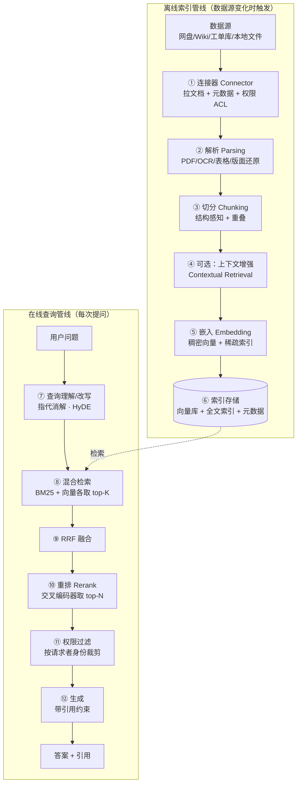

# RAG 搭建文档：格式规范 · 架构构成 · 企业范例 · 使用与迭代

> 信息基准日：2026-09-27。**RAG 没有像 MCP 那样的统一协议规范**——本文的"格式规范"指业界已收敛的工程约定：什么格式的数据能进库、怎么切分（chunking）、元数据写什么、检索接口长什么样、引用怎么给。企业仓库信息（star 数、特性、维护状态）均为当日对 GitHub README 与文档的实际抓取，随时间漂移，以仓库现状为准。
>
> 本工作区惯例是结论带 `文件:行号`；本文是网络调研文档，等价做法是**结论带来源链接**（每节末尾标 URL）。

---

## 0. TL;DR

- **RAG**（Retrieval-Augmented Generation，检索增强生成）= 回答前先从外部知识库**检索**相关片段，把片段作为上下文交给 LLM 生成答案。它同时解决四件事：私有知识、知识时效、**答案溯源（引用）**、以及把权限裁剪放在生成之前。
- 架构是**两条管线**：离线索引管线（连接器 → 解析 → 切分 → 嵌入 → 建索引）与在线查询管线（查询改写 → 混合检索 → 融合 → 重排 → 组装上下文 → 生成带引用）。拆开看每一环都很朴素，工程量全在**每环的质量与环间的回归验证**。
- 检索范式已经收敛为行业默认：**混合检索**（hybrid search：BM25 全文 + 稠密向量）+ **RRF 融合** + **两阶段重排**（召回 top-50 → 重排取 top-5）。Anthropic Contextual Retrieval 的官方数字：基线检索失败率 5.7%，上下文增强 + 混合 + 重排三件套叠加后降到 **1.9%（下降 67%）**。
- 切分没有银弹，但有基线：**256–512 token、重叠 10–20%**，结构感知切分（按标题/表格行）优先于机械切分；"命中片段能否独立支撑回答"是唯一可靠的验收标准。
- 企业范例的三大标杆：**Onyx**（企业知识层：50+ 连接器 + **文档级 ACL 权限随同步入库**）、**RAGFlow**（深度文档理解 + 模板化切分可视化 + 人工干预）、**kotaemon**（引用可视化：分数 + PDF 高亮 + 低相关告警）。行业整体从"单用户应用"走向"引擎 / 框架 / 平台"分层。
- 迭代三板斧：**黄金数据集**（golden dataset，50–150 条起步）+ **回归评测**（RAGAS 四指标 / DeepEval 进 CI）+ **反馈闭环**（点踩查询 → 坏例挖掘 → 回流测试集）。换 embedding 模型必须全量重建索引，用别名（alias）原子切换、随时回滚。
- 与 agent 的关系正在合流：**Agentic RAG**（agent 决定何时检索、多轮检索）不是取代管线而是包一层；代码仓库场景 grep 式 agent 检索已占优（本工作区六家 agent 全是这个路线），企业知识库场景**索引式 RAG 仍是底座**——因为权限过滤与成本控制只能在检索层做。

**阅读路线**：想建立架构观 → 读 §1；动手前吃透规范 → 读 §2；想跑起来 → 读 §3；想抄作业 → 读 §4；管接入部署 → 读 §5；长期迭代 → 读 §6；进阶方向 §7；排障速查 §8。

---

## 1. RAG 是什么：架构与角色

### 1.1 一句话与生态位

LLM 的知识冻结在训练截止日，也不知道你公司的内部文档。RAG 的思路：**不改变模型，在推理前把"可能用得上的知识"检索出来塞进上下文**。对比另外两条路线——微调（fine-tuning，把知识训进权重）与长上下文（把全部文档塞进窗口）——RAG 的独特价值：

| 路线 | 私有知识 | 时效性 | 溯源引用 | 权限控制 | 知识更新 | 成本 |
|---|---|---|---|---|---|---|
| **RAG** | ✅ | ✅ 增量索引 | ✅ 逐句可引 | ✅ **检索层裁剪** | ✅ 改索引即生效 | 低（每次只带相关片段） |
| 微调 | ⚠️ 易过拟合 | ❌ 重训 | ❌ | ❌ | ❌ 重训 | 高 |
| 长上下文直塞 | ✅ | ✅ | ⚠️ 弱 | ❌ **必须先塞进 prompt 才谈权限** | ⚠️ | 高（token 随文档量线性涨） |

业界对"长上下文会不会杀死 RAG"的主流结论是**互补而非替代**（§7.2 有展开）：长上下文改变的是检索粒度（可以检更大的块、甚至整篇文档），而不是消灭"先筛后读"这件事。

### 1.2 双管线架构



关键认知：**"知识库里存了答案"和"智能体能答对"之间隔着解析、切分、嵌入、检索、重排、权限、生成约束七八个环节**，任何一环出问题，最终回答都会错。排障时先判断问题出在哪一环，而不是直接改 prompt 或换模型（这个"先定位环节再调参"的纪律，本工作区 [fde-handbook/tencent-adp-fde-course/lessons/4.3_知识库质量与_RAG_调优.md](../fde-handbook/tencent-adp-fde-course/lessons/4.3_知识库质量与_RAG_调优.md) 有完整的企业课程版本）。

### 1.3 形态谱系：从 Naive 到 Agentic

| 阶段 | 检索方式 | 特征 |
|---|---|---|
| **Naive RAG**（朴素） | 一次向量检索 top-K | 索引→检索→生成直通；幻觉与"检索不到"高发，是所有问题的基线 |
| **Advanced RAG**（进阶） | 混合检索 + 重排 + 查询改写 + 父子检索 | 检索前后各加优化环节，§2/§3 的大部分技术属于此层 |
| **Modular RAG**（模块化） | 管线可编排 | 每个环节是可替换模块（Haystack 的 DAG Pipeline、Quivr 的 YAML 声明式） |
| **Agentic RAG**（智能体式） | agent 决定**是否**检索、检索几轮、检索哪些源 | 复杂多跳问题的答案，代价是延迟与 token（§7.2） |

企业系统的现状大多是 **Advanced 为主干 + 局部 Agentic**：默认走固定管线保住延迟与成本，识别到复杂查询再升级多轮检索。

### 1.4 RAG vs Agent 检索：两条路线正在合流

本工作区六家 agent（Claude Code / Codex / ZCode 等）全部采用 **agent 式检索**：不建向量索引，让模型用 grep/读文件的工具迭代搜索。两者对照：

| 维度 | 索引式 RAG | Agent 式检索（grep 迭代） |
|---|---|---|
| 索引 | 需要预建、需增量维护 | **无索引，永远最新** |
| 查询延迟/成本 | 快且便宜 | 每查询多轮工具调用，token 贵 |
| 大语料 | 可扩展到 TB 级 | 不适合海量文档 |
| 硬查询（语义关联） | 依赖嵌入质量 | 迭代搜索往往更准 |
| **权限** | **检索层天然可过滤** | 依赖文件系统权限 |
| 典型场景 | 企业知识库、客服、合规 | 代码仓库 |

结论：**代码仓库场景 agent 式检索已占优**（仓库规模适中、有 git 权限、强依赖最新性）；**企业知识库仍是索引式 RAG 的地盘**（文档量大、需文档级权限、成本敏感），且索引式 RAG 可以作为工具被 agent 调用——这就是 **Agentic RAG** 的合流形态（§7.2）。

> 六家 agent 的主循环与工具检索实现见各自《架构拆解》，如 [01-claude-code/架构拆解.md](../01-claude-code/架构拆解.md)。

---

## 2. 格式规范（搭建前必须吃透的部分）

## 2.1 数据摄入规范：什么能进库

**先分知识形态，再决定入库方式**——文档、问答（Q&A 对）、数据库三类知识的准备规范不同：

| 知识形态 | 适合 | 准备规范重点 |
|---|---|---|
| **文档** | 制度、手册、SOP | **可解析**（干净的结构）、**可追溯**（版本/生效日期元数据，到期不再命中） |
| **问答对** | 高频标准问题、口语化问法 | **可校验**（人工审核后才采纳）、**无冲突**（同一问题只有一个口径） |
| **数据库** | 需按字段查询/聚合的数据 | **字段可理解**（表名列名单位描述写清楚） |

**不要直接入库的典型资料**（先人工提炼再进库）：只适合人看的活动海报/宣传页/截图合集、设计元素混杂的 PPT、拍照模糊或表格线不清的扫描件、无版本标识的多轮修改汇总文档。经验法则：**适合人读 ≠ 适合机器检索**。

结构化文本（Markdown / 带版面信息的 HTML / 提取后的文本）质量远高于裸 PDF；PDF 里的表格、多栏、扫描件需要专门的解析层（RAGFlow 的 DeepDoc、MinerU、Docling、PaddleOCR 都是这个位置的工具）。

> 来源：ADP 课程 4.3.2 与 2.2 中（本工作区 [fde-handbook/tencent-adp-fde-course/lessons/](../fde-handbook/tencent-adp-fde-course/lessons/) ）

## 2.2 切分（Chunking）规范：本文最重要的一节

Chunk（切分块）是检索命中的基本单元。切分的目标不是越细越好，而是**每个块既容易被问题命中、又能独立支撑回答**——只命中了结论没有条件、只有表格数据没有表头、只有步骤没有前置条件，都说明切分要调。

**策略谱系**（按复杂度递增，低层不满足再上高层）：

| 策略 | 做法 | 适用 |
|---|---|---|
| **固定大小** fixed-size | 按 token 数硬切 + 重叠 | 快速原型；易截断语义 |
| **递归字符** recursive | 按分隔符层级（段落→句子→词）递归切，尽量在自然边界断 | 通用默认；LangChain `RecursiveCharacterTextSplitter` 是事实标准 |
| **语义** semantic | 先按句切，按相邻句嵌入相似度找断点 | 长篇散文 |
| **结构感知** structure-aware | 按 Markdown 标题 / HTML 标签 / 代码 AST / **表格按行（表头随行走）**切 | 有清晰结构的文档，**企业文档首选** |
| **父子检索** parent-child / **句子窗口** sentence-window | "小块检索、大块喂模型"（small-to-big）：用子块精确命中，返回父块或周边窗口给 LLM | 检索精度与上下文完整性兼得的生产标配 |

**参数基线**（业界共识，来源：Pinecone / Weaviate 官方指南）：

- chunk 大小 **256–512 token** 起步；事实型问答可降到 128–256；Weaviate 建议起步值 512 token + 50–100 token 重叠；LlamaIndex `SentenceSplitter` 默认 1024/200（偏大，别照抄）。
- 重叠（overlap）**10–20%**。腾讯 ADP 的产品化取值与此一致：切片最大 4800 字符、重叠建议 10% 最高 25%；父子切分子级最大 1500 字符；表格按行切、表头最多随 5 行。
- **不要套默认值，要在自己的语料上做参数扫描**（如 256/512/1024 × 0/10/20% overlap），用黄金测试集（§6.2）对比 Recall@k。

**两个进阶技巧**：

1. **Anthropic Contextual Retrieval（上下文检索）**：把整篇文档与每个 chunk 一起喂给一个便宜的小模型，为该块生成 50–100 token 的"这块在全文中的位置与背景"说明，**前置到块文本后**再做嵌入与 BM25 索引（配 prompt caching 提示词缓存，成本约 $1.02/百万文档 token）。官方公布的 top-20 检索失败率：基线 5.7% → 上下文嵌入 3.7%（**-35%**）→ + 上下文 BM25 2.9%（**-49%**）→ + 重排（top-150 重排取 top-20）**1.9%（合计 -67%）**。
   > 来源：https://www.anthropic.com/news/contextual-retrieval
2. **Late Chunking（晚切分，Jina AI）**：反直觉地"先嵌后切"——用长上下文嵌入模型整篇编码得到 token 级向量，再对各块跨度做池化（pooling），每块向量天然携带全文上下文，省掉 LLM 改写。
   > 来源：https://arxiv.org/abs/2409.04701

## 2.3 元数据规范：每条 chunk 必须带什么

元数据是**过滤检索**（时间、部门、权限）与**引用展示**（来源、页码）的基础，索引时欠的债检索时都要还。最小字段集：

```jsonc
{
  "chunk_id": "doc-1234#chunk-07",       // 文档内稳定且可复现（同文档重导不换 id）
  "doc_id": "doc-1234",
  "source_uri": "hr://policies/travel-v3.pdf#page=4",  // 引用展示用：能定位到页/节
  "title": "差旅报销制度 v3",
  "doc_type": "policy",                  // 文档/问答/数据库条目
  "version": "v3.2",                     // 版本与生效期：过期知识自动失效的依据
  "effective_date": "2026-01-01",
  "ingested_at": "2026-09-27T08:00:00Z", // 新鲜度监控用
  "acl": ["dept:hr", "role:employee"],   // 权限：随连接器同步（§6.5）
  "tenant_id": "company-a",              // 多租户隔离（§6.5）
  "keywords": ["差旅", "报销"],           // 可选：给 BM25 侧补充锚点
  "acl_synced_at": "2026-09-27T08:00:00Z" // 权限变更近实时传播的依据
}
```

三条硬规则：**权限元数据必须与文档同批入库**（连接器同步时一起拉，Onyx 的做法，§4.2）；**版本/生效日期必须有**（否则过期制度会继续被命中，这是企业场景第一大事故源）；**chunk_id 必须可复现**（否则增量更新变成全量重灌）。

## 2.4 嵌入与索引规范

- **嵌入模型**：按语言匹配选型（中文看 C-MTEB 榜单、英文看 MTEB）；维度与成本、精度权衡；**API 模型与本地模型（如 bge 系列）都可行**，QAnything 甚至自研嵌入+重排配对模型来对抗大规模下的检索退化（§4.5）。
- **双索引是标配**：稠密向量索引（语义）+ 稀疏全文索引（BM25，精确词匹配——错误码、型号、人名是嵌入的盲区）。RAGFlow 用 Elasticsearch 存双索引，Qdrant/Weaviate 原生支持稀疏+稠密混合。
- **归一化与度量**：向量统一归一化后用余弦相似度；换模型 = 换向量空间，**新旧向量不可混存**（§6.3）。

## 2.5 检索接口规范

检索层的对内 API 建议**一个函数说清所有事**（参数即契约）：

```python
def search(
    query: str,
    top_k: int = 5,                    # 最终返回数（重排之后）
    recall_k: int = 50,                # 每路召回数（重排之前）
    filters: dict | None = None,       # 元数据过滤：{"tenant_id": ..., "doc_type": ...}
    acl: list[str] | None = None,      # 请求者权限（必传！服务端强制，不信客户端）
    mode: Literal["hybrid", "vector", "keyword"] = "hybrid",
    rerank: bool = True,
) -> list[Hit]:   # Hit = {chunk, score, source_uri, ...元数据}
```

通行做法是**两阶段检索**：每路（BM25 / 向量）召回 recall_k ≈ 50，RRF（Reciprocal Rank Fusion，倒数排名融合，按 Σ1/(k+rank) 合并两路排名，免去两套分数的量纲校准）融合后，交叉编码器重排取 top-5。这是 RAG 质量提升**性价比最高**的一步。

## 2.6 引用与溯源规范

- **引用是可信度的一部分**：企业制度/合规场景，答案不带引用等于不可验收；引用错误则说明检索、重排、文档版本或生成约束有问题。
- 生成约束三件套：prompt 里明确"**只基于给定上下文回答，不知道就说不知道**"；答案逐条标注来源（`[doc-1234#p4]`）；检索分数过低的片段**宁可不给**（kotaemon 的做法是低相关时显式告警，§4.4）。
- 引用粒度到**文档+页码/章节**（`source_uri` 支撑），前端可点开预览高亮（kotaemon 的 citation UI 是参照实现）。

**搭建检查清单**：

- [ ] 每类知识（文档/问答/数据库）按 §2.1 的规范整理过，不适合机器读的资料已提炼
- [ ] 切分策略与语料结构匹配（结构感知优先），参数在自有测试集上扫过
- [ ] 每条 chunk 元数据齐全（§2.3 三条硬规则）
- [ ] 双索引（向量+BM25）就位，检索接口带 filters + acl 参数
- [ ] 两阶段检索 + RRF + 重排已成默认管线
- [ ] 生成端有引用约束与"不知道就拒答"
- [ ] 同一批文档重导入，chunk_id 稳定（增量更新可用的前提）

---

## 3. 从零搭一个最小 RAG

## 3.1 选型：框架与向量库

**框架**（只做管线编排与组件抽象，不绑定向量库）：

| 框架 | star | RAG 抽象 | 一句话 |
|---|---|---|---|
| [LlamaIndex](https://github.com/run-llama/llama_index) | 约 5.2 万 | Node 节点抽象；`IngestionPipeline`（可缓存/增量去重）；Retriever → NodePostprocessor → ResponseSynthesizer 组成 QueryEngine | **文档处理平台**，RAG 模块化程度最高 |
| [LangChain](https://github.com/langchain-ai/langchain) | 约 14.7 万 | DocumentLoader（数百连接器）/ TextSplitter（`RecursiveCharacterTextSplitter` 是事实标准）/ VectorStore / Retriever 统一接口 | 组件最全；1.0 后重心转向 Agent，RAG 组件稳定 |
| [Haystack](https://github.com/deepset-ai/haystack) 2.x | 约 2.7 万 | 带类型注解的组件显式连成 DAG Pipeline，支持循环/分支，**可 YAML 序列化** | "显式优于隐式"，生产可调试性最好 |
| [txtai](https://github.com/neuml/txtai) | 约 1.3 万 | Embeddings Database（向量+图+关系库三合一） | 一体化语义搜索框架 |

**向量库**（经验法则：<500 万向量 pgvector/Chroma 够用；500 万–5000 万 Qdrant/Weaviate；更大 Milvus）：

| 库 | 定位 |
|---|---|
| **Chroma** | 轻量嵌入式，API 极简，原型首选 |
| **Qdrant** | Rust 实现，过滤检索最强，原生稀疏+稠密混合；多租户推荐 payload 分区 |
| **Weaviate** | 原生 BM25+向量混合检索是招牌；租户为一等对象 |
| **Milvus** | 分布式，十亿级向量与 GPU 索引 |
| **pgvector** | PostgreSQL 扩展，数据已在 PG 时零新增基础设施 |
| **Elasticsearch/OpenSearch** | 已有搜索平台时顺带做混合检索，功能全运维重 |

## 3.2 最小可用管线（LlamaIndex，十几行）

```python
from llama_index.core import VectorStoreIndex, SimpleDirectoryReader
from llama_index.core.node_parser import SentenceSplitter
from llama_index.core.ingestion import IngestionPipeline

# ① 摄取：读目录 → 切分 → 嵌入 → 存默认内存索引
pipeline = IngestionPipeline(transformations=[
    SentenceSplitter(chunk_size=512, chunk_overlap=50),   # §2.2 基线值
])
docs = SimpleDirectoryReader("./policies").load_data()
nodes = pipeline.run(documents=docs)
index = VectorStoreIndex(nodes)

# ② 查询：检索 + 生成一步到位
qe = index.as_query_engine(similarity_top_k=5)
print(qe.query("差旅报销的打车票能报吗？"))
```

生产环境把 `VectorStoreIndex` 换成接 Qdrant/PGVector 的构造参数即可——**框架的价值就是让你先用内存索引验证切分质量，再无痛换库**。

## 3.3 生产化三步：混合检索 + 重排 + 父子检索

在最小管线上叠 §2 的三个默认项（伪代码，Qdrant + LlamaIndex 风格）：

```python
from llama_index.core.retrievers import QueryFusionRetriever        # RRF 融合
from llama_index.core.postprocessor import SentenceTransformerRerank
from llama_index.retrievers.bm25 import BM25Retriever               # 稀疏路

vector_retriever = index.as_retriever(similarity_top_k=50)          # ⑧ 稠密路 top-50
bm25_retriever  = BM25Retriever.from_defaults(docstore=docstore, top_k=50)  # ⑧ 稀疏路 top-50
hybrid = QueryFusionRetriever([vector_retriever, bm25_retriever],
                              mode="reciprocal_rerank",             # ⑨ RRF 融合
                              num_queries=1)                        # 关闭多查询扩展亦可
reranker = SentenceTransformerRerank(model="BAAI/bge-reranker-base", top_n=5)  # ⑩ 重排取 top-5

qe = index.as_query_engine(retriever=hybrid,
                           node_postprocessors=[reranker],
                           response_mode="compact")
```

三个叠加项各自独立有效、可逐个上线：先混合（解决精确词），再重排（解决排序），再父子（解决上下文完整性）。预算紧就上 Anthropic 的组合拳：Contextual Retrieval 是三件套里单笔投入最大、增益也最大的一项（§2.2）。

## 3.4 检索质量设计八条（从企业范例提炼）

1. **切分跟着结构走**：标题层级、表格行、代码函数是天然边界；机械等长切分是语义破坏的第一来源。
2. **混合检索是默认，不是优化**：只做向量检索的 RAG 在错误码/型号/人名类查询上必然翻车。
3. **两阶段检索**：召回靠便宜的第一阶段（top-50），精度靠昂贵的第二阶段（重排 top-5）。
4. **权限在检索层裁剪**，生成层过滤只是兜底（§6.5 展开为什么）。
5. **引用强制化**：答案必须带 `source_uri`；无引用的答案在生产上视为不合格。
6. **问答对是文档的补充而不是替代**：高频口语问法（"打车票怎么报"）沉淀为 QA 对，直接映射到标准答案——检索命中率立竿见影（ADP 课程与 FastGPT 的共同结论）。
7. **检索分数要暴露给上层**：低分告警、无结果显式说"没找到"，比硬编一个答案好。
8. **每个参数调整都要过测试集**：围绕样本调参，不围绕单条问题调参（调好了 A 坏了 B 是最常见的假优化）。

---

## 4. 企业真实范例（GitHub 收集）

> 选样原则：真实企业/团队维护、当前有生产用户、形态各异（引擎/应用/框架/平台都有）。star 数与状态为 2026-09-27 实抓（标注"约"）。本节结论来自各仓库 README 与文档当日抓取。

## 4.1 横向对比总表

| 仓库 | 维护方 | star | 语言/许可证 | 定位 | 检索与切分亮点 | 权限 | 状态 |
|---|---|---|---|---|---|---|---|
| [infiniflow/ragflow](https://github.com/infiniflow/ragflow) | InfiniFlow | 约 9.1 万 | Py+Go / Apache-2.0 | 深度文档理解 RAG 引擎 | **DeepDoc 解析**、模板化切分+**可视化人工干预**、多路召回+融合重排 | 团队（企业版） | 非常活跃 |
| [langgenius/dify](https://github.com/langgenius/dify) | LangGenius | 约 15.7 万 | Py+TS / Apache+附加条款 | LLMOps 平台（RAG 是其 Pipeline 一环） | RAG 做成**工作流节点**；生产日志回流数据集 | 应用级 | 非常活跃 |
| [Mintplex-Labs/anything-llm](https://github.com/Mintplex-Labs/anything-llm) | Mintplex | 约 6.7 万 | Node+React / MIT | 全栈本地 AI 应用 | 默认 LanceDB，**可换 9 种向量库** | 多用户（仅 Docker 版） | 非常活跃 |
| [zylon-ai/private-gpt](https://github.com/zylon-ai/private-gpt) | Zylon | 约 5.8 万 | Python / Apache-2.0 | **API-first** 私有 LLM 层 | 摄取+带引用检索+Agentic RAG+MCP | RBAC 在商业版 | 活跃（1.0 重写） |
| [QuivrHQ/quivr](https://github.com/QuivrHQ/quivr) | QuivrHQ | 约 4.0 万 | Py+TS / Apache-2.0 | "第二大脑"框架 | **YAML 声明式管线**、Megaparse 解析、Cohere 重排 | 无 | 活跃（重心在 quivr-core 库） |
| [onyx-dot-app/onyx](https://github.com/onyx-dot-app/onyx) | Onyx（原 Danswer） | 约 3.2 万 | Py+TS / MIT+企业版 | 企业知识层 / Agentic RAG | 50+ 连接器、混合检索 | **文档级 ACL + RBAC(EE)** | 活跃 |
| [labring/FastGPT](https://github.com/labring/FastGPT) | labring | 约 3.0 万 | TS / 自定义（禁 SaaS 转售） | 知识库+可视化编排 | **QA 对拆分导入**、混合检索&重排、分块可编辑 | 团队空间 | 活跃 |
| [Cinnamon/kotaemon](https://github.com/Cinnamon/kotaemon) | Cinnamon | 约 2.6 万 | Py+Gradio / Apache-2.0 | 干净可定制的 RAG UI | 默认混合+重排、**引用可视化**、GraphRAG 即插即用 | 多用户集合 | 活跃 |
| [netease-youdao/QAnything](https://github.com/netease-youdao/QAnything) | 网易有道 | 约 1.4 万 | Py+Vue / AGPL-3.0 | 本地知识库问答 | **两阶段检索**（自研 BCEmbedding）、纯 CPU 友好、离线部署 | 无 | 维护模式 |
| [weaviate/Verba](https://github.com/weaviate/Verba) | Weaviate | 约 0.8 万 | Py+TS / BSD-3 | 官方端到端 RAG 应用（**单用户**） | 语义+关键词混合、四类可插拔管理器、丰富 chunker | 明说不做多用户 | **已归档**（2026-06 只读） |

> 两个组织迁移注意：Danswer 已更名 **Onyx**（danswer-ai/danswer → onyx-dot-app/onyx），搜旧教程时注意；Verba 已归档，只读当教学样本。

## 4.2 精读一：Onyx（企业知识层标杆：连接器 + 文档级 ACL）

**总体**：MIT 社区版 + 企业版，10k+ commits 的活跃工程。README 定位"AI Chat that works with every LLM"——它不生产模型，而是做企业知识的**接入与检索层**。

**① 连接器同步"文档 + 元数据 + 权限"是它的招牌**。50+ 应用连接器（网盘/Wiki/工单/IM 等）在同步数据时**连同源系统的权限元数据一并拉取**（README 原文），查询时按请求者身份过滤——这就是 permission-aware RAG（权限感知检索）：**答案只来自该用户有权访问的源**。这是把"企业级"三个字落地的关键设计，也是它与玩具 RAG 的分水岭（§6.5 展开为什么权限必须在检索层）。

**② 部署形态的工程化**：Docker/K8s/Helm/Terraform 全覆盖，支持**气隙（air-gapped）自托管**（完全断网环境），另有 <1GB 的 Lite 版——同一套代码按规模裁剪出双形态。

**③ 检索侧**：向量 + 关键词双索引混合检索是默认；已叠加 Agentic RAG 与 Deep Research（深度研究）能力——Advanced 主干 + 局部 Agentic 的典型样本（§1.3）。

**值得抄**：连接器抽象（新增数据源 = 实现一个连接器）；权限随同步入库；标准/Lite 双部署形态。

> 来源：https://github.com/onyx-dot-app/onyx ｜ https://docs.onyx.app

## 4.3 精读二：RAGFlow（深度文档理解：解析与切分的工业级答案）

**总体**：Apache-2.0，10 家里 star 最高的纯 RAG 引擎（约 9.1 万），Python+Go，版本迭代极快（v0.27.x）。

**① DeepDoc 深度文档理解**：解析层专门处理 PDF 版面、表格（含合并单元格）、扫描件 OCR，还可外接 MinerU/Docling 等解析器与多模态模型。**企业文档质量的瓶颈通常不在模型而在解析**——RAGFlow 把投入压在这一层是对的。

**② 模板化切分 + 可视化人工干预是它的招牌**：不同文档类型（合同/论文/试卷/表单）用不同切分模板，切分结果**可视化展示、允许人工逐块修正**再入库。它把"切分质量"从黑盒参数变成了**可审查的产物**——对切分质量要求高的场景（法务、合规），这个思路比调参更可靠。

**③ 检索侧**：多路召回 + 融合重排为默认；Elasticsearch 存全文+向量双索引（可切换自研 Infinity 引擎）；已同步 Confluence/S3/Notion/Google Drive 等连接器。

**值得抄**：切分可视化+人工干预（把最不可控的环节变成可审核流程）；多路召回+融合重排的默认化。

> 来源：https://github.com/infiniflow/ragflow ｜ https://ragflow.io

## 4.4 精读三：kotaemon + FastGPT（引用可信与调试观测）

**kotaemon**（Cinnamon，Apache-2.0）：干净、可定制的 RAG UI，默认管线就是混合检索（全文+向量）+ 重排。**招牌是引用可视化**：文档预览、相关度分数展示、PDF 内高亮定位、**检索相关度过低时显式告警**——把"这个答案可信吗"变成用户一眼可判断的东西。另支持 GraphRAG 多后端即插即用（MS GraphRAG / LightRAG，§7.1）、多模态问答（图表解析走 Azure DI/Docling/PaddleOCR）、向量库可换（Chroma/Milvus/Qdrant/Elasticsearch）。**值得抄**：引用 UI 是可信度工程，不是美化。

**FastGPT**（labring，自定义许可证）：TS 全栈知识库平台。**两个独门设计**：① **QA 对拆分导入**——文档可自动拆成问答对入库，FAQ 场景召回显著好于裸 chunk；② **调试观测**——知识库支持单点检索测试（输入问题直接看命中了哪些块），每次对话有**全调用链日志**与评测能力。**值得抄**：把"检索单点调试"做成产品功能，等于把 §6 的迭代闭环内置化了。

> 来源：https://github.com/Cinnamon/kotaemon ｜ https://github.com/labring/FastGPT

## 4.5 其余六家速览

- **Dify**（约 15.7 万星）：LLMOps 平台，本文唯一"平台视角"样本——RAG 被做成**工作流里的节点**（检索节点可编排、可分支），知识库支持"基于生产日志持续改进"，并原生集成 Langfuse/Arize Phoenix 等观测平台（§6.1）。适合把 RAG 嵌进更大的应用编排里。
- **AnythingLLM**（约 6.7 万星）：全栈本地应用，**零配置默认**（嵌入式 LanceDB，无需装向量库）+ 全抽象（9 种向量库、几十种 embedding/LLM 可换），桌面端（Mac/Win/Linux/Android）到 Docker 一路覆盖——私有化门槛最低的样本。
- **PrivateGPT**（约 5.8 万星）：**API-first 路线**的代表——1.0 全量重写后定位为"私有版 Claude API"：标准消息 API（流式/异步/token 计数）、文件摄取、带引用检索、Agentic RAG、MCP 支持；UI 明确定位为演示器。想自建 RAG 中台给别人用，抄它的接口形态。
- **Quivr**（约 4.0 万星）：**YAML 声明式 RAG 管线**（`filter_history → rewrite → retrieve → generate_rag`），管线即配置、可版本化可组合——把 Modular RAG 落到了配置文件粒度。
- **QAnything**（约 1.4 万星，维护模式）：网易有道出品，**两阶段检索 + 自研 BCEmbedding 嵌入/重排配对模型**对抗大规模检索退化；纯 CPU 可跑、Docker Compose 一键、支持完全离线。虽然已降速，其"自研模型配对 + 极致工程化"仍是好教材。
- **Verba**（约 0.8 万星，**已归档**）：Weaviate 官方应用，四类可插拔管理器（ingestion/chunking/embedding/generation）的抽象干净；但**单用户定位**写明在 README 里，多用户/RBAC "out of scope"——2026-06 归档。反例价值：**应用形态的 RAG 若不解决多用户与权限，天花板极低**。

## 4.6 形态趋势：应用 → 引擎/框架/平台分层

十家放一起看，生态已经分层，选型先选层：

| 层 | 代表 | 适合 |
|---|---|---|
| **引擎**（重解析与检索质量） | RAGFlow | 自建知识中台、文档质量差的场景 |
| **应用**（开箱即用） | AnythingLLM、FastGPT、kotaemon、QAnything | 团队内部快速上线 |
| **框架**（管线编排库） | LlamaIndex、LangChain、Haystack、Quivr-core | 自研管线、深度定制 |
| **平台**（LLMOps 编排） | Dify | RAG 是大应用里的一环 |
| **知识层**（企业接入+权限） | Onyx | 面向全公司的知识问答 |

两条明确的收敛：**检索范式收敛**为混合+重排（十家里七家默认）；**权限与多用户**成为"玩具与生产"的分界线（Onyx/RAGFlow/FastGPT 往上走，Verba/QAnything 停在这条线下面）。

## 4.7 提炼：跨企业的 6 条设计模式

1. **连接器抽象**：数据源接入做成插件（Onyx 50+ 连接器、Dify Marketplace），新增源不改核心。
2. **权限随同步入库**：ACL 元数据在摄取时与文档绑定，检索时按身份过滤（Onyx）——不是查询时临时拼。
3. **切分可解释可干预**：可视化 + 人工修正（RAGFlow）、分块可编辑（FastGPT），而非纯自动黑盒。
4. **QA 对一等公民**：问答与文档并列为一等知识形态（FastGPT/ADP/各家 FAQ 场景共识）。
5. **检索单点可调试**：输入问题直接看命中的块与分数（FastGPT/kotaemon），等于把评测台内置进产品。
6. **可观测从第一天接入**：调用链日志（FastGPT）与 Langfuse/Phoenix 集成（Dify）是标配，不是事后补。

---

## 5. 使用：接入与部署形态

## 5.1 三种使用方式

| 方式 | 形态 | 适用 |
|---|---|---|
| **UI 直接问** | 各项目自带 Web UI（kotaemon/FastGPT/AnythingLLM） | 团队内部知识问答 |
| **API 调用** | PrivateGPT 式标准消息 API（问答带上引用结构返回） | 嵌入自有产品 |
| **agent 接入** | 把 RAG 检索暴露为工具/MCP server，供 agent 按需调用 | agent 工作流里的知识环节 |

第三种值得展开：把知识库封装成 **MCP server**（检索函数作为 tool、文档作为 resource），六家 agent（Claude Code / ZCode 等）即可直接挂载使用。MCP 的 Resources 原语（application-driven 应用控制注入）天然契合"知识库订阅注入"，Tools 原语契合"按需检索"。协议细节与 server 写法见本工作区 [mcp-handbook/MCP搭建文档.md](../mcp-handbook/MCP搭建文档.md) §2/§3；PrivateGPT 已原生支持 MCP（§4.5），RAG→MCP 是当前最顺的接入路径。

## 5.2 部署形态

| 形态 | 方式 | 适用 |
|---|---|---|
| **桌面/单机** | AnythingLLM 桌面版、Ollama+本地模型 | 个人与小组，数据不出机器 |
| **Docker 自托管** | 各项目 docker compose（RAGFlow/FastGPT/QAnything 一键） | 团队服务器 |
| **企业级** | Onyx K8s/Helm/Terraform、气隙部署；向量库选型按 §3.1 经验法则扩容 | 全公司、内网/离线、需对接 SSO |

上线顺序建议：**桌面/单机验证语料与切分 → Docker 上线小范围试点 → 按权限与规模需求上企业形态**。企业形态里最大的新增项不是规模而是 §6.5 的权限对接（SSO/源系统 ACL 同步）。

## 5.3 日常使用的三个调试动作

1. **检索单测**：拿典型问题直接调检索接口（不经过生成），看命中的块与分数——FastGPT 的单点调试即此；先确认"检索对不对"再看"回答好不好"。
2. **片段体检**：对命中块逐条问"它能否独立支撑回答"（§2.2 验收标准），不能就回头改切分。
3. **引用核对**：抽查答案的引用是否真实指向命中块、版本是否过期（引用错位往往意味着生成约束或重排出问题）。

---

## 6. 迭代：评测、反馈闭环与工程实践

## 6.1 评测框架四件套

| 工具 | 定位 | 核心概念 | 最小用法 |
|---|---|---|---|
| [RAGAS](https://docs.ragas.io) | RAG 专用无参考/少参考评测 | **faithfulness 忠实度**（答案论断能否被上下文支持）、**answer relevancy 答案相关性**、**context precision 上下文精确率**（相关块是否排在前面）、**context recall 上下文召回率**（是否覆盖参考答案全部要点）——前两个评生成，后两个评检索 | 构造 `EvaluationDataset`（question/answer/contexts/ground_truth），几行代码跑四指标 |
| TruLens | 带 LLM 评委的追踪+评测 | **RAG Triad 三角**：Context Relevance（检索内容是否回应查询）+ Groundedness（答案是否植根于检索内容）+ Answer Relevance（答案是否回应问题） | 装饰 app 记录调用，跑三个 feedback 函数 |
| [DeepEval](https://github.com/confident-ai/deepeval) | "pytest for LLM" | `LLMTestCase` + 指标断言，`deepeval test run` 进 **CI** | 评测不过 = 构建失败 |
| [Langfuse](https://langfuse.com) / Arize Phoenix | LLM 可观测（observability）平台 | **trace 追踪**：每次请求记录 query、检索单元、prompt、输出、token、延迟、成本；Langfuse 可自托管，Phoenix 兼容 OpenTelemetry | 线上 trace 抽样 → 离线回放评测 |

定位分工：**RAGAS/TruLens 管离线打分，DeepEval 管卡 CI，Langfuse/Phoenix 管线上看见**。三个都上才是完整闭环。

## 6.2 黄金数据集（golden dataset）

- **起步**：用 LLM 从真实文档 chunk 合成问答对（RAGAS `TestsetGenerator`），**再尽快掺入生产真实查询**——真实查询暴露合成数据没有的措辞、错拼、真实意图。
- **规模**：**50–150 条**即可获得有统计意义的信号；严格回归基线 100+ 条。**多样性比数量重要**：易/中/难、边界、以及"知识库里没有、应当拒答"的题外类。
- **每条三要素**：query + 期望命中的源文档/chunk + 参考答案（ground truth，参考标准答案）；参考答案由领域专家/业务方人写，评分可用 LLM-as-a-judge（LLM 当评委）放大。

## 6.3 回归测试与 embedding 升级

- **回归**：维护"query → 期望文档/期望答案"固定测试集；任何管线变更（切分、embedding、reranker、过滤参数）**前后各跑一遍**，对比 Recall@k、MRR、nDCG 与 RAGAS 分数。注意**切分与嵌入是耦合变更**（切分变了嵌入输入就变），要组合测试而不是各改各的。评测接进 CI（DeepEval），退步直接卡发布。
- **换 embedding 模型必须全量重建索引**：不同模型的向量空间互不兼容，新旧向量混存即污染。通行做法：建新 collection 全量重灌 → 灰度环境用黄金集对比新旧索引 → **alias（别名）原子切换**指针、随时回滚（Qdrant collections/aliases 模式）。切分策略同理。
- **ADP 课程的同款纪律**：每次大批量调整切分/检索配置后，用关键问题集回归，确认旧问题没有反弹、权限没有串库，再扩大范围（[4.3 节](../fde-handbook/tencent-adp-fde-course/lessons/4.3_知识库质量与_RAG_调优.md)）。

## 6.4 反馈闭环与坏例挖掘

- **反馈采集**：UI 做thumbs up/down（每用户每消息仅一条**可更新**的反馈记录，防刷）；负反馈是最高价值样本。
- **坏例挖掘的四个日志信号**：① 无结果/空检索；② 检索分数偏低；③ 用户在短窗口内**换措辞重问**（最容易被忽略的强信号）；④ 点踩会话。高频失败按主题聚类后优先修复，**每个修复直接转成回归用例**。
- **Badcase 记录四要素**（ADP 4.3 的纪律，与业界通行做法一致）：**问题现象、优先归因、调整动作、调整后效果**。同一 Badcase 多次复发 → 不是单条问题，是某类知识组织/切分/检索策略的系统性问题，升级为专项。
- **闭环去路**：修知识（补文档/补 QA 对）、修管线（切分/检索参数）、沉淀问答（高频口语问法 → QA 对），三者优先级从左到右排。

## 6.5 权限与多租户（企业场景的生死线）

**为什么权限必须在检索层做，不能只在生成层做**：未授权的 chunk 一旦进了上下文，模型可能复述其中内容——LLM 无法可靠地"看到再拒答"；且生成层过滤挡不住间接提示注入。唯一可靠的位置是**在检索/重排前按请求者身份裁剪候选集**。

- **通行做法**（Onyx / Azure AI Search 同款）：连接器同步时把源系统 ACL（Access Control List，访问控制列表）与文档一起入库，查询时用请求者身份做 security trimming（检索前裁剪）。**权限变更要近实时传播**（§2.3 的 `acl_synced_at`）。
- **多租户**：Weaviate 原生租户（一等对象、物理隔离、单 collection 支撑数百万租户）；Qdrant 官方推荐 **payload 分区**（单 collection 内 `tenant_id` 字段 + 强制过滤）而非每租户一个 collection。共同原则：**隔离在存储层声明，在查询层强制，不信任客户端传参**。
- 上线前必测：用两个不同权限的账号对同一批问题做**越权抽查**（含"知道文档存在但无权读"的场景），并对 trace 做权限字段审计。

## 6.6 数据新鲜度与成本

- **增量同步是常态**：连接器定期增量拉取（新增/变更/删除），全量重建只留给模型升级或索引结构变更；频率几分钟到数小时轮询或 webhook 触发；**删除与权限变更近实时**。
- **语义缓存**（semantic cache）：语义相近的问题命中同一条缓存，公开报告最高省约 68.8% API 成本；对小模型路由（简单查询走小模型/缓存、复杂查询升级大模型）叠加后，综合省钱报道在 60–85%。
- **监控新鲜度**：对"索引里最新文档时间"与"源系统最新文档时间"做差值告警，陈旧数据是静默失败（用户不会报告"答案旧了"，只会不再信任系统）。

---

## 7. 拓展讲解

## 7.1 图增强 RAG：GraphRAG 与 LightRAG

向量检索擅长"找相似"，不擅长**多跳关联**（"A 公司的 CEO 毕业于哪所学校"需要两次关联）。图增强 RAG 的思路：索引期用 LLM 从文本抽取**实体与关系**构建知识图谱。

- [Microsoft GraphRAG](https://github.com/microsoft/graphrag)（约 3.6 万星，基本转入维护模式）：实体/关系图 → 聚类成社区 → **分层生成社区摘要**。两种查询：**local search**（沿查询相关实体的邻域答具体事实题）与 **global search**（汇总社区摘要答全库归纳题，如"这批文档的主要主题是什么"）。代价是索引期 LLM 调用量大。
- [LightRAG](https://github.com/HKUDS/LightRAG)（约 4.0 万星，EMNLP 2025）：砍掉社区摘要与多跳推理，保留实体/关系抽取，检索分 local/global/hybrid/mix 模式，LLM 调用量与成本大幅降低，**支持增量更新与删除**（GraphRAG 的弱项）。

选型直觉：全库归纳类问题占比高才值得上图；普通事实问答用向量+混合足够。kotaemon 已把两者做成即插即用后端（§4.4），可低成本实验。

## 7.2 Agentic RAG 与"还需要 RAG 吗"的终局

**Agentic RAG**：在用户与检索之间插入 agent，由它决定**是否**检索（模型自答即可的跳过）、拆解复杂问题、跨多源**多轮**检索、判断结果是否足够再作答。与传统一次检索管线是**演进关系而非取代**：单跳低延迟场景仍走固定管线，多跳/多源/需验证的任务才值得升级（本工作区六家 agent 的工具调用循环就是这套的执行器，见各《架构拆解》的"主循环"章节）。

两个判断（与 §1.4 呼应）：

1. **长上下文不会杀死 RAG**：成本（token 随文档量线性涨）与噪声（无关内容拉低精度、助长幻觉）之外，最硬的理由是**权限**——长上下文要求先把全部文档塞进 prompt，检索层裁剪就没法做了。长上下文真正改变的是检索粒度：可以检更大的块、甚至整篇文档做"检索筛选 + 长窗口精读"。
2. **索引式与 agent 式在合流**：代码仓库场景 grep 式 agent 检索已占优（无索引、永远最新）；企业知识库场景索引式 RAG 仍是底座（权限、成本、规模），被 agent 当工具调用——即"agent 负责编排，RAG 负责检索"。

## 7.3 再往后的方向（一句话索引）

- **多模态 RAG**：图表/截图入索引（RAGFlow DeepDoc、kotaemon 的 Azure DI/Docling/PaddleOCR 路线）；
- **结构化数据 RAG**：text-to-SQL 与知识库并存（PrivateGPT 已内置），数据库类知识的字段描述质量决定上限（§2.1）；
- **Rerank 训练数据飞轮**：线上点踩/点击回流为重排模型微调数据（Onyx/FastGPT 的反馈数据沉淀方向）。

---

## 8. 常见坑（FAQ 式速查）

| 坑 | 症状 | 解法 |
|---|---|---|
| 只做向量检索 | 错误码/型号/人名查不到 | 混合检索 BM25+向量 + RRF（§2.5） |
| 机械等长切分 | 命中了结论没有条件、表格没表头 | 结构感知切分 + 父子检索；命中块能否独立支撑回答当验收标准（§2.2） |
| 裸 PDF 直接入库 | 解析乱、表格碎 | 先过解析层（DeepDoc/MinerU/Docling），不适合机器读的资料人工提炼（§2.1） |
| 无版本元数据 | 过期制度还在被命中 | version/effective_date 入元数据，过期自动失效（§2.3） |
| 权限只在生成层过滤 | 未授权内容被复述、注入绕过 | 检索层按身份裁剪；连接器同步 ACL（§6.5） |
| 换 embedding 没重建索引 | 检索质量神秘下降 | 新旧向量空间不兼容，全量重建 + alias 切换（§6.3） |
| 围绕单条问题调参 | A 好了 B 坏了 | 固定测试集回归，看整体指标（§6.3；ADP 4.3 同款纪律） |
| 答案无引用 | 用户无法验收、不敢用 | 生成约束强制引用 + 低相关告警（§2.6；kotaemon 样板） |
| 只搭不评测 | 效果玄学化、迭代靠感觉 | RAGAS 四指标 + DeepEval 卡 CI + Langfuse 看 trace（§6.1） |
| 只知点踩不知归因 | 同类问题反复复发 | Badcase 四要素（现象/归因/动作/效果）+ 复发升级专项（§6.4） |

---

## 9. 参考资料

**官方指南**：Anthropic Contextual Retrieval https://www.anthropic.com/news/contextual-retrieval ｜ Pinecone 切分指南 https://www.pinecone.io/learn/chunking-strategies/ ｜ Weaviate 切分博客 https://weaviate.io/blog/chunking-strategies-for-rag ｜ Late Chunking https://arxiv.org/abs/2409.04701 ｜ HyDE https://arxiv.org/abs/2212.10496

**框架**：https://github.com/run-llama/llama_index ｜ https://github.com/langchain-ai/langchain ｜ https://github.com/deepset-ai/haystack ｜ https://github.com/neuml/txtai

**评测与观测**：https://docs.ragas.io ｜ https://github.com/confident-ai/deepeval ｜ https://www.trulens.org ｜ https://langfuse.com ｜ https://arize.com/phoenix

**企业范例**：ragflow ｜ onyx ｜ dify ｜ anything-llm ｜ private-gpt ｜ quivr ｜ FastGPT ｜ kotaemon ｜ QAnything ｜ Verba（链接见 §4.1 表内）

**图增强**：https://github.com/microsoft/graphrag ｜ https://github.com/HKUDS/LightRAG

---

*本文档由 2026-09-27 三路调研汇总写成（企业仓库实抓 / 检索技术前沿 / 评测迭代实践）。与本工作区已有内容的接口：企业知识库的平台化与调优纪律见 [fde-handbook/tencent-adp-fde-course/lessons/4.3](../fde-handbook/tencent-adp-fde-course/lessons/4.3_知识库质量与_RAG_调优.md) 与 [2.2中](../fde-handbook/tencent-adp-fde-course/lessons/2.2中_知识与连接能力：知识库、工具、连接器与_Skills.md)；把本文的知识库暴露给 agent 用的协议见 [mcp-handbook/MCP搭建文档.md](../mcp-handbook/MCP搭建文档.md)；agent 侧的检索（grep 式）与 RAG 的合流见六家《架构拆解》的主循环章节。*
