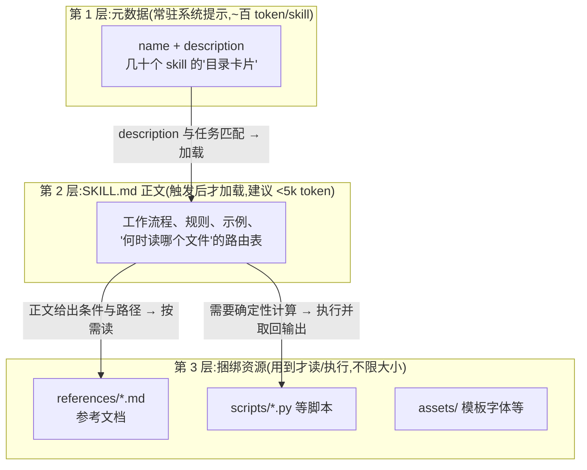
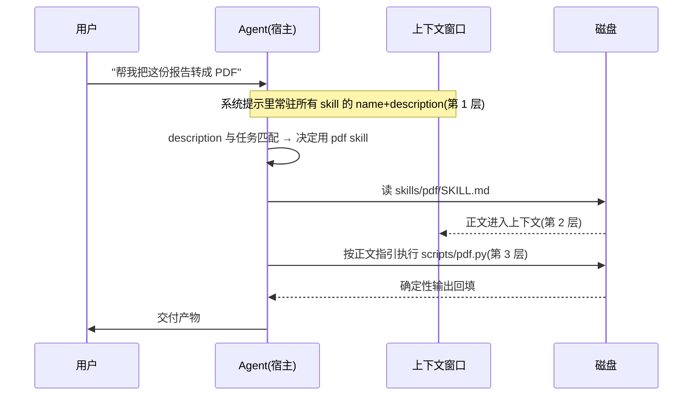

# Skill 搭建文档:格式规范 · 架构构成 · 企业范例 · 使用与迭代

> 信息基准日:**2026-09-27**。格式规范以 **agentskills.io 开放标准现行版** 为主(2025-10 由 Anthropic 开放,已被 Claude Code / ZCode / Codex 等主流 agent 采纳);企业仓库信息(star 数、目录结构、skill 数量)均为当日对 GitHub 的实际抓取,随时间会漂移,以仓库现状为准。
>
> 规范来源:agentskills.io 官方 Specification、anthropics/skills 仓库、Anthropic 工程博客《Equipping agents for the real world with Agent Skills》。本工作区惯例是结论带 `文件:行号`,本文是网络调研文档,等价做法是**结论带来源链接**;凡标注"本机验证"的,都可在 `C:\Users\Lenovo\.agents\skills\` 与 `C:\Users\Lenovo\.zcode\cli\plugins\cache\` 下直接打开对照。

---

## 0. TL;DR

- **Agent Skill(技能)** 是一个开放标准:一个**文件夹 + 一个 `SKILL.md`**(YAML frontmatter 元数据 + Markdown 正文指令),可选捆绑 `scripts/`、`references/`、`assets/` 等资源。它把"只有某个团队/某个人知道的流程知识"打包成模型可按需加载的能力包。
- 核心架构思想是**渐进式披露(progressive disclosure)**三级加载:元数据(name + description,约百 token)常驻上下文 → 正文(建议 <5k token)触发时才进上下文 → 捆绑文件按需读取、不限大小。**上下文经济学是这套设计的全部动机**。
- frontmatter 只有两个必填字段:`name`(≤64 字符,小写连字符,须与目录同名)和 `description`(≤1024 字符,**唯一常驻的触发信号**,要写"做什么 + 何时用");可选字段为 `license`、`compatibility`、`metadata`、`allowed-tools`。
- 写 skill 的关键手艺:**SKILL.md 是入口路由器,不是百科全书**——正文写"何时读哪个文件、何时跑哪个脚本",细节下沉到捆绑文件;description 要写得"积极一些",因为模型倾向于**不触发**(under-trigger)。
- 企业范例两大标杆:**anthropics/skills**(官方,19 个 skill,其中 docx/pdf/pptx/xlsx 是驱动 Claude 文档能力的**生产级**代码)与 **obra/superpowers**(29 万 star 的社区方法论框架,32 个 skill,把"测试先行、TDD、写计划"等软件纪律做成 skill)。另有 Notion 等企业合作伙伴范例与 skills.sh 注册表。
- 使用链路四条路:装进个人/项目目录、插件市场(`/plugin marketplace add anthropics/skills`)、skills.sh(`npx skills add`)、Claude API/claude.ai 上传。触发两方式:description 自动匹配、`/skill <name>` 强制加载。
- 迭代方法论一句话:**草稿 → 2~3 条真实测试提示词 → 和用户一起看结果 → 泛化改进**,循环到满意为止;四原则——泛化胜过堆规则、删掉不拉车的指导、解释 why、重复劳动固化为 `scripts/`。

**阅读路线**:想搞懂概念 → 读 §1;想动手写 → 读 §2、§7;想抄作业 → 读 §3、§4;管接入与分发 → 读 §5;长期养 skill → 读 §6。

---

## 1. Skill 是什么:定位与生态位

### 1.1 一句话定义

> Agent Skill 是一个**基于文件夹的能力格式**:一个目录,内含 `SKILL.md`(YAML frontmatter 元数据 + Markdown 指令正文),可选拥有脚本、参考文档、模板资产。Agent 在需要某项能力时加载对应 skill,像给新员工发一本"操作手册"。([agentskills.io](https://agentskills.io/specification))

2025-10 Anthropic 发布 Agent Skills,并将格式开放为标准([Anthropic 工程博客](https://www.anthropic.com/engineering/equipping-agents-for-the-real-world-with-agent-skills));随后 Claude Code、Claude.ai、Claude API、以及本工作区正在学习的 ZCode 等第三方 agent 均已实现同一格式。**MCP 的开放标准剧本重演了一遍**:先有官方实现,再抽成开放规范。

### 1.2 解决什么问题

模型是通用模型,但每个团队都有自己的私有流程知识:公司品牌色、文档排版规范、部署步骤、数据口径。这些知识有三个去处,各有代价:

| 去处 | 代价 | 问题 |
|---|---|---|
| 永远塞在系统提示词里 | 每 token 常驻,乘以每次对话 | 上下文爆炸,且 99% 时间用不上 |
| 每次手动粘贴 | 人的时间 | 不可复用、不可版本化 |
| **Skill 按需加载** | 只在用到时占上下文 | ✅ 可分发、可版本管理、可迭代 |

Skill 的本质是给上下文窗口(context window,上下文窗口)做**分层缓存**——常驻层只留"目录卡片",正文和细节按需进场。

### 1.3 与 MCP / subagent / slash command 的边界

初学者最容易混淆的四样东西,按"谁控制、提供什么"划分:

| 机制 | 提供什么 | 谁决定何时用 | 典型例子 |
|---|---|---|---|
| **MCP**(Model Context Protocol,模型上下文协议) | **连接**:外部系统的工具/数据(调 API、查库) | 模型决定(工具调用) | GitHub MCP 让模型能提 PR |
| **Skill** | **知识**:怎么做某类事的流程、规范、脚本 | 模型决定(description 匹配)或用户强制 | 教模型"如何写好 PR 描述"的公司规范 |
| **Subagent**(子代理) | **隔离上下文的执行者** | 主代理分派 | 并行搜索、visual-judge |
| **Slash command**(斜杠命令) | 固定提示词模板 | **用户显式敲命令** | `/review` |

Anthropic 官方的说法([工程博客](https://www.anthropic.com/engineering/equipping-agents-for-the-real-world-with-agent-skills)):MCP 负责把模型**接上**外部系统,Skill 教模型**如何用好**这些系统——二者互补而非竞争。例:GitHub MCP 提供 `create_pull_request` 工具,而公司可以发一个 skill,规定"PR 标题必须带 ticket 号、描述必须含测试方案"。

**判断口诀**:要**连**一个新系统 → MCP;要**教**一套做某类事的流程/规范 → skill;要**固定一句话提示词、用户手敲** → slash command。

### 1.4 渐进式披露:三级加载机制

这是 Agent Skills 架构的核心,官方规格明确分为三级([agentskills.io/specification](https://agentskills.io/specification)):



三级各有约束(规格原文要点):

1. **第 1 层 metadata**(元数据):name + description 常驻,**每个 skill 约占百 token**,所以一个环境里装几十个 skill 也不挤占上下文——但代价是 description 写不好就永远不被触发。
2. **第 2 层 SKILL.md 正文**:仅当 skill 触发时整个进入上下文,官方建议 **<5k token**(约几百行),超了就拆到第 3 层。
3. **第 3 层捆绑资源**:模型**读到正文里的指引后**才去打开的文件、执行脚本,规格不限制大小。脚本输出回填上下文,拿回的是**确定性结果**——"与其让模型每步生成 2000 token 算一遍,不如让它跑一个 20 行脚本"。

> 与 MCP 手册对照:这是 skill 版的"按控制权分层"。MCP 三原语按控制权分(模型控制/应用控制/用户控制),skill 三层按**加载时机**分(常驻/触发/按需)。

---

## 2. 格式规范(agentskills.io 现行版逐条)

### 2.1 目录结构

```
skill 目录(名字 = name 字段)
├── SKILL.md          必需;入口文件
├── scripts/          可选;模型可执行的脚本(最常见 .py/.sh/.js)
├── references/       可选;按需阅读的参考文档(.md/.txt 等)
└── assets/           可选;模板、字体、样板文件等(不被"阅读",被"使用")
```

([agentskills.io/specification](https://agentskills.io/specification)。注意:`scripts/references/assets` 是**约定俗成**的目录名而非强制——见 §3.4 的实例,真实生产 skill 会自创 `briefs/`、`configs/`、`typesetting/` 等目录,规格允许任意捆绑文件,唯一硬规则是"引用只能一层深"。)

### 2.2 SKILL.md 的两层结构

```markdown
---
name: pdf
description: Use this skill whenever the user wants to do anything with PDF
  files. This includes reading or extracting text/tables from PDFs, combining
  or merging multiple PDFs, splitting PDFs apart, rotating pages, ...
license: Complete terms in LICENSE.txt
---

# PDF Processing

[正文:Markdown 指令……]
```

第一段是 **YAML frontmatter**(YAML 前置元数据,`---` 包围),第二段起是 **Markdown 正文**(指令本体)。上面是真实抓取的 [anthropics/skills 的 pdf skill](https://github.com/anthropics/skills/blob/main/skills/pdf/SKILL.md) 开头。

### 2.3 frontmatter 字段规范

| 字段 | 必填 | 规格 | 说明 |
|---|---|---|---|
| `name` | ✅ | ≤64 字符;仅小写字母数字与连字符;**必须与目录名一致** | skill 的标识符 |
| `description` | ✅ | ≤1024 字符;第三人称 | **唯一常驻的触发信号**。要同时写清"做什么"与"何时该用"(用户的哪些说法、什么场景)。模型倾向不触发,官方教学版本建议写得积极一些(见 §2.4) |
| `license` | ❌ | 许可证名或指向捆绑的 LICENSE 文件 | 如 pdf skill 写 `Complete terms in LICENSE.txt` |
| `compatibility` | ❌ | ≤500 字符 | 声明运行环境要求(如需要某个最低版本);面向未来的字段,大多数 skill 留空 |
| `metadata` | ❌ | 任意键值对 map | 放 `version`、`author`、`tags` 等自定义信息,agent 不解释其含义 |
| `allowed-tools` | ❌ | 逗号分隔的工具名列表 | 限制 skill 激活期间模型可用的工具(实现相关,Claude Code/ZCode 支持,Web 上无效) |

两个细节([agentskills.io/specification](https://agentskills.io/specification)):兼容旧实现的迁移注意——name 在发布平台上需唯一;`metadata` 是团队沉淀自定义字段(如内部审批单号)的出口。

### 2.4 正文编写规范

规格与官方教学(本机 `C:\Users\Lenovo\.zcode\cli\plugins\cache\zcode-plugins-official\skill-creator\0.1.0\skills\skill-creator\SKILL.md`,本机验证)给出的可执行规则:

- **祈使句写作**:直接下指令("先读 X 再改"),不要写成文档腔。规则不明显时**解释为什么**——现代模型在理解理由时遵循度更高;满屏大写 MUST/NEVER 通常说明该规则本身没讲清楚,而不是需要喊得更响。
- **示例胜过规则**(Examples beat rules):skill 产出结构化结果时,正文里放一个**字面量示例**;该用某个工具时,正文里写出那次调用长什么样。
- **description 要"积极"**:教学原文给了对照——弱:"How to build a dashboard for internal data"(怎么给内部数据建仪表盘);强:"How to build a fast dashboard for internal data. Use whenever the user mentions dashboards, data visualization, internal metrics, or wants to display any company data — even if they don't explicitly say 'dashboard'"(用户提到仪表盘、数据可视化、内部指标,或想让任何公司数据可展示时使用——**即使他们没说"仪表盘"三个字**)。
- **长正文拆分**:领域细节拆进 `references/`,正文只留路由("若目标是 AWS,先读 references/aws.md")。

### 2.5 文件引用与校验

- **引用只能一层深**:正文/参考文件里用相对路径引用捆绑文件,被引用文件**不能再引用文件**(防止模型陷入无限套娃阅读);引用路径必须**相对 skill 根目录**。
- **官方 CLI 校验**:开放标准配套 `skills-ref` 命令行工具——`skills-ref validate`(校验 frontmatter 合法性)、`skills-ref check`(校验文件引用是否完整),发布前跑一遍。

### 2.6 发现路径与优先级(以 ZCode 为例,本机验证)

Agent 宿主(agent host,承载模型的工具型应用)各自定义 skill 的搜索位置。ZCode 的规则(来源:本机 skill-creator SKILL.md `第 40~48 行`,本机验证):

| 优先级 | 路径 | 用途 |
|---|---|---|
| 1(最高) | `<项目>/.zcode/skills/<name>/SKILL.md` | **覆盖**同名 skill |
| 2 | `<项目>/.agents/skills/<name>/SKILL.md` | 项目专属 skill(**新建推荐位置**) |
| 3 | `~/.zcode/skills/<name>/SKILL.md` | 个人覆盖 |
| 4 | `~/.agents/skills/<name>/SKILL.md` | 个人 skill,全项目可用(**新建推荐位置**) |

同名不同路径视为**两个独立安装**的 skill,但高优先级路径会**遮蔽(shadow)**低优先级路径——这是"想改官方 skill 就复制到自己目录再改"机制的基础(官方插件缓存目录通常只读)。Claude Code 的对应路径是 `~/.claude/skills/` 与 `<项目>/.claude/skills/`,规则同构。

---

## 3. 架构与构成:五个真实范例拆解

抽象规范看三遍不如解剖一个真实仓库。以下五个范例覆盖从 15 行到 50 文件的完整光谱,全部可溯源、多数可本机打开。

### 3.1 骨架范例:template-skill(最小合法 skill)

[anthropics/skills/template/](https://github.com/anthropics/skills/tree/main/template) 只有 15 行,展示了"合法"的最低标准:

```markdown
---
name: template-skill
description: Replace with description of the skill and when Claude should use it.
---

# Insert instructions below
```

两个必填字段 + 一个标题。**搭新 skill 从这里开始,而不是从复杂模板开始。**

### 3.2 纯提示词型:brand-guidelines(企业流程知识,零代码)

[skills/brand-guidelines/](https://github.com/anthropics/skills/blob/main/skills/brand-guidelines/SKILL.md) 是"skill 不一定要写代码"的最佳示例——整个 skill 就是**一份结构化的品牌手册**:

- frontmatter:description 写明"Applies Anthropic's official brand colors and typography to any sort of artifact...(把 Anthropic 官方品牌色与字体应用到任何产物上)"。
- 正文全是**具体事实**:品牌色列表(如 Anthropic Clay `#CC785C`)、字体栈(Styrene 用于标题、Tiempos 用于正文)、logo 使用规则。

**可学之处**:企业的"规则类知识"(品牌规范、行文规范、审批流程)天然适合做成这种 skill——它把散落在 wiki 和老员工脑子里的知识,变成模型每次做设计/写文档时都会加载的约束。

### 3.3 流程纪律型:superpowers 的 test-driven-development(约束行为,不提供信息)

[obra/superpowers 的 TDD skill](https://github.com/obra/superpowers/blob/main/skills/test-driven-development/SKILL.md) 展示了另一极:不教任何事实,专门**约束行为**:

```markdown
---
name: test-driven-development
description: Use when implementing any feature or bugfix, before writing implementation code
---
```

正文核心是"红-绿-重构"(Red-Green-Refactor)循环的硬规则(永远先写失败测试再写实现、一次只改一处)+ 一张**反合理化对照表**——把模型(和人)最常见的四条借口("只是改个 typo""回头再补测试")逐条写出来并说明为什么依然不行;结尾指向捆绑文件 `testing-anti-patterns.md`(第 3 层的典型用法)。

**可学之处**:模型的坏习惯(跳过验证、走捷径)可以像管新人一样"预先逐条堵死";把纪律写成 skill 比每次在对话里吼一遍可复用得多。superpowers 把这个思路做成了 32 个 skill 的方法论体系(见 §4.2)。

### 3.4 入口路由器型:mcp-builder(SKILL.md 当路由表)

本机 `C:\Users\Lenovo\.agents\skills\mcp-builder\`(Anthropic 官方 skill 的分发副本,本机验证):

```
mcp-builder/
├── SKILL.md                     入口:只写"怎么选路"
├── LICENSE.txt
├── reference/                   ← 注意:官方自己也没叫 references/,印证"目录名是约定不是强制"
│   ├── mcp_best_practices.md
│   ├── python_mcp_server.md
│   ├── node_mcp_server.md
│   └── evaluation.md
└── scripts/
    ├── connections.py
    ├── evaluation.py
    ├── example_evaluation.xml
    └── requirements.txt
```

SKILL.md 正文的结构:先给"选 Python 还是 TypeScript"的决策规则,然后明确指示"若用 Python → 读 reference/python_mcp_server.md",最后给"自评"环节让模型跑 `scripts/evaluation.py` 检验自己搭的 server。

**可学之处**:这是中大型 skill 的标准形态——**正文是路由器,细节在 reference,工具在 scripts**。模型永远只加载当前需要的那份参考。

### 3.5 生产级重型:pdf / docx(50+ 文件的真实进化形态)

两个层次的样本,同名 skill 的两个进化阶段:

**阶段一**——[anthropics/skills 的 pdf](https://github.com/anthropics/skills/blob/main/skills/pdf/SKILL.md)(单文件入口 + 脚本):description 覆盖全部触发词("reading or extracting text/tables from PDFs, combining or merging multiple PDFs, splitting PDFs apart, rotating pages, adding watermarks, creating new PDFs…");正文定 5 步工作流(分析请求 → 选方法 → 按环境选工具 → 抽取保存 → **校验结果与原文件一致**)与 5 类核心操作,并明确处理依赖(katex、pypdf)的降级路径。

**阶段二**——本机 ZCode 官方插件缓存里的 pdf skill(`C:\Users\Lenovo\.zcode\cli\plugins\cache\zcode-plugins-official\pdf\0.1.7\skills\pdf\`,本机验证,50+ 文件):

```
pdf/
├── SKILL.md            入口:四条产线路由(报告/海报/学术/创意)
├── briefs/             9 个"任务简报":report.md、poster.md、academic.md、resume.md……
├── configs/            components.md、fonts.md、visual_framework.md
├── typesetting/        排版知识库:cover.md、pagination.md、overflow.md、charts.md、typography.md……
├── references/         简历 LaTeX 模板(resume-academic.tex 等)
├── scripts/            pdf.py、pdf_qa.py、design_engine.py、toc_validate.py……
├── env_setup/          setup_windows.ps1 / setup_mac_linux.sh / env_check.sh
└── LICENSE.txt
```

**可学之处**:① 第 3 层资源可以按**角色**再分(briefs=按任务、configs=按配置、typesetting=按知识域),路由表让模型每次只进一条产线;② **环境自举**(env_setup)是生产 skill 与玩具 skill 的分水岭——skill 不能假设运行机有什么依赖,要自带检测与安装脚本;③ `*_validate.py` 后缀揭示的迭代哲学:**校验脚本先于生成脚本**(先定义"什么是好的输出",再让生成过程对齐它)。

### 3.6 构成速查表:你的 skill 该长什么样

| skill 类型 | 构成 | 参考范例 |
|---|---|---|
| 纯规则/知识 | 只有 SKILL.md | brand-guidelines(§3.2) |
| 行为纪律 | SKILL.md(红线+反合理化)+ 个别 reference | superpowers/TDD(§3.3) |
| 有分支流程 | SKILL.md 路由 + reference/*.md | mcp-builder(§3.4) |
| 有确定性操作 | + scripts/,含环境自举与校验脚本 | pdf(§3.5) |
| 大型多产线 | + briefs/configs/typesetting 等自创目录 | ZCode pdf 插件(§3.5) |

---

## 4. 企业真实范例收集(GitHub)

> star 数为 2026-09-27 抓取。选样标准:有真实企业/团队在生产使用、可看到完整迭代历史、覆盖不同形态。

### 4.1 总览对比

| 仓库 | star | 定位 | 规模 | 最值得抄的 |
|---|---|---|---|---|
| [anthropics/skills](https://github.com/anthropics/skills) | 17.9 万 | **官方范例库**:19 个 skill + 模板 + 规范指针,其中文档四件套驱动着 Claude 真实的文档能力 | 19 个 skill | 生产级 pdf/docx;plugin marketplace 分发;`/template` 骨架 |
| [obra/superpowers](https://github.com/obra/superpowers) | 29.2 万 | **社区方法论框架**:把软件开发纪律(TDD、计划、代码评审、验证)做成 32 个 skill 的体系 | 32 个 skill + 命令 | 写法纪律(反合理化表);测试先行的 skill 开发法;插件化分发 |
| [notion-skills-for-claude](https://github.com/team-attention/notion-skills-for-claude)(Notion 官方) | 24 | **企业合作范例**:8 个 SKILL.md 指导 Claude 按企业工作流操作 Notion(带 API 版本号与校验流程);已归档,能力并入产品 | 8 个 | 企业如何把自己的 SaaS 操作流程沉淀成 skill |

另有 **[skills.sh](https://skills.sh/)(The Agent Skills Directory)**:第三方 skill 注册表/目录站,提供发现、安装(`npx skills add <name>`)与安装量统计,相当于 skill 生态的 npm 前传,找热门 skill 与看趋势从这里进。

### 4.2 精读一:anthropics/skills(官方生产库)

仓库结构([抓取于 2026-09-27](https://github.com/anthropics/skills)):

```
anthropics/skills/
├── README.md            含三条安装路径说明
├── skills/              19 个 skill
│   ├── 文档四件套:docx / pdf / pptx / xlsx   ← 驱动 Claude 文档能力的生产代码
│   ├── 工程:mcp-builder / webapp-testing / web-artifacts-builder
│   ├── 设计:canvas-design / algorithmic-art / theme-factory / frontend-design
│   └── 企业流程:brand-guidelines / internal-comms / doc-coauthoring / claude-api …
├── template/            §3.1 的最小骨架
├── spec/                一行指针,指向 agentskills.io
└── .claude-plugin/marketplace.json   ← 分发关键(见下)
```

三个观察:

1. **"生产级"的含金量**:README 明确说明文档四件套是 Claude 文档能力的底层实现(源码可见但非开源),也就是说这些 skill 每天服务海量真实请求——§3.5 的 pdf 就是直接解剖它。
2. **分发即一个 JSON**:`.claude-plugin/marketplace.json` 登记仓库里全部 skill,任何用户执行 `/plugin marketplace add anthropics/skills` 即可整库安装——**skill 的分发单位不是单个文件夹而是"marketplace 清单"**,企业内部可以照抄此结构建私有 skill 源(§6.4)。
3. **19 个 skill 的分类学本身就是答案**:官方库天然分成三类——能力型(文档/测试/构建)、设计型、流程型(品牌、内部沟通、文档协同),对应 §3.6 的构成光谱。

### 4.3 精读二:obra/superpowers(方法论框架)

29.2 万 star(Jesse Vincent/obra 维护),自我描述"An agentic skills framework & software development methodology that works"。它回答的问题是:**好工程师的工作习惯,能不能装进 agent?**

- **规模与组织**:`skills/` 下 32 个 skill(brainstorming、writing-plans、requesting-code-review、verification-before-completion、test-driven-development、writing-skills……),外加 `commands/`(斜杠命令入口)与 `plugins/`(多宿主分发),以插件形式一键安装。
- **skill 之间互相引用**:TDD skill 指向 testing-anti-patterns.md,writing-skills 教你怎么写其他 skill——**体系而不是清单**。
- **对写 skill 本身的研究最深**:`writing-skills` skill 专门教"怎么写 skill"(测试先行、控制行数、少用 MUST),§6 会直接引用其方法论。

**可学之处**:企业内部想推"agent 开发规范",照 superpowers 的模式做——每个规范一个 skill,命名即动词短语,红线条目化,再配一个"总纲" skill 负责路由。

### 4.4 精读三:Notion(企业把自己产品做成 skill)

[team-attention/notion-skills-for-claude](https://github.com/team-attention/notion-skills-for-claude) 是 Anthropic 官方 README 点名的**合作伙伴范例**:8 个 SKILL.md,教 Claude 按 Notion 的推荐工作流操作工作区(建库、写文档、项目管理),每个 skill 带明确的 API 版本声明与正式的校验流程。现已归档(24 star),能力并入产品——但它作为"**企业如何用 skill 把自家产品的最佳实践灌进任意 agent**"的样板仍然成立:skill 是比文档中心、比插件轻量的产品接入面。

### 4.5 怎么继续找

- GitHub 搜索:`topic:agent-skills`(官方 topic 标签)按 star 排序;`awesome-claude-skills` 类清单作索引。
- [skills.sh](https://skills.sh/) 的 Official/Topics/Audits 栏目,看安装量趋势。
- 本机即有可解剖样本:`C:\Users\Lenovo\.agents\skills\`(mcp-builder、docx 等)+ `C:\Users\Lenovo\.zcode\cli\plugins\cache\zcode-plugins-official\`(pdf、skill-creator、zcode-guide 系列)。

---

## 5. 使用机制:从安装到触发到执行

### 5.1 获取与安装(四条路径)

| 路径 | 命令/操作 | 适用 |
|---|---|---|
| 个人/项目目录 | 把 skill 文件夹放进 §2.6 的四个路径之一 | 自建 skill、改别人的 skill |
| 插件市场 | `/plugin marketplace add anthropics/skills` | 整库安装企业/社区 skill 源 |
| skills.sh | `npx skills add <skill>` | 单个安装社区 skill |
| Claude 官方云侧 | claude.ai 设置 → Capabilities 上传;API 走 `/v1/skills` 端点 | 无本地文件系统的场景 |

([anthropics/skills README](https://github.com/anthropics/skills),2026-09-27 抓取)

### 5.2 触发:自动匹配与强制加载



- **自动触发**:宿主把所有 skill 的 description 放进系统提示,模型判断当前任务与哪条 description 匹配。**触发质量完全取决于 description 写得好不好**(§2.4)。
- **强制加载**:模型没触发但你确定该用,直接 `/skill pdf 把这份报告转成 PDF`(ZCode 支持的强制入口)。
- 同名遮蔽见 §2.6:想临时替换官方 skill,在自己目录放同名版本即可。

### 5.3 执行模型:skill 是"知识注入",MCP 是"工具接线"

skill 激活后,**模型仍然用同一套基础工具**(读文件、跑命令、写代码)——skill 只是往上下文里注入了"此刻该怎么用这些工具"的指令与脚本。这带来三个工程性质:

1. **无新协议**:不像 MCP 需要 client/server 握手、传输协商,skill 就是文件,git 即版本管理,任何编辑器可审。
2. **代码执行即可靠性**:正文鼓励把易错的确定性步骤(格式转换、数据抽取)写成脚本——模型负责"何时调、怎么解释结果",脚本负责"结果必须对"。
3. **可组合**:多个 skill 可同时激活(如 pdf + brand-guidelines 让"做一份品牌规范的 PDF");这也是要控制每个 skill 体积的原因——**同时进场的 skill 挤占同一个上下文窗口**。

---

## 6. 迭代:把 skill 越养越好

skill 不是一次写完的静态文档,官方教学把它的生命周期定义为**一个循环**。以下综合 [anthropics 官方 skill-creator](https://github.com/anthropics/skills/tree/main/skills/skill-creator) 与 [superpowers/writing-skills](https://github.com/obra/superpowers/tree/main/skills/writing-skills) 两套方法论,并在本工作区的真实自建 skill(`C:\Users\Lenovo\.agents\skills\project-deep-study\`,本机验证)上有直接对应物。

### 6.1 核心循环(五步)


关键姿势:

- **测试提示词要像真人**:带具体文件路径、随意措辞、甚至错别字——"帮我把这个表弄成三线表"比"请使用表格格式化技能"更能暴露 description 的触发盲区。
- **看过程,不只看结果**:如果 skill 让模型反复读同一批文件、写一次性脚本、原地打转,说明 skill **过度规定**(over-prescribing)或没讲清——信号是**删**,不是**加**。
- **一次只改一处**,改完重跑同一组提示词,才能归因。

### 6.2 改进四原则(skill-creator)

1. **泛化胜过堆规则**:你俩只在几个样例上迭代,但 skill 要面对没见过的输入;某个问题反复改不动时,换一种**表述框架/类比**,而不是继续叠约束——"琐碎的过拟合规则和压迫式 MUST 只会让 skill 随时间变差"(skill-creator 原文)。
2. **删掉不拉车的指导**:每条指引都要付出上下文代价;鼓励了 busywork(忙乱功)的段落,删了再看。
3. **解释 why**:用户的反馈即使简短或带情绪,背后总有真实诉求;把"为什么"写进 skill,比写成命令有效。
4. **重复劳动固化成脚本**:每次测试都独立写出同一段辅助逻辑 → 把它写一次放进 `scripts/`,正文指向它。"写一次,而不是让模型每次重新发明"。

### 6.3 测试先行(writing-skills / superpowers)

superpowers 的 writing-skills 把软件工程的 TDD 搬进 skill 开发:**写 SKILL.md 之前先写测试**(期望行为清单或可直接跑的测试提示词,放进 skill 自己的目录里),部署前跑一遍;正文控制在 **500 行以内**;能用示例说明的,不用 MUST 说明。这与 §3.5 观察到的"校验脚本先于生成脚本"是同一哲学。

### 6.4 工程化:让迭代可持续

| 手段 | 做法 | 出处/范例 |
|---|---|---|
| 静态校验 | 发布前跑 `skills-ref validate` + `skills-ref check`(§2.5) | agentskills.io 官方 CLI |
| 版本管理 | skill 目录进 git;破坏性变更记 `metadata.version`;企业库沿用 marketplace.json 清单(§4.2) | anthropics/skills |
| 分发 | 私有 marketplace(照抄官方仓库结构)/ skills.sh / 云侧上传 | §5.1 |
| 覆盖机制 | 只读的官方 skill 用"复制到个人目录再改"迭代,原版本仍可回滚(§2.6 遮蔽规则) | 本机 skill-creator |
| 案例沉淀 | 每次触发失败/输出跑偏,把该提示词加进测试集 | skill-creator 循环 |

### 6.5 反模式清单

| 反模式 | 症状 | 处方 |
|---|---|---|
| description 太弱 | skill 从不自动触发 | 写"做什么+何时用+用户会说什么",参照 §2.4 强弱对照 |
| SKILL.md 写成百科全书 | 触发后上下文爆炸、模型跳读 | 正文只留路由,细节下沉 reference(§3.4) |
| 与 MCP 职责重叠 | skill 里教"如何调 API 端点"却没接上该 API | 连接交给 MCP,skill 教流程与规范(§1.3) |
| 压迫式 MUST 堆叠 | 模型阳奉阴违或过度保守 | 解释 why + 给正面示例(§2.4、§6.2) |
| 假设环境完备 | 换台机器就崩 | env_setup 自举 + 依赖降级路径(§3.5) |
| 输出无校验 | 模型自信地交付错误结果 | 先定义"好输出"(校验脚本),再优化生成(§3.5、§6.3) |

---

## 7. 上手清单:30 分钟从零到合格

1. **定性**(5 分钟):这是知识/流程(→ skill)还是连接新系统(→ MCP)?用户会以哪些**原话**提起它?(原话就是 description 素材)
2. **定形**(5 分钟):按 §3.6 速查表选构成;从 template 骨架开始。
3. **写 description**(5 分钟):做什么 + 何时用 + 触发词;≤1024 字符;写得积极一些。
4. **写正文**(10 分钟):祈使句;一个字面量输出示例;"何时读哪个 reference、跑哪个 script"的路由;>500 行就拆。
5. **装配**(5 分钟):目录名 = name;放 `~/.agents/skills/<name>/`(个人)或 `<项目>/.agents/skills/<name>/`(项目);有脚本就补 env_setup 与校验。
6. **测试**(循环):2~3 条真实提示词,自动触发与 `/skill` 强制各跑一遍;按 §6.2 四原则改;满意前不发布。
7. **发布前**:`skills-ref validate`;写一条一行说明(用途+维护人)进团队索引。

**最小可运行示例**(把下面两个文件放进 `~/.agents/skills/meeting-notes/` 即生效):

```markdown
# 文件:~/.agents/skills/meeting-notes/SKILL.md
---
name: meeting-notes
description: 把会议录音转写稿或聊天记录整理成行动项会议纪要。当用户提到"会议纪要""行动项""action items""把今天的讨论整理一下"时使用,即使没说"纪要"二字。
---

# 会议纪要整理

## 步骤
1. 通读原始材料,识别:决议、行动项、待定问题。
2. 按以下固定结构输出(示例):

   ## 决议
   - (编号 + 一句话 + 决策人)

   ## 行动项
   | # | 事项 | 负责人 | 截止 |
   |---|---|---|---|
   | 1 | 示例事项 | 张三 | 周五 |

   ## 待定问题
   - (问题 + 卡在谁手里)

3. 行动项必须含负责人与截止时间;原文没给的,标 `?` 并在末尾"需确认"列出,禁止编造。

## 红线
- 不新增原文没有的决议;转写含糊时引用原句并标注时间戳。
```

---

## 附录 A. 术语对照表

| 英文 | 中文/解释 |
|---|---|
| Agent Skill(能力包) | 文件夹形式的能力单元:SKILL.md + 捆绑资源 |
| SKILL.md | skill 入口文件:YAML frontmatter + Markdown 指令正文 |
| frontmatter(前置元数据) | 文件头部 `---` 包围的 YAML 键值区 |
| description(描述/触发信号) | 唯一常驻上下文的字段,模型据此决定是否加载 skill |
| progressive disclosure(渐进式披露) | 三级按需加载:元数据 → 正文 → 捆绑资源 |
| trigger(触发) | 模型把任务与 description 匹配并加载 skill 的动作 |
| shadowing(遮蔽) | 高优先级路径的同名 skill 覆盖低优先级版本 |
| under-trigger(欠触发) | description 写得保守导致模型该用而不用 |
| over-prescribing(过度规定) | 指令过细导致模型绕路、busywork |
| bundle / bundled files(捆绑资源) | scripts/、references/、assets/ 及任意自创子目录 |
| marketplace.json(插件市场清单) | 仓库级分发清单,plugin 机制据此整库安装 |
| skills-ref | 官方 CLI:validate(校验 frontmatter)/ check(校验引用) |
| context window(上下文窗口) | 模型单次可见的 token 总量,skill 设计的核心约束 |
| code execution environment(代码执行环境) | 宿主提供的沙箱,scripts 在其中确定性执行 |

## 附录 B. 本文档引用来源

- 规格:[agentskills.io/specification](https://agentskills.io/specification)(开放标准,现行版)
- 官方仓库:[anthropics/skills](https://github.com/anthropics/skills)(19 skills + template + marketplace.json;pdf/docx 为生产级)
- 方法论框架:[obra/superpowers](https://github.com/obra/superpowers)(32 skills;writing-skills、test-driven-development)
- 企业合作范例:[notion-skills-for-claude](https://github.com/team-attention/notion-skills-for-claude)(已归档)
- 注册表:[skills.sh](https://skills.sh/)
- 机制阐述:Anthropic 工程博客 [Equipping agents for the real world with Agent Skills](https://www.anthropic.com/engineering/equipping-agents-for-the-real-world-with-agent-skills)
- 本机可验证样本:`C:\Users\Lenovo\.agents\skills\`(mcp-builder、project-deep-study)、`C:\Users\Lenovo\.zcode\cli\plugins\cache\zcode-plugins-official\`(pdf、docx、skill-creator)
